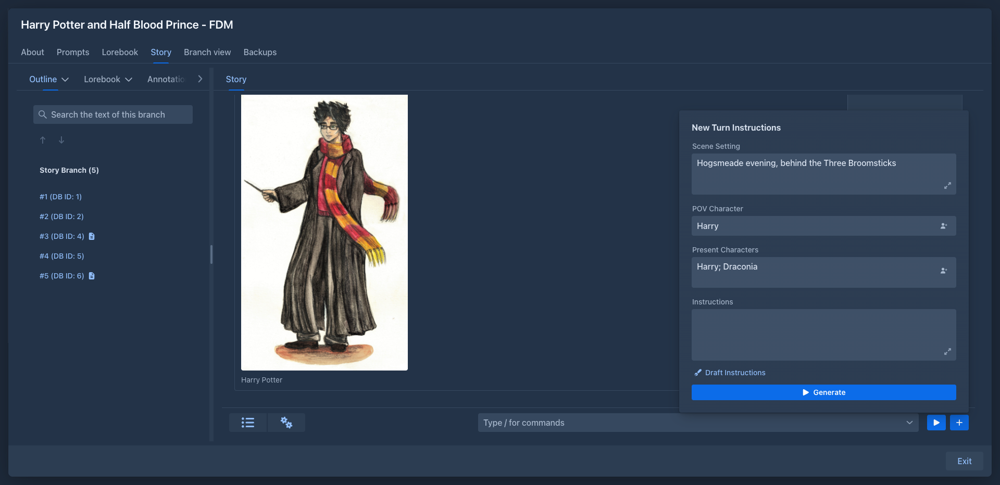
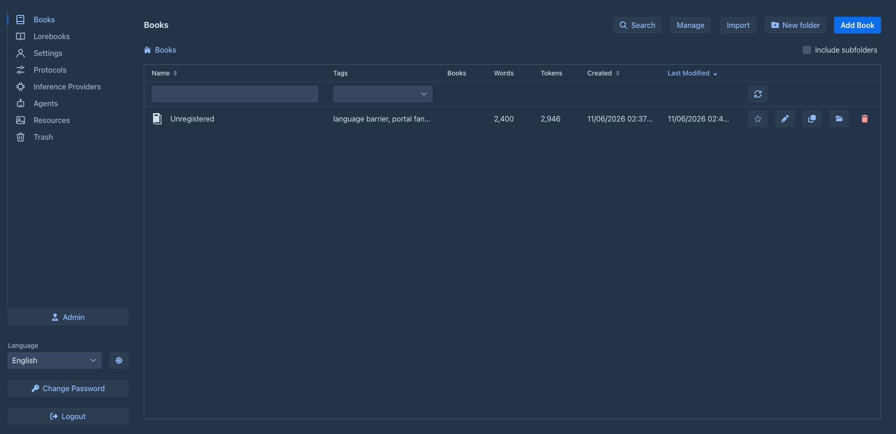
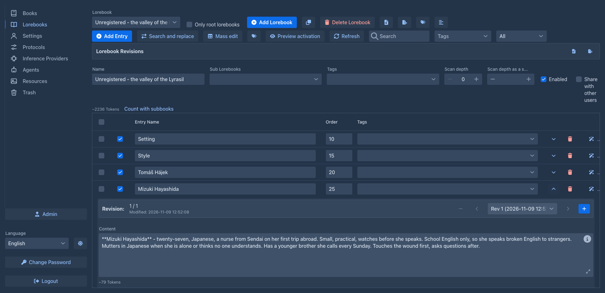
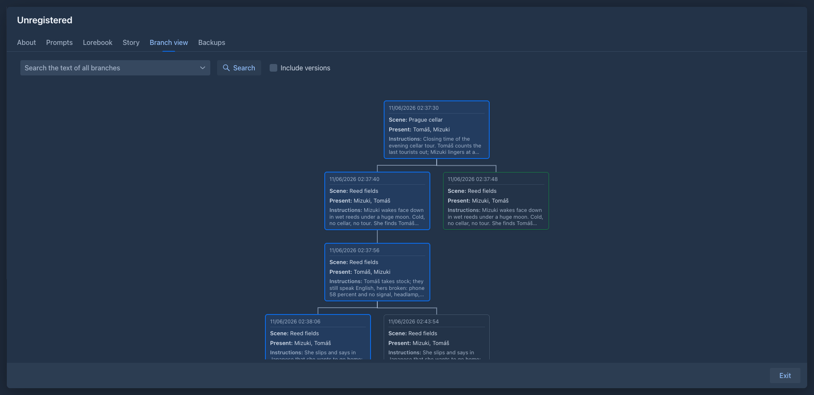
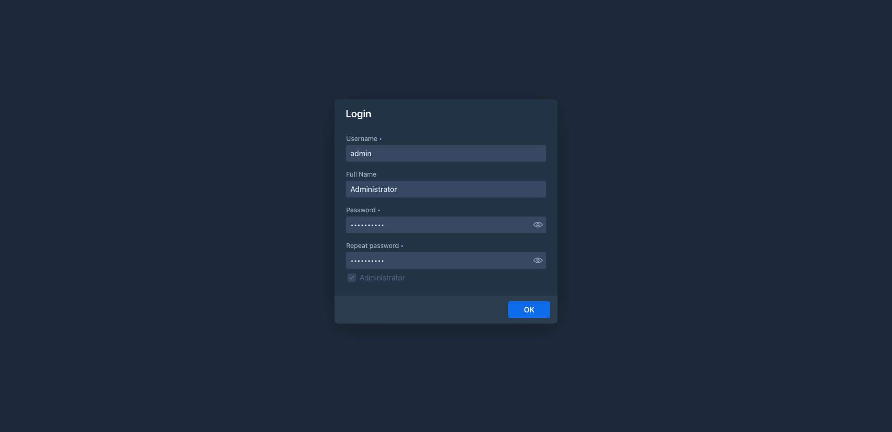
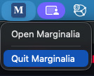
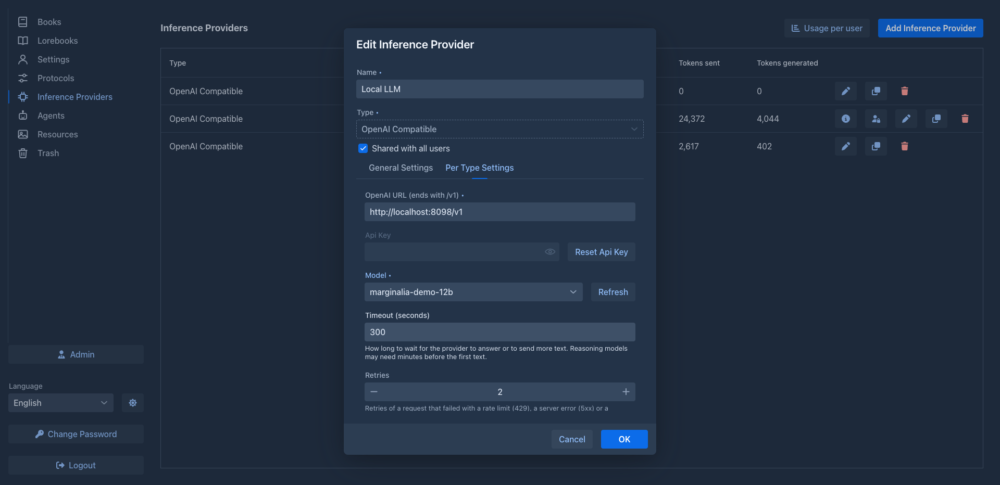

# Marginalia

Marginalia is a self-hosted writing tool for long-form fiction co-written with large language models. You write
the instructions for each part of the story, the model writes the prose, and Marginalia keeps everything around it in
order: the branching story, the world lore, the summaries that keep long books within the model's context, and the
prompt settings that shape the style.

It runs in your browser - either as a small server for you and your friends (Docker) or as a desktop app on your own
computer - and works with any OpenAI-compatible API: OpenAI, OpenRouter, LiteLLM, llama.cpp, LM Studio, Ollama, vLLM and
others.

The manual is at **[enerccio.github.io/Marginalia](https://enerccio.github.io/Marginalia)**, also in Japanese, French, Spanish, German,
Korean, Italian and Chinese (the language links are in the top bar of the manual; the in-app help assistant reads it in the language of your interface).



## 日本語

Marginalia は、大規模言語モデル（LLM）と共同で長編小説を書くためのセルフホスト型ツールです。各場面の指示を
書くとモデルが本文を生成し、Marginalia が分岐するストーリー、世界設定（ロアブック）、長い作品をコンテキストに
収めるための要約、文体を決めるプロンプト設定を管理します。

- ブラウザで動作します。サーバー（Docker）としても、デスクトップアプリとしても使え、OpenAI 互換 API
  （OpenAI、OpenRouter、LiteLLM、llama.cpp、LM Studio、Ollama、vLLM など）に対応しています。
- 画面は日本語に翻訳済みです。ワークスペース下部の「言語」セレクターで日本語を選ぶと、設定がアカウントに保存され、
  次回ログイン時にも使われます。ログイン画面は英語です。
- インストール方法は下の [Installation](#installation) を、日本語のマニュアルは [enerccio.github.io/Marginalia/ja](https://enerccio.github.io/Marginalia/ja/) をご覧ください。

## Français

Marginalia est un outil auto-hébergé pour écrire de longs récits en collaboration avec des grands modèles de langage (LLM).
Vous rédigez les consignes de chaque partie, le modèle écrit le texte, et Marginalia organise tout le reste : l'histoire
ramifiée, le lore du monde (lorebooks), les résumés qui permettent aux longs livres de tenir dans le contexte du modèle et
les réglages de prompt qui façonnent le style.

- Il fonctionne dans le navigateur, comme petit serveur (Docker) ou comme application de bureau, avec n'importe quelle API
  compatible OpenAI (OpenAI, OpenRouter, LiteLLM, llama.cpp, LM Studio, Ollama, vLLM, etc.).
- L'interface est traduite en français. Choisissez le français dans le sélecteur **Langue** en bas de l'espace de travail :
  le choix est enregistré dans votre compte et réutilisé à la prochaine connexion. L'écran de connexion reste en anglais.
- Pour l'installation, voir [Installation](#installation) plus bas ; le manuel en français est ici : [enerccio.github.io/Marginalia/fr](https://enerccio.github.io/Marginalia/fr/).

## Español

Marginalia es una herramienta autoalojada para escribir ficción larga junto con grandes modelos de lenguaje (LLM). Tú
escribes las instrucciones de cada parte, el modelo redacta el texto y Marginalia ordena todo lo demás: la historia
ramificada, el lore del mundo (lorebooks), los resúmenes que mantienen los libros largos dentro del contexto del modelo y
los ajustes de prompt que dan forma al estilo.

- Funciona en el navegador, como un pequeño servidor (Docker) o como aplicación de escritorio, con cualquier API compatible
  con OpenAI (OpenAI, OpenRouter, LiteLLM, llama.cpp, LM Studio, Ollama, vLLM y otras).
- La interfaz está traducida al español. Elige el español en el selector **Idioma** de la parte inferior del espacio de
  trabajo: la elección se guarda en tu cuenta y se usa en el próximo inicio de sesión. La pantalla de inicio de sesión
  siempre está en inglés.
- Para la instalación, consulta [Installation](#installation) más abajo; el manual en español está aquí: [enerccio.github.io/Marginalia/es](https://enerccio.github.io/Marginalia/es/).

## Deutsch

Marginalia ist ein selbst gehostetes Werkzeug, um lange Prosa gemeinsam mit großen Sprachmodellen (LLMs) zu schreiben. Sie
schreiben die Anweisungen für jeden Abschnitt, das Modell verfasst den Text, und Marginalia hält alles andere in Ordnung:
die verzweigte Geschichte, das Weltwissen (Lorebooks), die Zusammenfassungen, die lange Bücher im Kontext des Modells
halten, und die Prompt-Einstellungen, die den Stil prägen.

- Es läuft im Browser, als kleiner Server (Docker) oder als Desktop-App, mit jeder OpenAI-kompatiblen API (OpenAI,
  OpenRouter, LiteLLM, llama.cpp, LM Studio, Ollama, vLLM und weitere).
- Die Oberfläche ist ins Deutsche übersetzt. Wählen Sie Deutsch im Auswahlfeld **Sprache** am unteren Rand des
  Arbeitsbereichs: Die Wahl wird in Ihrem Konto gespeichert und bei der nächsten Anmeldung wieder verwendet. Die
  Anmeldeseite ist immer auf Englisch.
- Die Installation steht unten unter [Installation](#installation); das Handbuch auf Deutsch finden Sie hier: [enerccio.github.io/Marginalia/de](https://enerccio.github.io/Marginalia/de/).

## 한국어

Marginalia는 대규모 언어 모델(LLM)과 함께 장편 소설을 쓰기 위한 셀프 호스팅 도구입니다. 각 장면의 지시문을 작성하면
모델이 본문을 쓰고, Marginalia는 분기하는 이야기, 세계관 설정(로어북), 긴 작품을 모델의 컨텍스트에 담기 위한 요약,
문체를 결정하는 프롬프트 설정을 관리합니다.

- 브라우저에서 동작하며, 작은 서버(Docker) 또는 데스크톱 앱으로 사용할 수 있고, OpenAI 호환 API(OpenAI, OpenRouter,
  LiteLLM, llama.cpp, LM Studio, Ollama, vLLM 등)를 지원합니다.
- 화면은 한국어로 번역되어 있습니다. 작업 공간 하단의 **언어** 선택기에서 한국어를 고르면 설정이 계정에 저장되어 다음
  로그인 때도 사용됩니다. 로그인 화면은 영어입니다.
- 설치 방법은 아래 [Installation](#installation)을, 한국어 매뉴얼은 여기에서 볼 수 있습니다: [enerccio.github.io/Marginalia/ko](https://enerccio.github.io/Marginalia/ko/).

## Italiano

Marginalia è uno strumento self-hosted per scrivere narrativa lunga insieme a grandi modelli linguistici (LLM). Tu scrivi le
istruzioni per ogni parte, il modello redige il testo e Marginalia tiene in ordine tutto il resto: la storia ramificata, il
lore del mondo (lorebook), i riassunti che mantengono i libri lunghi entro il contesto del modello e le impostazioni dei
prompt che danno forma allo stile.

- Funziona nel browser, come piccolo server (Docker) o come app desktop, con qualsiasi API compatibile con OpenAI (OpenAI,
  OpenRouter, LiteLLM, llama.cpp, LM Studio, Ollama, vLLM e altre).
- L'interfaccia è tradotta in italiano. Scegli l'italiano nel selettore **Lingua** in fondo all'area di lavoro: la scelta
  viene salvata nel tuo account e usata di nuovo al prossimo accesso. La schermata di accesso è sempre in inglese.
- Per l'installazione vedi [Installation](#installation) più sotto; il manuale in italiano è qui: [enerccio.github.io/Marginalia/it](https://enerccio.github.io/Marginalia/it/).

## 简体中文

Marginalia 是一款自托管工具，用于与大型语言模型（LLM）共同创作长篇小说。你为每个段落写下指示，模型生成正文，
Marginalia 则负责管理其余的一切：分支的故事、世界设定（Lorebook）、让长篇作品保持在模型上下文之内的摘要，以及决定
文风的提示词设置。

- 它在浏览器中运行，可以作为小型服务器（Docker）或桌面应用使用，支持任何与 OpenAI 兼容的 API（OpenAI、OpenRouter、
  LiteLLM、llama.cpp、LM Studio、Ollama、vLLM 等）。
- 简体中文界面由扩展 *Chinese localization* 提供：管理员在 *Admin → Extensions* 中加载它（见 [Extensions](#extensions)）后，
  在工作区底部的**语言**选择器中选择「中文（简体）」，设置会保存到你的账户，下次登录时继续使用。登录界面始终为英文。
- 安装方法见下方的 [Installation](#installation)；中文手册请见此处：[enerccio.github.io/Marginalia/zh](https://enerccio.github.io/Marginalia/zh/)。

## Features

- **Books with branching stories** - regenerate or swipe a part, branch from any point, navigate the story tree,
  edit the generated text, mark chapters.
- **Lorebooks** - world and character notes inserted into the prompt when they matter: activation by book tags,
  text or regex filters, insertion into the lore block or right before the instructions, lorebooks nested in
  lorebooks. SillyTavern world info can be imported.
- **Templates and macros** - prompts are Handlebars templates with SillyTavern-compatible macros (`{{user}}`,
  `{{getvar}}`, `{{random}}`, `{{if}}`...), so imported lore keeps working.
- **Summaries** - older parts of the story are condensed so long books fit in the context window.
- **Any OpenAI-compatible model** - including reasoning models, with per-model context and response limits and
  generation settings ("protocols") you can switch per book.
- **Backups** - per-book backups with restore and copy, plus full database backups on a cron schedule.
- **Multiple users** - each with their own books, lore and models; administrators manage users, backups and cleanup.
- **Languages** - the interface is available in English, Japanese, French, Spanish, German, Korean and Italian; every user
  picks their own language, and extensions can add more (Simplified Chinese is included as a plugin). The manual is translated
  into all of them, and so are the built-in prompts (a separate *Prompt language* setting).
- **Published books** - share a read-only view of a book.
- **Search and replace, commands** - search and replace in the story and in lorebooks (also with regular
  expressions), and a command line in the story editor with commands that read and change the book.
- **Agents (experimental)** - a model works on a book on its own, on a copy, through the same commands; you follow it in a console,
  review what it changed and take over what you want. Needs the permission *Agents* (administrators have it).
- **Permissions** - an administrator decides per user who creates models, uses the help assistant or uses agents.
- **Extensions** - plugins add features at runtime (chapter markers, lorebook version history, AI reviews, side
  questions to the model).

| Books | Lorebook | Story tree |
|---|---|---|
|  |  |  |

## Installation

Marginalia stores everything (database, backups, extensions) in a `.marginalia` folder in the home directory of the
user that runs it. On first start it asks you to create the administrator account.



### Desktop app (Windows, macOS, Linux)

A self-contained version for one computer: no Java or server to install, it listens only on your computer
(`http://127.0.0.1:8765`) and opens in your browser.

1. Download the archive for your system from the
   [releases page](https://github.com/Enerccio/Marginalia/releases):
   `marginalia-<version>-<os>-<arch>-app` is the app, `marginalia-<version>-<os>-<arch>` a portable folder.
2. Extract it and start Marginalia:
   - **macOS** - move `Marginalia.app` to Applications and open it. The app is not signed yet: the first time,
     right-click it and choose *Open*, or run `xattr -dr com.apple.quarantine /Applications/Marginalia.app`.
   - **Windows** - run `Marginalia\Marginalia.exe`. SmartScreen may warn about an unknown publisher: *More info* →
     *Run anyway*.
   - **Linux** - run `Marginalia/bin/Marginalia`.
   - **Portable folder** - run `bin/marginalia` (or `bin\marginalia.bat` on Windows).
3. Marginalia appears as an **M** icon in the system tray (menu bar on macOS) with *Open* and *Quit*.

Data is kept in `~/.marginalia` (`%USERPROFILE%\.marginalia` on Windows), logs in `~/.marginalia/desktop/logs`. Starting
the app again while it runs just opens it in the browser. Options for the portable launcher:

```
marginalia --port 8765        # another port (a free one is picked automatically when 8765 is taken)
marginalia --home /path       # keep the .marginalia folder somewhere else
marginalia --no-browser --no-tray
```



### Server (Docker)

For several users or access from other devices.

```sh
git clone https://github.com/Enerccio/Marginalia.git
cd Marginalia
docker compose up -d
```

To use the prebuilt image (`ghcr.io/enerccio/marginalia`, amd64 and arm64) instead of building it, see the
[Docker guide](manual/user/getting-started/docker-server.md#prebuilt-image).

Marginalia is then available on port 8080 and keeps its data in `./data`. Memory and other JVM options are set in
`docker-compose.yml` (`JAVA_TOOL_OPTIONS`).

Marginalia uses login cookies, so **don't expose it to the internet over plain HTTP** - put it behind a reverse proxy
with HTTPS (Caddy, nginx, Traefik...) and forward to port 8080. Don't leave an account without a password on a server.

The image reports its health to Docker (`docker ps` shows `healthy` once Marginalia is up, which takes a minute).

**Upgrading:** the database is migrated automatically when a newer version starts. A migration that fails is rolled
back and Marginalia does not start, but one that went through stays, and an older version refuses the migrated database.
So before changing the structure of an existing database Marginalia saves a copy in `db-backups` (the last three are
kept, listed in *Admin → Database Backups*). It's still wise to make your own database backup first, then
`git pull && docker compose up -d --build` (or `docker compose pull && docker compose up -d` with the prebuilt image).

### Build from source

Requirements: JDK 25 or newer and Maven 3.9+. Node.js for the frontend is downloaded by the build.

```sh
cd marginalia
mvn package               # deployable WAR (Vaadin production mode) in target/, runs the tests
mvn package -Pdesktop     # desktop app for the current OS in target/desktop/ (see the desktop profile in pom.xml)
```

The Docker image is built from source by `docker compose build`.

## Connecting a model

In *Inference Providers*, add the base URL of your OpenAI-compatible API (for example `https://api.openai.com/v1`,
`https://openrouter.ai/api/v1` or `http://localhost:8080/v1` for llama.cpp), an API key if it needs one, and pick the
model. Then create a book, choose the provider and a protocol, and start writing.



## Extensions

Extensions are OSGi bundles (JAR files). Administrators install them in *Admin → Extensions*; they are stored in
`~/.marginalia/extensions`. Twenty-nine plugins are included in [`marginalia/plugins`](marginalia/plugins/README.md) and
built separately with Maven, or in Docker (see the plugins README):

- [Anthropic Claude](marginalia/plugins/anthropic/README.md) - Anthropic's Claude models as an inference provider, over the Anthropic Java SDK,
- [Arc Outline](marginalia/plugins/arc-outline/README.md) - the arcs of the book and their chapters in the story sidebar, written by the model if you want,
- [Audiobook](marginalia/plugins/audiobook/README.md) - (stub) a book as an audiobook with a text-to-speech server and a voice per character,
- [Author's Note](marginalia/plugins/authorsnote/README.md) - a note to the model inserted into every generation,
- [Beta Readers](marginalia/plugins/beta-readers/README.md) - personas you define and a chat about the book with them, alone or in a group,
- [Book Description Generator](marginalia/plugins/book-description-generator/README.md) - the name and the description of a book written by the model from its story,
- [Chapter Marker](marginalia/plugins/chaptermarker/README.md) - chapters in the story sidebar,
- [Character Tracker](marginalia/plugins/character-tracker/README.md) - the characters of the book with their relationships and a map of them,
- [Chinese localization](marginalia/plugins/chineselocalization/README.md) - Simplified Chinese as a language of the interface (the example for adding a language),
- [Conlang Translator](marginalia/plugins/conlang-translator/README.md) - the speech of your characters in a constructed language (rules and a lexicon, written with the model's help), the English kept behind it as the source every model reads,
- [Gemma 4 tools fix](marginalia/plugins/gemma4toolsfix/README.md) - function calling with Gemma 4 models whose API wants another role for tool results,
- [Google Gemini](marginalia/plugins/google-genai/README.md) - Google's Gemini models as an inference provider, over the Google Gen AI SDK,
- [Image Generator](marginalia/plugins/image-generator/README.md) - make an image for a part of the story with ComfyUI or an OpenAI-style images API, the model writes the prompt,
- [Instruction Exporter](marginalia/plugins/instructionexporter/README.md) - copy the instructions, scene settings and characters of the story to the clipboard,
- [Knowledge Tracker](marginalia/plugins/knowledge-tracker/README.md) - what the characters you choose know and do not know, put into the prompt (and given to the annotation as facts) so the model stops giving them knowledge they cannot have,
- [Lore Generator](marginalia/plugins/lore-generator/README.md) - write a lorebook entry with the model from the existing lore,
- [Lorebook VCS](marginalia/plugins/lorebookvcs/README.md) - revision history for lorebook entries,
- [Manga Generator](marginalia/plugins/manga-generator/README.md) - turn parts of the story into a manga script and image generation tags,
- [Name generator](marginalia/plugins/name-generator/README.md) - functions for the model to get names (about 1200 categories) instead of inventing them,
- [Name provider](marginalia/plugins/name-provider/README.md) - functions for the model to pick real names (forenames and surnames of about 100 countries) from lists,
- [Place provider](marginalia/plugins/place-provider/README.md) - functions and commands to look up real places (about 18 000 notable ones), what is near a place and the distance of two,
- [Prompt History](marginalia/plugins/prompt-history/README.md) - the last 20 requests sent to the models in your session, with the answers and the reasoning,
- [Prompt Inspector](marginalia/plugins/prompt-inspector/README.md) - see the prompt of a generation and confirm it before it is sent to the model,
- [Real Language Translator](marginalia/plugins/reallang-translator/README.md) - the speech of your characters in a real language (Japanese for a story set in Japan), the English kept behind it as the source every model reads,
- [Reviewer](marginalia/plugins/reviewer/README.md) - AI reviews of story parts,
- [Side Query](marginalia/plugins/sidequery/README.md) - ask the model about your book without changing it,
- [SillyTavern Converter](marginalia/plugins/sillytavern-converter/README.md) - rewrite a SillyTavern chat as a story: the chat next to the story, turn details made of it by the model.
- [Story Notes](marginalia/plugins/story-notes/README.md) - a small wiki of your own pages (tags, `[[links]]`) in the story sidebar; agents and the plot wizard can read and change the pages you allow.
- [Read Aloud](marginalia/plugins/tts-reader/README.md) - read a published book aloud in the viewer with the voice of the device.

The extension API is not frozen in 1.0: extensions are built for one Marginalia version, and Marginalia refuses to start
one that does not fit the version it is running.

## License

MIT, see [LICENSE](LICENSE).
