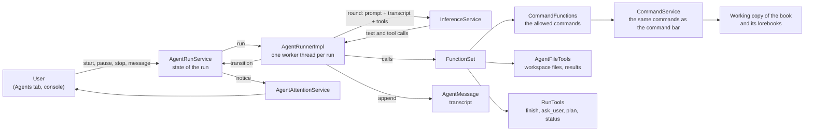
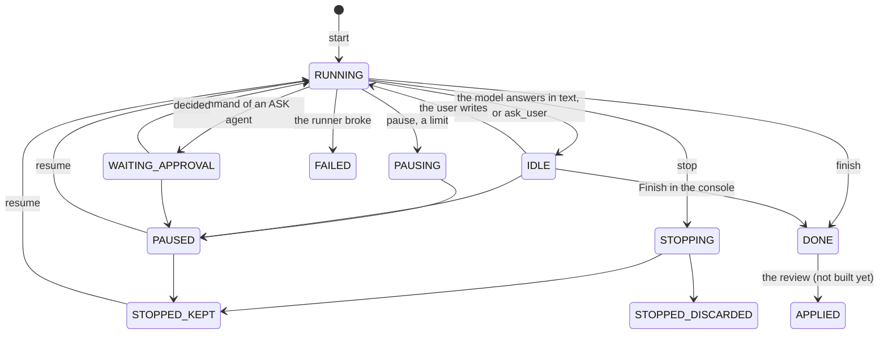

# Agents

An **agent** is an LLM that works on one book on its own, for a long time, and calls [commands](commands/index.md) as its tools; one
execution of it is a **run**. This page is how it all works inside: the pieces, the life of a run, what the model sees and can call,
how the user is brought in, and how to add to it. What the user sees is in the [user guide](../user/agents.md); the entities
(`Agent`, `AgentRun`, `AgentMessage`) are in the [domain model](domain-model.md#agents).

The central idea: **an agent is not a new kind of program but a loop around the things that already exist.** The model is asked
through the same `InferenceService` as everything else, the tools are the same commands the command bar runs, and a run works on an
ordinary (hidden) copy of a book in the same services. What an agent adds is a way to run all that without a browser: a request
context made from the database, a state machine that can be paused and resumed, a workspace of files, and a transcript that is saved after every round.



## The pieces

| Piece | Where | What it does |
|---|---|---|
| `Agent`, `AgentRun`, `AgentMessage` | `domain.model.impl` | The definition, one execution, one row of the transcript. |
| `AgentService` | `domain.service` | CRUD of the definitions, the grant of the user (`AGENTS` permission), cloning, resolving the model profile. |
| `AgentRunService` | `domain.service` | The state of a run: start, `transition`, pause, stop, resume, the working copy, the lock of the book, the request context. |
| `AgentRunner` | `domain.service` | Makes a `RUNNING` run do work: the loop, one worker thread per run. |
| `AgentMessageService` | `domain.service` | The transcript, append only. |
| `CommandFunctions` | `domain.service.agent` | Turns the allowed commands into functions for the model. |
| `AgentFileTools`, `AgentVirtualFileSystemService` | `domain.service.agent`, `domain.service` | The workspace and the file tools; paths are virtual. |
| `RunTools` | `domain.service.agent` | `finish`, `ask_user`, `update_plan`, `get_run_status`. |
| `CommandResults` | `domain.service.agent` | The last 10 results of the commands of a run, whole. |
| `AgentApprovalService`, `AgentAttentionService` | `domain.service` | Bring the user in: approve a command, a notice that a run needs them. |
| `AgentRequestAttributes`, `AgenticSessionPoint`, `AgentSession` | `bound` | The request context of a run (no browser) and where it finds its book. |
| `AgentPart`, `AgentConsoleDialog`, `AgentDialog`, ... | `ui.workspace.parts`, `ui.dialogs.agent` | The screens, see [The screens](#the-screens). |
| `Defaults.DEFAULT_AGENT_PROMPT`, `AGENT_*` | `Defaults` | The texts the model is told, see [What the model is told](#what-the-model-is-told). |

The permission is `PermissionType.AGENTS`; the limits of it (concurrent runs, token budget, number of agents) are read by
`AgentService.getGrant`.

## The life of a run

A run is a row (`AgentRun`) with a **status** (`AgentRunStatus`, stored by name). Everything else about it, the transcript, the
counters, the working copy, hangs on that status, and **only `AgentRunService` changes it**, with a conditional SQL update (the caller says
which status it believes the run has; an out of date caller gets an `IllegalStateException` and looks again).



(The complete table of the allowed changes is `AgentRunStatus.next()`; the diagram leaves out the discards.)

Three questions are asked of a status, each a method of the enum:

- `isActive()`: a runner is (supposed to be) busy: `RUNNING`, `WAITING_APPROVAL`, `PAUSING`, `STOPPING`. After a restart of the server a run found in
  one of these was interrupted (`recoverInterrupted`).
- `holdsLock()`: the book of the agent is locked, see [The working copy and the lock](#the-working-copy-and-the-lock). `IDLE` holds it too: the
  user is in the middle of a conversation.
- `needsAttention(reason)`: the user should hear of it, see [Bringing the user in](#bringing-the-user-in).

**Pause and stop are requests, not interruptions.** The user's button moves a `RUNNING` run to `PAUSING` / `STOPPING`; the worker looks at the
status at the top of every round (the *stable point*) and ends the change there. A model request or a command that is going on finishes first. A
run that waits for the user (`IDLE`, `WAITING_APPROVAL`) is paused at once, and when no worker is registered for a run the service finishes the
change itself, so nothing ever waits for a thread that does not exist. A run that is thrown away (deleted, discarded) is the exception:
the worker polls for that while it waits and cancels the request.

**A run survives a restart.** Every round is appended to `agent_messages` before the next request, the status is in the database, and the working
copy and the workspace are on disk. A resumed run reads its transcript back, repairs its end (calls nobody answered get "interrupted", a transcript
that ends with a plain reply gets the resume message, see `AgentRunnerImpl.Worker.prepare`) and goes on. What is *not* kept: the
`CommandResults` (they live as long as one worker) and the plan is restored from the last `update_plan` call.

## The request context of a run

The commands, the services and `Localization` find the user and the open book through **session scoped beans** (`user`, `sessionPoint`),
which resolve against the request attributes of the thread. A run has no browser, so `AgentRunService.openSession(run)` builds the context from
the database at every start and resume:

- `AgentSession(userUuid, language)` is all a run stores of its session: the owner, and the language of the *book* (not the interface language of
  the user: the agent sees one fixed language, English where the book's has no bundle).
- `AgentRequestAttributes` implements `RequestAttributes` over two maps in memory (session and request scope). It starts with the `user`
  bean (a copy of the owner, as the login makes it) and an `AgenticSessionPoint`. Any other session bean is created on first use, empty.
- `AgenticSessionPoint` is a `SessionPoint` that holds the **working copy** directly. `CommandUtils.getSessionPoint()` returns it for these attributes
  (and the bean of the servlet session for a browser), so **the same command works at the command bar and for an agent**: it asks `CommandUtils`
  for the book and never knows who is asking. This is why a command must never keep the book in a field or reach for `Workspace`.
- The worker enters it with `InRequestScope`; every thread that works for the run does the same. `ThreadCopyRequestAttributes.create()` hands
  the `AgentRequestAttributes` on as it is (a browser session is copied, these are shared), so a command that starts a worker thread (`async = true`,
  or the generation of a story turn) keeps the context. A test wrapper that is not an `AgentRequestAttributes` is *not* handed on: in tests of an
  `async` command use the real class.

The context checks nothing and is for the runner; whoever builds one (tests, `AgenticRequestAttributes` in the test sources) must pass a user that
owns the book.

## The working copy and the lock

A run never touches the book of the user. `AgentRunService.start` makes a hidden **working copy** (`ManuscriptService.createAgenticCopy`: the
book through its backup JSON, with its own copy of the lorebook tree; everything has `agentic = true`, new uuids, nothing shared) and stores
it as `AgentRun.workingCopy`. The lists of the UI leave the `agentic` books out (`findAllRegular...`), the services that delete a copy refuse a book that is not
`agentic`, so a path that deletes the book of a user does not exist. `DONE`, `FAILED` and a discarded stop delete the copy for good; a pause or a kept stop
keeps it. Bringing the changes back into the book (the review, `APPLIED`) is not built yet.

While a run `holdsLock()` the **original book is locked**: `AgentRunService.checkNotLocked(manuscript)` throws `ManuscriptLockedException`, and the services
that change a book call it (`ManuscriptService.save/delete/restoreBackup`, `ChatMessageService`, `SummaryService`, `ManuscriptReplaceService.apply`,
`StoryGenerationService.generateNextTurn`). Reading is free, lorebooks are not locked. The screens that open a book ask `AgentLockCheck` first
so the user is told which agent holds it instead of getting an error later. A change that a service does not route through these methods is not locked.

## The services

`AgentService` and `AgentRunService` (`domain.service`) manage the definitions of agents and their runs, see
[`Agent` and `AgentRun`](domain-model.md#agent-and-agentrun-agents). `AgentRunner` works a started run, see [The runner](#the-runner). This is the reference of what the services do; [The life of a run](#the-life-of-a-run) is the overview.

`AgentService` extends `ExtendableService`. `save` checks that a new agent is allowed (`getGrant(user).allowed()`: administrators,
or a user with the granted permission `AGENTS`), the manuscript exists and is the user's own, a manuscript has no other agent and the
manuscript of an existing agent is not changed, the instructions are at most `MAX_INSTRUCTIONS_LENGTH`, there are at most
`MAX_MODEL_PROFILES` profiles with unique non-blank roles and positive limits; names, roles and the allowed commands are trimmed (commands
also de-duplicated). It does not check that the AI and protocol of a profile exist: `resolveProfile(profile)` does, when the agent is used.
An existing agent can be edited after the permission was taken away, it can't run. `getGrant(user)` is an `AgentGrant(allowed,
maxConcurrentRuns, runTokenBudget, maxAgents)`: everything for an administrator, else the settings of the `AGENTS` permission (1 run, no budget,
`DEFAULT_MAX_AGENTS` = 5 agents when not set). `save` of a **new** agent (so `cloneAgent` too) refuses with an `IllegalStateException` when the user already
has `maxAgents` agents (the deleted ones don't count); `canCreate()` is the same rule for the UI. `cloneAgent(source, name, manuscript)` copies the definition to another manuscript of the user, `findForManuscript`,
`deleteForManuscript(manuscript, hard)` (called by `ManuscriptService.delete`) and `delete`, which deletes the runs first.

`AgentRunService` extends `ExtendableService`. The status and the counters change only here, by SQL updates (`AgentRunRepository`):

- `start(agent)` creates a run in `RUNNING` (the language of the book). It refuses (`SecurityException`, `IllegalArgumentException` for an agent
  that is not the user's, `IllegalStateException` otherwise) when the user is not allowed, the agent is disabled, has no main model or the main model
  can't be resolved, the agent has an unfinished run, or the user has all the concurrent runs of the grant (`RUNNING`, `WAITING_APPROVAL`,
  `PAUSING`, `STOPPING`; a run waiting for the user in `IDLE` is not counted).
- `transition(run, to, reason)` changes the status along `AgentRunStatus.next()`. The status of the `run` argument is the one the caller
  believes the run has: the update is conditional on it (and on the owner), so a runner whose run was paused by the user in between gets
  an `IllegalStateException` and has to look again. The update comes first and nothing is read before it: in WAL mode SQLite fails a
  transaction that reads and then writes when another transaction wrote in between, at once and without waiting. It returns the run as it is now.
- `addUsage(run, prefill, generated)` adds to the counters and counts a round, safe for the parallel threads of a run;
  `getTokenBudget(run)` is the smaller of the agent's budget and the grant's (0 is none), `isBudgetExceeded(run)`.
- `start` makes the **working copy** of the run before it saves it (`ManuscriptService.createAgenticCopy`: the book through its backup JSON without the
  lorebook link, plus its own copy of the lorebook tree from `LorebookService.copyLorebooks`; every copy has `agentic = true`, new uuids and nothing
  shared with the original) and stores it as `AgentRun.workingCopy`. `transition` to `DONE`, `FAILED`, `STOPPED_DISCARDED` or `APPLIED` (the
  `COPY_ENDING` statuses) deletes the copy for good and sets the column to null (`AgentRunRepository.updateWorkingCopy`, an SQL update first, the
  run lets go of it before the copy is deleted: `ManuscriptService.deleteAgenticCopy` hard deletes the messages with their summaries
  (`ChatMessageService.hardDeleteForManuscript`, the soft deleted ones too, children first), the tags and the copy's lorebooks
  (`LorebookService.deleteAgenticCopy`: the tree, its entries and tags); both refuse anything whose `agentic` is false, so a book of the user
  can't be deleted by this path). `PAUSED` and `STOPPED_KEPT` keep the copy, `resume` makes one for a run that has none, a new run makes a new copy.
  Not done: the uuid pairs, the base snapshot and the merge back.
- `delete(run, hard)` discards a run that is not over (`STOPPED_DISCARDED`) and deletes its working copy for good first.
- `pause(run)`, `stop(run, keep)` and `resume(run)` are what the buttons of the Agents tab call. A run that waits for the user (`IDLE`,
  `WAITING_APPROVAL`) is paused at once; a `RUNNING` one goes to `PAUSING` / `STOPPING` and the runner finishes the change at its next stable
  point, unless **no worker is registered** for it (`workerStarted(run)` / `workerFinished(run)`, the runner's to call, a set of run ids in
  memory), then the service takes the second step itself, so nothing waits for a runner that does not exist. `stop` of a run that is paused,
  kept or done changes it at once; discarding deletes the working copy. `resume` checks what `start` checks (except the one-unfinished-run rule,
  the run is that run). All three take the status of the `run` the caller has and fail with an `IllegalStateException` when it is out of date.
- **Attention.** `AgentRunStatus.needsAttention(reason)` says which statuses the user should hear of (`IDLE`, `WAITING_APPROVAL`, `DONE`, `FAILED`, a `PAUSED` with a
  reason); every status change writes it into the column `agent_runs.attention` in the same SQL update as the status (`JpaAgentRunRepository.statusUpdate`), so it is
  stored while the user is away. `findNeedingAttention()` reads it, `acknowledge(run)` clears it. After the transaction commits, `start`, every `transition` and `acknowledge` hand the run
  to `AgentAttentionService.publish` (every change, with `Notice.attention` telling whether it needs the user: a stop or a pause is finished by the worker later, and the tables of
  agents on the open screens have to show where it ended), which calls the listeners subscribed for the owner (`subscribe(userId, listener)`, a plain observer in memory with no UI in it): the
  Agents tab of every open UI subscribes in `create()`, keeps the `RequestAttributes` of its session (`ThreadCopyRequestAttributes.create()`) and runs the notice through
  `ui.access` + `InRequestScope`.
- **Approvals.** `AgentApprovalService` keeps, in memory, the commands an agent in the `ASK` mode waits to run (`request` returns the future of the decision). The
  runner's `Worker.approve` is the `CommandFunctions.Approval`: it registers the request, moves the run `RUNNING` to `WAITING_APPROVAL`, and returns a future that
  completes on a thread of the run in its `InRequestScope`, so the command that follows is never run in the session of the user's browser; `backToWork` moves the run back
  to `RUNNING` when nothing waits. `transition` to `PAUSED`, `STOPPING`, `STOPPED_*`, `DONE` or `FAILED` calls `rejectAll`. `pending(run)` and `decide(run, id, approved)`
  check that the run is the user's.
- `findLockingRun(manuscript)` is the run of the non-deleted agent of the book whose status `holdsLock()` (`RUNNING`, `IDLE`, `WAITING_APPROVAL`,
  `PAUSING`, `STOPPING`; whoever owns it), `checkNotLocked(manuscript)` throws the `ManuscriptLockedException` (it carries the agent name) when there is
  one. It is called by `ManuscriptService` (`save`, `delete`, `restoreBackup`), `ChatMessageService` (`save`, `delete`), `SummaryService`
  (creating, updating, attaching and removing a summary), `ManuscriptReplaceService.apply` and `StoryGenerationService.generateNextTurn`. Reading is
  free, lorebooks are not locked, and the lock follows the status: paused, stopped and finished runs release it. A change of the manuscript
  that a service does not route through these methods is not locked.
- `openSession(run)` makes the **request context of a run** (`AgentRequestAttributes`, package `bound`) from the database for every start and
  resume. A run stores only its `AgentSession(userUuid, language)` (`AgentSession.of(run)`: the owner of the run and the language of the book;
  the UI language of the user does not matter, the agent sees one fixed language, English where the book's has no localization bundle). The attributes
  are not a servlet request: they hold the session scope in memory, with the `user` bean (a copy of the owner, with uuid) and the `sessionPoint`
  (an `AgenticSessionPoint` on the working copy; a run without one fails with an `IllegalStateException`, the agent never gets the book of the user), so `currentUser`, the services and
  `Localization` resolve on any thread that enters them with `InRequestScope`. All the threads of the run share the one object:
  `ThreadCopyRequestAttributes.create()` hands it on, so the commands and the generation worker started from a command keep the context. The runner
  closes it (`close()` runs the destruction callbacks) when the run stops working. It checks nothing, it is for the runner.
- `recoverInterrupted()` is for the start of the server, when no runner is alive: `STOPPING` becomes `STOPPED_KEPT`, the other active statuses
  `PAUSED`, with a reason. It needs no user; `AgentRunnerImpl` calls it when the singletons are created (`SmartInitializingSingleton`).
- `getStopTarget(run)` and `endStop(run)`: `stop` of a working run remembers in memory whether the result is kept and the worker ends the stop (`STOPPING` to that status, the copy dropped for a discard); without a worker `stop` ends it at once. `workerFinished` forgets the choice.

## The runner

`AgentRunner` (`AgentRunnerImpl`, `domain.service`) is what makes a run do anything. `run(run)` takes a `RUNNING` run up (it throws for another status, and
does nothing when a worker has it already): it registers the worker with `workerStarted` before the thread starts, so a pause asked at once waits for it.
`send(run, text)` is the message of the user to an `IDLE` run (`IDLE` to `RUNNING`, the message appended, a worker started). The UI calls `run` after
`start` and `resume` (`run(run, firstMessage)` appends that first message to the empty transcript of a run first, for the run started from the console, where the
agent is told to ask the author at once). A worker (a daemon thread of a cached pool) does this, in `InRequestScope` of the `AgentRequestAttributes` of `openSession`, which it closes at the end:

1. Loads the run, resolves the main profile (a model that is gone pauses the run), reads the transcript (`AgentMessageService.transcript`) and repairs its end: a
   new run gets `Defaults.DEFAULT_AGENT_START_MESSAGE`, calls of the last assistant message without a result get `Defaults.AGENT_INTERRUPTED_CALL`, a transcript that ends
   with a plain assistant reply gets `Defaults.DEFAULT_AGENT_RESUME_MESSAGE`. The plan is read back from the last `update_plan` call.
2. Builds the tools: `CommandFunctions.forAgent(...)` (with a reader of the files of the run and the `CommandResults` of the run, see [References](#references)) `and` the file tools of `AgentVirtualFileSystemService` `and` `RunTools` bound to a `RunToolsImpl`
   (a name used twice fails the run). The `ASK` approval is `Worker.approve`, see [Bringing the user in](#bringing-the-user-in).
3. Loops. At the top, the **stable point**: the status is read, and `PAUSING` becomes `PAUSED`, `STOPPING` ends with `endStop`, any other status than `RUNNING` ends the worker.
   Then the limits: rounds (`Agent.maxRounds`), `isBudgetExceeded`, and the context (the lowest cap of the agent, the profile and the AI against the tokens of the
   last request, the first one estimated); a limit pauses the run with the reason. The request is `InferenceService.round` with the system message (prompt,
   instructions, `Defaults.AGENT_RUNNER_NOTE`, for a conversation also `Defaults.AGENT_INTERACTIVE_NOTE`, and the limits of the model: the context cap and `TokenLimits.responseTokens`, as `limitsNote`) and the transcript; a failure of it (also the limits of the user's AI) pauses the run. The usage goes to `addUsage`, the answer is
   appended with its context and its reasoning (`appendAnswer`; the round callback's `onRound(text, reasoning, calls, usage)` brings the reasoning, read from `reasoning_content` / `reasoning` of the message), a reply without calls ends the turn (`IDLE`), otherwise every call runs one after another on a thread in the context of the run and the results are appended
   together (`Error: <message>` for a failure, as the inference service writes it). After the round `finish` makes the run `DONE` (the report is the status reason, cut
   at 2 000 characters) and `ask_user` makes it `IDLE` (the question is the reason).
4. While it waits for a request or a call the worker looks every second whether the run was thrown away (deleted or `STOPPED_DISCARDED`) and cancels the request
   and ends; a pause and a stop wait.

A status change that finds another status than it expected (the user paused meanwhile) is not an error: `reach` and `pause` then do the pause or stop that was asked.
Anything the worker throws that is not one of these makes the run `FAILED` with the message. `RunTools` (`domain.service.agent`) are `finish`, `ask_user`, `update_plan`
(statuses `pending`, `in_progress`, `done`; the usual other spellings are mapped) and `get_run_status`; `RunToolsImpl` only notes the request of the model, the worker acts on
it after the round, so every call of the round has its result in the transcript first.

The transcript is `AgentMessage` (table `agent_messages`): the run, the `ordinal` and the `LLMChatMessage` as JSON in an extended attribute, only appended. The system
message is not stored.

`InferenceService.round(payload, protocol, functions, callback)` is what the runner uses instead of `stream`/`infer`: one non-streaming request that reports the
text, the calls the model asked for (they are not called) and the tokens (the provider's, otherwise ours), with the limits and the usage of the user as for any
request. Services that can't do it throw `UnsupportedOperationException`.

## What the model is told

The model gets, in every request, a system message built by `AgentRunnerImpl.Worker.payload` from these parts, in this order, and the transcript after it.
The system message is **never stored**: it is made again for every round, so a change in `Defaults` reaches a run that is resumed.

| Part | From |
|---|---|
| The system prompt of the agent | `Agent.systemPrompt`, a new agent starts with `Defaults.DEFAULT_AGENT_PROMPT` (the editorial role and working rules). |
| `# Instructions of the author` | `Agent.instructions`, the "agents.md" of the user. The agent can read it and never change it. |
| How this run works | `Defaults.AGENT_RUNNER_NOTE`: rounds, `finish` / `ask_user` / `update_plan`, the cost of writing, `@file:` and `@result`. This is where a rule for *all* agents goes. |
| A conversation | `Defaults.AGENT_INTERACTIVE_NOTE`, only for a run started from the console: `finish` does not end it. |
| Limits of the model | `limitsNote`: the context cap and `TokenLimits.responseTokens` (the longest answer), because a model that does not know it tries to write a 100 000 token file in one call and the call is cut off. |

The first message of a run is a user message too: `Defaults.DEFAULT_AGENT_START_MESSAGE` (work now; the task is in the instructions) or, for a run
started from the console, `AGENT_CONSOLE_START_MESSAGE` (do not work yet, call `ask_user` at once). A run that goes on after a pause with the last
word being the model's gets `DEFAULT_AGENT_RESUME_MESSAGE`; a call that was in the air when the server stopped is answered with
`AGENT_INTERRUPTED_CALL`.

The descriptions of the commands are part of the prompt in practice: a model decides what to call from `llmDescriptionText` and the
`descriptionText` of the parameters, see [Writing commands for agents](#writing-commands-for-agents). The parameter descriptions of the text
parameters also get `AGENT_FILE_ARGUMENT_HINT` and `AGENT_RESULT_ARGUMENT_HINT`.

## The tools of an agent

`AgentRunnerImpl.Worker.tools()` puts three function sets together with `FunctionSet.and` (a function name used twice fails the run):

```text
CommandFunctions.forAgent(...)                    the commands the agent is allowed
  .and(fileSystemService.getFileTools(files, results))   list_files, read_file, write_file, ..., save_command_result
  .and(registry.bind(RunTools.class, runTools))          finish, ask_user, update_plan, get_run_status
```

A round is one **non-streaming** request (`InferenceService.round`) that answers with text, the calls the model asked for (they are not called by the
inference service) and the tokens. The runner calls them itself, **one after another in the order the model wrote them**, each on a thread of its pool inside
the context of the run, and appends all the results together as the next messages; a failure is the text `Error: <message>` so the model can correct the
call. Because the order is kept, a call may use what an earlier call of the same answer did (`save_command_result` right after a command).
`RunTools` only *notes* what the model asked (the report, the question, the plan); the worker acts on it after the round, so that every call of the round
has its result in the transcript first.

### Commands as functions

`CommandFunctions` (package `domain.service.agent`) turns the commands an agent may call into a `FunctionSet`: `forAgent(commandService, agent, lookup,
approval)` offers the commands on the allowlist of the agent, `create(commandService, names, mode, lookup, approval)` the ones named. `lookup` gives the
texts (`localization::getValue`; the descriptions are for the model, so build the set inside the context of the run). It is built for a run and combined with
the tools of the runner by `FunctionSet.and`; the arguments may hold [references](#references).

- **One function per command.** The forms (overloads) of a command share one schema: the union of their parameters in the order of the ladder, a type
  that differs between the forms is "any". A call goes to the form with the fewest parameters that has every argument the model passed, the parameters of
  it the model left out are null or their `defaultValue`; a middle option left out therefore works. Arguments no form takes, a missing required one
  or a value outside `allowed` are an `INVALID_ARGUMENTS` error that says which. A command without a declared signature takes any properties.
- **Required** is not declared: a parameter is required when every form with a signature has it and none marks it `optional` (see
  [writing commands](commands/writing-commands.md)). The schema carries `description`, `enum` (enum types and `allowed`) and `default`.
- **Names.** A command name that is a valid function name (`[a-zA-Z0-9_-]{1,64}`) is the function name. Any other is written with `_` for every
  character that is not allowed, cut so that it fits, and `_` plus six hexadecimal digits of the SHA-256 of the command name (`functionName`). The rule
  looks at the name only, never at what else is registered, so the name in a stored transcript means the same command after a restart (and `foo.bar`
  is never taken for a command `foo_bar`). Names are resolved by the name at every call, so a command that is gone answers "not available now".
- **Result and errors.** The result is bounded (`MAX_RESULT_LENGTH`, 20 000 characters, cut at a line with a note how much there was): a string as it is,
  anything else JSON, nothing "OK". A failure is the message of the cause (no class names), which the inference service writes as `Error: <message>`.
- **Policy.** Only the allowed commands exist for the model. A `DESTRUCTIVE` command follows `Agent.getDestructiveMode()`: `DENY` leaves it out,
  `AUTO` runs it, `ASK` asks the `Approval` (a future of the decision of the user; the call waits for it and no thread is held) and refuses when there is none.
- **Context.** The commands run as whoever the thread is: the inference service calls the functions in the request context of the caller, which for a run is
  the `AgentRequestAttributes` of `openSession`, and the command service hands it on to the commands that run on a worker. Nothing is aimed at the
  working copy by the adapter itself; that is what the context (the `AgenticSessionPoint` of the run) does.

### References

A long text should not pass through the model twice: the model pays for every token it writes (time, and the limit of one answer), and a text it
has already read is in its context. Two references let a call name the text instead of writing it. Both are a **whole value** of an argument
(`@file:/notes/a.md`, `@result`, `@result:3`; text inside a longer value is just text) and both are replaced **before the call**, so the command
(and the approval dialog) gets the real text, while the transcript keeps the short call.

| Reference | Is | Works in |
|---|---|---|
| `@file:/path` | The text of that file of the workspace. | The text parameters of the commands, the `content` of `write_file` and `append_file`. |
| `@result` | The whole result of the newest call of a command in the run. | The same places. |
| `@result:3` (also `@result:#3`) | The whole result with that number. | The same places. |

`CommandFunctions.readReferences` does the replacing, once the arguments are known and before the form of the command is picked, and only for a
parameter that is a text in every form that has it: a number or a boolean is left as the model wrote it. A reference that
cannot be resolved is an error naming the argument (`The argument text: There is no result #7, list_command_results shows the ones that are kept`),
so the model corrects it. The functions are told about the references in the schema (the description of every text parameter gets the hint) and in the
runner note; `@file:` is a reference only when the agent has files (a `files` reader was given) and `@result` only when results are kept (a `CommandResults`
was given), otherwise the text is passed as it is.

`CommandResults` is the holder of the results: one per `tools()`, shared by the commands (which add to it) and the file tools (which read it).
`CommandFunctions.run` adds the result of every call that **returned** (a failure keeps nothing) with the function name, the arguments as one short
line (`describeArguments`; an argument that was a reference shows the reference) and the text **before** the model's 20 000 characters cut, so what a reference
inserts and `save_command_result` writes is all of it even when the model saw a cut one. The last `KEEP` = 10 are kept, numbers count from 1 in the run, the
holder lives as long as one worker (a resumed run starts empty). `list_command_results` shows them newest first, `save_command_result(path, id?, append?)`
writes one to a file by the same atomic write as `write_file`. A result is added after the command returned and before the next call is read, so the
newest is always the one of the previous call.

### Files of an agent

`AgentVirtualFileSystemService` hands out the files of agents. Two folders in the application folder (not in `data/`, which is named by logins):
`agent-workspaces/<agent uuid>` is the **workspace**, which belongs to the agent and stays between its runs (the notes it keeps), and
`agent-runs/<run uuid>` is the folder of a run (`base/` and `checkpoints/`, nothing writes them yet; `RunFolder` is the layout). The uuids are
checked, so no value of the database makes a path leave these folders. `open(run)` is the file system of a run (the workspace and `/checkpoints`),
`openWorkspace(agent)` the workspace alone for the user to look at; both refuse (`IllegalArgumentException`) what is not the user's own.
`getFileTools(fileSystem)` binds `AgentFileTools` to it (a `FunctionSet`, to be put with the other tools of the run). `clearWorkspace` refuses
while the agent works, `copyWorkspace` is what `AgentService.cloneAgent` calls, and a workspace is deleted with an agent that is deleted for good
(not with a soft deleted one: it can be restored) and by the cleanup (the service is a `CleanupContributor`), a run folder with its run; the
files go after the transaction committed, a rollback does not bring them back.

The model never gets a path of the disk. A string it wrote goes through three steps, all in `domain.service.agent`:

```text
text -> VirtualPath.parse -> VirtualFileSystem (mounts) -> WorkspaceMount: checked real path (never returned)
```

- `VirtualPath` is the immutable value. Parsing normalizes (NFC), requires `/` at the start, lets `..` go up and stop at the root (a chroot), and refuses
  empty and `.` parts, `\`, control, format and unassigned characters, `< > : " | ? *`, a name that starts or ends with a space or ends with a dot,
  Windows device names and too long names, paths and depth. That takes drive letters and UNC paths with it. Percent encoded or full width dots are
  letters: names like any other, leading nowhere. Every method that builds a path from a name checks the name again.
- `VirtualFileSystem` routes a path to a `VirtualMount` (`stat`, `list`, `read`, `write`, `delete`, `move`, `toVirtual`): the workspace is the root,
  `/checkpoints` (`CheckpointsMount`) lists the checkpoints and is read only. Other mounts, backed by services, can be added the same way. `toVirtual(Path)`
  is the reverse mapping for everything that goes to the model and throws for a path outside every mount.
- `WorkspaceMount` is where the cage is made of real checks: it walks the path name by name from the real root and refuses a symbolic link, anything
  but a file or a folder, and a name present in another spelling (also on a case sensitive file system, so `Notes.md` and `notes.md` are never both there);
  a workspace folder that is itself a link is refused when it is opened. Files are written whole to a temporary file (`.marginalia-tmp-` prefix, not listed,
  not creatable) and moved over the target, so a reader sees the old or the new content. Writes and deletes of one workspace take one lock (kept by the
  service per agent), which makes the limits of `WorkspaceLimits` (file size, total size, number of files) true under parallel threads. The name
  `checkpoints` is reserved at the root.
- Errors are `VirtualFileException`s whose message names virtual paths only; the cause (with real paths) goes to the log. The tools pass nothing else to the model.

`AgentFileToolsImpl` implements the functions: `list_files`, `read_file` (line ranges, cut at 20 000 characters at a line with the line to go on from),
`write_file`, `append_file`, `replace_in_file` (the old text must be in the file exactly once; a file with Windows line breaks is matched too),
`regex_replace_in_file`, `grep_files` (at most 100 lines, 1 000 files), `move_file` (a free target name, the folders above it are
created; not between mounts), `copy_file` (a file or a folder to a free name; all or nothing, checked against the file, size, depth and path-length limits before a byte is copied, through a temporary file or folder moved into place; the same mount only), `merge_files` (up to 100 files, read and joined in Java, one write; a `*` / `?` in the last name of a path stands for the files of that folder by name, the target left out) and `delete_file`. `list_command_results` and `save_command_result` work on the results of the commands, see [References](#references). `list_files` and `grep_files` take a `glob` (`VirtualGlob`: `*`, `**`, `?`, `[a-c]`, `{md,txt}`, case-insensitive, matched on virtual paths only; without a `/` against the name at any depth, with one against the path below the folder). The regular expressions use `TextSearch` and read the text through
a `DeadlineCharSequence`, which throws after three seconds, because a thread cannot be stopped from outside and a pattern with a back reference backtracks for
hours.

## Bringing the user in

Agents work while the user is away, so nothing here depends on an open browser.

- **Attention.** Every status change writes `agent_runs.attention` in the same SQL update as the status (`AgentRunStatus.needsAttention`: `IDLE`,
  `WAITING_APPROVAL`, `DONE`, `FAILED`, a `PAUSED` with a reason of its own), so it is stored while the user is away; `acknowledge(run)` clears it. After
  the transaction commits, `AgentAttentionService.publish` calls the listeners of the owner, an observer in memory with no UI in it. The Agents tab of
  every open UI subscribes in `create()` and runs the notice through `ui.access` + `InRequestScope`: the number on the tab, a notice with **Open**. Opening
  the console acknowledges the run.
- **Approvals.** For an agent in the `ASK` mode a destructive command waits. `CommandFunctions` calls the `Approval` the runner gave it (`Worker.approve`),
  which registers the request with `AgentApprovalService`, moves the run to `WAITING_APPROVAL`, and returns the future of the decision. The console shows
  the oldest pending command in `AgentApprovalDialog`; **Approve** / **Deny** complete the future, and the continuation runs on a thread of the run in its
  own context, **never** in the session of the user's browser. `backToWork` moves the run to `RUNNING` when nothing else waits. Pausing, stopping, finishing or failing
  the run refuses every pending command (`rejectAll`).
- **Questions.** `ask_user`, or a reply with no call, ends the round with `IDLE`; the question is the status reason and the console shows it as the
  last bubble. `AgentRunner.send(run, text)` appends the answer, moves `IDLE` to `RUNNING` and starts a worker.

## The screens

All under `ui.dialogs.agent` except the tab. They are ordinary `@Configurable` classes created with `new`, so they use the services and never touch the
runner's internals.

| Class | Does |
|---|---|
| `AgentPart` | The **Agents** tab (a `WorkspaceComponent`, not in the phone layout yet): the table of agents with the state of their run, the buttons that call `AgentRunService` / `AgentRunner`, and the attention badge. |
| `AgentDialog`, `AgentCommandsEditor`, `AgentCommandPreset` | Create / edit an agent. The editor lists every registered command with its severity; the presets (all, none, non-destructive) tick them at once. An allowed command that is not registered now (its extension is not loaded) stays allowed when saved. |
| `AgentCloneDialog` | Copies the definition and the workspace (not the runs) to a new agent of another book. |
| `AgentStopDialog` | Keep or discard the result. |
| `AgentConsoleDialog` | The window of a run: three tabs (**Run**, **Runs**, **Workspace**), the state above, the box and the buttons below. It **polls** (`ui.setPollInterval(2000)` while it is attached, restored on detach) and reads only the rows of the transcript it has not rendered (`shown`), so a long run costs no more than a short one; the model's reasoning is a folded block, a command is a folded line that opens to its arguments and result. |
| `AgentRunHistory` | The **Runs** tab: every run, open one in the Run tab, download it (`AgentTranscriptExport`, the transcript as Markdown, nothing cut), delete it. |
| `AgentWorkspaceBrowser` | The **Workspace** tab: the folders and files of the agent over `AgentVirtualFileSystemService.openWorkspace`. A text file is shown cut at `VIEW_LIMIT` (2 000 characters) in a text area of a fixed height (otherwise Lumo grows it with the content), the whole file is the download; nothing can be changed while the agent works. **New folder** (`VirtualFileSystem.createFolder`, `WorkspaceMount.createFolder`) and **Upload file** (an `InMemoryUploadHandler`; the bytes go through `VirtualFileSystem.decodeText`, the same UTF-8 without NUL as `readText`, then `writeText`) keep the cage, the names and the limits of the agent's own writes; an existing file is not replaced, and both are refused while the agent works. |
| `AgentApprovalDialog` | One pending command, Approve / Deny. |
| `AgentLockCheck` | Called by the screens that open a book: tells which agent holds a locked book. |

The console shows the model's results cut at `RESULT_LIMIT` (20 000), the same as the model got. Texts for the screens are `L` keys like any other (English, Japanese and the Chinese plugin bundle).

## Writing commands for agents

An agent calls the commands that the user ticked in the editor, so **every command is also an agent tool**. The rules for [writing commands](commands/writing-commands.md)
apply; for an agent these matter most:

- **Get the book from `CommandUtils`**, never from the UI; return the data (text, JSON) instead of showing it.
- **Mark the severity honestly.** `NON_DESTRUCTIVE` commands are what the default selection offers; `DESTRUCTIVE` follows the agent's mode (`DENY` hides them).
  A command that only returns text and leaves the storing to the caller (the lore generator commands do this: they return the text, the agent writes the
  entry with the commands that exist for that) is the safest tool to hand out.
- **Describe it for a model.** `llmDescriptionText` is read by the model, `descriptionText` by the human; say *when* to use it, what the arguments mean, what
  the result looks like and what it costs. A required prompt argument that is vague gives vague results: say what a good one contains (the lore generator
  throws "Give the prompt: what the entry is about, ..." for an empty one). Parameters can carry `allowed`, `defaultValue` and `optional`; they become the `enum`, `default` and `required` of the schema.
- **Order the forms as a ladder.** The overloads are positional, the adapter picks the form with the fewest parameters that has every argument the model
  passed, so put the rarely used options last and make them `optional`.
- **Keep results short or paged.** Over 20 000 characters the model gets a cut with a note; give the command a limit or a page argument. The whole result is
  still kept for `@result` and `save_command_result`.
- **Long work goes `async = true`.** The command then runs on the command service's worker pool with the request context of the run
  (`ThreadCopyRequestAttributes`). A command that calls a model (lore generator) uses the blocking `InferenceService.infer`; with one slot on the model server
  that is sequential and re-reads the prompt, which is why such a command is worth its cost only for a task the agent cannot do itself. Not done: an `async` command is
  not stopped when the run is; honour the thread interrupt (`CancellationException`) so a stop can reach it.
- **Fail with a message for the model.** The text of the exception is what the model reads as `Error: <message>`; no class names, say what to change.

Extensions bring commands the same way for the command bar and for agents: register a suite in `onExtensionLoad`, unregister it in `onExtensionUnload`.
`lore-generator` (`list-lore-templates`, `generate-lore-entry`, `compact-lore-entry`), `name-generator` (`list-name-categories`, `generate-names`)
and `name-provider` (`list-real-name-lists`, `pick-real-names`) are examples; the [example plugin](plugins/example.md) shows the registration.

## Logging

At `INFO`, always with the uuid of the run: a run started and taken up, the model and the limits when a worker begins, every round (tokens, the context against
its cap, the names of the calls), every call (name, time, length of the result, `done` or `failed`), every status change, a message of the user (only its length), an approval
asked and decided. The arguments and results of calls, messages and reports are the story's business and are **never logged**.

## Tests

`AgentTestBase` (and the helper `AgenticRequestAttributes`) set up a user with the permission, a book and an AI; `MockLLMServer` plays the
model, so a whole run is tested without a network. The main classes: `AgentRunnerTest` (the loop with a scripted model), `AgentRunServiceTest`, `AgentRunControlTest`
(pause, stop, resume, the worker registry), `AgentRunStatusTest` (the table of changes), `AgentWorkingCopyTest`, `ManuscriptLockTest`, `AgenticBooksTest`,
`AgentApprovalTest`, `AgentAttentionTest`, `CommandFunctionsTest` and `CommandFunctionsAgentTest` (the adapter: forms, references, results, policy), `AgentFileToolsTest`,
`VirtualFileSystemTest` / `VirtualPathTest` (the cage of the files), `AgentTranscriptExportTest`, and the UI tests (`AgentPartTest`, `AgentConsoleDialogTest`,
`AgentDialogTest`, `AgentWorkspaceBrowserTest`...). An `async` command is only tested with the real `AgentRequestAttributes` (see
[The request context of a run](#the-request-context-of-a-run)).

## Extending

| To add... | Do |
|---|---|
| A tool the agent can call | A command (see above) is the normal way, it appears in the editor by itself. A tool of the runner (needs the run, not the book) goes into `RunTools` / `AgentFileTools` (an `@LLMFunction` method plus its implementation and a test) and, if it needs per run state, a holder passed in `tools()` like `CommandResults`. |
| A rule for all agents | A bullet in `Defaults.AGENT_RUNNER_NOTE`; keep it a targeted rule, models take a general "be brief" literally. |
| A limit of a run | Next to `maxRounds` in `Agent`, checked in `Worker.limit`; a limit pauses the run with a reason (`needsAttention`). |
| A status | Add it to `AgentRunStatus` and to `next()` (stored by name, do not rename), decide `isActive` / `holdsLock` / `needsAttention`, handle it in `AgentRunServiceImpl` and the localization of the status (`Localization.getAgentRunStatus`). |
| A screen | A class in `ui.dialogs.agent`, a poll in the console when it shows run data. |

Not done: the review that brings the changes of the working copy back into the book (`APPLIED`; the uuid pairs and the base snapshot are not built either), summaries of
older rounds when the context is full (the run pauses instead), "Pause now" (the request in the air is waited for), a limit of concurrent requests per AI, threads
(sub-agents) and handles, stopping a running `async` command when its run stops.
