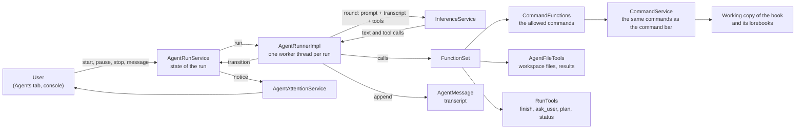
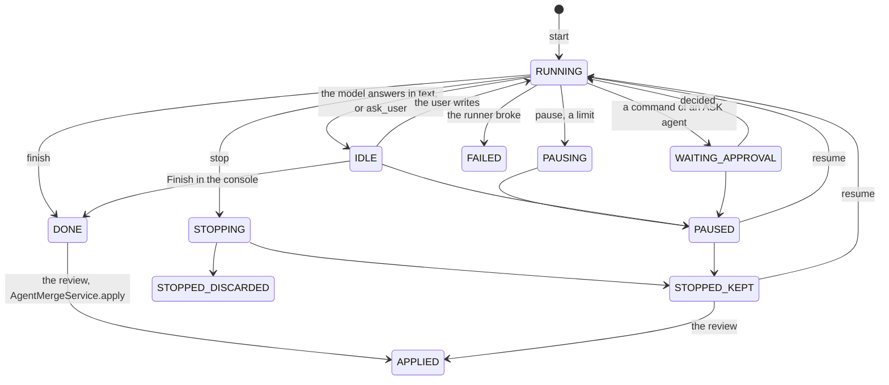

# Agents

An **agent** is an LLM that works on one book on its own, for a long time, and calls [commands](commands/index.md) as its tools; one
execution of it is a **run**. This page is how it all works inside: the pieces, the life of a run, what the model sees and can call,
how the user is brought in, and how to add to it. What the user sees is in the [user guide](../user/agents.md); the entities
(`Agent`, `AgentRun`, `AgentMessage`) are in the [domain model](domain-model.md#agents).

The central idea: **an agent is not a new kind of program but a loop around the things that already exist.** The model is asked
through the same `InferenceService` as everything else, the tools are the same commands the command bar runs, and a run works on an
ordinary (hidden) copy of a book in the same services. What an agent adds is a way to run all that without a browser: a request
context made from the database, a state machine that can be paused and resumed, a workspace of files, and a transcript that is saved after every round.



## The pieces

| Piece | Where | What it does |
|---|---|---|
| `Agent`, `AgentRun`, `AgentMessage` | `domain.model.impl` | The definition, one execution, one row of the transcript. |
| `AgentService` | `domain.service` | CRUD of the definitions, the grant of the user (`AGENTS` permission), cloning, resolving the model profile. |
| `AgentRunService` | `domain.service` | The state of a run: start, `transition`, pause, stop, resume, the working copy, the lock of the book, the request context. |
| `AgentRunPairService` | `domain.service` | Which item of the working copy is which item of the original (the uuid pairs), see [The working copy and the lock](#the-working-copy-and-the-lock). |
| `AgentRunner` | `domain.service` | Makes a `RUNNING` run do work: the loop, one worker thread per run. |
| `AgentMessageService` | `domain.service` | The transcript, append only. |
| `CommandFunctions` | `domain.service.agent` | Turns the allowed commands into functions for the model. |
| `AgentFileTools`, `AgentVirtualFileSystemService` | `domain.service.agent`, `domain.service` | The workspace and the file tools; paths are virtual. |
| `RunTools` | `domain.service.agent` | `finish`, `ask_user`, `update_plan`, `request_compaction`, `get_run_status`. |
| `CheckpointTools`, `CheckpointService`, `CheckpointStore` | `domain.service.agent`, `domain.service` | The checkpoint tools (`checkpoint`, `checkpoint_list`, `checkpoint_restore`, `checkpoint_delete`), the service behind them and the console, and the ZIP files; see [Checkpoints](#checkpoints). |
| `AgentMergeService`, `MergeDiff`, `MergePlan`, `BaseAdvance`, `SyncReport`, `SyncTools` | `domain.service`, `domain.service.agent` | Compares the copy with the base and the book now and applies the changes the user picked; brings the changes of the user into the copy on a resume; see [Merge and apply](#merge-and-apply). |
| `AgentCopyService` | `domain.service` | Read-only look at the working copy of a run (its branches, the parts of one, its lorebooks), for the **Book copy** tab; see [Reading the copy](#reading-the-copy). |
| `ImageTools`, `ImageFiles`, `ShownImages` | `domain.service.agent` | `view_image` (only for a profile with `images`), the image checks and scaling, and the images asked for in a round; see [Images](#images). |
| `CommandResults` | `domain.service.agent` | The last 10 results of the commands of a run, whole. |
| `AgentApprovalService`, `AgentAttentionService`, `AgentWebhookService` | `domain.service` | Bring the user in: approve a command, a notice that a run needs them, a message to their webhook when no screen is open, see [Bringing the user in](#bringing-the-user-in). |
| `AIGate` | `domain.service` | The cap of concurrent requests of agents at one AI, see [One AI, several runs](#one-ai-several-runs). |
| `AgentRequestAttributes`, `AgenticSessionPoint`, `AgentSession` | `bound` | The request context of a run (no browser) and where it finds its book. |
| `AgentPart`, `AgentConsoleDialog`, `AgentDialog`, ... | `ui.workspace.parts`, `ui.dialogs.agent` | The screens, see [The screens](#the-screens). |
| `Defaults.DEFAULT_AGENT_PROMPT`, `AGENT_*` | `Defaults` | The texts the model is told, see [What the model is told](#what-the-model-is-told). |

The permission is `PermissionType.AGENTS`; the limits of it (concurrent runs, token budget, number of agents) are read by
`AgentService.getGrant`.

## The life of a run

A run is a row (`AgentRun`) with a **status** (`AgentRunStatus`, stored by name). Everything else about it, the transcript, the
counters, the working copy, hangs on that status, and **only `AgentRunService` changes it**, with a conditional SQL update (the caller says
which status it believes the run has; an out of date caller gets an `IllegalStateException` and looks again).



(The complete table of the allowed changes is `AgentRunStatus.next()`; the diagram leaves out the discards.)

Three questions are asked of a status, each a method of the enum:

- `isActive()`: a runner is (supposed to be) busy: `RUNNING`, `WAITING_APPROVAL`, `PAUSING`, `STOPPING`. After a restart of the server a run found in
  one of these was interrupted (`recoverInterrupted`).
- `holdsLock()`: the book of the agent is locked, see [The working copy and the lock](#the-working-copy-and-the-lock). `IDLE` holds it too: the
  user is in the middle of a conversation.
- `needsAttention(reason)`: the user should hear of it, see [Bringing the user in](#bringing-the-user-in).

**Pause and stop are requests, not interruptions.** The user's button moves a `RUNNING` run to `PAUSING` / `STOPPING`; the worker looks at the
status at the top of every round (the *stable point*) and ends the change there. A model request or a command that is going on finishes first. A
run that waits for the user (`IDLE`, `WAITING_APPROVAL`) is paused at once, and when no worker is registered for a run the service finishes the
change itself, so nothing ever waits for a thread that does not exist. A run that is thrown away (deleted, discarded) is the exception:
the worker polls for that while it waits and cancels the request.

**A run survives a restart.** Every round is appended to `agent_messages` before the next request, the status is in the database, and the working
copy and the workspace are on disk. A resumed run reads its transcript back, repairs its end (calls nobody answered get "interrupted", a transcript
that ends with a plain reply gets the resume message, see `AgentRunnerImpl.Worker.prepare`) and goes on. What is *not* kept: the
`CommandResults` (they live as long as one worker) and the plan is restored from the last `update_plan` call.

## The request context of a run

The commands, the services and `Localization` find the user and the open book through **session scoped beans** (`user`, `sessionPoint`),
which resolve against the request attributes of the thread. A run has no browser, so `AgentRunService.openSession(run)` builds the context from
the database at every start and resume:

- `AgentSession(userUuid, language)` is all a run stores of its session: the owner, and the language of the *book* (not the interface language of
  the user: the agent sees one fixed language, English where the book's has no bundle).
- `AgentRequestAttributes` implements `RequestAttributes` over two maps in memory (session and request scope). It starts with the `user`
  bean (a copy of the owner, as the login makes it) and an `AgenticSessionPoint`. Any other session bean is created on first use, empty.
- `AgenticSessionPoint` is a `SessionPoint` that holds the **working copy** directly. `CommandUtils.getSessionPoint()` returns it for these attributes
  (and the bean of the servlet session for a browser). A command no longer reads the book from there: it takes it from `context.getScope()`, and
  the runner runs the commands of an agent in the scope of its run (`CommandScopes.forRun(run)`, see [The scope](commands/index.md#the-scope)), so
  **the same command works at the command bar and for an agent** and never knows who is asking. This is why a command must never keep the book in a
  field or reach for `Workspace`.
- The worker enters it with `InRequestScope`; every thread that works for the run does the same. `ThreadCopyRequestAttributes.create()` hands
  the `AgentRequestAttributes` on as it is (a browser session is copied, these are shared), so a command that starts a worker thread (`async = true`,
  or the generation of a story turn) keeps the context. A test wrapper that is not an `AgentRequestAttributes` is *not* handed on: in tests of an
  `async` command use the real class.

The context checks nothing and is for the runner; whoever builds one (tests, `AgenticRequestAttributes` in the test sources) must pass a user that
owns the book.

## The working copy and the lock

A run never touches the book of the user. `AgentRunService.start` makes a hidden **working copy** (`ManuscriptService.createAgenticCopy`: the
book through its backup JSON, with its own copy of the lorebook tree; everything has `agentic = true`, new uuids, nothing shared) and stores
it as `AgentRun.workingCopy`. The lists of the UI leave the `agentic` books out (`findAllRegular...`), the services that delete a copy refuse a book that is not
`agentic`, so a path that deletes the book of a user does not exist. `FAILED`, a discarded stop and `APPLIED` delete the copy for good (`COPY_ENDING`); a pause, a kept stop and `DONE` keep it,
`DONE` until the result is applied or discarded (see [Merge and apply](#merge-and-apply)).

The copy has **new uuids**, so the run records how it relates to the original, in the transaction that makes the copy:

- **The uuid pairs** (`AgentRunPairService`, table `agent_run_pairs`, V17): one `AgentRunPair` row per message, summary, lorebook and lorebook entry of the copy,
  `kind` + `copyUuid` -> `originalUuid` (null for an item the agent made; it has none until it is applied) + a `handle` column that is empty until the agent is
  given handles. `ManuscriptService.createAgenticCopy` returns an `AgenticCopy` (the copy, the `UuidPair`s, the base); `cloneFromBackup(backup, pairs)` and
  `LorebookService.copyLorebooks(lorebooks, pairs)` report the pairs of the messages, summaries, lorebooks and entries as they make them, and `AgentRunServiceImpl.start`
  and `resume` (for a run without a copy) store them with `AgentRunPairService.replace` once the run is saved. `AgentRunPair` is a **plain entity** (no `BaseEntity`: no
  uuid, no soft delete, no extended content, a book of 2000 parts is thousands of rows) keyed by the id of the run, so the cleanup does not know it:
  `AgentRunServiceImpl.releaseCopy` deletes the rows (`deleteForRun`) when the run lets go of the copy, whichever way that happens. The reading methods work for the
  runs of the user only.
- **The base snapshot**: the backup JSON of the original as it was copied, with the lorebook tree **and the uuids of the entries** (the backup format has none, so
  `LorebookService.marshalLorebooks(root, true)` adds them; the copy of the lorebooks is made from this very JSON, so base and pairs agree), written to
  `agent-runs/<run uuid>/base/manuscript.json` by `AgentVirtualFileSystemService.writeBase` (deleted again when the transaction rolls back) and read with `readBase`. It is deleted
  with the copy (`deleteBase`) and with the run folder.

**The model of the copy.** The copy is made from the backup, so it has the AI and the protocol of the book (or none). `Agent.useAgentModel` (an extended attribute, `isUsingAgentModel()`: null is on) says what the run writes with. `AgentRunnerImpl.Worker.work` calls `AgentRunService.useAgentModel(run)` every time a worker starts: on, it writes the AI and the protocol of the main profile of the agent into the copy (`ManuscriptService.setAgenticCopyModel`, an exact set, refuses a book that is not `agentic`); off, it writes the ones the original book has now back (the flag may have been on in an earlier session). So the generation commands without a `profile` (`options` of `StoryGenerationCommands`, the summary commands) use the agent's model, and a profile or a flag the author edited between a pause and a resume is picked up. The two are not in `MergeDiff.BOOK_FIELDS`, so neither the review nor `apply` nor the sync on resume ever touches the AI and the protocol of the original; a restore of a checkpoint keeps what the snapshot had, the next worker start sets them again.

The commands of **extensions** that call a model do not read the book, so they ask the scope: `CommandScope.getModel()` (a `ModelChoice(ai, protocol)`) is, for the scope of a run, the main profile of the agent when the flag is on, else the model of the copy (null when it has none); for the scope of the session it is null, and the command uses its own choice (the Lore Generator the default model of the user, the Arc Outline the model of the book first). The Lore Generator and the Arc Outline commands (`requireModel(context...)`) take it first. An extension that starts a model on behalf of a command should do the same, or an agent that was told to mix models will not.

While a run `holdsLock()` the **original book is locked**: `AgentRunService.checkNotLocked(manuscript)` throws `ManuscriptLockedException`, and the services
that change a book call it (`ManuscriptService.save/delete/restoreBackup`, `ChatMessageService`, `SummaryService`, `ManuscriptReplaceService.apply`,
`StoryGenerationService.generateNextTurn`). Reading is free. The screens that open a book ask `AgentLockCheck` first
so the user is told which agent holds it instead of getting an error later. A change that a service does not route through these methods is not locked.

The **lorebooks** are locked with the book, because the run works on a copy of them and the copy is compared with the lorebooks as they were: the lorebook the book links and its subbooks, however deep (`AgentRunService.findLockingRun(Lorebook)` / `checkNotLocked(Lorebook)`, which throw `LorebookLockedException`, a `ManuscriptLockedException`; the working copies of agents are never locked). `LorebookService` and `LorebookEntryService` check it in `save` and `delete`. A lorebook has no screen of its own to tell the user, so `LorebookView` shows a locked lorebook with the `PhoneLorebookView` (nothing else of the screen), which says which agent holds it and changes nothing; both views read the lock again on **Refresh**. The tags of a lorebook are not locked.

## The services

`AgentService` and `AgentRunService` (`domain.service`) manage the definitions of agents and their runs, see
[`Agent` and `AgentRun`](domain-model.md#agent-and-agentrun-agents). `AgentRunner` works a started run, see [The runner](#the-runner). This is the reference of what the services do; [The life of a run](#the-life-of-a-run) is the overview.

`AgentService` extends `ExtendableService`. `save` checks that a new agent is allowed (`getGrant(user).allowed()`: administrators, who need no granted permission but get the limits of their own `AGENTS` permission and the defaults when it is empty or missing (`grantOf`),
or a user with the granted permission `AGENTS`; the grant is read when a run's worker starts, `AgentVirtualFileSystemService.open`), the manuscript exists and is the user's own, a manuscript has no other agent and the
manuscript of an existing agent is not changed, the instructions are at most `MAX_INSTRUCTIONS_LENGTH`, there are at most
`MAX_MODEL_PROFILES` profiles with unique non-blank roles and positive limits; names, roles and the allowed commands are trimmed (commands
also de-duplicated). It does not check that the AI and protocol of a profile exist: `resolveProfile(profile)` does, when the agent is used.
An existing agent can be edited after the permission was taken away, it can't run. `getGrant(user)` is an `AgentGrant(allowed,
maxConcurrentRuns, runTokenBudget, maxAgents, maxCopies, maxFileBytes, maxWorkspaceBytes, maxWorkspaceFiles, maxCheckpointBytes, maxConcurrency)`: everything for an administrator (the
quotas are the defaults), else the settings of the `AGENTS` permission (1 run, no budget, `DEFAULT_MAX_AGENTS` = 5 agents when not set; the **quotas** are
`Permission.agentsMaxCopies`, `agentsMaxFileKb`, `agentsMaxWorkspaceMb`, `agentsMaxWorkspaceFiles`, where none, zero or below is the default: no limit of copies,
and the `WorkspaceLimits` of the application for the files; the four argument constructor of the record keeps the old callers). `AgentRunService.start` (and
`resume` of a run that lost its copy) refuses with an `IllegalStateException` when `countWithWorkingCopy` of the user has reached `maxCopies`: every run that
is not finished keeps its copy, paused and stopped-and-kept ones too. `save` of a **new** agent (so `cloneAgent` too) refuses with an `IllegalStateException` when the user already
has `maxAgents` agents (the deleted ones don't count); `canCreate()` is the same rule for the UI. `cloneAgent(source, name, manuscript)` copies the definition to another manuscript of the user, `findForManuscript`,
`deleteForManuscript(manuscript, hard)` (called by `ManuscriptService.delete`) and `delete`, which deletes the runs first.

`AgentRunService` extends `ExtendableService`. The status and the counters change only here, by SQL updates (`AgentRunRepository`):

- `start(agent)` creates a run in `RUNNING` (the language of the book). It refuses (`SecurityException`, `IllegalArgumentException` for an agent
  that is not the user's, `IllegalStateException` otherwise) when the user is not allowed, the agent is disabled, has no main model or the main model
  can't be resolved, the agent has an unfinished run, or the user has all the concurrent runs of the grant (`RUNNING`, `WAITING_APPROVAL`,
  `PAUSING`, `STOPPING`; a run waiting for the user in `IDLE` is not counted).
- `transition(run, to, reason)` changes the status along `AgentRunStatus.next()`. The status of the `run` argument is the one the caller
  believes the run has: the update is conditional on it (and on the owner), so a runner whose run was paused by the user in between gets
  an `IllegalStateException` and has to look again. The update comes first and nothing is read before it: in WAL mode SQLite fails a
  transaction that reads and then writes when another transaction wrote in between, at once and without waiting. It returns the run as it is now.
- `addUsage(run, prefill, generated)` adds to the counters and counts a round, safe for the parallel threads of a run;
  `getTokenBudget(run)` is the smaller of the agent's budget and the grant's (0 is none), `isBudgetExceeded(run)`.
- `start` makes the **working copy** of the run before it saves it (`ManuscriptService.createAgenticCopy`: the book through its backup JSON without the
  lorebook link, plus its own copy of the lorebook tree from `LorebookService.copyLorebooks`; every copy has `agentic = true`, new uuids and nothing
  shared with the original) and stores it as `AgentRun.workingCopy`. `transition` to `DONE`, `FAILED`, `STOPPED_DISCARDED` or `APPLIED` (the
  `COPY_ENDING` statuses) deletes the copy for good and sets the column to null (`AgentRunRepository.updateWorkingCopy`, an SQL update first, the
  run lets go of it before the copy is deleted: `ManuscriptService.deleteAgenticCopy` hard deletes the messages with their summaries
  (`ChatMessageService.hardDeleteForManuscript`, the soft deleted ones too, children first), the tags and the copy's lorebooks
  (`LorebookService.deleteAgenticCopy`: the tree, its entries and tags); both refuse anything whose `agentic` is false, so a book of the user
  can't be deleted by this path). `PAUSED` and `STOPPED_KEPT` keep the copy, `resume` makes one for a run that has none, a new run makes a new copy.
  The pairs and the base snapshot of the copy are stored with it (above). Not done: the merge back.
- `delete(run, hard)` discards a run that is not over (`STOPPED_DISCARDED`) and deletes its working copy for good first.
- `pause(run)`, `stop(run, keep)` and `resume(run)` are what the buttons of the Agents tab call. A run that waits for the user (`IDLE`,
  `WAITING_APPROVAL`) is paused at once; a `RUNNING` one goes to `PAUSING` / `STOPPING` and the runner finishes the change at its next stable
  point, unless **no worker is registered** for it (`workerStarted(run)` / `workerFinished(run)`, the runner's to call, a set of run ids in
  memory), then the service takes the second step itself, so nothing waits for a runner that does not exist. `stop` of a run that is paused,
  kept or done changes it at once; discarding deletes the working copy. `resume` checks what `start` checks (except the one-unfinished-run rule,
  the run is that run). All three take the status of the `run` the caller has and fail with an `IllegalStateException` when it is out of date.
- **Attention.** `AgentRunStatus.needsAttention(reason)` says which statuses the user should hear of (`IDLE`, `WAITING_APPROVAL`, `DONE`, `FAILED`, a `PAUSED` with a
  reason); every status change writes it into the column `agent_runs.attention` in the same SQL update as the status (`JpaAgentRunRepository.statusUpdate`), so it is
  stored while the user is away. `findNeedingAttention()` reads it, `acknowledge(run)` clears it. After the transaction commits, `start`, every `transition` and `acknowledge` hand the run
  to `AgentAttentionService.publish` (every change, with `Notice.attention` telling whether it needs the user: a stop or a pause is finished by the worker later, and the tables of
  agents on the open screens have to show where it ended), which calls the listeners subscribed for the owner (`subscribe(userId, listener)`, a plain observer in memory with no UI in it): the
  Agents tab of every open UI subscribes in `create()`, keeps the `RequestAttributes` of its session (`ThreadCopyRequestAttributes.create()`) and runs the notice through
  `ui.access` + `InRequestScope`.
- **Approvals.** `AgentApprovalService` keeps, in memory, the commands an agent in the `ASK` mode waits to run (`request` returns the future of the decision). The
  runner's `Worker.approve` is the `CommandFunctions.Approval`: it registers the request, moves the run `RUNNING` to `WAITING_APPROVAL`, and returns a future that
  completes on a thread of the run in its `InRequestScope`, so the command that follows is never run in the session of the user's browser; `backToWork` moves the run back
  to `RUNNING` when nothing waits. `transition` to `PAUSED`, `STOPPING`, `STOPPED_*`, `DONE` or `FAILED` calls `rejectAll`. `pending(run)` and `decide(run, id, approved)`
  check that the run is the user's.
- `findLockingRun(manuscript)` is the run of the non-deleted agent of the book whose status `holdsLock()` (`RUNNING`, `IDLE`, `WAITING_APPROVAL`,
  `PAUSING`, `STOPPING`; whoever owns it), `checkNotLocked(manuscript)` throws the `ManuscriptLockedException` (it carries the agent name) when there is
  one. It is called by `ManuscriptService` (`save`, `delete`, `restoreBackup`), `ChatMessageService` (`save`, `delete`), `SummaryService`
  (creating, updating, attaching and removing a summary), `ManuscriptReplaceService.apply` and `StoryGenerationService.generateNextTurn`. Reading is
  free, lorebooks are not locked, and the lock follows the status: paused, stopped and finished runs release it. A change of the manuscript
  that a service does not route through these methods is not locked.
- `openSession(run)` makes the **request context of a run** (`AgentRequestAttributes`, package `bound`) from the database for every start and
  resume. A run stores only its `AgentSession(userUuid, language)` (`AgentSession.of(run)`: the owner of the run and the language of the book;
  the UI language of the user does not matter, the agent sees one fixed language, English where the book's has no localization bundle). The attributes
  are not a servlet request: they hold the session scope in memory, with the `user` bean (a copy of the owner, with uuid) and the `sessionPoint`
  (an `AgenticSessionPoint` on the working copy; a run without one fails with an `IllegalStateException`, the agent never gets the book of the user), so `currentUser`, the services and
  `Localization` resolve on any thread that enters them with `InRequestScope`. All the threads of the run share the one object:
  `ThreadCopyRequestAttributes.create()` hands it on, so the commands and the generation worker started from a command keep the context. The runner
  closes it (`close()` runs the destruction callbacks) when the run stops working. It checks nothing, it is for the runner.
- `recoverInterrupted()` is for the start of the server, when no runner is alive: `STOPPING` becomes `STOPPED_KEPT`, the other active statuses
  `PAUSED`, with a reason. It needs no user; `AgentRunnerImpl` calls it when the singletons are created (`SmartInitializingSingleton`).
- `getStopTarget(run)` and `endStop(run)`: `stop` of a working run remembers in memory whether the result is kept and the worker ends the stop (`STOPPING` to that status, the copy dropped for a discard); without a worker `stop` ends it at once. `workerFinished` forgets the choice.

## The runner

`AgentRunner` (`AgentRunnerImpl`, `domain.service`) is what makes a run do anything. `run(run)` takes a `RUNNING` run up (it throws for another status, and
does nothing when a worker has it already): it registers the worker with `workerStarted` before the thread starts, so a pause asked at once waits for it.
`send(run, text)` is the message of the user to an `IDLE` run (`IDLE` to `RUNNING`, the message appended, a worker started); to a *conversation*
(`run.isInteractive()`) that is `RUNNING`, `WAITING_APPROVAL` or `PAUSING` it queues the message in the run's `Inbox` (in memory, by run id, like the approvals;
`queued(run)` lists them as `QueuedMessage(id, text)`). The worker reads the **messages** of the queue at the top of every iteration of the loop (`deliverQueuedMessages`: the leading messages up to the first command, `Inbox.takeMessages`, as one `USER` message, so the next request has them), and everything, commands included, where it would end the turn (`endTurn`: no tool call, `finish`, `ask_user`): under the
lock of the `Inbox` it either appends all queued messages as one `USER` message and goes on, or moves the run to `IDLE`; `enqueue` takes the same lock and re-reads the status, so a
message is never left queued on an `IDLE` run (it is sent as usual there). A resumed run delivers them instead of the resume message (`prepare`). `cancelQueued(run, id)` removes an item from the `Inbox` (`Inbox.remove`; false when it was delivered meanwhile; a wish to force that item goes with it, and `deliverForced` then delivers nothing). `force(run, id)` sets the
wish in the `Inbox` (or sends at once if the run is `IDLE`): `await` sees it every `POLL_MILLIS` and throws `Forced`, which cancels the request or the call; the calls of the round that
were written to the transcript get `AGENT_FORCED_CALL` (the one in flight) / `AGENT_SKIPPED_CALL` results, `rejectAll` refuses a waiting approval (the worker moves the run back to
`RUNNING` itself first: two writers of SQLite at once fail), and the messages up to the forced one are appended (`deliverForced`). An answer of the model that was not complete is not
written and not counted. `command(run, line)` is the same queue for **commands of the author**: `consoleCommands(agent)` names what may be run (`compact`, `clear-workspace` and the agent's allowed commands that are not
destructive: a destructive command asks the browser for a confirmation, which a run does not have), an item of the `Inbox` is a `Queued(id, message, command)` and `QueuedMessage` says `command`. Where the run is `RUNNING`
(a conversation), `WAITING_APPROVAL` or `PAUSING` the command is queued; where it is `IDLE` or `PAUSED` a worker with `initial` items does only that (`start(run, initial)`, the run stays as it was,
`send` refuses while it is registered because the worker writes the transcript; after the commands it goes on into the loop only if the run became `RUNNING` meanwhile). `deliver(due, transcript)` runs the items in order
outside of the lock of the `Inbox` (a command can take long): messages go in as one message, a command is `runCommand` - `/compact` is `compact`, `/clear-workspace` is `VirtualFileSystem.clearWorkspace(keep)` (paths and globs, all or nothing, answer `Deleted N file(s) and M folder(s)`; the console asks `ConfirmDialog` first), anything else `CommandService.executeLine` in the context of the run -
and its answer (or `Error:`, cut like a result of a call) is a `USER` message that starts with `Defaults.AGENT_AUTHOR_COMMAND_NOTE`, not a tool call of the agent. `endTurn` goes `IDLE` after commands alone, it
continues the loop when a message of the author was among them; a forced item (`deliverForced`) always continues. `ignoreForce` keeps a forced message from cutting off the command that is run for it.
`payload` merges messages of the author that follow each other (`coalesced`) because some chat templates refuse two of a role in a row, the transcript itself is not changed.
A stopped or finished run drops its inbox (`queued` and the worker's end). The UI calls `run` after
`start` and `resume` (`run(run, firstMessage)` appends that first message to the empty transcript of a run first, for the run started from the console, where the
agent is told to ask the author at once). A worker (a daemon thread of a cached pool) does this, in `InRequestScope` of the `AgentRequestAttributes` of `openSession`, which it closes at the end:

1. Loads the run, resolves the main profile (a model that is gone pauses the run), reads the transcript (`AgentMessageService.transcript`) and repairs its end: a
   new run gets `Defaults.DEFAULT_AGENT_START_MESSAGE`, calls of the last assistant message without a result get `Defaults.AGENT_INTERRUPTED_CALL`, a transcript that ends
   with a plain assistant reply gets `Defaults.DEFAULT_AGENT_RESUME_MESSAGE`. The plan is read back from the last `update_plan` call.
2. Builds the tools: `CommandFunctions.forAgent(...)` (with a reader of the files of the run and the `CommandResults` of the run, see [References](#references)) `and` the file tools of `AgentVirtualFileSystemService` `and` `RunTools` bound to a `RunToolsImpl`
   (a name used twice fails the run). The `ASK` approval is `Worker.approve`, see [Bringing the user in](#bringing-the-user-in).
3. Loops. At the top, the **stable point**: the status is read, and `PAUSING` becomes `PAUSED`, `STOPPING` ends with `endStop`, any other status than `RUNNING` ends the worker.
   Then the limits: rounds (`Agent.maxRounds`), `isBudgetExceeded`, and the context (the lowest cap of the agent, the profile and the AI against the tokens of the
   last request, the first one estimated); a limit pauses the run with the reason. The request is `InferenceService.round` with the system message (prompt,
   instructions, `Defaults.AGENT_RUNNER_NOTE`, for a conversation also `Defaults.AGENT_INTERACTIVE_NOTE`, and the limits of the model: the context cap and `TokenLimits.responseTokens`, as `limitsNote`) and the transcript; a failure of it (also the limits of the user's AI) pauses the run. The usage goes to `addUsage`, the answer is
   appended with its context and its reasoning (`appendAnswer`; the round callback's `onRound(text, reasoning, calls, usage)` brings the reasoning, read from `reasoning_content` / `reasoning` of the message), a reply without calls ends the turn (`IDLE`), otherwise every call runs one after another on a thread in the context of the run and the results are appended
   together (`Error: <message>` for a failure, as the inference service writes it). After the round `finish` makes the run `DONE` (the report is the status reason, cut
   at 2 000 characters) and `ask_user` makes it `IDLE` (the question is the reason).
4. While it waits for a request or a call the worker looks every second whether the run was thrown away (deleted or `STOPPED_DISCARDED`) and cancels the request
   and ends; a pause and a stop wait.

**Calls cut off in the middle.** When the answer of the model ends inside a call (the limit of one answer, see below), the call has arguments that are not valid JSON; the function layer answers it with an error, and the row keeps what the model
wrote. The history is sent back at every request, and a provider that parses the arguments of the calls in it (LiteLLM in front of llama.cpp) refuses the *whole request* for the broken one, so from then on every request failed and
only a rewind helped. `Worker.coalesced` (it makes the payload of the agent and of a sub-agent) now sends such a call with `{}` as its arguments (`withReadableCalls`; the stored row is not changed), and the error result says that the answer was cut off.

**Unreadable calls.** A provider that parses the arguments of a call itself (LiteLLM and OpenAI-compatible proxies) refuses the whole answer when the JSON is cut off (the limit of one answer, `TokenLimits.responseTokens`, sent as `max_completion_tokens` only when the protocol or the AI sets one, or a default of the server, or the model stopping; not the context), so the request fails and the transcript did not change: a resume
repeats it and fails the same way (the run was "bricked" until the user rewound). `AgentRunnerImpl.isUnreadableCall` recognises the message (`Failed to parse tool call arguments`, `arguments as JSON`...,
in the exception or its causes); the loop (and `subLoop`) then appends `Defaults.AGENT_UNREADABLE_CALL` as a user message and asks again, at most `MAX_UNREADABLE_CALLS` = 3 times in a row (the counter is reset by an answer),
and pauses with the notices in the transcript when it goes on failing.

**Cancelling a call.** `Worker.call` (and `callSub`) hand `await` a cancel that sets the `canceled` flag the function reads (`FunctionContinuation.isCancelled`) *and* cancels the `CompletableFuture` that `FunctionSet.call` returned. `FunctionSet` runs the hooks a function registered with `FunctionContinuation.onCancel(Runnable)` when that future is cancelled (each once, at once when it was cancelled before the hook was added; the default method of the interface ignores them, so other implementations need nothing). `CommandFunctions.run` registers `commandRun.cancel(true)`: the command service then completes the run, interrupts the worker thread and `CommandContext.isTerminated()` becomes true; a command that declared itself uninterruptable refuses the cancel. A call cancelled before its approval came starts nothing. `await` cancels on a pause at once (`interrupts`), a forced message, a run thrown away and, since the stop was changed from "waits for the answer", on `STOPPING`: `Interrupted` goes to the stable point which ends the stop, the call in the air is answered `Defaults.AGENT_STOPPED_CALL` and the rest of the round `AGENT_STOPPED_SKIPPED_CALL` (`Worker.stopping()`). An ordinary pause still waits for the call. The sub-agents' `awaitSub` cancels the same way.

**Pause now.** `AgentRunner.pauseNow(run)` is a `pause` that does not wait for the round: it puts the run id in the in-memory `interrupts` set first, then asks `AgentRunService.pause`. `Worker.await` looks at the set before every wait (every second, like the discard check) and cancels what it waits for with `Interrupted`, a subclass of `Discarded` so that the places that rethrow a discard rethrow it too. In the loop `ask` catching it drops the answer (nothing is written or counted) and goes to the stable point, which pauses; in a round whose calls are written the call in the air is answered `Defaults.AGENT_PAUSED_CALL`, the rest `AGENT_PAUSED_SKIPPED_CALL`, and the results are appended with the others of the round; anywhere else the exception reaches `Worker.run`, which settles the requested pause. The set is cleared when the worker ends. An ordinary pause or stop ends the wait for a place at the AI too (`await(..., queued = true)`), since nothing is lost by it.

A status change that finds another status than it expected (the user paused meanwhile) is not an error: `reach` and `pause` then do the pause or stop that was asked.
Anything the worker throws that is not one of these makes the run `FAILED` with the message. `RunTools` (`domain.service.agent`) are `finish`, `ask_user`, `update_plan`
(statuses `pending`, `in_progress`, `done`; the usual other spellings are mapped) `request_compaction` (the focus is noted, `isCompactionRequested`) and `get_run_status`; `RunToolsImpl` only notes the request of the model, the worker acts on
it after the round, so every call of the round has its result in the transcript first.

The transcript is `AgentMessage` (table `agent_messages`): the run, the `ordinal`, the `thread` (null: the agent's own conversation, otherwise the handle of a sub-agent, V18) and the `LLMChatMessage`
as JSON in an extended attribute, only appended; the `creation` of the row is the time the console and the export show. The system message is not stored.

`InferenceService.round(payload, protocol, functions, callback)` is what the runner uses instead of `stream`/`infer`: one request that is streamed to the provider and put together by the service (so the timeout is the wait for the next chunk, the reasoning included, not for the whole answer), and that reports the
text, the calls the model asked for (they are not called) and the tokens (the provider's, otherwise ours), with the limits and the usage of the user as for any
request. Services that can't do it throw `UnsupportedOperationException`.

## Sub-agents

A sub-agent is a thread of the run, not a run: same working copy, workspace, budgets, pause and stop state; only the conversation is its own, and it is **stored with the transcript**
(`agent_messages`, V18: the column `thread` = the handle, null for the agent's own rows; the console does not show it, the export of the run does). Limits: `Agent.maxSubagents` (an extended attribute, 0..`AgentService.MAX_SUBAGENTS` = 10,
checked in `AgentServiceImpl.validate`; null or zero offers no tools) read by `AgentRunService.getMaxSubagents(run)`, and the permission setting **Requests to the model at once**
(`Permission.agentsMaxConcurrency`, `AgentGrant.maxConcurrency`, at least 1, one when not set, unlimited for an administrator) read by `AgentRunService.getMaxConcurrency(run)`.

- **Tools.** `SubAgentTools` (`spawn_agent(task, context?)`) is bound when `maxSubagents > 0`, `SubAgentControlTools` (`await_agent`, `agent_status`, `cancel_agent`) only when it is more than 1
  (with one, `spawn_agent` waits by itself). Both are implemented by `SubAgentToolsImpl` over `SubAgents`, the registry of the worker (`Sub` = handle `subN`, task, state `RUNNING` /
  `DONE` / `FAILED` / `CANCELLED`, result, rounds, tokens, last action, a `finished` future). `spawn_agent` creates the `Sub`, hands it to the runner (`Worker.startSub`) and answers at once
  while `live() < max`; the call that fills the last place is kept (`SubAgents.whenSlotFree`) and completes, from the thread of the sub-agent that ends, with the results of what ended meanwhile
  (a limit of one: its own answer). A call that finds the limit reached already (one that was cut off) waits for a place first. `await_agent` completes from the `finished` future, with an optional timeout.
  The tools are `FunctionContinuation`s: waiting holds no thread. The system message of the agent says the limits (`Defaults.AGENT_SUBAGENTS_NOTE`), the results are cut at `Defaults.AGENT_SUBAGENT_RESULT_CHARS`.
- **The loop** is `Worker.subLoop` on a thread of the pool, in `InRequestScope` of the same `AgentRequestAttributes`: system message of the agent plus `Defaults.AGENT_SUBAGENT_NOTE`, the task as the
  first message, `InferenceService.round` with `subTools` (the commands and the file tools of the agent - **no run tools, checkpoint tools, sync or image tools, and no sub-agent tools**, so no sub-agent
  can spawn), the calls one after another, a round without calls is the answer. At most `Defaults.AGENT_SUBAGENT_MAX_ROUNDS`, and the limits of the run (`maxRounds`, `isBudgetExceeded`, the context cap -
  no compaction) fail it with a reason; every request is added to the run (`addUsage`). `checkSub` runs before every request, call and poll: a cancel or a run that was thrown away ends it as `CANCELLED`
  (`SubStopped`), `interrupts`, `SubAgents.suspend` and a run that is `PAUSING` / `PAUSED` (or `STOPPING` towards `STOPPED_KEPT`) end it as `SUSPENDED`, any other status that is not `RUNNING` /
  `WAITING_APPROVAL` as `CANCELLED`.
- **Requests.** `Worker.ask` takes a place of the run's `RequestSlots` (the cap above; a FIFO queue like `AIGate`, in memory) and then the `AIGate` place of the AI, for the agent and the sub-agents alike (`Waiter` abstracts how
  each waits: the agent reacts to a pause at once and a forced message, a sub-agent to `checkSub`). A sub-agent that waits for a turn is cancelable.
- **One writer.** SQLite can fail the second writer at once (`SQLITE_BUSY`; read-write transactions begin with the write lock now, see [Database](database.md), but the lock keeps the changes of a call in order), and the sub-agents are threads of one run. So `Worker.changeLock` (a fair `ReentrantLock`) is held by every call that `changes(call)`
  (not the run tools, not the reading commands, not the sub-agent tools), by the automatic checkpoint, and by the small writes of the run (`append`, `appendAnswer`, `addUsage`, `compact`). A wait for it is
  pollable (`lockChanges`, `checkSub`). A sub-agent that changes something sets `dirty`, so the next round of the agent gets its automatic checkpoint. The status changes of an `ASK` approval are still not under the lock
  (they run on the thread of the call).
- **End.** `stopSubAgents` (wait up to 30 s: they use the session of the run) runs when the worker ends, before a `checkpoint_restore` (they work in the book that is replaced; the agent is told) and `finish` /
  `ask_user` cancel them; a plain reply while some work gets `Defaults.AGENT_SUBAGENTS_STILL_WORKING` once. It *cancels* them, except when the run is paused or stopped to be kept (`waitsForResume`): then it only
  calls `SubAgents.suspend` and they stop where they are.
- **Stored conversations.** `AgentMessageService.startThread` (first row: `threadTask`, `threadCall` = the id of the `spawn_agent` call), `appendToThread`, `appendAnswerToThread` (with the tokens of the
  request, so `SubThread.rounds()` / `tokens()` are read from the rows), `endThread` (a row with `threadEnd` = `DONE` / `FAILED` / `CANCELLED` whose text is the answer or the reason; the first end wins),
  `endOpenThreads` and `threads` (the `SubThread` records). A conversation without an end row is one that goes on. The ordinal counts per thread, and every query of the agent's own transcript
  (`findAllByRun`, `countByRun`, `findLatestByRun`) asks for `thread IS NULL`, so `transcript`, `count`, `compact`, `rewind` and the checkpoints' `after` / `keep` are unchanged; only `deleteForRun` reads
  every row. `rewind` marks the rows of the sub-agents whose `threadCall` is a call of a rewound row, and `CheckpointService.restore` ends the open ones as `CANCELLED` (the book is another one).
  `endSub` stores the end under the `changeLock` and the session of the run (it runs inside the `InRequestScope` of `runSub`).
- **Pause and resume.** A paused sub-agent ends as `State.SUSPENDED` (`finished()` completes, nothing is stored); a call of the agent that waits for it (`await_agent`, `spawn_agent`, the report of
  `SubAgentToolsImpl`) returns the sentinel `SubAgentToolsImpl.SUSPENDED`, which the loop does **not** store: the rest of the round is left unanswered too (the stable point pauses) and a `pause at once`
  that cuts such a call off does the same. A sub-agent that is cut off between its calls has the open calls answered (`AGENT_PAUSED_CALL` / `AGENT_PAUSED_SKIPPED_CALL`) before it ends. When the run
  is resumed `Worker.work` makes the tools, then `restoreSubAgents(true)` (the stored threads become `Sub`s through `SubAgents.restore`, the ones without an end continue with their conversation,
  after the unanswered calls of a crash got `AGENT_INTERRUPTED_CALL`) and `resumeParked`: when the first unanswered call of the last round is a `WAITING_TOOLS` call it is **made again** (`spawn_agent` finds
  its sub-agent by `Worker.resumedCallId` and does not start another one) and the calls after it (never made) are answered as skipped; only then does `prepare` go on. `tools()` itself restores nothing
  (`describe`, for the context view, makes tools too): only `work` and `restoreForAgent` (`restoreSubAgents(false)`: everything is over, the agent can ask) do. `openCalls` looks only at the results after
  the last message with calls: a model may use the same call id again in another round.

Not done: the conversations of the sub-agents in the console, another profile (`profile` argument) for a sub-agent, images for a sub-agent, `message_agent`, a sub-agent that survives a stop that discards.

## What the model is told

The model gets, in every request, a system message built by `AgentRunnerImpl.Worker.payload` from these parts, in this order, and the transcript after it.
The system message is **never stored**: it is made again for every round, so a change in `Defaults` reaches a run that is resumed.

| Part | From |
|---|---|
| The system prompt of the agent | `AgentService.getSystemPrompt(agent)`: `Agent.systemPrompt`; when that is blank the owner's `UserSetting.defaultAgentPrompt`, then `AppSettings.defaultAgentPrompt` (administrators, the Agents tab of the Admin page, `setAppSystemPrompt`), then `Defaults.DEFAULT_AGENT_PROMPT` (the editorial role and working rules). The same chain as the book prompts, so a new agent stores nothing and follows the default; `getDefaultSystemPrompt()` is what a blank prompt means for the current user (the placeholder and the **Insert Default Template** of the agent dialog), `getAppDefaultSystemPrompt()` what a user without own default gets (the placeholder in the settings). The runner reads it when the work starts, like the instructions. |
| `# Instructions of the author` | `AgentService.getInstructions(agent)`: `Agent.instructions`; when that is blank the owner's `UserSetting.defaultAgentInstructions`, else nothing (no application level). `getDefaultInstructions()` is the placeholder of the agent dialog. The runner reads it when the work starts and `AgentVirtualFileSystemService.open` when the file system of the run is opened (the `/AGENTS.md` mount). The agent can read it and never change it. |
| A compacted run | The transcript the model reads starts with the summary of `compact`, a `USER` message that begins with `Defaults.AGENT_COMPACTED_NOTE`; see below. |
| How this run works | `Defaults.AGENT_RUNNER_NOTE`: rounds, `finish` / `ask_user` / `update_plan`, the cost of writing, `@file:` and `@result`. This is where a rule for *all* agents goes. |
| A conversation | `Defaults.AGENT_INTERACTIVE_NOTE`, only for a run started from the console: `finish` does not end it. |
| Limits of the model | `limitsNote`: the context cap and `TokenLimits.responseTokens` (the longest answer), because a model that does not know it tries to write a 100 000 token file in one call and the call is cut off. |

The first message of a run is a user message too: `Defaults.DEFAULT_AGENT_START_MESSAGE` (work now; the task is in the instructions) or, for a run
started from the console, `AGENT_CONSOLE_START_MESSAGE` (do not work yet, call `ask_user` at once). A run that goes on after a pause with the last
word being the model's gets `DEFAULT_AGENT_RESUME_MESSAGE`; a call that was in the air when the server stopped is answered with
`AGENT_INTERRUPTED_CALL`.

The descriptions of the commands are part of the prompt in practice: a model decides what to call from `llmDescriptionText` and the
`descriptionText` of the parameters, see [Writing commands for agents](#writing-commands-for-agents). The parameter descriptions of the text
parameters do not repeat that a value can be given as `@file:/path` or `@result` (it was in every one, more than half of the size of the definitions of all the tools, 20k tokens for the whole set): `AGENT_RUNNER_NOTE` in the system prompt says it once.

### Compaction

`/compact [focus]` (`Worker.compact`) asks the model of the agent, with the transcript so far as the history and `AgentService.getCompactionPrompt(agent)` (the agent's, else `UserSetting.defaultAgentCompactionPrompt`,
else `AppSettings.defaultAgentCompactionPrompt`, else `Defaults.DEFAULT_AGENT_COMPACTION_PROMPT`: the chain of the system prompt, edited in the agent dialog, the Templates tab of Settings and the Agents tab of Admin) as the last message,
plus the focus, with the tools declared and no tool wanted: a request through `ask`, counted with `addUsage`. `fit` first leaves out the oldest messages, whole rounds and never the newest, until the history
and the system message take at most 80% of the context cap, so a run that stopped on a full context can still be compacted (`Defaults.AGENT_COMPACTED_TRIMMED` tells the summary how many were left out). The summary text gets the
plan appended (`Your plan when this summary was written`): `update_plan` calls are in the compacted rows and `planOf` would not find them after a resume. `AgentMessageService.compact` marks every row of the run
`compacted` (extended attribute of `AgentMessage`, no migration) and appends the summary as a row with `summary`; `transcript` leaves the compacted rows out, `messages` and `count` keep them, so the console shows everything
(the summary as a folded block) and the Markdown export keeps it. A failure (no model, no text, a tool call instead of text) changes nothing and is written to the transcript as a message of the author. The runner compacts by itself too: after the results of a round (and when the agent did not ask) `compactAutomatically` checks the context of the last request against `Agent.autoCompactPercent` of the cap (null is `Defaults.AGENT_AUTO_COMPACT_PERCENT` = 90, zero never, valid values 50 to 99 in `AgentService.save`) and runs the same `compact` with `Compaction.AUTOMATIC` (the note `Defaults.AGENT_AUTO_COMPACTED_NOTE`; no warning is added on top). A failure is written to the transcript as a message to the agent and the next try waits `AUTO_COMPACT_RETRY_ROUNDS` (3) rounds. The number lags by one round like the warnings, so a round with a huge result can still reach the cap and pause the run at the top of the loop.

The agent is warned instead and compacts itself. After the tools of a round are answered (and `finish` / `ask_user` did not end the turn) the worker either runs `compactForAgent` (the model called
`request_compaction`: `compact(focus, transcript, true)`, the note of the summary is `Defaults.AGENT_SELF_COMPACTED_NOTE`, the focus line says "You asked", `ignoreForce` as for `/compact`; a failure is written to
the transcript as a message to the agent) or `warnAboutContext`: when the context of the last request (`Progress.contextTokens`, so without the results of this round) is at least
`Defaults.AGENT_CONTEXT_WARNING_PERCENT` (75) of `contextCap` it appends a `USER` message, `Defaults.AGENT_CONTEXT_WARNING`, from `AGENT_CONTEXT_CRITICAL_PERCENT` (90) `AGENT_CONTEXT_CRITICAL`. One notice per
round while above the threshold, none without a cap. The numbers lag by one round, so what one answer can add is limited too: `limitCalls` drops the repeats of a `NO_CHANGE_TOOLS` call (same name and arguments) from the answer and keeps at most `Defaults.AGENT_MAX_CALLS_PER_ROUND` (32) calls, before the answer is stored, so no result is owed for the dropped ones; the agent gets `Defaults.AGENT_TOO_MANY_CALLS` after the results. (A Gemma 4 run wrote 773 `get_run_status` calls in one answer, 119k tokens of results.) `Defaults.AGENT_RUNNER_NOTE` tells the agent about both. `Agent.batchMode` (an extended attribute, `AgentBatchMode`, null is `BATCHED`; the **Calls in one answer** box of `AgentDialog`) says what `limitCalls` keeps: `BATCHED_IGNORE_POLICIES` all the calls, `NOT_BATCHED` the first (notice `Defaults.AGENT_ONE_CALL_NOTICE`), `BATCHED` all but the answer ends before a call of a command whose `@Command(batch = BatchPolicy.SINGLE)` (the first call is then the whole answer; notice `Defaults.AGENT_SINGLE_CALL_NOTICE`). The agent is also told up front, in a section of its system message (`Worker.callsNote`: `Defaults.AGENT_ONE_CALL_RULE` for `NOT_BATCHED`, `Defaults.AGENT_SINGLE_CALLS_RULE` with the sorted names when `BATCHED` has commands that are alone, nothing for `BATCHED_IGNORE_POLICIES`; the same text every round so the cache of the server stays hot), because a model that is only told after the fact writes the dropped calls again and wonders why. The policy is advice about use and not a claim about effects like `readOnly`; `CommandDefinition.batch` carries it (a built-in tool declares it with `@LLMFunction(batch = ...)`, `FunctionDefinition.getBatch`; `request_compaction` and the console command `compact` are `SINGLE`, they make a model call), the worker collects the names with a `SINGLE` overload and the tools that are (`singleCalls`) and the commands table of the dialog shows it in the **Batch** column. The commands that make a call to a model are `SINGLE`: `next`, `swipe`, `regenerate`, `regenerate-summary`, `create-meta-summary` and the generating commands of the Lore Generator and Arc Outline plugins. A call that fails ends the answer in the worker loop (agent and sub-agents): the calls after it are not run and get `Defaults.AGENT_AFTER_ERROR_SKIPPED_CALL` as their result (it starts with `Error: this call `, so `AgentDiagnostics` counts them as cut off and not as errors). `ManuscriptReadSupport.ref` takes the `handle` out of a result passed whole (`@result` of `create-part` is a JSON object) so a handle parameter accepts it.

### The context of a run taken apart

`AgentRunner.context(run)` returns an `AgentContext` (`domain.service.agent`): what the model reads with its **next request**, part by part, for the **Context** tab of the console and for debugging. `AgentRunnerImpl.context` checks that the run is the user's (`AgentRunService.findForUser`) and lets a `Worker` that is never started `describe()` it: it opens the session of the run (`openSession`, `InRequestScope`), reads the run and its agent with the same `loadAgent` / `loadModel` the loop uses, and builds the parts from the **same code that builds the request**: `systemParts()` (the sections of the system message; `payload` joins the same list with a blank line, so a test compares the two) and `tools()` (the definitions, one part per `FunctionDefinition`: its description and pretty printed schema, counted as `toolTokens` counts them). The conversation is `coalesced(transcript(run))`, the messages as the request is made of them, so what the model reads is what is listed; the images are not read (the context shows their file names) and a resume's additions (`prepare`) are not made. Nothing is written, no worker, request slot or checkpoint is touched. `tools()` failing (the working copy is gone) leaves one `TOOL` part with the reason instead of failing the call.

An `AgentContext.Part` has a `Kind` (`SYSTEM_PROMPT`, `INSTRUCTIONS`, `NOTE`, `TOOL`, `SUMMARY`, `USER`, `ASSISTANT`, `RESULT`), a title, the exact text and its tokens (`InferenceService.countTokensApprox`, a quarter of the characters for a run whose model is gone). `history` is a `Point` per answer: the `contextTokens` the model reported (`AgentMessage.contextTokens`, compacted rows included, so a compaction shows as a drop) and `estimated`, what the context was made of at that answer by `Kind`. `describe()` makes it by replaying the rows in order (`Worker.replay`): the prompt, note and tool tokens are the current ones (nothing stores the old ones), a row adds its message (content and the name and arguments of its calls), a summary row replaces everything before it, and the rows a rewind marked leave at the next row that was kept (the rewound rows are marked, not dated, so a compaction that was rewound is not brought back). It is O(rows squared) in the copies of the live list and counts every row once; nothing is stored per answer. `reportedTokens` is the last reported size. `toMarkdown()` ends with a table of the points when they have estimates. `toMarkdown()` is the whole context as one document, each text in a fence longer than any run of backticks in it (`AgentTranscriptExport.fenced`).

### Diagnostics of a run

`AgentRunner.diagnostics(run)` returns an `AgentDiagnostics.Report` (`domain.service.agent`): what the run did, counted from the rows `AgentMessageService.messages(run)` and `threads(run)` hold, for the **Diagnostics** tab of the console and for tuning the tools and the prompt from a real run. It needs nothing but the stored rows, so it works for a run of any state, an old one too, and writes nothing. `AgentRunnerImpl.diagnostics` checks that the run is the user's. `AgentDiagnostics.analyze` is a pure function (the tests build the rows by hand).

**Telemetry.** What the runner knows about a request is stored with its answer, so the analyzer does not have to guess from the gaps between the rows: `InferenceService.RoundUsage` carries a `RoundStats` (`OpenAICompatibleInferenceService.RoundStatsCollector` fills it while the answer streams: the time to the first chunk and to the last, the finish reason, `cached_tokens` and `reasoning_tokens` of the usage, and the `timings` llama.cpp adds to its last chunk; -1 or null is not known, a provider tells what it tells), the runner adds the wait for a place (`Round.waitMillis`, measured in `Worker.ask`) and the calls the answer had against the ones that were made, and stores it as the JSON `AgentMessage.telemetry` (`AgentTelemetry`, an extended attribute: no migration, travels with backups) with `AgentMessageService.appendAnswer` / `appendAnswerToThread` / `compact` (the summary row has the one of the request that wrote it). `AgentDiagnostics.Telemetry` adds it up (rows without it are left out, `rounds` says how many had it).

A **round** is an answer of the model with its calls; a **call** is matched to its result by the id of the call. The time of a step is the gap between the creation time of its row and of the row before it: the request for an answer, the call for a result (the runner stores each result as the call ends). A gap of `IDLE_MILLIS` (30 minutes) or more is idle. The report has the totals (`Overview`), the statistics of each tool (`ToolStat`: calls, errors, cut results, rounds the tool was alone in, characters written and returned, time), the `Series` (three or more rounds in a row that called one tool, `afterSearch` when a search round came right before), the calls made again, the error messages (numbers replaced by `N`, with the start of the arguments of the first call that got each), the biggest results, the slowest rounds, the compactions and the sub-agents. An error is a result that starts with `Error:`, except the ones of a call a pause, a stop or a message of the author cut off (`Error: this call ...`), counted apart as `interrupted`. The notices of the runner are recognised by the texts in `Defaults`. The arguments of every call are read as JSON: a text argument that starts with `@file:` or is an `@result` reference counts as a reference, any other string of `LONG_TEXT` (300) characters or more as a long text written out, and such a text is a *copy* when a sample of 80 characters from its middle is in one of the 60 results before the call (what the model had just read). A call cut off in the middle (invalid JSON) counts what is there as written. `Block` adds up `BLOCK` (25) rounds: the characters of the arguments, of the text beside the calls and of the reasoning (`AgentMessage.getReasoning`), the references, long texts, copies, errors and the model time, and `BigArgument` is a call with one of the longest arguments. `toMarkdown()` and `toJson()` are the two files the tab downloads; the tab shows the Markdown.

## One AI, several runs

`AI.maxConcurrentRequests` (an extended attribute, the **Concurrent requests of agents** field of the `AIDialog`; null or zero is no cap) is enforced by `AIGate` (`AIGateImpl`, a singleton, state in memory keyed by the uuid of the AI): `acquire(ai)` gives a `CompletableFuture<Permit>` that is complete at once when there is room, else when it is its turn (a queue in the order of arrival, per AI); the cap is read from the stored AI at every `acquire`, so a change applies to the next request. Canceling the future takes the caller out of the queue and costs nobody a place; closing a `Permit` twice frees one place.

Two places take a permit: `AgentRunnerImpl.Worker.ask` (every round and every compaction; the wait is part of the round, so `Interrupted` / `Forced` / a discard and an ordinary pause or stop end it) and the commands that start a model on behalf of an agent (`ManuscriptWriteSupport.placeAt(context, ai)`, used by `/next`, `/swipe`, `/regenerate` and the summary commands; it gives a no-op permit to the user at the command bar, who is not queued). The stream of the story window is not gated: the stream ends in several asynchronous places, and an agent never gets a place the user holds. The cap is therefore about the requests of agents only; a user who generates by hand on a one-slot server still shares it with them.

## Checkpoints

A checkpoint is a restore point of the working copy and the workspace of a run. `CheckpointStore` (`domain.service.agent`, only files, not synchronized) keeps them as `checkpoints/NNNN.zip` in the run folder: the number is given
by the code (the next one, never the agent), the archive holds `manuscript.json` (`ManuscriptService.snapshotAgenticCopy`: the backup of the copy with its lorebooks and the uuids of their entries, the format of the base),
`pairs.json` (`AgentRunPairService.getAll`, with the **handles**: `UuidPair` has a `handle`), `workspace/...` (`WorkspaceMount.snapshotTo`) and `meta.json` (kind, label, round, workspace size). A checkpoint is first written
to a temporary file (`Pending`) and only `commit()` gives it its number, so a refused one leaves nothing. The size of the archive is what the quota counts. Kinds: `START` (one, pinned), `AUTOMATIC` (the ring of `RING` = 5),
`MANUAL`.

`CheckpointService` (`CheckpointServiceImpl`) holds a lock for each run and decides about the quota, which is `AgentGrant.maxCheckpointBytes` (the permission setting **Checkpoints of a run (MB)**, an extended attribute of
`Permission`) or `DEFAULT_QUOTA_BYTES` (100 MB). `START` must fit the quota. `AUTOMATIC` is never refused for the room that other automatic ones take: `ringDrops` lets the oldest ones go (beyond the ring, and more while the quota
is exceeded), never the start or a manual one; it fails (`CheckpointFullException`) only when manual ones took everything. `MANUAL` fits when `used + size + reserve <= quota`, where the reserve is the room for the ring to fill up
(and for the start, if missing) at the size of the newest checkpoint; it fails with `CheckpointFullException`, whose message is written for the agent (needed / free, the list, "delete with checkpoint_delete", or that deleting
does not help). Nothing is ever deleted to make room for a manual one. `delete(run, id, byAgent)` refuses the start and the newest for the agent.

**Rewind** (`CheckpointService.rewind`, `@CommonTx`, only for a `PAUSED` or `STOPPED_KEPT` run, so no worker holds a transcript in memory) is a restore with the conversation: every checkpoint stores the place in the transcript it was made at in its `meta.json` (`after`, the uuid of the last row that is part of its state, `Info.after`; `AgentMessageService.lastRow`; the automatic checkpoint of the runner is made after the answer that asks for the changes, so it passes `forgetLast = 1` and a rewind forgets that answer too; one without `after` was made before the rewind existed). A place is a row uuid and not an ordinal so that a checkpoint of an undone conversation recognises itself: its row is `rewound` now and `rewindable` leaves it out, while the ones made after the rewind stay valid. `rewind` restores first (its safety checkpoint is made with the whole conversation), then `AgentMessageService.rewind(run, keep)` marks every row from `keep` on `rewound` (an `AgentMessage` extended attribute like `compacted`; `transcript` and `getContextTokens` skip them, `messages` and the export do not), un-compacts the rows a compaction after the cut had replaced (the rows before the last kept summary stay compacted), answers the calls of the last kept round that have no result with `Defaults.AGENT_REWOUND_CALL` (a checkpoint made in the middle of a round by `checkpoint`; the results of a round are stored one by one, so the ones before it stay) and appends `Defaults.AGENT_REWOUND` as a user message. The plan is read from the transcript on resume, so it is the plan of the kept conversation. The run is not resumed; the console greys the rows (`CssStyles.AGENT_REWOUND`) and shows the transcript again from its start (`AgentConsoleDialog.rewound`).

**Rewind to a message** (`CheckpointService.planRewindToMessage` / `rewindToMessage`; the same private `rewound(run, info, keep)` as `rewind`, so the same restore, marking and notice) is what the console offers under every user row (`AgentConsoleDialog.rollbackButton`, enabled in `IDLE`, `PAUSED` and `STOPPED_KEPT`; an `IDLE` run is paused first, `rewindToMessage` itself needs `PAUSED` or `STOPPED_KEPT`). The target is the checkpoint with the largest `keep` (the number of rows that stay: `ordinal + 1` of its `after` row) that is at most the ordinal of the message; the checkpoint of the start with no `after` counts as `keep` 0. State is only known at checkpoints, so the rows between that checkpoint and the message are forgotten with it (`RewindPlan.forgotten` counts them for the confirmation); a checkpoint whose place was rewound over is skipped like in `rewindable`, a message that was rewound over or has no checkpoint before it is refused with a `CheckpointException`.

**Restore** (`restore`, `@CommonTx`) first makes an automatic checkpoint of the state it leaves (`protectedId`: the ring does not push out the one being restored), then
`ManuscriptService.createAgenticCopyFromSnapshot` makes a new copy from the snapshot (the shared part of `createAgenticCopy`; the pairs it reports name the uuid the item had in the snapshot as its original),
`remap` turns those into the real pairs (the original and the handle the item has now, else those in `pairs.json`; the rows of handles of items that did not exist at the checkpoint stay without an item, so a handle of the
transcript points at nothing and is never given again), `AgentRunService.replaceWorkingCopy` points the run at the new copy, stores the pairs and deletes the old copy, and last `VirtualFileSystem.restoreWorkspace`
(`WorkspaceMount.replaceFrom`) unpacks the archive next to the workspace, checks every name like a name the model writes, and swaps the folders; a failure leaves the workspace as it was and rolls the database back.
`AgentVirtualFileSystemService.deleteCheckpoints` is called by `releaseCopy`, so the checkpoints go with the copy.

In the runner (`Worker`): `startCheckpoint` before the loop (`ensureStart`; a resumed run that has checkpoints is `dirty`), and before the calls of each round `checkpointBeforeChanges`: when the round contains a call that
`changes` (every tool except the ones in `NO_CHANGE_TOOLS` and the commands with `@Command(readOnly = true)`) and the worker is `dirty` (something changed since the last checkpoint), an automatic checkpoint is made; after the round
`dirty |= changes`. A checkpoint that does not fit does not stop the run: the agent is told once (`Defaults.AGENT_NO_AUTOMATIC_CHECKPOINT`, after the results of the round, never between the call and its result). The tools are
`CheckpointToolsImpl`: `checkpoint`, `checkpoint_list` and `checkpoint_delete` are done at once; `checkpoint_restore` only notes the id, and the worker restores after the round (`restoreForAgent`), makes the tools again (the
scope of the commands holds the copy) and tells the agent what came back (`Defaults.AGENT_RESTORED`, the files removed, the checkpoint of the state before). The console tab is `AgentCheckpointBrowser`.

## Merge and apply

What a run changed is taken over by `AgentMergeService` (`AgentMergeServiceImpl`), for a run that is `DONE` or `STOPPED_KEPT` (it has its copy). `plan(run)` returns a `MergePlan`, `apply(run, MergeSelection)` applies what
the user picked. The book is never restored from a backup (that would change the uuid of every part): the items are changed one by one, in place.

**The comparison** is `MergeDiff` (`domain.service.agent`), plain code on JSON without the database. Its three inputs are snapshots in the format of `ManuscriptService.createBackup` plus the lorebooks with the uuids of
their entries: the **base** (`AgentVirtualFileSystemService.readBase`, the book as the run started), the **copy** (`ManuscriptService.snapshotAgenticCopy`) and the **book now** (`createBackup` + `marshalLorebooks(root, true)`).
The copy is read through the pairs of the run (`AgentRunPairService.getAll`, copy uuid -> original uuid): every uuid of the copy, also the ones inside a text (`nextSummaryUuid`, `replacedSummary`, the data of a plugin;
`MergeDiff.translate`), becomes the uuid of its original, and an item without a pair gets the key `new:<uuid in the copy>`. Each item is a map of properties (a part: `response`, `instructions`, `sceneSetting`,
`povCharacter`, `presentCharacters`, `summary` - one canonical string of the text, type, hash and the links of the summary; a lorebook: `name`, `enabled`, `tags`, `subbooks`; an entry: its fields, tags and the lorebook it is in;
the book: its settings, `tags` and every `attributes_*` key, the data of the plugins) and is compared **field by field**: the field the agent changed (copy differs from base) and the book did not (book equals base) is a change to
take over, both changed to different values is a `conflict`, the same value on both sides is nothing. `SET` fields (tags, subbooks) are merged by what each side added and removed and never conflict. A key only in the copy is
`ADDED`, one only in the base and still in the book is `DELETED` (a conflict when the book changed it since), the ones the user deleted from the book are `problem`s (`PROBLEM_GONE`, `PROBLEM_NEEDS_PARENT`,
`PROBLEM_NEEDS_LOREBOOK`) and can't be applied. `Item.dependsOn` is the item that must be applied first (the new part a new part follows, the new lorebook a new entry is in); `MergeDiff.chain` and `dependents` follow it. A book that had no lorebook when the run started (the commands `create-lore-entry` and `create-lorebook` make its root in the copy, `LorebookWriteSupport.loreToAddTo`) gets the root of the copy as its lorebook when the apply made it (`Applier.adoptRoot`).
The service adds `sharedWith` (the other books whose lorebook tree holds the lorebook).

**Apply** runs as two transactions (a `TransactionTemplate` of the `common` manager, `apply` has no `@CommonTx`): the changes, all or nothing, and then `AgentRunService.transition(run, APPLIED)`, which deletes the copy, the pairs, the
base and the checkpoints (the 2000-part measurement: 150 changes on a book of 2000 parts of 4 KB: the plan 0.2 s, the changes and the delete of the copy a few seconds each, the whole apply 5-9 s; a restore is 30 s because it also
makes a copy). The plan is made again inside the transaction, so the picked ids are applied to the book as it is at that moment, and an item whose prerequisite is not picked is skipped (`Skipped`). A backup of the book
(`BackupService.takeBackup`) is taken first. The order: the settings of the book (`ManuscriptService.updateSettings`, the plugin data into `getAttributes()`, the tags), new lorebooks, changed lorebooks and their subbooks
(`addSubbook`/`removeSubbook` with the cycle check), new / changed / deleted entries (`LorebookEntryService.create/update/move/deleteEntry`), deleted lorebooks, then parts: new ones in the tree order
(`ChatMessage.copyOf` + `createRoot`/`addChild`), changed ones (the text through `ChatMessageService.storeResponse`: tokens and words are counted again only for a text the user wrote, the agent's text comes with the counts
of its part), deleted ones (`deleteNodeAndMigrateChildren`, to the trash), and the summaries (the summary a part already has is written in place so that meta summaries still find it by uuid; the links inside new
ones are translated at the end). The picked text of the user comes in `MergeSelection.edits` (item id -> field -> text), only for the `editable` fields. The services are called as for an edit by the user (their events are
sent). Anything that fails rolls the changes back and the run stays `DONE`; if only the second transaction fails the changes are in and the run still waits, discarding it ends it.

**Sync on resume** is the same comparison with the roles swapped. `MergeDiff.computeSync(base, book, copy, pairs)` takes the book as the side that changed and the copy as the side that takes it over (`Item.sourceUuid` / `targetUuid` are the item in
the book and in the copy; in a review they are the copy and the book), and the `Applier` works on a `Direction` (source book, target book, the pairs in the direction needed, and how a key of the plan becomes a uuid of the target). `AgentRunServiceImpl.resume`
calls `AgentMergeService.sync(run)` before the status changes. The base is **not** advanced as a whole, so that the review still sees what the sync did not take over; `BaseAdvance` moves it only for what was taken over (the new items are added to it, the fields
changed get the value of the book), otherwise a later change of the agent to a value that came from the user would look like a change both sides made. A field both changed (`Field.conflict`) is left to the copy and reported; an item the copy lacks
(`PROBLEM_GONE`, `PROBLEM_NEEDS_PARENT`) is a conflict line too. The items the sync creates in the copy are recorded as pairs (`Applier.created`), so they have handles, and `BaseAdvance` and the pairs are stored in the same transaction as the changes (the base file
is replaced when it commits: `AgentVirtualFileSystemService.updateBase`). The result is a `SyncReport` (lines by handle, `text()` for the model); it is written to `base/sync-report.txt` with a `base/sync-pending` mark
(`writeSyncReport`, after the commit), the runner's `prepare` takes the mark (`takePendingSync`) and puts the report in front of the model as a user message, with the "go on" sentence, and the tool `get_sync_report` (`SyncTools`, offered only while the run has a report) reads the file. A resume of a run
whose book did not change takes 0.1 s and writes nothing; one with a hundred changed parts of a book of 2000 parts takes about 3.5 s. A lorebook the sync makes in the copy is `agentic`.

The screen is `AgentMergeDialog`: a multi-select grid of the items beside the detail of the one clicked (the text of the book and an editable box of the text to apply, the added and removed values of a set), opened from
the Agents tab and the console (`Review changes`). It keeps the picks consistent with `dependsOn` and refuses to pick a `problem` item.

**Per field.** `MergeSelection.skippedFields` (item id -> field names, the fourth component; the three argument constructor leaves it empty) names the fields of an item the user did not tick. `AgentMergeServiceImpl.withPickedFields` removes
them from the `CHANGED` items before the `Applier` runs, so the applier needs no change (the sync builds items with fewer fields the same way): `ADDED` and `DELETED` items are taken whole, `MergeDiff.PARENT` is never left out (a part is not taken
over without its place), and a `CHANGED` item left with no field but `parent` is dropped (not counted, not "skipped"). The dialog shows a **Take this change** box per field only for a `CHANGED` item with more than one field other than `parent`.

**The text diff.** `utils.WordDiff` is the difference of two texts in words and white space (`diff(before, after)` -> `Segment(kind, text)` of `SAME` / `ADDED` / `REMOVED`, adjacent ones joined): the common start and end are cut off, the rest is the shortest edit
script of Myers (`MAX_EDITS` = 1500 changed units; beyond that the middle is one removed and one added segment, so two texts with nothing in common cost nothing). Where two scripts are equally short, which one is taken is arbitrary (a shared space can split a change in two): it
is always a correct script (both texts can be read back from it), only not always the prettiest. It is not `utils.TextDiff`, the sentence diff of the `compare-parts` command, which has no inline form. `ui.widgets.WordDiffView` shows the segments as `Span`s (the
classes `merge-diff*`). `AgentMergeDialog.differences` shows book now -> the box (live), and for a field with a conflict also base -> agent and base -> book. It compares only `TEXT` fields the user can edit.

### Reading the copy

`AgentCopyService` (`AgentCopyServiceImpl`, `@CommonTxReadOnly`) reads the working copy of a run the user owns (`agentRunService.findForUser`; `IllegalArgumentException` for someone else's run, `IllegalStateException` without a copy): `branches(run)` (the ends of the branches, oldest first,
numbered like the `list-branches` command), `branch(run, partUuid)` (the parts of the branch that shows the part: the active branch when the part is on it, else the newest one below it; `null` for the active branch) and `lorebooks(run)` (the root and its subbooks level by level, with the entries and their tags). It
uses `StoryTree` of the read commands (made `public` for it), so the numbers agree with what the agent sees. It works while the run works (plain reads), and it never opens the copy as a book: there is no window, so `StoryBackup` never starts and no plugin decorator sees it.
The view is `AgentCopyView` (the **Book copy** tab, `AgentConsoleDialog.COPY_TAB`, read when the tab is picked and by **Refresh**, never by the poll), with `showPart(uuid)` / `showEntry(uuid)` for the **Show in the copy** button of the review (a dialog over it, `AgentMergeDialog.showInCopy`); the item's `sourceUuid` is the uuid in the copy.

**A part inserted into the story** (`ChatMessageService.insertPart`, the command `insert-part`) is an `ADDED` part whose parent is the part it follows, and the parts it took over are existing parts whose parent changed. Existing parts are compared by `MESSAGE_FIELDS` only, so `MergeDiff.messageItems` adds the field `parent` (`MergeDiff.PARENT`, type `REF`, shown as the label of the part, `DISPLAY` + `parent`) to the `CHANGED` item of a part whose parent in the copy is a part the agent made, and the item `dependsOn` that new part. A part that only moved up because its parent was deleted (`delete-part`) is not matched: that is applied by the delete itself. `changeMessage` sets the parent from the source part (`targetOf` of its copy parent, made by `createMessage` before: the plan lists the added parts first). A user who leaves the move out gets the new part as a new branch beside the old one. A parent is **not always older than its child** after an insert, so nothing may order parts by id (`hardDeleteForManuscript` sorts by depth).

## The tools of an agent

`AgentRunnerImpl.Worker.tools()` puts the function sets together with `FunctionSet.and` (a function name used twice fails the run):

```text
CommandFunctions.forAgent(...)                    the commands the agent is allowed
  .and(fileSystemService.getFileTools(files, results))   list_files, read_file, write_file, ..., save_command_result
  .and(registry.bind(RunTools.class, runTools))          finish, ask_user, update_plan, get_run_status
  .and(registry.bind(SubAgentTools.class, ...))          spawn_agent (and SubAgentControlTools with more than one), only when the agent has sub-agents, see [Sub-agents](#sub-agents)
  .and(registry.bind(ImageTools.class, ...))             view_image, only when the main profile has images
```

A round is one request (`InferenceService.round`, streamed to the provider and returned whole) that answers with text, the calls the model asked for (they are not called by the
inference service) and the tokens. The runner calls them itself, **one after another in the order the model wrote them**, each on a thread of its pool inside
the context of the run, and appends all the results together as the next messages; a failure is the text `Error: <message>` so the model can correct the
call. Because the order is kept, a call may use what an earlier call of the same answer did (`save_command_result` right after a command).
`RunTools` only *notes* what the model asked (the report, the question, the plan); the worker acts on it after the round, so that every call of the round
has its result in the transcript first.

### Images

An agent can look at images when the author says its model can (`AgentModelProfile.isImages()`, a checkbox of the `AgentDialog` for the main profile; the API of
an OpenAI compatible endpoint does not report it). Everything image related is built from three existing facts: `LLMAttachment` (an image on a user message becomes
an `image_url` content part in `OpenAICompatibleInferenceService.toUserMessage`), the cage (an image is a file of the workspace) and the transcript (rows must stay small).

- **Files.** An image is a workspace file whose **bytes** start like a PNG, a JPEG, a GIF or a WebP (`ImageFiles.mimeType`, never the name; SVG is text and is not one).
  `VirtualFileSystem.writeImage` checks that (`ImageFiles.check`: the type, and for the types ImageIO reads the pixels from the header, at most `MAX_PIXELS`, so a
  decompression bomb is not stored) and writes through `VirtualMount.writeImage` (a default method that refuses; `WorkspaceMount` shares `write` with it). An image may be
  `WorkspaceLimits.maxImageBytes` (5 MB by default; the three argument constructor makes it the larger of that and `maxFileBytes`), a text file keeps `maxFileBytes`; both count against
  the total and the number of files. `WorkspaceMount.read` reads up to the larger limit and `VirtualFileSystem.read` refuses what is over `maxFileBytes` and not an image, so the
  text rules did not change. `readText` of an image says "is an image ... view_image shows it to you". The agent can't write bytes (its tools write text), so images come from the
  user: the Upload button of the `AgentWorkspaceBrowser` and the attach button of the console, or a command result in a later version.
- **What the model is sent.** `ImageFiles.prepare` returns an image as it is when its longest side is within `MAX_SIDE` (1568) and the file within 1.5 MB, otherwise it is scaled
  with ImageIO in its own format (a PNG stays PNG, a JPEG stays JPEG, a GIF is its first frame as PNG, an image with alpha is PNG); a WebP is not decoded here and goes as it is.
  `VirtualFileSystem.readImage` is `prepare(read(...))`.
- **`view_image(path)`** (`ImageTools`, `ImageToolsImpl`) checks the image and notes the path in the `ShownImages` of the worker. A tool result is text only in Chat Completions, so after the results of
  the round the worker appends **one more message of the user**: the text "The image you asked to look at: /refs/map.png" and an attachment per image. The tool is bound only
  when the main profile has `images` (`Worker.seesImages`).
- **The transcript keeps paths.** The attachment of a stored message is `ImageFiles.reference(path)` (kind `IMAGE`, the path as its name, no bytes, no URL; `isReference` tells it). A message of the
  transcript with such an attachment is turned into the real image **when a request is made**: `Worker.withImages` works on a copy of the transcript, reads and scales the newest
  `MAX_SHOWN_IMAGES` (4) images, and writes a note into the text of the older ones (`... is not shown any more, view_image shows it again`), of the ones that are gone (`can't be shown: <reason>`)
  and of all of them for a model that does not see images. The images are re-read for each request, which costs a decode and keeps the stored run small and valid after a resume.
- **Images with a message of the author.** `AgentRunner.send(run, text, images)` takes paths of image files of the workspace (at most `MAX_ATTACHED_IMAGES` = 8; the text may be empty): it refuses a model
  that does not see images, checks each path with `readImage`, appends "Attached image: /uploads/a.png" to the text and adds the references. The console (`AgentConsoleDialog`) keeps the picked images
  (`attachImage`, an `Upload` that takes `image/*` and a paste handler, `JavascriptLibrary.forwardPastedImages`) until **Send**, then writes them with `writeImage` into `/uploads` (`uploadPath`: a taken
  name gets `-2`, `-3`) and passes their paths.
- **Commands that take images.** A command parameter of the type `LLMAttachment[]` is a list of paths for the model (an array of strings with `Defaults.AGENT_IMAGES_ARGUMENT_HINT`):
  `CommandFunctions.forAgent(..., Function<String, LLMAttachment> images)` reads the paths with `readImages` (at most `MAX_IMAGES` = 8; a path that is not an image is an error naming the argument)
  and the command gets `LLMAttachment[]`. Without a reader the parameter is not in the schema. The worker gives the reader whatever the profile says: the images go to the model of the **command**, which is not the model
  of the agent (`generate-lore-entry` of the Lore Generator is the first). In the command bar the argument is text, which can't be converted, so a form with such a parameter is not reachable there.

### Commands as functions

`CommandFunctions` (package `domain.service.agent`) turns the commands an agent may call into a `FunctionSet`: `forAgent(commandService, agent, lookup,
approval)` offers the commands on the allowlist of the agent, `create(commandService, names, mode, lookup, approval)` the ones named. `lookup` gives the
texts (`localization::getValue`; the descriptions are for the model, so build the set inside the context of the run). It is built for a run and combined with
the tools of the runner by `FunctionSet.and`; the arguments may hold [references](#references).

- **One function per command.** The forms (overloads) of a command share one schema: the union of their parameters in the order of the ladder, a type
  that differs between the forms is "any". A call goes to the form with the fewest parameters that has every argument the model passed, the parameters of
  it the model left out are null or their `defaultValue`; a middle option left out therefore works. Arguments no form takes, a missing required one
  or a value outside `allowed` are an `INVALID_ARGUMENTS` error that says which. A command without a declared signature takes any properties.
- **Required** is not declared: a parameter is required when every form with a signature has it and none marks it `optional` (see
  [writing commands](commands/writing-commands.md)). The schema carries `description`, `enum` (enum types and `allowed`) and `default`.
- **Names.** A command name that is a valid function name (`[a-zA-Z0-9_-]{1,64}`) is the function name. Any other is written with `_` for every
  character that is not allowed, cut so that it fits, and `_` plus six hexadecimal digits of the SHA-256 of the command name (`functionName`). The rule
  looks at the name only, never at what else is registered, so the name in a stored transcript means the same command after a restart (and `foo.bar`
  is never taken for a command `foo_bar`). Names are resolved by the name at every call, so a command that is gone answers "not available now".
- **Result and errors.** The result is bounded (`MAX_RESULT_LENGTH`, 20 000 characters, cut at a line with a note how much there was): a string as it is,
  anything else JSON, nothing "OK". A failure is the message of the cause (no class names), which the inference service writes as `Error: <message>`.
- **Policy.** Only the allowed commands exist for the model. A `DESTRUCTIVE` command follows `Agent.getDestructiveMode()`: `DENY` leaves it out,
  `AUTO` runs it, `ASK` asks the `Approval` (a future of the decision of the user; the call waits for it and no thread is held) and refuses when there is none.
- **Context.** The commands run as whoever the thread is: the inference service calls the functions in the request context of the caller, which for a run is
  the `AgentRequestAttributes` of `openSession`, and the command service hands it on to the commands that run on a worker. Nothing is aimed at the
  working copy by the adapter itself; that is what the context (the `AgenticSessionPoint` of the run) does.

### References

A long text should not pass through the model twice: the model pays for every token it writes (time, and the limit of one answer), and a text it
has already read is in its context. Two references let a call name the text instead of writing it. Both are a **whole value** of an argument
(`@file:/notes/a.md`, `@result`, `@result:3`; text inside a longer value is just text) and both are replaced **before the call**, so the command
(and the approval dialog) gets the real text, while the transcript keeps the short call.

| Reference | Is | Works in |
|---|---|---|
| `@file:/path` | The text of that file of the workspace. | The text parameters of the commands, the `content` of `write_file` and `append_file`. |
| `@result` | The whole result of the newest call of a command in the run. | The same places. |
| `@result:3` (also `@result:#3`) | The whole result with that number. | The same places. |

`CommandFunctions.readReferences` does the replacing, once the arguments are known and before the form of the command is picked, and only for a
parameter that is a text in every form that has it: a number or a boolean is left as the model wrote it. A reference that
cannot be resolved is an error naming the argument (`The argument text: There is no result #7, list_command_results shows the ones that are kept`),
so the model corrects it. The functions are told about the references in the schema (the description of every text parameter gets the hint) and in the
runner note; `@file:` is a reference only when the agent has files (a `files` reader was given) and `@result` only when results are kept (a `CommandResults`
was given), otherwise the text is passed as it is.

`CommandResults` is the holder of the results: one per `tools()`, shared by the commands (which add to it) and the file tools (which read it).
`CommandFunctions.run` adds the result of every call that **returned** (a failure keeps nothing) with the function name, the arguments as one short
line (`describeArguments`; an argument that was a reference shows the reference) and the text **before** the model's 20 000 characters cut, so what a reference
inserts and `save_command_result` writes is all of it even when the model saw a cut one. The last `KEEP` = 10 are kept, numbers count from 1 in the run, the
holder lives as long as one worker (a resumed run starts empty). `list_command_results` shows them newest first, `save_command_result(path, id?, append?)`
writes one to a file by the same atomic write as `write_file`. A result is added after the command returned and before the next call is read, so the
newest is always the one of the previous call.

### Files of an agent

`AgentVirtualFileSystemService` hands out the files of agents. Two folders in the application folder (not in `data/`, which is named by logins):
`agent-workspaces/<agent uuid>` is the **workspace**, which belongs to the agent and stays between its runs (the notes it keeps), and
`agent-runs/<run uuid>` is the folder of a run (`base/` with the snapshot of the original, written when the copy is made, and `checkpoints/`, see [Checkpoints](#checkpoints); `RunFolder` is the layout). The uuids are
checked, so no value of the database makes a path leave these folders. `open(run)` is the file system of a run (the workspace, `/checkpoints` and `/AGENTS.md`),
`openWorkspace(agent)` the workspace alone for the user to look at; both refuse (`IllegalArgumentException`) what is not the user's own. Both use the
`WorkspaceLimits` of `getLimits(agent)`: the defaults of the service (`getLimits()`) with the quotas of the permission of the agent's owner over them.
`getFileTools(fileSystem)` binds `AgentFileTools` to it (a `FunctionSet`, to be put with the other tools of the run). `clearWorkspace` refuses
while the agent works, `copyWorkspace` is what `AgentService.cloneAgent` calls, and a workspace is deleted with an agent that is deleted for good
(not with a soft deleted one: it can be restored) and by the cleanup (the service is a `CleanupContributor`), a run folder with its run; the
files go after the transaction committed, a rollback does not bring them back.

The model never gets a path of the disk. A string it wrote goes through three steps, all in `domain.service.agent`:

```text
text -> VirtualPath.parse -> VirtualFileSystem (mounts) -> WorkspaceMount: checked real path (never returned)
```

- `VirtualPath` is the immutable value. Parsing normalizes (NFC), requires `/` at the start, lets `..` go up and stop at the root (a chroot), and refuses
  empty and `.` parts, `\`, control, format and unassigned characters, `< > : " | ? *`, a name that starts or ends with a space or ends with a dot,
  Windows device names and too long names, paths and depth. That takes drive letters and UNC paths with it. Percent encoded or full width dots are
  letters: names like any other, leading nowhere. Every method that builds a path from a name checks the name again.
- `VirtualFileSystem` routes a path to a `VirtualMount` (`stat`, `list`, `read`, `write`, `writeImage`, `createFolder`, `delete`, `move`, `toVirtual`): the workspace is the root,
  `/checkpoints` (`CheckpointsMount`) lists the checkpoints and is read only, `/AGENTS.md` (`InstructionsMount`, only in the file system of a run) is one read only file with
  the instructions of the agent as `open(run)` read them. A mount is a folder or a file (`mountEntries()` gives how each shows at the root); a file of the workspace
  with the name of a mount is hidden by it. Other mounts, backed by services, can be added the same way. `toVirtual(Path)`
  is the reverse mapping for everything that goes to the model and throws for a path outside every mount.
- `WorkspaceMount` is where the cage is made of real checks: it walks the path name by name from the real root and refuses a symbolic link, anything
  but a file or a folder, and a name present in another spelling (also on a case sensitive file system, so `Notes.md` and `notes.md` are never both there);
  a workspace folder that is itself a link is refused when it is opened. Files are written whole to a temporary file (`.marginalia-tmp-` prefix, not listed,
  not creatable) and moved over the target, so a reader sees the old or the new content. Writes and deletes of one workspace take one lock (kept by the
  service per agent), which makes the limits of `WorkspaceLimits` (file size, total size, number of files) true under parallel threads. The name
  `checkpoints` and `AGENTS.md` are reserved at the root.
- Errors are `VirtualFileException`s whose message names virtual paths only; the cause (with real paths) goes to the log. The tools pass nothing else to the model.

`AgentFileToolsImpl` implements the functions: `list_files`, `read_file` (line ranges, cut at 20 000 characters at a line with the line to go on from; a result that is the whole file and has at least `Defaults.AGENT_FILE_HINT_FROM` (500) characters ends with `Defaults.AGENT_FILE_HINT`, a line that tells the model to pass the file as `@file:/path` instead of writing its text out in a call: the model has just got the text, which is when it copies it, and its output is what costs the time),
`write_file`, `append_file`, `replace_in_file` (the old text must be in the file exactly once; a file with Windows line breaks is matched too),
`regex_replace_in_file`, `grep_files` (at most 100 lines, 1 000 files), `move_file` (a free target name, the folders above it are
created; not between mounts), `copy_file` (a file or a folder to a free name; all or nothing, checked against the file, size, depth and path-length limits before a byte is copied, through a temporary file or folder moved into place; the same mount only), `merge_files` (up to 100 files, read and joined in Java, one write; a `*` / `?` in the last name of a path stands for the files of that folder by name, the target left out), `unzip_file` (see [Zip files](#zip-files)) and `delete_file`. `list_command_results` and `save_command_result` work on the results of the commands, see [References](#references). `list_files` and `grep_files` take a `glob` (`VirtualGlob`: `*`, `**`, `?`, `[a-c]`, `{md,txt}`, case-insensitive, matched on virtual paths only; without a `/` against the name at any depth, with one against the path below the folder). The regular expressions use `TextSearch` and read the text through
a `DeadlineCharSequence`, which throws after three seconds, because a thread cannot be stopped from outside and a pattern with a back reference backtracks for
hours.

### Zip files

The workspace holds three kinds of file: text (UTF-8, no NUL), images (`ImageFiles`) and **zip files** (`ArchiveFiles.isZip`: the `PK` signature). A zip file is
written by `VirtualFileSystem.writeArchive` (the upload of the workspace browser does it; the model has no tool that writes one) up to
`WorkspaceLimits.maxArchiveBytes` (10 MB by default, or the file limit when that is more), counts like any file, and cannot be read as text
(`readText` says to use `unzip_file`). `maxAnyFileBytes()` is the most any file may be, which is what `WorkspaceMount.read` allows.

`unzip_file(path, target)` is `VirtualFileSystem.unzip` -> `WorkspaceMount.unzip`, under the lock of the workspace, all or nothing: the archive is opened with
`java.util.zip.ZipFile` (so its central directory is the source of the sizes), `ZipExtractor` unpacks into a temporary folder next to the archive
(`.marginalia-tmp-` prefix, so no folder is made before the archive is known to be good), and the folder is moved to the target, which must not exist.
`ZipExtractor` trusts nothing of the archive:

- Names: an entry with `..` or a leading `/` refuses the whole archive (zip slip). Other names lose their `.` and empty parts, are normalized (NFC) and
  must pass `VirtualPath` (an entry that does not is left out and reported; a `\` is a forbidden character, never a separator); the real path is
  built from the checked names below the temporary folder. A name starting with `.marginalia-tmp-` is left out. Two names equal in lower case, and a name that is
  both a file and a folder, refuse the archive.
- Only regular files and folders are made; a link in the archive is an ordinary entry with the target as its bytes, judged as any file.
- Content: text, images (`ImageFiles.check`) and zip files are kept within their limits; the rest is left out and named in the answer (the first 20).
  A zip file inside is stored, never unpacked, so there is no recursion.
- Bombs: at most 5 000 entries; the bytes inflated by all the entries (the ones left out too) must not pass `maxTotalBytes`; an entry is read to the size it
  declares and refused when it inflates to more; the ratio of inflated to packed bytes is limited to 100 for an entry and for the archive (not looked at
  below 256 KiB); the files and bytes must fit what the workspace has room for.
- Encrypted and damaged archives give an error without details of the disk.

`ZipUnpackTest` covers it, with the archives made in the test.

## Bringing the user in

Agents work while the user is away, so nothing here depends on an open browser.

- **Attention.** Every status change writes `agent_runs.attention` in the same SQL update as the status (`AgentRunStatus.needsAttention`: `IDLE`,
  `WAITING_APPROVAL`, `DONE`, `FAILED`, a `PAUSED` with a reason of its own), so it is stored while the user is away; `acknowledge(run)` clears it. After
  the transaction commits, `AgentAttentionService.publish` calls the listeners of the owner, an observer in memory with no UI in it. The Agents tab of
  every open UI subscribes in `create()` and runs the notice through `ui.access` + `InRequestScope`: the number on the tab, a notice with **Open**. Opening
  the console acknowledges the run.
- **Webhook.** `AgentAttentionServiceImpl.publish` also hands the notice to `AgentWebhookService.notify(notice, screenOpen)` (`screenOpen`: some UI of the user is subscribed). On its own thread (`agent-webhook`, the publishing thread is inside the commit of the change) it checks that the administrator allows it (`AppSettings.agentWebhooksDisabled`, null is allowed; `setAllowed` is admin only), that the change needs the user (`Notice.attention`), that the user has `UserSetting.agentWebhookUrl` (`check`: `http` / `https` with a host, at most 2000 characters) and, with a screen open, `agentWebhookAlways`; the text is the `MSG_AGENT_NOTICE_*` of the user's language (`Localization.getValue(Language, L)`, the default language where a bundle lacks it) and goes out as `WebhookFormat.PLAIN` (the body, the agent name as the `Title` header when it is printable ASCII), `DISCORD` (`{"content"}`) or `GOTIFY` (`{"title","message","priority"}`) with `java.net.http` (no redirects, 5 s to connect, 10 s for the answer, the answer is not read). Nothing that holds the URL is logged or returned: the URL may hold a secret, and the call is a request of the server to an address a user typed. `sendTest` is the button of the settings. A failure is a line in the log.
- **Approvals.** For an agent in the `ASK` mode a destructive command waits. `CommandFunctions` calls the `Approval` the runner gave it (`Worker.approve`),
  which registers the request with `AgentApprovalService`, moves the run to `WAITING_APPROVAL`, and returns the future of the decision. The console shows
  the oldest pending command in `AgentApprovalDialog`; **Approve** / **Deny** complete the future, and the continuation runs on a thread of the run in its
  own context, **never** in the session of the user's browser. `backToWork` moves the run to `RUNNING` when nothing else waits. Pausing, stopping, finishing or failing
  the run refuses every pending command (`rejectAll`).
- **Questions.** `ask_user`, or a reply with no call, ends the round with `IDLE`; the question is the status reason. The console does not show the status reason (it holds only the last one): the calls of `finish` and
  `ask_user` are rendered as bubbles of their own (`specialCall`) at their place in the transcript, their acknowledgement (`RunToolsImpl.isAcknowledgement`) hidden, so they stay when the run goes on. `AgentRunner.send(run, text)` appends the answer, moves `IDLE` to `RUNNING` and starts a worker.

## The screens

All under `ui.dialogs.agent` except the tab. They are ordinary `@Configurable` classes created with `new`, so they use the services and never touch the
runner's internals.

| Class | Does |
|---|---|
| `AgentPart` | The **Agents** tab (a `WorkspaceComponent`): the table of agents with the state of their run, the buttons that call `AgentRunService` / `AgentRunner` (**Pause now** is `AgentRunner.pauseNow`), and the attention badge. `new AgentPart(workspace, true)` is the phone variant, used by `PhoneWorkspace.addAgentsTab`: one column with a card for each agent (`createCard`: name, state, the same buttons wrapping). The dialogs call `UIUtils.fitPhone(dialog, fullHeight)` (the width of the phone workspace, `UIUtils.isPhone()`): full screen with the `phone-dialog` rules, footers wrap, the review splits vertically. |
| `AgentDialog`, `AgentCommandsEditor`, `AgentCommandPreset` | Create / edit an agent. The editor lists every registered command with its severity; the presets tick them at once: all, none, non-destructive and the roles `AUDITOR`, `LORE_KEEPER`, `EDITOR`, `DRAFTER` (`AgentCommandPreset.includes(row)`: every `readOnly` command, also of extensions, plus the named write commands of the role; none has a destructive one; the selection shows the first preset whose set equals it). An allowed command that is not registered now (its extension is not loaded) stays allowed when saved. Each row carries `tokens`, what its definition adds to a request (`CommandFunctions.create` for that one command, the name, description and schema counted with `TokenizerService.countTokensApprox` as the runner's `toolTokens` does, destructive mode `AUTO` so none is left out); the dialog adds the ticked ones, the prompt and the instructions (a blank field counts its default) into the line under the instructions (`AgentDialog.showSize`). |
| `AgentCloneDialog` | Copies the definition and the workspace (not the runs) to a new agent of another book. |
| `AgentStopDialog` | Keep or discard the result. |
| `AgentMergeDialog` | The review of the result of a finished or kept run: the changes in a grid to tick, the detail with the text to apply, apply and discard, see [Merge and apply](#merge-and-apply). |
| `AgentCheckpointBrowser` | The **Checkpoints** tab of the console (`AgentConsoleDialog.CHECKPOINTS_TAB`, read again only while shown): the list with who made each, the usage of the quota, save / restore / rewind / download / delete. Saving, restoring and rewinding wait until the agent does not work; a rewind needs a paused or stopped run and a checkpoint that is `rewindable`. |
| `AgentCopyView` | The **Book copy** tab (`AgentConsoleDialog.COPY_TAB`): a branch of the copy's story part by part (a combo of the branches) and its lorebooks in a grid with the detail of the row; read-only, made when the tab is picked and by **Refresh**; also opened by the review at an item, see [Reading the copy](#reading-the-copy). |
| `AgentContextView` | The **Context** tab of the console (`AgentConsoleDialog.CONTEXT_TAB`, made when the tab is picked and by **Refresh**, never by the poll: it counts tokens): three `ChartJs` charts (the kinds against the cap as a doughnut, every part in order as bars, and the context per answer as a stacked bar of the estimated kinds with the reported size and the cap as lines; the lines get stacks of their own, or a stacked scale would add them up), a grid of the parts and a read only viewer of the picked one, **Download** and **Copy** of `AgentContext.toMarkdown()`. |
| `AgentTranscriptRenderer` | Puts messages into a box as the blocks of the console (bubbles with markdown, folded reasoning and calls with their results, the report and the question of the agent, the author's commands, the compaction summary, the time of each); the console uses it for the transcript of the run and `AgentSubAgentsView` for each sub-agent (`setLabels` names who speaks; `setOnSubAgent` gives the `spawn_agent` calls a button). |
| `AgentSubAgentsView` | The **Sub-agents** tab (`AgentConsoleDialog.SUBAGENTS_TAB`): a combo of `AgentMessageService.threads(run)` (the rewound ones marked) and the conversation of the picked one, rows added as they come (`shownRows`), read when the tab is picked and on every poll while it is shown; `showCall(callId)` picks the thread whose `callId` is the call, for the button of a `spawn_agent` call in the **Run** tab. |
| `AgentDiagnosticsView` | The **Diagnostics** tab (`AgentConsoleDialog.DIAGNOSTICS_TAB`, made when the tab is picked and by **Refresh**, never by the poll): the report of `AgentRunner.diagnostics` as a `Markdown`, with **Download** (Markdown), **Download JSON** and **Copy**. |
| `AgentConsoleDialog` | The window of a run: eight tabs (**Run**, **Runs**, **Workspace**, **Checkpoints**, **Context**, **Book copy**, **Sub-agents**, **Diagnostics**), the state above, the box and the buttons below. It **polls** (`ui.setPollInterval(2000)` while it is attached, restored on detach) and reads only the rows of the transcript it has not rendered (`shown`), so a long run costs no more than a short one; the model's reasoning is a folded block, a command is a folded line that opens to its arguments and result. The command line is the `CommandBar` of the story tab (list, help popover, severity badges), set to the commands of `AgentConsoleCommands.of(commandService, AgentRunner.consoleCommands(agent))` (`setCommands`: the registered ones the agent is allowed and the definition of `/compact`, which no suite registers) and to hand its line to `AgentRunner.command` (`setLineRunner`) instead of running it as the user in their browser session; it sits, with a one line hint, between the transcript and the message box, enabled for a run that waits, is paused or is a conversation that works. Messages and commands the author queued while the agent works (`AgentRunner.queued`) are dashed bubbles after the last row, each with a small **Send now** / **Run now** button (`AgentRunner.force`); they come off while the transcript grows and go back after it. In the **Workspace** tab the list and the viewer split the height (`flex 3 : 2`), so only they scroll. |
| `AgentRunHistory` | The **Runs** tab: every run, open one in the Run tab, download it (`AgentTranscriptExport`, the transcript as Markdown, nothing cut), delete it. |
| `AgentWorkspaceBrowser` | The **Workspace** tab: the folders and files of the agent over `AgentVirtualFileSystemService.openWorkspace`. A text file is shown cut at `VIEW_LIMIT` (2 000 characters) in a text area of a fixed height (otherwise Lumo grows it with the content), the whole file is the download; nothing can be changed while the agent works. **New folder** (`VirtualFileSystem.createFolder`, `WorkspaceMount.createFolder`) and **Upload file** (an `InMemoryUploadHandler`; a file that starts like an image goes to `writeImage`, anything else through `VirtualFileSystem.decodeText`, the same UTF-8 without NUL as `readText`, then `writeText`) keep the cage, the names and the limits of the agent's own writes; an existing file is not replaced, and both are refused while the agent works. |
| `AgentApprovalDialog` | One pending command, Approve / Deny. |
| `AgentLockCheck` | Called by the screens that open a book: tells which agent holds a locked book. |

The console shows the model's results cut at `RESULT_LIMIT` (20 000), the same as the model got. Texts for the screens are `L` keys like any other (English, Japanese and the Chinese plugin bundle).

## Writing commands for agents

An agent calls the commands that the user ticked in the editor, so **every command is also an agent tool**. The rules for [writing commands](commands/writing-commands.md)
apply; for an agent these matter most:

- **Get the book from `context.getScope()`**, never from the UI; return the data (text, JSON) instead of showing it. An item that is passed in
  is found through the scope (`resolveMessage`, `resolveLorebook`, `resolveEntry`), which keeps the command inside the working copy.
- **Mark the severity honestly.** `NON_DESTRUCTIVE` commands are what the default selection offers; `DESTRUCTIVE` follows the agent's mode (`DENY` hides them).
  A command that only returns text and leaves the storing to the caller (the lore generator commands do this: they return the text, the agent writes the
  entry with the commands that exist for that) is the safest tool to hand out.
- **Describe it for a model.** `llmDescriptionText` is read by the model, `descriptionText` by the human; say *when* to use it, what the arguments mean, what
  the result looks like and what it costs. A required prompt argument that is vague gives vague results: say what a good one contains (the lore generator
  throws "Give the prompt: what the entry is about, ..." for an empty one). Parameters can carry `allowed`, `defaultValue` and `optional`; they become the `enum`, `default` and `required` of the schema.
- **Order the forms as a ladder.** The overloads are positional, the adapter picks the form with the fewest parameters that has every argument the model
  passed, so put the rarely used options last and make them `optional`.
- **Keep results short or paged.** Over 20 000 characters the model gets a cut with a note; give the command a limit or a page argument. The whole result is
  still kept for `@result` and `save_command_result`.
- **Long work goes `async = true`.** The command then runs on the command service's worker pool with the request context of the run
  (`ThreadCopyRequestAttributes`). A command that calls a model (lore generator) uses the blocking `InferenceService.infer`; with one slot on the model server
  that is sequential and re-reads the prompt, which is why such a command is worth its cost only for a task the agent cannot do itself. The runner cancels the
  `CommandRun` of a call when the run is paused at once, stopped, thrown away or sent a forced message (see **Cancelling a call** below): the command sees
  `CommandContext.isTerminated()` and its thread is interrupted, so check the one between the steps of the work and honour the other (`CancellationException`,
  `InterruptedException`), and leave the book in a state the agent can read; a synchronous command is not stopped.
- **Fail with a message for the model.** The text of the exception is what the model reads as `Error: <message>`; no class names, say what to change.

Extensions bring commands the same way for the command bar and for agents: register a suite in `onExtensionLoad`, unregister it in `onExtensionUnload`.
`lore-generator` (`list-lore-templates`, `generate-lore-entry`, `compact-lore-entry`), `name-generator` (`list-name-categories`, `generate-names`)
`name-provider` (`list-real-name-lists`, `pick-real-names`), `arc-outline` (the outline and its generators) and `character-tracker` (characters and relationships) are examples; the [example plugin](plugins/example.md) shows the registration.

## Logging

At `INFO`, always with the uuid of the run: a run started and taken up, the model and the limits when a worker begins, every round (tokens, the context against
its cap, the names of the calls), every call (name, time, length of the result, `done` or `failed`), every status change, a message of the user (only its length), an approval
asked and decided. The arguments and results of calls, messages and reports are the story's business and are **never logged**.

## Tests

`AgentTestBase` (and the helper `AgenticRequestAttributes`) set up a user with the permission, a book and an AI; `MockLLMServer` plays the
model, so a whole run is tested without a network. The main classes: `AgentRunnerTest` (the loop with a scripted model), `AgentRunServiceTest`, `AgentRunControlTest`
(pause, stop, resume, the worker registry), `AgentRunStatusTest` (the table of changes), `AgentWorkingCopyTest`, `ManuscriptLockTest`, `AgenticBooksTest`,
`AgentApprovalTest`, `AgentAttentionTest`, `CommandFunctionsTest` and `CommandFunctionsAgentTest` (the adapter: forms, references, results, policy), `AgentFileToolsTest`,
`VirtualFileSystemTest` / `VirtualPathTest` (the cage of the files), `AgentTranscriptExportTest`, and the UI tests (`AgentPartTest`, `AgentConsoleDialogTest`,
`AgentDialogTest`, `AgentWorkspaceBrowserTest`...). An `async` command is only tested with the real `AgentRequestAttributes` (see
[The request context of a run](#the-request-context-of-a-run)).

## Extending

| To add... | Do |
|---|---|
| A tool the agent can call | A command (see above) is the normal way, it appears in the editor by itself. A tool of the runner (needs the run, not the book) goes into `RunTools` / `AgentFileTools` (an `@LLMFunction` method plus its implementation and a test) and, if it needs per run state, a holder passed in `tools()` like `CommandResults`. |
| A rule for all agents | A bullet in `Defaults.AGENT_RUNNER_NOTE`; keep it a targeted rule, models take a general "be brief" literally. |
| A limit of a run | Next to `maxRounds` in `Agent`, checked in `Worker.limit`; a limit pauses the run with a reason (`needsAttention`). |
| A status | Add it to `AgentRunStatus` and to `next()` (stored by name, do not rename), decide `isActive` / `holdsLock` / `needsAttention`, handle it in `AgentRunServiceImpl` and the localization of the status (`Localization.getAgentRunStatus`). |
| A screen | A class in `ui.dialogs.agent`, a poll in the console when it shows run data. |

Not done: a read only window of the working copy, the sync of the changes of the book into the copy on resume, summaries of
older rounds when the context is full (the run pauses instead).
