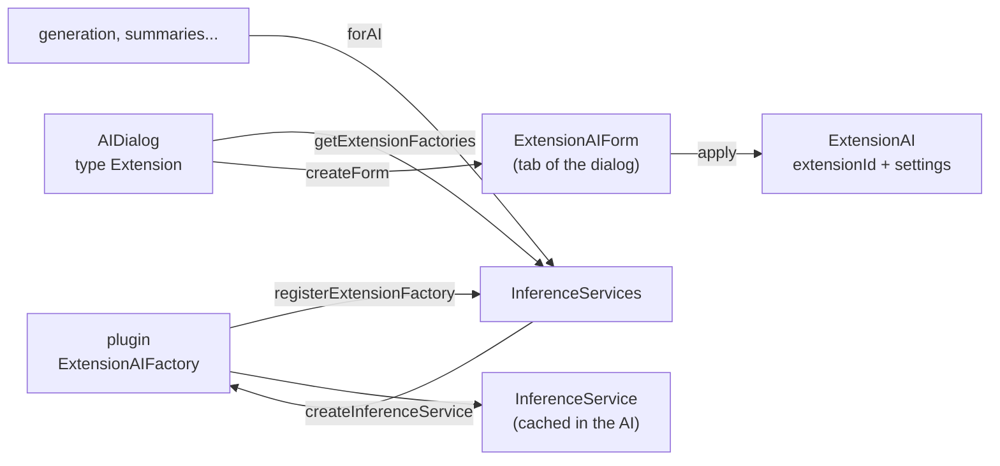

# Inference providers from a plugin

A plugin can bring a model API of its own. The user then creates an AI of the type **Extension**, chooses the
provider of the plugin in the AI dialog, and the AI works like an OpenAI-compatible one: books use it, it is shared and
limited, its usage is counted. The bundled
[Google Gemini](https://github.com/Enerccio/Marginalia/tree/master/marginalia/plugins/google-genai) plugin is the
worked example.



## The pieces

| Piece | What it is |
|---|---|
| `AIType.EXTENSION` | The type of such an AI. Stored as an ordinal like the others (1), so it must stay the last value. |
| `ExtensionAI` (`ais_extension`) | An `AI` subclass with **one column**, `extensionId`. Everything else the provider needs lives in `getSettings()`: the object under the key `extensionId` of the [dynamic attributes](extended-attributes.md), so there is no migration for it and it travels with the AI. |
| `ExtensionAIFactory` | What the plugin registers: its `getExtensionId()`, a `getName()` for the user, `createInferenceService(ExtensionAI)` and `createForm(ExtensionAI)`. |
| `ExtensionAIForm` | The settings of the provider in the *Per Type Settings* tab of the dialog: `getComponent()`, `validate()` and `apply(ExtensionAI)`. |
| `InferenceServices` | `registerExtensionFactory` / `unregisterExtensionFactory`, `getExtensionFactory(id)` and `getExtensionFactories()`, and `forAI(ai)`, which asks the factory of an `ExtensionAI`. |

The extension id is stored in every AI of the provider and never changes: use the symbolic name of the bundle
(the Google plugin uses `google-genai`).

## Registering

Register the factory in `onExtensionLoad` and take it back in `onExtensionUnload`, like the other registrations
(see [Plugin basics](overview.md)):

```java
@Configurable
public class MyExtension implements MarginaliaExtension {

    @Autowired
    private InferenceServices inferenceServices;

    private MyFactory factory;

    @Override
    public void onExtensionLoad(Bundle bundle, OsgiService parentService, ExtensionService extensionService) {
        factory = new MyFactory(inferenceServices, parentService.createLogger(bundle));
        inferenceServices.registerExtensionFactory(factory);   // IllegalStateException when the id is taken
    }

    @Override
    public void onExtensionUnload(Bundle bundle, OsgiService parentService, ExtensionService extensionService) {
        inferenceServices.unregisterExtensionFactory(factory);
        factory.close();                                        // HTTP clients, threads
    }
}
```

## The settings form

`createForm` is called by the AI dialog each time the user picks the provider (and when an existing AI is edited), with
the `ExtensionAI` being edited, or a new one that only has the extension id. The form reads the AI's
`getSettings()` and builds its fields (a `FormLayout` is the usual root; use `@Configurable(preConstruction = true)` to
get `Localization` into the constructor). The dialog:

- calls `validate()` before it saves or tests, and does not go on when it returns `false` - the form tells the user
  why (a notification);
- calls `apply(ai)` on the AI it saves, and on a throw-away copy (a deep copy of the attributes with the values of the
  dialog, no id) when the user clicks **Test Connection**, which runs `testConnection()` of the service the factory
  creates for the copy. A form that lists models (a **Refresh** button) can create a service for such a copy itself and
  close it afterwards.

The general settings of the AI (name, context and response size, jailbreak, reasoning) stay with the dialog; the
service reads them from the `AI` (`getMaxContext()`, `getEnabledReasoning()`, `getReasoningEffort()`...) and the
protocol (`TokenLimits`).

### Secrets

The attributes are **not encrypted**. Keep an API key with `inferenceServices.protectSecret(key)` (AES with the
installation key, the same as the API key column of an OpenAI-compatible AI) and read it with `revealSecret`, which
returns `null` for a key from another installation. Never show a stored key: disable the field and offer a **Reset**
button, as the bundled forms do.

## The inference service

`createInferenceService(ai)` returns an `InferenceService`. `InferenceServices.forAI` calls it **once** and keeps the
service in the AI (`ExtensionAI.getInferenceServiceFactory()` remembers which factory made it), exactly as for an
OpenAI-compatible AI. Saving the AI in the dialog clears the cache (`setAiType`), so new settings reach the next service.
Read the settings in the constructor: the service is not rebuilt per request.

The core calls a service for many things (the generation, summaries, other plugins), so implement all of
`InferenceService` that your API can do and throw `UnsupportedOperationException` for the rest, as the defaults do.
What a service has to take care of itself, because nothing above it does:

| | |
|---|---|
| **Limits** | Call `AILimitService.check(ai, promptTokens, responseTokens)` at the start of `stream` and `infer`, in the caller's thread: it throws `InferenceException` (`NOT_AVAILABLE`, `LIMIT_REACHED`) when an administrator's limit for the user forbids the request. |
| **Unmetered requests** | Read `UnmeteredScope.isActive()` once, in the caller's thread, when the request starts. When it is true the application asks on its own account (the help assistant with an AI that is not shared or has no *Apply limits*): skip `AILimitService.check` and do not call `UsageService.record` for that request, however many rounds and threads it takes. |
| **Usage** | Call `UsageService.record(ai, prefill, generated)` once per request, whichever way it ends, with the numbers the API reported (otherwise your own estimate - `TokenizerService.countTokensApprox`). It needs the user: capture `ThreadCopyRequestAttributes.create()` in the thread that calls `stream`/`infer` and run the recording in `InRequestScope`. |
| **Errors** | Fail with `InferenceException` and the right `Type` (authentication, rate limit, context overflow...): the application has a localized text for each and `InferenceErrors.describe` adds the provider's message. Anything else is shown as an internal error. |
| **Agents** | The runner of an [agent](../agents.md) asks with `InferenceService.round(payload, protocol, functions, callback)`: one request, the text, the reasoning and the calls the model wants made handed to `onRound` (they are **not** called) with a `RoundUsage` (tokens, and a `RoundStats` of what is known: the cache, the reasoning, the time, why it ended; -1 or null for what the provider does not tell). The default throws `UnsupportedOperationException`, so a service that does not implement it can not be given to an agent. |
| **Callbacks** | `stream` hands chunks one at a time: call `onChunk(controller, type, text)` and wait for `controller.continueInference()` before the next, then `onCompletion()`. `ChunkType.REASONING` is the thinking, shown apart from the answer. Check `callback.isDead()` and the `CancellationToken` between chunks and end with `onCancel()`. Cut a blocked read short by cancelling the HTTP call when the token is cancelled (the Google plugin does it with an OkHttp interceptor). |
| **Functions** | When a `FunctionSet` is passed, offer its definitions, run the calls the model makes with `FunctionSet.call(...)` (asynchronously, in the request scope), report each with `onFunctionCall`, ask again with the results, up to `MAX_FUNCTION_ROUNDS`. See `callFunctions` in the Google plugin. |
| **Tokens** | `countTokens` is called very often (every part of the prompt): do not make a request for it. `TokenizerService.countTokensApprox` is local. |

## When the plugin is not loaded

AIs are rows in the database: the AI of an unloaded plugin stays in the list (`AITypes.label` shows its provider name, or
`Extension: <id>`) and works again when the plugin is loaded. In between:

- `InferenceServices.forAI(ai)` returns `null` and drops a service cached from the unloaded plugin; so it does when
  the plugin was loaded again meanwhile, because the cached service was made by the old factory: the next call asks
  the new one.
- `forAIOrThrow(ai)` throws `InferenceException` of the type `EXTENSION_UNAVAILABLE` ("The extension that provides this AI
  is not loaded...") and is what the generation steps and the summaries call. Code that has a sensible fallback (the
  token count in `StorySupport`) keeps using `forAI` and its `null`.
- The AI dialog opens such an AI with a notice instead of the form, saves the general settings and leaves the settings
  of the plugin untouched.

Unregistering does not stop the services that exist. Close what they hold in `onExtensionUnload` (the Google factory
keeps its services in a weak set and closes their clients) and let a closed service fail with
`EXTENSION_UNAVAILABLE`.

## The AI dialog

`AIDialog` offers the type **Extension** only while a factory is registered (or when the AI being edited is one).
The type of an existing AI cannot be changed, because the type decides the entity class. For the type Extension the
dialog shows a **Provider** selector - preselected when only one plugin provides AIs, read-only when editing - and, under
it, the form of the chosen provider and the **Test Connection** button. The methods that do this
(`addExtensionSettings`, `currentExtensionAI`, `testExtensionConnection`...) are `@PublicAPI` like the rest of the dialog.

## The Google Gemini plugin

`marginalia/plugins/google-genai` uses the
[Google Gen AI Java SDK](https://github.com/googleapis/java-genai):

| Class | Role |
|---|---|
| `GoogleGenAiActivator`, `GoogleGenAiExtension` | Bundle start; the extension registers `GoogleGenAiFactory` and closes it on unload. |
| `GoogleGenAiFactory` | `google-genai`, "Google Gemini"; creates the services and keeps them (weakly) to close their clients. |
| `GoogleGenAiSettings` | The settings of an AI (`apiKey` encrypted, `model`, `baseUrl`, `requestTimeoutSeconds`, `maxRetries`, `safetyFiltersOff`) read from `ExtensionAI.getSettings()`. |
| `GoogleGenAiForm` | The fields, **Refresh** for the model list, validation, `apply`. |
| `GoogleGenAiInferenceService` | `stream`, `infer`, `round` (one request for an agent: not streamed, the calls are handed back and not made), function calls, JSON schema (`responseJsonSchema`), usage, limits, thinking (`ThinkingConfig`: a level for `gemini-3*`, a token budget for the others), safety settings, cancellation. |
| `GoogleGenAiMessages` | The payload as Gemini `Content`s: leading system messages are the system instruction, system messages later in the conversation become user messages, neighbouring messages of one role are one content, the results of the calls of one message are one content. |
| `GoogleGenAiErrors` | `ApiException` and IO failures as `InferenceException`. |

Two things in it are worth copying:

- **Thought signatures.** Gemini 3 refuses the next round of a function call unless the model's previous answer comes
  back with its thought signatures. The service therefore keeps the model's own `Content` (with the signature parts, without
  the thinking summaries) and puts it in front of the results of the calls, instead of rebuilding the turn from the
  `LLMToolCall`s.
- **Cancellation.** The SDK hides its HTTP call. Every request carries a header with the id of the run, an OkHttp interceptor
  stores the `Call` under it (and removes the header before the request leaves), and the `CancellationToken` cancels that
  call, so a generation stops at once even if Google is slow to send the next chunk.

### Packaging a library only the plugin needs

The SDK is not a dependency of the application. The plugin's `pom.xml` lists it as a normal dependency and embeds it:

```xml
<Embed-Dependency>*;scope=compile|runtime;inline=false</Embed-Dependency>
<Embed-Transitive>true</Embed-Transitive>
<Import-Package>!com.github.enerccio.marginalia.extensions.googlegenai.*</Import-Package>
```

`maven-bundle-plugin` puts the JARs inside the bundle and adds them to `Bundle-ClassPath`. The framework is started with
`org.osgi.framework.bootdelegation=*` and the application's class loader as the parent, so **a class the application
has wins over an embedded copy** (the bundle looks in its own JARs only for what the application does not have). Hence:

- libraries the application ships already (OkHttp, Jackson, Kotlin, Gson, slf4j, jspecify) are `exclusions` of the SDK and
  `provided` for compiling - the SDK then runs on the application's versions (OkHttp 4.12, Jackson 2.22), which must stay
  compatible with the ones the SDK was built for;
- nothing is imported (`Import-Package` lists only the negated own package), so no package of an embedded library has to be
  exported by the application;
- the JAR is large (about 14 MB: the SDK, Guava, Protobuf, google-auth).

A provider that sends the story to a service somebody else runs should say so where the administrator and the users read: the
README of the plugin (and its user page) states that the story text, the lore, the summaries and the files of agents go to
Google's servers, under Google's terms, and that sharing such an AI sends the text of everybody who uses it.

The plugin has unit tests for the pure parts (`GoogleGenAiMessagesTest`, `GoogleGenAiErrorsTest`,
`GoogleGenAiSettingsTest`); the core has `ExtensionAIFactoryTest`, `ExtensionAICrudTest`, `ExtensionAIGenerationTest` and
`AIDialogExtensionTest` with a fake factory, which is the way to test your own provider's contract without a plugin.
