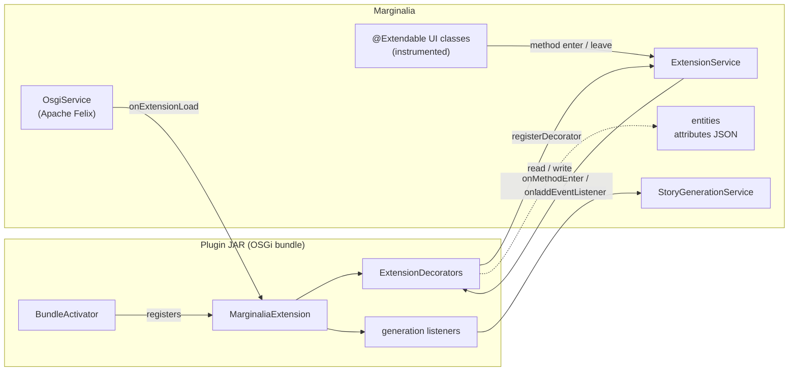

# Plugin development

A Marginalia plugin (the user interface calls them *extensions*) is an OSGi bundle - a JAR with a few extra manifest
headers - that Marginalia loads at runtime, without a restart. A plugin can add menu items, tabs, panels and settings
to the user interface, keep its own data on books, story parts, lorebooks and user settings, call the model, and take
part in generation.

This part of the developer guide explains how plugins work and how to write one. It assumes you can build Marginalia
from source ([Building from source](../building.md)) and know a little Vaadin Flow ([User interface](../ui.md)).

## How a plugin plugs in



There is no plugin API in the usual sense - no list of extension points with stable signatures. Instead, a plugin
gets general mechanisms and the whole application to use them on:

| Mechanism | What it gives you | Page |
|---|---|---|
| **Bundles** | Loading, unloading, the `MarginaliaExtension` lifecycle, access to every Spring service through `@Configurable`. | [Plugin basics](overview.md) |
| **`@Extendable` hooks** | Code that runs before and after *any* method of an instrumented UI class, with access to its arguments, local variables and fields, and the possibility to replace the return value. | [@Extendable hooks](extendable.md) |
| **Extended attributes** | A JSON object on every data entity where a plugin keeps its data - saved with the entity, included in backups, no schema change. | [Extended attributes](extended-attributes.md) |
| **Desktop notifications** | List a run of the plugin in *Settings → Notifications* (`NotificationService.register`) and tell the user in the browser when it is over (`DesktopNotifier.finished` / `failed`), with a separate entry for a run that starts by itself. | [Desktop notifications](notifications.md) |
| **Inherited settings** | A setting of the plugin that books and folders inherit like the prompts: a field in the *Prompts* tab and the folder dialog, `ManuscriptService.resolveExtension` for the value (`InheritedSettingRegistry`). | [Inherited settings](inherited-settings.md) |
| **The text a model reads** | Give the model another form of the story than the one that is stored (a translation, a redaction): a transformer in the `PartTextRegistry`, the offset map of `ModelText`, `ChatMessageService.replaceText` to store the other form. | [The text a model reads](part-text.md) |
| **The text of an export** | Change what the export of a book holds for a passage (the English instead of a translation, a footnote with the other text) without touching the exporters, together with other plugins: a contributor in the `ExportTextRegistry`, edits as ranges of the stored text. | [The text of an export](export-text.md) |
| **Facts for the annotation** | Hand what the plugin knows about the story (what the characters know, a timeline) to the model that annotates a part, so it can mark continuity errors no text shows: a provider in the `AnnotationFactsRegistry`. | [Facts for the annotation](annotation-facts.md) |
| **Anchored passages** | Attach your own data to a passage of a part that follows the text (edits, regenerate, merge, branch, backups): `PassageService`, a `PassageKind` in `PassageKinds` with the mark, the click and the flags for the viewer and the exports. | [Anchored passages](anchored-passages.md) |
| **Libraries** | Share code between plugins: a plain jar in `marginalia/libs` that each plugin embeds in its bundle; the translator library is the example. | [Libraries for plugins](libraries/index.md) |
| **Other extensions** | Offer text about a book or a story part to other extensions or ask them for it (`IPCService`), offer a suite of tools for the model with a human name, items and commands (`ToolService`), or call one particular extension by reflection, without importing its classes. | [Sharing data between extensions](ipc.md) |
| **Inference providers** | A model API of the plugin's own: its settings form in the AI dialog and the inference service of its AIs (`ExtensionAIFactory`). | [Inference providers from a plugin](ai-providers.md) |
| **Generation events** | Listeners that read and change the prompt, the lore, the summaries and the streamed answer while a story part is generated. | [Generation events](generation-events.md), [Generation pipeline](../generation-pipeline.md#events-for-extensions) |
| **Commands** | Commands for the command bar and for agents: `commandService.registerCommands(...)` with `@Command` methods (a suite object), unregistered on unload. Arc Outline, Author's Note, Character Tracker, Knowledge Tracker, Lore Generator, Name Generator, Name Provider and Place Provider bring theirs. A read only command with `availableInMacros = true` can also be run by a template with `{{command::name}}` (Author's Note, Character Tracker and Knowledge Tracker have one). | [Writing commands](../commands/writing-commands.md) |

[Extending the UI](ui-extensions.md) puts the first three together: adding components, settings panels, threads and
cleaning up on unload. [Generation events](generation-events.md) shows how a plugin changes the prompt sent to the
model, on the bundled Author's Note. [Example plugin](example.md) builds a small plugin from scratch and walks through
the bundled Chapter Marker and Author's Note.

!!!warning Plugins are tied to one version of Marginalia
Hooks are attached by class and method *name* and read local variables and fields by name. Renaming a method or a
variable in the application silently disables the part of a plugin that used it (a warning is logged). Build plugins
from the same source tree as the application they run in, and test them after every update. Marginalia itself
[verifies](extendable.md#verification-before-loading) the decorators of an extension before it starts it and refuses
ones that ask for classes, methods, arguments, locals or fields that don't exist.
!!!

## The bundled plugins

The twenty-two plugins in `marginalia/plugins/` are complete, working examples. Each is a separate Maven project.

| Plugin | What it adds | Shows how to |
|---|---|---|
| [Anthropic Claude](https://github.com/Enerccio/Marginalia/tree/master/marginalia/plugins/anthropic) | Anthropic's Claude models as an inference provider, over the Anthropic Java SDK. | Add a provider (`ExtensionAIFactory`) the same way as the Google plugin, with thinking blocks that must travel with the calls and a stream that is cancelled by closing it. |
| [Arc Outline](https://github.com/Enerccio/Marginalia/tree/master/marginalia/plugins/arc-outline) | The arcs of the book and their chapters, each planned, current or finished, in the story sidebar (a chapter can show its note under the description); the model can write an arc from the lore, the chapters of an arc, or an arc with chapters from a range of the active branch of the story; a chat about the plot (the plot wizard) in which the model may also read and change the planner, the lorebook and the outline through commands. | Add a tab to the story editor and a section to the user settings, keep a tree in a book's attributes, run a chat in which the model calls the commands of the application as functions (`CommandFunctions` with an approval before it changes something, `FunctionSet.whenCalled` to show a call when it starts, the thinking sent back with the calls), stream a structured (JSON schema) answer into the UI with `PartialJson`, read the messages of the active branch (`ChatMessageService.getBranchFromLeaf`) and show how many tokens a prompt has (`TokenizerService.countTokensApprox`, `TokenLimits`), name tools from another plugin ([call it directly](ipc.md#calling-another-extension-directly)), offer data to other plugins with `IPCService`, plugin-only CSS classes. |
| [Author's Note](https://github.com/Enerccio/Marginalia/tree/master/marginalia/plugins/authorsnote) | A per-book note inserted into the prompt of every generation, at a chosen depth and role. | Listen to generation events and change the payload sent to the model; add a tab to the story editor. |
| [Beta Readers](https://github.com/Enerccio/Marginalia/tree/master/marginalia/plugins/beta-readers) | Personas and a chat about the book with them, alone or in a group. | Add a tab to the story editor and its phone twin; register [inherited settings](inherited-settings.md); read a model's reply while it streams (`InferenceService.stream` with a JSON schema); keep per-book data in the `attributes` of the book. |
| [Chapter Marker](https://github.com/Enerccio/Marginalia/tree/master/marginalia/plugins/chaptermarker) | Story parts that start with a Markdown heading are shown as chapters in the story sidebar. | Read method arguments and locals, change a component the method built. The smallest one - start here. |
| [Character Tracker](https://github.com/Enerccio/Marginalia/tree/master/marginalia/plugins/character-tracker) | The characters of the book with their relationships, imported from lore entries if wanted, and a relationship map, in the story sidebar. | Add a tab to the story editor, add a button to the fields of the new turn form (reading fields of an `@Extendable` object through the one the decorator gets), keep a list in a book's attributes, draw a graph with the application's `GraphView` ([Custom components](../custom-components.md)), upload and scale images. |
| [Gemma 4 tools fix](https://github.com/Enerccio/Marginalia/tree/master/marginalia/plugins/gemma4toolsfix) | Sends the results of function calls to Gemma 4 models with the role `tool_responses`. | Change how a service talks to the model without UI code: register an `InferenceServices.ToolRoleResolver` on load, remove it on unload. |
| [Google Gemini](https://github.com/Enerccio/Marginalia/tree/master/marginalia/plugins/google-genai) | Google's Gemini models as an inference provider, over the Google Gen AI Java SDK. | Add a provider (`ExtensionAIFactory`), embed a library only the plugin needs, stream with cancellation, call functions. |
| [Image Generator](https://github.com/Enerccio/Marginalia/tree/master/marginalia/plugins/image-generator) | Makes an image for a part of the story: the model writes the prompt, a backend (ComfyUI workflow, OpenAI-style images API) draws it, the user rerolls and accepts it. | Add an item to the menu of a part (`StoryMenuItem.card`), a settings panel on `UserPart`, a dialog that streams from the model and works in a thread of its own, store images with `ResourceService`, call HTTP servers around the work (hooks), keep a secret with `protectSecret`. |
| [Prompt History](https://github.com/Enerccio/Marginalia/tree/master/marginalia/plugins/prompt-history) | Keeps the last requests sent to the models, with the answers and the reasoning, in each user's session. | Watch every request with `InferenceSession.addListener` (`InferenceListener`, the answer streamed into a dialog with `ui.access`), keep per-session data in `SessionPoint.getPluginData`, add a panel to the Extension Settings of `UserPart` and a button to the footer of `AgentConsoleDialog`. |
| [Prompt Inspector](https://github.com/Enerccio/Marginalia/tree/master/marginalia/plugins/prompt-inspector) | Shows the prompt of a generation and asks before it is sent to the model. | Add a check box item to the settings menu, keep a per-user switch in the attributes of the user settings, listen to `BEFORE_INFERENCE` and ask the user from the listener: open a dialog on the user's page with `GenerationControllerEvent.accessUI` while the generation waits ([below](#asking-the-user-in-the-middle-of-a-generation)). |
| [Instruction Exporter](https://github.com/Enerccio/Marginalia/tree/master/marginalia/plugins/instructionexporter) | Copies the instructions, scene settings and characters of the active branch to the clipboard, from the story settings menu. | Add an item to the settings menu of the story editor, read the story through a service, write to the clipboard. |
| [Book Description Generator](https://github.com/Enerccio/Marginalia/tree/master/marginalia/plugins/book-description-generator) | Writes the name and the description of a book with the model from a range of its story, notes first when the range is longer than the context. | Add a button to the About tab of the book window (desktop and phone) and copy the result into its fields; register two [inherited settings](inherited-settings.md) (the prompts); run several requests in a row on a worker thread (`InRequestScope`) and read a JSON or Markdown answer; use the summaries of the story (`SummaryService.collectBlocks`). |
| [Knowledge Tracker](https://github.com/Enerccio/Marginalia/tree/master/marginalia/plugins/knowledge-tracker) | Tracks what chosen characters know and do not know and puts it into the prompt; follows the active branch with a cursor. | Add a sidebar tab, insert a message into the payload (`BEFORE_PREPARE_CONTENT` reserves the tokens, `AFTER_PREPARE_PAYLOAD` inserts), listen to `AFTER_CLEANUP` for a regenerate, a read-only command for the `{{command::...}}` macro (`availableInMacros`), commands that ask the user (`async = true`), keep state in a book's attributes and settings in the user settings, stream a request to read the model's reasoning (`InferenceService.stream`, `infer` drops it), decorate the new `AutoAnnotate.finished` hook, a pure logic layer with plain unit tests.
| [Conlang Translator](https://github.com/Enerccio/Marginalia/tree/master/marginalia/plugins/conlang-translator) | Writes the direct speech of the characters in a constructed language and keeps the English as the source the models read; a click shows it, in the story, the viewer and the exports. | Register a [passage kind](anchored-passages.md) (an `AnchoredPassage` with the plugin's data in its attributes, a mark and a click), a [`PartTextRegistry`](part-text.md) transformer that turns the stored text back into what a model reads, [inherited settings](inherited-settings.md) of a book and a folder, a panel in the Settings screen (decorators of `UserPart.refresh` / `save`), items of the story menu (`StoryMenuItem` tools and card), decorators of the viewer (`Viewer.createPart` with `PartView.setContent`), a field in the export dialog (`createExtensionFields`) and an [`ExportTextRegistry`](export-text.md) contributor for what the export holds, facts for the model that annotates a part ([`AnnotationFactsRegistry`](annotation-facts.md): the characters that do not follow a language), categories of names for the Name generator (`NameGeneratorBridge`: the other extension is found among the loaded ones and called by reflection), the shared library [`translator-common`](libraries/translator-common.md) (the edit of the source of a speech and the search and replace over the sources, which call back `PassageKind.textReplaced`), `StoryEditor.reloadStory`, workers that carry the session of the user (`ThreadCopyRequestAttributes`), command suites (`CommandService.registerCommands`) with the data of an agent run kept in the attributes of the working copy of the book (`LanguageAccess`), a `PluginLocalizationBundle` with a test that every text has its translations, pure logic layers with plain unit tests. |
| [Real Language Translator](https://github.com/Enerccio/Marginalia/tree/master/marginalia/plugins/reallang-translator) | The sibling of the Conlang Translator for a real language (Japanese for a story set in Japan): the dialogue is translated into kana and kanji or romaji, the English stays behind it. No lexicon; a short set of rules per language (script, honorifics, politeness, names) with presets, a script check, a reading line, the same screens, commands and export as the Conlang Translator, and a **glossary** of the names and special words of the story at three levels (the language, the folders of the book, the book) that the translation is checked against, filled by hand or by a model that reads a range of parts (the word extraction, with a library of prompts in the user's settings). | Shares the library [`translator-common`](libraries/translator-common.md) with the Conlang Translator, **embedded** in each bundle (`Embed-Dependency ...;inline=true`; plugins do not see each other's classes, so the library is shared source, not shared runtime), its own passage kind and CSS, a `PartTextRegistry` transformer. |
| [Lore Generator](https://github.com/Enerccio/Marginalia/tree/master/marginalia/plugins/lore-generator) | Writes a lorebook entry with the model from the existing lore: a generation, then a compaction, optional attachments. | Add a column to a grid, open a dialog that streams from the model (with `LLMAttachment`s), keep prompts in the user settings, give the model the functions of another extension ([a direct call](ipc.md#calling-another-extension-directly)), let the user choose the model with `ModelProtocolPicker`. |
| [Lorebook VCS](https://github.com/Enerccio/Marginalia/tree/master/marginalia/plugins/lorebookvcs) | Revision history of lorebook entries, export and import of the history. | Insert panels into a view, store data in a lorebook's attributes, replace a field of the view. |
| [Manga Generator](https://github.com/Enerccio/Marginalia/tree/master/marginalia/plugins/manga-generator) | Adapts parts of the story into a manga script and image tags, in one large window opened from the story settings menu. | Add an item to the settings menu of the story editor that opens a dialog, activate lore for arbitrary text with `LorebookActivationService.evaluateAll`, fit it to the context with `TokenLimits`, stream several answers side by side, keep data in a book's attributes. |
| [Name generator](https://github.com/Enerccio/Marginalia/tree/master/marginalia/plugins/name-generator) | `list_name_categories` and `generate_names`: names from Markov chains trained at build time on lists of names. | Write functions for the model (`@LLMFunction`), train data at build time with Java programs run by `exec-maven-plugin`, ship it as a resource. |
| [Name provider](https://github.com/Enerccio/Marginalia/tree/master/marginalia/plugins/name-provider) | `list_real_name_lists` and `pick_real_names`: real forenames and surnames of countries picked at random, as pairs of the romanized and the original name. | Write functions for the model whose answer is a list of records, ship data imported at build time (a CSV of a repository, cloned and converted by a Java program) as a resource. |
| [Place provider](https://github.com/Enerccio/Marginalia/tree/master/marginalia/plugins/place-provider) | `list_place_types`, `search_places`, `places_near` and `distance_between` (also as commands): real places from Natural Earth by name, type and country, around a point, and the distance of two. | Ship a dataset reduced at build time by a Maven profile (`-Pimport-places`, committed result), write functions and commands over an in-memory index. |
| [Reviewer](https://github.com/Enerccio/Marginalia/tree/master/marginalia/plugins/reviewer) | AI reviews of a story part with configurable reviewer profiles (a book can pick its own profile). | Add a sub-menu to every part, add a settings panel, stream an answer from the model. |
| [Side Query](https://github.com/Enerccio/Marginalia/tree/master/marginalia/plugins/sidequery) | A chat panel next to the story for questions about the book. | Add a tab to the story editor, keep per-book sessions, build a prompt from lore and parts, use the data other extensions offer through `IPCService` ([Sharing data](ipc.md)). |
| [Converter](https://github.com/Enerccio/Marginalia/tree/master/marginalia/plugins/sillytavern-converter) | A tab next to the story with a SillyTavern chat, or the parts of another book (a backup, or a book picked from the list), and the turn details the model prepares from it. | Add a tab to the story editor, keep data in a book's attributes, stream a structured (JSON schema) answer, fill the new turn form of the story with `NewTurnForm.restoreState`. |
| [Chinese localization](https://github.com/Enerccio/Marginalia/tree/master/marginalia/plugins/chineselocalization) | Simplified Chinese as a language of the user interface. | Add a language with `ExtensionHasLocalization` - no UI code at all. |

Users install them as described in [Managing extensions](../../user/administration/extensions.md).

## Asking the user in the middle of a generation

A generation listener can stop the generation and show the user a dialog, and the generation goes on, or ends, by what the
user answers. The bundled [Prompt Inspector](https://github.com/Enerccio/Marginalia/tree/master/marginalia/plugins/prompt-inspector)
does exactly this: with its check box on, every generation of the user stops just before the request with a dialog that
shows the messages about to be sent, and *Send* sends them while *Cancel* ends the generation. Three things make it work:

* **The chain waits for you.** A listener gets `(event, chain)` and the generation does not go on until it calls
  `chain.next()`. Nothing blocks a thread while it waits, so a listener can start something, return, and call `chain.next()`
  later from wherever the answer arrives. It must call it exactly once.
* **`event.accessUI(action)` runs the action on the user's page.** The generation runs on a worker thread; `accessUI` is
  the way back to the UI that started it (`ui.access` and a push), and the `UI` it hands over is the one to open the dialog on.
  It returns `false`, and never runs the action, when the generation has no UI (an agent or a command started it): then
  nobody can be asked and the listener goes on at once.
* **Stopping is cancelling the token.** `event.getCancellationToken().cancel()` and then `chain.next()`: the generation
  jumps to its cleanup, the request is not sent and the part started for it is removed.

Listeners are global (the generations of all users come through them), so the first thing the listener does is look
whether *this* user wants to be asked - the Prompt Inspector keeps a boolean in the attributes of the user settings and
reads it with `settingService.find(UserSetting.class, currentUser)`, which works on the generation's thread. The listener,
trimmed:

```java
// onExtensionLoad / onExtensionUnload
inferenceRegistration = storyGenerationService.addEventListener(Events.BEFORE_INFERENCE, this::inspect);
inferenceRegistration.unregister();

private void inspect(GenerationControllerEvent event, EventChain chain) {
    boolean asked = false;
    try {
        if (event.getPayload() != null && isEnabled()) {          // this user switched it on
            asked = GenerationQuestion.ask(event, chain, log,
                    (send, cancel) -> new PromptInspectorDialog(format(event.getPayload()), send, cancel));
        }
    } catch (Exception e) {
        log.warn("Failed to show the prompt: {}", e.getMessage(), e);   // generate without asking rather than fail
    } finally {
        if (!asked) {
            chain.next();                                         // nobody was asked: go on
        }
    }
}
```

The asking is a class of its own, `GenerationQuestion`, so that it can be tested without a browser (a fake dialog and a fake
page stand in for the real ones, `GenerationQuestionTest`). Trimmed, it is:

```java
static boolean ask(GenerationControllerEvent event, EventChain chain, Logger log, ViewFactory factory) {
    AtomicBoolean answered = new AtomicBoolean();
    AtomicReference<View> view = new AtomicReference<>();
    // whatever answers first - Send, Cancel, a stop from elsewhere, the page going away - lets the generation go on, once
    Runnable proceed = () -> {
        if (answered.compareAndSet(false, true)) {
            chain.next();
        }
    };
    Runnable stop = () -> {                                       // a refusal: stop before the request
        event.getCancellationToken().cancel();
        proceed.run();
    };
    // the generation was stopped from another window while the question is open: go on, then close it
    Runnable unsubscribe = event.getCancellationToken().onCancel(() -> {
        try { proceed.run(); } finally { closeQuietly(event, view, log); }
    });
    if (answered.get()) {
        return true;                                              // it was cancelled already: the chain has gone on
    }

    boolean scheduled = event.accessUI(ui -> {                    // runs on the thread of the user's page
        try {
            View shown = factory.create(proceed, stop);           // Send -> proceed, Cancel -> stop
            view.set(shown);
            shown.whenDetached(() -> {                            // the page was closed or expired with the question open
                if (!answered.get()) {
                    stop.run();
                }
            });
            shown.open();
        } catch (RuntimeException e) {
            log.warn("Could not show the question: {}", e.getMessage(), e);
            proceed.run();                                        // go on unasked rather than wait for ever
        }
    });
    if (!scheduled) {                                             // an agent or a command: no page to ask
        unsubscribe.run();
        return answered.get();
    }
    return true;                                                  // the dialog is out, the answer calls chain.next()
}
```

The dialog is a plain Vaadin `Dialog` that is given two `Runnable`s (and implements `View`, which adds `whenDetached`
over `addDetachListener`). It is modal and does not close on *Esc* or a click outside, because the generation is waiting for the
answer; each button runs its callback first and then closes, so that the closing, which detaches the dialog, finds the
question answered.

What to keep in mind when you write one:

* **Always release the chain.** Every path out of the listener must end in exactly one `chain.next()`: the `finally`, the
  answer, the cancellation. Guard it with an `AtomicBoolean` when several things can answer.
* **Give a question that nobody answers a way out.** While the question is open the generation is not a thread that
  waits but a callback nobody has called yet, so there is nothing to interrupt: if the page is closed or expires with the
  dialog open, no button is ever pressed and the generation would stay parked for ever (its placeholder part in the book,
  its closures in memory). Treat the dialog going away unanswered as a refusal (a detach listener that cancels the token and
  releases the chain), and release the chain when the token is cancelled some other way
  (`getCancellationToken().onCancel(...)`, which also returns a `Runnable` that removes the listener again). The server
  notices that a page is gone only after a while, so this is not instant.
* **Nothing in the way out may throw.** `CancellationToken.cancel()` runs its listeners one after the other and a listener
  that throws keeps the rest from running; `accessUI` throws `UIDetachedException` when the page is gone. Release the chain
  first, then close the dialog, and catch what closing throws.
* **The action and the dialog run on the thread of the UI, not in the request scope of the generation.** Keep them to
  showing the dialog and reporting the answer; hand the work on through the chain and do it in the listener.
* **Check that someone can see it.** `accessUI` returning `false` means no dialog was shown - do not wait. It throws
  `UIDetachedException` when the user has closed the page: treat it like a failure and go on or cancel.
* **Ask as late as you can.** `BEFORE_INFERENCE` is the last event before the request, so what the user sees is what
  the model gets after every other extension has changed it.

The other events and what they carry are in [Generation events](generation-events.md#other-things-listeners-can-do).

## Reading order

1. [Plugin basics](overview.md) - project layout, the activator and the extension, building and loading.
2. [Example plugin](example.md) - build one, load it, see it work.
3. [@Extendable hooks](extendable.md) - the decorator API in detail and its limits.
4. [Extended attributes](extended-attributes.md) - storing data.
5. [Extending the UI](ui-extensions.md) - patterns for menus, tabs and settings, threads and unloading.
6. [Generation events](generation-events.md) - changing the prompt and the answer during generation.
7. [Sharing data between extensions](ipc.md) - `IPCService`, `ToolService` and calling another extension directly.
8. [Inference providers from a plugin](ai-providers.md) - bringing a model API: factory, settings form, inference service.
9. [Inherited settings](inherited-settings.md) - settings of a plugin that books and folders inherit.
10. [The text a model reads](part-text.md) and [anchored passages](anchored-passages.md) - keeping the story in one form and giving a model another.
11. [The text of an export](export-text.md) - what an export of a book holds for such a passage.
12. [Facts for the annotation](annotation-facts.md) - offering what a plugin knows to the model that reviews a part.
13. [Libraries for plugins](libraries/index.md) and [translator-common](libraries/translator-common.md) - sharing code between plugins.
