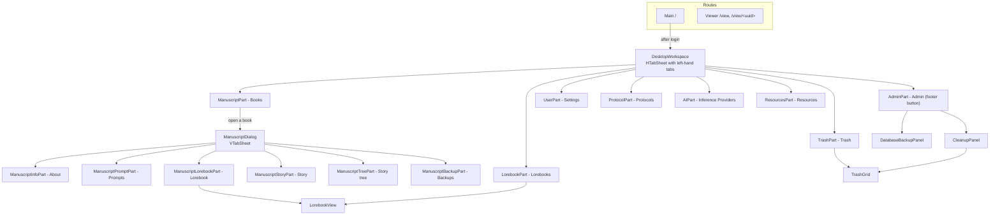
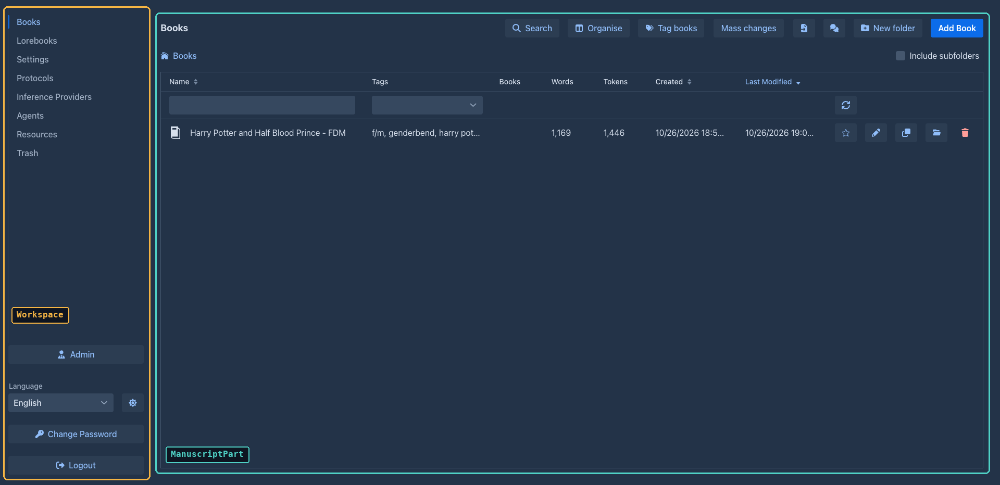
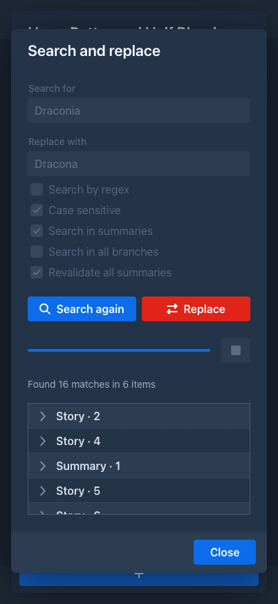

# User interface

Marginalia's UI is written in Java with [Vaadin Flow](https://vaadin.com/docs/latest/flow) 25: the component tree
lives on the server, the browser renders it with Vaadin's web components (Lumo theme, dark color scheme) and sends
events back over HTTP and a push WebSocket. There is no hand-written frontend code apart from one CSS file and a small
connector for the story tree. This page explains how the UI code is organized and the conventions to follow when you
change it. The code is in `ui/`.

## Structure






| Package | Contains |
|---|---|
| `ui.main` | Servlet, app shell, routes, login (`LoginCheckRoute`). |
| `ui.workspace` | The `Workspace` interface, its `DesktopWorkspace` implementation and the `WorkspaceComponent` interface. |
| `ui.workspace.phone`, `.parts` | `PhoneWorkspace` and the phone specific tabs (`PhoneManuscriptPart`, `PhoneLorebookPart`, `PhoneProtocolPart`, `PhoneAIPart`, `PhoneSettingsPart`, `PhoneTrashPart`). |
| `ui.dialogs.phone`, `.manuscript` | `PhoneManuscriptDialog` and its tabs (`PhoneManuscriptInfoPart`, `PhoneManuscriptPromptPart`, `PhoneManuscriptLorebookPart`, `PhoneManuscriptStoryPart`, `PhoneManuscriptTreePart`, `PhoneManuscriptBackupPart`), the book dialog for phones. |
| `ui.workspace.parts`, `.admin` | The workspace tabs and the admin panels. |
| `ui.dialogs` | Entity dialogs, the book window and generic dialogs. |
| `ui.dialogs.manuscript` | The tabs of the book window (`ManuscriptDialogPart`). |
| `ui.components` | Larger reusable components: `LorebookView`, `PhoneLorebookView`, `LorebookPreview`, `InvalidExtensionsWarning`, `HelpAssistantWidget`, `TreantTree`, `MessageImages`, `ThreadCopyRequestAttributes`. |
| `ui.widgets` | Small reusable widgets, among them `TrashGrid` (see [Trash](#trash)). |

## The shell, routes and login

- `AppShellConfig` (`AppShellConfigurator`) sets up the page once: `@Push`, Lumo stylesheet, `@ColorScheme(DARK)`,
  full-viewport body, `shared-styles.css`, page title, PWA metadata.
- `MarginaliaServlet` is the `VaadinServlet` mapped to `/*` (with `asyncSupported` for push).
- There are two routes, both extending `LoginCheckRoute`:

  | Route | Class | Shows |
  |---|---|---|
  | `/` | `Main` | The workspace. |
  | `/view`, `/view/<uuid>` | `Viewer` | The reader: a list of the user's own books, and a book's active branch as text (own or published books, by link). |

`LoginCheckRoute` runs in the route's constructor (`showLogin()`):

1. On an empty installation it opens `UserDialog` in *first time* mode (create the administrator) and reloads.
2. Otherwise it tries a user that is already logged in this session (`authenticatedSessionUser`, overridden by `Main`: the page was reloaded, e.g. by the language selector) and then the *Save login* cookies (`authenticateFromCookie`, rotating the secret on success).
3. Otherwise it shows a `LoginOverlay` (`PermissiveLoginOverlay` - allows empty passwords to reach the server-side
   check) with the *Save login* checkbox.
   The check passes the client address (`LoginCheckRoute.clientAddress()`) to `UserService.authenticate`, which
   throttles failed logins per address (see [Login throttling](services.md#login-throttling)).
4. After a successful login it calls `VaadinService.reinitializeSession` (new session id) and the subclass's
   `proceedWithLogin(login)`, which fills the session-scoped `user` bean, registers the login with
   `SessionManager.userLoggedIn` (see [Sessions](architecture.md#sessions)), sets the language of the session from
   the user's settings ([Localization](architecture.md#localization)) and builds the content.

Logout deletes the cookies, closes the Vaadin session, invalidates the HTTP session and redirects to the context
root. Cookie names include the context path and the route class (`root_Main_llllm_rememberMe_login`...), so the workspace
and the viewer keep separate saved logins.

## Building blocks

### Classes that build components

Most UI classes are **not** Vaadin components themselves. They are plain classes with a `create()` method that builds
and returns the component tree, and keep references to the fields they need later:

```java
@Configurable
@Extendable
public class ProtocolPart implements WorkspaceComponent {

    @Autowired
    private Localization loc;

    @Autowired
    private ProtocolService protocolService;

    private Grid<Protocol> grid;

    @Override
    public Component create() throws Exception {
        VerticalLayout layout = new VerticalLayout();
        grid = new Grid<>();
        ...
        return layout;
    }

    @Override
    public void refresh() throws Exception { ... }
}
```

This shape is deliberate:

- **`@Configurable`** - the class is created with `new`, and the AspectJ-woven configurer injects its `@Autowired`
  fields (services, `Localization`, the session `User`). See [AspectJ weaving](building.md#aspectj-weaving).
- **`@Extendable`** - the class is instrumented at startup so extensions can run code before and after any of its
  methods and read its local variables (see [Extensions](#extension-points)). Small methods with descriptive local
  variable names (`menu`, `toolbar`, `detailLayout`) are what make a class easy to extend.

Dialogs (`AIDialog`, `ProtocolDialog`, `UserDialog`, `LorebookDialog`, `ManuscriptDialog`...) extend Vaadin's `Dialog`
but follow the same pattern: construct with the entity, call `create()`, then `open()`.

### The workspace

`Workspace` is the interface of the top-level layout shown after login (`create`, `refresh`, `setNavigationLocked`,
`isNavigationLocked`, `getOnLogout`, `setOnLogout`). `Main`, the parts, `ApplicationPoint` and `SessionInformation`
only depend on this interface. `DesktopWorkspace` is the implementation (`@Configurable`, `@Extendable`): it builds an
`HTabSheet` (tabs on the left, a footer with *Admin*, the language selector, *Change Password*, *Logout*) and puts the red `InvalidExtensionsWarning` bar (`ui.components`; hidden while no installed extension is invalid, the administrator gets the names as its tooltip, other users a note to tell the administrator, from `OsgiService.getInvalidExtensions()`) above it - the phone workspace has it in the navbar - and creates all tab components up
front (the admin part is refreshed only when the user is an administrator and has the *Admin* button: it refuses anybody else). Each tab is a `WorkspaceComponent`:

| Method | Called |
|---|---|
| `create()` | Once, when the workspace is built. |
| `refresh()` | To reload data (after login, after changes elsewhere). |
| `onTabSwitched()` | When the tab becomes active - parts reload their lists here. |
| `onTabClosed()` | When another tab is selected. |

`Workspace.setNavigationLocked(true)` disables the other tabs and the *Admin* and *Logout* buttons, so the user can't
leave the active tab. `UserPart` locks it while the settings have unsaved changes: it listens to every `HasValue`
in its layout (extension settings panels included) and unlocks on *Save*, *Discard Changes* or `refresh()`.

`Main.proceedWithLogin` picks `PhoneWorkspace` instead when the body of the page is narrower than 768 px
(`ExtendedClientDetails.getBodyClientWidth()`). The choice is made once per login: resizing or rotating the device
does not switch the workspace until the page is reloaded, and a tablet or a phone in landscape gets the desktop one. `PhoneWorkspace` replaces
the left-hand tab sheet with an `AppLayout`: the parts are listed in a drawer (opened with the toggle in the top bar)
whose footer holds the language selector, *Change Password* and *Logout*, and the active part fills the screen. **There is no *Admin* button
and no `AdminPart`** on a phone: the administration (users, database backups, cleanup, extension install) is only
reachable in the desktop layout. The services still check `AdminGuard.requireAdmin()` themselves. The user manual
describes this for users in [Using Marginalia on a phone](../user/phone.md). Only the book list, the lorebooks, the settings, the protocols, the models and the trash differ. `PhoneManuscriptPart` renders the book list
like the `Viewer` (stacked filters, sort buttons, one column) with the controls of `ManuscriptPart`; both share the
*Add Book* flow in `NewBookAction`. `PhoneLorebookPart` hosts `PhoneLorebookView`, a reduced `LorebookView`: lorebooks can
only be selected (no add, delete, import or export, no new entries) and only the enabled flags and the content of an
entry are editable, every other setting of the lorebook and of an expanded entry is shown as text. `PhoneTrashPart`
hosts `PhoneTrashGrid` (see [Trash](#trash)). `PhoneProtocolPart` and `PhoneAIPart` replace the type, name and
action columns of their desktop lists with a text column (*Type:* and *Name:* on two lines) and a buttons column.
`PhoneSettingsPart` extends `UserPart` (so the extension settings panels that decorate `UserPart.refresh`/`save` keep
working) and only overrides `createHeader()`: the title, the unsaved changes hint and the *Discard*/*Save* buttons are
stacked, and *Import backup as new book* is left out. The other parts are the desktop ones.

Code that must not care which layout the user has works with the common interfaces: `ManuscriptWindow` (package `ui.dialogs`, implemented
by `ManuscriptDialog` and `PhoneManuscriptDialog`: the book, its model, open/close, the story tab, the state callbacks, `asDialog()`),
`ManuscriptSection` (package `ui.workspace`, implemented by `ManuscriptPart` and `PhoneManuscriptPart`: `getOpenWindow()`, the window of
the book that is open or `null`) and `Workspace.getManuscriptSection()` / `getOpenManuscriptWindow()`. The session's `SessionPoint` holds the
workspace, and `CommandUtils` (package `utils`) reads it for commands: `getWorkspace()`, `getManuscriptSection()`, `getManuscriptWindow()`,
`getCurrentManuscript()` and `getCurrentAI()` return `null` when there is no session, workspace or open book. The book-related methods delegate to
`SessionPoint` (`getManuscriptWindow()`, `getCurrentManuscript()`, `getCurrentAI()`), which `AgenticSessionPoint` overrides for a session without
a browser: the book is held directly and there is no window.

**Command bar** (see [The command bar](commands/command-bar.md)). `CommandBar` (package `ui.components`, a `Composite`) is the input line for the commands of `CommandService`, to be placed anywhere:
a `ComboBox` with custom values, where the user types `/name arg arg`, plus a run button. The list is filled lazily from the registry (`CommandHelp.matchingNames`),
the help is a `Popover` above the bar (it covers what is above and moves nothing in the layout), rebuilt as the text changes (description, the forms that fit, the next parameter highlighted, the return value, "too many arguments"); it opens for the arguments, for text that is not a command and for a name nothing matches, and while the name is typed the list (with the descriptions) is the help;
picking a command writes `/name ` into the field, or runs it when it takes no arguments. The bar shows no results: it hands them to its
`CommandResultTarget` (`setResultTarget`), an interface (`onCommandResult`, and `clearCommandResult` when the user types or runs something else) that each place implements as it needs; the story tab (`ManuscriptStoryPart.createCommandBox()`, next to
the menu bar) uses `CommandResultView`, a popover above the bar with a close button, and other places can consume the value differently. An `async` command opens
`CommandProgressDialog` (modal, the two status lines of the command, Stop cancels the future); failures and stops are shown by the bar. Not on the phone story tab yet.

Opening a book on a phone shows the `PhoneManuscriptDialog` (package `ui.dialogs.phone`) instead of `ManuscriptDialog`;
*Add Book* (`NewBookAction`) creates the book and hands it to `openManuscript` of the list, which opens the window of its layout and remembers it. It is a separate class, not a subclass, so extensions know
which dialog they decorate (decorators of `ManuscriptDialog` and the desktop parts do not run on a phone). It fills the
screen (the `phone-dialog` class), the exit button is an icon in the header and the tabs are one scrolling `Tabs` row
above the content of the selected tab. Every tab is a `PhoneManuscriptDialogPart` of `ui.dialogs.phone.manuscript`
(the desktop `ManuscriptDialogPart` without the tab sheet argument): `PhoneManuscriptInfoPart` and
`PhoneManuscriptPromptPart` (one column of fields), `PhoneManuscriptLorebookPart` (the lorebook of the book and
`PhoneLorebookView(true)`, which hides its own lorebook selection like the pinned `LorebookView`),
`PhoneManuscriptTreePart` (stacked search bar), `PhoneManuscriptBackupPart` (one row per backup) and
`PhoneManuscriptStoryPart`. The story is a single column in an `AppLayout`: the outline is its drawer (slid in by the
toggle in the navbar, which also holds the summaries/settings menu bar), the new turn button is at the bottom. Its
`ChatMessageCard` is only the text of the part under a small header line with two icons: the menu (with *Show Prompt*)
and a popover with the metadata of the inference (ids, model, protocol, tokens, words) and the turn details (the
right-hand column of the desktop card). Its summaries item opens `PhoneSummariesDialog`, the `SummariesDialog` with a fixed 640 px, taller content column (the grid scrolls sideways anyway, so the summaries stay readable and editable). The fixed navbar and drawer of the
`AppLayout` are kept inside the dialog by the `phone-story-layout` class.

On the desktop the *Admin* button is only added for administrators; `AdminPart` shows the users grid and the
`DatabaseBackupPanel`, `CleanupPanel` and extensions tab (with the SHA-256 of each JAR behind a `#` button next to the version - tooltip, click copies it with
`JavascriptLibrary.copyToClipboard` - the verification report of each extension and, per
extension, the buttons *Stop* / *Start* (`OsgiService.stopExtension` / `startExtension`, state *Stopped*), *Log*
(`ExtensionLogDialog`: the end of the extension's log with refresh and clear) and *Unload*). Note that the admin UI being hidden is not a permission
check - the administrator-only services call `AdminGuard.requireAdmin()` themselves (see
[Services](services.md#administration)).

### The agents tab

`AgentPart` (`ui.workspace.parts`, a `WorkspaceComponent` like the others) is a table of the agents of the user: the uuid, the name and the
status of the unfinished run (`Localization.getAgentRunStatus`), and a row of buttons whose visibility follows the status of the run
(`Start` / `Resume`, `Pause` for `RUNNING`, `IDLE` and `WAITING_APPROVAL`, `Stop` for the statuses that are not over or stopping). They call
`AgentRunService` (`start`, `resume`, `pause`, `stop`); the refusals of the service (`IllegalStateException`, `SecurityException`,
`IllegalArgumentException`) are shown as a warning with the text of the exception, everything else as an internal error, and the table
is read again after every action. `DesktopWorkspace.create` builds the tab only when `AgentService.isAllowed()`, once per login (a
permission given or taken later shows after the next login); the phone layout has none. **New agent** and **Clone** are off when
`AgentService.canCreate()` is false. The dialogs are in `ui.dialogs.agent`:

| Class | |
|---|---|
| `AgentDialog` | Creates and edits an agent. A new agent gets `Defaults.DEFAULT_AGENT_PROMPT` as its system prompt and the `NON_DESTRUCTIVE` command preset; the book is offered from the books without an agent and is read only on an existing agent. It edits the main model profile only (the first one, role `overseer` for a new agent) and leaves the others as they are; AI and protocol are both set or both empty. A refusal of `AgentService.save` is a notification, the dialog stays. |
| `AgentCommandsEditor` | The allowed commands: a grid of the commands of `CommandService` (one row per command name, the severity and the `llmDescription`) with a check box column, and a combo box with the `AgentCommandPreset`s (`ALL`, `NONE`, `NON_DESTRUCTIVE`) that ticks them at once; a manual change shows the combo box as *Custom* (empty). The names allowed that no command has now (an extension that is not loaded) are kept and returned by `getAllowed()`. |
| `AgentCloneDialog`, `AgentStopDialog` | Name and book for `AgentService.cloneAgent`; keep or discard the result for `AgentRunService.stop`. |
| `AgentLockCheck` | `refuses(manuscript)`: whether a run locks the book, with the notification naming the agent. The book lists (`ManuscriptPart`, `PhoneManuscriptPart`) call it before they open a book (also when the stored state of the workspace is restored). `UIUtils.internalServerError` shows a `ManuscriptLockedException` anywhere else as a warning, not as an error window. |

The settings of the `AGENTS` permission are edited by `AgentsPermissionComponent`, see [Permissions dialog](#permissions-dialog).

### Remembering where the user was

The workspace is autosaved so the next login opens it where it was left. Everything that has state worth coming back
to implements `Restorable` (`ui`): `JsonObject storeState()` serializes the state the class needs into a new object and
asks the children it has for theirs (nested under their own key), `restoreState(JsonObject self)` reads it back and
passes the nested objects on. `RestorableState` has the defensive readers (`string`, `bool`, `strings`, `object`) and
`put`, which leaves out an empty state. `Workspace`, `WorkspaceComponent` (default: no state), `ManuscriptDialogPart`
and `PhoneManuscriptDialogPart` (default: no state), both book dialogs, `LorebookView`/`PhoneLorebookView` and
`NewTurnForm` are `Restorable`. What is stored:

| Class | State |
|---|---|
| `DesktopWorkspace`, `PhoneWorkspace` | `tab` (`books`, `lorebooks`, `settings`, `protocols`, `models`, `resources`, `trash`) and `parts`, the state of each part under its tab name. The admin panel is not remembered. |
| `ManuscriptPart`, `PhoneManuscriptPart` | `filters` (`name`, `tags` as tag uuids) and `dialog`, the state of the open book window. |
| `ManuscriptDialog`, `PhoneManuscriptDialog` | `manuscript` (uuid), `tab` (`info`, `prompt`, `lorebook`, `story`, `tree`, `backup`) and `parts`, the state of the tabs. |
| `ManuscriptStoryPart`, `PhoneManuscriptStoryPart` | `newTurn`, the `NewTurnForm`: `scene`, `pov`, `present`, `instructions` and `edited`. The desktop part also stores `tabs`, the `TabDock` state: `selected`, the ids of the tab each sidebar panel shows. |
| `LorebookPart`, `LorebookView`, `PhoneLorebookView` and the lorebook tab of the book window | `lorebook` (uuid, not for the view pinned to the lorebook of a book) and `entries`, the uuids of the entries whose details are open. |

Everything is stored by uuid and looked up when it is restored (`findForUser`), so a book, lorebook, entry or tag that
is gone is skipped: a book that does not exist is not opened, the lorebook stays the default one. The state of an older
version is read the same way, unknown keys are ignored.

`WorkspaceAutosave` (`ui.workspace`, one per workspace) keeps the state in `UserSetting.workspaceState`, an
`@ExtendedAttribute(inject = true)` `JsonObject` (so no migration). `Workspace.autosave()` stores the state of the
whole workspace; the parts call it after the user did something worth coming back to - selected a tab, changed a filter,
opened or closed a book, selected a tab of the book window (`ManuscriptDialog.stateChanged()`), opened an entry or
chose a lorebook (`setOnStateChange` of the views), typed into the new turn form (`NewTurnForm.setOnChange`). It
writes nothing when the state did not change, and failures are only logged. `Main.proceedWithLogin` calls
`Workspace.restoreAutosaved()` after `create()` and `refresh()`: the autosave is **off until then**, because building
the workspace fires the same change events and would overwrite the stored state, and it stays off while restoring (the
restoring fires them too). The book window is restored after `open()`: `ManuscriptPart.openManuscript` is the one place
that creates and opens it, for the *Edit* button and for restoring. Code that saves a `UserSetting` must load it right
before, not hold on to one (`UserPart.save` does), or it writes back an older `workspaceState`.

A new part with state overrides the two methods and calls `workspace.autosave()` (or its owner's callback) when
the user changes the state; a new tab of a dialog needs a name in the `partsByKey` map of the dialog.

### The book window

Opening a book creates a `ManuscriptDialog` - a full-screen, strictly modal dialog with a `VTabSheet` of
`ManuscriptDialogPart`s:

| Method | Purpose |
|---|---|
| `create(VTabSheet)` | Build the tab content and add the tab. |
| `load(Manuscript)` | (Re)load the part from the book; called for all parts when the dialog opens. |
| `onTabEnter()` / `onTabLeave()` | Tab switching - parts save pending edits on leave. |
| `setFrozen(boolean)` | Disable editing while a generation runs. |

The dialog holds the book (`getManuscript()`, `refreshManuscript()` reloads it, `save()` saves it) and
`freeze()` / `unfreeze()`, which disable the tabs, the exit button and every part during generation.

`ManuscriptStoryPart` is the story editor and the largest UI class: the sidebar with one button per part, a
`ChatMessageCard` per part (Markdown view, edit mode, menu with Edit / Regenerate / Swipe / Branch / View prompt /
Summary / Delete), the *New Turn Instructions* popover, starting generations and applying the result, the automatic
book backups, and the menu bar of the bottom bar (see [The story menu bar](#the-story-menu-bar)).

`renderStoryContent()` redraws only the cards and the outline list: the left tab sheet is created once in `create()`
(so the selected tab and the tabs of extensions survive), and the reasonings that were open are reopened on the new
cards. `PhoneManuscriptStoryPart` does the same.

The left bar (`leftBar`) is a `TabDock` (`ui.widgets`), a reusable widget: a row of columns, each a stack of tab sheets, whose
tabs the user can drag out into sheets of their own (a strip between the sheets of a column) or into a column of their own (a
strip between the columns and at the sides) and back (the drag and drop is Flow's `DragSource`/`DropTarget`, no JavaScript;
the strips show while a tab is dragged). The columns and the sheets of a column are separated by `SplitLayout`s the user can
resize; a split layout has two sides, so the cells of a row or column are a chain of nested split layouts, the position of each
being the share of its cell in what is left (`chain`, `shares`). When a splitter is dragged the shares of all cells are read
again and stored as `size` (percent of the dock / of the column) in the layout, `onLayoutChange` saves them; a cell without a
size gets the average. Tabs have a stable id (`add(id, caption, content)`, the
outline is `ManuscriptStoryPart.CHAPTERS_TAB`); the layout, `{"columns":[{"size":50,"groups":[{"size":50,"tabs":["id", ...]}, ...]}, ...]}` (`size` optional)
(`getLayout`/`setLayout`; a layout with `groups` at the top level, as the dock stored before it had columns, is one column), names tabs only by id and keeps the place of tabs that are not there now, because extensions add
their tabs late (a tab the layout does not know goes to the first sheet). `ManuscriptStoryPart` stores the layout in the
attributes of the manuscript under `$desktopManuscriptStoryPartTabsConfig` (`TABS_CONFIG_ATTRIBUTE`): `saveTabsConfig()` runs
after a drag, `applyTabsConfig()` in `load()` before the story is drawn. The position of the splitter between the dock and the story is saved the same way,
as a number in the attribute `$desktopManuscriptStoryPartSplitPosition` (`SPLIT_POSITION_ATTRIBUTE`): `saveSplitPosition()` runs after the drag,
`applySplitPosition()` in `load()`. The selected tab of each sheet is not part of the
layout but the `Restorable` state of the dock. `PhoneManuscriptStoryPart` uses `new TabDock(false)`, one plain sheet.

The tab with the id `ManuscriptStoryPart.LOREBOOK_TAB` (`lorebook`) of the left bar is the `LorebookPreview` (`ui.components`),
a read only preview of the lore of the book, desktop only (the phone has the `PhoneLorebookView`). It is a `TreeGrid` of
`Row`s (a lorebook or one of its entries) over a `TreeData` it rebuilds in `refresh(lorebook)`: with the *Include sub
lorebooks* checkbox the lorebook and every lorebook below it (found breadth first like `ProcessLorebookStep` does, each
once, so a cycle ends) are the top level rows and their entries the children, otherwise the entries of the lorebook are the
top level rows. The item details of an entry row show the content, rendered with a `Markdown` component, and the filtering (text or pattern). It saves nothing;
the opened entries and the lorebooks the user closed are kept (as uuids) over a refresh. `ManuscriptStoryPart.load()`
refreshes it, and `onTabEnter()` calls `load()`, so the lore is read again every time the user returns to the Story tab. Like
the other views of this kind the components are built in `create()`, the injected services are not there in the constructor.

What the desktop and the phone story editor have in common lives in `ui.dialogs.story`, so the two classes keep only
their layout and the methods extensions decorate (`renderStoryContent`, `createSidebarButton`, `populateMenuBar`,
`createCogsMenuItem`, the card's `createMenuItems`, `refreshSummaryMenuItems`, `autosaveAndSwapToMarkdown`):

| Class | Does |
|---|---|
| `StoryHost` | What a story tab needs from its dialog (`refreshManuscript`, `save`, `freeze`, `unfreeze`); `ManuscriptDialog` and `PhoneManuscriptDialog` implement it (through `ManuscriptWindow`). |
| `StoryCard`, `StoryCards` | The card interface both `ChatMessageCard` classes implement, and the registry of the cards of the branch and the streaming one (opened reasonings, last flags, freezing, autosave). |
| `StoryGenerationListener` | The `GenerationListener` of a story tab: creates and fills the cards while a generation streams, redraws the story at its end. The tab reacts through `Callbacks`. |
| `NewTurnForm`, `TurnDetailsForm`, `MessageMetrics` | The fields of the *New Turn Instructions* popover, the turn details of a part, the metadata lines of a part. |
| `StoryBackup`, `StorySupport` | The automatic backup after N parts / minutes, and the scroll position tracking and saving of an edited part. |

The helpers are `@Extendable` instances (the tabs create them with `new`, `StoryBackup` and `StorySupport` are
`@Configurable`), so a decorator of one of their methods applies to the desktop and the phone tab alike. The inner
card classes stay inner classes of the tabs: extensions reach the outer part through `this$0`.

### The story menu bar

The bottom bar of the story editor has a `MenuBar` with two items, built by small methods so that extensions can add
to it (see [Extending the UI](plugins/ui-extensions.md#the-story-menu-bar)):

| Method | Builds |
|---|---|
| `createMenuBar()` | The bar: calls the three methods below. Stored in the field `menuBar`. |
| `createSummariesMenuItem(bar)` | The **Summaries** item (field `summariesMenuItem`), which opens `SummariesDialog`. Its tooltip shows the tokens of the summaries in use (`refreshSummariesMenuItem()`, run when the story is loaded, after a summary is deleted and when a summary dialog is closed). |
| `createCogsMenuItem(bar)` | The settings item (field `cogsMenuItem`, local `cogs`) and its sub menu: `createChangeStylesMenuItem(cogs)`, `createHighlightGeneratedMenuItem(cogs)`, `createExportMenuItem(cogs)`. |
| `populateMenuBar(bar)` | Empty, runs last: the hook for new items of the bar. |

The checkable **Highlight Generated Text** item is the diff view: `setShowGeneratedDiff(show)` stores the flag (a field
of the tab, not saved) and calls `ChatMessageCard.renderResponse()` of every card, which sets the content of the
response `Markdown` - with the flag on, the text from `GeneratedTextHighlighter.highlight(response, originalResponse,
CssStyles.GENERATED_TEXT)`, which diffs both texts word by word and wraps the shared words in `<mark>`. The card calls
`renderResponse()` whenever its response changes (construction, streaming, end of an edit), and
`StoryGenerationListener.onResponseChunk` copies `originalResponse` into the card's own `ChatMessage` while streaming.
The phone tab has no diff view.

### The summaries overview

`SummariesDialog` shows the summaries of the active branch (`SummaryService.collectTree`) in a `TreeGrid<SummaryNode>`:
the summaries generation uses are the top level, the summaries a meta summary stands in for are its children
(including the summary it replaced, read from `replacedSummary`, which has no id). Columns: database id (the
hierarchy column), message id, order in the branch, content, tokens, a checkbox and a delete button. Checkboxes,
delete buttons and the edit pencil exist only on the top level - the text of the merged summaries is part of the hash
of their meta summary, so editing them would invalidate it.

- **Content** (`SummaryContent`): reasoning (a `Details` with `Markdown`, reasoning is mostly markdown), badges (*Meta summary*, *Replaced*) and the text as
  plain text (`white-space: pre-wrap`, summaries are not markdown and the model's single line breaks must show), in a scrolling `Div` of a fixed height, so all rows have the same height. The pencil is in a gutter next
  to the scroll area (not over the text); it swaps the text for a `TextArea` of the same size and the buttons for a
  green check (`SummaryService.updateSummaryText`) and a red trash icon (back to the Markdown).
- **Delete** goes through `SummaryRemoval.confirmAndRemove`, shared with the part menu of the story editor: a normal
  summary is confirmed with yes/no, a meta summary asks *Unwind* / *Delete* / *Cancel* (`ConfirmDialog` with custom
  button labels).
- **Create meta summary** takes the ticked summaries, uses the newest as `from` and the oldest as `to` and opens
  `SummaryDialog` with a meta request (`createMetaSummary`); it needs at least two.
- The grid is reloaded after every change (`refresh()`): editing, deleting, and closing the dialog of a meta summary.

`SummaryDialog` is the dialog of one summary: it generates it (`startGeneration`, streaming into a read-only text area,
with a *Stop* button), or shows the existing one. It is created with the part, and with the oldest part of the range
for a meta summary. It was an inner class of `ManuscriptStoryPart`; both the story editor and the overview open it now.
Both dialogs are `@Configurable(preConstruction = true)` (they use injected services in their constructors) and
`@Extendable`; the overview's menu bar above the grid is empty, `populateMenuBar(bar)` is where extensions add tools.

### Grids

Lists of entities use Vaadin `Grid` with a lazy data provider. `BackendTableProviderBase` (in `ui.widgets`) is the
common base: the owning part searches for the ids to show (`ManuscriptService.searchManuscripts(...)` returns ids,
already filtered and sorted), passes them with `setIds(ids)`, and the provider loads only the entities of the visible
page (`service.find(id)`) and wraps them in a `BackendTableItem` subclass. It also tracks checked rows.

### Widgets

| Widget | Used for |
|---|---|
| `HTabSheet` | The workspace's left-hand tab sheet with a footer area. |
| `LanguageSelector` | The language combo box of the workspace footers: saves the choice in `UserSetting.language`, sets `SessionPoint.language` and reloads every page of the user ([Localization](architecture.md#localization)). |
| `TagsView` (`ui.components`) | The Tags tab of `UserPart`: a grid of the tags with their relation counts, rename (a name that exists asks to merge) and delete. It acts at once and is not tracked as an unsaved setting. |
| `LLMInteract` / `LLMSnapshot` (`ui`) | What the help assistant's model can read of the screen, see [Letting the help assistant see the UI](#letting-the-help-assistant-see-the-ui). |
| `BuildInfoFooter` | The version text (`Marginalia 1.4.0 (93ec118)`) as a `Span` fixed in the bottom left corner (`CssStyles.BUILD_INFO_FOOTER`, 10 px, faded, outside the layout); the tooltip has the full commit id, the commit time and the build time. Added to `Main` after the workspace (the phone layout has it too). The login overlay shows the same text as `LoginI18n.additionalInformation` (`LoginCheckRoute.getLoginI18n`). The values come from `utils.BuildInfo`, see [Building](building.md#building-the-application). |
| `HelpAssistantWidget` | The help chat: a round robot `Button` fixed in the bottom right corner (`CssStyles.HELP_FAB`) opening a fixed panel above it (`HELP_PANEL`: header with clear and close, which AI answers, a warning when `Info.metered()`, the messages, an input row whose send button turns into stop). Added to `Main` after the workspace, so the phone layout has it too; hidden unless `HelpAssistantService.isAvailable()` when the page is built, the panel reads `getInfo()` at each opening. Answers stream into a `Markdown` card with `ui.access` + `UIPushGuard.push`; the conversation is `SessionPoint.getHelpChat()` (the widget keeps the list, the callbacks have no session). A request that fails or is refused (limit) takes the question back into the input field and shows the reason in the card. Reasoning chunks are not shown. |
| `LorebookPreview` | The read only *Lorebook* tab of the desktop story editor: a tree grid of the lorebook (optionally with its sub lorebooks as top level rows) and its entries, opening to the content and the text activation. `create()`, then `refresh(lorebook)`. |
| `TagMultiComboBox` | Tag selection with lazy search (`TagService.searchTagsForUser`) and creation of new tags. |
| `MultiTagDialog` (`ui.dialogs`) | Puts one tag on many books, lorebooks or the entries of a lorebook (`Kind.BOOKS`, `Kind.LOREBOOKS`, or the constructor with a `Lorebook`), opened from `ManuscriptPart` and `LorebookView`. A `ComboBox<Tag>` (an unknown typed value is made with `TagService.getOrCreateForUser`) and a grid of rows (check box, name, chips of the tags with the picked one marked, apply / remove buttons); the rows with the picked tag sort first. The tags of all rows come from one `TagRelationService.getTagsForObjects`; apply and remove go through `createRelation` / `removeRelation` with the class of the entity (`Manuscript`, `Lorebook`, `LorebookEntry`), positive relations only. A row is locked when `AgentRunService.findLockingRun` returns a run (an entry is locked with its lorebook); locked rows are grayed out (`CssStyles.MULTI_TAG_LOCKED`), can not be ticked and are skipped when the change is made, which asks the lock again as the run may have started since the list was read. The tag relations themselves are not guarded by the services, so the lock is checked here. |
| `ModelProtocolPicker` | A model and a protocol combo box (the AIs and protocols of the user, the protocol optional) for a dialog that runs the model with a choice of its own: `setSelection(ai, protocol)` / `getAi()` / `getProtocol()` / `addSelectionListener(Runnable)`. Used by the generator dialogs of the Lore Generator and the Arc Outline. |
| `TextAreaPopoverComponent`, `TextFieldPopOverComponent` | Prompt fields with a hints popover. |
| `TemplateHints` | Content of the hints popover: *Insert Default Template*, the template's variables (from `@LocalizedTemplateDescription`) and the macros (from `Macros.hints()`). |
| `ScrollPanel`, `HtmlText` | Scrollable container; text with HTML. |
| `ResizableTextArea` | `ResizableTextArea.install(loc, textArea, "160px")` on long prompt and description fields: a corner icon toggles between the fixed height (with a scrollbar) and a height that fits the whole content. |
| `GraphView` | A [Cytoscape.js](https://js.cytoscape.org/) graph with rings around a center node and re-centering by double click, see [Custom components](custom-components.md#graphview). |
| `ChartJs` | A [Chart.js](https://www.chartjs.org/) chart: `setChartConfig(json)` takes a Chart.js configuration (`type`, `data`, `options`) as JSON and draws it responsively into the element (height 320px, the `chart-js` style). Used by `TokenUsageDialog` (doughnut of the prompt sections, bar chart of the payload messages), opened from *Token Usage* in the part menu of the desktop and phone story editors. |
| `TrashGrid` | Deleted objects with a restore button and a button that deletes parts and entries for good, see [Trash](#trash). |
| `Notification` | `Notification.success(...)` / `error(...)` with Marginalia's durations and variants. |

### Trash

`TrashGrid` is a self-contained widget (`@Configurable`, create it with `new TrashGrid(allUsers).create()`) over
`TrashService`: a lazy multi-select `Grid<TrashItem>` (items identified by their `EntityKey`, so the selection
survives paging), a filter by type (names from `Localization.localizeDomainObject(Class)`) and, with `allUsers`, a
filter by owner and an owner column. `allUsers` only decides what the widget shows; the service decides what the
current user may see and restore. *Restore Selected* confirms and calls `TrashService.restore`; when it returns
blockers the widget shows them in a dialog (nothing was restored), otherwise it refreshes and runs the listeners from
`addRestoreListener` (`TrashPart` uses it to refresh the whole workspace). *Delete Permanently* (`createDeleteButton`,
the field `deleteButton`) is enabled while the selection has only types of `TrashService.getPermanentlyDeletableTypes()`
(story parts, lorebook entries), confirms and calls `TrashService.deletePermanently`, shows the reasons in a dialog when
it is blocked and refreshes the table otherwise (nothing to refresh elsewhere, nothing came back). The *Extended Content* link opens the JSON
from `TrashService.getExtendedContent` in a read-only text area. `TrashPart` (the *Trash* tab, `allUsers` for
administrators) and `CleanupPanel` (a `Details` section, created when first opened) both use it.

`PhoneTrashGrid` (used by `PhoneTrashPart`) subclasses it through the `createToolbar()` (it adds the same `createDeleteButton()`) and `addColumns()` hooks: the
filters are stacked over the whole width, the description is behind an info button (a `Popover`) instead of above the
table (`createDescription()`), and the table has only the check box column and one content column that
shows name, type, owner (`allUsers`), delete time and the *Extended Content* link below each other.

Generic dialogs: `ConfirmDialog.show(message, onYes)`, `TextInputDialog.Builder`, `ListSelectDialog`,
`ErrorDialog` (message and expandable stack trace), `ProgressBarDialog`, `SearchReplaceDialog`. `DialogFocus.onOpen(dialog, field)` (`ui.widgets`) puts the cursor into the field a dialog is about every time it opens, so the user can type at once; the form dialogs (`AIDialog`, `ProtocolDialog`, `UserDialog`, `ExportDialog`, `TextInputDialog`, `ListSelectDialog`, `AILimitEditDialog`, `SearchReplaceDialog`) call it. `ExtensionLogDialog.show(bundle, name)` is the
read-only, monospace view of an extension's log. `UsageDialog.show()` is the read-only table of every user's `Usage` (administrators). `AILimitsDialog.show(ai)` is the table of the limits of a shared AI with add / edit (`AILimitEditDialog`) / delete, `AILimitInfoDialog.show(ai)` the current user's limit and usage of it.

`SearchReplaceDialog` (`ui.dialogs.search`) is the search and replace window without any knowledge of what it searches.
A subclass supplies the title, its own options (`createOptions()`, shown next to the regex option and locked with it)
and `createSearcher(SearchRequest)`, which runs on the UI thread (the place to read the options) and returns a `Searcher`
for the worker thread; that gives a `SearchResult` (the rows as `SearchReplaceItem`s with their `TextHit`s, an optional
warning to confirm before the replace, and the `Replacer` that does the work). The dialog goes through the states
`INPUT` → `SEARCHING` (inputs frozen, only Stop works) → `PREPARED` (inputs locked, Search is Search again, which drops
the result, and Replace works; a warning goes through `confirm`) → `REPLACING` (everything frozen) → `INPUT`; the work
runs on a `ThreadAccessDialog` thread and reports to the progress bar through `TaskProgress`. The constructor flag `phone`
selects the layout (the fields and buttons below each other, one column in the table), so one class serves both
layouts. `ManuscriptSearchReplaceDialog` adds the summaries and all branches options and calls `ManuscriptReplaceService`;
the story parts of both layouts open it from the settings menu and show the story again when `onReplaced` fires. `LorebookSearchReplaceDialog` is the second subclass, for the entries of a lorebook (no extra options, `getIdColumnHeader()` makes the table show entry names); `LorebookView` has a button for it after *Add Entry* and `PhoneLorebookView` an icon button.




## Conventions

### Text

Never hard-code user-visible text. Add a key to `loc/L.java` and the text to `LocalizationBundleEN` (and `LocalizationBundleJP`), and use
`loc.getValue(L.KEY)` (`Localization` is injected into every UI class). Date formats come from the same bean
(`loc.getDateFormat()`...). The name of a kind of entity (book, lorebook...) is `loc.localizeDomainObject(entityClass)`; it falls back to the closest known superclass, then to the simple class name, so a new entity type needs a mapping in `LocalizationImpl.loadMaps()`. The texts are in the language of the user's session, so never keep a text in a field that outlives the page or the request - look it up when you show it ([Localization](architecture.md#localization)).

### Errors

Wrap event handlers in `try`/`catch` and report unexpected exceptions with
`UIUtils.internalServerError(loc, e)` - it logs the exception and opens an `ErrorDialog` with the stack trace.
Expected problems (validation, missing configuration) are shown with `Notification.error(...)` or a message next to
the field; `UIUtils.showValidationErrors(loc, e)` formats a binder's `ValidationException`. Failures of a request to the
model API (`InferenceException`: wrong key, wrong URL, timeout...) go through `UIUtils.inferenceError(loc, e)`, which
shows the localized cause (`InferenceErrors`) as a notification and falls back to `internalServerError` for anything
else. `AIDialog` has, for the type *Extension* (offered while an extension provides AIs), a *Provider* selector and the settings form of the chosen `ExtensionAIFactory` (see [Inference providers from a plugin](plugins/ai-providers.md)); the type of an existing AI is read-only. It has the *Test Connection* button (`InferenceService.testConnection()` with the values of the form) and, for administrators only, the *Shared with all users* checkbox. The API key stays editable when its tab is not the one shown (the tab sheet disables the hidden tabs, so the dialog keeps its own `apiKeyEditable` flag), and *Refresh* of the model list keeps the model that was selected.
`AIPart` / `PhoneAIPart` (the type column shows the name of the extension's provider, `AITypes.label`) list the user's AIs and the shared ones with the user's own `Usage` (tokens sent / generated); the edit and delete buttons are only shown for AIs the user owns (`AIService.isOwnedByCurrentUser`) and the add button only when `AIService.canCreate()`. The service refuses the same things itself. Rows of shared AIs have an *info* button (`AILimitInfoDialog`), and the owning administrator a *Limits* button (`AILimitsDialog`, `AILimitService`). `AIPart` also has a *Usage per user* button, visible to administrators only, that opens `UsageDialog` (`UsageService.findAllUsages()`: user, model, tokens sent / generated, requests, last used); the service checks the administrator itself.

### Saving

Most forms save automatically: value change listeners call an `autosave()` method of the part (guarded so that
loading values into the fields doesn't trigger a save). The story editor saves an edited part when the edit is
closed (`autosaveAndSwapToMarkdown`) and before a generation starts (`autosaveAndSwapAllToMarkdown`). Entities held
by the UI are detached copies - reload them through the service before changing them, and keep the object returned
by `save`.

### Background work and push

Vaadin component state may only be touched on a thread holding the session lock. The rules:

- Long work (generation, summaries, backups, imports) runs on another thread; the UI thread returns immediately.
- Updates from that thread go through `ui.access(() -> ...)`, with the `UI` captured on the UI thread
  (`UI.getCurrent()` is `null` elsewhere). `UIPushGuard.push(ui)` sends them right away.
- Service calls on that thread need the user's request scope - capture `ThreadCopyRequestAttributes.create()` on the
  UI thread and wrap the work in `InRequestScope` (see [The current user](services.md#the-current-user)).
- `ThreadAccessDialog` packages all of this for dialogs: `run()` starts `runInThread()` on a new thread in the
  request scope, and `vaadinLocked(...)` / `vaadinLockedSync(...)` run UI updates with `ui.access` /
  `ui.accessSynchronously` and push. `ProgressBarDialog` builds on it.

The story editor is the main example: `startGeneration` freezes the book window, calls
`StoryGenerationService.generateNextTurn` with a `GenerationListener`, and every callback (`onNodeCreated`,
`onResponseChunk`, `onComplete`...) updates the cards inside `ui.access(...)` and pushes.

### Browser-side code

Prefer Java components. When the browser has to do something (scroll positions, element sizes), the script is a
static method of `ui.JavascriptLibrary` - UI classes don't call `executeJs` themselves. The element is passed
explicitly (`$0`, not `this`), and a script that returns a value returns the `PendingJavaScriptResult`, read with
`.then(...)`; see `UIUtils.getPositionAndSizeOfElement`, the scroll handling in `ManuscriptStoryPart` and
`JavascriptLibrary.scrollTextAreaToBottom` (the extension log is shown scrolled to its newest line).
Extensions keep their own scripts.

There are three JavaScript modules, all documented in [Custom components](custom-components.md). `src/main/frontend/chart-connector.js` is loaded by `ChartJs` (`@JsModule`, with the
npm package `chart.js`); it registers Chart.js and draws the configuration it gets from
`JavascriptLibrary.renderChart`, taking the text and grid colors from the Lumo variables of the page.

`src/main/frontend/treant-connector.js` is loaded by `TreantTree` (`@JsModule`) together
with the npm packages `treant-js` and `raphael` (`@NpmPackage`) and treant's CSS (`@CssImport`). It draws the story
tree; `TreantTree` sends the tree as JSON and receives clicks back: `node-click` (a card was clicked, with the
`data-node-id` of the card) and `node-goto` (an element with `data-goto-id` inside a card was clicked; the card itself
is not clicked then). `src/main/frontend/graph-connector.js` is loaded by `GraphView` (npm package `cytoscape`).

### Searching the story tree

`ManuscriptTreePart` has a search bar above the tree: an editable `ComboBox` (the last 15 searches; typed text is a
custom value that the part sets as the value) and a button. A search calls `ChatMessageService.searchFulltext` and
keeps the result as `lastQuery` and `hitSnippets` (part id → text around the match); `renderTree` then adds the CSS
class `search-hit` (shared-styles.css) to the cards of the found parts and, in them, the snippet and a "Show in story"
link (`data-goto-id`). Stretches of more than 20 parts that would be collapsed stay open when they contain a hit.
The search is kept while the tab is open and repeated on every `onTabEnter`; `load` (opening the book) clears it.

The link fires `NodeGotoEvent`. `onNodeGoto` resolves the id among the messages of the book only, asks
`ChatMessageService.findLeafFor` for the end of the branch to show, makes it the book's active leaf when it is not
(`ManuscriptDialog.save`) and calls `ManuscriptDialog.showMessage(id)`. That tells `ManuscriptStoryPart` which part to
scroll to (`scrollToMessageOnNextRender`) and selects the story tab; entering the tab renders the story, which scrolls to
the part (and flashes it) instead of restoring the saved scroll position.

### Styles

Global styles are in `src/main/frontend/styles/shared-styles.css` (imported by `AppShellConfig`): spacing helpers,
the loading indicator, the story text (`.chat-message`), the story tree (`.Treant`) and the utility classes
(`.text-secondary`, `.hint-text`, `.min-width-0`...). The book style of the reader and editor
(`.manuscript-styles .chat-message-markdown`) is in `reading-mode-styles.css`, imported separately by `AppShellConfig`. Components are
styled by adding these classes (`addClassName(CssStyles.TEXT_SECONDARY)`), not with `getStyle().set(...)`; keep that
only for values computed at runtime (the combo box overlay width). A new class goes
into the stylesheet and into `CssStyles` together. All `vaadin-markdown` elements wrap long lines (and break long words of
paragraphs, code, headings, lists, quotes, tables and links) through the rules there, so a `Markdown` needs no extra call. Class names used from Java are constants in
`CssStyles`; column widths and offsets in `UIConstants`. Use Lumo's CSS custom properties (`--lumo-space-m`,
`--lumo-contrast-10pct`...) instead of fixed colors, so the dark theme stays consistent.

Styles of plugins are not in the stylesheet. `Main` and `Viewer` (the `ApplicationEntryPoint`s) own a `CssRegistry` that
injects the CSS returned by loaded extensions (`ExtensionHasCss.getCss`) as `<style>` elements and removes it when the
extension is unloaded ([Styles of a plugin](plugins/ui-extensions.md#styles-of-a-plugin)).

## Extension points

Every class annotated `@Extendable` can be extended by plugins: a decorator registered for a class and method name
runs before and after that method and can read its arguments and local variables. The UI classes that are
`@Extendable`:

| Area | Classes |
|---|---|
| Workspace | `Workspace`, `DesktopWorkspace`, `PhoneWorkspace`, `ManuscriptPart`, `PhoneManuscriptPart`, `PhoneLorebookPart`, `PhoneProtocolPart`, `PhoneAIPart`, `PhoneSettingsPart`, `PhoneTrashPart`, `LorebookPart`, `UserPart`, `ProtocolPart`, `AIPart`, `ResourcesPart`, `TrashPart`, `AdminPart`, `DatabaseBackupPanel`, `CleanupPanel` |
| Book window | `ManuscriptDialog`, `ManuscriptStoryPart` (and its `ChatMessageCard`), the shared story helpers (`StoryCards`, `StoryGenerationListener`, `NewTurnForm`, `TurnDetailsForm`, `MessageMetrics`, `StoryBackup`, `StorySupport`), `ManuscriptInfoPart`, `ManuscriptPromptPart`, `ManuscriptLorebookPart`, `ManuscriptTreePart`, `ManuscriptBackupPart`, `SummariesDialog` (and its `SummaryContent`), `SummaryDialog`, `ImagesDialog`; the phone twins of the tabs (`PhoneManuscriptStoryPart` and its `ChatMessageCard`, `PhoneManuscriptInfoPart`, `PhoneManuscriptPromptPart`, `PhoneManuscriptLorebookPart`, `PhoneManuscriptTreePart`, `PhoneManuscriptBackupPart`), see [the phone twins](plugins/extendable.md#the-phone-twins) |
| Dialogs and components | `AIDialog`, `ProtocolDialog`, `UserDialog`, `LorebookDialog`, `LorebookImportDialog`, `PromptDialog`, `TokenUsageDialog`, `UsageDialog`, `ExportDialog`, `PhoneManuscriptDialog`, `PhoneSummariesDialog`, `LorebookView`, `PhoneLorebookView`, `TreantTree`, `MessageImages`, `TagMultiComboBox`, `ChartJs`, `TrashGrid`, `PhoneTrashGrid` |
| Routes | `LoginCheckRoute` (login, saved logins), `Main` (creates the `DesktopWorkspace` or `PhoneWorkspace` in `proceedWithLogin`), `Viewer` |

New screens, dialogs and components with their own logic get `@Extendable` too (a nested class needs its own
annotation), and each of their instrumented methods gets a [`@PublicAPI`](plugins/extendable.md#the-public-api) that
declares its arguments, local variables and return type. Left out on purpose: classes with only static methods (`TemplateHints`, `SummaryRemoval`, `UIUtils`; static
methods are not instrumented), the generic dialogs and widgets used everywhere (`ConfirmDialog`, `ErrorDialog`,
`ProgressBarDialog`, `Notification`, `HTabSheet`, the `BackendTable*` providers), the plumbing (servlet, app shell,
initializer, `ThreadCopyRequestAttributes`) and small data wrappers.

The bundled plugins hook into these methods:

| Plugin | Class | Methods |
|---|---|---|
| Author's Note | `ManuscriptStoryPart` | `renderStoryContent` |
| Chapter Marker | `ManuscriptStoryPart`, `ManuscriptStoryPart$ChatMessageCard` | `createSidebarButton`; `autosaveAndSwapToMarkdown` |
| Instruction Exporter | `ManuscriptStoryPart`, `PhoneManuscriptStoryPart` | `createCogsMenuItem` |
| Lore Generator | `LorebookView`, `LorebookPart`, `UserPart` | `create` (adds a column to the `grid` field); `refresh` (the same for a workspace tab that was built before the extension was loaded); `refresh`, `save` |
| Lorebook VCS | `LorebookView` | `create`, `createEntryDetailLayout` |
| Reviewer | `ManuscriptStoryPart$ChatMessageCard`, `UserPart` | `createMenuItems`, `refreshSummaryMenuItems`; `refresh`, `save` |
| Side Query | `ManuscriptStoryPart`, `UserPart` | `renderStoryContent`; `refresh`, `save` |

Because plugins depend on method names and local variable names, **renaming or restructuring these methods breaks
plugins**. When you change an `@Extendable` class, check the plugins in `marginalia/plugins/` and mention the change
in the release notes. New UI that should be extensible: put it in an `@Extendable` class, build it in small,
well-named methods, and keep the components extensions will want (menus, toolbars, layouts) in local variables or
fields with clear names. See [Extending the UI](plugins/ui-extensions.md).

## Viewer

`Viewer` (`/view`) is a separate, reader-only route. It requires a login like the workspace (with its own saved-login
cookies). Without a parameter it lists the user's own books, with name and tag filters and sorting by last opened or
name; other users' published books are opened by their link; with `/view/<uuid>` it shows the book's active branch as Markdown in
the book's reading style. Books are resolved only through `ManuscriptService.findViewable(uuid)` (owner or
published, never deleted). The layout is made for phones.

## Letting the help assistant see the UI

The help assistant's model has a function, `get_ui_state(path, deep)`, that returns what the user currently sees. The
UI describes itself through `LLMInteract` (`ui`), which every UI class that matters implements: `Workspace`,
`WorkspaceComponent` (so all parts of both layouts), `ManuscriptDialogPart` and `PhoneManuscriptDialogPart`, every class
that extends `Dialog`, `Main`, the admin panels, and `LorebookView`, `PhoneLorebookView`, `LorebookPreview`, `TagsView`,
`TrashGrid`. An element has a name (`getLLMName`, the simple class name), a state (`getLLMState`, **Markdown**: free text
suits the very different things to say, and it is what a model reads best) and children (`getLLMChildren(deep)`).
`takeLLMSnapshot()` builds the tree, `LLMSnapshot` (a record `path`, `state`, `children`, `interactions`, `problems`, `element`) holds it: the path of a node is
the names from the root (`UI/Main/DesktopWorkspace/ManuscriptPart`), siblings with one name are numbered (`Panel[1]`,
`Panel[2]`), a node that throws is listed with a note, depth is capped. `read(path, maxChars)` renders a subtree as
Markdown (a heading with the path per node) and cuts it with the outline of the rest; an unknown path throws with the
outline of the paths there are.

- **Only the active branch.** `takeLLMSnapshot()` expands what is shown: invisible components, dialogs that are not open
  and the content of tabs that are not selected are left out. Where the UI has alternatives the element reports them
  with `LLMInteract.options(all, active, deep)` (the others become `inactive` stubs: the name and "Not open", no
  children), or `LLMInteract.parts(partsWithComponents, active, deep)` for parts that created a component each. With
  `deep = true` (`takeLLMSnapshot(true)`, the function's `deep` parameter, for something that is not on the screen) the
  alternatives are expanded and hidden elements are included and marked `*Hidden*`.
- **Defaults.** A component finds its children as the nearest visible descendants that are `LLMInteract`; a dialog
  describes itself by its title. Something that is not a component (a workspace part, a dialog part) has no children
  unless it says so: `LLMInteract.within(part, component)` adds the elements of the component the part created. A bare `Text` node has no visibility
  (`isVisible()` throws) and counts as shown; it is never an element, the search goes on below it.
- **What to put in a state.** What the user sees and would say himself: the title of the open book, the open tab, a
  filter. Never a secret, an id, the text of a story or a lorebook (the state goes to the AI of the help assistant, which
  may be a provider outside the installation), and nothing long: the model reads all of it.
- **Problems with a form.** `getLLMProblems()` lists what is wrong with the form an element shows *now*, one line each, and
  the snapshot renders it under the state (`Problems with the form:`, also without the interactions flag). The default,
  `LLMFormProblems.scan(component)`, walks the visible, enabled fields inside the component (not the ones inside another
  `LLMInteract`, which reports its own, and not what is hidden or a dialog that is not open): a field marked invalid
  (`HasValidation.isInvalid()`) with the message it shows, and a required (`setRequired` / required indicator) field that is empty,
  named by its label, aria label or placeholder. **Never a value.** A form that checks across fields in its save method overrides it and
  adds those rules (`AIDialog`: the numbers positive, the response smaller than the context, the additional parameters a JSON
  object); `within(part, component)` scans the component of a part that is not a component itself. At most 15 lines.
- **Called on the UI thread** under the session lock (the widget reads through `ui.access`); quick, read only.
- **In the extendable classes** (`Main`, both workspaces, `AdminPart`, both manuscript dialogs) the overrides carry
  `@PublicAPI` like any method; `DesktopWorkspace` / `PhoneWorkspace` describe the sections through
  `WorkspaceLLMSupport`.
- **Extensions** implement `LLMInteract` on their own components (a tab, a panel) and are found like any other: they
  appear under the nearest element above them, so a tab an extension adds to the story editor shows up when it is the
  open one.

The widget builds the root with `LLMSnapshot.ofComponentTree("UI", ..., ui, deep)`, so the dialogs open on top of the
page appear next to `Main`; `Main` reports the workspace of its UI (from `ApplicationPoint`) as its only child. The
function is `HelpTools.getUiState`, bound with the manual tools by `HelpAssistantService.ask(history, uiState, callback)`;
`UiStateSource` is how the widget answers it.

### Permissions dialog

`PermissionsDialog` (`ui.dialogs.permissions`, opened by `AdminPart.openPermissionsDialog` from the key button of the user list) edits
the `Permission`s of a user: a modal dialog (`ModalityMode.STRICT`, no close on Esc or outside click) with a grid of the permissions
(name from `Localization.getPermissionType`, a *Granted* checkbox, a delete button), a combo box of the types the user has none of with
**Add permission**, and **Exit** / **Save** in the footer. The columns have fixed widths (name takes the rest, `Granted` and the delete button `TOOL_COLUMN_SIZE_LARGE`: an icon button does not fit the narrower `TOOL_COLUMN_SIZE`; the rows are kept in the order of `PermissionType`); the settings component of a permission is the detail row of the grid, folded by the arrow button in front of the name (`expanded`, a set of types that survives re-reading the rows; a row without settings has the `fold-spacer` class in its place, a new permission is unfolded). It edits a copy in memory: **Save** is on only when something differs
(`isDirty`: a new permission, a changed `granted`, an edited settings component or a deleted permission), **Exit** asks with
`MSG_UNSAVED_CHANGES_EXIT` when it is, and a delete is a hard delete (`PermissionService.delete(permission, true)`) done by **Save**, before the
saves. After the save the rows are read again and, unless the user is the current one, `SessionManager.reloadUser` reloads their pages
(`Page.reload` in each live session, the caller's own session is skipped).

A permission type with settings of its own has a `PermissionUIComponent` that `PermissionUIFactory.createComponent(type)` returns
(`null` for a type without; the implementation is `PermissionUIFactoryImpl`, a switch on the type): `getComponent()` is shown in the detail
row of the grid, `model2component` / `component2model` copy the settings between the component and the `Permission` (they are extended
attributes of `Permission`, `helperApplyLimits` / `helperInteractions`; `HelperPermissionComponent` for `HELPER`), `onChange` tells the
dialog the user edited it (not fired by `model2component`). To add a type: a constant in `PermissionType`, `ENUM_PERMISSION_*` in `L`
and the bundles and the map of `LocalizationImpl`, and, if it has settings, an `@ExtendedAttribute` field in `Permission` and a component.

### Interactions

When the permission `HELPER` of the user allows it (**Allow navigating the interface** in their permissions, `Permission.helperInteractions`,
off by default) the model can also move through the UI for the user, with a second function, `interact_with_ui(path,
interactions)` (`InteractiveHelpTools`, bound instead of `HelpTools` only when the permission setting is on **and** the question comes
from a page). An element offers interactions by overriding `getInteraction()`: a map from a key to an `LLMInteraction`
(`description` for the model, `action` a `Runnable`). The map is what is possible *now*: the section that is open is not
offered again, nothing while the navigation is locked, no disabled tab. `applyInteraction(key)` and
`applyInteraction(List<String> keys)` run them in order and return `takeLLMSnapshot()` of the element after them; the map
is read again before each step, so a sequence can use what an earlier step made possible. A key that is not offered ends
the sequence with an `IllegalArgumentException` that names what was done and what the element offers (what was done stays
done); an action that throws is reported the same way.

- **Only harmless moves.** An interaction is something the user could do with one click and undo with another: open a
  section, select a tab, open the dialog to add something. Never one that changes, saves, deletes, sends, generates, logs out or closes a dialog that may hold
  unsaved work. There are no generic interactions: each element decides. Today `DesktopWorkspace` / `PhoneWorkspace` (`open-section:<label>`,
  through `WorkspaceLLMSupport.openSections`), `AdminPart`, `UserPart` (so the phone settings too), `ManuscriptDialog` and `PhoneManuscriptDialog`
  (`open-tab:<label>`, through `LLMInteract.tabs`), and the lists of books, models and protocols, desktop and phone (`open-dialog:<button text>`,
  through `LLMInteract.dialogButtons(buttons)`, which presses the button the way a click does; it is offered only while the button is shown and enabled and no
  dialog is open, since an open dialog blocks the page and a second one would stack on it). A part that is a table says so with
  `WorkspaceLLMSupport.describeTable("models", grid, addButton)` (the number of rows and what the button does, nothing of the rows).
  Keys use the labels the user reads, which is what the model sees in the states. A dialog is put into the page only when
  the response is about to be sent, so `dialogButtons` runs those pending executions right after the press: the result of the interaction already shows the dialog.
- **The snapshot carries them.** `LLMSnapshot` also has `interactions` (key to description) and the live `element`, so
  `LLMSnapshot.interact(path, keys)` finds the element by the same path the model read (`[n]` numbering included) and applies
  the keys to it. `toMarkdown(true)` / `read(path, max, true)` list them under the state of the node (`Interactions:`); without the flag they are left out, which is what the
  model gets while the setting is off. Hidden and inactive elements offer nothing. The `element` is only valid on the thread of the page.
- **What the model gets back** is the whole page after the moves (`HelpAssistantWidget.interactNow`: apply, then read the page
  with interactions), because a move can change something other than the element (a section opens a dialog elsewhere).
- **Plugins** add interactions to their own `LLMInteract` components the same way; `getInteraction` in an extendable class carries
  `@PublicAPI`. Keep to the rule above.

`UiStateSource` has `read(path, deep, withInteractions, done)`, `interact(path, interactions, done)` and `readProblems(count, done)`;
`HelpAssistantService.ask` appends `HelpPrompts.INTERACTIVE` to the prompt when the model has the function, so that an edited prompt cannot lose its rules.

### What went wrong: the problem log

When a user says that something failed, the model calls `read_last_errors(count)` (`HelpTools`, bound for everybody) to read what
the application showed them. Four pieces:

- **`UiProblem` / `ProblemLog` (`bound`).** A problem is `(id, time, kind, message, detail)`; kinds are `EXCEPTION` (error dialog), `INFERENCE`
  (a failed request to a provider), `VALIDATION`, `ERROR` and `WARNING` (notifications). The `ProblemLog` of the session lives in
  `SessionPoint.getProblems()`, holds the last 20 and is synchronized. The same message told twice within two seconds is one problem
  and the more specific kind stays (the code that failed records `INFERENCE` with its exception, then the notification that shows it
  records `ERROR`). `UiProblem.clean` makes the text safe for a model: one line, what looks like a key, a token or a password replaced
  by `[removed]`, cut at 400 characters; `detail` is the chain of the exceptions (class and message, four deep), never a stack trace.
- **`UiProblems` (`utils`) is the recorder.** `UIUtils.showError`, `internalServerError`, `inferenceError` and `showValidationErrors` call it,
  and so does every `Notification.error` / `warning` (the central place: the text the user is told is the text recorded), and
  `StoryGenerationListener.onInferenceError` (new in `GenerationListener`, a default that calls `onSimpleError`; `InferenceStep` calls
  it for a provider failure). It reaches the log through the *Vaadin session*, where `Main` (after login) and the widget `attach` it, not
  through the `SessionPoint` bean: notifications are shown from `ui.access(...)` on threads that have no HTTP request, where the
  scoped bean can not be resolved. Nothing is recorded before it is attached, and recording never throws.
- **The browser keeps the last three.** For the unexpected failures (`EXCEPTION`, `INFERENCE`) it also pushes the problem as JSON to the
  `sessionStorage` of the tab (`JavascriptLibrary.rememberProblem`, key `marginalia.problems`), which survives a reload and a new session.
  `readLastErrors` merges both copies by id, newest first (`UiProblems.merge`), reading the browser's through
  `JavascriptLibrary.readRememberedProblems` (a round trip, so the widget answers the continuation in its callback;
  `HelpAssistantWidget.problemsText` renders it). What the storage holds is the user's, so anything that does not parse is skipped.
- **Form problems are not here.** What is wrong with the form that is open comes with the screen (`Problems with the form`, above); the
  log has the messages the user was told when they tried to save (the generic *validation failed* warning, or `showValidationErrors`'s text).

The widget also keeps the links of an answer from leaving the application (`JavascriptLibrary.openLinksInNewTab`: a click handler on the
messages, `noopener`) and stays usable above a dialog (`JavascriptLibrary.keepOnTopOfDialogs`): a dialog and its curtain are in the
top layer of the browser, over the button and the panel, so while one is open (and again whenever another opens) the widget's children
become manual popovers, shown after it (CSS `.help-root > [popover]` puts the popover defaults back and moves them to the left, away from
the buttons a dialog has in its bottom right corner). The server accepts their events: strict modality does not block this widget.
