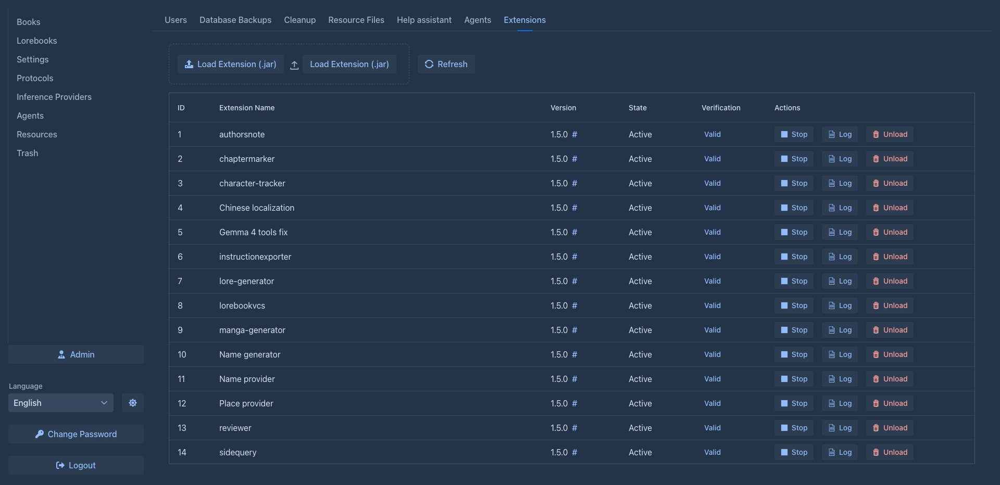
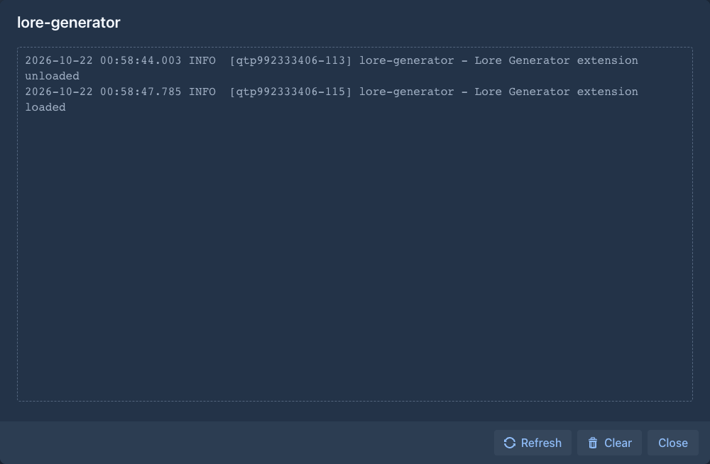
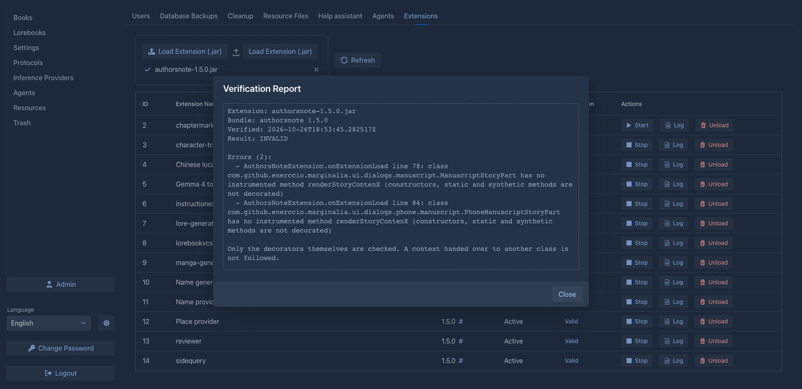

# Managing extensions

The **Extensions** tab of the admin page installs and removes [extensions](../extensions/index.md) for the whole
installation.

## Installing

Click **Load Extension (.jar)** (or drop the file on it) and choose the extension's JAR file. It is copied to the
`extensions` folder of the [data folder](index.md#the-data-folder) and started right away; *Extension loaded
successfully.* confirms it. The extension appears in the list:

| Column | |
|---|---|
| **ID** | The internal number of the extension in this run. |
| **Extension Name** | Its name. |
| **Version** | Its version. The **#** button next to it shows the SHA-256 hash of the extension's JAR when you hover it; click it to copy the hash, e.g. to compare it with the one published by the author. |
| **State** | *Active* when it is running; *Stopped* when you stopped it (see [Stopping and starting](#stopping-and-starting)); *Installed* or *Resolved* when it failed to start (see [When an extension fails](#when-an-extension-fails)). |
| **Verification** | *Valid* or *Invalid*; click it to read the report of the check Marginalia made before starting the extension. |
| **Actions** | **Stop** / **Start**, **Log** and **Unload**. |

Users see the extension in windows they open from then on - a book that was already open has to be closed and opened
again, or the page reloaded.

JAR files can also be copied into the `extensions` folder directly, for example on a server without access to the
UI; they are loaded on the next start. This is also how the Docker setup can be prepared: put the JARs into
`./data/extensions`. The JARs can be built in Docker too, see
[Plugins](../getting-started/docker-server.md#plugins) in the server guide.

!!!warning Use extensions built for this version
Extensions change parts of the user interface of one Marginalia version. Use the extensions built from the same source
as the application (see the [plugins README](https://github.com/Enerccio/Marginalia/blob/master/marginalia/plugins/README.md)).
An incompatible extension may fail to load or break parts of the application. The extension API is not frozen in
1.0, so expect to update extensions together with Marginalia.
!!!

## Stopping and starting

**Stop** unloads the extension immediately without removing it: it disappears from the screens it added to, but its
JAR and data stay, and it is listed with the state *Stopped*. The button then reads **Start**, which loads it again
(it is checked first, like at the start of the application; if the check fails, it stays stopped and the report is
shown). A stopped extension stays stopped after Marginalia restarts. Uploading a new version of a stopped
extension starts it.

The stop is remembered by an empty file named like the JAR with `.STOPPED` added (`sidequery.jar.STOPPED`) in the
`extensions` folder. On a server without access to the UI, create it to keep an extension from starting, or delete it
to let the extension start on the next start.

## The extension log

**Log** opens the log of the extension: what the extension itself wrote with the logger Marginalia gives to extensions
([Logging](../../developer/plugins/overview.md#logging)). It shows the last part of the file, **Refresh** reads it again
and **Clear** deletes it. The file is `extensions/<name>.jar.log` (for example `sidequery.jar.log`); when it grows over
2 MB it is moved to `.log.old` and a new one is started. It is deleted when the extension is unloaded. Extensions that
don't log anything have an empty log. What the extension logs also goes to the application log (named `extension.<name>`, at the level of the line), so it is in the log of the server too; problems of Marginalia itself are only there.

## Removing

**Unload** asks for confirmation, then stops the extension immediately and deletes its JAR (and its log) from the
`extensions` folder.
Its data stays (see [Where extension data is kept](../extensions/index.md#where-extension-data-is-kept)); loading it
again brings the data back.

## Updating

To install a newer version of an extension, **Load Extension (.jar)** with the new file - the file name doesn't
matter. The installed version is unloaded, its JAR deleted and the new version started in its place. If the new
version fails to load, the upload shows the error and the old version keeps running.

## When an extension fails

If an uploaded extension can't be loaded, the upload shows *Failed to load extension: ...* and its JAR is not kept.

Marginalia checks an extension against the version it is running in before it starts it. An extension that does not
fit - typically one built for another version of Marginalia - is not loaded. An upload shows the report of the check
and is not kept; an extension in the `extensions` folder stays in the list, not started, with **Invalid** in the
*Verification* column, and the report is in the log. The check is repeated after Marginalia is updated, so an
extension that worked before can be refused afterwards: get the version of the extension that was built for the new
version of Marginalia and load it. Next to each extension's JAR you'll find a small `.valid` or `.invalid` file with the
report; it is removed with the extension and can be left alone.

An extension in the `extensions` folder that fails to start (for example one built for another version) doesn't stop
the others from loading. It is listed with the state *Installed* or *Resolved* instead of *Active* and can be removed
with **Unload**. A file that isn't an extension at all is skipped and not listed - delete it from the `extensions`
folder. The log (`docker compose logs`, or `desktop/logs/marginalia.log` for the desktop app) has the details of the
error.
