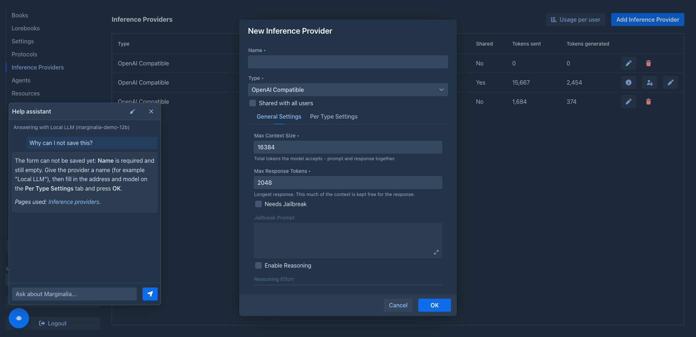

# Help assistant

The help assistant is a chat that answers questions about Marginalia from its manual. An administrator chooses which
model it uses and gives the permission **Help assistant** to the users who can ask it, in their
[permissions](permissions.md) (administrators always can); they need no model of their own. Users that existed
when the permissions were introduced got it if the assistant was on at the time; new users have none.

Once a user can use it, they see a round robot button in the bottom right corner of the window. It opens the chat; the
panel says which model answers and warns when the user's limit applies (see [Who pays](#who-pays)). The model looks
the answers up in the manual (it can search it and read its pages), names the pages it used as links to the
[published manual](https://enerccio.github.io/Marginalia/) (they open in a new tab), and explains: it
changes nothing and does not see the user's books. It can also look at what went wrong when something fails (see
[When something goes wrong](#when-something-goes-wrong)) and take the user somewhere, if you allow it (see
[Showing the way](#showing-the-way)). The conversation is kept until the user logs out (closing the panel
or reloading the page keeps it), the broom button clears it.

The button appears when a user opens Marginalia, and the model and the limit warning are read each time the panel
is opened; if you take the permission away or remove the model, users who already have the page open lose the button when
they reload it (or when they open the panel).

## Settings

Open **Admin → Help assistant**:

| Setting | |
|---|---|
| **Model** | One of *your own* [models](../inference-providers.md), shared with the users or not. Models that other administrators share are not in the list. |
| **Allow reading administration data** | Lets the assistant read the state of the extensions and their logs, the database backups and the other data of the Admin page *for an administrator who asks it*, see [Administration data](#administration-data). Off by default. |
| **Prompt for administrators**, **Prompt for other users** | The instructions the model gets with every question; see [Prompts](#prompts). |

Two settings depend on the user and are in their **Help assistant** [permission](permissions.md#settings-of-a-permission) (open it with the
key button in **Admin → Users**; both are off by default):

| Setting of the permission | |
|---|---|
| **Apply limits** | Only for a shared model, see [Who pays](#who-pays). |
| **Allow navigating the interface** | Lets the assistant open a section, select a tab or open the dialog to add something when a user asks it to show them where something is, see [Showing the way](#showing-the-way). |

An administrator who has no such permission is answered with both off.

The settings are saved with **Save**. The assistant asks the model without a [protocol](../protocols.md), so the settings of the model itself apply. It stops working by itself when the model is deleted,
or when its owner is no longer an administrator, so a model that belongs to an ordinary user is never handed to
everybody.

## What the assistant sees of the screen

The model can look at what the user is doing right now (it is told to when a question is about "here" or "this"): which
section, tab or dialog is open, as a short description for each part of the screen - for example the title of the
open book and its open tab, or the title of an open dialog. The tabs that are not open are only listed, and it reads
them only when the question needs it. For a form that is open it also gets what is wrong with it right now: the fields
that the form marks as invalid with the message it shows, the required fields that are empty, and what the form checks across
fields (for a model: the response must be smaller than the context). Only the *names* of the fields, never what is typed in
them. It never gets the text of a story, a lorebook entry, an API key or a password.

## When something goes wrong

When a user says that something failed ("I get an error", "it does not save", "the model does not answer"), the
assistant can read what Marginalia showed them: the last errors, the failed requests to the model provider (wrong key, no such model,
limit reached, timeout...), the warnings and the messages of forms that could not be saved, newest first and with how long ago
each happened. It explains what the message means and what to fix, and for a form that is open it says which fields to
change.

What is written down, and where:

* everything a user is shown as an error or a warning in a notification, and the message of a failed validation, is kept
  for the session (the last 20);
* unexpected failures (the ones with a stack trace dialog) and failed requests to a provider are also kept by the browser tab
  (the last three, in its session storage), so they are still there after the page is reloaded or the session
  expired.

The assistant gets the text the user saw and, for a failure, the names and messages of the exceptions, without the stack trace.
Each text is cut at 400 characters and what looks like a key, a token or a password is removed, but the text of a message
can still contain a part of what a provider or the system said, for example the answer of a provider to a request. The model that answers is the one you chose, which may
be an external provider: keep that in mind when you [choose it](#settings).

## Showing the way

With **Allow navigating the interface** on in the permission of the user, the assistant can do a few things in the window itself when a user asks it
("show me where the lorebooks are", "take me to the backups", "how do I add a model?"): open a section (Books, Lorebooks, Settings, ...), the Admin page
(only administrators have it), select a tab of the Settings, of the Admin page or of the story editor, or press the button that
opens the dialog to add a book, a model or a protocol (the dialog only opens, nothing is created until the user fills it in
and confirms; it is not offered while another dialog is open). It tells the user what it did.
It can do nothing else: it does not press other buttons, type, save, delete, generate, close a dialog or log out, and a user who
cannot open something cannot have the assistant open it for them. It does not move on its own initiative, only when asked.
Where the navigation is locked (the open section has unsaved changes, a book is being generated) it can not move.

Allowing it also tells the model the names of the elements on the screen and what they offer; that is the same kind of
information as in [What the assistant sees of the screen](#what-the-assistant-sees-of-the-screen).

## Administration data

With **Allow reading administration data** on, the assistant can read the data of the Admin page for an administrator who asks
it ("why does Side Query not work?", "when was the last backup?"), and for nobody else; an ordinary user
never gets it, whatever the setting says, and it is checked again every time it is read.

| Topic | What it reads |
|---|---|
| Extensions | Every installed [extension](../extensions/index.md) with its version, whether it is active, stopped by you or failed to start, and the result of its verification |
| The log of an extension | The last lines of its log (40 by default, 200 at most), the same as **Admin → Extensions → Log** |
| Users | How many users there are, how many administrators and how many are locked out; no names |
| Database backups | The size of the database, how many backups there are and when the newest was made, the schedule, whether a restore is waiting |
| Cleanup | What a [cleanup](cleanup.md) would remove (nothing is removed), and what blocks it |
| Application | The Java version, the memory in use and how long the application has been running |

It is read only: the assistant cannot start, stop or remove anything there. Keep in mind that all of it is sent to the model that
answers, which may be an external provider, and that the log of an extension can contain text the extension wrote (a
log line is cut at 400 characters and keys, tokens and passwords are removed, but nothing more is done to it). That is why the setting is off until you
turn it on.

## Prompts

There are two prompts: one for administrators (who may ask about the Admin page) and one for everybody else (who are
told that administration is for administrators). Both are filled in with the defaults; change the text and save, **Reset
to default** puts the default back. A prompt that is empty or equal to the default is stored as "the default", so it
improves with a new version of Marginalia, one you changed is yours to keep up to date.

`` in a prompt is replaced by the list of the manual's pages (path, title and what the page is about), which is how
the model knows what it can read. Leave it out and the model only finds pages by searching. Keep the instructions to look
things up in the manual and to say so when it does not cover a question, otherwise the answers get less reliable. The rules
for the tools that read errors, move through the interface and read the administration data are added to the prompt by
Marginalia (you do not have to keep them in it), and only for the tools that are allowed.

## Who pays

The users never see the model or its API key; their questions go through the application.

| Model | **Apply limits** (permission of the user) | What happens |
|---|---|---|
| Shared | on | A question is a request like any other to the shared model: the [limit](../inference-providers.md#limits-of-shared-providers) you set for the user is checked and the tokens are added to the user's usage. A user whose limit is reached (or who may not use the model) gets no answer. |
| Shared | off | The model's owner pays. The user's limit is ignored and nothing is counted for the user. |
| Not shared | (no effect) | The model's owner pays: no limit, nothing counted for the user. The model is only used by the assistant. |

Your own questions count in the same way, for you the model is just another model.
