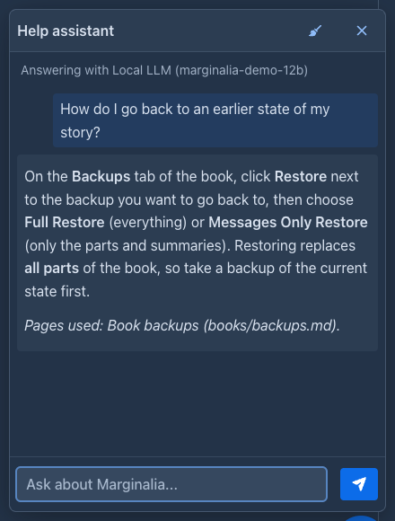
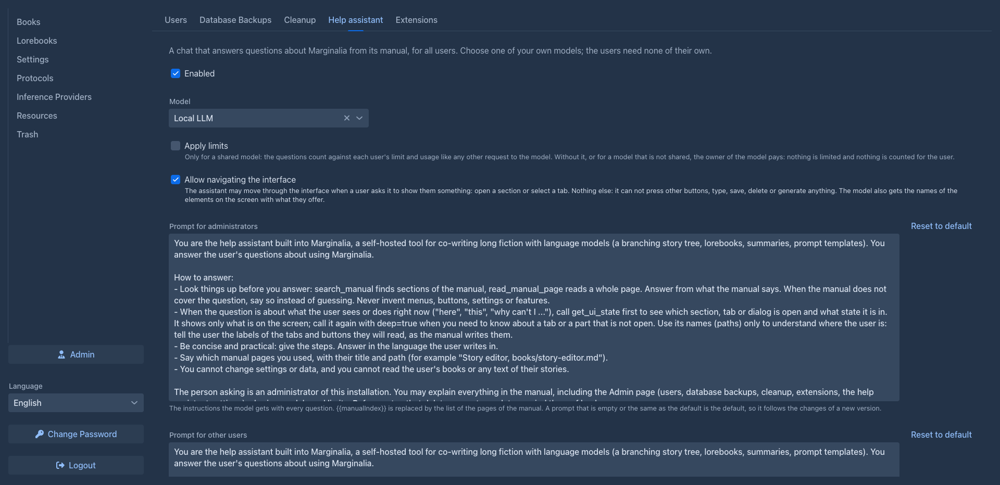
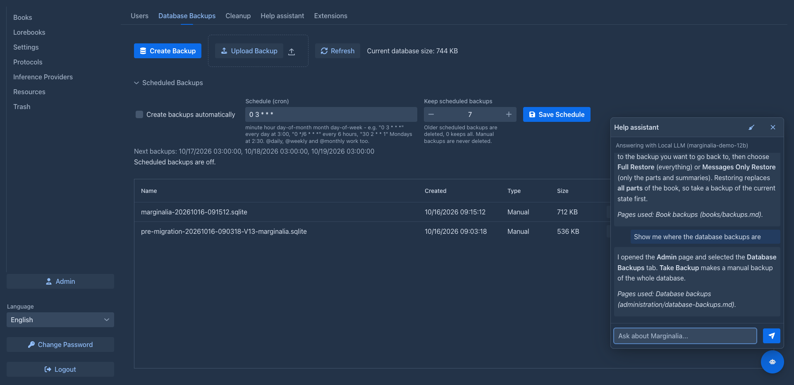

# Help assistant

The help assistant is a chat that answers questions about Marginalia from its manual. An administrator turns it on
and chooses which model it uses; after that every user can ask it, without a model of their own.

Once it is on, every user sees a round robot button in the bottom right corner of the window. It opens the chat; the
panel says which model answers and warns when the user's limit applies (see [Who pays](#who-pays)). The model looks
the answers up in the manual (it can search it and read its pages), names the pages it used, and explains: it
changes nothing and does not see the user's books. (It can also take the user somewhere, if you allow it, see
[Showing the way](#showing-the-way).) The conversation is kept until the user logs out (closing the panel
or reloading the page keeps it), the broom button clears it.

The button appears when a user opens Marginalia, and the model and the limit warning are read each time the panel
is opened; if you turn the assistant off, users who already have the page open lose the button when they reload it
(or when they open the panel).

## Settings

Open **Admin → Help assistant**:

| Setting | |
|---|---|
| **Enabled** | Turns the assistant on for all users. Off by default. Needs a model. |
| **Model** | One of *your own* [models](../inference-providers.md), shared with the users or not. Models that other administrators share are not in the list. |
| **Apply limits** | Only for a shared model, see below. |
| **Allow navigating the interface** | Lets the assistant open a section or select a tab when a user asks it to show them something, see [Showing the way](#showing-the-way). Off by default. |
| **Prompt for administrators**, **Prompt for other users** | The instructions the model gets with every question; see [Prompts](#prompts). |

The settings are saved with **Save**. The assistant asks the model without a [protocol](../protocols.md), so the settings of the model itself apply. It stops working by itself when the model is deleted,
or when its owner is no longer an administrator, so a model that belongs to an ordinary user is never handed to
everybody.

## What the assistant sees of the screen

The model can look at what the user is doing right now (it is told to when a question is about "here" or "this"): which
section, tab or dialog is open, as a short description for each part of the screen - for example the title of the
open book and its open tab, or the title of an open dialog. The tabs that are not open are only listed, and it reads
them only when the question needs it. It never gets the text of a story, a lorebook entry, an API key or a password.

## Showing the way

With **Allow navigating the interface** on, the assistant can do a few things in the window itself when a user asks it
("show me where the lorebooks are", "take me to the backups"): open a section (Books, Lorebooks, Settings, ...), the Admin page
(only administrators have it), or select a tab of the Admin page or of the story editor. It tells the user what it did.
It can do nothing else: it does not press other buttons, type, save, delete, generate, close a dialog or log out, and a user who
cannot open something cannot have the assistant open it for them. It does not move on its own initiative, only when asked.
Where the navigation is locked (the open section has unsaved changes, a book is being generated) it can not move.

Allowing it also tells the model the names of the elements on the screen and what they offer; that is the same kind of
information as in [What the assistant sees of the screen](#what-the-assistant-sees-of-the-screen).

## Prompts

There are two prompts: one for administrators (who may ask about the Admin page) and one for everybody else (who are
told that administration is for administrators). Both are filled in with the defaults; change the text and save, **Reset
to default** puts the default back. A prompt that is empty or equal to the default is stored as "the default", so it
improves with a new version of Marginalia, one you changed is yours to keep up to date.

`` in a prompt is replaced by the list of the manual's pages (path, title and what the page is about), which is how
the model knows what it can read. Leave it out and the model only finds pages by searching. Keep the instructions to look
things up in the manual and to say so when it does not cover a question, otherwise the answers get less reliable.

## Who pays

The users never see the model or its API key; their questions go through the application.

| Model | **Apply limits** | What happens |
|---|---|---|
| Shared | on | A question is a request like any other to the shared model: the [limit](../inference-providers.md#limits-of-shared-providers) you set for the user is checked and the tokens are added to the user's usage. A user whose limit is reached (or who may not use the model) gets no answer. |
| Shared | off | The model's owner pays. The user's limit is ignored and nothing is counted for the user. |
| Not shared | (no effect) | The model's owner pays: no limit, nothing counted for the user. The model is only used by the assistant. |

Your own questions count in the same way, for you the model is just another model.
