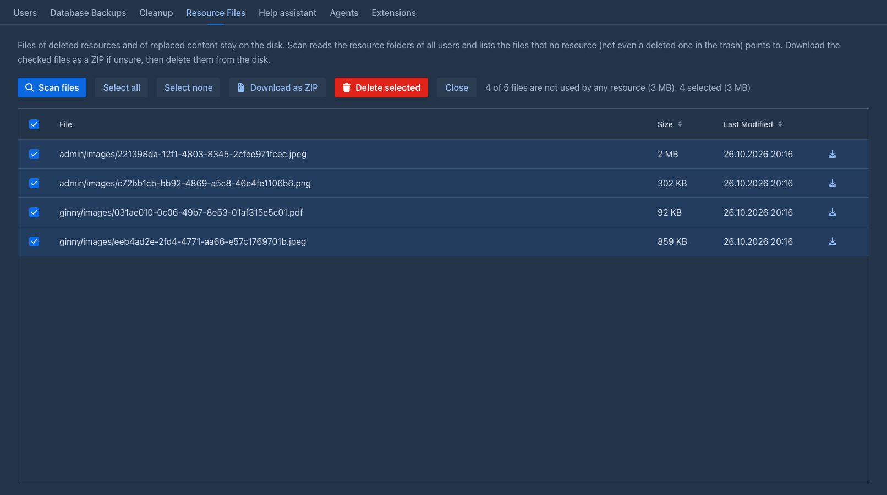

# Resource Files

The files of [resources](../resources.md) (the pictures users attach to story parts, uploaded files) are stored in the
data folder of each user, in `data/<login>/images` and `data/<login>/resources`. Deleting a resource, or replacing its
content, only changes the database: the file stays on the disk, and neither the [cleanup](cleanup.md) nor anything else
removes it. **Resource Files** finds the files that nothing uses any more, lets you download them and deletes them from the
disk to get the space back.

## Cleaning up the files

1. Open the **Resource Files** tab of the admin page and click **Scan files**. A progress bar shows the folders being read.
   Nothing is changed.
2. The table lists the files **no resource points to**: the path (`<user folder>/images/<file>`), the size and the date they
   were last modified. All of them are ticked. Untick what you want to keep, **Select all** and **Select none** change all
   of them, and the arrow in the header of the first column does the same. A line above the table tells how many of the files
   are unused, their size, and how many are ticked.
3. Optionally click **Download as ZIP** to get the ticked files in one archive (the entries are named by their path), or the
   arrow in a row for a single file. That is the backup to keep before deleting.
4. **Delete selected** removes the ticked files from the disk after you confirm. **Close** empties the table without
   deleting anything.

!!!warning
Deleted files can't be brought back. Download them as a ZIP first when in doubt.
!!!

## What counts as used

A file is used when **any resource of any user points to it**, a deleted one included: a resource in the
[Trash](../trash.md) can be restored, and its picture must work again. So the files of resources that are deleted are listed
only after the [cleanup](cleanup.md) has removed the resources from the database, together with the files of content that was
replaced (the old file stays behind) and files left by failed uploads.

The files are compared by name (a random identifier), in the folders of all users, also the `<login>-deleted` folders of
deleted users: their files stay *used* until the cleanup purges the user and their resources.

Only the `images` and `resources` folders of the folders in the data folder are read, nothing else (database backups,
agent workspaces and so on are not touched).

A file that a user uploads after the scan is not deleted: **Delete selected** reads the database again and keeps the files that
resources point to by then (the message says how many files were kept).

The scan reads the data folder, which can take a while with many files; **Stop** on the progress bar cancels it.
