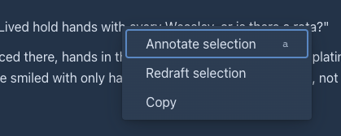
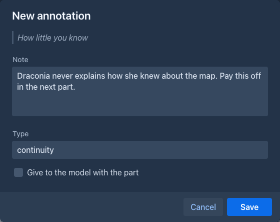
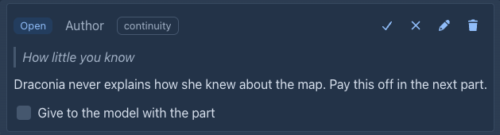
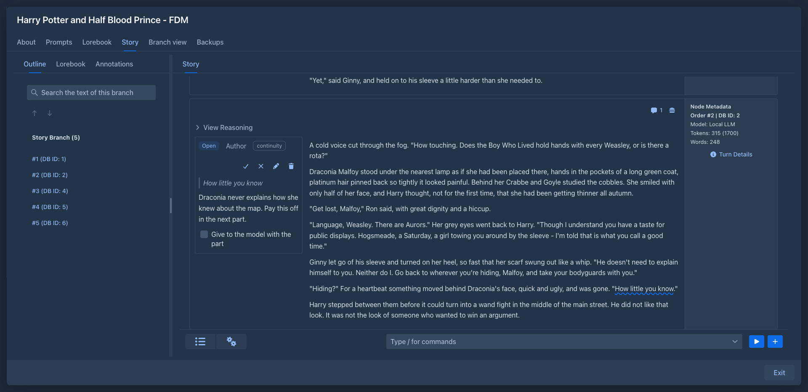
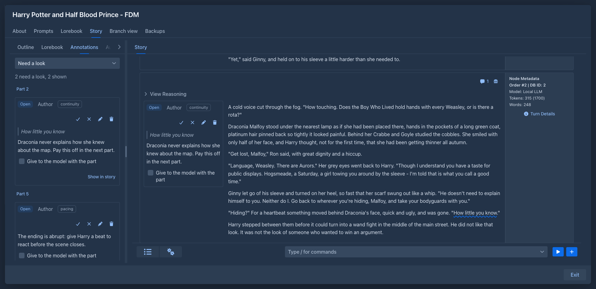
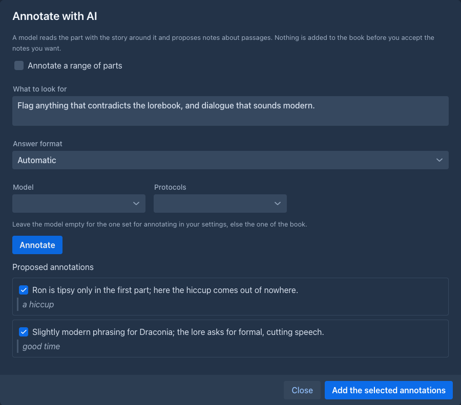
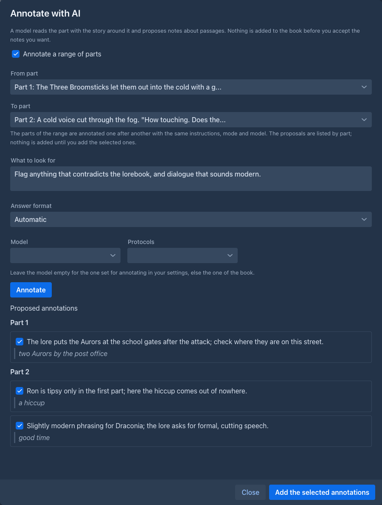

# Annotations

An **annotation** is a note for you about a passage of a part: *weak scene*, *timeline is wrong*, *revisit*. It works like
a comment in a word processor: the text of the story stays clean, the passage is only marked, and the note lives next to
it. Notes can also come from a model or from an [extension](../extensions/index.md) that checks the story.

An annotation is **for the author**. It is not sent to the model unless you say so for that note, see
[Giving a note to the model](#giving-a-note-to-the-model).

## What an annotation is

| | |
|---|---|
| **Passage** | The words the note is about, or the **whole part**. |
| **Note** | What you want to remember. |
| **Type** | An optional word you choose (*continuity*, *style*, *pacing*...). |
| **Source** | Who wrote it: you, a model (*AI*), an *agent* or an *extension*. The mark in the text has a different colour for each. |
| **Status** | *Open*, *Resolved*, *Dismissed* or *Orphaned*. Only open notes are marked in the text. |

A part can have any number of annotations, also on overlapping passages.

## Making an annotation

**On a passage.** Select the words in the text of the part (they can have formatting, the selection does not have to be
exact), then **right click** it (a long press on a phone) and choose **Annotate selection**, or press its [key](story-editor.md#keyboard-shortcuts) (`a`). The window shows the passage; write the note, an
optional type, and whether the model gets the note, and **Save**. The menu (☰) of the part has no such item: opening it takes the selection away. The right click menu has **Annotate selection**, [**Redraft selection**](story-editor.md#redrafting-only-a-passage) and **Copy**, and replaces
the one of the browser on the text of a part, so it has **Copy** too. While the part is being edited, the selection in the
editor is used: the edit is saved first.

**On the whole part.** Choose **Annotate part** in the menu of the part.

**With a model.** Choose **Annotate with AI**, see [below](#letting-a-model-annotate).

**From the command line** (and for extensions): [`/create-annotation`](../commands/index.md#annotations).

## Reading the annotations

A passage with an open note is underlined with a **wavy line**, coloured by who wrote the note (blue you, orange a
model, green an agent, red an extension). A note inside another one is underlined lower, so both can be seen.

- **Click the underlined text** to see the notes that cover that point (all of them where passages overlap). They open
  next to the text; on a phone tap the passage.
- A **speech bubble with a number** in the header of a part counts the notes of the part that need a look. Click it to
  see them all, also the ones about the whole part and the ones that lost their passage.
- In the **margin** (the cogs menu of the story, **Annotations in the margin**; desktop only, and remembered for you) the notes of every part stand in a column
  left of its text, in the order of their passages, instead of in the popover. The note under the pointer and its underlined passage light up together, and a click on
  a passage brings its note into view. The notes are the same ones (resolve, edit...); resolved and dismissed notes are not shown there, as they are not underlined.
- The **Annotations** tab lists the notes of the whole book, grouped by part in the order of the story, with a filter
  (*Need a look*, *Closed*, *All*). **Show in story** (or the number of the part) takes you to the part.

Each note shows who wrote it, its type, its status, the passage, the note and these actions:

| | |
|---|---|
| ✓ **Resolve** | The problem is dealt with. The note leaves the text and stays in the list. |
| ✗ **Dismiss** | The note is not worth dealing with. Same. |
| ↶ **Reopen** | Brings a closed note back. |
| ✎ **Edit** | Changes the note and the type. |
| 🗑 **Delete** | Deletes the note; it can be restored from the [trash](../trash.md). |
| **Give to the model with the part** | See below. |
| **Attach to selection** | For a note without a passage: select text in the part, then click it. |

## Annotations follow the text

You do not have to care where a note is when you edit. Marginalia keeps the passage of each note with the words it
was about:

- text added or removed **before** the passage moves it;
- an edit **inside** the passage makes it longer or shorter;
- words you type **right at the start or end** of the passage are outside of it;
- fixing a typo in a one word passage keeps the note on that word.

When the passage is **deleted** or rewritten so that it can't be found, the note becomes **Orphaned**. It is kept: attach
it to another passage (**Attach to selection**), dismiss it, or delete it. If you bring the words back (undo), the note
finds its passage again.

When a part is **generated again** the text is new, so the notes find their passages again by the words they quoted;
the ones whose words are gone are orphaned. When two parts are [merged](story-editor.md#merging-a-part-into-the-previous-one), the notes of the later one move to
the merged part. A **branch** of a part copies its notes. Notes are part of [backups](backups.md), copies of a book and
exports of a backup.

## Letting a model annotate

**Annotate with AI** in the menu of a part asks a model to review it. You say what to look for (*flag continuity errors*,
*weak dialogue*, *contradicts the lore*; empty uses the task of the prompt), choose the model, and **Annotate**.

The model reads the part like the [redraft](story-editor.md#redrafting-a-part) does: the part, the story before it (older
story as [summaries](summaries.md)), as much of the story after it as fits, the lore and the style of the book, and the
notes the part already has so it does not repeat them. It never gives positions: it **quotes** the passage, and Marginalia
finds the quote in the text. A quote that is not found is not lost: the note is proposed as a note about the whole part,
marked *not found in the text*.

**Nothing is added to the book until you accept.** The notes the model proposes are listed with a check box each (all
checked); uncheck the ones you do not want and choose **Add the selected annotations**.

| Option | |
|---|---|
| **Model** | The model that reviews. Empty is the **Default model for annotating** from your [settings](../account.md#general-settings), else the model of the book. Reviewing is analysis, so this is often not the model that writes the prose. |
| **Answer format** | *Automatic* (structured, when the model can answer in JSON), *Structured (JSON)*, *Text blocks* (for models that do not keep to a format) or *Free critique, then extraction* (the model writes a free review, a second model, usually a cheaper one, turns it into notes: choose it under **Model that extracts the notes**). |

**A range of parts (batch).** **Annotate with AI** in the menu of a part reviews that part only. To review several, open the
settings menu (⚙) of the story and choose **Annotate a range of parts with AI** (on a phone too). It is the same window with
**From part** and **To part** to choose (both are required, **Annotate** waits for them; it does not matter which
is the earlier; only parts with a text are listed). **Annotate** then reviews the parts of the range one after another, with the same instructions, answer
format and model, each read with the story around it like a single part. The proposals are listed under the number of
their part, all checked, and **Add the selected annotations** adds each to its own part. **Stop** stops the part in progress
and starts no more; what was found until then stays in the list. A part whose answer can't be read or that does
not fit the context of the model is skipped (the window says which) and the run goes on; a failure of the model ends the run.
Every part is a request to the model, so a long range costs as many requests (and tokens).

If an answer can't be read, Marginalia asks once more; if it still can't be read, the model's answer is shown so the work
is not lost. The prompt is the [annotate prompt](prompts.md#annotate-prompt).

### Annotating every new part automatically

The settings menu (⚙) of the story has **Automatic annotation** (on a phone too; a check mark shows that it is on). It makes the
book review each part right after it was generated, and optionally redraft it. The settings are stored with the book:

| Option | |
|---|---|
| **Model**, **Protocol** | The model that reviews. Empty is the model of the book (not the **Default model for annotating** of your settings, which the window you open yourself starts with). |
| **What to look for** | The instructions, as in **Annotate with AI**. Empty uses the task of the prompt. |
| **Annotate every generated part automatically** | Turns it on. After a part was generated (a new part, a swipe or a regeneration; not one that was stopped or failed) the annotation window opens and **starts at once**. |
| **Add the annotations without asking** | When the model is done, the notes it found are added and the window closes. Without it the window stays open with the proposals, as when you start it yourself. |
| **Then redraft the part to address the annotations** | Only with the one above. After the notes were added the [redraft](story-editor.md#redrafting-a-part) window opens and starts at once, with **Deal with the open annotations of the part** checked and no instructions of its own. It writes with the model of the book and does not offer to revalidate summaries: the part is new, no summary describes it. |
| **Apply the redraft without asking** | Only with the redraft. When the model is done the redraft replaces the text of the part, the notes it dealt with are marked resolved and the window closes. Without it the window stays open for you to look at the result. |

**Closing a window ends the whole run.** If you close or stop the annotation window, nothing is added and no redraft follows; if you close the
redraft window, the part keeps its text. A model that finds nothing closes its window (with a message) and nothing follows,
since there is nothing to redraft. A window that stays open (no automatic add, an answer that could not be read, a stopped run) waits for
you; closing it ends the run.

Every generated part costs at least one more request to the model (two with the redraft). If you generate with a local server that keeps only one prompt in its cache,
the review replaces the story in it and the next generation has to read the story again: choose another **Model** for the review, or
a second server.

## Giving a note to the model

Check **Give to the model with the part** on a note and it becomes a note to the model too: the notes of the parts that are
in the prompt go into the master template as `{{annotations}}` (the built-in template has a block *Author's notes on the
story*; a template of your own has to use the variable). Only **open** notes with this check are given, and only for the
parts that fit into the prompt. Use it for what the model should keep in mind while it continues (*this character is hiding
the letter*), not for editing remarks.

## Redrafting to address the notes

When a part has open notes, the [redraft](story-editor.md#redrafting-a-part) window has a check box **Deal with the open
annotations of the part**. Checked, the model gets the notes (the passage and the note) together with your instructions and
rewrites the part to deal with them; when you **Apply** the redraft, those notes are marked resolved. In the
[redraft of a selection](story-editor.md#redrafting-only-a-passage) only the notes whose passage overlaps the selection are
given.

## Commands

[`/list-annotations`](../commands/index.md#annotations), `/get-annotation`, `/create-annotation`, `/update-annotation`,
`/resolve-annotation`, `/reattach-annotation` and `/delete-annotation` work with the notes from the command line.
Extensions can use the same commands. [`/generate-annotation <part>`](../commands/index.md#annotations) is **Annotate with AI** as a command: the model reviews the part with the model of the book
(an agent uses its own model when *Write the book with the model of the agent* is on; `profile` picks another model profile of the agent), with the instructions, answer format and prompt of the book, and every note it finds is added at once,
since there is nobody to pick them. It is one request to the model, so it runs alone and costs tokens.

## Annotations and agents

An [agent](../agents.md) reads and writes annotations with the same commands: it can annotate a whole book (*continuity*, *style*...), resolve notes it dealt with, edit
or delete them. It works on a copy of the book, so nothing reaches your notes until you [review the result](../agents.md#reviewing-the-result):

- A note the agent made is a line **Annotation - Added**, one it resolved, dismissed or rewrote is **Changed** (with the note, type, status and *give to the model* as the
  fields, each with its own **Take this change** box), one it deleted is **Deleted**. The notes of a part the agent deleted go with the part and have no lines.
- The line says in which part the note is (`3: ` and the start of the note); **Show in the copy** opens the part in the agent's copy. A note on a part the agent wrote needs
  that part: ticking the note ticks the part too.
- **Only annotations** above the list ticks the notes alone. The passage of a taken note is the same one when the text of the part is the same; when you take the
  agent's new text of the part, or your own text differs, the note finds its words again in the text of your book and, when it can't, becomes a note about the whole part.
- A note you wrote while the agent was paused comes into its copy when it resumes (and a note you resolved is resolved there), so it knows about it; a note you and the agent
  both changed is a conflict like any other.
