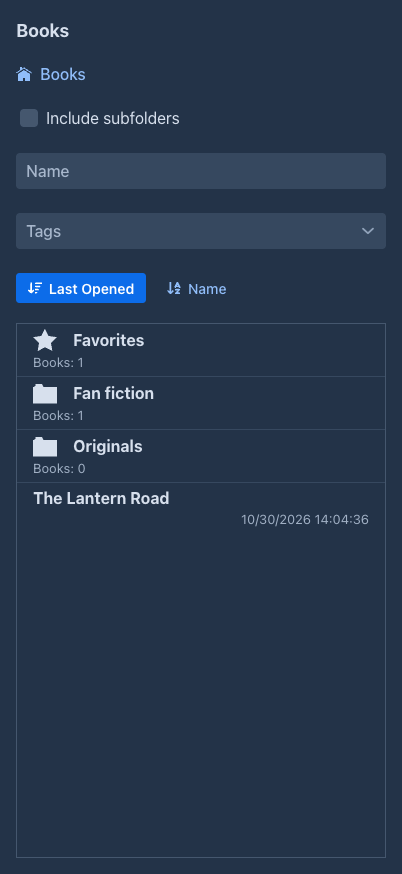
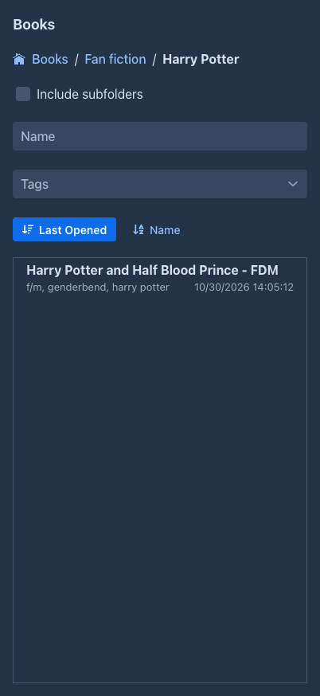
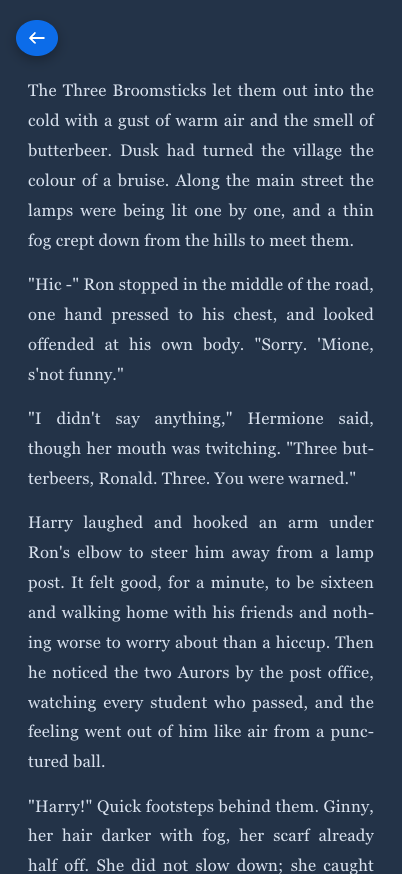

# Publishing & viewer

The **viewer** is a reading view of your books: just the text of the story, without the editor around it. It works
well on phones and tablets. **Publishing** a book lets other users of the same Marginalia installation read it in the
viewer.

## Opening the viewer

The viewer is at `/view` on your Marginalia address, for example:

- desktop app: `http://127.0.0.1:8765/view`
- server: `https://marginalia.example.com/view`

It uses the same login as Marginalia.

The list shows your books, with their tags and when you last opened them. Filter it by **Name** (books whose name
starts with the text) and **Tags** (books with all the selected tags). Sort it by **Last Opened** or **Name**; clicking
the active sort button again reverses the order.

Click a book to read it.

### Folders in the list

The list shows your [folders](folders.md) like the phone list of the workspace does: the folders come first, each with
the number of books beneath it, then the books of the current folder. Click a folder to go into it. The path above the
filters (`Books / Fan fiction / Harry Potter`) shows where you are, and a click on a part of it goes back there.

- **Include subfolders** lists every book below the current folder, at any depth, with the folder of each under its name.
- **Favorites**, the folder of the top level that exists while you have a favorite book, lists the favorite books of all
  folders. Favorites are set in the [list of books](folders.md#favorites), not in the viewer.
- The filters work inside the current folder (or below it with *Include subfolders*), so to search all your books go to the
  top level and check the box. **Last Opened** orders the folders by their last modification.
- The viewer opens in the folder where you left it: after reading a book the arrow takes you back to the same folder, and the
  next visit, or a reload, starts there too. The place is kept in a cookie of your browser (`marginalia_viewer_folder`), the
  server does not store it, so another browser starts at the top level. A folder that was deleted is the top level.

## Reading

The reading view shows the [active branch](branches-and-story-tree.md) of the book from the first to the last part,
in the book reading style (justified, with hyphenation for the book's [language](managing-books.md#the-about-tab)). Other branches, the turn instructions and the metadata are not shown. The arrow button in
the top left corner returns to the list.

What you read is the book as it is now: new parts appear the next time the page is opened.

A long book is read in pieces: the parts around where you are are shown, the next (and previous) ones are added as you
scroll, and the ones far away are dropped again; a *Loading* mark at the edge appears if you scroll faster than they
arrive. No more than the **Parts loaded at once in the story** setting of [your account](../account.md) are loaded at a
time; empty loads the whole book at once.

The viewer remembers where you stopped reading each book: it opens the book at that part the next time. The position is
kept in the local storage of your browser only (per book), it is not saved on the server, so another browser or a cleared
browser storage starts at the beginning.

[Pictures of the parts](story-editor.md#images) are shown under the text, but only to you, the owner. Readers of a
[published](#publishing-a-book) book see the text without the pictures.

## Publishing a book

By default only you can open your books in the viewer. To let other users read a book:

1. Open the book and check **Published** on its *About* tab.
2. Copy the reader link that appears under the checkbox on the *About* tab. The link is the address of your
   installation (including its context path, if Marginalia is not served from the root), followed by `/view/` and the
   book's ID: `<address of Marginalia>/view/<book ID>`. In Docker, where Marginalia runs as the root application, it
   looks like `https://marginalia.example.com/view/0b6f3c1e-...`; if it is deployed under a context path such as
   `/marginalia`, the link is `https://example.com/marginalia/view/0b6f3c1e-...`. (You can also copy the same address
   from the browser's address bar when the book is open in the viewer.)
3. Send the address to the other users.

Other users need an account on the same Marginalia installation; they log in and see the book. Published books don't
appear in their viewer list, only the address opens them. They can only read the book, not change it.

Publishing shares the book as it is: only the text of the parts is shared, the pictures of the parts stay private.

Uncheck **Published** to stop sharing: the address then shows *Book not found* to everyone but you. Deleted books
can't be opened at all.
