# Story editor

The **Story** tab of a book is where you write. It shows the parts of the [active branch](branches-and-story-tree.md)
from the beginning to the end.

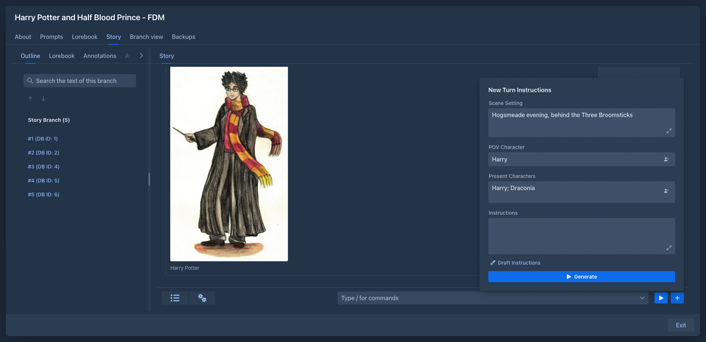

This page describes the desktop layout. On a phone the story is one column with the outline in a drawer, see
[Using Marginalia on a phone](../phone.md#the-story).

| Area | |
|---|---|
| **Outline** (left) | One entry per part, `#1`, `#2`... with the part's database ID. Click an entry to scroll to the part (the parts before it are loaded first when it is not loaded yet). The header shows how many parts the branch has. The [Chapter Marker](../extensions/chapter-marker.md) extension shows chapter titles here. |
| **Lorebook** (left, next to the Outline) | A read only look at the lore of the book, see [The lorebook tab](#the-lorebook-tab). |
| **Annotations** (left, next to the Outline) | The [notes](annotations.md) on passages of the story, for the whole book. |
| **Story** (center) | The text of each part, with its menu (☰) and its metadata on the right, and under it the bottom bar. |
| **Bottom bar** | The **Summaries** button (list icon) and the settings menu (⚙) on the left, the command line, and the **+** button on the right. |

This is how a new book looks. All of these are tabs you can arrange as you like, the story included, see
[Arranging the tabs](#arranging-the-tabs). The divider between the sidebar and the story can be dragged, and Marginalia
remembers where you left it (saved with the book) and returns to it when you open the book again.

The story always opens at the bottom, at the newest part. A long book is not drawn all at once: only the last parts are
loaded, and the earlier ones are added above as you scroll up, without moving the part you are reading. The parts at the
other end are dropped again, so no more than the **Parts loaded at once in the story** setting of your
[account](../account.md) stay loaded (empty loads all of them). If you scroll faster than the parts arrive, a *Loading
earlier parts* (or *later parts*) mark at the edge says that there is more. Clicking a part in the outline, or finding one
with the search, loads the parts around it, and starting a new part brings you back to the end of the story.

### Searching the story

Above the outline there is a search field for the text of the **branch you are on** (the search of the story tree
searches all branches). Because a long book is not loaded all at once, the search of the browser (Ctrl+F) cannot find
text in the parts that are not loaded; this one can.

- Type what you look for; the search starts when you stop typing. Several words must all be in the same part, a phrase
  goes in double quotes (`"old key"`) and `*` stands for any characters (`light*house`). The case does not matter.
- Every place where a word stands is a match, and they are numbered through the whole branch. Below the field you see
  *Match 3 of 27, in part #5* and a bar with how far you are. The story scrolls to the match and loads the parts around it
  when they are not loaded.
- The **up** and **down** buttons go to the previous and the next match (after the last one it goes round to the first).
  **Enter** in the field does the same as the down button, **Shift+Enter** as the up button.
- All the matches in the loaded parts are highlighted in the text, the match you are at in a stronger colour. Clear the
  field to remove the highlight.

On the phone the search is in the outline drawer; the drawer closes when it shows a match, open it again for the next one.

### The lorebook tab

The **Lorebook** tab of the sidebar shows the lore of the book's lorebook without leaving the story, so you do not have to
swap tabs to check what an entry says. It is a preview: nothing can be changed here, change the lore in the book's
*Lorebook* tab. It is read again every time you come back to the *Story* tab, so changes you made there show at once.

- Every entry is a row with its name; the arrow opens it to show its **content** (rendered as Markdown) and the **text that activates it** (the
  *Filtering Text/Pattern*, with a note when it is a regular expression).
- **Include sub lorebooks** shows the lorebook and each of its sub lorebooks (and theirs, however deep) as rows of their own, with their entries
  under them; click the arrow of a lorebook to hide its entries. Without it only the entries of the book's lorebook are listed.
- Entries and lorebooks that are switched off (they are not used for the story) are shown dimmed.
- A book without a lorebook shows a note instead.

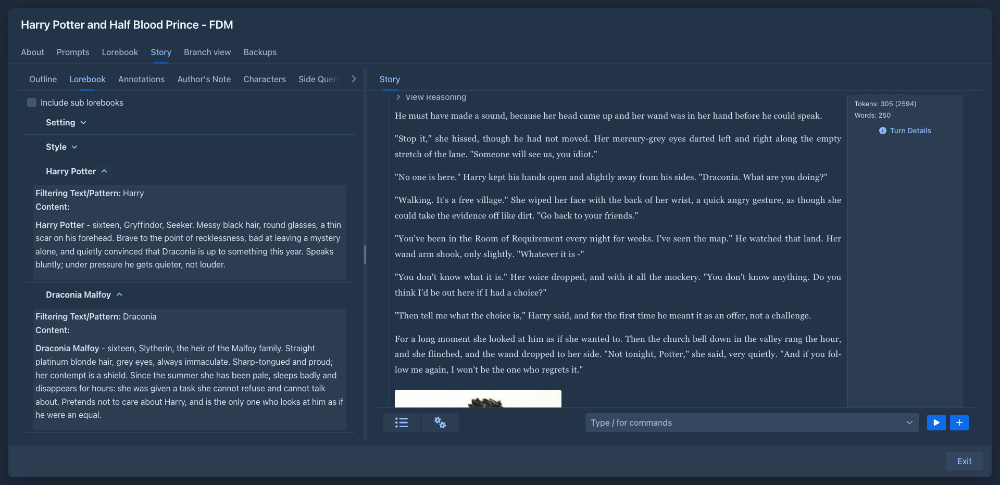

Like every tab of the editor it can be dragged out into a panel of its own, see below.

### Arranging the tabs

The editor is a set of tabs: the **Story** itself (the parts and the bottom bar under them), the **Outline**, the **Lorebook**, and the
tabs [extensions](../extensions/index.md) add (Characters, Arcs, Side Query...). Drag a tab by its header to rearrange
them (desktop only, the phone keeps one column with the outline in a drawer). A new book has the Outline and the Lorebook in a panel
on the left and the Story in a column of its own on the right; you can put the story anywhere, for example in the middle with the
outline on one side and the lore on the other, or above the outline:

- Drop it on one of the dashed strips that appear above, between and under the panels of a column to **detach** it into a
  panel of its own in that column; the panels of a column are stacked under each other.
- Drop it on one of the tall strips at the left, right or between the columns to **detach it to the side**: it gets a
  column of its own, next to the others. Widen the editor with the dividers to make room for more columns.

The panels and the columns are separated by splitters: drag them to give each panel the room you need. The sizes are saved
with the arrangement.

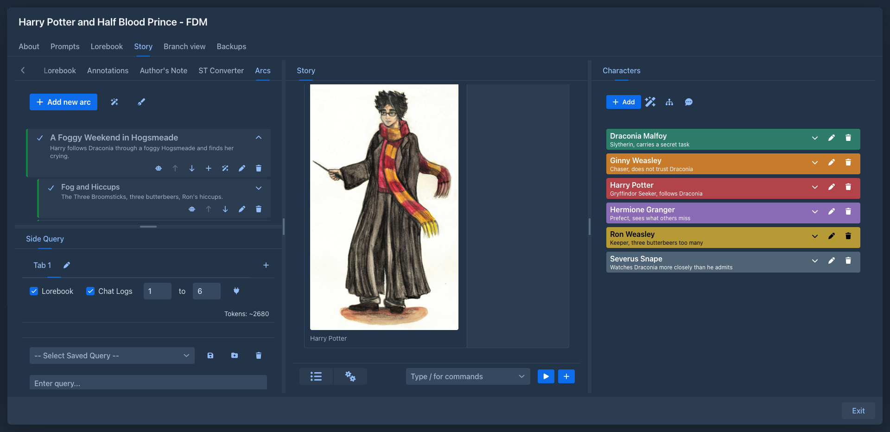

- Drop it on the tab header or on the body of another panel to **join** that panel (dropping on a tab puts it before that
  tab, dropping on the body puts it last). A panel that loses its last tab disappears, and so does a column without panels.

The arrangement and the sizes are saved with the book, so it is the same the next time you open it and in every browser; the tab each
panel shows is remembered with the rest of your workspace. A tab of an extension that is not loaded keeps its place for when
the extension is back.

The story is always somewhere: its tab can't be closed, and a tab that lives in a panel together with other tabs is hidden
while another one is selected. Whatever shows a part brings the story back: clicking an entry of the outline, a hit of the
search, choosing a branch in the [story tree](branches-and-story-tree.md), and starting a generation select the **Story** tab
first. While a generation runs the other tabs are disabled and only the story stays usable, so you can stop it.

To go back to the arrangement of a new book, choose **Restore default layout** in the settings menu (⚙) of the story and confirm.
It only moves the tabs back (and forgets the sizes): your texts, the tab each panel shows and the tabs of extensions stay, the
latter in the first panel.

## Writing the next part

1. Click **+** in the bottom right corner. The *New Turn Instructions* panel opens.
2. Fill in the fields. All of them are optional, but the model needs at least some direction:

   | Field | |
   |---|---|
   | **Scene Setting** | Where and when the part takes place, e.g. *The lighthouse, a stormy night in late autumn*. |
   | **POV Character** | Whose point of view the part is written from. |
   | **Present Characters** | Who is in the scene, and in what state. |
   | **Instructions** | What should happen in this part. |

   *Scene Setting*, *POV Character* and *Present Characters* are filled in from the last part, so you only change
   what is different. *Instructions* starts empty each time.
3. Click **Generate**.

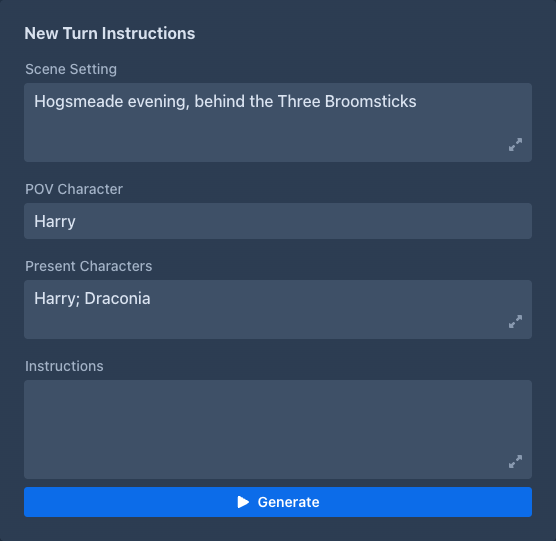

The new part appears at the end and fills in as the model writes it. For [reasoning models](../inference-providers.md#reasoning-models)
the reasoning appears first under **View Reasoning**.

While a part is being generated, the **+** button turns into a red **Stop** button. Stopping keeps the text written so
far as the part. The rest of the book window is disabled until the generation finishes or is stopped.

When the model returns an error (server not reachable, wrong API key, context too long...), the error is shown.
If no text arrived yet, the story stays as it was: a new part or swipe is removed and a regenerated part gets its
previous text back. Text that already arrived before the error is kept, like with **Stop**. Fix the problem and
generate again.

How the fields get into the prompt is set by the book's [User Prompt](prompts.md#user-prompt). With the default user
prompt, the model gets them as *Current Location & Time*, *Point of View Character*,
*Characters Currently Present / State* and *Plot Specifications for the Next Part*.

!!!
The text is written in Markdown: `*italics*`, `**bold**`, `# Heading` and so on are shown formatted. A part with a
`#` heading is a chapter for the [Chapter Marker](../extensions/chapter-marker.md) extension.
!!!

## The part menu

Every part has a menu (☰) in its top right corner:

| Item | |
|---|---|
| **Edit** | Turns the text into an editable field. **Save** (the same menu item) saves it. Starting a generation or leaving the tab saves open edits too. |
| **Discard Changes** | Only while the text is edited: closes the field without saving, the part keeps the text it was last saved with. If you changed the text, you are asked first. |
| **Regenerate** | Writes the last part again, replacing its text. Only on the last part. |
| **Swipe** | Writes another version of the last part and keeps the old one as a separate branch. Only on the last part. See [Branches & story tree](branches-and-story-tree.md#trying-another-version-of-the-last-part). |
| **Redraft** | Lets the model write this part again from your instructions, on any part, see [below](#redrafting-a-part). Not while the text is edited. |
| **Annotate selection** / **Annotate part** | Makes a [note](annotations.md#making-an-annotation) about the words you selected in the part, or about the whole part. |
| **Annotate with AI** | Lets a model [review the part](annotations.md#letting-a-model-annotate) and propose notes. Not while the text is edited. |
| **Branch Story** | Starts a new branch from this part, see [Branches & story tree](branches-and-story-tree.md#branching-from-an-earlier-part). |
| **Merge into previous part** | Adds the text of this part to the part before it, see [below](#merging-a-part-into-the-previous-one). Not on the first part. |
| **Show Prompt** | Shows the exact prompt that was sent to the model for this part. |
| **Token Usage** | Shows how the context of the model was used for this part: a chart of the sections of the prompt (instructions of the model, lore, summaries, story so far, your instructions, room kept for the response) and the size of each message sent to the model. If part of the story did not fit, it says how many parts were left out. Parts written before this was recorded have no chart. |
| **Images** | Attaches pictures to the part, see [Images](#images). |
| **Generate summary** / **View summary** | Summarizes the story up to this part, or shows the summary, see [Summaries](summaries.md). |
| **Delete summary** | Removes the summary of this part. For a [meta summary](summaries.md#meta-summaries) it asks whether to unwind it or delete it completely. |
| **Delete** | Deletes the part, see [below](#deleting-a-part). |

*Regenerate* and *Swipe* use the turn details of the last part (see [below](#turn-details)). To change what should
happen, edit them first.

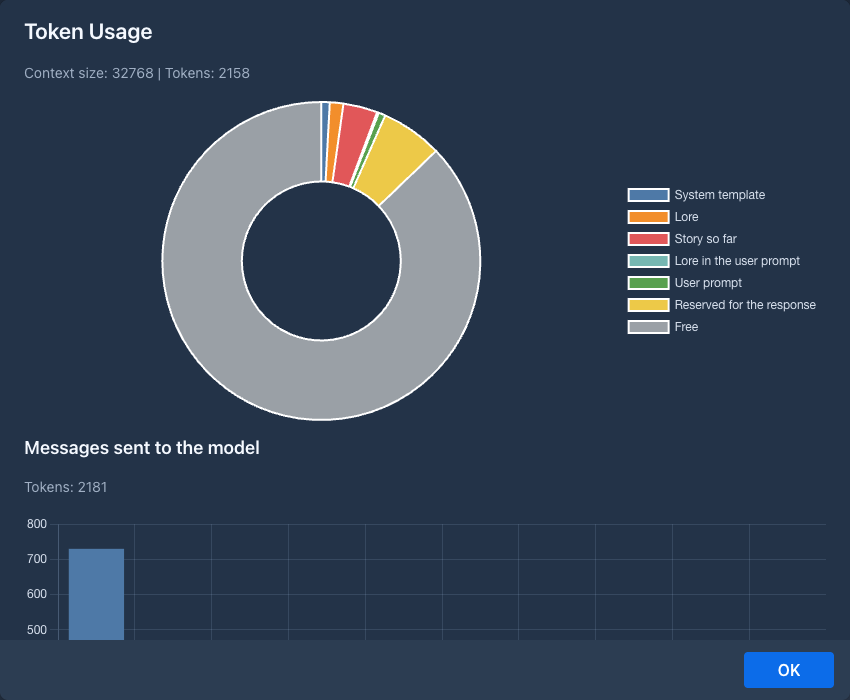

## Part metadata

Next to each part:

| | |
|---|---|
| **Order #n \| DB ID: m** | The position of the part in the branch, and its ID in the database. |
| **Model** | The inference provider that wrote the part. |
| **Tokens: x (y)** | `x` tokens of text in the part, `y` tokens in the prompt that produced it. |
| **Words** | Words in the part. |
| **Turn Details** | The instructions the part was written from. |

### Turn details

**Turn Details** opens the *Scene Setting*, *POV Character*, *Present Characters* and *Instructions* the part was
written from. For the last part they can be changed (changes are saved right away) and are used by *Regenerate* and
*Swipe*. For earlier parts they are read-only.

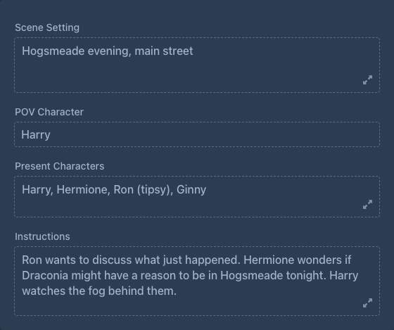

## Editing the text

Generated text is yours to change. Choose **Edit** in the part menu, change the text, and choose **Save**. Edited
parts are sent to the model as you edited them.

Editing a part that a [summary](summaries.md) covers makes that summary outdated; Marginalia notices it at the next
generation and drops the summary.

## Keyboard shortcuts

On a computer (the [phone layout](../phone.md) has none) the writing loop works with the keyboard:

| Key | |
|---|---|
| `+` | Opens the *New Turn Instructions* panel with the cursor in *Instructions*. |
| `Ctrl+Enter` | Generates from the open panel. `Esc` closes it; the keyboard goes back to the story. |
| `Ctrl+.` | Stops the generation that runs. |
| `s` / `r` | **Swipe** / **Regenerate** the last part. |
| `e` | Opens the editor of the last part. |
| `Ctrl+S` | Saves the part that is being edited (also while the cursor is in its text). |

A key without `Ctrl`, `Alt` or `Meta` (such as `+`, `s`, `r`, `e`) works only when no text field has the focus, so it
never gets in the way of typing. The shortcuts work in the story tab of the open book and not while another window is
open above it. The buttons show their key in the tooltip. On a Mac `Cmd` works where a key says `Ctrl` (unless you gave that `Cmd` key to another action). You can change every key in
[Settings → Keyboard shortcuts](../account.md#keyboard-shortcuts).

## Deleting a part

**Delete** removes the part from the story. The parts that followed it stay and continue from the part before it, so
deleting a part in the middle of the story just takes it out. Deleting the last part makes the part before it the new
end of the branch.

## Redrafting a part

**Regenerate** and **Swipe** work on the last part only and write it from scratch. **Redraft** works on any part, also an
old one in the middle of the story, and keeps what you do not ask to change. Choose **Redraft** in the menu of the part:

1. Write what should change in **Instructions for the redraft**: *add more dialogue between the two*, *make the fight
   longer*, *remove the explanation of the map*, *keep the ending as it is*. Empty instructions write the part again with
   the same events.
2. Choose **Redraft**. The text streams into **Redrafted text**; **Stop** ends it early. Choose **Redraft again** for
   another try, with other instructions if you like. **Differences** shows what changed against the part, word by word.
   When the part has open [annotations](annotations.md), **Deal with the open annotations of the part** (checked at first)
   gives them to the model as well, and **Apply** marks them resolved.
3. The redrafted text is a field you can still edit. **Apply** replaces the text of the part with it; **Close** throws it
   away. Nothing in the book changes before **Apply**.

The model gets one prompt, the [redraft prompt](prompts.md#redraft-prompt): the part, your instructions, the story before
the part (the older story as [summaries](summaries.md) where there are valid ones, the rest as text, the newest part first
when it does not all fit), as much of the story after the part as fits (up to a quarter of the room), the lore the part
was written with, the point of view, tense and style of the book, and the scene setting, point of view character, present
characters and instructions of the turn the part came from. The story after the part is there so the new text still leads
into it: events the following parts rely on should stay.

The part keeps its place, its summary, its pictures and how it was generated; the text, its words and tokens are replaced
and the part counts as edited. Applying the redraft is an edit like **Save** in the editor, so [summaries](summaries.md)
that describe the old text become outdated, and Marginalia tells how many. A summary on the part itself is one of them.

## Merging a part into the previous one

A model that stopped in the middle of a sentence (the response limit, a cut connection) cannot be told to "continue" the
same text reliably. Write the next part instead (*continue from where the last part stopped*) and join the two with
**Merge into previous part** in the menu of the second one. A review opens:

- **Join the texts with**: an empty line, a line break, a space or nothing. It is preselected from the end of the previous
  text: a paragraph after a text that ended a sentence, a space after one that was cut.
- The **scene setting**, **POV character**, **present characters** and **instructions** of both turns, combined in fields
  you can edit. What the two turns have in common at the start is kept once ("Write the duel. Keep it short" and "Write the
  duel. Add rain" give the first, and "Add rain" on the next line).
- **Data**: what the two parts keep, value by value (for example the [variables](../templates/macros.md) of the story
  and the data of extensions), with whether the value is the same, different or only on one of the parts. The merged part
  keeps the value of the **later part** (it is where the story stands now) unless you choose the value of the previous
  part for it, or leave the value out. Values that are the same are hidden unless you ask for them.

The previous part keeps its place, its summary and how it was generated (prompt, model, times); it gets the joined text,
the joined reasoning and pictures, and its words and tokens are counted again. The part you merged is deleted (it is in
the [Trash](../trash.md)) and what followed it continues from the previous part. Summaries that cover the two parts become
outdated, as after an edit. The part cannot be merged when it is the first part of the book, or when the part before it has
other continuations (swipes of the part): delete them or make them a branch first.

## Images

A part can have pictures: a map, a character portrait, an illustration. Choose **Images** in the part menu to open the
list of the pictures of the part.

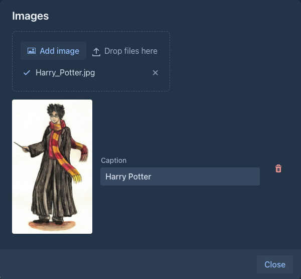

- **Add image** (or drop a file on it) uploads a PNG, JPEG, GIF or WebP picture of up to 10 MB. WebP pictures are
  converted to PNG when they are uploaded, because Word and PDF files can't contain WebP.
- **Caption** is shown under the picture. It can be empty.
- The trash button removes the picture from the part.

The pictures are shown under the text of the part and in the same order in every [export](export.md).

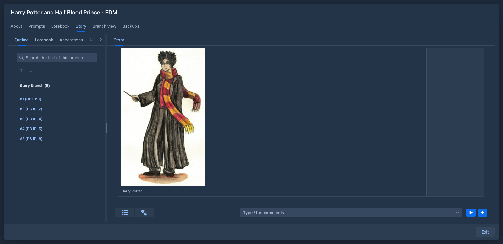

Pictures are **not part of the text**. The model never sees them, they are not in the prompt, they do not count as
tokens and they do not change the [summaries](summaries.md). They are also not Markdown: a `` link written in
the text is not a picture of the part, use **Images** instead.

Good to know:

- **Regenerate** keeps the pictures of the part, also when the generation fails. **Swipe** writes a new part
  (a new version next to the old one), which starts without pictures. **Branch Story** copies the pictures to the new part.
- Pictures belong to your account. In the [viewer](publishing.md) only you see them; readers of a published book see
  the text only. A book is published as it is: pictures are not made public with it.
- A [backup](backups.md) remembers which pictures a part has, but not the picture files. Restoring a backup into
  another account or another installation gives parts without their pictures.
- Removing a picture from a part only takes it off the part. The file stays and is still listed in
  [Resources](../resources.md), where you can download, replace or delete it. Deleting it there removes it from every
  part that uses it. The file itself stays in the data folder.

## Summaries

The **Summaries** button in the bottom bar (left of the settings menu ⚙) opens the overview of the summaries of the
branch, where they can be edited, deleted and merged into meta summaries. The tooltip of the button shows how many
tokens the summaries in use take in the prompt. See [Summaries](summaries.md#the-summaries-overview).

## How much of the context the story takes

The settings menu (⚙) has **Branch Tokens**. It shows, before you generate anything, what the story of the active branch
takes of the prompt: a bar for the story **without summaries** (all the parts) and **with summaries** (the summaries
and the parts after the newest one), and a table with the parts, the tokens and the share of the **prompt budget**
(the context of the book's model minus the room for the response). Only summaries that still describe the story count;
the ones that no longer match are named, they are dropped when a part is generated. The lore, the system template and the
instructions of the turn take room from the same budget. Without a model with a context size the table has no shares.

## Book styles

The settings menu (⚙) in the bottom bar has **Change Styles For Text**. It switches the text of the parts between the
normal look of the application and a book-like reading style (the one the [viewer](publishing.md) uses). The setting
is saved per book.

In this style paragraphs are justified and long words are hyphenated automatically, using the dictionary of the
book's **Language** (set on the [About tab](managing-books.md#the-about-tab)). Hyphenation is done by the browser;
for a few rare languages it has no dictionary and the text is simply not hyphenated.

## Highlighting generated text

The settings menu (⚙) also has the checkable **Highlight Generated Text**. While it is on, the text that is still the
way the model wrote it is highlighted in every part, so what you added or rewrote stands out. Marginalia keeps the
original text of each part and compares it with the current one word by word. A part you never edited is highlighted
whole; a part you wrote yourself has nothing highlighted. The switch is not saved: it is off again when the page is
opened anew.

Parts that existed before this feature count wholly as generated, because the original text was not kept for them.
The highlight is available in the desktop view only, not in the [phone view](../phone.md).

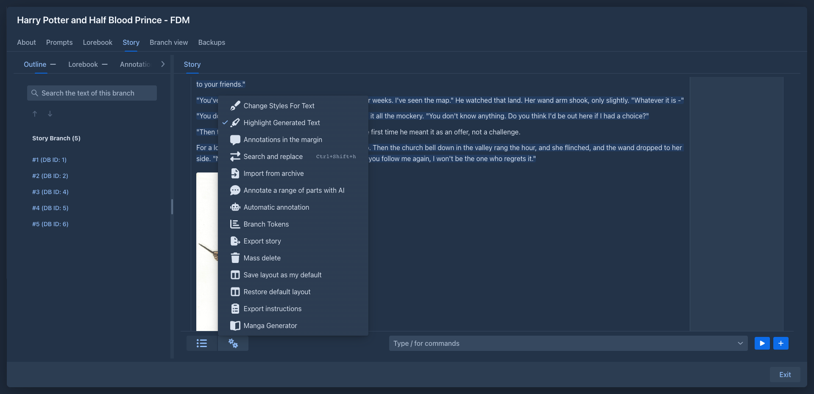

## Commands

Next to the menu below the story there is a **command line**: type `/` to see the commands, pick one and press **Enter**
(or the play button) to run it. What a command returns is shown in a small window above the line. See
[Commands](../commands/index.md) for how to write arguments, what the help shows and how to stop a command that takes a
while. The command line is only in the story tab of the desktop layout so far.

## Search and replace

The settings menu (⚙) also has **Search and replace**, which changes a word, a name or a phrase in the whole story at
once. The window has a **Search for** and a **Replace with** field and these options:

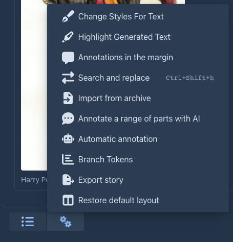

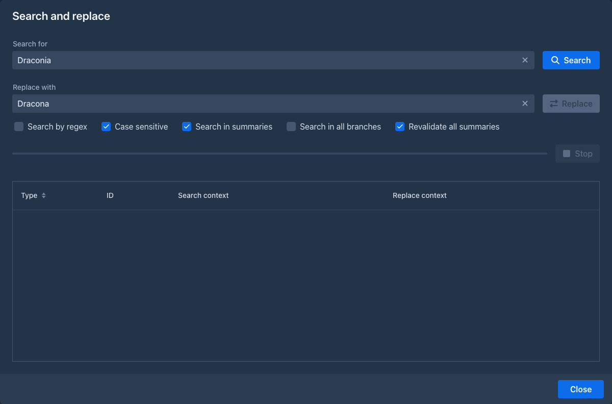

| Option | Default | Meaning |
|---|---|---|
| **Search by regex** | off | The search text is a [regular expression](../regular-expressions.md) and the replacement can use its groups (`$1`). Otherwise the text is searched as typed. |
| **Case sensitive** | on | A text is found only in the case you typed it (*John* does not find *john*). Off: the case does not matter. Locked while **Search by regex** is on. |
| **Search in summaries** | on | The [summaries](summaries.md) are searched and changed too. |
| **Search in all branches** | off | All [branches](branches-and-story-tree.md) are searched, otherwise only the active one. |
| **Revalidate all summaries** | on | After the replace every [summary](summaries.md) of the book is valid again, see below. |

With a regular expression the case is always taken as typed, start it with `(?i)` to ignore it. Press **Search**
(the button on the right of the fields; on the phone below them). The progress bar shows how far it is and **Stop**
next to it interrupts it. Nothing is changed by a search.

The table lists every part of the story and every summary that has a match, with its type and id. Open a row to see the
matches in it: the text around the match as it is and as it will be after the replacement. A match or a replacement that
is too long to show is written as *[searched text]* or *[replace text]*.

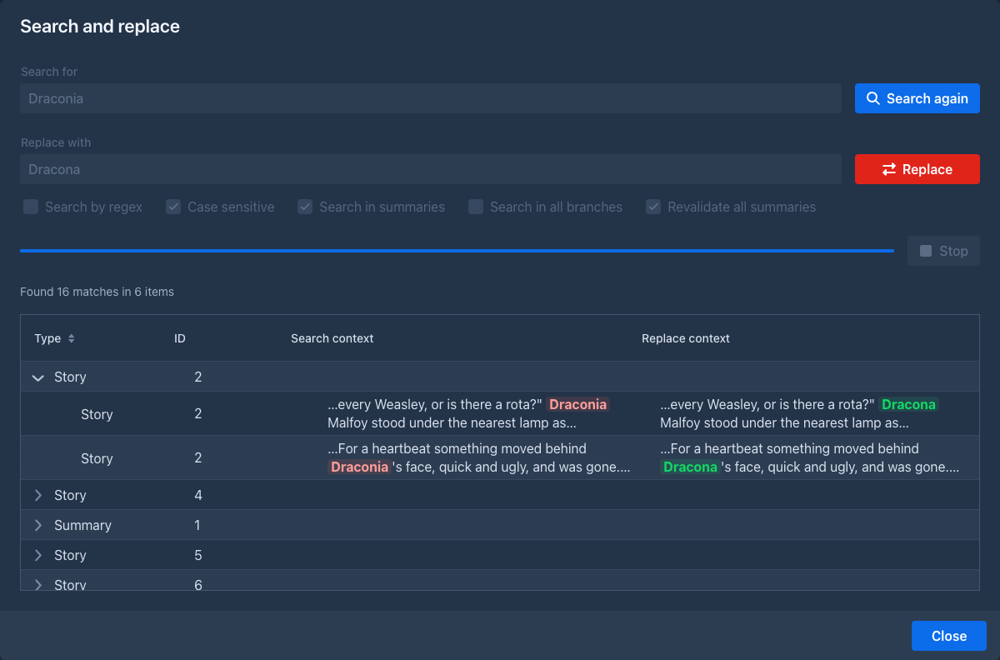

Pressing **Enter** in the **Search for** or **Replace with** field does the same as **Search**.

When the search is done, the fields and options are locked and the **Replace** button is enabled. **Search again** forgets
what was found and unlocks the window, so you can change the search. **Replace** changes the story: the window is frozen
completely (even **Stop** does not work) until it is done, and then it is empty again. Replaced parts are marked as
edited, as if you had edited them yourself.

A replace in the text a [summary](summaries.md#when-summaries-become-outdated) describes would make the summary outdated.
With **Revalidate all summaries** on, Marginalia works out again the check value of every summary of the book (those of
all branches too, those the replace did not touch, and those that were outdated before), so all of them are valid
afterwards. That also turns an outdated summary valid without its text being looked at, so use it when you know the
summaries still say the right thing.

With the option off only the summaries the search covers are brought up to date. Those it does not cover (summaries of
branches that are not searched, which share their earlier parts with the active branch; or all of them when summaries are
not searched) become outdated. If there are such summaries, Marginalia tells you how many and asks whether to go on. A
summary that was outdated already stays so.

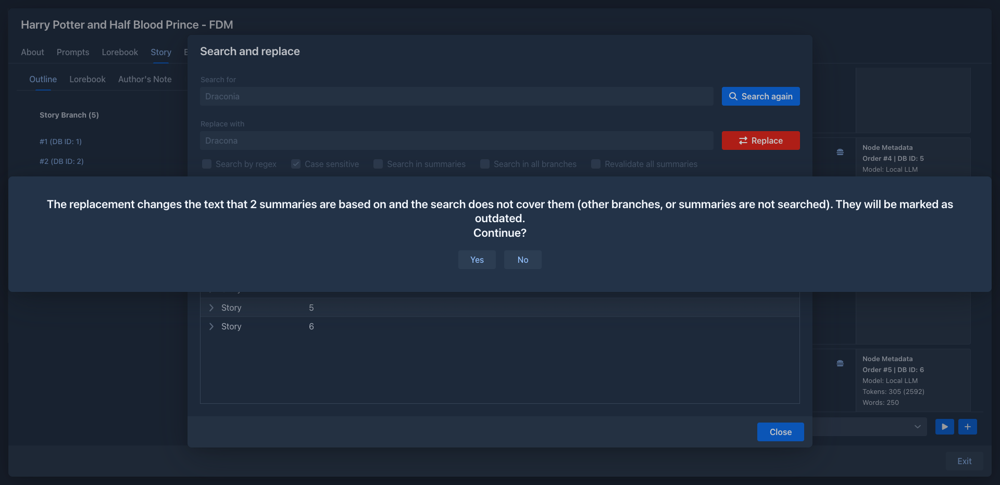

In the [phone layout](../phone.md) the same window has the fields and buttons below each other, and the table has one
column that shows the type and id, and below them the match and the replacement.

The same search and replace can be run from the [command line](../commands/index.md#commands-that-come-with-marginalia)
with `/search-replace-parts`; it asks before it replaces.

## Importing text files

The settings menu (⚙) has **Import from archive**. Upload a `.zip` of `.md` (Markdown) files and every file is added as
a **part** at the end of the story: the first one after the last part of the active branch (the first part of an empty
book), each next one after the one before. The files are taken in the order of their names, numbers inside the names
compared as numbers (`2.md` before `10.md`), also in folders of the archive. Folders, hidden files (`.name`), the
`__MACOSX` folder and files that are not `.md` are skipped. The file is the text of the part as it is, it is not sent to
the model and not changed; the parts count as written by you. The summaries are not made, do that in the
[summaries](summaries.md) window.

The import shows a progress bar with the number of files done. **Stop** ends it after the part that is being stored: the parts
that were already added stay in the story (the import is not undone), and a message tells how many of the files were imported.

The **import** button of the Books tab does the same into a new book, see [Managing books](managing-books.md#creating-a-book).
The same import into a lorebook is described in [Import & export](../lorebooks/import-export.md#importing-an-archive-of-text-files).

## Exporting the story

The settings menu (⚙) also has **Export story**, which saves the active branch as a text, Markdown, HTML, Word, PDF or EPUB
file. See [Exporting a book](export.md).

## What the model gets

For each new part Marginalia sends:

1. The **master template** as the system message: role, [lorebook](../lorebooks/index.md) entries, point of view,
   tense, style and [summaries](summaries.md). The jailbreak prompt of the
   [inference provider](../inference-providers.md#general-settings), if enabled, comes first.
2. The previous parts of the active branch as the model's own earlier answers - as many as fit into the
   [context limit](../protocols.md#limits), newest first. Older parts that don't fit are left out (unless a
   [summary](summaries.md) covers them).
3. The **user prompt** with the instructions for the new part.

*Show Prompt* on any part shows exactly what was sent. See [Book prompts](prompts.md) for the templates.
