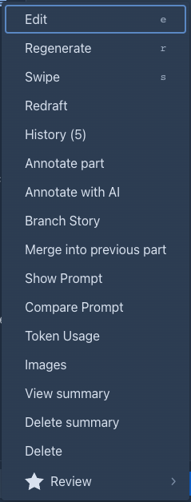
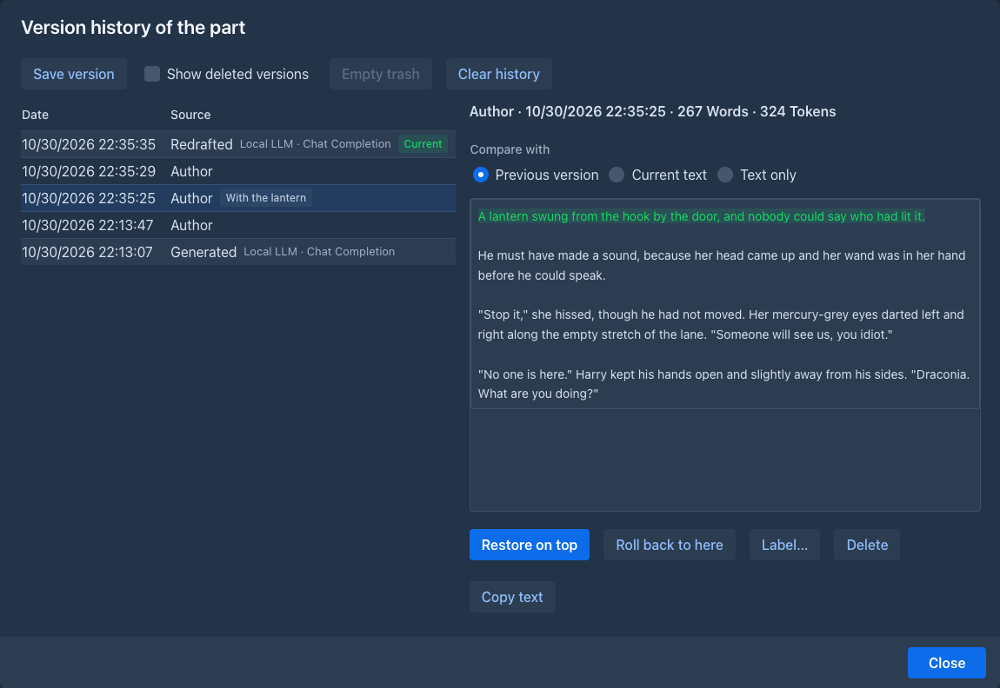
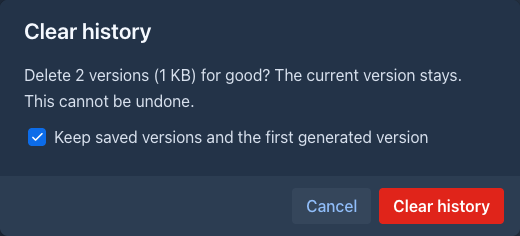
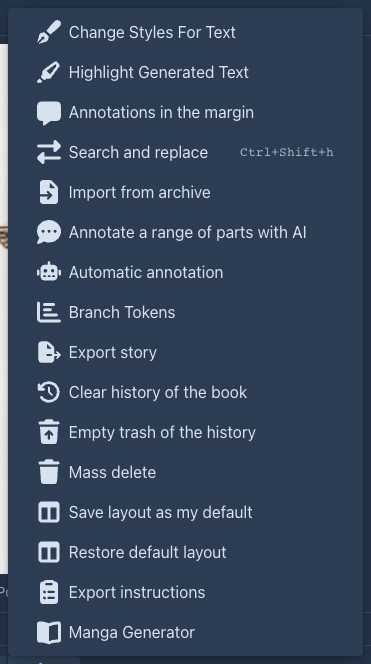
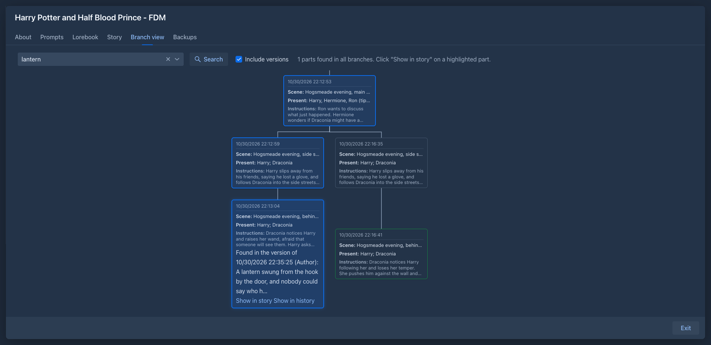

# Version history of a part

Every time the text of a part changes, Marginalia keeps the text it had. You can look at the earlier versions of a part,
see what changed between them, put one back, give a version a name so it is never lost, and search the old text.

A part is changed by the model writing it (the first generation, **Regenerate**, **Swipe**, [**Redraft**](story-editor.md#redrafting-a-part)),
by you (**Edit** and **Save**), by a mass action (**Search and replace**, an import, a command), by an
[agent](../agents.md), by an [extension](../extensions/index.md), by [merging](story-editor.md#merging-a-part-into-the-previous-one)
two parts, and by putting a version back. Each of these makes a **version** with the time and who made it:

| Source | |
|---|---|
| **Generated**, **Regenerated**, **Redrafted** | A model wrote the text. The version says which model and protocol, and keeps the reasoning that came with it. |
| **Author** | You typed it. A change made by a command, a mass action, an import or an agent says so in the line of the version (an agent is marked). |
| **Extension** | An extension changed the text. |
| **Merged** | The text of a part that was merged into this one. |
| **Restored** | A version that was put back on top, a copy of the version it names. |
| **Saved version** | A version you saved by hand with a name. |

The history is not a second copy of the book. The versions are stored apart from the parts, so a long history does not
make the story slower, and a book that is exported, published or read in the viewer has only the current text.

## Looking at the history

Choose **History** in the menu (☰) of the part. The number in brackets is how many versions the part has. (The item is
not offered while the text of the part is edited, nor for a part that is not saved yet.)

The list on the left has the newest version at the top. Each row has the time, the source, the number of words and the
name of the version, if it has one; the newest version is marked **Current**: it is the text the part has now. Click a row
to see that version on the right. Above the text, choose what it is compared with:

| | |
|---|---|
| **Previous version** | The changes against the version before it, word by word. |
| **Current text** | The changes against the text of the part now. |
| **Text only** | The text as it was, without comparing. |

A version that a model wrote shows its reasoning in a block you can unfold. A **Restored** version says which version it is
a copy of.

On a phone the dialog fills the screen: the versions are cards above the selected version, and nothing needs the mouse.

## Putting a version back

There are two ways, and they differ in what happens to the versions that come after:

| | |
|---|---|
| **Restore on top** | The text of the chosen version becomes the text of the part again, as a new **Restored** version at the top. Nothing is lost: the versions in between stay in the list. Use it to take back an earlier wording. |
| **Roll back to here** | The part goes back to the chosen version, and **all the versions newer than it go to the trash** of the history (you are asked, and told how many). They can be taken out of the trash again. Use it to undo a whole line of changes. |

Both change the part as an edit does: the [summaries](summaries.md) that describe the old text become outdated, and
Marginalia tells how many, and the part counts as edited. The story shows the restored text at once.

## Naming a version

A version with a name is a **saved version**, and the history never removes it by itself.

- **Save version** in the dialog saves the text the part has now with a name you give.
- **Label…** gives a name to a version that exists, or changes or removes it.

Use it before you try something risky: *the draft the editor liked*, *before the duel was cut*.

## Deleting versions

- **Delete** puts a version into the **trash of the history**. Tick **Show deleted versions** to see the trash (the rows are
  greyed); **Take out of trash** puts a version back where it was in the list, and **Delete permanently** removes one for good.
  The newest version cannot be deleted: it is the text of the part.
- **Empty trash** deletes everything in the trash for good.
- **Clear history** deletes all versions of the part but the current one, for good. The dialog says how many versions go and
  how much room they take. **Keep saved versions and the first generated version** (checked at first) keeps the ones you named
  and the first thing the model wrote for the part.

The settings menu (⚙) of the story has the same for the whole book: **Clear history of the book** and **Empty trash of the
history**.

## How many versions are kept

A part keeps **50 versions** unless a limit says otherwise. When a new version would be one too many, the history removes
the oldest version in the trash first, and then the oldest version that is not in the trash. Versions in the trash
count toward the limit until they are purged. Three versions are never removed: the newest one, the ones with a name, and
the first thing the model generated for the part (they do not count toward the limit either).

The limit can be set on four levels, and **the strictest one wins**:

| Level | Where |
|---|---|
| The book | **Versions kept per part** on the [About](managing-books.md#the-about-tab) tab of the book. |
| The folders | **Versions kept per part** in the [settings of the folder](folders.md#folder-settings); the folders above the book are all looked at. |
| You | **Versions kept per part** in the [Settings](../account.md) tab. |
| The administrator | The [permission](../administration/permissions.md) **Version history**, a ceiling for the user. |

An empty field means that this level sets no limit. **0** keeps no history at all (the versions that exist stay until you
clear them, but nothing new is added). The field shows, as its hint, the limit it inherits and which level sets it, for
example *Limited to 20 by the folder "Fan fiction"*. A book cannot raise a limit set above it.

## Searching the old text

The main searches look at the current text only, so an old sentence you changed does not make a part show up. To find it,
tick **Include versions** (off at first, and not remembered, so a search never surprises you with old text):

- in the [advanced search of the books](managing-books.md#advanced-search): a book is found when an earlier version of
  one of its parts has the words;
- in the search of the [branch view](branches-and-story-tree.md#searching-all-branches): a part that has the words only in an earlier version is
  marked, the hit says *Found in the version of 12 Oct 2026 14:05 (Generated)*, and **Show in history** opens the history of the
  part on that version.

An agent can do the same with the `search-parts` command and its `includeVersions` option; each hit then says which version
it is from. Versions in the trash are not searched, and **Search and replace** never changes a version.

## Backups, copies and the Trash

- A [book backup](backups.md#the-history-of-the-parts) can take the history with it (**Include version history**,
  unchecked at first, because it can be large). Restoring such a backup, as the book or as a copy, brings the versions back,
  with their names and the trash. A backup without it gives each part one first version.
- A [duplicate of a book](managing-books.md#cloning-a-book) starts its own history: one version per part, from the text it was copied with.
- Deleting a part, or a book, takes its versions with them; they are in the [Trash](../trash.md) as long as the part is, and
  are deleted for good with it.
- Merging a part into the previous one removes the history of the part that is merged; the text shows up in the history
  of the surviving part as a **Merged** version.

## Books from before the history

When Marginalia was updated, every part that already existed got its first versions: a part a model wrote starts with a
**Generated** version of the text as the model wrote it (with its reasoning and the model used), and has an **Author** version
when you edited it since; any other part starts with an **Author** version. The earlier edits of those parts are not
known and are not in the list.
