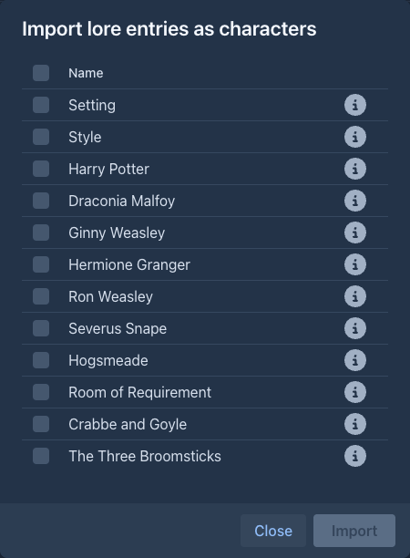
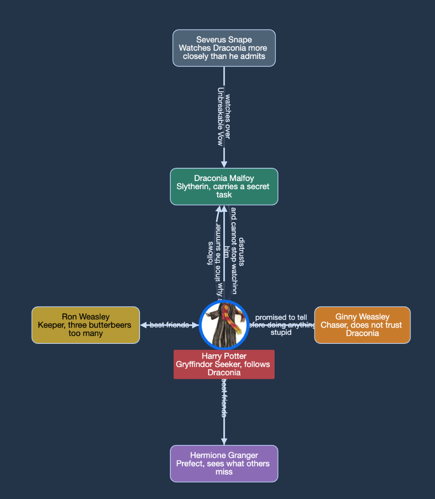

# Character Tracker

The cast of your book in the sidebar: a list of characters with a tagline, a note, an icon and a color, the
relationships between them, and a map of those relationships.

## The Characters tab

The left sidebar of the [story editor](../books/story-editor.md) gets a **Characters** tab next to *Outline*. Above the
list are two buttons, **Add new character** and **Relationship map**.

The wand button between them has the menu item **Import lore entries as characters**, see
[below](#importing-characters-from-the-lorebook).

The list is ordered by name. Every character is on its own color and shows its **name** with the **tagline** below it in
smaller letters (two lines at most). The buttons of a character:

| Button | |
|---|---|
| chevron | Expands the character to show its **icon** and **note**. |
| pen | Opens the character in the dialog. |
| trash | Deletes the character and all its relationships, after a confirmation. |

Characters are saved with the book as soon as you change them, so they are included in its backups.

## The character dialog

**Add new character** and the pen open the same dialog:

| Field | |
|---|---|
| **Name** | Required. |
| **Tagline** | A few words about the character, shown in the list and in the map. |
| **Note** | Anything you want to remember. |
| **Icon** | Upload a PNG, JPEG or GIF. It is scaled down to at most 200 x 200 pixels, the proportions are kept. |
| **Color** | Background of the character in the list and in the map. |

The fields are applied with **Save**.

### Relationships

When you open an existing character, the dialog also lists its relationships: the ones the character points to (`→`),
the ones that point to it (`←`) and the unidirectional ones (`↔`), each with a name and a tagline. The trash button
deletes a relationship.

To add one, search for the other character, choose the **Direction** (*this character → other*, *other → this
character* or *both ways*), enter a **Name** (e.g. *employs*, *friends*) and optionally a **Tagline**, and press **Add
relationship**. Relationships are saved at once. A new character can get relationships after it has been saved.

## Importing characters from the lorebook

If your characters are already in the lorebook, the wand menu creates them for you. **Import lore entries as
characters** opens a dialog with the entries of the book's lorebook and of all its sub lorebooks, sorted by their
*order*. Each shows its name and a checkbox, and an **i** icon that shows the content of the entry in a popover, for a quick look
before you decide; the checkbox in the header of the list checks or clears all of them. **Import** creates a character
with the name of every checked entry (the tagline, note, icon and color stay empty for you to fill in), **Close** leaves
without importing.

Entries are not compared with the characters you already have: importing the same entry twice creates two characters.

## The relationship map

**Relationship map** shows all relationships of the book as a graph. Every character that has a relationship is a
circle with its icon (or a box without one) on its color, with its name and tagline; every relationship is an arrow
between two characters with its name and tagline. An arrow points at the target; a unidirectional relationship has an
arrow at both ends. Characters without relationships are not in the map.

The characters are arranged in rings around one character - at first the one with the most relationships: the
characters it is related to are on the first ring, theirs on the second and so on. **Double-click a character** to
arrange the map around it. You can also drag the characters, move the map and zoom with the mouse wheel.

## Phone

The tab is in the drawer of the story, next to the outline, like the [Author's Note](authors-note.md).
