# Conlang Translator

Lets the characters of your story speak a constructed language. You describe the language (its rules and its words) and the model
writes the **direct speech** of the characters who speak it in that language, while the story keeps the English behind it.

!!!
The text of the story holds the **conlang**. Everything that reads the story to a model (the next generation, the summaries,
the lorebook scan, the annotations, the other extensions) reads the **English** the speech was translated from, so the model never
has to understand your language to carry on the story. A click on a translated speech shows the English.
!!!

!!!warning Work in progress
The extension works for a person using the screens described here. It is **not** available to agents yet (no commands, and an
agent that works on a copy of a book does not know about the languages), and the phone has only part of it, see
[Limits](#limits).
!!!

## The idea

1. A **language** is two things: **rules** (text, written for the model like a grammar book) and a **lexicon** (the words, written
   mostly by the model and judged by you). Languages are kept in your settings, once, and any number of books use them.
2. A **book** (or a folder of books) chooses its language. A part is translated **by hand** from its menu, **by itself** when it
   is final, or **a range at a time**.
3. One request to the model per part classifies every direct speech (is it said in the language, or in the common tongue of the
   story, by this character, understood by the listener?) and translates the speech that is. A word the language lacks is invented
   by the rules, **reported with the reason**, and added to the lexicon as **new**, for you to accept, change, lock or throw away.
4. The English is kept (in the data of the book, as the *source* of the speech) and read by every model. The conlang is the original:
   what you change in it by hand stays, and a part you edit is never overwritten behind your back.

## Languages

A language is edited in **Settings → Extension Settings → Conlang Translator**, the panel that lists your languages.

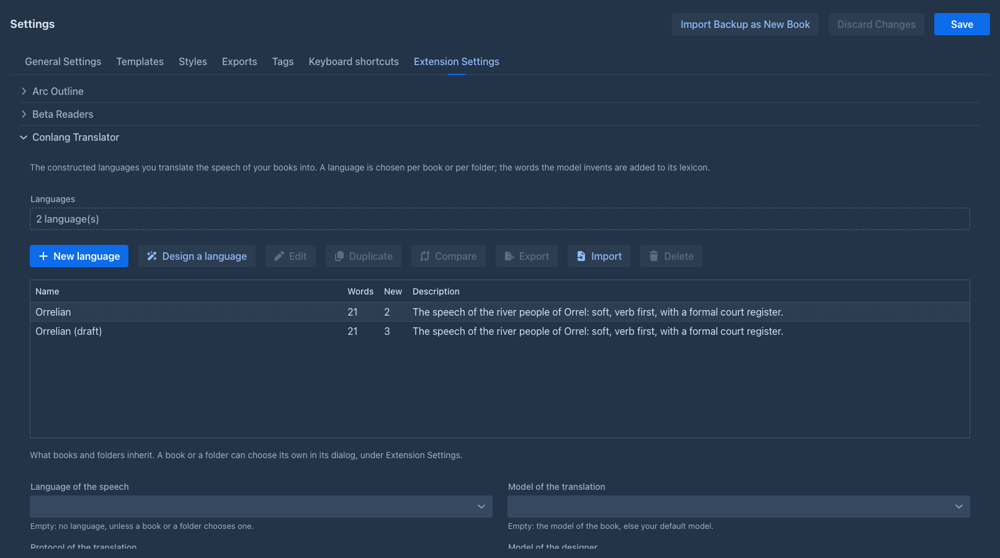

| Button | |
|---|---|
| **New language** | An empty language. |
| **Design a language** | A [wizard](#the-designer) in which the model proposes each part of a new language and you edit and accept it. |
| **Edit** | The [editor](#the-editor) of the selected language. |
| **Duplicate** | An independent copy with a new name, words and all. Use it to try a change (a copy is also the only way to have a language *for one book*: a book that chooses a language shares it with every other book that chooses it). |
| **Compare** | Brings the changes of another language into the selected one, after a [review](#comparing-and-merging). |
| **Export**, **Import** | A language as a document (JSON): the rules and the lexicon, without the links to a book. An import of a language whose name you already have offers the review of the differences or a new language. |
| **Delete** | After a question. |

At the top are the **model and protocol of the designer**. Below the list are the choices that books and folders **inherit** from you: the language, whether a part is translated by itself,
and the model and protocol of the translation. A book or folder can set its own, see [Choosing the language of a
book](#choosing-the-language-of-a-book). **Save** the Settings screen to keep your changes (the words that a translation added meanwhile
are not lost: a language you did not touch is read again when the screen is saved).

### The editor

The editor is a window with five tabs; it works on a copy until **Save**, can be resized, dragged and maximized.

| Tab | |
|---|---|
| **Overview** | The name, a description for you, the option **A hyphen is a part of a word** (off: `thal-orun` and `thalorun` are the same word; on, the hyphen belongs to the form), and the **example book** and **example lorebook** the designer reads. |
| **Rules** | The rules in **sections** (sounds and spelling, grammar, word formation...). Each section says **who reads it**: *the translator* (sent in every request), *only the designer* (the history of the language, notes for making words) or *nobody* (your own notes). The plugin does not parse the rules: they are text for the model. |
| **Categories** | Groups of words (*People & Social*, *Nature*, *Particles*...). The lexicon is shown and sent to the model under these headings. A category that is **always sent** (particles, pronouns, numbers) goes into every request even when the lexicon is too big to send whole. |
| **Registers** | The styles of speech (*formal*, *soft*, *vulgar*, *archaic*...) with a note. A concept may have a form for each register; the model chooses by who speaks and to whom. |
| **Lexicon** | The words, see below. |

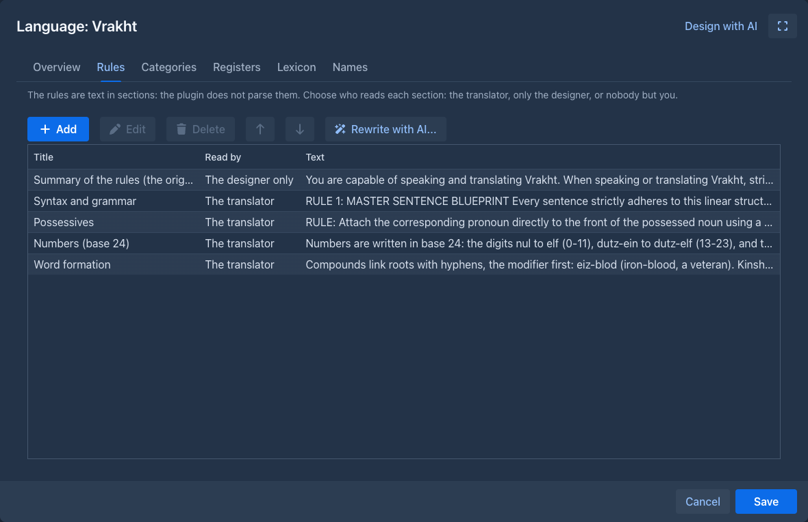

### The lexicon

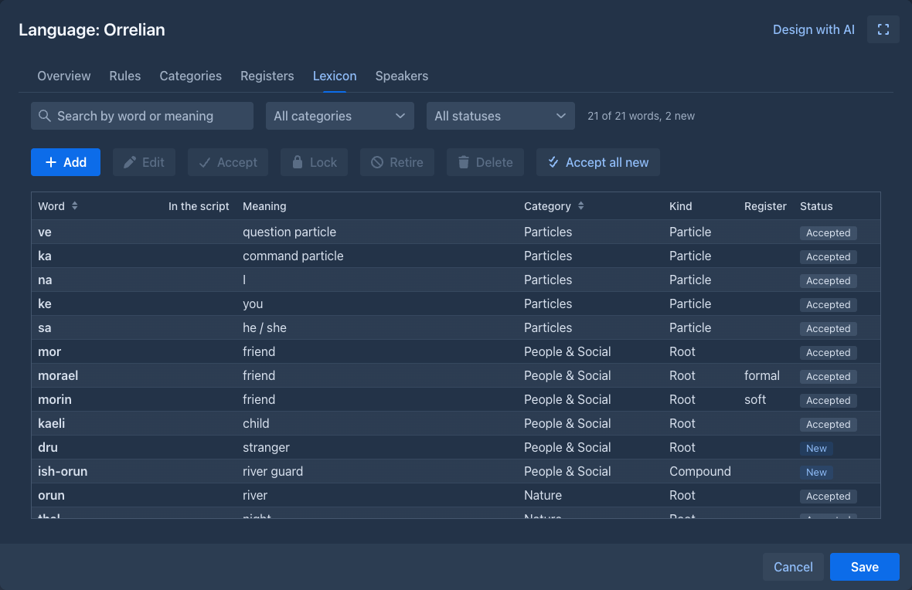

The grid has a **search** (by word or meaning), filters by **category** and **status**, and the actions **Add**, **Edit**, **Accept**,
**Lock**, **Retire**, **Delete** and **Accept all new**. A word has:

- the **form** (how the story writes it), optionally the form in a **script**, a **category** and a **kind** (root, compound, particle,
  name, number, phrase);
- one or more **meanings** (a homophone has several, each with a part of speech and a note) and the **other forms of the concept**
  (the formal, soft and vulgar word for the same thing, shown and sent together);
- the **rationale**: why the model chose the word (the rule or the roots). You read it to judge the word, and it goes back into later requests
  so that the next invention follows the same logic;
- an **origin**: yours, or the model's (with the part it was invented for, the model and the time). A word of the model that you edit becomes yours;
- a **status**: **New** (the model made it and you have not looked yet), **Accepted**, **Locked** (the model may use it but never redefine it) or **Retired**
  (kept, not offered to the model: for a word that was replaced).

A word the model needs but the lexicon lacks is **never dropped for being new**: it is added at once, so the next part says the same thing the same
way, and it waits as *New*. A translation that uses words that are not in the lexicon and that the model did **not** report is flagged, because
nobody can tell whether the word is a mistake.

### The designer

The **Design with AI** menu of the editor asks the model for help, always with the language **as it is** (its rules, registers, categories, lexicon and the example lorebook), and
always as a **proposal**: nothing is written before you review it.

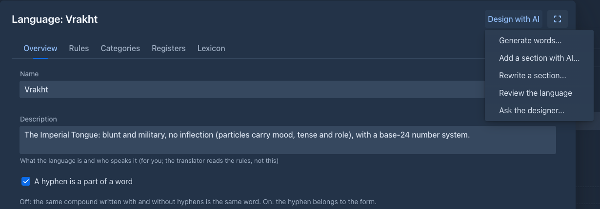

| Action | |
|---|---|
| **Generate words...** | Words for a category, a number of them, with a note ("a siege camp's kitchen"). |
| **Add a section with AI...** | A new section of the rules for what they miss (numbers, colors, politeness) and the words it needs. |
| **Rewrite a section...** | The model rewrites a section as you ask. The model gives back the **whole section**, so a very long section is slow and costly: keep sections short, one topic each. |
| **Review the language** | A list of contradictions, gaps and words that break the sound system, each with a section and a fix. Nothing is changed. |
| **Ask the designer...** | A conversation; an answer with words or sections can be reviewed as changes. |

**Design a language** in the panel is a wizard of seven steps (the brief, the sounds, the writing, the grammar, word formation, the first words by category, and a test with
sentences). Each step is a section that the model proposes and you edit, refine with a note and accept; the language exists only in the window until **Finish**.

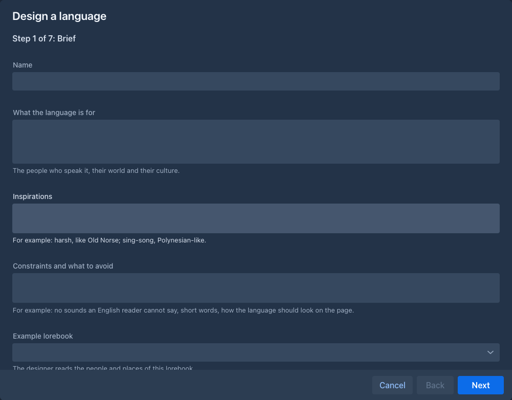

### Comparing and merging

**Compare** (and the import of a language you already have) opens a window with the differences between two languages, each a line with a check box: what was added,
changed, deleted or moved among the language's fields, rules, categories, registers and words. A change that both sides made differently is a **conflict**:
your value is kept until you choose theirs or write your own. What you pick is written into the language on the screen, and stored when you save the Settings screen. The
same window shows what the designer proposes.

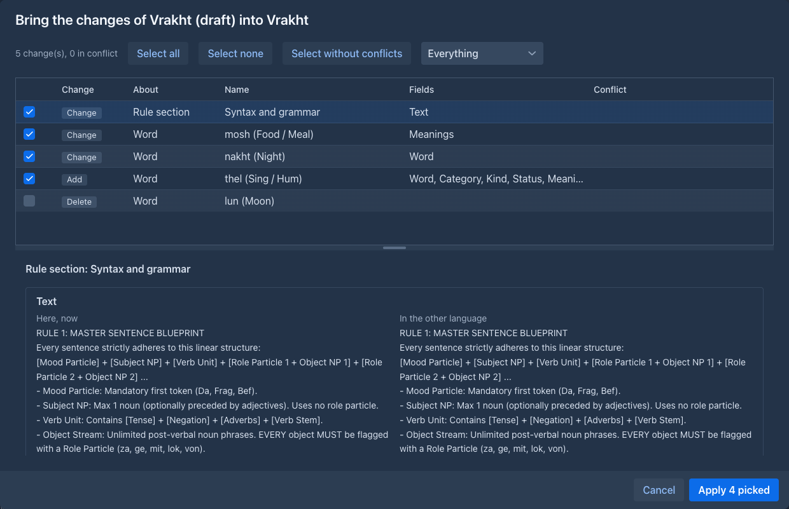

## Choosing the language of a book

The **Prompts** tab of the book window, under *Extension Settings*, has the fields of the extension; the folder window has the same. Empty means *inherit*: the folder
above, then the settings of your user.

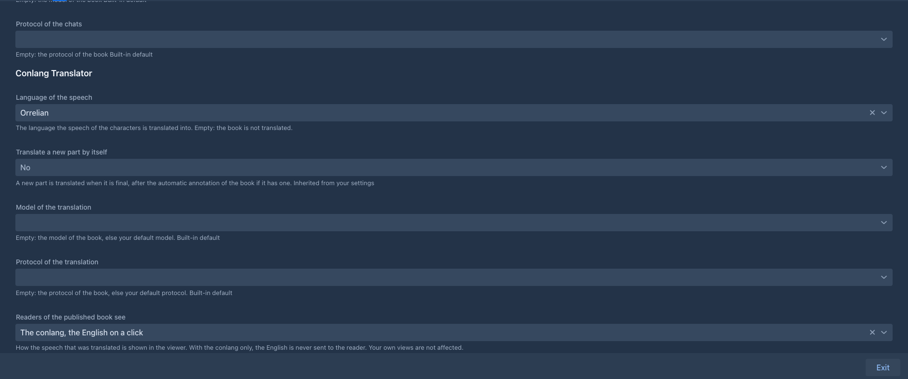

| Field | |
|---|---|
| **Language of the speech** | The language the book is translated into. Empty: the book is not translated. |
| **Translate a new part by itself** | A part is translated when it is final: after a generation, after the automatic annotation and redraft if the book has them. |
| **Model of the translation**, **Protocol of the translation** | Empty: the model and protocol of the book, else your defaults. |
| **Readers of the published book see** | What the [viewer](#the-viewer) shows. |

## The Conlang tab of the book

The story window has a **Conlang** tab (in the same dock as the chapters and the lorebook; drag it where you like) for the language of *this* book. It has three tabs
of its own, and **Refresh** reads the language again after you changed it in the window of the book.

### Words

The lexicon of the book's language, with the search, the filters and the actions of the [editor](#the-lexicon): look a word up while you write, edit it, accept the words the
model invented, lock or retire one. The change is stored in your library at once (the words a translation added meanwhile are not lost).

### Speakers

Who speaks the language **in this book**. The speakers belong to the book, not to the language: the same language is spoken by other people in another story, so a language
you duplicate, export or compare carries no characters.

By default **everybody speaks the language except the listed characters** (or, the other way round, only the listed ones). This is only the default: the
text overrides it ("she said in the common tongue", "the guard could not understand a word") and the model decides for every speech. For each character
you may note the **gender** (a language that marks gender gets it wrong when the part only says "her") and the **voice** ("formal, clipped, coarse"), which
the model matches to the registers of the language. Changes are stored in the book at once.

### Quick translate

Write a text in English (a phrase, a name, a line you have not written yet), optionally who says it and to whom, and press **Translate**: the model translates it into the
language of the book with the rules, the registers and the lexicon, and the notes of the characters named in the text. Nothing is written into the story. The result is the
translation, a note on the choices, and the **words the translation needed** that the lexicon lacked, each with its meaning and why; select the ones you want and **Import the selected words**:
they go into the lexicon as *new*, the same as the words of a translated part. Words in the translation that are neither in the lexicon nor reported are listed as a warning.

## Translating

- **By hand:** the menu of a part has **Translate the speech**. A part that is translated already is translated again **from its English**, so this is also how you retranslate a
  part after the rules or the lexicon changed.
- **By itself:** with **Translate a new part by itself**, a generated part is translated as soon as it is final. A *regenerate* of a part gives it new English and removes the old translation.
- **A sentence you wrote:** select it in the text of a part, right click and choose **Translate the selection**. The model translates the selected text
  (spaces and a pair of quotation marks around it are left out) with the language, the notes of the characters and the story around it; the text is replaced by the translation and
  the English is kept as the source of the speech, so a click on it shows the English like on any translated speech. The words the model had to invent are added to the lexicon as
  *new*, as for a translated part. A selection that holds a translated speech is refused (put the English back first), and so is one made in a part that changed meanwhile.
- **A range:** **Translate parts** in the tools menu of the story opens a window that stays open beside the story.

  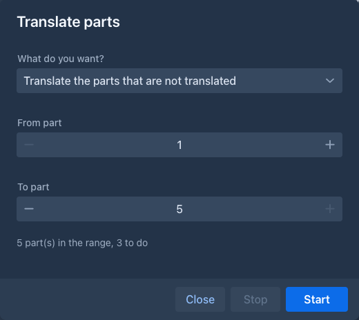

  Choose **From part** and **To part** (parts with text, counted from 1 as in the export) and what to do: *Translate the parts that are not translated*, *Translate the translated
  parts again* (after the rules or the lexicon changed), or *Put the English back*, after a question. The window says how many parts the range holds and how many the choice
  works on, shows *Part n of m*, and a **Stop** that takes effect after the part that is being done (a request to the model that has begun cannot be taken back). A part that fails is
  counted and the run goes on; a missing language or model ends it. The story is drawn again when the run is over. A part you edit while it runs makes that one part fail, not the run.

A translation is stored like any change of the text: the history of the part gets a version, the part is **not marked as edited**, and the English is kept. **A speech you changed by hand
is left as it is** when the part is translated again or put back to English, because it holds your words.

!!!
A translation takes as long as the model takes for the part: minutes on a local model that thinks. The extension asks the model to think (the translation of gender, number and
register is much better that way), so give the model a generous output limit.
!!!

## What the reader sees

### In the story

A translated speech has a **dotted line**. A click on it shows the English in a popover: who said it, and *(not understood by the listener)* when the listener does not understand the
language; a red note says that you edited the conlang text after the translation, so the English may not be what it says now.

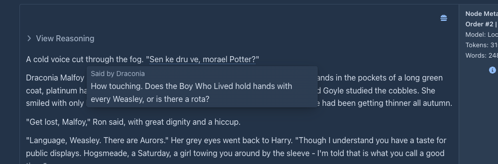

### The viewer

The viewer of a [published book](../books/publishing.md) shows the translated speech the way the book asks, with the field **Readers of the published book see** (a choice of the book or of its folders; your own defaults never
decide what a reader sees):

| | |
|---|---|
| **The conlang, the English on a click** | The default. A click (a tap on a phone) opens the popover with the English. |
| **The conlang only** | The English is never sent to the reader's browser. |
| **The English only** | The book as if it had never been translated. |

In the click mode the page holds only the conlang; the English of a speech is fetched from the server when the reader clicks it.

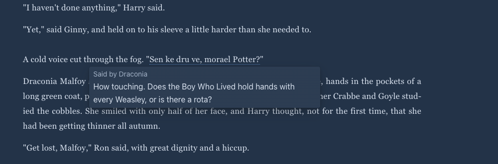

## Exporting

When the book has translated speech, the [export](../books/export.md) dialog has the field **Translated speech**:

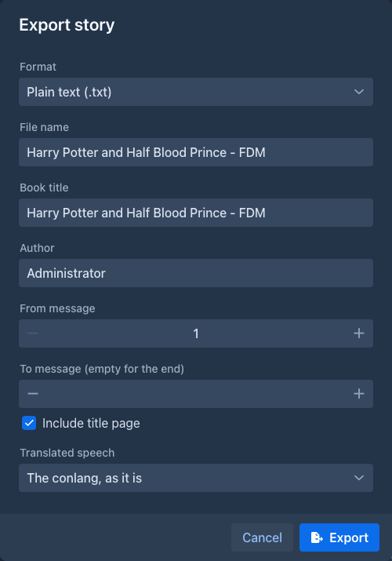

| | |
|---|---|
| **The conlang, as it is** | The default: the text as it is stored. |
| **The English only** | The speech is replaced by its English. |
| **The conlang, the English in footnotes** | Every translated speech gets a footnote with the English (and the speaker). |
| **The English, the conlang in footnotes** | The other way round. |

The footnotes are the [footnotes of the export](../books/export.md#footnotes): linked notes in HTML and EPUB, endnotes after each part in plain text, Word and PDF. A speech you edited after it
was translated stays as it is and has no footnote. The stored text of the book is never changed by an export.

## Limits

- **The quality is the model's.** The extension checks what it can for free (that the quoted speech is in the part, the language, the words against the lexicon and its rules for
  compounds and affixes) and reports the rest; it does not check your grammar. Try a language on a few parts before a long run, and use **Review the language** of the designer when a mistake repeats.
- **A language is shared by the books that use it.** A word you change, or a word a translation adds, changes it for every book of the series. That is meant (one world), and
  **Duplicate** is how to keep a language apart.
- **Retranslating asks the model again for every part of the range.** There is no way yet to keep the translations whose English did not change.
- **No agents.** There are no commands for the extension and an agent run on a copy of a book does not copy or lock a language.
- **A phone** has the panel, the editor, the review and the wizard, but the lexicon grid scrolls sideways; the tap on a speech in the viewer works; the story side (the menu of a part, the range window, the click in the story) was not tried there.
- **Footnotes of Word and PDF** are endnotes after the part, not notes at the foot of the page.
- The **Japanese and Chinese texts** of the extension were written by a model and not read by a native speaker.
