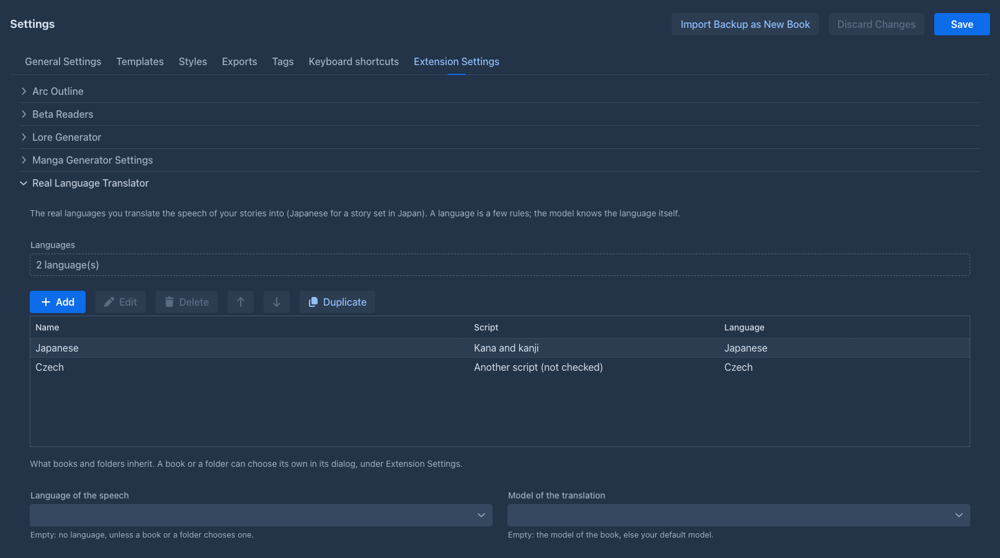
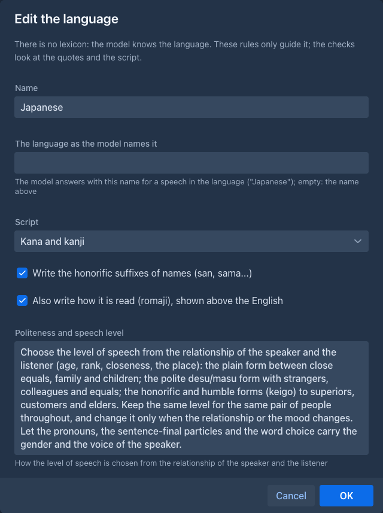
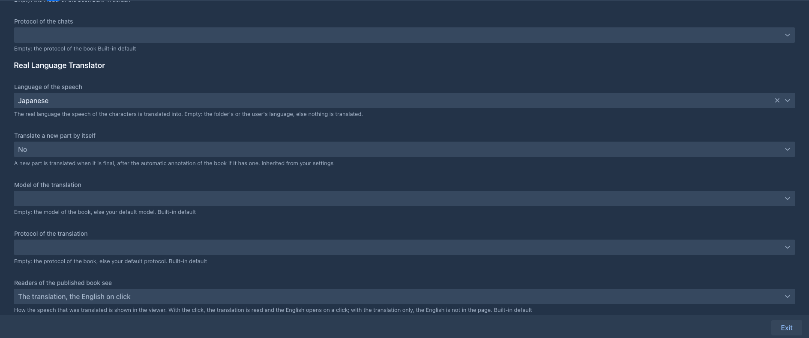
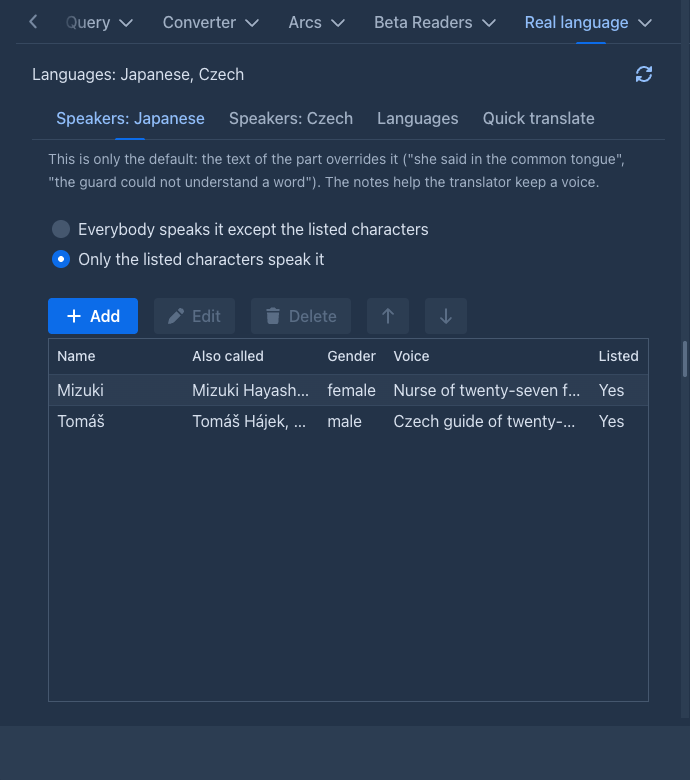
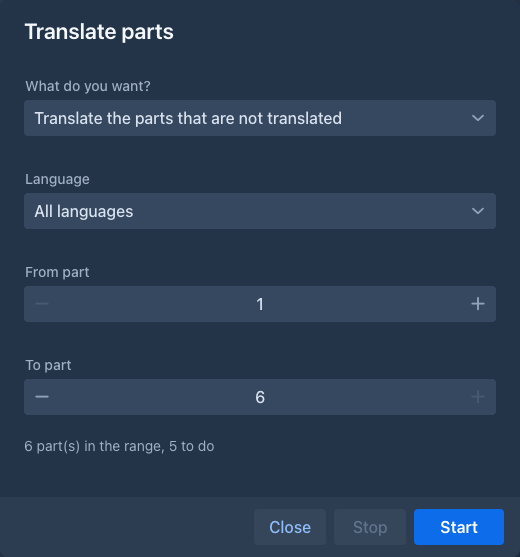
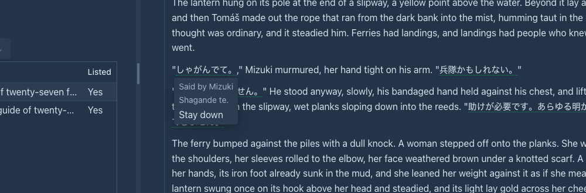
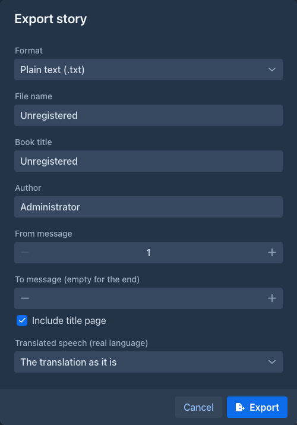

# Real Language Translator

Lets the characters of your story speak a **real language**: a story set in Japan can be written in English by you and the model, and the direct speech of the characters becomes
authentic Japanese (kana and kanji, or romaji), with the English kept behind it. It is the [Conlang Translator](conlang-translator.md) for a language that exists: the same idea and the same
screens, without a lexicon.

!!!
The text of the story holds the **translation**. Everything that reads the story to a model (the next generation, the summaries, the lorebook scan, the annotations, the other extensions)
reads the **English** the speech was translated from, so you write and steer the story in English. A click on a translated speech shows the English.
!!!

!!!warning Work in progress
The translation of parts, ranges and sentences, the settings, the tab of the book, the viewer, the export and the [commands](#commands) are there. A second pass that polishes the translation,
several real languages in one book and a language per character are not, see [Limits](#limits).
!!!

## The idea

1. A **language** is a short set of rules for the translator: the **script** (kana and kanji, kana only, romaji), whether the **honorific suffixes** of names are written, how the
   **level of speech** is chosen from the relationship of the speaker and the listener, how **names** are written, and anything else you want held to. The model knows the language itself, so
   there is no lexicon. Languages are kept in your settings, once, and any number of books use them.
2. A **book** (or a folder of books) chooses its language. A part is translated **by hand** from its menu, **by itself** when it is final, or **a range at a time**.
3. One request to the model per part classifies every direct speech (is it said in the language, or in English, by this character, understood by the listener?) and translates the speech that
   is, in the voice and the level of speech the character and the relationship ask for.
4. The English is kept (in the data of the book, as the *source* of the speech) and read by every model. The translation is the original: what you change in it by hand stays, and a part you
   edit is never overwritten behind your back.

The extension checks what it can for free: the quoted speech must be in the part, the language must be the book's, and the translation must be in the **script** you asked for (a romaji
translation with kanji in it, or a kana-only one with kanji, is kept and *reported*). It cannot check the Japanese itself: read a few parts before a long run.

## Languages

A language is edited in **Settings → Extension Settings → Real Language Translator**.

| Button | |
|---|---|
| **Add** | A new language. It starts as one of the **presets** (Japanese in kana and kanji, in kana only, in romaji, or another language) which fills the fields in; change what you like. |
| **Edit**, **Delete**, **Move up**, **Move down** | The selected language. A delete asks. |
| **Duplicate** | An independent copy with a new name. A book that chooses a language shares it with every other book that chooses it; a copy is how to keep a language for one book. |

The editor has these fields:

| Field | |
|---|---|
| **Name** | What you call it ("Japanese, romaji for the novel"). |
| **The language as the model names it** | The word the model answers with for a speech in the language ("Japanese"); empty: the name. |
| **Script** | *Kana and kanji*, *Kana only*, *Romaji (Latin letters)*, or *Another script (not checked)*. |
| **Write the honorific suffixes of names** | san, sama, kun... |
| **Also write how it is read (romaji)** | The model also writes the reading of the translation; the popover shows it above the English. |
| **Politeness and speech level**, **Names of people and places**, **Other rules** | Short texts for the translator. The Japanese presets bring a text for the first two (plain form between close equals, the polite form with strangers, keigo to superiors; a foreign name in katakana). |

Below the list are the choices that books and folders **inherit** from you: the language, whether a part is translated by itself, and the model and protocol of the translation. **Save** the
Settings screen to keep your changes.

## Choosing the language of a book

The **Prompts** tab of the book window, under *Extension Settings*, has the fields of the extension; the folder window has the same. Empty means *inherit*: the folder above, then your settings.

| Field | |
|---|---|
| **Language of the speech** | The language the book is translated into. Empty: the book is not translated. |
| **Translate a new part by itself** | A part is translated when it is final: after a generation, after the automatic annotation and redraft if the book has them. |
| **Model of the translation**, **Protocol of the translation** | Empty: the model and protocol of the book, else your defaults. |
| **Readers of the published book see** | What the [viewer](#what-the-reader-sees) shows. |

## The Real language tab of the book

The story window has a **Real language** tab (in the same dock as the chapters and the lorebook) for the language of *this* book, with **Refresh** to read it again.

**Speakers.** Who speaks the language **in this book** (a book with [more than one language](#more-than-one-language-in-a-book) has a *Speakers* tab for each). By default everybody speaks it except the listed characters (or only the listed ones). The text overrides this ("she said in English",
"the guard could not understand a word"). For each character note the **gender** and the **voice**: the level of speech follows it. Write the age, the rank and how the character talks to
others here ("a young officer, polite to her seniors, blunt with friends"): that is what lets the translator choose between the plain form and keigo. The speakers belong to the book.

**Languages.** The other languages of the book, besides the one its **Language of the speech** field names: see [below](#more-than-one-language-in-a-book).

**Quick translate.** Write a text in English, optionally who says it and to whom, and press **Translate**: the model translates it with the rules of the language (with several languages, choose
which one). Nothing is written into the story; you copy the translation.

## More than one language in a book

A story with Japanese and Korean speakers needs both. A book names **one language first** (the field above, which a folder or your settings may also give) and the **Languages** tab adds **other languages**
from your library, one by one, and takes them away again.

- **Each language has its own speakers**, in a tab of its own. The first language is spoken by everybody except the characters you list, as before; **a language you add starts as "only the listed characters
  speak it" with nobody listed**, so it is not asked for anything until you list who speaks it. List a character as an exception of the first language when another language is theirs, or the first language
  is asked for their speech too (a speech two languages claim stays with the one that is asked first). A character may speak more than one language (list them in both; the text of the part tells the model which
  one a speech is in).
- **One request for each language**: the rules and the notes of one language, and only the speeches of its speakers. A part with the speech of two languages takes two requests, one after the other; the second
  reads the part with the English of the first one's speeches and leaves those speeches translated. A part whose point of view and present characters are all outside the speakers of a language is not asked for
  that language (a part that names no character is asked for every language that has speakers).
- **A passage knows its language.** **Translate the speech** again for one language leaves the speeches of the others alone, and **Put the English back** can be for one language or for all.
- **The menus ask which language** when the book has more than one: the menu of a part (one of the languages or *All languages*) and the right click on a selected sentence (one language).
  **Translate parts** has a *Language* field (all languages by default); *the parts that are not translated* means "not translated in that language".
- **The automatic run** translates a new part into every language whose speakers may be in it.

## Translating

- **By hand:** the menu of a part has **Translate the speech (real language)**. A part that is translated already is translated again **from its English**. A book with more than one language asks first [which one](#more-than-one-language-in-a-book).
- **By itself:** with **Translate a new part by itself**, a generated part is translated as soon as it is final. A *regenerate* of a part gives it new English and removes the old translation.
- **A sentence you wrote:** select it in the text of a part, right click and choose **Translate the selection (real language)**. The model translates it with the story around it; the English is
  kept as the source. A selection that holds a translated speech is refused.
- **A range:** **Translate parts (real language)** in the tools menu of the story opens a window that stays open beside the story: *Translate the parts that are not translated*, *Translate the
  translated parts again* or *Put the English back*, from a part to a part, with a **Stop**.

A translation is stored like any change of the text: the history of the part gets a version, the part is **not marked as edited**, and the English is kept. **A speech you changed by hand is
left as it is** when the part is translated again or put back to English, because it holds your words.

## What the reader sees

A translated speech has a **dotted line**; a click on it shows the English in a popover: the reading (when the language asks for it), who said it and whether the listener does not understand it, and a red
note when you edited the translation after it was made.

The [published book](../books/publishing.md) shows it the way the book asks, with **Readers of the published book see**: *the translation, the English on click* (the default), *the translation
only* (the English is never sent to the reader's browser) or *the English only*.

## Exporting

When the book has translated speech, the [export](../books/export.md) dialog has the field **Translated speech (real language)**: *the translation as it is*, *the English only*, *the translation with
the English in footnotes* or *the English with the translation in footnotes*. The stored text of the book is never changed by an export.

## Together with the Conlang Translator

A book may hold both: an invented language for the elves and Japanese for the town. Each plugin has its own speakers, its own language setting and its own passages, and the passages of the two do not
touch each other. The English every model reads has both back. The [export](../books/export.md) combines the footnotes of both in one numbering, and the viewer draws the speech of both in the same page. Set
the same value in **Readers of the published book see** for both: one page is drawn once, by the plugin that gets to it first.

## Commands

Everything the screens do is also a command, for the [command line](../commands/index.md) and for [agents](../agents.md). A language is addressed by its **name** (the case does not matter) or its id; a part by its handle or
its position on the active branch (the first part is 1).

| Command | |
|---|---|
| `reallang-list`, `reallang-create`, `reallang-update`, `reallang-delete` | The library. `reallang-create` takes a `preset` (`ja-kana-kanji`, `ja-kana`, `ja-romaji`, `other`). `reallang-delete` asks. |
| `reallang-set-book-language` | The language of the open book (the **Language of the speech** field of its *Extension Settings*). |
| `reallang-add-book-language`, `reallang-remove-book-language` | The other languages of the open book. Removing asks the user. |
| `reallang-status` | The language of the book and which parts are translated. |
| `reallang-translate-part`, `reallang-translate-range`, `reallang-translate-sentence`, `reallang-translate-text`, `reallang-revert-to-source` | Translating: one part, a range (`mode` *new* or *again*), one sentence of a part, a text that is only returned, and the English back. With the optional `language` they are about one language of the book (all of them by default, the first for a sentence or a text). |
| `reallang-get-source`, `reallang-list-passages` | Reading: the text of a part as the models read it (the English), and the translated speeches of a part with their reading and English. |
| `reallang-speakers`, `reallang-set-speakers-mode`, `reallang-set-speaker`, `reallang-remove-speaker` | Who speaks the language in the open book (`language` names one of the book's languages, the first by default). |

A language is a few lines of rules and has no working copy for an agent run (the Conlang Translator copies a language with its lexicon): an agent that creates or changes a language changes your library at once. The speakers,
the settings of the book and the passages are the book's, and the run's copy of the book carries them.

## Limits

- **The quality is the model's.** Politeness is the hard part of Japanese; the rules and the notes on the characters guide it, a few parts read by a person decide whether they are enough.
- **Speakers decide which languages are asked for**, from the point of view and the characters present of a part. A speech by a character the part does not name can be missed by a language whose speakers are
  listed; the text of the part decides inside a request.
- **No second pass** that rewrites a translation for naturalness, and no back-translation check yet.
- **No furigana.** The reading is a line in the popover, not ruby text in the page.
- **A part that the other translator plugin translated** is read by this model with that translation in the text (not its English); it is told only that the speech there is in another language.
- **A phone** has the panel and the editor; the story side (menus, range window, click in the story) was not tried there.
