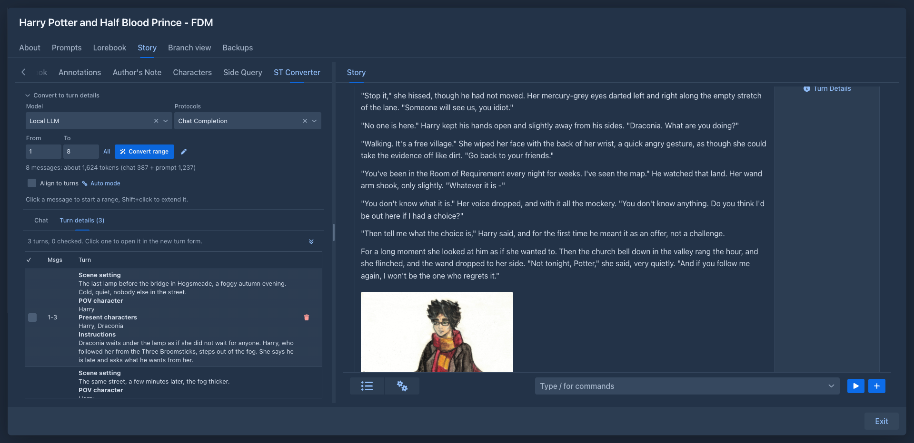

# Converter

!!!
This extension was called *SillyTavern Converter* before 1.6.0. Only the name changed; its files, the data stored with your books and the saved layouts are the same.
!!!

Rewrite a [SillyTavern](https://github.com/SillyTavern/SillyTavern) roleplay chat as a story, turn by turn: load the
chat into a book, let the model split it into *turn details* using the chat and the lore of the book, and put each turn
into the new turn form of the story with one click.

The source does not have to be a chat: the converter can also take the parts of another book of yours (from a backup file or
the book itself) and give you their instructions one by one, to [redraft a book](#redrafting-a-book).

To make a book out of a chat directly (every message, or every user and assistant pair, a part), see
[Importing from SillyTavern](../books/managing-books.md#importing-from-sillytavern). The converter is for the other way: you keep the
chat next to you and write the story again, with the model, from instructions made of the chat.

!!!
The Converter is not available in the [phone layout](../phone.md#extensions).
!!!

## The Converter tab

The left sidebar of the [story editor](../books/story-editor.md) gets a **Converter** tab (small text, and the tab scrolls
when the sidebar is low). Above its two lists is the section **Convert to turn details**, closed until you open it so that
the lists get the room. It holds:

| | |
|---|---|
| **Model** and **Protocol** | What the wand runs with. They start with the model and protocol of the book; the choice is kept with the book. |
| **From**, **To** | The range of messages the wand works on. Type the numbers, click in the chat, or use **All**. |
| Token count | How many tokens the request takes: the messages of the range plus the prompt and the lore (counted once). Use it to keep the range within the context of the model. |
| **Convert range** | The wand: asks the model for the turn details of the range. It becomes **Stop** while the model works. |
| Pen button | Edits the prompt of the wand (variables ``, ``, ``, ``, ``), with a **Default** button. |
| **Align to turns** | Moves the range to the boundaries of the turns, see below. Kept with the book. |
| **Auto mode** | Shows the controls that convert the whole range in batches, see below. |

### Align to turns

A turn of the story is the messages of the user (the instructions) followed by the message of the character. With **Align to
turns** ticked, every range you choose (by clicking, typing the numbers or **All**) is moved to the boundaries of the turns:
the start goes back to the first message of its turn, and the end goes back to the last message of the character before it,
so the range never ends on a message of the user that belongs to the turn after it. The end of the chat stays where it is. A
range that lies wholly in the messages of the user before a reply is extended forward to that reply.

### Auto mode

**Auto mode** shows a line with **Messages per batch**, the button **Convert in batches** and how many requests that makes,
with the tokens they take in all. The button splits the current range into batches of that many messages and sends
them to the model one after another (after asking), the same as the wand does for one range. With **Align to turns** every
batch ends at the end of a turn (the last message of the character within the size, or the end of the turn when it is longer
than the size), so no turn is cut in two; without it the batches are cut exactly by the number, and a turn on the border
can be split in two.

While it runs the chat shows the batch it is at, the status line tells which batch of how many, and the button becomes
**Stop**. The turn details of each batch are stored as soon as it is done, as with the wand (the turns that touch the range
and that you have not ticked are replaced). When all batches are done the range is as you had it and the **Turn details**
tab opens. A batch whose answer can't be used (empty, or not matching what was asked for) is sent again, up to three times in all. When you stop, or a batch still fails, the notification says why and the range is what is left, so you can go on from there.

### What a range continues from

The prompt tells the model the details of the last turn that ends before the range (its scene setting, POV character, present
characters and instructions, in ``), so the turns of the range keep the same point of view and scene until
the chat changes them. This is how a batch of the auto mode continues from the one before it: the turn details of
a batch are stored before the next one is sent. When there is no turn before the range the part of the prompt is left out.

## The chat

Upload the `.jsonl` file of a chat (in SillyTavern it is in `data/<user>/chats/<character>/`, or export it from the
chat). The chat must have no branches: of every message the swipe that was shown is read, and hidden system messages and
empty ones are left out. If your chat has branches, import the one you want to rewrite first (see
[Importing from SillyTavern](../books/managing-books.md#importing-from-sillytavern) for joining branches into a tree).

The **Chat** tab is a table of the messages: a checkbox, the number and the message, with the name of who said it in bold above the
text (the messages of the user are marked with `»`).

- Tick the checkbox of a message you have gone through, so you can see what is left. The button with the double arrow
  above the table scrolls to the next unchecked message (after the one you ticked or clicked last, starting again from the
  top at the end).
- **Click** a message to make it the range, **Shift+click** another to extend the range up to it. The range is
  highlighted and the token count follows.
- The button with the cross above the table removes the chat and the turn details from the book (after asking).

## Turn details

Use the wand and the **Turn details** tab opens with what the model prepared, in the order of the chat. A row is a turn:
the messages it is made from and, in one element, the scene setting, the POV character, the characters who are present and
the instructions, each under a bold line with its name.
The model is told to cover every message of the range exactly once; numbers outside of the range are cut to it.

- **Click a row** to open the *new turn* form of the story and copy all four fields of the turn into it. Change what you
  want and generate. (A row's checkbox and delete button do not open the form.)
- Tick the checkbox of a turn you have used; the double arrow goes to the next unchecked turn.
- Running the wand again for a range **replaces** the earlier turns that touch the range, except the ticked ones.

## Redrafting a book

To write a book again, part by part, load the old one as the source. The tab shows **Upload a chat**, **Load a backup** and
**Pick a book** while it has no source:

- **Pick a book** opens a list of your books (not the one you are in). The parts of the branch the book is on are loaded,
  from the first part to the one the book is at now.
- **Load a backup** takes a backup file of a book: the JSON, the `.zip` with the images, or a file you [downloaded from the
  backups](../books/backups.md) of a book. The backup is only read, nothing is restored. The branch is the one the book was
  on when the backup was made.

Of every part the converter keeps the instructions, the scene setting, the POV character, the present characters and the text of the part,
and nothing else (no summaries, lorebook, reasoning, images, other branches or settings), so a long book stays small.
A book that has no parts loads nothing, and a backup whose parts do not lead back to the first part is refused as damaged.

The tab then has two lists, as with a chat but without the wand (the book already has its instructions, so the **Convert
to turn details** section is not there):

- **Parts** is the text of each part, with the same checkbox and the arrow to the next unchecked part. Read the old text next
  to the story you write.
- **Turn details** has one row per part with its scene setting, POV character, present characters and instructions.
  **Click a row** to put them into the new turn form of the story, as with a chat, and generate the new part. Tick the
  turns you have done.

Only one source is kept with a book. To load another, remove the current one with the cross (after asking); this
also forgets the ticks made on it.

## Storage

The uploaded file is stored as a [resource](../resources.md) of yours (a chat of SillyTavern can be megabytes, with all
that SillyTavern adds to the messages), linked to the book. The parts of a book are stored the same way as a small JSON
file (`<book name>.redraft.json`) with the instructions and the text; the book keeps only the ticks. The ticks, the turn details, the model and the prompt are stored in
the attributes of the book, so they are in [book backups](../books/backups.md) and copies.

!!!warning
The file of the chat is not in book backups, and a copy of a book points to the same file. After a restore the ticks and turn
details are there, but the converter asks for the chat again (upload the same file; this replaces the turn details
and the ticks). The same goes for the parts of a book: load the book or the backup again and tick again. Removing the source
with the cross deletes the resource.
!!!
