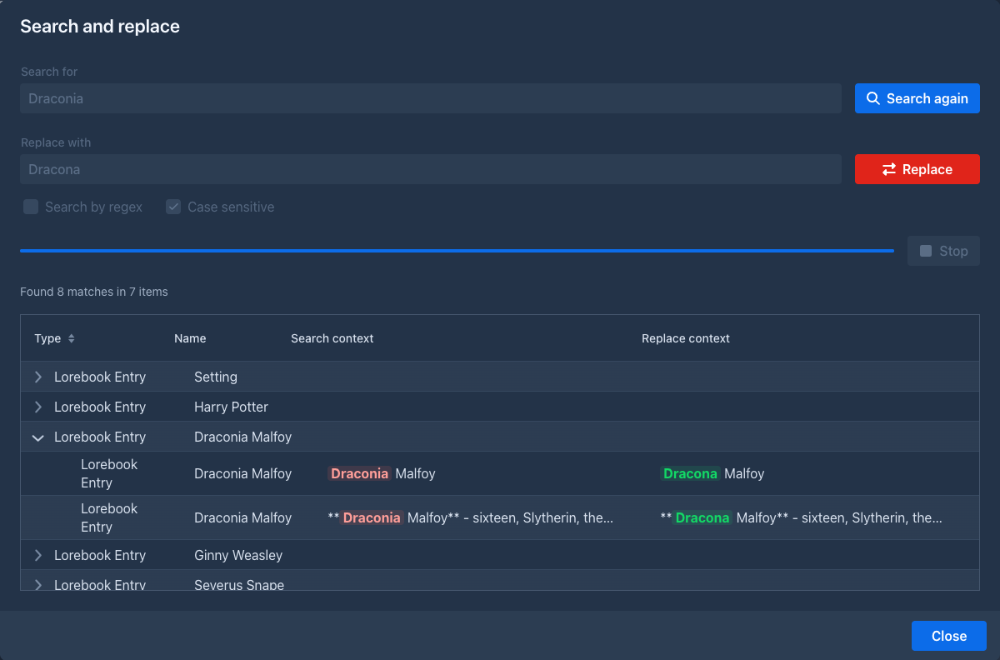
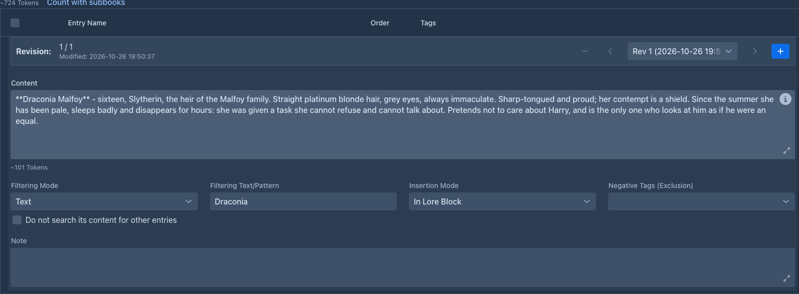

# Entries & activation

## The entry list

Each row of the lorebook editor is one entry:

| Column | |
|---|---|
| checkbox | **Enabled**. Disabled entries are never used. |
| **Entry Name** | Your name for the entry. Not sent to the model. |
| **Order** | Position of the entry in the prompt, see [Order and insertion](#order-and-insertion). New entries get `100`. |
| **Tags** | Tags that activate the entry, see [Tags](#tags). |
| ⌄ | Shows the details of the entry. |
| trash | Deletes the entry (after confirming). |

**Add Entry** in the toolbar adds an entry with order `100`. Changes are saved as you type.

### Searching and deleting many entries

The box with the magnifier next to the buttons shows only the entries that have the text in their name, content, note or
filter (the case does not matter); clear it to see all of them again. It looks only at the entries of the selected
lorebook, not at the sub lorebooks. The phone layout has the box above the list.

The checkbox column at the left selects entries (the one in the header selects all that are shown, so a search and then
the header box selects the matches). When something is selected, **Delete selected** appears in the toolbar with the number
of the entries; it asks once and then moves them to the [trash](../trash.md). The phone layout does not delete many entries
at once.

## Search and replace

**Search and replace** (right of **Add Entry**) changes a word, a name or a phrase in the name, the text and the comment of
all the entries of the lorebook at once. It works like the [search and replace of the story](../books/story-editor.md#search-and-replace),
without the options for summaries and branches: **Search** lists the entries with matches (the table shows their names) and
the matches in them as they are and as they will be, **Replace** changes the entries. It has the options **Search by regex** (see [Regular expressions](../regular-expressions.md)) and **Case sensitive** (on by default; locked while the regex is on, which
can use `(?i)` to ignore the case). Entries that are disabled are searched too. On the phone the button (an icon next to the
*Enabled* check box) opens the same window in the phone layout.



The command line of the story editor has `/search-replace-lore-entries` for the lorebook of the open book, see
[Commands](../commands/index.md#commands-that-come-with-marginalia).

## Entry details

The ⌄ button opens the details:



| Field | |
|---|---|
| **Content** | The text that goes into the prompt. A [template](#templates-in-entries): it can use variables and macros. |
| **Filtering Mode** | **Keywords (any)**, **Keywords (all)**, **Text** or **Regex**, how *Filtering Text/Pattern* is matched. |
| **Filtering Text/Pattern** | The filter, see [Filters](#filters). Empty means no filter. |
| **Insertion Mode** | **In Lore Block** or **Before User Prompt**, see [Order and insertion](#order-and-insertion). |
| **Negative Tags (Exclusion)** | Tags that switch the entry off, see [Tags](#tags). |
| **Do not search its content for other entries** | When ticked, the words in this entry's content never bring other entries in, see [Entries brought in by other entries](#entries-brought-in-by-other-entries). The phone layout shows it when it is ticked. |
| **Note** | Your notes. Not sent to the model. Entries imported from SillyTavern list the settings that couldn't be imported here. |

Write the content as you want the model to read it - a short, factual description works best:

> **Captain Varro** - commander of the harbor watch of Ostra, fifties, scarred left hand. Loyal to the Duke, distrusts
> the mages' guild. Speaks in short, clipped sentences.

## Activation

Before each generated part, Marginalia goes through the entries of the book's lorebook and its
[sub lorebooks](lorebooks.md#sub-lorebooks). An entry is **activated** when:

1. the entry is enabled, and so is its lorebook;
2. none of its **negative tags** is a tag of the book;
3. it has no **tags**, or at least one of them is a tag of the book;
4. it has no **filter**, or the filter matches the instructions for the part.

All conditions must hold. An entry without tags and filter is always active.

### Tags

Tags connect entries with **book tags** (set on the book's [About](../books/managing-books.md#the-about-tab) tab).
Use them to share one lorebook between books that need different parts of it:

| Entry tags | Negative tags | Active in a book tagged... |
|---|---|---|
| - | - | always |
| `winter` | - | `winter` |
| `winter`, `book-2` | - | `winter` **or** `book-2` |
| - | `book-1` | anything but `book-1` |
| `winter` | `book-1` | `winter`, unless it is also `book-1` |

Tags must match exactly. A negative tag always wins over a tag.

Tags can also be given to a whole lorebook (the **Tags** field of the [lorebook](lorebooks.md); lorebooks imported
from files can carry them). They then count as tags of each of its entries.

### Filters

A filter activates the entry only when the **request for the part** mentions it. It is matched against the
[user prompt](../books/prompts.md#user-prompt) of the part as it is sent - the *Scene Setting*, *POV Character*,
*Present Characters* and *Instructions* you entered, inside the wording of the user prompt template.

| Mode | Matches when |
|---|---|
| **Keywords (any)** | The filter is a list of keywords separated by commas (`Varro, Ostra`); the request contains at least one of them, ignoring case. Spaces around a keyword are ignored. |
| **Keywords (all)** | The same list, but the request must contain every keyword. |
| **Text** | The text appears anywhere in the request, ignoring upper and lower case. `varro` matches *Captain Varro*. |
| **Regex** | The [regular expression](../regular-expressions.md#in-a-lorebook-entry-filter) matches anywhere in the request, ignoring case, across lines. |

For example, the regex `\b(varro|captain)\b` matches the whole word *Varro* or *Captain*, and
`varro.*(harbor|docks)` matches only when Varro and the harbor or the docks are both mentioned, in that order.

!!!warning The filter sees the request, not the story
Filters check the instructions for the new part only, not the text of earlier parts. An entry about Varro is
activated when Varro is mentioned in the scene, characters or instructions of the part you are writing - put him
into *Present Characters* when he is in the scene.

The request also contains the text of the user prompt template itself. A filter for a word the template uses
(the default one mentions *characters*, *plot*, *tone*...) is always active.
!!!

An invalid regular expression never matches; the entry stays inactive.

Combine tags and a filter when an entry should only be used in some books, and there only when it's relevant.

### Entries brought in by other entries

Normally only the request for the part activates entries. With a **scan depth** (the field of the
[lorebook](lorebooks.md#the-lorebook-editor); `0`, which is the default, switches this off) the content of the entries that
were activated is searched for the filters of the entries that were not, as if it were part of the request. An entry whose
filter is found there is activated too. That is **pass 1**; the content of the entries it activated is searched in pass 2,
and so on, as many passes as the scan depth says (at most 5).

For example, with a scan depth of `1`, an entry *Captain Varro* (filter `varro`) is activated by the request, and its content
says "...serves the Duke of Ostra". An entry *Ostra* (filter `ostra`) is then activated too, although the request never
mentions the city. With a scan depth of `2`, the entry *Ostra* would in turn bring in an entry about the harbor it mentions.

- Only **filters** count: an entry that is already used because it has no filter needs nothing, and an entry that is
  switched off, or excluded by its tags, is not brought in.
- The content that is searched is the text of the entry as written, the templates in it are not run.
- The setting of the lorebook the **book uses** counts; the scan depth of a sub lorebook is ignored.
- An entry with **Do not search its content for other entries** ticked can be activated, but it brings nobody in.
- The order in the prompt does not depend on how an entry was found, see [Order and insertion](#order-and-insertion).
- Extensions that change which entries are used (see [Extensions](../extensions/index.md)) are asked about the entries
  that are brought in too.

## Preview activation

**Preview activation** (the button with the eye in the toolbar of the lorebook editor, and on the phone next to the search and replace
button) answers "which entries would be used for this text?" without generating anything. Type the text of the request
into **Text of the turn** (the scene, the characters and the instructions, as you would enter them) and the table lists every entry
of the lorebook and of its sub lorebooks, in the order they are used:

- a green check mark for the entries that would be used and a gray mark for the others;
- the lorebook of the entry, its **Order**, the **Pass** (empty for the entries the text activated, `1`, `2`... for the entries
  brought in by [other entries](#entries-brought-in-by-other-entries));
- the **Reason**: no filter, filter found in the text, filter found in the content of another entry (with the filter and the
  entry), or why not: switched off, a negative tag of the book, the book lacks a tag of the entry, the filter was not found.

The tags decide too, so pick a book in **Tags of the book** to use its tags (without one, no tags count). Below the text, a line says how many entries
would be used and about how many tokens of lore that is. The scan depth of the lorebook is used.

The preview applies the rules of Marginalia only: the text is the one you type (not the user prompt template around it),
and what an [extension](../extensions/index.md) changes while a part is generated is not part of it.

## Order and insertion

Activated entries are put into the prompt sorted by **Order**, lowest first. Entries with the same order keep the
order in which they were created. Entries from all included lorebooks are sorted together.

**Insertion Mode** decides where an entry goes:

| Mode | Where |
|---|---|
| **In Lore Block** | Into the `{{backgroundLore}}` block of the [master template](../books/prompts.md#master-template) - *World & lore context* in the default template, in the system message. Use it for background knowledge. |
| **Before User Prompt** | Right before the request for the part, at the end of the prompt. The model pays most attention to it. Use it sparingly, for what must influence this very part (a character's current state, a rule for the scene). |

Entries are separated by an empty line. Lore counts toward the [context limit](../protocols.md#limits); with many
long entries, less of the story fits into the prompt.

## Templates in entries

The content of an entry is a template like the [book prompts](../books/prompts.md#templates). It can use:

| Variable | |
|---|---|
| `{{sceneSetting}}`, `{{povCharacter}}`, `{{presentCharacters}}`, `{{instructions}}` | The instructions for the part. |
| `{{narrativePov}}`, `{{narrativeTense}}`, `{{style}}` | The book's narrative settings. |

and all [macros](../templates/macros.md). For example, an entry that adapts to the point of view character:

```handlebars
Varro {{#povCharacter}}is seen through the eyes of {{.}}: {{/povCharacter}}a stern, scarred officer.
```

All activated entries of one part share their variables in activation order: an entry can `setvar` a value that
entries later in the order (and the master template) read with `getvar`.

A syntax error in the content is shown under the field. The entry is still saved; until it is fixed, its content is
used as plain text, without processing the template.

## Tips

- Keep entries short and factual; the model doesn't need prose, it needs facts.
- One entry per character, place or concept, so each can be activated on its own.
- Use always-active entries for the core of the world, filters for the cast and places, and tags to share a lorebook
  between books.
- Check what was activated with **Show Prompt** on a generated part, or try a text before you write with
  [Preview activation](#preview-activation).
- Use the scan depth sparingly: one pass is enough for most books, and every pass can bring in more lore than you wanted.
