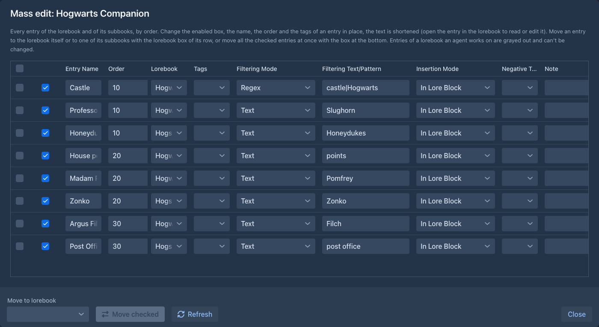
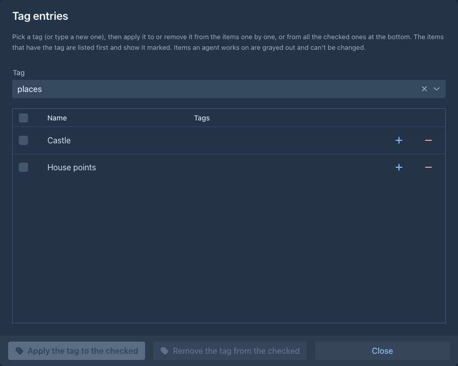
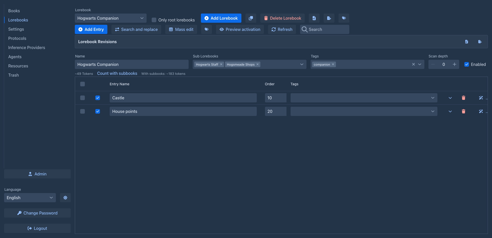

# Creating lorebooks

## The lorebook editor

Open the **Lorebooks** tab. The editor shows one lorebook at a time; pick it in the **Lorebook** field at the top.
Lorebooks belong to your account: other users don't see them.

The toolbar has two rows, which wrap onto more lines in a narrow window: the first for the lorebooks (**Lorebook** to **Tag lorebooks**), the second for the entries of the selected lorebook (**Add Entry** to **Refresh**).

| Button | |
|---|---|
| **Lorebook** | Selects the lorebook to edit. |
| **Only root lorebooks** | Lists only the lorebooks that are not a sub lorebook of another one (the selected lorebook stays in the list). |
| **Add Lorebook** | Creates a new lorebook named *New Lorebook* and selects it. |
| Clone (two sheets icon) | Makes a copy of the selected lorebook: asks for the name (the original's with *(Copy)*) and selects the copy. The copy has the same entries (with their settings, tags and negative tags), tags and data of extensions. Its sub lorebooks are not copied, the copy uses the same ones. The original is not changed. |
| **Delete Lorebook** | Deletes the selected lorebook (after confirming). |
| Import (file icon) | **Import Marginalia Lorebook**, **Import from SillyTavern** or **Import from archive** (a zip of `.md` files), see [Import & export](import-export.md). |
| Export (file icon) | Downloads the lorebook with its sub lorebooks, see [Import & export](import-export.md#exporting). |
| Tags (tags icon, last of the first row) | **Tag lorebooks**: puts a tag on many lorebooks at once, see [below](#tagging-many-at-once). Not shown for a lorebook that is open in a book. |
| **Add Entry** | Adds an entry to the lorebook, see [Entries & activation](entries.md). |
| **Search and replace** | Changes a text in the name, text and comment of the entries of the lorebook, see [Search and replace](entries.md#search-and-replace). |
| **Mass edit** | Opens all the entries of the lorebook and of its sub lorebooks in one table, see [Mass edit](#mass-edit). |
| Tags (tags icon, right of **Search and replace**, second row) | **Tag entries**: puts a tag on many entries of the selected lorebook at once, see [below](#tagging-many-at-once). |
| **Refresh** | Reloads the entries. |

Below the toolbar are the settings of the selected lorebook:

| Field | |
|---|---|
| **Name** | The name of the lorebook, shown when you pick it for a book or as a sub lorebook. |
| **Sub Lorebooks** | Other lorebooks whose entries are included with this one, see [below](#sub-lorebooks). Click the name of a selected sub lorebook to open it. |
| **Tags** | Tags of the whole lorebook; they count as tags of each of its entries, see [Tags](entries.md#tags). |
| **Enabled** | When unchecked, the lorebook contributes nothing - neither its entries nor those of its sub lorebooks. |

The rest of the editor is the list of [entries](entries.md). All changes are saved as you make them.

Under the settings, the estimate of the tokens of the enabled entries of the lorebook is shown. The link **Count with subbooks** next to it adds up
the tokens of the enabled entries of the lorebook and of all its sub lorebooks, however deep, and shows the total next to it. As when a
story is written, a disabled sub lorebook is left out together with the lorebooks under it, and a lorebook that is a sub lorebook in more than one place counts once.
The total is a count of the moment you click: change an entry and it disappears, click again to count again.

A lorebook of a book an agent works on is shown read only (see [Agents](../agents.md)), without **Add Entry**, **Search and replace**, **Mass edit**, **Delete Lorebook** and the settings; **Add Lorebook**, import, export and **Refresh** stay, so you can always start another lorebook.

## Mass edit

**Mass edit** opens a window with every entry of the selected lorebook **and of its sub lorebooks** (however deep) in one table,
ordered by the **Order** of the entries (entries with the same order by lorebook, then by name). It is for tidying a big lorebook:

- Change the *enabled* box, the **Entry Name**, the **Order**, the **Tags**, the **Filtering Mode**, the **Filtering**, the **Insertion Mode**, the
  **Negative Tags** and the **Note** of an entry in place, as in the editor. Every entry is one line; the table scrolls down (and to the side when the
  window is narrow). The row moves to its new place when you change the order. The text of an entry is shortened in the table; open the entry in
  the lorebook to read or edit all of it.
- The **Lorebook** box of a row says in which lorebook the entry is. Pick another one (the lorebook itself or any of its sub lorebooks) to move the entry there.
- To move many entries, tick them (the box in the header ticks all), pick **Move to lorebook** at the bottom and press **Move checked**.
- A lorebook that an agent works on is locked: its entries are grayed out and can not be changed or moved, and nothing can be moved into
  it. This is checked for each lorebook, so a lorebook can be free while one of its sub lorebooks is locked (it is used by another book).
  **Refresh** reads the window again to see whether a lock is gone.

The lorebook in the editor is refreshed when the window is closed after a change.



## Tagging many at once

The two tags buttons of the toolbar open one window that puts a tag on many items, or takes it off them: **Tag lorebooks** lists
your lorebooks, **Tag entries** the entries of the selected lorebook. Pick the **Tag** (or type a new one and press Enter);
the list shows every item with its tags, and the items that have the picked tag come first with the tag highlighted. A row's
**+** and **-** buttons apply or remove the tag for that item; tick several items (the box in the header ticks all) and
use **Apply the tag to the checked** or **Remove the tag from the checked** at the bottom to do it for all of them. An item
an agent works on (a lorebook of a book with a running agent, and so all its entries) is grayed out and can not be changed
until the run is paused or stopped. The window also tags [books](../books/managing-books.md#tagging-many-books-at-once).
The tags it puts on entries are the ordinary ones, see [Tags](entries.md#tags); negative tags are set on the entry itself.



## Using a lorebook in a book

Open the book and its **Lorebook** tab, and pick the lorebook in the **Lorebook** field. The editor below shows the
lorebook, so you can add and change entries while you write. Clear the field to write without a lorebook.

A book uses one lorebook. To use several, create a lorebook that includes them as sub lorebooks, and use that one.

The same lorebook can be used by any number of books. Changes to it affect all of them from the next generated part
on; parts that were already written keep the lore they were written with.

## Sub lorebooks

**Sub Lorebooks** includes the entries of other lorebooks in this one. A typical setup:

```
"Saga" (used by the books of the series)
 ├─ "World"       places, history, rules of magic
 ├─ "Characters"  the main cast
 └─ "Book 2 notes"
```

- Sub lorebooks can have sub lorebooks of their own; all levels are included.
- A lorebook can be a sub lorebook of several lorebooks. When it is reached more than once, its entries are still used
  only once.
- A lorebook can't include itself, directly or through other lorebooks: such a choice is refused with
  *Cannot select sub lorebook: cycle detected.*
- A disabled sub lorebook is left out together with everything it includes.



The entries of all included lorebooks are put together and sorted by their [order](entries.md#order-and-insertion),
regardless of which lorebook they come from.

## Disabling and deleting

Uncheck **Enabled** to switch a lorebook off for a while, for example to see how a book reads without it. Books keep
using it, and it works again when you check it.

**Delete Lorebook** removes the lorebook from your lists. Books that used it no longer get its entries, and lorebooks
that included it as a sub lorebook skip it. The data stays in the database until an administrator runs
[Cleanup](../administration/cleanup.md), and until then you can restore the lorebook from the [Trash](../trash.md); copies in [book backups](../books/backups.md) and exported files are not
affected.
