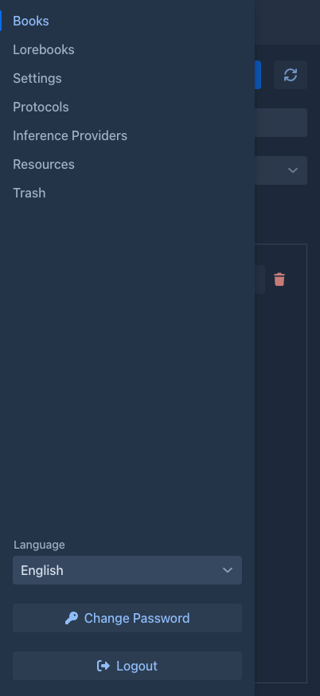
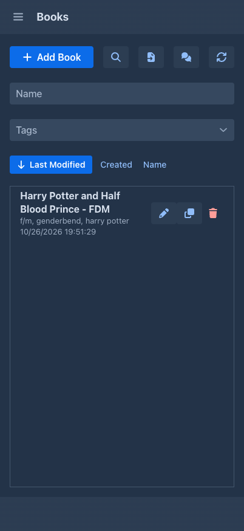
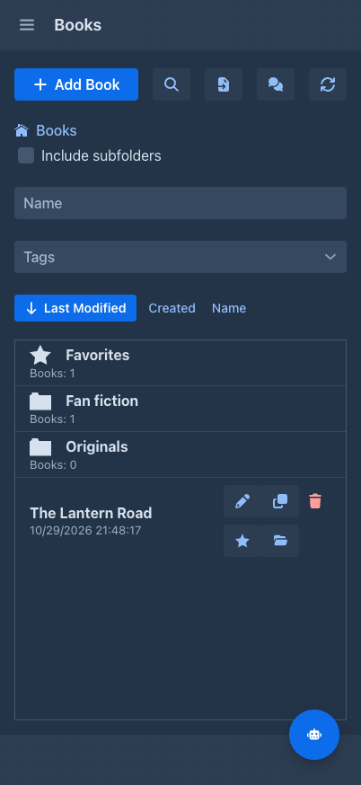
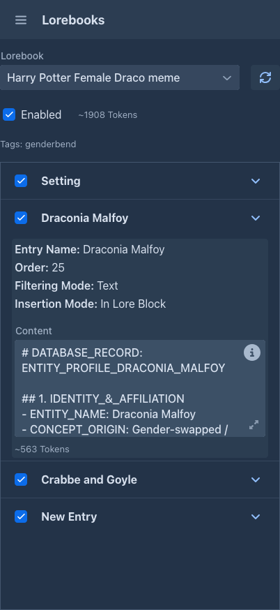
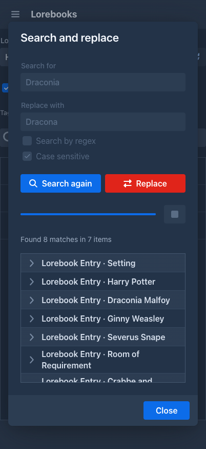
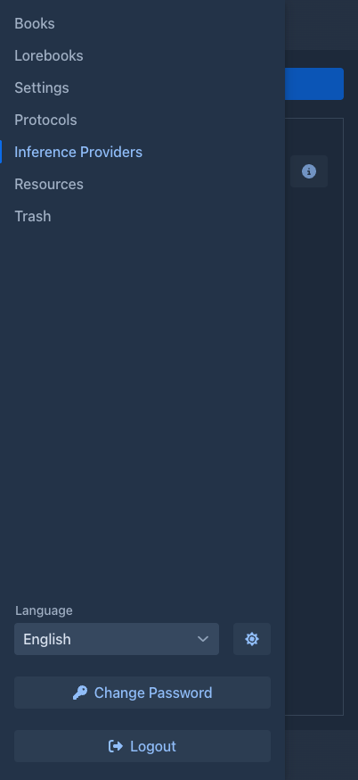
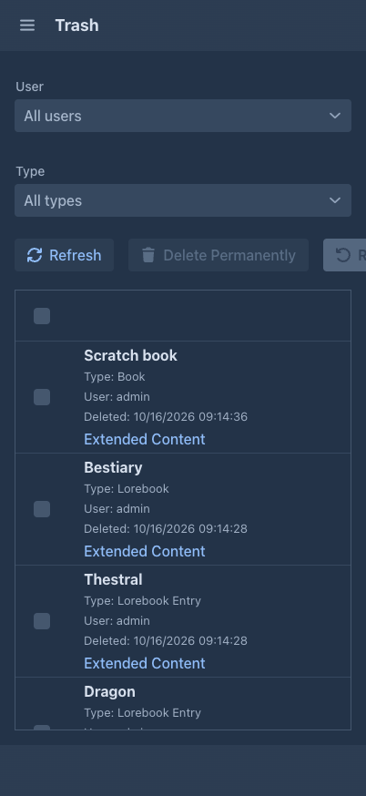
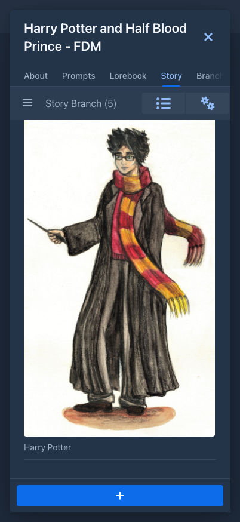

# Using Marginalia on a phone

Marginalia has a layout made for phones. You write, edit and regenerate parts, read and tweak lorebooks and manage your
models from the phone browser, but the phone layout is **not a copy of the desktop one**: it is simpler, a few things
are missing and not every extension works in it. This page lists the differences.

For reading a book on a phone, there is also the [viewer](books/publishing.md), which is made for it.

## When the phone layout is used

Marginalia looks at the width of the browser window **when the page loads**. Narrower than 768 pixels gives you the phone
layout, anything wider the normal [workspace](index.md#the-workspace).

- Tablets and phones in landscape mode are usually wider than 768 pixels and get the desktop layout.
- The layout is **not switched while you work**. If you turn the phone or tablet on its side, or resize the window, the
  layout stays as it was until you **reload the page**. So to get the larger desktop layout on a tablet or a turned
  phone, turn it and reload; to go back to the phone layout, turn it back and reload again.
- A narrow desktop browser window gets the phone layout too, which is handy to try it.

Like the desktop, the phone layout can be added to the home screen like an app (*Install app* / *Add to Home Screen*
in the browser menu).

## The workspace

The tabs on the left are replaced by a **drawer**. Tap the menu button in the top bar to open it, tap a tab to switch
to it. The tab you are on fills the whole screen and its name is shown in the top bar.

The drawer has the same tabs as the desktop - *Books*, *Lorebooks*, *Settings*, *Protocols*, *Inference Providers*,
*Agents* (only for users who may use [agents](agents.md#on-a-phone)), *Resources* and *Trash* - and the **Language** selector, **Change Password** and **Logout** at the bottom. Extensions may add buttons, but only
to the places they know on the phone, see [Extensions](#extensions).

While the *Settings* tab has unsaved changes, the drawer is locked as on the desktop: save or discard first.

### Books

The book list is one column. Above it are the name filter, the tag filter and the sort buttons (*Last Modified*,
*Created*, *Name*; tap the active one again to reverse the order), then **Add Book**, the magnifier (the [advanced search](books/managing-books.md#advanced-search): tags to include and exclude, dates, number of parts and text) and refresh. Each book has
buttons: the star makes it a favorite, **Move to folder** puts it into a [folder](books/folders.md), the pencil opens it and the trash deletes it (into the [Trash](trash.md)).

The list shows one [folder](books/folders.md) at a time, as on the desktop: the path of the folder you are in as buttons to go back on,
the check box **Include subfolders**, then the folders above the books (tap one to go in; it shows how many books are beneath it) and, at
the top level, the virtual **Favorites** folder. The name and tag filters search the current folder, or everything below it with *Include
subfolders*. **Add Book** and the imports put the new book into the folder you are in. The folder you are in is remembered.

A folder can't be made, renamed or deleted on the phone, and there is no *Organise* window or mass change; do that on a computer. The
language of a book can be inherited from a folder here too, and the *Prompts* tab shows where each value comes from.

### Lorebooks

The phone shows a **reduced lorebook editor**. You can pick a lorebook, enable or disable it and its entries, and
edit the **content** of an entry. Everything else is shown as text only: name, order, tags, filtering and insertion
mode, negative tags and note. You cannot create, delete, import or export lorebooks, or add entries. Use the desktop
for that, see [Lorebooks](lorebooks/index.md).

The same reduced editor is used in the *Lorebook* tab of a book. When the lorebook of the book has sub lorebooks, the box
**Shown lorebook** under it switches the tab to any of them, and back, without changing the lorebook of the book.

The button next to the *Enabled* check box opens **Search and replace** for the entries of the lorebook, see
[Entries](lorebooks/entries.md#search-and-replace).

### Settings, protocols, providers, resources, trash

- **Settings** are the same as on the desktop, only laid out in a narrow column. The one thing missing is
  **Import Backup as New Book**. To bring a backup file back on the phone, create a book, use **Import Backup** in
  its [Backups tab](books/backups.md) and restore it there, or import it as a new book on the desktop.
- **Protocols** and **Inference Providers** list each entry as text with the edit and delete buttons next to it. The
  editing dialogs are the desktop ones.
- **Resources** is the desktop tab, not adapted to the phone.
- **Trash** shows each deleted object as a card (name, type, when it was deleted). The explanation of the trash is
  behind the *i* button. Restoring works as described in [Trash](trash.md).

## The book window

Opening a book shows it **full screen**. The close button is the **✕** in the top corner, and the tabs - *About*,
*Prompts*, *Lorebook*, *Story*, *Branch view*, *Backups* - are one row you scroll sideways. They do the same as on the
desktop (see [Books](books/index.md)), with their fields in one column.

### The story

The story tab is one column of parts. The differences from the [story editor](books/story-editor.md):

- The **outline** (and the tabs extensions add next to it, such as the [Author's Note](extensions/authors-note.md))
  is in a **drawer**. Open it with the button at the top left.
- The **Summaries** button and the settings menu (⚙, with *Change Styles For Text*, *Search and replace*, *Import from archive*, *Mass delete* and *Export story*) are in the top bar, not
  at the bottom.
- The **+** button for a new part is at the bottom.
- [Annotations](books/annotations.md): the **Annotations** tab is in the drawer next to the outline; a tap on an underlined passage
  opens its note; **Annotate part** and **Annotate with AI** are in the menu of the part, **Annotate selection** in the menu of a long press on the selected text.
- **Search and replace** opens the same window as on the desktop, with the fields and buttons below each other:

  

- A part is only its text under one small line with two icons. The first is the part's **menu** (edit, regenerate,
  swipe, branch, show prompt, images, summary, delete); the second opens a **popup** with what the desktop shows in the
  column on the right of a part: the ids, model, protocol, tokens, words and the turn details.
- The [summaries](books/summaries.md) overview keeps a fixed width and scrolls sideways.

## What is missing

| Missing on the phone | Where to do it |
|---|---|
| **Admin**: users, database backups, cleanup, installing extensions | Desktop layout, logged in as an administrator. |
| Creating, deleting, importing and exporting lorebooks, adding lorebook entries, changing the settings of an entry | Desktop layout, [Lorebooks](lorebooks/index.md). |
| **Import Backup as New Book** in *Settings* | Desktop layout, or **Import Backup** in the *Backups* tab of a new book. |

Everything not in this list works the same as on the desktop: generating, editing, regenerating, swiping and branching
parts, summaries and meta summaries, book prompts, the branch tree, book backups, export, resources and the trash.

!!!warning Administrators
An administrator on a phone is a normal user: there is **no Admin button**. The administrator tasks have to be done in
the desktop layout, that is in a window wider than 768 pixels (reload the page after widening it).
!!!

## Extensions

The phone layout has its own classes, so an extension has to support it explicitly. The extensions that come with
Marginalia:

| Extension | On the phone |
|---|---|
| [Arc Outline](extensions/arc-outline.md) | Works. The Arcs tab is in the outline drawer. |
| [Author's Note](extensions/authors-note.md) | Works. The note is in the outline drawer of the story. |
| [Chapter Marker](extensions/chapter-marker.md) | Works. Chapter titles are in the outline drawer. |
| [Character Tracker](extensions/character-tracker.md) | Works. The Characters tab is in the outline drawer. |
| [Converter](extensions/sillytavern-converter.md) | Works. The Converter tab is in the outline drawer; the range of the chat is chosen with two taps, see [On a phone](extensions/sillytavern-converter.md#on-a-phone). |
| [Instruction Exporter](extensions/instruction-exporter.md) | Works. **Export instructions** is in the settings menu of the story. |
| [Manga Generator](extensions/manga-generator.md) | Works. **Manga Generator** is in the settings menu of the story; its window is large, so landscape is easier. |
| [Reviewer](extensions/reviewer.md) | Works. Its items are in the menu of a part, its settings in *Settings → Extension Settings*. |
| [Side Query](extensions/side-query.md) | **Not available.** The side chat is only added to the desktop story editor. |
| [Lore Generator](extensions/lore-generator.md) | **Not available.** The generator button is only added to the desktop lorebook editor. |
| [Lorebook VCS](extensions/lorebook-vcs.md) | **Not available.** The revision history is only added to the desktop lorebook editor. |

Extensions from other sources may behave differently or add nothing at all on the phone; they appear where their
author made them work. If an extension seems to be missing, check it in the desktop layout. How an extension
supports the phone is described in the [developer manual](../developer/plugins/extendable.md#the-phone-twins).

## Tips

- Writing long text on a phone is easier in landscape mode. The layout stays the phone one after the turn, until you
  reload the page.
- If you need something that is missing on the phone, turn the phone on its side and reload, or open Marginalia in a
  wider window; your books and settings are the same everywhere.
- To reach Marginalia from a phone it has to run as a [server](getting-started/docker-server.md): the
  [desktop app](getting-started/desktop-app.md) listens on your computer only.
