# Using Marginalia on a phone

Marginalia has a layout made for phones. You write, edit and regenerate parts, edit lorebooks, manage your models and
(as an administrator) the installation from the phone browser. The phone layout is **not a copy of the desktop one**: the
same things are laid out in one column, a few windows are simpler and not every extension works in it. This page lists
the differences.

For reading a book on a phone, there is also the [viewer](books/publishing.md), which is made for it.

## When the phone layout is used

Marginalia looks at the width of the browser window **when the page loads**. Narrower than 768 pixels gives you the phone
layout, anything wider the normal [workspace](index.md#the-workspace).

- Tablets and phones in landscape mode are usually wider than 768 pixels and get the desktop layout.
- The layout is **not switched while you work**. If you turn the phone or tablet on its side, or resize the window, the
  layout stays as it was until you **reload the page**. So to get the larger desktop layout on a tablet or a turned
  phone, turn it and reload; to go back to the phone layout, turn it back and reload again.
- A narrow desktop browser window gets the phone layout too, which is handy to try it.

Like the desktop, the phone layout can be added to the home screen like an app (*Install app* / *Add to Home Screen*
in the browser menu).

## The workspace

The tabs on the left are replaced by a **drawer**. Tap the menu button in the top bar to open it, tap a tab to switch
to it. The tab you are on fills the whole screen and its name is shown in the top bar.

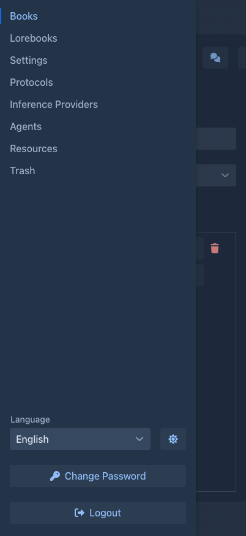

The drawer has the same tabs as the desktop - *Books*, *Lorebooks*, *Settings*, *Protocols*, *Inference Providers*,
*Agents* (only for users who may use [agents](agents.md#on-a-phone)), *Resources* and *Trash* - and, for an administrator,
*Admin* (the button of the desktop is a tab here). At the bottom are the **Language** selector, **Change Password** and **Logout**. Extensions may add buttons, but only
to the places they know on the phone, see [Extensions](#extensions).

While the *Settings* tab has unsaved changes, the drawer is locked as on the desktop: save or discard first.

### Books

The book list is one column. Above it are the name filter, the tag filter and the sort buttons (*Last Modified*,
*Created*, *Name*; tap the active one again to reverse the order), then **Add Book**, the magnifier (the [advanced search](books/managing-books.md#advanced-search): tags to include and exclude, dates, number of parts and text) and refresh. Each book has
buttons: the star makes it a favorite, **Move to folder** puts it into a [folder](books/folders.md), the pencil opens it and the trash deletes it (into the [Trash](trash.md)).

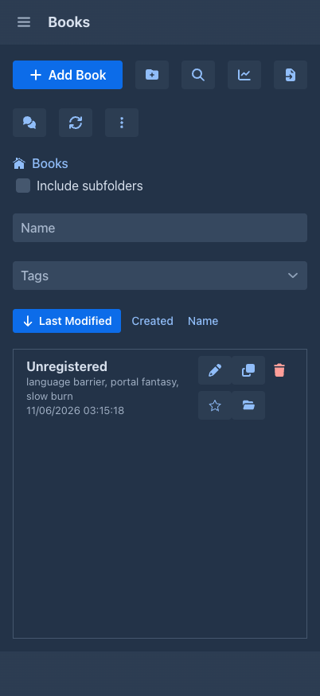

The list shows one [folder](books/folders.md) at a time, as on the desktop: the path of the folder you are in as buttons to go back on,
the check box **Include subfolders**, then the folders above the books (tap one to go in; it shows how many books are beneath it) and, at
the top level, the virtual **Favorites** folder. The name and tag filters search the current folder, or everything below it with *Include
subfolders*. **Add Book** and the imports put the new book into the folder you are in. The folder you are in is remembered.

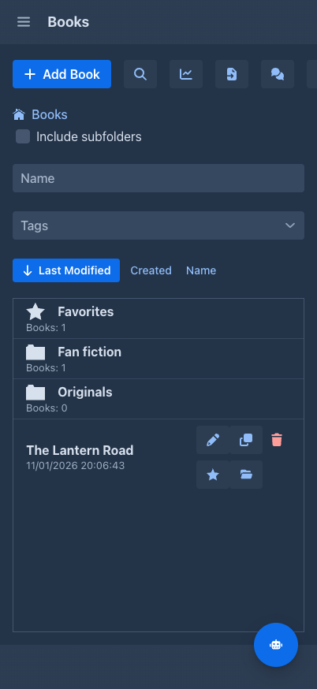

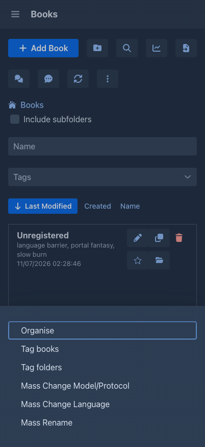

A folder is made with the **New folder** button of the header, and renamed, set up (description, tags, language, model and protocol
for its books) or deleted from the **⋮** button of its row. The **⋮** button in the header has the windows that work on many books:
**Organise** (the two panes of folders are one over the other on a phone, there is no keyboard hint), **Tag books**, **Tag folders** and
the mass changes of [folders](books/folders.md) (model and protocol, language, rename). The
language of a book can be inherited from a folder here too, and the *Prompts* tab shows where each value comes from.

### Lorebooks

The phone has the **whole lorebook editor** of the desktop, laid out in one column. The lorebook is picked in a box; the **⋮**
button next to it opens the menu of the lorebook: **Add Lorebook**, **Clone**, **Delete**, **Import** (a lorebook file, a SillyTavern
file, a zip archive of Markdown files, a lorebook another user shares), **Export** (the lorebook or the SillyTavern format),
**Tag lorebooks** and **Edit description**. Under the *Enabled* check box, the token count and the buttons for
**Search and replace** and the **activation preview**, the section **Settings** opens to the name, the sub lorebooks, the tags, the scan
depth and *Share with other users* of the lorebook. See [Lorebooks](lorebooks/index.md).

Below are **Add Entry** (and the **⋮** with the mass edit and the tags of many entries), the search box and the entries. An entry opens
with its enabled box and name on a row; opened it has a form: name, order, tags, filtering mode and text, insertion mode, negative tags,
the activation context and its range, *Prevent recursion*, the content, the note and **Delete entry**. Everything that is changed is saved
at once, as on the desktop. What is not here: the check box *Only root lorebooks* and selecting many entries to delete at once (delete an entry
from its own form, or use the trash of the desktop).

The same editor is used in the *Lorebook* tab of a book. When the lorebook of the book has sub lorebooks, the box
**Shown lorebook** under it switches the tab to any of them, and back, without changing the lorebook of the book. While an
[agent](agents.md) works on a book that uses the lorebook, the lorebook is shown as text and nothing in it can be changed.

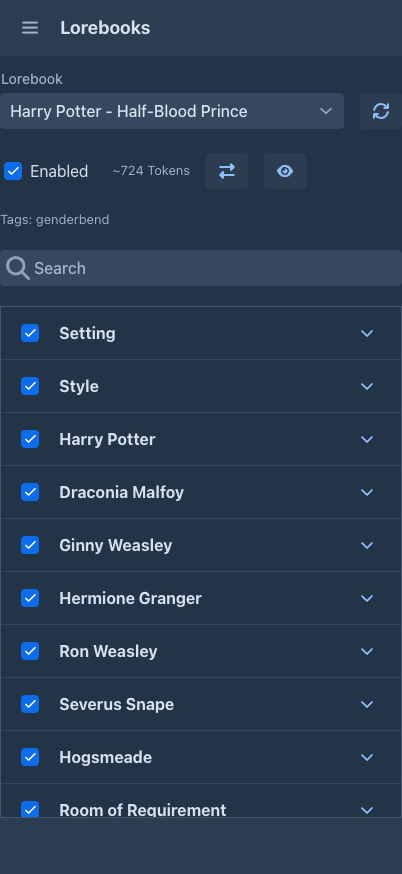

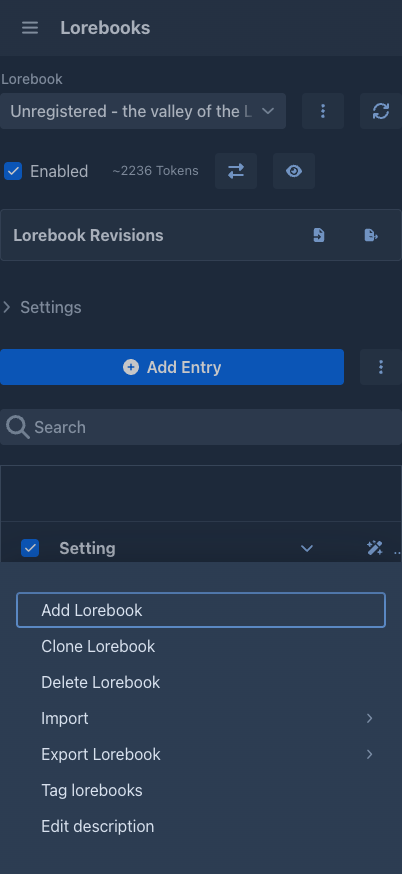

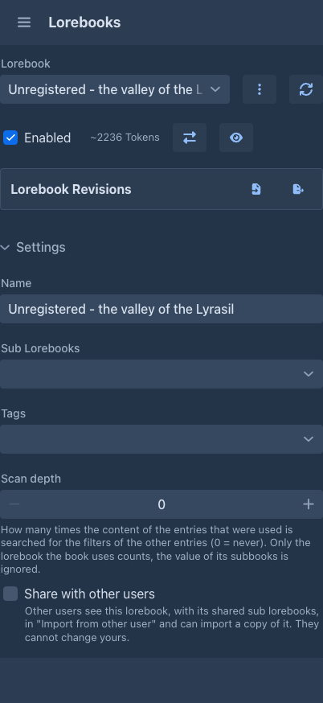

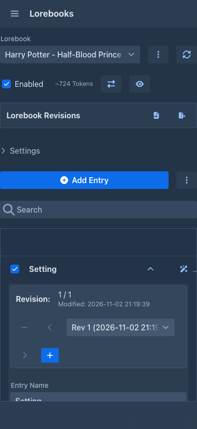

The button next to the *Enabled* check box opens **Search and replace** for the entries of the lorebook, see
[Entries](lorebooks/entries.md#search-and-replace).

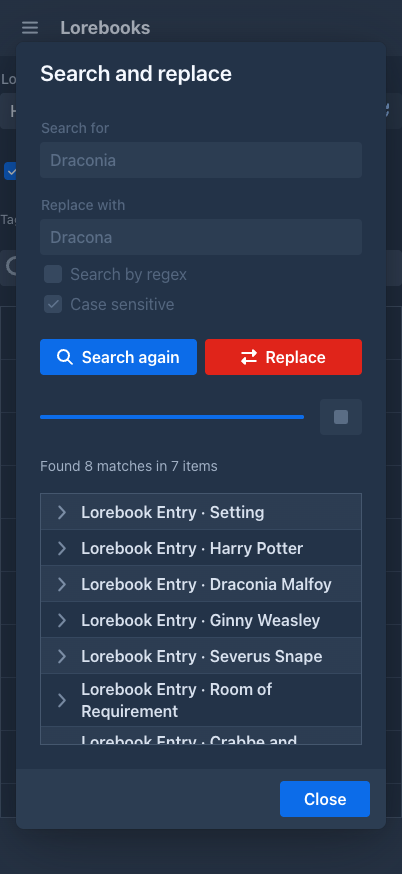

### Settings, protocols, providers, resources, trash

- **Settings** are the same as on the desktop, laid out in a narrow column; **Import Backup as New Book** is the button above *Discard Changes*.
- **Protocols** and **Inference Providers** list each entry as text with the buttons next to it (below it, for providers, which have more of them). The
  editing dialogs are the desktop ones, so a protocol can be [shared](protocols.md#sharing-a-protocol) from the phone, and the
  **Import from other user** button above the list imports a protocol that another user shares.
- **Resources** shows each file as a card (a picture, the name, type, size, date, the object it belongs to and the buttons to download, replace and delete), with
  a check box for *Delete selected*.
- **Trash** shows each deleted object as a card (name, type, when it was deleted). The explanation of the trash is
  behind the *i* button; the buttons of the filters wrap to a second line. Restoring works as described in [Trash](trash.md).

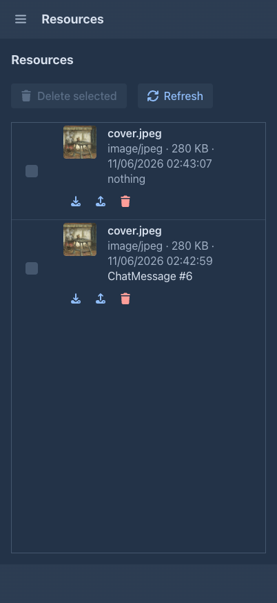

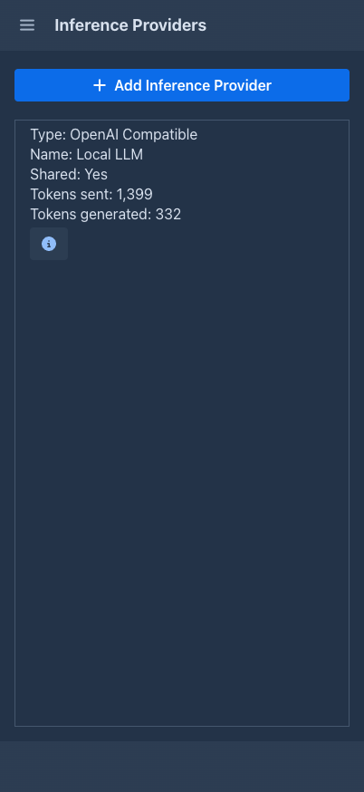

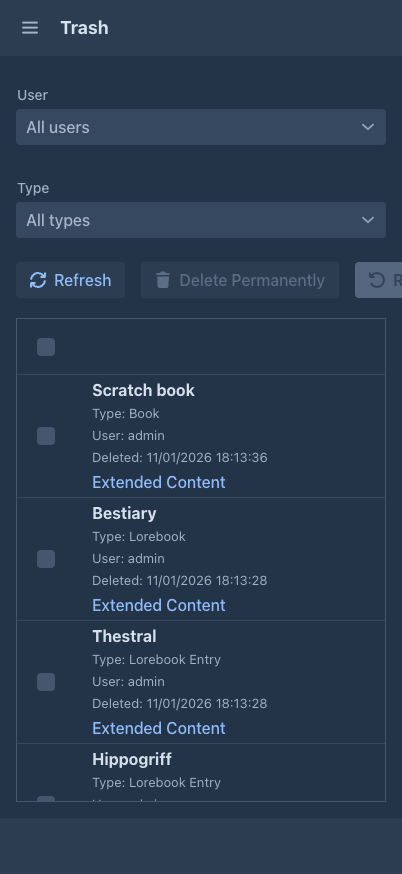

## The book window

Opening a book shows it **full screen**. The close button is the **✕** in the top corner, and the tabs - *About*,
*Prompts*, *Lorebook*, *Story*, *Branch view*, *Backups* - are one row you scroll sideways. They do the same as on the
desktop (see [Books](books/index.md)), with their fields in one column.

### The story

The story tab is one column of parts. The differences from the [story editor](books/story-editor.md):

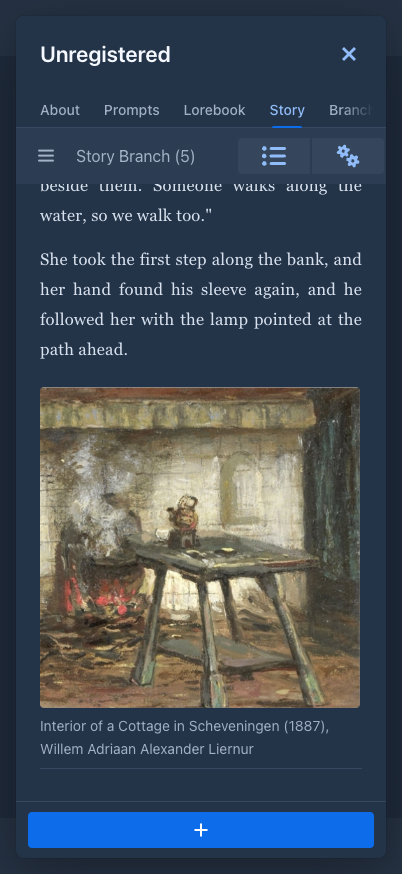

- The **outline** (and the tabs extensions add next to it, such as the [Author's Note](extensions/authors-note.md))
  is in a **drawer**. Open it with the button at the top left.
- The **Summaries** button and the settings menu (⚙, with *Change Styles For Text*, *Search and replace*, *Import from archive*, *Mass delete* and *Export story*) are in the top bar, not
  at the bottom.
- The **+** button for a new part is at the bottom.
- The **Summaries** window has its menu bar (*Search and replace*, *Export Summaries*, *Import Summaries*) in a row of its own;
  on a narrow screen the items are behind the **⋯** button. [Importing summaries](books/summaries.md#export-and-import-of-the-summaries)
  is the same window as on the desktop, in the width of the screen.

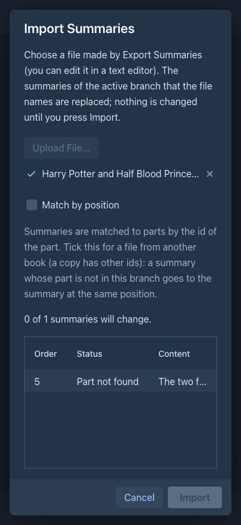
- [Annotations](books/annotations.md): the **Annotations** tab is in the drawer next to the outline; a tap on an underlined passage
  opens its note; **Annotate part** and **Annotate with AI** are in the menu of the part, **Annotate selection** in the menu of a long press on the selected text.
- **Search and replace** opens the same window as on the desktop, with the fields and buttons below each other:

  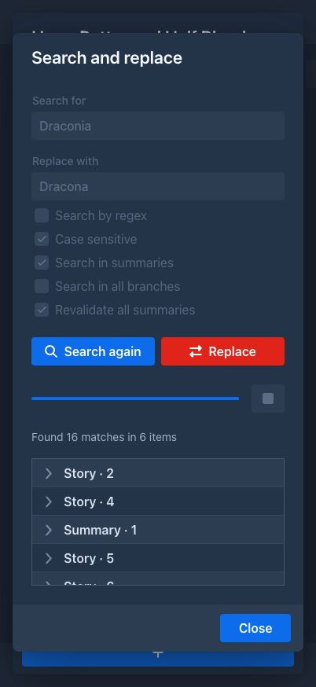

- A part is only its text under one small line with two icons. The first is the part's **menu** (edit, regenerate,
  swipe, branch, history, show prompt, images, summary, delete); the second opens a **popup** with what the desktop shows in the
  column on the right of a part: the ids, model, protocol, tokens, words and the turn details.
- **History** in the menu of a part opens the [version history](books/version-history.md) as a full screen page: the versions are
  cards above the selected version, with the same actions as on the desktop.

  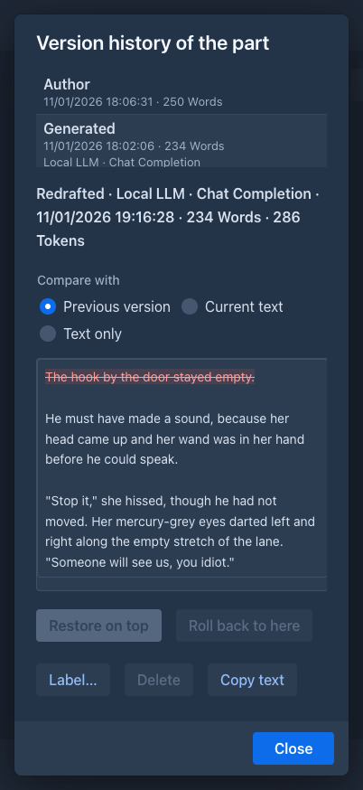

- **Statistics** is in the settings menu of the story (the statistics of the book) and a button in the header of the list of books
  (all books). The window is a full screen page; its calendar shows the last 16 weeks (a year on the desktop), see
  [Writing statistics](books/statistics.md).

  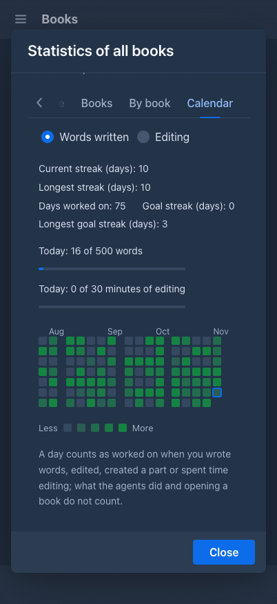

- The [summaries](books/summaries.md) overview keeps a fixed width and scrolls sideways.

## Administration

An administrator has the tab **Admin** in the drawer, with the same tabs as the [desktop page](administration/index.md) in a row you scroll sideways:
*Users*, *Database Backups*, *Cleanup*, *Resource Files*, *Help assistant*, *Agents* and *Extensions*. The lists (users, backups, extensions) are
cards with their buttons under the text, and the toolbars wrap onto a second line. Installing an extension (*Load Extension*) and uploading a database backup open the file chooser of the phone. Other users do not get the tab.

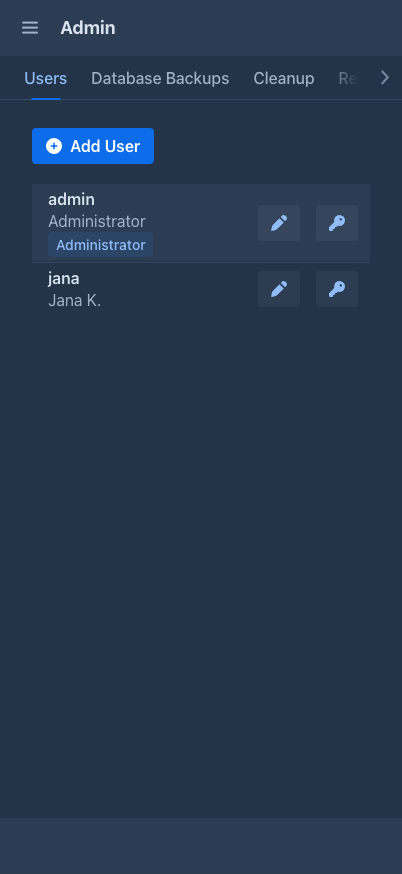

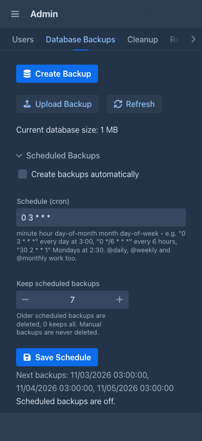

## What is missing

The phone does what the desktop does, with these differences:

| Missing or different on the phone | Where to do it |
|---|---|
| The check box *Only root lorebooks* and the selection of many lorebook entries to delete at once | Desktop layout. |
| The command bar, keyboard shortcuts, the diff view of a regenerated part and the notes in the margin | Desktop layout, they need a keyboard or a wide screen. |
| Windows with a lot of columns or two panes (the [summaries](books/summaries.md) overview, the Beta Readers conversation, the Manga Generator) are small | They work: landscape is easier. |

Everything not in this list works the same as on the desktop: generating, editing, regenerating, swiping and branching
parts, summaries and meta summaries, book prompts, the branch tree, book backups, export, resources, the trash, lorebooks and the administration.

## Extensions

The phone layout has its own classes, so an extension has to support it explicitly. The extensions that come with
Marginalia:

| Extension | On the phone |
|---|---|
| [Arc Outline](extensions/arc-outline.md) | Works. The Arcs tab is in the outline drawer. |
| [Author's Note](extensions/authors-note.md) | Works. The note is in the outline drawer of the story. |
| [Beta Readers](extensions/beta-readers.md) | Works. The Beta Readers tab is in the outline drawer; the room for the conversation is small, landscape is easier. |
| [Book Description Generator](extensions/book-description-generator.md) | Works. The button is at the end of the About tab; the dialog shows the options above the result. |
| [Chapter Marker](extensions/chapter-marker.md) | Works. Chapter titles are in the outline drawer. |
| [Character Tracker](extensions/character-tracker.md) | Works. The Characters tab is in the outline drawer. |
| [Converter](extensions/sillytavern-converter.md) | Works. The Converter tab is in the outline drawer; the range of the chat is chosen with two taps, see [On a phone](extensions/sillytavern-converter.md#on-a-phone). |
| [Instruction Exporter](extensions/instruction-exporter.md) | Works. **Export instructions** is in the settings menu of the story. |
| [Manga Generator](extensions/manga-generator.md) | Works. **Manga Generator** is in the settings menu of the story; its window is large, so landscape is easier. |
| [Reviewer](extensions/reviewer.md) | Works. Its items are in the menu of a part, its settings in *Settings → Extension Settings*. |
| [Side Query](extensions/side-query.md) | Works. The Side Query tab is in the outline drawer. |
| [Lore Generator](extensions/lore-generator.md) | Works. The wand button is in the row of every entry of the lorebook; its window shows the prompt above the result. |
| [Lorebook VCS](extensions/lorebook-vcs.md) | Works. The panel of the lorebook is under its *Enabled* row, the revisions of an entry are at the top of its form. |
| [Image Generator](extensions/image-generator.md) | Works. **Generate image** is in the menu of a part. |

Extensions from other sources may behave differently or add nothing at all on the phone; they appear where their
author made them work. If an extension seems to be missing, check it in the desktop layout. How an extension
supports the phone is described in the [developer manual](../developer/plugins/extendable.md#the-phone-twins).

## Tips

- Writing long text on a phone is easier in landscape mode. The layout stays the phone one after the turn, until you
  reload the page.
- If you need something that is missing on the phone, turn the phone on its side and reload, or open Marginalia in a
  wider window; your books and settings are the same everywhere.
- To reach Marginalia from a phone it has to run as a [server](getting-started/docker-server.md): the
  [desktop app](getting-started/desktop-app.md) listens on your computer only.
