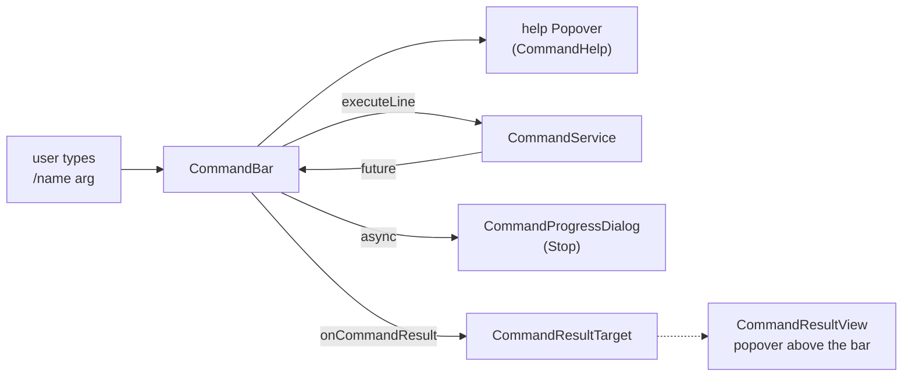

# The command bar

`CommandBar` (package `ui.components`) is the input line for commands, a `Composite<HorizontalLayout>` with a `ComboBox`
and a run button. It is a separate component: it can be placed anywhere (a dialog, a sidebar, a toolbar). The story tab
of the book window places it next to the menu bar; the bar knows nothing about the book.



The list the bar shows when `/` is typed, and the help popover of a command while its arguments are typed:


## Using it

```java
CommandBar bar = new CommandBar();
bar.setResultTarget(result -> myField.setValue(result.text()));
layout.add(bar);
```

`CommandBar` is `@Configurable`: create it with `new` in a session; the services are injected. It implements `HasEnabled`
(the story part disables it while the story is frozen by a running generation).

## Results are delivered, not displayed

The bar does not show what a command returned. It hands a `CommandResult(commandName, humanName, value)` to its
`CommandResultTarget`, an interface with:

- `onCommandResult(CommandResult)` – called on the UI thread, inside the session, once for every command that finished
  (`result.text()` is the value as text, empty for `null`),
- `clearCommandResult()` – the user started something new (typed, or ran another command), so a result that is still
  shown is out of date. Default: does nothing.

Each place implements the target as it needs: the story tab shows the result in a popover (`CommandResultView`), another
component could insert the text into a field, use the object as a value, or ignore it. Failures and stopped commands are
reported by the bar itself with notifications.

`CommandResultView` is a plain `@Configurable` class implementing the target; `create(Component target)` builds a `Popover`
above `target` (`TOP_START`) with a title, a close button and the body. It closes with the cross, with Esc and with a
click outside.

## Layout rule: popovers, not rows

The help and the result are **popovers** over the target, so the bar is one row high and never changes the layout (an
earlier version put the help under the field and misaligned its neighbours). Popovers are opened and closed from the
server (`setOpenOnClick/Focus/Hover(false)`, `setModal(false)`). The CSS classes are in `shared-styles.css` and `CssStyles`
(`command-box`, `command-bar`, `command-help*`, `command-item-*`, `command-severity*`, `command-result*`).

## How the field works

| Behavior                  | Implementation                                                                                                                                         |
|---------------------------|--------------------------------------------------------------------------------------------------------------------------------------------------------|
| The list                  | `ComboBox<String>` with allowed custom values; items are `"/name"` strings, computed lazily by `CommandHelp.matchingNames` (filter timeout 150 ms). The callback always applies `query.getOffset()/getLimit()`, also when the list is empty. Each row shows the name, the human name, the data severity label and the description. |
| The list is empty once the name is complete | Otherwise the open dropdown would intercept the click on the run button while the user types arguments.                                              |
| Picking an item           | Writes `/name ` into the field, or runs the command at once when no form takes arguments. A `pickedByEnter` flag prevents Enter on a list item from also running the typed text. |
| Enter                     | `Shortcuts.addShortcutListener(...).listenOn(input)`, registered through `ui.beforeClientResponse`; runs the typed text.                               |
| Run button                | A small primary play icon; runs the typed text.                                                                                                       |
| Blur, outside click, Esc  | Never run anything. The `custom-value-set` event fires for all of them, so the bar only records the text there.                                      |
| The help                  | A `Popover` that opens while the field has focus (focus/blur listeners) and the text is not a plain name; rebuilt by `showHelp()` as the text changes. |

### The help

`CommandHelp.of(allCommands, text, localizer)` is pure (no UI; the `localizer` turns an `L` key into the text of the user, the bar passes `loc::getValue`) and returns the typed name, the command, its forms that fit what is
typed, the index of the argument being typed and whether there are too many arguments. The bar renders: the description,
the description with the data severity label, the forms with the current parameter highlighted and its description, the return value, and an error line for too many
arguments, an unknown command or text without a slash. The texts are localization keys (`LABEL_COMMAND_*`,
`HELP_COMMAND_*`, `ERROR_COMMAND_*`); the Japanese and Chinese bundles carry them too.

The label of the [data severity](index.md#data-severity) is a `Span` made by `severityBadge`, in the list and in the help:
red (`command-severity-destructive`) for `DESTRUCTIVE`, green (`command-severity-non-destructive`) for `NON_DESTRUCTIVE`, the
explanation in its `title`. The texts come from `CommandDataSeverity.getLabel()` and `getDescription()`.

## Running and asynchronous commands

`run(line)` closes the help, clears the result (`clearCommandResult()`), empties the field (`clearInput()`; text that is not a known command returns earlier and stays) and calls `commandService.executeLine`. For a
command that completed (synchronous) the result is delivered at once. For an `async` command the bar opens a
`CommandProgressDialog` – modal, an indeterminate `ProgressBar`, the two status lines of the command (`setStatus`,
`setSubStatus`; a line that is empty is hidden) and a **Stop** button whose handler cancels the future. The bar feeds the
lines from `CommandRun.addStatusListener` through `ui.access(...)`, after reading the status already set, and the state
of the button from `addUninterruptableListener` (disabled while the command is uninterruptable, `setStopEnabled`). When
the future completes, `ui.access(...)` (with the request scope and `UIPushGuard.push`) closes the dialog and delivers the
result, or shows a notification for a stop, a `CommandException` or an `IllegalArgumentException`. This is why an `async`
command **must** react to `isTerminated()`: Stop only cancels the future.


## Adding the bar elsewhere

1. Create the `CommandBar` where the component is built (a `@Configurable` class or a plugin decorator) and set its
   result target.
2. Give it a CSS class for sizing. Do not use inline styles; `command-box` (flex 1 1 40%, minimum width 12 em) is the one
   the story tab uses.
3. Disable it with `setEnabled(false)` while something locks the UI.
4. Decide what a result means there. Reuse `CommandResultView` if a popover fits.

In the story tab, `ManuscriptStoryPart.createCommandBox()` builds the bar and the result view and returns the bar;
`setFrozen` enables and disables it. The method is `@Extendable`/`@PublicAPI` (from 1.4.0), so a plugin can replace or wrap
the bar through a decorator on its return value (see [Extendable classes](../plugins/extendable.md)).

Two setters turn the bar into the one of another place. `setCommands(Supplier<List<CommandDefinition>>)` makes it offer, and show the
help of, only those commands instead of all the registered ones, and `setLineRunner(Consumer<String>)` hands a line (the command
with its slash, a known one) to the runner in place of `commandService.executeLine`; the result and the progress are then the
runner's business and the result target is not used. The console of an [agent](../agents.md) uses both: it offers `/compact`,
`/clear-workspace` and the commands that only read or add, and runs them on the run, not on a book window.

The bar is not on the phone's story tab yet; only the desktop `ManuscriptStoryPart` has it.
