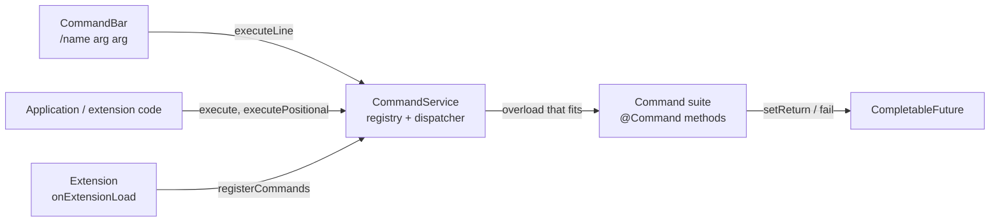

# Commands

A **command** is a named action with typed arguments and a return value, run by name: from the
[command bar](command-bar.md) the user types, from code in the application or in an extension, and later by agents
(each command carries a description written for a model). This page explains the model; [Writing commands](writing-commands.md)
shows how to write and register a suite, and [The command bar](command-bar.md) how the UI side works. The user's view is
in the [user guide](../../user/commands/index.md).

## Concepts

| Concept             | What it is                                                                                                                                                                                  |
|---------------------|---------------------------------------------------------------------------------------------------------------------------------------------------------------------------------------------|
| **Suite**           | Any object whose class has methods annotated with `@Command`. Registering the object registers all of them.                                                                                |
| **Command method**  | `public void name(CommandContext context)`: the only parameter is the context, nothing is returned from the method itself.                                                                  |
| **Command**         | A name (`commandName`: letters, digits, `_`, `-`, `.`) with a `humanName` for the user, a `description`, an `llmDescription` for agents (each as an `L` key or, for extensions, a plain `...Text`, see [Texts](writing-commands.md#texts)), a `signature`, a return declaration, `async`, the `dataSeverity` and `availableForAgent` (`false` keeps the command from agents, see [Available for agents](writing-commands.md#available-for-agents)).   |
| **Form** (overload) | Methods of a suite that share a `commandName` are forms of one command. They must have the same `humanName` and `dataSeverity` and each its own `signature`. One `CommandDefinition` exists per form.          |
| **Signature**       | `@CommandParameterSignature(@CommandParameter(name, type, description), ...)`: the arguments of one form. An empty signature is a form without arguments; `any = true` is "any arguments".    |
| **Context**         | `CommandContext`: the arguments (`get`, `getPositional`), the answer (`setReturn`, `fail`), the two lines of status (`setStatus`, `setSubStatus`) and `isTerminated()`. It belongs to one run. |
| **Run**             | One call, which returns a `CommandRun` (a `CompletableFuture<Object>`) that completes with the value given to `setReturn` and holds the status the command reports.                       |

## The context

A command never receives its arguments as Java parameters; it reads them from the context by the names of its signature:

| Method                          | Use                                                                                                                                          |
|---------------------------------|----------------------------------------------------------------------------------------------------------------------------------------------|
| `get(name)`                     | The value as passed (converted to the parameter's type), `null` if not passed.                                                               |
| `get(name, type)`               | As `type`; `IllegalArgumentException` when it is not an instance (numbers are converted when they fit).                                      |
| `getPositional()`               | The arguments in order. For a form that takes any arguments, the objects the caller passed.                                                  |
| `has(name)`, `getArguments()`   | Whether an argument was passed, and all of them (read only).                                                                                 |
| `setReturn(value)`              | The answer. A form with `async = false` must call it before its method returns, otherwise the result is `null`. Later calls are ignored.     |
| `fail(error)`                   | Ends the run with a `CommandException` (for `async` commands that report from another thread; a synchronous command can throw).             |
| `setStatus(text)`, `setSubStatus(text)` | Two lines of progress for the user: what the command is doing now, and the detail of that step. They are independent, `null` or blank clears one. Any thread; ignored once the run is over. |
| `setUninterruptable(flag)`, `isUninterruptable()` | Declares the run can't be stopped now (see [Uninterruptable runs](#uninterruptable-runs)). Any thread; ignored once the run is over. |
| `isTerminated()`                | True when the run is over for the caller: the command answered or failed, or the caller cancelled the future. Never true while a synchronous command runs. |

## Arguments and dispatch

A call names the command and passes the arguments in one of three ways:

| Call                              | Arguments                                                                                                               |
|-----------------------------------|-------------------------------------------------------------------------------------------------------------------------|
| `execute(name, Map)`              | By name. The form whose parameter names are exactly the keys is called; a form that takes any arguments gets the map.   |
| `executePositional(name, List)`   | By position. The form with as many parameters as there are arguments, all convertible, is called.                       |
| `executeLine("/name a b")`        | A command typed as text; the arguments are strings, split by `CommandLine.parse` (see below).                            |

Each of them also has a form with a last argument `boolean uninterruptable`, see [Uninterruptable runs](#uninterruptable-runs).

When several forms fit, the closest types win. Each argument costs 0 when it already has the parameter's type, 1 for a
parameter of type `Object` ("any"), 2 when text or a number has to be converted (to a number, boolean, character or
enum); a form that takes any arguments costs 1000, so it is the last resort. The form with the lowest total is called,
ties go to the form that is listed first (declared forms by the number of parameters, then by method name). The
`Object.class` parameter is "any": it takes the argument as it is, including a `List` of objects, so a command can be
given a list as one argument.

Conversions (`CommandValues`): an instance of the type is passed as it is; a number to another number type when the value
fits; text to a number, boolean, character or enum constant.

### The command line

`CommandLine.parse(text)` splits a command typed as text. The text is a command when it starts with `/`.

- Arguments are separated by spaces; repeated spaces count as one.
- `\ ` is a space inside an argument, `\\` a backslash and `\"` a quote.
- A double quote starts or ends a quoted part in which spaces need no escape. Quotes may start anywhere in an argument
  (`a"b c"d` is `ab cd`), `""` is an empty argument, a quote that is never closed runs to the end of the text.
- Any other backslash stays as it is (`C:\dir` is unchanged).
- `trailingSeparator` tells whether the text ends with a space that starts a new, still empty argument; with
  `typingName()` and `currentArgument()` the help knows what the user is typing. `CommandLine.escape(argument)` writes an
  argument so that `parse` reads it back as one argument.

## Return values

`@Command(returns = @CommandReturn(name, type, description))` declares what the command returns; the type is a direct
class reference (`String.class`, `Object.class` for "any", `void.class` by default). It is documentation for the user and
for agents (the help shows it); the service does not check the value against it.

## Synchronous and asynchronous commands

| `async`   | The method runs                                                                                                  | Answer                                                                       |
|-----------|------------------------------------------------------------------------------------------------------------------|------------------------------------------------------------------------------|
| `false`   | On the thread of the caller; the future is complete when `execute*` returns.                                     | `setReturn` before the method returns, or `null`. A thrown exception fails the future. |
| `true`    | On a worker thread (a daemon cached pool) with the **request attributes of the caller**, so session-scoped beans resolve. | The future completes with the first `setReturn` or `fail`, from any thread, whenever the command likes. |

A caller can cancel the future (the **Stop** button of the progress window does). Then `isTerminated()` becomes true, the
worker thread is interrupted, and a command that has not started yet does not start. A long-running `async` command must
cooperate: look at `isTerminated()` (and the interrupt flag) between the steps of its work and return at once. What it
sets afterwards is ignored. `/hello-world-async` of `HelloWorldCommands` (a suite of the tests, `src/test/java`, not part of the application) is the model of such a loop.

### Uninterruptable runs

Some work can't be abandoned half way, a change that is being written to the database. A command declares that with
`context.setUninterruptable(true)` just before it, and `false` after it: meanwhile `CommandRun.cancel` does nothing (it
returns `false`) and the progress window of the command bar disables its **Stop** button
(`CommandRun.isUninterruptable()`, `addUninterruptableListener(...)`, called on the thread of the command like the status
listener). The search and replace commands do so for the replace, after the user confirmed it.

A caller can start a run that way too: every `execute*` has a form with a trailing `boolean uninterruptable`
(`execute(name, Map, true)`, `executePositional(name, List, true)`, `executeLine(line, true)`). Such a run is
uninterruptable from the start and the command can't lift it with `setUninterruptable(false)`. A command that is
uninterruptable and starts another asynchronous command passes `context.isUninterruptable()`, so the nested one is not
abandoned either.

### Status

A command that takes time tells the user what it is doing with `setStatus` (the main line, "Taking a backup of Dune") and
`setSubStatus` (the detail, "Chapter 3 of 12"). The lines are kept in the `CommandRun` that `execute*` returns
(`getStatus()`, `getSubStatus()`); `addStatusListener((status, subStatus) -> ...)` is called on the thread of the command on
each change, so a view must hop to its own thread (the progress window of the command bar does with `ui.access`). A
listener does not get what was set before it was added: read the getters after adding it. A listener that throws is
ignored. `/take-backup` (`BackupCommands`) is an example.

## Data severity

`@Command(dataSeverity = ...)` says what the command does to the data that exists, as a `CommandDataSeverity`:

| Value             | Means                                                                                                      |
|-------------------|------------------------------------------------------------------------------------------------------------|
| `DESTRUCTIVE`     | The command changes or removes data that exists (replaces text, deletes, overwrites). **The default.**     |
| `NON_DESTRUCTIVE` | The command only reads data or adds new data; whatever exists stays as it is (`/take-backup`). |

The default is the safe assumption: a command that does not say is treated as destructive, so a command that only reads or
adds declares `NON_DESTRUCTIVE`. All forms of a command have the same severity (`registerCommands` throws
`IllegalArgumentException` otherwise), and `CommandDefinition.dataSeverity()` returns it. The severity is for two readers:
the [command bar](command-bar.md#the-help) shows it as a label next to the command for the user, and an agent that runs
commands on its own is meant to ask the user before it runs a `DESTRUCTIVE` one. Nothing in the service enforces that
today: the severity does not stop a run, and a command that must ask the user still does it itself, see
[Asking the user](writing-commands.md#asking-the-user).

## Failures

A future fails with:

- `CommandException` when the command throws or calls `fail` (the cause is the original error),
- `IllegalArgumentException` when there is no command of that name, no form fits the arguments, or the text for
  `executeLine` does not start with `/`.

## Registration

`registerCommands(Object suite)` validates the whole suite and registers all of it or nothing, and throws
`IllegalArgumentException` for: a class without a `@Command` method; a command method that is not `public void` with a
`CommandContext` as the only parameter; a name with characters other than letters, digits, `_`, `-`, `.`; two forms
with the same signature; forms with different `humanName`; a signature that is also `any`; a duplicate parameter name; a
name another object already holds. It returns the `CommandDefinition`s. Registering the same object again does nothing.

`unregisterCommands(Object suite)` removes the suite, `unregisterCommand(String)` one command with all its forms. The
service does not know which bundle a suite came from: **an extension unregisters its suites in `onExtensionUnload`**.
Runs in progress are not interrupted by unregistering.

The application registers its own suites in `CommandServiceImpl.afterPropertiesSet` (`BackupCommands`, the two search and replace commands and the [commands that read the book](#commands-that-read-the-book)).

## Statelessness

A suite is one object shared by all users and runs in parallel, so it must be **stateless**: no fields that hold what a
run or a user did. What a command needs to know about the current state it reads when it runs:

- from the services, which resolve the current user and check ownership (`ManuscriptService`, and so on),
- from the **scope** of the call, `context.getScope()` (below): the book the command works on, its lorebooks and the way to ask a question,
- from the session-scoped `SessionPoint` (`getLanguage()`, `getWorkspace()`), through `CommandUtils`.

### The scope

`CommandContext.getScope()` is a `CommandScope`: what the command works on and who answers its questions. A command takes the book from it
(`getManuscript()`, read again from the database every time, `getLorebook()` the root lorebook of the book) and asks with
`context.confirm(question)`; it never reaches for the open window. The user at the command bar gets the scope of their session
(`CommandScopes.session()`: the open book, a dialog for the questions), an agent the scope of its working copy
(`CommandScopes.forRun(run)`: the copy of the run, whichever it is now, and a yes without asking, since what an agent may do without
asking was decided when it called the command). `CommandService.execute`, `executePositional` and `executeLine` have a form with a last
argument `scope`; without one the scope of the session of the calling thread is made on that thread.

`getModel()` answers which AI and protocol work that a command starts should use when the user did not choose (a `ModelChoice`; null is "no opinion"). For an agent it is the model of the agent, or the one of its book when the agent was told not to use its own (`Agent.useAgentModel`); the user at the command bar has none, so a command falls back to its own choice (the Lore Generator to the default model of the user, the Arc Outline to the model of the book first). A command of an extension that calls a model must ask it first, or it ignores what the author of the agent decided. A command that writes through the story services asks nothing: the working copy already holds the model (see [Agents](../agents.md#the-working-copy-and-the-lock)). Tools with their own request to a model inside a long-lived agent should also take a place at the AI with `AIGate` (`ManuscriptWriteSupport.placeAt`).

The scope is also the **cage**. `resolveMessage(uuid)`, `resolveLorebook(uuid)` and `resolveEntry(uuid)` find an item by the uuid, and only
the ones of the book of the scope: the parts of the book, the lorebook of the book and its subbooks however deep, and their entries. A uuid of
anything else (the original book of a copy, another book, a lorebook the book does not use, a deleted item) is refused with an
`IllegalArgumentException` as if it did not exist, so a command that takes an item as an argument can't be aimed outside of the book by what
it is given. A command that takes an item does it through the scope and not through `findForUser` or `find(id)`.

One exception: `resolveUnusedLorebook(uuid)` also finds a lorebook of the working copy that the book does not use any more, because a command deleted it
(`LorebookService.delete` only marks it, with its entries and tags) or took it out of its parent. It is for `/add-subbook`, which brings such a lorebook
back (`LorebookService.restore`, the restore of the trash); the cage is that the lorebook is one of the copy (`agentic`, of the owner of the run) and that the
run has a **handle** for it, so an agent can only name what it was shown. The scope of the user at the command bar answers like `resolveLorebook`; the user
restores from the trash.

`CommandUtils` (package `utils`) reads the session of the caller – also on the worker thread of an `async` command, which
gets the request attributes – and returns `null` when there is nothing to return (no session, no workspace yet, no book
open), so a command checks its results. The book-related methods only delegate to the `SessionPoint`, which knows where the
book comes from: for a user the `SessionPoint` reads it from the open window of the workspace, for an agent the
`AgenticSessionPoint` (a `SessionPoint` without workspace and window) holds the book directly, so the same command runs for
both:

| Method                    | Returns                                                                       |
|---------------------------|-------------------------------------------------------------------------------|
| `getSessionPoint()`       | The `SessionPoint` of the session: the bean of the servlet session, or for other request attributes (an agent run) the `AgenticSessionPoint` kept under `AgenticSessionPoint.SCOPED_TARGET_NAME` in their session scope. |
| `getWorkspace()`          | The user's `Workspace` (desktop or phone); `null` for an agent.               |
| `getManuscriptSection()`  | The part of the workspace that holds book windows (`ManuscriptSection`); `null` for an agent. |
| `getManuscriptWindow()`   | The open book window (`ManuscriptWindow`, the same interface on the desktop and the phone); `null` for an agent. |
| `getCurrentManuscript()`  | The open book (`SessionPoint.getCurrentManuscript()`) or the book of the agent session; a command takes the book from `context.getScope()` instead. |
| `getCurrentAI()`          | The AI of that book.                                                          |

`confirm` and `reloadManuscriptWindow` talk to the window, so in a session without one they answer *no* and do nothing (`CommandContext.confirm` is what a command calls, it is routed by the scope).

A command that changes the UI does it on the UI thread: from a synchronous command that is the calling thread, from an
`async` one use `ui.access(...)` (see [UI extensions → Threads](../plugins/ui-extensions.md#threads)).

## Commands that read the book

The package `domain.service.impl.commands.manuscript.read` holds one class per command (`GetBookInfoCommand`, `ListPartsCommand`,
`GetPartCommand`, `ListSwipesCommand`, `ListBranchesCommand`, `GetPartMetricsCommand`, `ShowPromptCommand`, `SearchPartsCommand`,
`FindOccurrencesCommand`, `ComparePartsCommand`, `CountTokensCommand`, `ListSummariesCommand`, `GetSummaryCommand`,
`CheckSummariesCommand`, `GetTemplateVariablesCommand`), each a `@Configurable` suite registered by `CommandServiceImpl`. They share
`ManuscriptReadSupport` (the services, the `Book` loaded again from the current manuscript, the JSON helpers) and `StoryTree` (the
parts as a tree, with the numbers of the branches). All are `NON_DESTRUCTIVE`, synchronous and answer JSON text.

- **Handles, positions and numbers.** Every row of an answer has a `handle`, the uuid of the part (an agent sees it as `h:m17`: the
  border of the agent turns the uuids of its copy into handles and back, see `CommandCage`; a command knows nothing of it). A part
  parameter is a `String` that `Book.locate(part, branch)` reads as a handle (`CommandScope.resolveMessage`, so only a part of the
  scope's book is found) or as a *position* (depth on a branch, the first part is 1); a branch is the handle of one of its parts
  (the branch through it to its end, `StoryTree.leafOf`) or its *number*: the ends of the branches (parts without children)
  ordered by creation, the oldest is 1. Positions and numbers move when parts are added or deleted, so the commands that write
  accept handles only. `list-branches` gives the numbers and `list-swipes`, `search-parts` and `find-occurrences` say the branch that
  shows a part that is not on the active branch. Without a branch the active branch (`getBranchFromLeaf`, the root first) is used; the other
  branches need the whole tree (`ChatMessageService.getAllMessages`, one query), so a command loads it only when asked for one.
  A form with a single `String` that could be a text or a part (`count-tokens`, `preview-lore-activation`) takes the handle in the text:
  the dispatcher can't tell two one-`String` forms apart.
- **Time limited patterns.** The regular expressions of `find-occurrences` (and `search-lore`) run over `utils.TimeSafeText`: the text is wrapped in a
  `CharSequence` whose `charAt` checks the clock and throws `RegexTimeoutException` after 30 seconds for the whole command (the system property
  `marginalia.regexTimeoutMillis` changes it), which the command turns into an error with `ERROR_REGEX_TIMEOUT`. A pattern the JDK can't optimise, such as
  one with a back reference (`(a+)+\1b`), can run for hours otherwise; `TextSearch` uses the same wrapper for each text.
- **Bounded answers.** Lists take `offset` and `limit` (50, at most 200); texts come in slices (`offset`, `length`, 6000 characters,
  at most 20000) with `totalLength` and `truncated`.
- **Forms.** The options are the usual ladder of overloads (every prefix of the parameter list is a form), so a command can be
  called by name only with a prefix of its parameters.
- **Summaries.** The state of a summary (`valid`, `outdated`) comes from `SummaryService.collectBlocks`; the "covers" range of a block
  runs from the part after the previous block to the part that holds the summary.
- `compare-parts` uses `utils.TextDiff`, a longest common subsequence of the sentences (a line break ends a sentence too), refused
  above 4 million cells.

Tests: `ManuscriptReadCommandsTest` runs them in an agent session (`AgenticRequestAttributes` in the test sources puts an
`AgenticSessionPoint` into the session scope of the logged in test user).

### Commands for annotations

`ListAnnotationsCommand` (`list-annotations [status [part [offset [limit]]]]`) and `GetAnnotationCommand` (`get-annotation`) read, `AnnotationWriteCommands`
(`create-annotation`, `update-annotation`, `resolve-annotation`, `reattach-annotation`, `delete-annotation`) change the [annotations](../domain-model.md#annotation). An annotation is given
by its uuid (`Book.annotation` checks that it is one of a part of the book of the scope). They change only the notes, never the story, so they are `NON_DESTRUCTIVE`
except the delete. An agent writes them in its working copy with the source `AGENT` (`CommandScope.isAgent`); the annotations are items of the
[merge](../agents.md#merge-and-apply) like parts and entries. `CommandScope.resolveAnnotation` finds one of the book of the scope (the handles of the agent, `h:a17`).
Tests: `AnnotationCommandsTest`, `AgentAnnotationsTest`.

### Commands that read the lorebooks

The package `domain.service.impl.commands.lorebook.read` has `ListLorebooksCommand`, `ListLoreEntriesCommand`, `GetLoreEntryCommand`,
`SearchLoreCommand` and `PreviewLoreActivationCommand` on `LorebookReadSupport`, which extends `ManuscriptReadSupport` (so the `Book`, the paging and the slices are the same).
Its `Lore` is the lorebook tree of the open book: the root lorebook of the manuscript, then the subbooks level by level, each once
(`LorebookService.getSubbooks` skips the deleted ones). A lorebook is its **number** in that order (the root is 1), an entry its **number in
the lorebook** (`LorebookEntryService.getEntriesForLorebook`: by `ordinal`, then by id, deleted ones left out). Nothing outside the tree is
reachable, so an agent never sees the other lorebooks of the user, and no uuid is given out or accepted. `list-lore-entries` filters by
name and tag in Java and keeps the numbers of the whole lorebook; `search-lore` scans name, text and comment case-insensitively
(plain text or a regular expression) and reports one hit per entry with the fields that match.

`preview-lore-activation` asks `LorebookActivationService` (`domain.service`), the rules the generation step `ProcessLorebookStep` uses too: `collectLorebooks` (the enabled
tree with the entries filled in), `orderedEntries` (by `order`, the older first), `evaluate(entry, bookTags, text)` (a `Verdict` with a `Reason`: `CONSTANT`,
`FILTER_MATCHED`, `LORE_MATCHED`, `DISABLED`, `NEGATIVE_TAG`, `MISSING_TAG`, `FILTER_NOT_MATCHED`), `evaluateAll` (all the entries, with the passes of the scan depth of the root
lorebook: an entry found by the content of others is `LORE_MATCHED`, its row has `scanDepth`, the pass) and `renderPayload`. The step only adds its events around them, so what the command
shows is what a generation does. With a part the filters are looked for in the user prompt of the book rendered from the turn input stored with the part, in a
fresh `TemplateContext` (the book, the narration settings, the variables of the book and of the part; not the story), so a payload that reads the story renders
without it. The form with `text` and the form with `part` both have one argument, a number on the command line is taken for the text: give a part as a number
to `executePositional`, or by name as an agent does.

Tests: `LorebookReadCommandsTest`, the same way, with a lorebook tree, a lorebook the book does not use and a deleted entry.

## Commands that change the book

The packages `domain.service.impl.commands.manuscript.write` and `lorebook.write` hold the commands that change the book, on
`ManuscriptWriteSupport` (which extends `ManuscriptReadSupport`) and `LorebookWriteSupport` (which extends `LorebookReadSupport`):
`PartEditCommands` (`edit-part`, `replace-part-text`, `append-to-part`, `set-part-fields`), `PartStructureCommands` (`create-part`,
`insert-part`, `branch-part`, `delete-part`, `switch-branch`), `SummaryWriteCommands` (`set-summary`, `remove-summary`, `revalidate-summaries`),
`BookSettingsCommands` (`set-book-info`, `set-book-prompts`, `set-book-tags`), `StoryGenerationCommands` (`next`, `swipe`,
`regenerate`), `SummaryGenerationCommands` (`regenerate-summary`, `create-meta-summary`), `RedraftCommands` (`redraft-part`, over `RedraftService`; the model is the one of the book as the scope gives it, which for an agent follows `Agent.useAgentModel`, or a `profile` through `ManuscriptWriteSupport.options`), `ImpersonateCommands` (`impersonate`, over `ImpersonateService`, returns the drafted instructions; `availableForAgent = false` and `readOnly`), `LoreEntryWriteCommands` and
`LorebookWriteCommands`. They call the services the screens use (`ChatMessageService.updateResponse` / `createPart` / `insertPart` /
`branchAndSwitch` / `swipeAndSwitch` / `deleteNodeAndMigrateChildren`, `SummaryService.updateSummaryText` / `removeSummary` /
`revalidate`, `ManuscriptService.updateSettings`, `LorebookEntryService.create` / `update` / `move` / `deleteEntry`,
`LorebookService` for the subbooks) and add no rule of their own, so what the user does in a window and what a command does is one path.

- **Handles only.** A part, lorebook or entry parameter must be a handle (`ManuscriptWriteSupport.part`, `LorebookWriteSupport.book` /
  `entry`); a position or number is refused with `ERROR_COMMAND_HANDLE_REQUIRED`.
- **Severity.** Adding and changing is `NON_DESTRUCTIVE`; what removes text or data (`replace-part-text`, `delete-*`, `remove-summary`,
  `regenerate`, `set-book-prompts`) is `DESTRUCTIVE` and calls `context.confirm(question)`: the user at the command bar gets a
  dialog, an agent is not asked again (its destructive mode decided before the call). A refusal answers *Nothing was changed.*
- **Outdated summaries.** An edit can invalidate the hash of a summary block. `reportOutdated` puts the summaries an edit made
  outdated (the ones outdated now and not before) and a hint into the answer; `revalidate-summaries` is the author's way to
  say they are still right.
- **The window.** After a change `changed()` reloads the book window of the user (`CommandUtils.reloadManuscriptWindow`, nothing for an
  agent, which has none).
- **Generation.** `next`, `swipe` and `regenerate` are `async` and call `StoryGenerationService.generateNextTurn` with a listener that
  completes a future; each moves `activeLeaf`, so one generation of a book runs at a time (a lock per manuscript, the others wait). Swipe
  and regenerate need the part to be the end of its branch (they make it the active leaf first, as the pipeline expects), and take
  the turn input from the part unless given. `profile` names a model profile of the agent of the run (`AgentService.resolveProfile`,
  `GenerationOptions.withModel`); for the user it is refused. The generation question about outdated summaries is passed on
  with `context.confirm` and the answer yes is reported as a warning. Stopping the command cancels the generation (`CancellationToken`).
- `search-replace-parts` and `search-replace-lore-entries` have `maxHits` (refuse above it) and `dryRun` (count and show five matches,
  change nothing).

Tests: `ManuscriptWriteCommandsTest`, `LorebookWriteCommandsTest` (a scope that answers the questions), `GenerationCommandsTest`
(the real generation against the mock server), `AgentHandlesTest` (the commands through the cage of a run, on the working copy).
