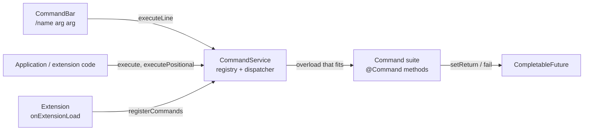

# Commands

A **command** is a named action with typed arguments and a return value, run by name: from the
[command bar](command-bar.md) the user types, from code in the application or in an extension, and later by agents
(each command carries a description written for a model). This page explains the model; [Writing commands](writing-commands.md)
shows how to write and register a suite, and [The command bar](command-bar.md) how the UI side works. The user's view is
in the [user guide](../../user/commands/index.md).

## Concepts

| Concept             | What it is                                                                                                                                                                                  |
|---------------------|---------------------------------------------------------------------------------------------------------------------------------------------------------------------------------------------|
| **Suite**           | Any object whose class has methods annotated with `@Command`. Registering the object registers all of them.                                                                                |
| **Command method**  | `public void name(CommandContext context)`: the only parameter is the context, nothing is returned from the method itself.                                                                  |
| **Command**         | A name (`commandName`: letters, digits, `_`, `-`, `.`) with a `humanName` for the user, a `description`, an `llmDescription` for agents, a `signature`, a return declaration and `async`.   |
| **Form** (overload) | Methods of a suite that share a `commandName` are forms of one command. They must have the same `humanName` and each its own `signature`. One `CommandDefinition` exists per form.          |
| **Signature**       | `@CommandParameterSignature(@CommandParameter(name, type, description), ...)`: the arguments of one form. An empty signature is a form without arguments; `any = true` is "any arguments".    |
| **Context**         | `CommandContext`: the arguments (`get`, `getPositional`), the answer (`setReturn`, `fail`) and `isTerminated()`. It belongs to one run.                                                      |
| **Run**             | One call, which returns a `CompletableFuture<Object>` that completes with the value given to `setReturn`.                                                                                  |

## The context

A command never receives its arguments as Java parameters; it reads them from the context by the names of its signature:

| Method                          | Use                                                                                                                                          |
|---------------------------------|----------------------------------------------------------------------------------------------------------------------------------------------|
| `get(name)`                     | The value as passed (converted to the parameter's type), `null` if not passed.                                                               |
| `get(name, type)`               | As `type`; `IllegalArgumentException` when it is not an instance (numbers are converted when they fit).                                      |
| `getPositional()`               | The arguments in order. For a form that takes any arguments, the objects the caller passed.                                                  |
| `has(name)`, `getArguments()`   | Whether an argument was passed, and all of them (read only).                                                                                 |
| `setReturn(value)`              | The answer. A form with `async = false` must call it before its method returns, otherwise the result is `null`. Later calls are ignored.     |
| `fail(error)`                   | Ends the run with a `CommandException` (for `async` commands that report from another thread; a synchronous command can throw).             |
| `isTerminated()`                | True when the run is over for the caller: the command answered or failed, or the caller cancelled the future. Never true while a synchronous command runs. |

## Arguments and dispatch

A call names the command and passes the arguments in one of three ways:

| Call                              | Arguments                                                                                                               |
|-----------------------------------|-------------------------------------------------------------------------------------------------------------------------|
| `execute(name, Map)`              | By name. The form whose parameter names are exactly the keys is called; a form that takes any arguments gets the map.   |
| `executePositional(name, List)`   | By position. The form with as many parameters as there are arguments, all convertible, is called.                       |
| `executeLine("/name a b")`        | A command typed as text; the arguments are strings, split by `CommandLine.parse` (see below).                            |

When several forms fit, the closest types win. Each argument costs 0 when it already has the parameter's type, 1 for a
parameter of type `Object` ("any"), 2 when text or a number has to be converted (to a number, boolean, character or
enum); a form that takes any arguments costs 1000, so it is the last resort. The form with the lowest total is called,
ties go to the form that is listed first (declared forms by the number of parameters, then by method name). The
`Object.class` parameter is "any": it takes the argument as it is, including a `List` of objects, so a command can be
given a list as one argument.

Conversions (`CommandValues`): an instance of the type is passed as it is; a number to another number type when the value
fits; text to a number, boolean, character or enum constant.

### The command line

`CommandLine.parse(text)` splits a command typed as text. The text is a command when it starts with `/`.

- Arguments are separated by spaces; repeated spaces count as one.
- `\ ` is a space inside an argument, `\\` a backslash and `\"` a quote.
- A double quote starts or ends a quoted part in which spaces need no escape. Quotes may start anywhere in an argument
  (`a"b c"d` is `ab cd`), `""` is an empty argument, a quote that is never closed runs to the end of the text.
- Any other backslash stays as it is (`C:\dir` is unchanged).
- `trailingSeparator` tells whether the text ends with a space that starts a new, still empty argument; with
  `typingName()` and `currentArgument()` the help knows what the user is typing. `CommandLine.escape(argument)` writes an
  argument so that `parse` reads it back as one argument.

## Return values

`@Command(returns = @CommandReturn(name, type, description))` declares what the command returns; the type is a direct
class reference (`String.class`, `Object.class` for "any", `void.class` by default). It is documentation for the user and
for agents (the help shows it); the service does not check the value against it.

## Synchronous and asynchronous commands

| `async`   | The method runs                                                                                                  | Answer                                                                       |
|-----------|------------------------------------------------------------------------------------------------------------------|------------------------------------------------------------------------------|
| `false`   | On the thread of the caller; the future is complete when `execute*` returns.                                     | `setReturn` before the method returns, or `null`. A thrown exception fails the future. |
| `true`    | On a worker thread (a daemon cached pool) with the **request attributes of the caller**, so session-scoped beans resolve. | The future completes with the first `setReturn` or `fail`, from any thread, whenever the command likes. |

A caller can cancel the future (the **Stop** button of the progress window does). Then `isTerminated()` becomes true, the
worker thread is interrupted, and a command that has not started yet does not start. A long-running `async` command must
cooperate: look at `isTerminated()` (and the interrupt flag) between the steps of its work and return at once. What it
sets afterwards is ignored. `/hello-world-async` (`HelloWorldCommands`) is the model of such a loop.

## Failures

A future fails with:

- `CommandException` when the command throws or calls `fail` (the cause is the original error),
- `IllegalArgumentException` when there is no command of that name, no form fits the arguments, or the text for
  `executeLine` does not start with `/`.

## Registration

`registerCommands(Object suite)` validates the whole suite and registers all of it or nothing, and throws
`IllegalArgumentException` for: a class without a `@Command` method; a command method that is not `public void` with a
`CommandContext` as the only parameter; a name with characters other than letters, digits, `_`, `-`, `.`; two forms
with the same signature; forms with different `humanName`; a signature that is also `any`; a duplicate parameter name; a
name another object already holds. It returns the `CommandDefinition`s. Registering the same object again does nothing.

`unregisterCommands(Object suite)` removes the suite, `unregisterCommand(String)` one command with all its forms. The
service does not know which bundle a suite came from: **an extension unregisters its suites in `onExtensionUnload`**.
Runs in progress are not interrupted by unregistering.

The application registers its own suites in `CommandServiceImpl.afterPropertiesSet` (today `HelloWorldCommands`).

## Statelessness

A suite is one object shared by all users and runs in parallel, so it must be **stateless**: no fields that hold what a
run or a user did. What a command needs to know about the current state it reads when it runs:

- from the services, which resolve the current user and check ownership (`ManuscriptService`, and so on),
- from the session-scoped `SessionPoint` (`getLanguage()`, `getWorkspace()`), through `CommandUtils`.

`CommandUtils` (package `utils`) reads the session of the caller – also on the worker thread of an `async` command, which
gets the request attributes – and returns `null` when there is nothing to return (no session, no workspace yet, no book
open), so a command checks its results:

| Method                    | Returns                                                                       |
|---------------------------|-------------------------------------------------------------------------------|
| `getSessionPoint()`       | The `SessionPoint` of the session.                                            |
| `getWorkspace()`          | The user's `Workspace` (desktop or phone).                                    |
| `getManuscriptSection()`  | The part of the workspace that holds book windows (`ManuscriptSection`).      |
| `getManuscriptWindow()`   | The open book window (`ManuscriptWindow`, the same interface on the desktop and the phone). |
| `getCurrentManuscript()`  | The open book (`Manuscript`).                                                 |
| `getCurrentAI()`          | The AI of the open book.                                                      |

A command that changes the UI does it on the UI thread: from a synchronous command that is the calling thread, from an
`async` one use `ui.access(...)` (see [UI extensions → Threads](../plugins/ui-extensions.md#threads)).
