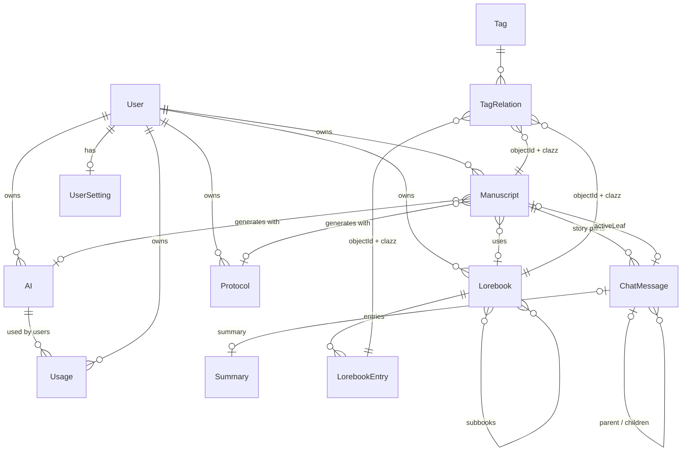
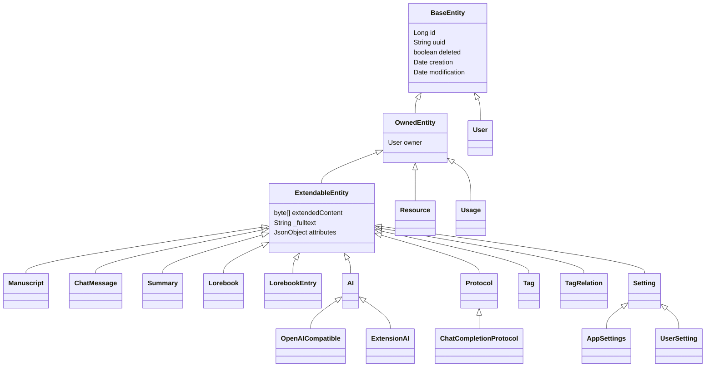
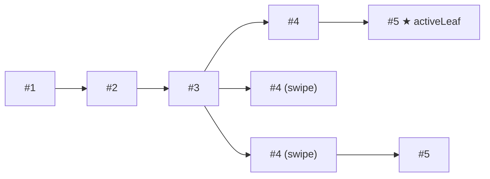

# Domain model

The entities Marginalia stores, how they relate, and the rules every entity follows: identity, ownership, soft
delete, extended attributes and cleanup. Entities are in `domain/model/` (base classes), `domain/model/impl/` and
`domain/security/model/User.java`. How the tables are created and changed is in [Database & migrations](database.md).

## Names in code and UI

Some entities kept their early names. The UI and this manual use the names on the right:

| Class | Table | In the UI |
|---|---|---|
| `Manuscript` | `manuscripts` | Book |
| `ChatMessage` | `messages` | Part (of the story) |
| `Summary` | `summaries` | Summary |
| `Annotation` | `annotations` | Annotation (a note on a passage of a part) |
| `Lorebook`, `LorebookEntry` | `lorebooks`, `entries` | Lorebook, entry |
| `AI`, `OpenAICompatible`, `ExtensionAI` | `ais`, `ais_openaicompat`, `ais_extension` | Inference provider |
| `Usage` | `usages` | Tokens sent / generated column of the Inference Providers tab |
| `Protocol`, `ChatCompletionProtocol` | `protocols`, `protocols_chatcompletion` | Protocol |
| `Tag`, `TagRelation` | `tags`, `t2e` | Tag |
| `Setting`, `AppSettings`, `UserSetting` | `settings` | Settings page, admin settings |
| `User` | `users` | User |
| `Permission` | `permissions` | What an administrator allowed a user to do, see [Permission](#permission-what-a-user-was-allowed) |
| `Agent`, `AgentRun`, `AgentMessage` | `agents`, `agent_runs`, `agent_messages` | Agents, see [Agent and AgentRun](#agent-and-agentrun-agents) |
| `AgentRunPair` | `agent_run_pairs` | A plain entity (not a `BaseEntity`): which item of the working copy of a run is which item of the original, see [Agent and AgentRun](#agent-and-agentrun-agents) |
| `Resource` | `resources` | Resources tab, image attachments of a part (story editor, exports) |

## Overview



Every entity except `User` has an owner, so each user has a separate set of books, lorebooks, providers, protocols
and settings. The relationships between them never cross users: a book can only use the owner's provider, protocol
and lorebook.

## Base classes



### `BaseEntity` - identity and soft delete

| Field | Column | |
|---|---|---|
| `id` | `id` | Database key, generated by Hibernate (`GenerationType.AUTO`, a `<table>_SEQ` table per hierarchy). Used for relations and inside one installation only. |
| `uuid` | `uuid` (unique) | Stable identity, set on the first save. Used wherever an entity leaves the database or must be found again: URLs (`/view/<uuid>`), backups, exports, imports, extension data. |
| `deleted` | `is_deleted` | Soft delete flag. |
| `creation`, `modification` | | Set by the repository on save. Siblings in the story tree are ordered by `creation`. |

`equals` and `hashCode` use the `id`, so don't put unsaved entities into hash-based collections.

**Soft delete.** `delete(entity, false)` - the normal delete - only sets `deleted = true`. All finder queries skip
deleted rows, so to the application the entity is gone, but the row stays and other rows can still point at it. The
administrator's *Cleanup* page later purges deleted rows that nothing needs any more (see [Cleanup references](#cleanup-references)).
`delete(entity, true)` removes the row right away; it is used where nothing can reference the row, e.g. replaced
messages during a backup restore.

**A soft delete takes the dependent rows with it.** The services whose entities own other rows override `delete` and,
when it is not a hard delete, soft delete those rows first (the `OWNED_BY` / `OWNS` rows of the
[cleanup references](#cleanup-references)), so the trash and the cleanup see the whole group deleted:

| Deleted | Also deleted |
|---|---|
| `Manuscript` | all its `ChatMessage`s and their `Summary`s (`ChatMessageService.softDeleteForManuscript`), its `TagRelation`s |
| `ChatMessage` | its `Summary`, its `Annotation`s and all messages below it (children, their children...) |
| `Lorebook` | its `LorebookEntry`s (through `LorebookEntryService.delete`, so with their tag relations), its `TagRelation`s |
| `LorebookEntry` | its `TagRelation`s (positive and negative) |
| `AI` | its `Usage`s |
| `Tag` | its `TagRelation`s |

A book has thousands of messages, so the messages and summaries are soft deleted with one bulk `UPDATE` per kind
(`softDeleteByManuscript`, `softDeleteByIds`; `deleted = true, modification = now`): the rows are not loaded, no entity
listener or event runs and `extendedContent` stays as it is. The rest goes through the services' `delete`. Objects that
only *reference* the deleted one (a book using a deleted provider or lorebook, a lorebook that includes the deleted one
as a subbook) are not deleted. A hard delete does not cascade. Code that adds an entity owned by another one has to add
it to the cascade, or the owned rows stay live while their owner is in the trash.

### `OwnedEntity` - ownership

`owner` (column `userId`) is the user the entity belongs to; `null` for installation-wide rows (`AppSettings`).
`OwnedServiceImpl.save` fills it with the current user when a new entity has no owner. Lookups that start from
user input go through the owner-aware finders:

| Method | Returns |
|---|---|
| `findAllForUser()`, `findAllIdsForUser()` | Non-deleted entities of the current user. |
| `findForUser(uuid)` | The entity with this uuid if it belongs to the current user and isn't deleted, otherwise `null`. |
| `find(id)` | Any entity, regardless of owner and `deleted` - only for ids taken from the user's own data. |

### `ExtendableEntity` - extended attributes

Most of an entity's data is not in table columns but in one JSON document stored in the `extendedContent` blob. Two
kinds of fields end up there:

- fields annotated `@ExtendedAttribute` (they are also `@Transient`, so Hibernate ignores them), and
- `attributes`, a free-form `JsonObject` for extensions. Its keys are stored with the prefix `attributes_` next to
  the other fields.

```json
{
  "instructions": "Mara finds the lighthouse logbook.",
  "response": "The logbook was heavier than she expected...",
  "modelUsed": "gpt-4.1",
  "request": "2026.10.08Z14:03:11.512",
  "attributes_reviewer": { "reviews": [ ... ] }
}
```

`ExtendableEntityListener` converts between the fields and the document:

- **Load** (`@PostLoad`): the JSON is parsed and the fields are set. Supported field types are `String`, numbers,
  `Boolean`, `Date` (ISO-8601 instant in UTC, e.g. `2026-10-09T08:15:30.123Z`; values in the old `yyyy.MM.dd'Z'HH:mm:ss.SSS` format, written in the server's time zone, are still read), enums (by name) and any type for `inject = true`: a `JsonObject` has its keys stored flat as `<injectPrefix>_<key>`, any other type is converted with Gson (object-shaped results are flattened the same way, lists and scalars are stored under the plain `injectPrefix` key).
- **Types**: the values are written with `toString()`, so a field can't be a collection. A list is kept as a JSON string
  in a `String` field with typed accessors, like `ChatMessage.imageAttachments` (`getImages()` / `setImages(...)`, a JSON
  array of `ImageAttachment(resource uuid, caption)`).
- **Save**: `JpaExtendableRepository.save` serializes the fields into `extendedContent` before the entity is written.

Because the fields are `@Transient`, Hibernate's dirty checking doesn't see them. **A change to an extended attribute
is only stored by calling the service's `save`.** Changing it on a managed entity and letting the transaction commit
does nothing.

`saveWithoutEvent` writes `extendedContent` as it is, without serializing the fields first. It is used when
`extendedContent` was set directly - copying the JSON of a backup into a restored entity - and must not be overwritten
by the (empty) fields. The repository then reads the fields back from the JSON and rebuilds `_fulltext` from them.

### Full-text column

Every `ExtendableEntity` table has a `_fulltext` text column (`clob`, `@Lob String`) next to `extendedContent`: the text of the entity that a search
should find, in one place, even when the text is spread over columns and JSON. Fields annotated `@Fulltextable`
(a column such as `LorebookEntry.name` or an `@ExtendedAttribute`) are collected by `ExtendableEntityListener`:

- `serialize` (called by every `save`) writes `_fulltext` right after `extendedContent`: the string value of each
  marked field (`toString()`, dates as ISO-8601), empty ones skipped, joined by a newline in declaration order.
  An entity without marked fields, or with all of them empty, has `NULL`.
- `updateFulltext` rebuilds only `_fulltext`, from the fields as they are. `saveWithoutEvent` uses it after reading the
  fields from the restored JSON, and `FulltextMigration` uses it to fill existing rows.

| Entity | Fields in `_fulltext` |
|---|---|
| `Manuscript` | `name`, `description` |
| `Lorebook` | `name` |
| `LorebookEntry` | `name`, `payload`, `comment` |
| `ChatMessage` | `response` |
| `Summary` | `summary` |

### Full-text search

The searches over `_fulltext` are `ChatMessageService.searchFulltext(manuscript, query)`, used by the search of
the story tree. `FulltextQuery.parse` splits the query into words (double quotes make a phrase); a part matches when its
text contains every word. In SQL (`ChatMessageRepository.findFulltexts`) each word is a
`_fulltext LIKE :pattern ESCAPE '\'`, built like the name filter of the book list (`LikePatterns.fromWildcards`): `*`
becomes `%`, and `\`, `_` and `%` are escaped so they are searched as typed. Only the id and `_fulltext` of the
messages are read, never the whole entity. SQLite's `LIKE` ignores case only for A-Z, so every word is also tried in
lower case, upper case and capitalized (`FulltextQuery.likePatterns`), which covers accented letters in the usual
spellings; a word written in mixed case in the text (`ŽlutÝ`) is not found by a differently cased query. The snippet
shown with a hit is cut from the text by `FulltextQuery.snippet`. The service checks that the book belongs to the
current user. The advanced search of the book list uses the same `LIKE`s over all the candidate books at once
(`ChatMessageRepository.findFulltextHits`, ids only) and, unless it searches all branches, keeps the books whose hit lies on
the branch of the active part (`findActiveBranchIds`, a walk up the parent links).

Like `extendedContent`, the column is invisible to dirty checking of the fields, so it is only current after a
service `save`. Marking a field of an entity that already has rows (or changing which fields are marked) leaves old
rows out of date: add an app migration that calls `updateFulltext` for the entity, as `FulltextMigration` does (see
[Database & migrations](database.md#startup-migrate-then-validate)).

Why most fields live in JSON:

- Adding or removing a field needs no database migration.
- Extensions can store data on any entity (`getAttributes().add("myplugin", ...)`) without their own tables.
- Book backups copy `extendedContent` as a whole, so extension data and new fields of books and parts travel with
  them; lorebook exports and the lorebooks in a backup carry the `attributes` of lorebooks and entries (see
  [Backups and copies](#backups-and-copies)).

The price is that extended attributes can't be queried or indexed in SQL. Anything the application filters, sorts or
joins on is a real column: relations, `name`, `enabled`, `ordinal`, `published`, `lastOpened`, `tokenCount`,
`wordCount`...

## Books and the story

### `Manuscript` (book)

| Field | Stored | |
|---|---|---|
| `name` | column | Title. |
| `description` | JSON | Description shown in the book list. Also `@Fulltextable`. It used to be a column as well; V9 moved what only the column had into the JSON and dropped the column. |
| `ai`, `protocol` | FK columns | Inference provider and protocol used for generation. |
| `lorebook` | FK column | The book's lorebook (with its sub-lorebooks). |
| `activeLeaf` | FK column | The last part of the branch currently shown and continued. |
| `published` | column | Readable by everyone at `/view/<uuid>`. |
| `agentic` | column | The working copy of an agent. The lists of the UI leave these books out (`ManuscriptService.findAllRegularForUser`, `searchRegularManuscripts`); `findAllAgenticForUser` and `searchAgenticManuscripts` return only them, `findAllForUser` and `searchManuscripts` both kinds. |
| `lastOpened` | column | When the owner last opened the book; orders the book lists. |
| `template`, `pov`, `tense`, `style`, `userPrompt`, `summaryPrompt`, `metaSummaryPrompt`, `redraftPrompt`, `annotatePrompt`, `impersonatePrompt` | JSON | The book's prompt overrides (*Prompts* tab); empty means the user's defaults from `UserSetting`, then `Defaults`. |
| `language` | JSON | Language of the story (`Language`, English when not set): the `lang` of the story views, which the browser uses for hyphenation and justification, and the language of the exports. |
| `showBookStyles` | JSON | Story display option. |
| `backupStrategy`, `backupStrategyValue`, `backupStrategyCurrentValue` | JSON | Per-book backup override and its progress counter. |

Tags of a book are `TagRelation`s (see [Tags](#tags)).

### `ChatMessage` (part) and the story tree

The story is a **tree** of parts. Each part points to its `parent` (`null` for the first part) and to its book
(`parentScript`). The book's `activeLeaf` selects one path from the root - the branch the user sees.



| Action in the UI | In the tree |
|---|---|
| Generate the next part | New child of the active leaf, which becomes the new active leaf. |
| Swipe | New sibling of the last part (another child of its parent). Moving between swipes sets `activeLeaf` to the deepest last descendant of the chosen sibling (`ChatMessageService.swipeTo`). |
| Regenerate | Replaces the text of the last part in place. |
| Branch story | Copies a part as a new sibling (`ChatMessageService.branch`), so the story can continue differently from there. |
| Merge into previous part | The text, original text, reasoning and images of the part are appended to its parent, the prompt fields and `attributes` are the ones the author reviewed (`PartMerge`), then the part is deleted like below (`ChatMessageService.mergeIntoPrevious`). Refused for a root and for a parent with other children. |
| Delete a part | Its children are re-attached to its parent, then it is deleted (`deleteNodeAndMigrateChildren`). |

Siblings are ordered by `creation`. The branch from the root to a leaf is read with a recursive SQL query
(`JpaChatMessageRepository.findBranchFromLeaf`).

| Field | Stored | |
|---|---|---|
| `parent`, `parentScript` | FK columns | Tree position and book. |
| `summary` | FK column | Summary covering this part and the parts before it (see below). |
| `tokenCount`, `wordCount` | columns | Size of the text, summed for the book statistics. |
| `edited` | column | The user edited the generated text. |
| `response` | JSON | The text of the part. |
| `originalResponse` | JSON | The text as the LLM produced it: filled chunk by chunk by `InferenceStep`, cleared by `GenerateNewMessageStep` (regenerate), never changed by editing; `null` for a part that was not generated. The story's *Highlight Generated Text* diffs `response` against it (`GeneratedTextHighlighter`). Existing parts got a copy of `response` from `OriginalResponseMigration`. |
| `responseReasoning` | JSON | Reasoning of a reasoning model. |
| `instructions`, `sceneSetting`, `povCharacter`, `presentCharacters` | JSON | The instruction panel it was generated from (`TurnInput`). |
| `builtPrompt`, `builtPromptTokens`, `backgroundLore` | JSON | The full prompt sent to the model and the activated lore (*Show Prompt*). |
| `tokenBreakdown` | JSON | Token counts of the prompt (`PromptTokenBreakdown`, JSON in an extended attribute); `null` for parts generated before it was recorded. |
| `modelUsed`, `protocolUsed`, `promptTokens`, `tokenReasoningCount` | JSON | Generation metadata. |
| `request`, `ttft`, `reasoningEnd` | JSON | Timestamps for the timing metrics. |

Template variables are stored when a part is generated (`GenerateNewMessageStep`): local ones (`setvar`), which
follow the branch, in the new part's `attributes`, global ones (`setglobalvar`) in the book's `attributes`.

### `Summary`

A summary belongs to one part and covers that part and all earlier parts back to the previous part with a summary
(see [Summaries](../user/books/summaries.md)). A **meta summary** (`summaryType` = `META_SUMMARY`) stands in for a
range of summaries: it is stored on the part of the newest of them, in place of the summary that part had.

| Field | |
|---|---|
| `summary`, `summaryTokens` | The text and its size. |
| `reasoning`, `reasoningTokens` | Reasoning of a reasoning model. |
| `summaryMessageHash` | SHA-512 of the **block** the summary stands for, see [below](#the-summary-chain). When the story in it changes (edit, regenerate), the hash no longer matches and the generation drops the summary as outdated. |
| `summaryType` | `SummaryType`: `SUMMARY` or `META_SUMMARY`. Missing (null) in data from before meta summaries, `getSummaryType()` returns `SUMMARY` then. |
| `nextSummaryUuid` | Meta summary only: `uuid` of the summary where the merged summaries end, the chain continues with it. `null`: the meta summary reaches back to the root. |
| `replacedSummary` | Meta summary only: the extended content (JSON, as `ExtendableEntityListener` writes it) of the summary the meta summary replaced on its part. Deleting the meta summary can restore it. |

All of them are `@ExtendedAttribute` fields, so no migration was needed and they travel with backups.

A summary is owned by its part (`@CleanupReference(OWNS)`); branching a part copies its summary (all of the fields
above).

#### The summary chain

The summaries of a branch are walked from the newest part to the root (`SummaryService.collectBlocks`; the generation,
the invalidation check and the overview all use it):

- A part with a summary starts a **block**: the part and the parts after it (older), up to the next block.
- After a meta summary the summaries are skipped (they belong to its block) until the one whose `uuid` is its
  `nextSummaryUuid`, which starts the next block. The meta summary block's hash includes the text of the skipped
  summaries.
- The hash of a block is SHA-512 over, part by part: the text of the part, and the text of the summary of the part if
  it has one - except for the head of the block, whose own summary is what the hash checks (it didn't exist yet when
  the hash was made). A normal block has no other summaries in it, so its hash is that of the texts only.

Deleting a meta summary (`SummaryService.removeSummary(part, unwind)`) with `unwind` restores the summary from
`replacedSummary`: it is deserialized into a new `Summary`. Because that summary can be a meta summary with its own
`replacedSummary`, unwinding nests. A meta summary takes over the `uuid` of the summary it replaces
(`attachMetaSummary`), and the restored summary gets it back, so the `nextSummaryUuid` of other meta summaries stays
valid. Restoring a backup creates all summaries with new `uuid`s, so `ManuscriptServiceImpl.restoreMessages` rewrites
the `nextSummaryUuid` of the restored meta summaries (also inside `replacedSummary`) to the new ones.

### `Annotation`

A note of the author, a model, an agent or an extension about a passage of a part (see [Annotations](../user/books/annotations.md)).
A real table (`annotations`, migration V19: the story view, the panel and the cleanup ask by part and status), the rest is
extended content. `part` is `@CleanupReference(OWNED_BY)`: the part takes its annotations to the trash and the purge; the
column `part_id` is also mapped as `partId` (read only), so code without a session (the commands, the UI lists) can tell the
part without loading the lazy proxy.

| Field | |
|---|---|
| `part`, `partId` | The part. Moved by a merge (`AnnotationService.moveToPrevious`) and copied by a branch (`copyForBranch`). |
| `status` | `AnnotationStatus`: `OPEN`, `RESOLVED`, `DISMISSED`, `ORPHANED`. Only `OPEN` is marked in the text (`isMarked`); `ORPHANED` is set by the text (the author can not choose it, `setStatus` refuses it). |
| `source` | `AnnotationSource`: `AUTHOR`, `AI`, `AGENT`, `PLUGIN`. |
| `start`, `end` | Columns `startOffset`, `endOffset`: the passage as offsets in the **source** text of the part (`ChatMessage.response`, markdown included), `end` exclusive. Both null: a note about the whole part (`hasRange()` is false), also an orphaned one. |
| `text` | The note. |
| `quote`, `contextBefore`, `contextAfter` | The passage as it was when the range was last set and `AnnotationService.CONTEXT_LENGTH` (60) characters around it: what finds the passage again when the offsets mean nothing. Kept up to date by every move of the range. |
| `type`, `label` | A free word, and who exactly (the extension, the agent, the model). |
| `sendToPrompt` | Open annotations with this flag go into the master template as `annotations`, see [Generation pipeline](generation-pipeline.md#4-prepare_content---preparecontentstep). |
| `notLocated` | Made from a quote that was not found: a note about the whole part. |

**The text carries no marker.** A marker in the stored text would leak into prompts, summaries, exports, search and extensions,
so the ranges are kept apart and **moved through every change of the text**. The pieces:

- `utils.TextAlignment` aligns an old and a new text token by token (`TextTokens`: white space, words, single characters; longest
  common subsequence after the common start and end are cut off, 4 million cells at most, an insertion or deletion block is slid to
  the latest place it can sit, so "hours. Then" to "hours. Very much. Then" keeps the full stop with the old sentence) and refines the
  gaps by letters (a typo in a word is the same word). `mapStart` / `mapEnd` move a range like the markers of a word processor: an
  edit before moves it, inside grows or shrinks it, text typed exactly at the start or the end is outside; `isPartlyRetained` is false
  when no letter of the range survived (it is gone), `isApproximate` when the texts were too different to align (then a range that is
  not inside a retained stretch is handled by the quote).
- `utils.QuoteFinder` finds a quote in a text: letter for letter (several places: the context around it and the hint decide), then
  ignoring case and white space, then the passage with the most words of the quote in order (70 %). The same finder serves the AI
  annotate, the commands and the selection of the browser.
- `AnnotationService.shift(book, part, oldText, newText)` is called after **every edit of the text by the author**:
  `ChatMessageServiceImpl.storeResponse` (so `updateResponse`, the redraft, the part edit commands, the agent merge of a text), the
  search and replace (`ManuscriptReplaceServiceImpl.apply`) and the agent merge that keeps the counts (`AgentMergeServiceImpl.storeResponse`).
  A text written another way needs its own call. `mergeIntoPrevious` calls `moveToPrevious` with the offset of the later text in the
  joined one, `branch` calls `copyForBranch` (a swipe is a new text and gets none), a generation of the same part (`REGENERATE`) calls
  `relocate` in `CleanupStep` (quote search only, the text is not an edit of the old one). An orphaned annotation whose quote is back
  (an undo) is found again by `shift`.
- `ChatMessageService.delete` soft deletes the annotations of the part (and of the parts below it), a hard delete removes them first
  (`hardDeleteForParts`: the foreign key), the delete of a book soft deletes them in bulk; the cleanup knows `Annotation` as owned by a
  part (`OWNED_ON_DELETE`).

**Backups.** A message of the backup JSON has `annotations`: an array of `{uuid, status, source, start, end, extendedContent}`
(`AnnotationService.marshalForManuscript` makes them for the whole book with one query, `restoreForPart` makes them again, with new
uuids; the overload with a `Collection<UuidPair>` also reports `ANNOTATION` pairs, the uuid in the backup and the new one, for the working copy of an agent). Everything that copies a book through the backup form (the clone, the restore, the working copy of an agent) copies them.

## Lorebooks

### `Lorebook`

| Field | |
|---|---|
| `name`, `enabled` | Columns. A disabled lorebook contributes nothing. |
| `agentic` | Column. The working copy of an agent; the lists of the UI use `LorebookService.findAllRegularForUser`, `findAllAgenticForUser` returns only these books, `findAllForUser` both kinds. |
| `subbooks` | Other lorebooks included in this one (join table `lorebooks_lorebooks`). A lorebook can be a sub-lorebook of several lorebooks. |
| `scanDepth` | JSON (`@ExtendedAttribute`). How many passes search the content of the entries that were used for the filters of the others, `0` = never (the default). Only the lorebook a book uses counts; `LorebookActivationService.scanDepth` clamps it to `MAX_SCAN_DEPTH`. Copied by clone, export and import. |
| `cachedEntries` | Transient; filled by `LorebookService.fillEntries` for generation and the editor. |

### `LorebookEntry`

| Field | Stored | |
|---|---|---|
| `lorebook` | FK column | |
| `name`, `enabled`, `ordinal` | columns | `ordinal` orders the entries in the prompt. |
| `payload` | JSON | The lore text (a template). |
| `comment` | JSON | Note for the author, never sent. |
| `filtering`, `filteringMode` | JSON | Activation filter: keywords separated by commas, a text to find, or a regular expression (`FilteringMode.KEYWORDS_OR` / `KEYWORDS_AND` / `TEXT` / `REGEX`). |
| `insertionMode` | JSON | `IN_LORE_BLOCK` or `BEFORE_USER_PROMPT`. |
| `preventRecursion` | JSON | The content of the entry is not searched for the filters of other entries (see `Lorebook.scanDepth`); it can still be used itself. Copied by clone, export and import. |
| `cachedTags`, `cachedNegativeTags` | transient | Filled by `fillEntries`: the entry's tags plus the tags of its lorebook, and the entry's negative tags. |

How entries are activated is described in [Lorebooks](../user/lorebooks/entries.md) and
[Generation pipeline](generation-pipeline.md).

## Tags

`Tag` is a value (`value`) owned by a user. `TagRelation` (table `t2e`) attaches a tag to any entity:

| Field | |
|---|---|
| `tag` | The tag. |
| `objectId`, `clazz` | The tagged entity: its id and its fully qualified class name. |
| `negative` | A negative tag (lorebook entries: the entry is *not* activated when the book has this tag). |

Books, lorebooks and lorebook entries are tagged. `TagRelationService` creates and removes relations and finds the
tags of an object (`getTagsForObject(entity)`, `getTagsForObject(entity, true)` for negative ones). Because the
relation is polymorphic, there is no foreign key from `t2e` to the tagged table; cleanup follows `objectId` / `clazz`
through `@CleanupReference(targetClassField = "clazz")`.

## Inference providers and protocols

Both use joined inheritance: a base table with the common fields and one table per type. `Protocol` has one type; `AI` has two, `OpenAICompatible` and `ExtensionAI`.

### `AI` / `OpenAICompatible` / `ExtensionAI` (inference provider)

| Field | Stored | |
|---|---|---|
| `aiType` | column (ordinal) | `AIType.OPEN_AI_COMPATIBLE` or `AIType.EXTENSION`. `InferenceServices` picks the implementation by this type. |
| `name` | column | |
| `maxContext`, `maxCompletionTokens` | columns | Context size and maximum response tokens of the model. A protocol can lower them, never raise them (`TokenLimits`). |
| `shared` | column (indexed with `deleted`) | An AI of an administrator that every user can use: `AIRepository`'s `findAll(user)`, `findAllIds(user)` and `findByUuid` return the user's own AIs and the shared ones, so `findAllForUser()` / `findForUser(uuid)` see them, as do backup restore and the model combos. Only the owner changes or deletes it and only an administrator sets the flag (`AIServiceImpl`, server side; the UI hides edit, delete and the API key from others). Real column because the lookups filter on it. |
| `enabledReasoning`, `reasoningEffort` | columns | Reasoning settings. |
| `needsJailbreak`, `jailbreak` | columns | Text put before the system prompt. |
| `uri`, `model`, `modelName`, `apiKey` | columns (`ais_openaicompat`) | Base URL, the model id sent to the API, its label in the model list, the API key (encrypted, see [Encrypted columns](database.md#encrypted-columns)). |
| `extensionId` | column (`ais_extension`, `ExtensionAI` only) | The extension that provides the AI, the id of its `ExtensionAIFactory`. The settings of the provider are in `getSettings()`, the object under that id in the dynamic attributes (`attributes_<id>`); secrets in it are encrypted with `InferenceServices.protectSecret`. See [Inference providers from a plugin](plugins/ai-providers.md). |
| `additionalParameters` | JSON (`additionalParameters_*`) | Extra fields added to every request; they win over the protocol's settings. |
| `requestTimeoutSeconds`, `maxRetries` | JSON | Wait for the API (read timeout) and retries of a request; `null` = the defaults of `OpenAICompatibleInferenceService` (300 s, 2 retries). |

### `Usage` (tokens used with an AI)

One row per AI and user (`owner`), unique on `(ai_id, userId)`: a personal AI has one, a shared AI one for everybody who
uses it. Counts what the user used, and since the last reset for the user's limit on the AI (below).

| Field | Stored | |
|---|---|---|
| `ai` | column `ai_id` | `@ManyToOne`, `OWNED_BY` the AI for cleanup. Nullable (migration V13): the cleanup nulls the reference before it purges the AI. |
| `prefillTokens` | column | Tokens sent to the model (the prompt). |
| `generatedTokens` | column | Tokens the model generated, reasoning included. |
| `requests`, `lastUsed` | columns | Number of requests added up, time of the last one. |
| `periodPrefillTokens`, `periodGeneratedTokens` | columns | Tokens sent / generated since the last reset of the user's token limit. Counted only while the user has a `TOKEN_LIMIT` (otherwise set to 0); stale when `lastUsed` is before the start of the current period. |

All are real columns: they are added up in SQL (`UsageRepository.add`, `UPDATE ... SET x = x + :n`), not read and saved, so parallel
requests don't lose counts. `UsageService.record(ai, prefill, generated)` is the way to count: it adds to the row of the
current user, creating it on first use (under a lock held until the commit, so two first uses can't both insert), and
never throws. `findAllForAI(ai)` lists every user's usage for the owner of the AI or an administrator; `findAllUsages()` lists all of them, administrators only (the
**Usage per user** dialog of the Models tab). See
[Inference](generation-pipeline.md#usage-counting).

#### Limits of the users of a shared AI

`AI.limits` is an `@ExtendedAttribute` string holding a JSON object: the `AILimit` of each user under the user's uuid
(`strategy` `LimitStrategy` UNLIMITED / TOKEN_LIMIT / NOT_AVAILABLE, `resetStrategy` `ResetStrategy` DAILY / WEEKLY / MONTHLY,
and `prefillTokens`, `generatedTokens`, `totalTokens`, each null for unlimited). `AILimits` reads and writes it; a user
without an entry is not limited. These are only the *settings* and they are set by the owner (an administrator). What a user
*used* is not in this JSON on purpose: it changes with every request, from the thread of any user, and `AIService.save` is
for the owner and would lose parallel updates, so it is in the two `period*` columns of the user's `Usage`, added up in SQL
like the other counters.

The reset is lazy. `ResetStrategy.periodStart(now)` is the start of the calendar day / week (from Monday) / month in the
server's time zone. `UsageService.add` (under `record`) of a user with a `TOKEN_LIMIT` first runs
`UsageRepository.resetPeriod` (zeroes the period counters when `lastUsed` is before the period start) and then adds; for a
user without one it zeroes them. `AILimitService.getStatus` does not write: it reports 0 used when `lastUsed` is before the
period start. `LimitStatus.block(promptTokens)` is the first reached of the sent, generated and total limits, or NOT_AVAILABLE. The
prompt is known before the request, so a request is refused when the sent (or total) counter is at its limit or the
estimated prompt (`approximatePromptTokens`, our count) would take it over; the generated counter is only compared with its
limit, so the last response can go over - unless `AILimit.hardGeneratedLimit` is set: then the generated counter plus the
response the request reserves (`TokenLimits.responseTokens(ai, protocol)`, the `max_completion_tokens` it sends; 0 when
there is none) has to fit into the generated limit. The hard flag does not apply to the total limit. `AILimit.validate()` rejects negative numbers and, when all three are
set, sent plus generated below the total (the total could never be reached).

### `Protocol` / `ChatCompletionProtocol`

| Field | Stored | |
|---|---|---|
| `name`, `protocolType` | columns | `ProtocolType.CHAT_COMPLETION`. |
| `maxTokens`, `replyTokens` | columns | Optional limits lower than the provider's context and response limits; `null` = use the provider's, a larger value is capped to the provider's (`TokenLimits`). |
| `temperature`, `topP`, `frequencyPenalty`, `presencePenalty` and their `...Enabled` flags | JSON | Sampling settings; a disabled setting is not sent. |

!!!warning Enum columns
`AI.aiType` and `Protocol.protocolType` are stored as **ordinals**: add new values only at the end of `AIType` and
`ProtocolType`, never reorder them. All other enums (`AI.reasoningEffort` as a column, `FilteringMode`,
`InsertionMode` and `BackupStrategy` in the JSON) are stored by **name**: renaming a value breaks existing data.
!!!

## Settings

`Setting` is one table (`settings`) for all settings classes, with the class name in `DTYPE` and in `key`. Almost all
values are extended attributes.

| Class | Owner | Contains |
|---|---|---|
| `AppSettings` | none (one per installation) | Data versions (`dbVersion`, `appVersion`), the database backup schedule (`backupScheduleEnabled`, `backupSchedule`, `backupKeep`, `lastScheduledBackup`, `backupScheduleChanged`), the help assistant (`helpAiUuid`, `helpAdminData` (may it read the data of the Admin page for an administrator), and the prompts `helpPromptAdmin` / `helpPromptUser`, null = the default; the uuid, not the id; written only by `HelpAssistantService.saveSettings`). The switches `userAisAllowed` and `helpEnabled` and the settings `helpApplyLimits` and `helpInteractions` are replaced by the permissions `CREATE_AI` and `HELPER` with the attributes `helperApplyLimits` and `helperInteractions` (V15 / app version 5); the fields stay, deprecated, only for `PermissionsMigration`. |
| `UserSetting` | each user | Default model and protocol (ids, `@CleanupReference(WEAK)`), default prompts (`masterTemplate`, `defaultPov`, `defaultTense`, `defaultStyle`, `defaultUserPrompt`, `defaultSummaryPrompt`, `defaultMetaSummaryPrompt`, `defaultRedraftPrompt`, `defaultAnnotatePrompt`, `defaultImpersonatePrompt`), default book backup strategy, how many parts the story and the viewer load at a time (`storyPartsLimit`, empty loads all), the code of the language of the UI (`language`, see [Localization](architecture.md#localization)), where the user left the workspace (`workspaceState`, a JSON object written by the workspace autosave, see [User interface](ui.md#remembering-where-the-user-was)). |

`SettingService.getOrCreate(UserSetting.class)` returns the current user's settings, creating them on first use;
`getOrCreateApp(AppSettings.class)` the installation's. Extensions keep their settings in the `attributes` of
`UserSetting` (Reviewer and Side Query profiles do).

The prompt used for a book is resolved in three levels: the book's value (`Manuscript.template`...), else the user's
default (`UserSetting.masterTemplate`...), else the built-in default (`Defaults`).

## Users

`User` extends `BaseEntity` directly - it has no owner and no extended attributes.

| Field | |
|---|---|
| `login` | Unique login name. |
| `fullName` | Display name. |
| `passwordHash` | Password hash (`UserServiceImpl`). |
| `savedLogins` | The *Save login* tokens as text, one `identifier;hashedSecret;created;lastAccess` entry per login, separated by `\|` (`PersistedLoginInfo`, read and written by `UserServiceImpl`). |
| `isAdmin` | Administrator. |
| `failedLogins`, `lockedUntil` | Login back-off: consecutive failed logins and the time (epoch milliseconds, `0` = not locked) until which the account refuses logins. Real columns (V7), reset by a successful login, a password change or clear and the administrator's unlock. A separate, in-memory limit per client address is kept by `UserServiceImpl`, not on the entity. |

The current user of a session is the session-scoped `user` bean (see [Architecture](architecture.md#spring-wiring)),
which holds a copy of the logged-in user's id, login and name - load the entity through `UserService` when you need
more.

### `Permission` (what a user was allowed)

`Permission` (`domain.security.model`, with `PermissionType` in `domain.security.permissions`; table `permissions`, V15) extends `ExtendableEntity`. There is at most one live row per
holder and `PermissionType`; a user without one does not have the permission.

| Field | |
|---|---|
| `permissionType` | `PermissionType`, stored by name (`@Enumerated(STRING)`): `HELPER` (use the help assistant), `CREATE_AI` (create their own AIs), `AGENTS` (create and run agents), `NOTIFICATIONS` (messages of the server to the user's webhook). Never rename a constant. |
| `permissionHolder` | Column `holder_id`, the `User` who has (or has not) the permission. `@CleanupReference(OWNED_BY)`: purged with the user; nullable because the cleanup nulls the reference before it purges the user. |
| `granted` | Whether it is given; `false` keeps the row as an explicit refusal. |
| `helperApplyLimits`, `helperInteractions` | Extended attributes of the type `HELPER` (booleans, off by default): do the limits of the user apply to their questions to the help assistant, may the assistant move through the interface for them (they were application settings before). Edited in `PermissionsDialog`. |
| `agentsMaxConcurrentRuns`, `agentsRunTokenBudget`, `agentsMaxAgents` | Extended attributes of the type `AGENTS`: how many runs of the user can work at once (1 when not set), the most tokens one run can spend (none or 0 is no limit) and how many agents the user can have, clones included (5 when not set). Read by `AgentService.getGrant`; `AgentsPermissionComponent` edits them in the permissions dialog. |
| `notificationsAllowLocal` | Extended attribute of the type `NOTIFICATIONS` (boolean, off by default): the messages may go to the machine of the server and to private networks. Counts only while `granted` (`AgentWebhookService.mayUseLocalAddresses`); `NotificationsPermissionComponent` greys the box out without the permission and `component2model` clears it. |
| `owner` | Inherited from `OwnedEntity`: the administrator who gave it, `null` for the ones the migration created. It plays no part when a permission is looked up, see [Permissions](services.md#permissions). |

## Agents

An agent is an LLM that works on one manuscript on its own and calls commands as its tools; what it does is a run. Both
extend `ExtendableEntity`. The services are in [Services](agents.md#the-services).

### `Agent` and `AgentRun` (agents)

`Agent` (table `agents`, V16) is the definition.

| Field | |
|---|---|
| `name`, `enabled` | Real columns. A disabled agent can't start a run. |
| `manuscript` | Column `manuscript_id`, `@CleanupReference(OWNED_BY)` and nullable (the cleanup nulls it before the purge). A manuscript has at most one agent (checked by `AgentService.save`) and the manuscript of an agent is not changed. |
| `modelProfiles` | Extended attribute (a JSON array, `inject`): `AgentModelProfile` (`role`, `aiUuid`, `protocolUuid`, `description`, `tools`, `contextCap`, `concurrency`). The first one is the main model, the others are what it can delegate to. The AI and protocol are named by uuid and looked up when the agent runs (`AgentService.resolveProfile`, only the AIs and protocols the user can use), nothing keeps an AI from being purged while a profile names it. |
| `systemPrompt`, `instructions` | Extended attributes. The instructions ("agents.md") are written by the user and are capped (`AgentService.MAX_INSTRUCTIONS_LENGTH`). |
| `allowedCommands` | Extended attribute: the names of the commands the agent is offered, nothing else. |
| `destructiveMode` | `DestructiveCommandMode` (`AUTO`, `ASK`, `DENY`), `ASK` when not set. |
| `maxRounds`, `tokenBudget`, `contextCap` | Extended attributes, limits of a run; `null` is no limit of the agent. |

`AgentRun` (table `agent_runs`, V16) is one execution, the whole job.

| Field | |
|---|---|
| `agent` | Column `agent_id`, `OWNED_BY`, nullable like the one above. |
| `status`, `statusReason` | `AgentRunStatus`, stored by name; `AgentRunStatus.next()` is the table of the allowed changes, `isActive()` (a runner is busy), `isTerminal()`, `isUnfinished()` (blocks the agent), `isResumable()`, `holdsLock()` (the manuscript of the agent is locked, see [Services](agents.md#the-services)). |
| `workingCopy` | Column `workingCopy_id`, the hidden copy of the manuscript the agent works on, `@CleanupReference(OWNS)`: deleted for good when the run ends (`DONE`, `FAILED`, `STOPPED_DISCARDED`, `APPLIED`) and purged with the run. Eager (the runner takes the book from it on its own threads). Made by `AgentRunService.start`; null only after it ended or before a resumed old run gets one. |
| `prefillTokens`, `generatedTokens`, `rounds` | What the run spent, all its threads. |
| `startedAt`, `finishedAt` | `finishedAt` is set when the run stops working (done, stopped, failed) and cleared when it is resumed. |
| `language`, `interactive` | Extended attributes: the language of the texts the agent sees (the language of the book when the run started) and whether the run is a conversation (`AgentRunService.start(agent, true)`, from the console: `finish` makes the run `IDLE` with the report, only `AgentRunService.finish` ends it). |

The columns `status`, `statusReason`, the counters and `finishedAt` are **not `updatable`** in the mapping: they are changed
only by the SQL updates of `AgentRunRepository` (through `AgentRunService`), so a `save` of a stale copy of the run (what a
runner thread or the UI holds) never writes them back. Their setters work for a new run only. The run folder on the disk
is derived from the uuid (`<application folder>/agent-runs/<uuid>`), no path is stored. One partial unique index keeps at most one run
per agent that is not over, see [Database](database.md#migrations).

`AgentMessage` (table `agent_messages`, V16) is a row of the transcript of a run: `run` (column `run_id`, `OWNED_BY`), `ordinal` (the place in the transcript) and the
`LLMChatMessage` as JSON in the extended attribute `message` (`toChatMessage`/`setChatMessage`). Rows are only appended; the system prompt is not stored. The answer of the model also
carries the extended attribute `contextTokens` (the tokens of the request and the answer, `AgentMessageService.appendAnswer`); and `reasoning` (what the provider sent as the reasoning of the round, kept beside the answer for the console and the download, never sent back to the model); the last `contextTokens` is the current context of the run
(`getContextTokens`, shown by the console), kept on the row and not on the run because an extended attribute of a row that is never updated needs no SQL update and no migration.
The column `thread` (V18) is the handle of the sub-agent whose conversation the row belongs to (`sub1`...), null for the agent's own; the `ordinal` counts per thread and the queries of the agent's transcript read
`thread IS NULL`. The first row of a conversation has the extended attributes `threadTask` and `threadCall` (the id of the `spawn_agent` call), the row that ends it `threadEnd` (`DONE`, `FAILED`,
`CANCELLED`); a conversation without one was only paused. See [Sub-agents](agents.md#sub-agents).

`AgentRunPair` (table `agent_run_pairs`, V17) is **not a `BaseEntity`**: a row says which item of the working copy of a run is which item of the original, and a
book of thousands of parts is thousands of rows that are only looked up by the run, so there is no uuid, no soft delete, no extended content and no owner. Columns:
`runId` (`run_id`, the id of the run, not a reference), `kind` (`AgentRunPairKind`: `MESSAGE`, `SUMMARY`, `LOREBOOK`, `ENTRY`), `copyUuid` (unique in the run),
`originalUuid` (null for an item the agent made) and `handle` (unique in the run, null until the agent is given one). The cleanup does not see it, so the rows are deleted
by `AgentRunPairService.deleteForRun` when the run lets go of its copy. Reach them through the service, which checks that the run is the user's.

A soft deleted manuscript takes its agent with it, and a soft deleted agent its runs (`ManuscriptService.delete`,
`AgentService.delete`); a run that is deleted while it is not over is discarded first. All three are in the trash and
restored together.

Besides the rows an agent has files: its **workspace** (`<application folder>/agent-workspaces/<agent uuid>`, notes that stay between the runs)
and, for each run, a folder (`agent-runs/<run uuid>`). They are not rows and not in the backups of the database; the cleanup, deleting
for good and cloning an agent take care of them, see [Files of an agent](agents.md#files-of-an-agent).

## Resources

`Resource` (`resources`, an `OwnedEntity`) is an uploaded file; today the files are the images attached to parts
(`ChatMessage.getImages()`, see [Extended attributes](#extendableentity---extended-attributes)).

| Field | |
|---|---|
| `path` | File name in the user's `images` folder (images) or `resources` folder (other files) of the data folder. The files are stored by content: uploading the same bytes again reuses the file. |
| `hash` | Hash of the content; with the owner it is the key for that deduplication (`ix_resources_user_hash`). |
| `mimeType`, `originalName` | Detected content type and the name the file was uploaded with. |
| `objectId`, `clazz` | Loose link to the object that uses the file (class name and id, like `TagRelation`). Bookkeeping for the Resources tab only - not a cleanup reference, the object may be gone. |

Deleting a resource is a soft delete like any other; files are never deleted from disk.

## Cleanup references

Soft-deleted rows are purged by `CleanupService` (*Admin → Cleanup*, administrators only: every method calls `AdminGuard.requireAdmin()`). Before purging, it builds a graph of all
references between rows and decides what may go. Each reference has a policy (`@CleanupReference`, in
`domain/traits/`):

| Policy | Meaning | Used for |
|---|---|---|
| `STRONG` (default) | The referenced row can't be purged while the reference exists. | `Manuscript.ai`, `.protocol`, `.lorebook`, `.activeLeaf` |
| `OWNED_BY` | The referencing row belongs to the referenced one and is purged with it. | `ChatMessage.parentScript`, `.parent`; `LorebookEntry.lorebook`; `TagRelation.tag`, `.objectId`; every `owner` |
| `OWNS` | The referenced row belongs to the referencing one and is purged with it, unless referenced elsewhere. | `ChatMessage.summary` |
| `WEAK` | The reference doesn't block the purge; it is cleared when the referenced row goes. | `Lorebook.subbooks`, `UserSetting.defaultModel`, `.defaultProtocol` |

JPA associations are found automatically from the Hibernate metamodel and default to `STRONG`. Plain id fields
pointing to other entities ("soft references", including extended attributes) are only seen when annotated with
`target = SomeEntity.class` or, for polymorphic ones, `targetClassField = "clazz"`. On an entity class,
`field = "..."` sets the policy of an inherited field (`OwnedEntity` makes `owner` `OWNED_BY`, so a deleted user
is purged together with everything they own).

### Trash

The same reference model drives the trash (`TrashService`, implemented by `CleanupServiceImpl`; *Trash* tab and
*Admin → Cleanup*). It lists the soft-deleted rows of every root entity that is an `OwnedEntity` (`Protocol` stands for
its subclasses) with narrow projections - the `extendedContent` blob is only read by `getExtendedContent`, which
pretty-prints it - and restores them with a bulk `UPDATE ... SET deleted = false, modification = now`, so no entity
listener runs and extended attributes stay untouched. Before it restores, it looks up the *parents* of the selected rows:

| Reference | Parent |
|---|---|
| `STRONG`, `OWNED_BY` held by the row | the referenced row (`Manuscript.ai`, `ChatMessage.parentScript`, `LorebookEntry.lorebook`, `owner`...) |
| `OWNS` held by another row | that row (the `ChatMessage` whose `summary` it is) |
| `WEAK` | none, purge clears it anyway |

When a parent is deleted and not part of the same selection, nothing is restored and the result lists the blockers.
A deleted owner counts as a parent, so the objects of a deleted user can't be restored.

The restore is the reverse of the [soft delete cascade](#baseentity---identity-and-soft-delete): the selection is first
extended with the deleted rows it owns (`OWNED_BY` rows pointing at a selected row, rows a selected row `OWNS`,
repeatedly), so restoring a book brings back its parts, summaries and tags, and `RestoreResult.getRestored()` counts
them too. It can't tell a row that was deleted together with its owner from one deleted on its own earlier, so the latter
comes back as well. A restored `ChatMessage` deleted by `deleteNodeAndMigrateChildren` does not get its children back:
they were moved to its parent when it was deleted.

`TrashService.deletePermanently` removes deleted rows for good, for the *Delete Permanently* button of `TrashGrid`. It is
limited to `getPermanentlyDeletableTypes()` (`ChatMessage`, `LorebookEntry`; anything else raises
`IllegalArgumentException`) so a user can't purge a whole book, and checks ownership like `restore`. It runs the purge of
the cleanup (`executePurge`) on the selection: the rows that go with it are only `Summary` and `TagRelation` rows, a
summary something else uses stays, and a block by a `CleanupContributor` (or any other row that would have to go) makes
the whole call return `DeleteResult.getBlocked()` and roll back. Before that, `moveChildrenOfMessages` moves the children
of the selected messages - deleted ones too, which the editor's `deleteNodeAndMigrateChildren` never sees - and the
`activeLeaf` of books to the nearest ancestor that is not selected, with bulk updates, so removing a chain of parts keeps
the parts below it connected.

So a deleted provider that a book still uses shows up as *blocked* on the Cleanup page until the book is switched to
another provider, while a deleted book takes its parts, their summaries and its tag relations with it.

Because the soft delete deletes the owned rows too, they are purge roots of their own. A root whose owner (`OWNED_BY`,
directly or through other rows) is blocked is *held back*: it stays, is not listed as blocked itself and is not
counted as purgeable, so a blocked lorebook that is still restorable keeps its entries.

## Backups and copies

Book backups (`BackupService`) serialize a book as JSON: its columns, its `extendedContent` as is, its tags, all
parts (with `extendedContent` and summaries) and references to its provider, protocol and lorebook by uuid and name.
Restoring or cloning creates new rows (new ids and uuids for the parts) and copies `extendedContent` unchanged, so
extended attributes and extension data come back exactly as they were. Linked entities are resolved among the
current user's own entities, first by uuid, then by name.

Lorebooks list their fields one by one (`name`, `payload`, `comment`, `filtering`...) in `LorebookService.marshalLorebooks`,
which the lorebook export (`exportLorebook`), the lorebooks inside a book backup and the copy of the lorebooks for an agent
share. Since 1.4.0 it adds the `attributes` of lorebooks and entries under `attributes` (when there are any), and the import
(`unmarshalContent`, `importLorebooks`) sets them on the new lorebooks and entries, so extension data such as the Lorebook
VCS history travels too. A field that is a real column, or an `@ExtendedAttribute` field that is not listed there, does not
(add it to the marshalling). Imported entries have new uuids (the format has none), so data that refers to an entry by its
uuid does not find it.

Keep this in mind when adding data: for books and parts anything in `extendedContent` is backed up automatically,
while a new column has to be added to the backup and restore code (`BackupServiceImpl`,
`ManuscriptServiceImpl.restoreBackup` / `restoreMessages`); a new column or `@ExtendedAttribute` field of a lorebook or
entry has to be added to `marshalLorebooks` and `unmarshalContent`, data in the `attributes` goes along by itself.

## Adding a field or an entity

**A field on an existing entity:**

1. Decide where it lives. Prefer an extended attribute (`@ExtendedAttribute @Transient`) - no migration, backed up
   automatically. Use a column only when you need to query, sort or join on it.
2. For a column: add a Flyway migration (see [Database & migrations](database.md)); Hibernate validates the schema on
   start. Extend the backup / restore code if the value should survive a backup.
3. For a reference to another entity: think about its cleanup policy and annotate it if `STRONG` isn't right.
   Soft references (ids) must be annotated with `target` or `targetClassField`, otherwise cleanup may purge the
   referenced row.
4. Save it through the service's `save` (not `saveWithoutEvent`).
5. If its text should be found by a search, annotate it `@Fulltextable` (see [Full-text column](#full-text-column))
   and add an app migration that refills `_fulltext` of the existing rows.

**A new entity:**

1. Extend `ExtendableEntity` (or `OwnedEntity` if it never needs extended data) and annotate the references.
2. List the class in `src/main/webapp/config/persistence.xml` - unlisted classes are ignored.
3. Write a Flyway migration creating the table, its `<table>_SEQ` table and indexes.
4. Add a repository (`JpaExtendableRepository` subclass) and a service (`ExtendableServiceImpl` subclass), and
   define both beans in `services-config.xml`.
5. Add a CRUD test based on `ExtendableCrudContract` (see [Testing](testing.md)).
6. Decide whether it belongs in book backups or lorebook exports.
