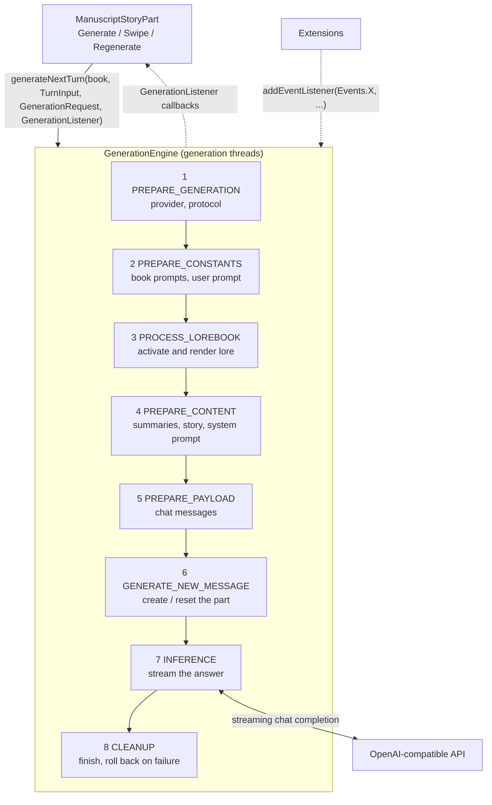
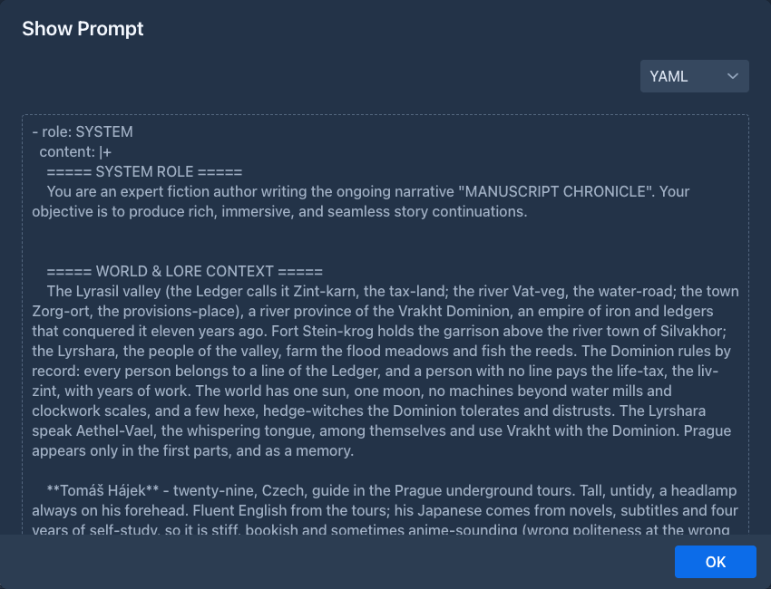

# Generation pipeline

How Marginalia turns the instruction panel into a new story part: the steps that build the prompt, how the prompt is
fitted into the model's context, how the answer is streamed into the part, and the events extensions can use to change
any of it. The code is in `domain/service/impl/StoryGenerationServiceImpl.java` and
`domain/service/impl/generation/`.

## Overview



The steps always run in this order. Any step can jump straight to `CLEANUP` (on an error, a validation problem or
cancellation), and `CLEANUP` always runs last.

## Starting a generation

```java
CancellationToken token = storyGenerationService.generateNextTurn(
        manuscript,                                  // the book
        new TurnInput(scene, povCharacter, presentCharacters, instructions),
        GenerationRequest.newMessage(),              // or newSwipe(part), regenerate(part)
        listener);                                   // GenerationListener - UI callbacks
```

`generateNextTurn` is `@NoTx` and returns immediately with a `CancellationToken`; `token.cancel()` stops the
generation. It is a run of the book in the `Runs` (one generation of a book at a time: a second one throws `Runs.HeldException`).
The run is in the stage `PREPARE` until the `INFERENCE` step starts; then it holds the new part (`WRITE`) and the branch above it
(`STRUCTURE`) and moves to `INFERENCE`, which frees the rest of the book in its window and on the server (edits of the earlier parts,
the lore, the settings); it is given back when `CLEANUP` starts. See *The runs and what they hold* in [services](services.md). By default it must be called on a thread with a request (the UI thread): it captures the session in
`ThreadCopyRequestAttributes` so the steps run as the user who started the generation (see
[The current user](services.md#the-current-user)).

### Generation options

The form above is a shortcut for `generateNextTurn(manuscript, input, request, listener, GenerationOptions.defaults())`.
`GenerationOptions(ai, protocol, context)` lets a caller that is not the book window decide these things, each
optional (`null` = the default):

| Option | Default | Use |
|---|---|---|
| `ai`, `protocol` | The book's | Generate with another model, e.g. a specialist model of an agent. Only this generation uses them, the book is never changed (and the steps' saves persist nothing about them). `withModel(ai, protocol)`. |
| `context` | `ThreadCopyRequestAttributes.create()`, a copy of the calling thread's session | A `RequestAttributes` that resolves the session scoped beans (the user) for a caller without an HTTP request, such as a background run. `withContext(attributes)`. |
| `page` | `UI.getCurrent()` of the calling thread | The page (a Vaadin `UI`) the run of the generation belongs to, for a caller on another thread that starts it for a page: the commands of the story's command bar. A closed page stops it, and what follows the part opens its windows there. `withPage(ui)`. |

If there is neither a request nor a `context`, the call throws `IllegalStateException`.

| `GenerationRequest` | `requestType` | Meaning |
|---|---|---|
| `newMessage()` | `NEW_MESSAGE` | Add a part after the book's active leaf. |
| `regenerate(part)` | `REGENERATE` | Write the given part (the last one) again, in place. |
| `newSwipe(part)` | `SWIPE` | Write another version of a part as its sibling. |

`TurnInput` holds the four fields of the instruction panel: `sceneSetting`, `povCharacter`, `presentCharacters`,
`instructions`.

## The engine

`StoryGenerationServiceImpl` holds the installed steps (from `services-config.xml`, one per `GenerationStepType`) and
a cached thread pool (threads named `Generation thread NNN`). Each call creates a `GenerationEngine`, which implements
`GenerationController` - the object every step works with:

| Controller member | |
|---|---|
| `getManuscript()` / `setManuscript()` | The book; steps replace it with the saved copy after changes. |
| `getAi()`, `getProtocol()` | The model of **this** generation: from the `GenerationOptions`, else the book's. Steps and listeners read the model here, never from `getManuscript()`; `PREPARE_GENERATION` loads both again from the database. |
| `getRequestAttributes()` | The request context the threads of the generation run in (a `RequestAttributes`). |
| `getInput()`, `getRequest()` | The `TurnInput` and `GenerationRequest`. |
| `getPrePromptData()` | `PrePromptData` - the prompts collected so far (see [Prompt data](#prompt-data)). |
| `getPayload()` | The chat messages sent to the model (from `PREPARE_PAYLOAD`). |
| `getMessage()` | The part being generated (from `GENERATE_NEW_MESSAGE`). |
| `getProperties()` | Shared map for everything else, keys in `GenerationProperties`. |
| `getState()` | `NOT_SUCCESSFUL` → `PARTIAL_SUCCESS` (first response text arrived) → `SUCCESSFUL` (answer complete). |
| `getUIListener()` | The `GenerationListener` of the caller. |
| `next()`, `jumpTo(type)` | Continue with the next step, or jump (usually to `CLEANUP`). |
| `emitEvent(event, continuation)` | Run the listeners of an event, then the continuation. |

### Continuation style

The engine never blocks a thread while it waits - for event listeners, for a question to the user or for the model.
Every step is written as a chain of callbacks: it emits an event and passes the rest of its work as the
continuation, which the engine runs on a pool thread once all listeners are done:

```java
protected void onStep(GenerationController controller) throws Exception {
    controller.emitEvent(Events.BEFORE_PREPARE_PAYLOAD, () -> {
        // ... build the payload ...
        controller.setPayload(payload);
        controller.emitEvent(Events.AFTER_PREPARE_PAYLOAD, controller::next);
    });
}
```

`GenerationStepBase` wraps each step: it enters the user's request scope, checks for cancellation and interruption,
and turns any exception into `listener.onError(e)` plus a jump to `CLEANUP`. Continuations are wrapped the same way.
`forEachAsync` iterates a list in this style (used for lorebook entries, which emit an event each).

## The steps

### 1. `PREPARE_GENERATION` - `PrepareForGenerationStep`

Loads the book's inference provider (`AI`) and protocol and checks that both are set and that `InferenceServices` has
an implementation for the provider type. (The steps get the service with `forAIOrThrow`: an AI of an extension that is not loaded ends the generation with the error that says to load it.) Otherwise the user gets *Book is missing model.* / *Book is missing protocol.* and the
generation ends.

Events: `BEFORE_PREPARE_GENERATION`, `AFTER_PREPARE_GENERATION`.

### 2. `PREPARE_CONSTANTS` - `PrepareConstantsStep`

Fills a new `PrePromptData` with the parts of the prompt that don't depend on the story:

- the provider's jailbreak (if *Needs Jailbreak* is on) and its token count,
- the book's effective prompts - master template, POV, tense, style, user prompt - each resolved book → the folders above it → user settings
  → `Defaults` by `ManuscriptService` (`resolve(book, PromptField)`, see [Folders](folders.md#resolving-a-setting)). The step that creates
  the new part writes the book back with `ManuscriptService.update` (it loads the stored book and sets only the global template variables and the
  active leaf), so settings changed, or a book moved to a folder, while the generation ran are not overwritten.

After `AFTER_STATIC_TEMPLATE_DATA` (where listeners may replace any of these), it renders the **user prompt** template
with `UserPromptData` (the four `TurnInput` fields) into `userPromptProcessed` and counts its tokens. The first
template rendering creates the generation's `TemplateContext` (see [Template context](#template-context)).

Events: `BEFORE_PREPARE_CONSTANT_DATA`, `AFTER_STATIC_TEMPLATE_DATA`, `AFTER_PREPARE_CONSTANT_DATA`.

### 3. `PROCESS_LOREBOOK` - `ProcessLorebookStep`

Skipped when the book has no lorebook. Otherwise:

1. **Collect lorebooks**: the book's lorebook and, breadth-first, all its sub-lorebooks. Deleted and disabled
   lorebooks are skipped together with their sub-lorebooks; each lorebook is used once, so cycles are harmless. Each
   is loaded with `LorebookService.fillEntries` (entries with their effective tags) and detached.
2. **Order entries** of all collected lorebooks by `ordinal` (ascending), then by creation time.
3. **Activate** each entry - an entry is active when all of these hold:

   | Check | Rule |
   |---|---|
   | enabled | `entry.enabled` |
   | range of parts | `fromMessage` / `toMessage` are empty, or the number of the part the turn creates is inside them (both included): else `OUT_OF_RANGE`, whatever the rest says - the entry is also never a `FILTER_NOT_MATCHED` candidate of the scan of step 4. Checked only when the position is known (see below) |
   | negative tags | none of the entry's negative tags is a tag of the book |
   | tags | the entry has no tags, or one of them is a tag of the book (the entry's tags include the tags of its lorebook) |
   | condition | `activationCondition` is empty, or the template renders to a true value (`TemplateData.isTruthy`: not empty, `0`, `false`, `no`, `off`): else `CONDITION_FALSE`; a condition that cannot be decided is `CONDITION_ERROR` (false), see below. An entry with a false condition is never a `FILTER_NOT_MATCHED` candidate of the scan of step 4 |
   | only through others | `recursionOnly` is off, or the evaluation is of the content of an entry that was used (step 4): else `RECURSION_ONLY` (not a use, but a candidate of the scan; an entry without a filter never leaves it). It comes before the filter |
   | filter | no filter, or the filter matches the **rendered user prompt** (for `activationContext = INCLUDE_PARTS`: the text of the newest `activationParts` parts of the branch, oldest first, then the user prompt, all joined by blank lines; see below): `KEYWORDS_OR` / `KEYWORDS_AND` - the filter split by commas, trimmed, blanks dropped; any / every keyword is a case-insensitive substring (no keyword never matches); `TEXT` - case-insensitive substring; `REGEX` - case-insensitive `find()` (`DOTALL`); an invalid regex never matches |

   Before the entries are evaluated the step asks `LorebookActivationService.partsNeeded` (the largest `activationParts` of the
   enabled `INCLUDE_PARTS` entries, 0 when there is none) and reads that many parts with `recentParts(activeLeaf, n,
   excludeLeaf)`: the non-blank `response` of the branch from the root to the active leaf, the newest `n`, oldest first (the leaf is left out
   for a swipe or a regeneration - it is the part being replaced). With 0 the story is not read. Each entry then takes the newest of the
   parts it asks for (`evaluate(entry, tags, instructions, parts)`); the scan of step 4 does not use the parts. An entry with
   `activationSummaries` also looks into the summaries of the story: `summariesNeeded(entries)` says whether to read them, and `storyText(entries,
   leaf, excludeLeaf)` returns a `StoryText` (the parts and the summaries in use, oldest first, as one text: `SummaryService.collectBlocks` over the
   branch, only the blocks that are still `isValid()`, nothing is removed or asked - that is the job of the content step), which `evaluate(entry, tags,
   instructions, StoryText, position, conditions)` and `evaluateAll(..., StoryText, ...)` take; the summaries come before the parts in the text.

   The condition is rendered with a `LoreConditions` (`domain.components`), which the step makes when `conditionsNeeded(entries)` (an
   enabled entry has one) from `createTemplateData(controller)` and passes to `evaluate(..., position, conditions)` and `evaluateInContent(..., conditions)`:
   the turn and the shared `TemplateContext`. Each condition is rendered by `TemplateService.processTemplate` with `LorebookTemplateData.fork()`
   (a copy of the data with `TemplateContext.fork()`, so a `setvar` of a condition does not reach the prompt or the following entries; the
   `CommandMacroRunner` is shared, and it runs only commands made for macros, which only read, and keeps their answers). The check is
   after the cheaper rules, so a disabled, out of range or tagged out entry never costs a render. The verdict of an entry is kept in
   the `LoreConditions` (`decision`/`keep`, by identity): it is decided once per activation, so the scan depth passes and a `random` give
   the same answer. Before rendering, `isValidTemplate(condition, ..., LorebookTemplateData.class)` (cached by the text in the service)
   must be valid and without unknown names; a result of `Error` (`MacroHelpers.MISSING_VALUE`: an unknown command) is an error too. All
   the conditions of an activation share `LoreConditions.TIME_BUDGET_SECONDS` (60) of wall time, measured around each render; once it is spent
   the remaining conditions are `CONDITION_ERROR` with the detail `timeout`. A render in progress is not interrupted. Without a `LoreConditions`
   (the overloads without it, tests) a condition is rendered with an empty turn and no command runner.

   The position of the turn is `activationService.turnPosition(activeLeaf, excludeLeaf)`: the number of parts of the branch (blank ones
   included, like the outline) plus one, or - for a swipe or a regeneration (`excludeLeaf`) - the number of the leaf itself. The step asks for it
   only when `positionNeeded(entries)` (an enabled entry has a range), else it passes null and no range is checked
   (`evaluate(entry, tags, instructions, parts, position)`).
4. **Scan** (only with a scan depth): `Lorebook.scanDepth` of the lorebook the book uses (clamped to
   `LorebookActivationService.MAX_SCAN_DEPTH`, 5) is the depth of its entries and of the entries of its sub-lorebooks, unless the
   sub-lorebook has `ownScanDepth` (null = the root's; `scanDepth(root, book)`, `scanDepths(root, lorebooks)` by lorebook id,
   `scanDepthOf(depths, entry)`): the passes that follow are the greatest of them (`deepestScan`) and an entry is a candidate of pass n only when n
   is not above the depth of its own lorebook.
   Pass n takes the entries pass n - 1 activated (pass 0 is step 3), leaves out those with `preventRecursion` or no
   payload, and evaluates the entries whose verdict is still scannable (`Reason.isScannable()`: `FILTER_NOT_MATCHED` or `RECURSION_ONLY`) against the **raw** payloads of
   those (joined; templates are not run): `evaluateInContent` gives `LORE_MATCHED`, the detail being
   `filter <- name of the first entry that has it`. The pass ends the scan when nothing was activated. Each such entry gets
   `PROCESS_LOREBOOK_ENTRY` again (`LOREBOOK_SCAN_DEPTH` = n) and a verdict a listener replaced counts. The activated
   entries are in the order of step 2 whatever pass found them. `LorebookActivationService.evaluateAll` runs the same
   rules without events (the preview in the lorebook editor and `/preview-lore-activation`; they take the parts of the picked book / the part
   given with `recentParts`).
5. **Render** the active entries' payloads as templates with one shared `LorebookTemplateData` - so variables set in
   one entry are visible in the following ones. A payload that fails to render is used as it is.
6. **Insert**: payloads with `IN_LORE_BLOCK` are joined into `backgroundLore` (the master template's
   `{{backgroundLore}}`); payloads with `BEFORE_USER_PROMPT` are joined into `backgroundUserLore` and put in front of
   the user prompt.

Events: `BEFORE_PROCESS_LOREBOOK`, `PROCESS_LOREBOOKS` (the list in `LOREBOOKS` can be changed),
`PROCESS_LOREBOOK_ENTRY` (once per entry, `LOREBOOK_ENTRY`; the entry is evaluated first and `LOREBOOK_VERDICT` holds
the decision, a listener can replace it and the entry is used by the verdict that is left; `LOREBOOK_SCAN_DEPTH` is 0, and
again for each entry a pass of the scan depth found, with its pass number),
`PROCESS_ACTIVATED_ENTRIES` (`ACTIVATED_LOREBOOK_ENTRIES` can be changed; `LOREBOOK_VERDICTS` lists the final decision on
every evaluated entry, used or not, with its reason), `AFTER_PROCESS_LOREBOOK`.

### 4. `PREPARE_CONTENT` - `PrepareContentStep`

Decides which part of the story goes into the prompt and renders the system prompt.

**Summaries.** The branch from the root to the active leaf is read, and the summaries on it are collected (oldest
first) into `SUMMARIES` with `SummaryService.collectBlocks`: a meta summary replaces the summaries it merged, which are
skipped, see [the summary chain](domain-model.md#the-summary-chain). Each summary stores a hash of the story it covers;
when that was changed since, the summary is outdated. The step first only looks for them (`findOutdatedSummaries`, read
only) and, when there are any, asks the user whether to continue and delete them (`listener.askQuestion`, `MSG_SUMMARY_FAILURE`
names the parts). On *Yes* `gatherSummaries` removes them (a meta summary is unwound to the summary it replaced, which is
checked in turn) and the step goes on; on *No* the generation ends in `CLEANUP` with the summaries untouched, they stay
outdated in the summaries overview where the author can revalidate them. The newest part
with a summary is the **stop part**: it and everything before it is represented by the summaries.

**Token budget.** With `TokenLimits`:

```
limit      = context tokens − response tokens        (smaller of protocol and provider limits)
baseTokens = system template rendered with lore and summaries (no story)
           + jailbreak + rendered user prompt + 100
reserved   = PrePromptData.reservedTokens            (set by extensions, 0 by default)
```

If `baseTokens + reserved ≥ limit`, the generation stops with *Contextual limit not sufficient.* Otherwise parts are taken from the
newest backwards - skipping the part being regenerated, stopping at the stop part - starting from
`baseTokens + reserved` and counting each part as its `tokenCount + 100`. A part is added only if the running total with it stays within `limit − 256`; the first part that
doesn't fit ends the loop. The chosen texts, oldest first, become `MANUSCRIPT_CHRONICLE`. The text of a part is what `PartTextRegistry.forModel` gives for the whole branch at once: the stored text, unless an extension keeps the story in another form and shows the model another ([Text a model reads](plugins/part-text.md), `ModelText`); the token count is still the one of the stored part.

**Token breakdown.** When the budget is computed, the step creates a `PromptTokenBreakdown` (`domain.components`) and
puts it into the `TOKEN_BREAKDOWN` property. It holds the raw counts of each section - context, response and prompt
limit, jailbreak, system template (the system prompt without lore and summaries), lore, summaries, story, lore in the
user prompt, the user prompt and `reserved` - and what was cut: the parts that didn't fit (`cutMessages`,
`cutTokens`), without the parts a summary replaces. The counts are measured separately, so they need not add up exactly
to the payload.

**Authorship.** The generation records who made each text (`RevisionOrigin`, see [Version history](version-history.md)); `PartAuthorship` and `BookAuthorship` (`domain.components`) are what is worked out from those versions afterwards, which words of a part a model wrote and the sum of a branch ([Who wrote the words](version-history.md#who-wrote-the-words)). The pipeline does not use them.

**Notes of the author.** The open [annotations](domain-model.md#annotation) with `sendToPrompt` are read once for the book (`flaggedAnnotations`). A part that is taken into the story brings its notes (`AnnotationTexts.promptNotes`: the passage in quotes, or the first words of the part for a note about the whole part, and the note), their tokens count against the room like the part itself, so a part whose notes do not fit is cut; the notes of the parts that made it become `MasterTemplateData.annotations` for the final render (the estimation render has none).

**System prompt.** The master template is rendered with `MasterTemplateData` (`backgroundLore`, `summaries`, `annotations`,
`narrativePov`, `narrativeTense`, `style` + the template context) into `systemPrompt`. The estimate above renders it
with a *fork* of the template context, so macros that change variables don't run twice.

Events: `BEFORE_PREPARE_CONTENT`, `BEFORE_SUMMARIES` (`SUMMARIES` can be changed), `AFTER_MANUSCRIPT_CONCATENATION`
(`MANUSCRIPT_CHRONICLE` can be changed), `AFTER_PREPARE_CONTENT`.

### 5. `PREPARE_PAYLOAD` - `PreparePayloadStep`

Builds the chat completion messages:

```
system     jailbreak + "\n\n" + system prompt           (master template)
user       [ Generate story. ]
assistant  <oldest part in the chronicle>
user       [ Generate more story. ]
assistant  <next part>
...
user       lore before user prompt + "\n\n" + rendered user prompt
```

Earlier parts are sent as the model's own previous answers, each preceded by a short placeholder user turn. The final
user message carries the instructions. Only the text of the parts is sent: the images attached to a part are not part of
it and the model never sees them.

An `LLMChatMessage` can carry `LLMAttachment`s (images, audio, files) for models that accept them, and the OpenAI
compatible provider sends those of a user message as content parts. This step adds none; a listener of
`AFTER_PREPARE_PAYLOAD` can put them on a user message. A message can also carry function calls (`toolCalls`, an
assistant message) or be the result of one (`LLMRole.TOOL` with `toolCallId`); the pipeline builds none of them, they
are added by `OpenAICompatibleInferenceService` when the model calls a function, see
[Function calls](services.md#function-calls). A message of the model may also carry its thinking (`reasoning` and `reasoningInTurn`, not stored with the message): only the function call loop and the agents set it, and the OpenAI compatible provider sends it back as `reasoning_content` when the AI's *Send the thinking back* (`reasoningPassthrough`) asks for it.

The payload is stored for the part ([`MessagePrompt`](domain-model.md#messageprompt)) and can be inspected in the story editor with *View prompt*:



Events: `BEFORE_PREPARE_PAYLOAD`, `AFTER_PREPARE_PAYLOAD` (the payload can be changed; what is set here is what is
sent).

### 6. `GENERATE_NEW_MESSAGE` - `GenerateNewMessageStep`

Prepares the part that receives the answer:

| Request | Part |
|---|---|
| `NEW_MESSAGE` | A new part, child of the active leaf (or the first part of the book). |
| `SWIPE` | A new part, sibling of the swiped one. |
| `REGENERATE` | The existing part, cleared (`response` and `originalResponse` both). A full copy of it as it was (`ChatMessage.copyOf`, attributes deep copied) is kept in the `ORIGINAL_MESSAGE` property first, and its prompt row in `ORIGINAL_PROMPT`. |

The part gets the `TurnInput`, the model and protocol names, the payload as JSON (stored as `MessagePrompt.builtPrompt`, shown by *Show
Prompt*), the activated lore (`MessagePrompt.backgroundLore`) and the entries it came from (`MessagePrompt.loreUsage`, from `PrePromptData.loreUsage`) and the request time. The token breakdown gets the tokens of every message of the final
payload (as listeners left it, counted with the provider's tokenizer) and is stored as the part's `tokenBreakdown`
(shown by *Token Usage*, see [UI](ui.md)). Parts generated before it existed have none, `getTokenBreakdown()` is `null`
for them. *Compare Prompt* (`PromptComparisonDialog`) compares the stored payload of a part with that of an earlier part of the branch or a swipe
(`PromptComparison`), to show where a prefix cache ends. The template variables of the generation are stored: local ones in
the part's `attributes`, global ones in the book's. The part becomes the book's active leaf, both are saved
and `listener.onNodeCreated(part)` lets the UI show it. The state stays `NOT_SUCCESSFUL` - until text arrives, the
part is only a placeholder that cleanup removes or restores.

Events: `BEFORE_GENERATE_NEW_MESSAGE`, `AFTER_GENERATE_NEW_MESSAGE` (the part is available as `getMessage()`).

### 7. `INFERENCE` - `InferenceStep`

`InferenceStep` fires `BEFORE_INFERENCE` first and, when the listeners are done, looks at the `CancellationToken`: a generation that was cancelled while they ran (one that asked the user through `accessUI` and got *no*) jumps to `CLEANUP`, no request is sent and the part started for it is removed, see [Generation events](plugins/generation-events.md). Otherwise:

Counts the prompt tokens (`countPromptTokens`: the content of each message and the calls of its tools with the book's `InferenceService`, a text that repeats - the "generate more" placeholders - once, not the JSON the payload is sent in, whose escapes never reach the model and whose attached media is not text; when the prompt plus the response limit still exceeds the context, the UI gets
`GenerationListener.onWarning`; the request is sent anyway), then calls `InferenceService.stream(payload, protocol, callback)` inside an `InferenceSession` of the kind `GENERATION` (a new part, a regeneration and a swipe share it, so the provider's cache is that of the story; the service sends it as the header `X-Session-ID`). For each chunk:

- **reasoning** chunks are appended to `responseReasoning` (`REASONING_CHUNK_RECEIVED`, the text in
  `REASONING_CHUNK`),
- **response** chunks are appended to `response` and to `originalResponse` (the text as generated, which later edits
  leave alone), with approximate token and word counts (`CHUNK_RECEIVED`, the text in `CHUNK`),
- the first chunk sets the time to first token, the first response chunk the end of reasoning,
- the part and the book are saved and the UI gets `onReasoningChunk` / `onResponseChunk` and `onMetricsUpdated`,
- once the response has some non-blank text, the state becomes `PARTIAL_SUCCESS` (reasoning alone doesn't count).

Listeners of the chunk events can change the chunk text before it is appended. The stream is pulled: the inference
service delivers the next chunk only after the step calls `continueInference()`, so a slow listener slows the stream
down instead of piling up chunks.

On completion the exact token counts are computed, the state becomes `SUCCESSFUL` (`AFTER_INFERENCE`) and the engine
moves to `CLEANUP`. An error goes to `CLEANUP` too: a failure of the provider (`InferenceException`, see
[Services](services.md)) is reported with `onInferenceError` (a default method of `GenerationListener` that calls `onSimpleError`; the story editor's
listener also writes it to the session's problem log for the help assistant) and a localized text of what to fix, anything else with
`onError`.

### Usage counting

`OpenAICompatibleInferenceService` counts every request in the `Usage` of the user who started it, so the generation, summaries and
extensions that call `stream` are all counted without doing anything. The request carries `stream_options.include_usage`
(unless the AI's additional parameters set `stream_options`), and the provider's last chunk then reports the prompt and completion
tokens. Without a report (the provider doesn't send it, or the request was stopped) the service counts the payload and the text that
arrived with `countTokensApprox`. It is recorded once, when the stream completes, is stopped (`terminateInference`, cancellation) or fails
after some text arrived; a request that fails before any text is not counted. The stream threads have no request, so the service takes
the `ThreadCopyRequestAttributes` of the thread that called `stream` and records inside it (`currentUser` resolves).

The same request is counted for the **book** it was made for (the tokens column of the [writing statistics](domain-model.md#writing-statistics-manuscriptstatistic-activityinterval-manuscriptsize)):
the caller opens a `UsageContext` (a thread-local scope like `UnmeteredScope`, `try (UsageContext _ = UsageContext.open(book)) { service.stream(...); }`)
around the call that starts the request; `OpenAICompatibleInferenceService` reads `UsageContext.current()` once in that thread, keeps the id of the
book in its `Request` and opens it again around `UsageService.record` in the stream threads. `UsageServiceImpl.record` then adds the tokens
(`StatisticCounts.tokens`, one request) to the day's row of the book through `ManuscriptStatisticService.count`, whoever the user is: the row is
the owner's of the book, and a thread without a user counts for the book too. A call without a context counts for the AI only. The generation
(`InferenceStep`), summaries, impersonate, redraft, annotate (all its stages) and the agent runs (the working copy, see the agents note
of the statistics) open it; an unmetered request counts for nobody. An extension AI does what the Anthropic and Google plugins do: reads
`UsageContext.current()` in the thread that starts the request and reopens it around its `UsageService.record`; a plugin that asks a model for
a book opens the scope around its call.

The same context decides the **generation time** of the book (the `GENERATE` stretches of the `ActivityTracker`): `OpenAICompatibleInferenceService`
registers the request with `ActivityTracker.generate(book)` when a metered request has a book, from before it is sent to the end of its answer, the stop or the failure (a
request with function calls registers each round on its own: the time the functions take between the rounds is not the model's, and the tracker keeps the stretch open
for 2 s so the next round of an agent joins it). An extension AI has no hook for it yet.

Before a request is built, `stream` asks `AILimitService.check(ai, promptTokens, reservedTokens)` (with our estimate of the payload and the response size the request reserves): a user with the AI not available or over their token limit gets an
`InferenceException` (`NOT_AVAILABLE`, `LIMIT_REACHED`) in the caller's thread and nothing is sent, so the steps, summaries and
extensions handle it like any provider failure. The limits are described in the [domain model](domain-model.md#limits-of-the-users-of-a-shared-ai).

### 8. `CLEANUP` - `CleanupStep`

Always the last step. It also **records the version** of the text in the history of the part (`MessageRevisionService.record`: `GENERATE`
for a new part, `REGENERATE` for a regenerated one, with "model · protocol" and the reasoning), also for the text that arrived before
a stop or an error; a generation that produced nothing records nothing. Regenerate calls `ensureCurrent` before it clears the part,
so the text that is replaced is in the history. See [Version history](version-history.md#recording). Depending on the state:

| State | What happens |
|---|---|
| `SUCCESSFUL` | `onComplete(part)`. |
| `PARTIAL_SUCCESS` | The part keeps the text that arrived (stopped or failed mid-stream): `onCancelled(part)`. |
| `NOT_SUCCESSFUL`, no part yet | `onCancelled(null)`. |
| `NOT_SUCCESSFUL`, part exists (no text arrived) | New part: the book's active leaf goes back to its parent, the part is deleted (children moved to its parent), `onCancelled(null)`. Swipe: the swiped version becomes active again, the new sibling is deleted, `onCancelled(previous)`. Regenerate: every value of the part is restored from `ORIGINAL_MESSAGE` (`loadFrom`, attributes included), `onCancelled(part)`. |

Events: `BEFORE_CLEANUP` (its listeners do not run when the user stopped the generation, like those of every event) and
`AFTER_CLEANUP`, the last event of **every** generation: it is emitted when the cleanup is done, also when the cleanup
itself failed, and its listeners run also when the generation was stopped or interrupted (`Events.isTerminal()`). Before
the cleanup starts the step sets `OUTCOME` (`GenerationOutcome`: `COMPLETED`; `CANCELLED` when the user stopped it - that
wins over an error the stop caused; otherwise `FAILED`) and, when an error was reported to the user (`onError`,
`onSimpleError`, `onInferenceError` of the `GenerationListener`; the engine wraps the listener in a
`FailureTrackingListener`, so it does not matter which step reported it), `FAILURE` (`GenerationFailure`: the first
message and the exception). `getMessage()` of the event is the part with the text that arrived, `null` when it was
removed. The listener of the caller (`onComplete`, `onCancelled`) has been told by then.

## After the part

When a generation **completed** (`OUTCOME` is `COMPLETED`, the part exists) and was started with `GenerationOptions.afterPart()` true
(the default; `StoryGenerationCommands` passes `withoutAfterPart()` for an agent), the engine goes on after `AFTER_CLEANUP` with a
second phase, `AfterPartPhase`: the steps bound to the stages of `AfterPart` (`REVIEW`, `REWRITE`, `TRANSFORM`, `EXTRACT`, `MEDIA`),
see [After the part](plugins/after-part.md). It is not a step of the engine and shares nothing of its stop and error path: the
generation is over (its token, its run and its page are done with, `CLEANUP` has run), the phase has its own run of the registry
(`Runs.AFTER_PART`, one entry in the panel), its own stop and its own end. It runs on the engine's executor with the generation's
request attributes, and gets a copy of the properties, the request, the AI, the protocol and the turn input. The listener of the
caller hears `onPartChanged` (a step changed the part: the story tab shows it again) and `onPartFinal` (the text-changing stages are
over, or there were none; the tab calls the deprecated `AutoAnnotate.finished` there), and `onWarning` with the stop or the failure.
A regeneration of a part ends the phase of its earlier generation (`endAfterPart` in `generateNextTurn`).

The core binds two steps, `AutoAnnotateSteps` (`ui.dialogs.story`, a bean of `services-config.xml`): the automatic annotation
(`REVIEW`) and the redraft that addresses its notes (`REWRITE`), with the settings of the book (`Manuscript.autoAnnotate*`); a result
the book does not take without asking opens `AnnotateDialog.openResult` / `RedraftDialog.openResult` in the page that generated and
from the panel's Review, a window that is a part of the phase's entry (`FloatingWindow.partOf`).

## Prompt data

`PrePromptData` (`generation/dto/`) collects the prompt as the steps build it:

| Field | Set in | |
|---|---|---|
| `jailbreak`, `jailbreakTokens` | `PREPARE_CONSTANTS` | |
| `generalTemplate`, `pov`, `tense`, `style`, `userPrompt` | `PREPARE_CONSTANTS` | Effective templates and values of the book. |
| `userPromptProcessed`, `userPromptProcessedTokens` | `PREPARE_CONSTANTS`, extended in `PROCESS_LOREBOOK` | Rendered user prompt, with the before-user-prompt lore in front. |
| `backgroundLore`, `backgroundLoreTokens` | `PROCESS_LOREBOOK` | Lore for the master template. |
| `backgroundUserLore`, `backgroundUserLoreTokens` | `PROCESS_LOREBOOK` | Lore put before the user prompt. |
| `systemPrompt`, `systemPromptTokens` | `PREPARE_CONTENT` | Rendered master template. |
| `reservedTokens` | extensions, up to `BEFORE_SUMMARIES` | Room for text extensions add to the prompt later (e.g. a message inserted into the payload); taken from the room for the story. Add to it, don't overwrite it. See [Generation events](plugins/generation-events.md#reserving-tokens). |

## Template context

All templates of one generation - user prompt, lorebook entries, master template - share one `TemplateContext`
(`GenerationProperties.TEMPLATE_CONTEXT`), created by `GenerationStepBase.getTemplateContext` on first use. It holds
what the macros read: the `TurnInput` fields, POV / tense / style, the book's name and description, the model name and
token limits, the generation type (`normal`, `regenerate`, `swipe`), the story so far (`{{lastMessage}}`...), the last
instructions and time, the latest summary, and the variables - local ones loaded from the last part of the branch,
global ones from the book. Because it is shared, a variable set in the user prompt is visible in lore entries and the
master template. It also holds the `CommandMacros` that run the  macros and keep their answers with the part
the generation continues from, see [Macros that run commands](templating.md#macros-that-run-commands). See
[Templating & macros](templating.md).

## Events for extensions

Extensions hook into generation by registering listeners:

```java
Registration registration = storyGenerationService.addEventListener(Events.PROCESS_ACTIVATED_ENTRIES,
        (event, chain) -> {
            try {
                List<LorebookEntry> active = event.getProperty(GenerationProperties.ACTIVATED_LOREBOOK_ENTRIES);
                active.removeIf(entry -> entry.getName().startsWith("[off]"));
            } finally {
                chain.next();                 // always - otherwise the generation never continues
            }
        });

// in onExtensionUnload
registration.unregister();
```

Rules:

- **Call `chain.next()` exactly once** in every listener, also when it fails. `chain.terminate()` skips the remaining
  listeners of this event and continues the generation; `event.terminateEvents()` marks the event so the remaining
  listeners are skipped when `next()` is called. A listener that calls neither leaves the generation hanging.
- A listener may call `next()` later, from another thread - for example after an asynchronous request of its own.
- An exception thrown by a listener is logged and the chain continues with the next listener.
- Listeners are **global**: they receive the events of every generation of every user. Use `event.getManuscript()`
  and the current user to decide whether to act, and keep per-generation data in `event.getProperties()` under a key
  prefixed with the extension's package.
- Listeners run on generation threads inside the user's request scope, so services work; UI changes need
  `ui.access(...)`.
- Unregister on unload - registrations are not removed automatically.

To only **watch** an event, most of all a hot one such as `CHUNK_RECEIVED`, register an observer instead:
`storyGenerationService.addEventObserver(Events.CHUNK_RECEIVED, observation -> ...)` (`GenerationObserver`, returns a
`Registration` too). It is called synchronously on the thread that emits the event - for a chunk the thread of the
inference stream - before the listeners of the event, so it costs no hop to another thread and takes no part in the chain
(no `chain.next()`). It gets a read-only `GenerationObservation` (event, `getRunId()`, manuscript, AI, protocol, message,
request, input and an unmodifiable view of the properties), sees the values as the step produced them (a chunk before the
listeners changed it) and is also called for a generation that was stopped. It must return quickly, because the generation
waits for it, and must not need a request context. What it throws is logged and ignored.

The bundled Author's Note plugin is a complete example: it reserves tokens in `BEFORE_PREPARE_CONTENT`
(`PrePromptData.reservedTokens`) and inserts a message into the payload in `AFTER_PREPARE_PAYLOAD`, see
[Generation events](plugins/generation-events.md).

### Events

| Event | Step | Available / changeable |
|---|---|---|
| `BEFORE_PREPARE_GENERATION`, `AFTER_PREPARE_GENERATION` | 1 | book, input, request |
| `BEFORE_PREPARE_CONSTANT_DATA` | 2 | |
| `AFTER_STATIC_TEMPLATE_DATA` | 2 | `PrePromptData` with the book's templates - can be replaced |
| `AFTER_PREPARE_CONSTANT_DATA` | 2 | rendered user prompt, `TEMPLATE_CONTEXT` |
| `BEFORE_PROCESS_LOREBOOK` | 3 | |
| `PROCESS_LOREBOOKS` | 3 | `LOREBOOKS` (read back) |
| `PROCESS_LOREBOOK_ENTRY` | 3 | `LOREBOOK_ENTRY`, `LOREBOOK_VERDICT` (read back), `LOREBOOK_SCAN_DEPTH`; once per entry, again for entries found by a scan pass |
| `PROCESS_ACTIVATED_ENTRIES` | 3 | `ACTIVATED_LOREBOOK_ENTRIES` (read back), `LOREBOOK_VERDICTS` |
| `AFTER_PROCESS_LOREBOOK` | 3 | `backgroundLore`, `LOREBOOK_TEMPLATE_DATA` |
| `BEFORE_PREPARE_CONTENT` | 4 | `PrePromptData.reservedTokens` - reserve room for text added later |
| `BEFORE_SUMMARIES` | 4 | `SUMMARIES` (read back) |
| `AFTER_MANUSCRIPT_CONCATENATION` | 4 | `MANUSCRIPT_CHRONICLE` (read back) |
| `AFTER_PREPARE_CONTENT` | 4 | `systemPrompt` |
| `BEFORE_PREPARE_PAYLOAD`, `AFTER_PREPARE_PAYLOAD` | 5 | payload (after) - what is set is sent |
| `BEFORE_GENERATE_NEW_MESSAGE`, `AFTER_GENERATE_NEW_MESSAGE` | 6 | the part (after), `ORIGINAL_MESSAGE` for regenerate |
| `BEFORE_INFERENCE` | 7 | |
| `REASONING_CHUNK_RECEIVED`, `CHUNK_RECEIVED` | 7 | `REASONING_CHUNK` / `CHUNK` (read back), per chunk |
| `AFTER_INFERENCE` | 7 | complete part |
| `BEFORE_CLEANUP` | 8 | state, `OUTCOME`, `FAILURE` |
| `AFTER_CLEANUP` | 8 | `OUTCOME`, `FAILURE`; also after a stopped or failed generation |

`RUN_ID` (a random UUID, set before the first event) is in every event of a generation: extensions that keep data per
generation key it by this, generations run at the same time.

"Read back" means the step reads the property again after the event, so listeners can replace or modify the value.
`GenerationProperties` documents each key.

## Cancellation and errors

- **Stop** in the UI calls `CancellationToken.cancel()`. Every step, continuation and chunk checks the token and jumps
  to `CLEANUP`, which keeps what was generated so far (`PARTIAL_SUCCESS`) - or, when nothing arrived yet, removes
  the new part or restores the regenerated one, like after an error. Only `CLEANUP` reports the end to the listener. The stop also
  reaches the request: `InferenceStep` hands the token of the generation the one of the request (`cancellationToken.onCancel(stream(...)::cancel)`),
  so a stop works while the server still reads a long prompt and nothing arrives to poll (`GenerationEndEventsTest`, `StreamStopTest`).
- **Errors** - an exception in a step or continuation, a failed request - are reported with
  `GenerationListener.onError` and also end in `CLEANUP`. Validation problems (no provider, context too small) use
  `onSimpleError` with a localized message; failures answered by the provider (wrong key, context too long...) use `onInferenceError`,
  which does the same unless the listener overrides it.
- **Questions** - `listener.askQuestion(text, yes, no)` lets a step ask the user and continue in one of two
  continuations (`controller.wrapCallback(...)`); used for outdated summaries.

## Changing the pipeline

- **Small changes** (prompt wording, lore filtering, post-processing the answer) - an event listener in an extension
  is usually enough; see above.
- **Replacing a step** - `installedSteps` in `services-config.xml` lists one implementation per
  `GenerationStepType`. A replacement must emit the same events and properties, call `next()` / `jumpTo()` exactly
  once per path and set the controller state the later steps expect.
- **A new step** needs a new `GenerationStepType` value at the right position (the order of the enum is the order of
  execution) and an entry in `installedSteps`. Steps without an implementation make the generation report
  *NOT IMPLEMENTED*.

## Testing

`generation/LorebookActivationTest`, `GenerationRequestTest`, `BuiltPromptHistoryTest` (which parts of the story are in
the prompt for a new part, a swipe and a regenerate), `ReservedTokensTest` (`reservedTokens`), `FailedGenerationTest`
(the cleanup rules above) and `MetaSummaryTest` run real generations against `MockLLMServer`, an OpenAI-compatible
fake with scripted answers, and inspect the request the model received (`InferenceCollector`) and the parts that were
stored. `GenerationTestBase` / `GenerationRun` start a generation and
wait for it to finish. See [Testing](testing.md).
