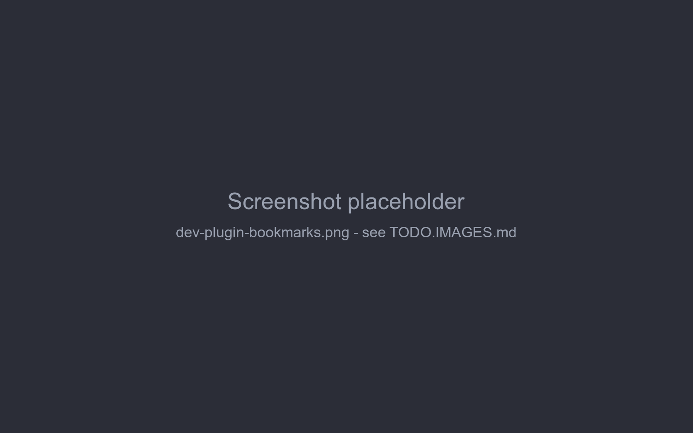

# Example plugin

This page builds a small plugin from scratch - *Bookmarks*, which lets you bookmark story parts - and then walks
through three bundled plugins: Chapter Marker, the smallest one that changes the UI, Author's Note, which changes
the prompt sent to the model, and Chinese localization, which adds a language and no code besides the texts. Together they use everything from the previous pages: a bundle, decorators reading arguments, locals and
fields, data in attributes, generation listeners, and cleanup on unload.

## Bookmarks

What it does:

- every story part's menu gets a *Toggle bookmark* item,
- bookmarked parts are marked with ★ in the story sidebar,
- the bookmark is stored on the part, so it's kept in backups and copied by *Branch Story*.



### 1. Install the application

The plugin compiles against the application's classes, installed in the local Maven repository:

```sh
mvn -N install                  # in the repository root: the parent POM the application's POM refers to
cd marginalia
mvn install -DskipTests
```

### 2. Create the project

```
bookmarks/
├── pom.xml
└── src/main/java/com/example/marginalia/bookmarks/
    ├── BookmarksActivator.java
    └── BookmarksExtension.java
```

Copy `marginalia/plugins/chaptermarker/pom.xml` and change:

- `groupId` to `com.example.marginalia`, `artifactId` to `bookmarks`, and replace the `<parent>` (the plugin is outside
  the repository) with a `<version>` of its own, e.g. `1.0.1`; the dependency on `marginalia` then needs the version of
  the installed application instead of `${project.version}`,
- `Bundle-Activator` to `com.example.marginalia.bookmarks.BookmarksActivator`,
- `Import-Package` to `!com.example.marginalia.bookmarks.*` and `Export-Package` to
  `com.example.marginalia.bookmarks.*`.

Keep the rest - the `provided` dependencies, the AspectJ plugin (for `@Configurable`) and the bundle plugin. See
[Plugin basics → pom.xml](overview.md#pomxml) for what each part does.

### 3. The activator

It only registers the extension:

```java
package com.example.marginalia.bookmarks;

import com.github.enerccio.marginalia.extensions.MarginaliaExtension;
import org.osgi.framework.BundleActivator;
import org.osgi.framework.BundleContext;
import org.osgi.framework.ServiceRegistration;

public class BookmarksActivator implements BundleActivator {

    private ServiceRegistration<MarginaliaExtension> registration;

    @Override
    public void start(BundleContext context) {
        registration = context.registerService(MarginaliaExtension.class, new BookmarksExtension(), null);
    }

    @Override
    public void stop(BundleContext context) {
        if (registration != null) {
            registration.unregister();
            registration = null;
        }
    }
}
```

### 4. The extension

```java
package com.example.marginalia.bookmarks;

import com.github.enerccio.marginalia.domain.model.impl.ChatMessage;
import com.github.enerccio.marginalia.domain.service.ChatMessageService;
import com.github.enerccio.marginalia.domain.service.ExtensionService;
import com.github.enerccio.marginalia.domain.service.ExtensionService.ExtendableMethodContext;
import com.github.enerccio.marginalia.domain.service.ExtensionService.ExtensionDecorator;
import com.github.enerccio.marginalia.domain.service.OsgiService;
import com.github.enerccio.marginalia.extensions.MarginaliaExtension;
import com.github.enerccio.marginalia.ui.dialogs.manuscript.ManuscriptStoryPart;
import com.google.gson.JsonObject;
import com.vaadin.flow.component.ComponentUtil;
import com.vaadin.flow.component.button.Button;
import com.vaadin.flow.component.contextmenu.ContextMenu;
import com.vaadin.flow.component.contextmenu.MenuItem;
import com.vaadin.flow.component.notification.Notification;
import org.osgi.framework.Bundle;
import org.slf4j.Logger;
import org.springframework.beans.factory.annotation.Autowired;
import org.springframework.beans.factory.annotation.Configurable;

import java.util.Collections;
import java.util.List;
import java.util.Set;
import java.util.WeakHashMap;

@Configurable
public class BookmarksExtension implements MarginaliaExtension {
    /** The logger of the extension, its lines go to Admin → Extensions → Log. */
    private Logger log;

    private static final String KEY = "com.example.marginalia.bookmarks";
    private static final String MENU_ITEM_KEY = KEY + ".menuItem";

    private static final String STORY_PART = "com.github.enerccio.marginalia.ui.dialogs.manuscript.ManuscriptStoryPart";
    private static final String MESSAGE_CARD = STORY_PART + "$ChatMessageCard";

    @Autowired
    private ChatMessageService chatMessageService;

    private final Set<ContextMenu> menus = Collections.synchronizedSet(Collections.newSetFromMap(new WeakHashMap<>()));
    private List<ExtensionDecorator> decorators = List.of();

    @Override
    public void onExtensionLoad(Bundle bundle, OsgiService osgiService, ExtensionService extensionService) {
        log = osgiService.createLogger(bundle);
        ExtensionDecorator menuDecorator = new ExtensionDecorator() {
            @Override
            public void onMethodEnter(Object instrumented, ExtendableMethodContext context) {
            }

            @Override
            public void onMethodLeave(Object card, ExtendableMethodContext context, Throwable throwing) {
                if (throwing != null) {
                    return;
                }
                ContextMenu menu = context.getReflectiveFieldValue(card, "hamburgerMenu", ContextMenu.class);
                if (menu == null || ComponentUtil.getData(menu, MENU_ITEM_KEY) != null) {
                    return;
                }
                MenuItem item = menu.addItem("Toggle bookmark", event -> {
                    try {
                        // read the field when clicked - the card replaces its message on every save
                        ChatMessage shown = context.getReflectiveFieldValue(card, "message", ChatMessage.class);
                        ChatMessage fresh = chatMessageService.find(shown.getId());
                        setBookmarked(fresh, !isBookmarked(fresh));
                        chatMessageService.save(fresh);

                        // redraw the story so the sidebar shows the change
                        ManuscriptStoryPart storyPart = context.getReflectiveFieldValue(card, "this$0", ManuscriptStoryPart.class);
                        context.callReflectiveMethod(storyPart, "renderStoryContent", new Class<?>[0], new Object[0], void.class);
                    } catch (Exception e) {
                        log.error("Cannot toggle bookmark", e);
                        Notification.show("Cannot toggle bookmark: " + e.getMessage());
                    }
                });
                ComponentUtil.setData(menu, MENU_ITEM_KEY, item);
                menus.add(menu);
            }
        };

        ExtensionDecorator sidebarDecorator = new ExtensionDecorator() {
            @Override
            public void onMethodEnter(Object instrumented, ExtendableMethodContext context) {
            }

            @Override
            public void onMethodLeave(Object storyPart, ExtendableMethodContext context, Throwable throwing) throws Exception {
                if (throwing != null) {
                    return;
                }
                ChatMessage msg = context.getMethodArgument("msg", ChatMessage.class);
                if (isBookmarked(msg) && context.hasLocalVariable("sidebarBtn", Button.class)) {
                    Button sidebarBtn = context.getLocalVariable("sidebarBtn", Button.class);
                    sidebarBtn.setText("★ " + sidebarBtn.getText());
                }
            }
        };

        try {
            extensionService.registerDecorator(menuDecorator, MESSAGE_CARD, "createMenuItems");
            extensionService.registerDecorator(sidebarDecorator, STORY_PART, "createSidebarButton");
            decorators = List.of(menuDecorator, sidebarDecorator);
        } catch (Exception e) {
            // logged by Marginalia, which then unloads the extension again
            throw new IllegalStateException("Bookmarks extension failed to load", e);
        }
    }

    @Override
    public void onExtensionUnload(Bundle bundle, OsgiService osgiService, ExtensionService extensionService) {
        decorators.forEach(extensionService::unregisterDecorator);
        decorators = List.of();

        synchronized (menus) {
            for (ContextMenu menu : menus) {
                // menus belong to other sessions - change them under their own lock
                menu.getUI().ifPresent(ui -> ui.access(() -> {
                    MenuItem item = (MenuItem) ComponentUtil.getData(menu, MENU_ITEM_KEY);
                    if (item != null) {
                        menu.remove(item);
                        ComponentUtil.setData(menu, MENU_ITEM_KEY, null);
                    }
                }));
            }
            menus.clear();
        }
    }

    static boolean isBookmarked(ChatMessage message) {
        JsonObject attributes = message != null ? message.getAttributes() : null;
        return attributes != null && attributes.has(KEY) && attributes.get(KEY).getAsBoolean();
    }

    static void setBookmarked(ChatMessage message, boolean bookmarked) {
        if (message.getAttributes() == null) {
            message.setAttributes(new JsonObject());
        }
        if (bookmarked) {
            message.getAttributes().addProperty(KEY, true);
        } else {
            message.getAttributes().remove(KEY);
        }
    }
}
```

How it works:

- **Two decorators.** `menuDecorator` runs after `ChatMessageCard.createMenuItems()` - the card runs it when its menu
  is opened for the first time (not when the card is created, so the cards of a long story stay cheap), so every menu
  that is opened gets the item. `sidebarDecorator` runs after `ManuscriptStoryPart.createSidebarButton(msg,
  orderId, dbId)`, which `renderStoryContent()` calls for each part of the branch.
- **Reaching the components.** The menu is the card's field `hamburgerMenu`; the sidebar button is the local
  variable `sidebarBtn` of `createSidebarButton`, the part is its argument `msg`. Both names are checked before use
  (`hasLocalVariable`) or fail with a logged warning if the application changes.
- **Adding once.** `ComponentUtil.setData(menu, MENU_ITEM_KEY, item)` marks the menu; a second call for the same menu
  does nothing.
- **Data.** The bookmark is one boolean under the plugin's key in the part's `attributes`. The click listener reads
  the card's `message` field at click time and reloads the part (`chatMessageService.find(id)`) before changing it,
  because the card's copy may be stale ([Extended attributes](extended-attributes.md#storing-and-reading-data)).
- **Redrawing.** After saving it calls the story part's private `renderStoryContent()` through
  `callReflectiveMethod`, reaching the outer `ManuscriptStoryPart` through the inner class's `this$0` field. The
  redraw runs `createSidebarButton` again, so the sidebar decorator adds the ★.
- **Unloading.** Decorators are unregistered; menu items are removed from the tracked menus inside each menu's own
  `ui.access(...)`, because they belong to other users' sessions
  ([Extending the UI → Unloading](ui-extensions.md#unloading)). Sidebar buttons lose their ★ on the next redraw.
- **Errors.** `onExtensionLoad` runs without a UI, so it throws instead of opening an error dialog; Marginalia logs
  the error and unloads the extension again.

!!!
With Chapter Marker installed too, both plugins decorate `createSidebarButton`, and decorators run in the order the
plugins were loaded. Bookmarks prefixes the text, so it works after Chapter Marker; Chapter Marker replaces the text
of chapter parts, so the ★ of a bookmarked chapter is lost when Chapter Marker runs second (and when the part is
edited).
!!!

### 5. Build and load

```sh
cd bookmarks
mvn package                     # target/bookmarks-1.5.0.jar
```

Load `target/bookmarks-1.5.0.jar` in *Admin → Extensions* and open a book (books that were already open need to be
closed and opened again). Open a part's menu, choose *Toggle bookmark* - the part's sidebar entry gets the ★.

If nothing appears, look in the log for `Mod 'com.example.marginalia.bookmarks.BookmarksExtension$...' skipped on
...` (a name that doesn't exist) or `Unhandled exception in extension ...`. The lines of the extension itself (here
`log.error("Cannot toggle bookmark", e)`) are in *Admin → Extensions → Log* of the extension, see
[Logging](overview.md#logging).

### Where to go from here

- Show the bookmarks in a tab of their own: decorate `renderStoryContent()` and add a tab to `leftBar`, like Side
  Query ([A tab next to the story](ui-extensions.md#a-tab-next-to-the-story)).
- Put bookmarked parts into the prompt: register a generation listener, like Author's Note
  ([Walkthrough: Author's Note](#walkthrough-authors-note), [Generation events](generation-events.md)).

## Walkthrough: Chapter Marker

`marginalia/plugins/chaptermarker` turns the story sidebar into a table of contents: a part whose text contains a
Markdown heading is shown as `5. Chapter 3: The Harbour`, highlighted. It has two classes and no data of its own -
the heading is part of the story text.

`ChapterMarkingActivator` is the same as the Bookmarks activator. `ChapterMarkingExtension` registers two decorators
in `onExtensionLoad`.

**Labelling the sidebar** - after `ManuscriptStoryPart.createSidebarButton(msg, orderId, dbId)`:

```java
ChatMessage msg = context.getMethodArgument("msg", ChatMessage.class);
Integer orderId = context.getMethodArgument("orderId", int.class);      // primitive argument: ask for int.class

VerticalLayout sidebarList = context.getReflectiveFieldValue(instrumented, "sidebarList", VerticalLayout.class);

Button sidebarBtn = null;
if (context.hasLocalVariable("sidebarBtn", Button.class)) {
    sidebarBtn = context.getLocalVariable("sidebarBtn", Button.class);
} else if (sidebarList.getComponentAt(sidebarList.getComponentCount() - 1) instanceof Button lastBtn) {
    sidebarBtn = lastBtn;                                                // fallback if the local is renamed
}
```

It remembers the button's original text, the order and the part's uuid on the button
(`ComponentUtil.setData(...)`), then sets the chapter title and style if the part has a heading.

**Following edits** - after `ManuscriptStoryPart$ChatMessageCard.autosaveAndSwapToMarkdown()`, which saves an edited
part:

```java
ChatMessage chatMessage = context.getReflectiveFieldValue(instrumented, "message", ChatMessage.class);
ManuscriptStoryPart parentPart = context.getReflectiveFieldValue(instrumented, "this$0", ManuscriptStoryPart.class);
VerticalLayout sidebarList = context.getReflectiveFieldValue(parentPart, "sidebarList", VerticalLayout.class);
```

It finds the sidebar button whose stored uuid matches the edited part and relabels it - or restores the original
text when the heading was removed. The data stored on the button in the first decorator is what makes this possible
without rebuilding the sidebar.

**Unloading** unregisters both decorators. Labels already changed stay until the story is redrawn, which is
acceptable here: they're just text.

What to take from it:

- arguments, locals and fields are all used, each with the right accessor;
- primitive arguments are read with the primitive type;
- a fallback for the local variable keeps the plugin working if the variable is renamed;
- component data (`ComponentUtil`) carries state from one hook to another.

The other bundled plugins build on the same pieces: Reviewer and Side Query add menu items, tabs, settings panels and
call the model ([Extending the UI](ui-extensions.md)); Lorebook VCS stores larger data in a lorebook's attributes
([Extended attributes](extended-attributes.md)); Lore Generator adds a button to every row of the lorebook grid and streams
a generation from the model into a dialog; Author's Note, below, changes the prompt of every generation.

## Walkthrough: Author's Note

`marginalia/plugins/authorsnote` sends a per-book note to the model with every generation: an *Author's Note* tab next
to the story outline edits it, a generation listener inserts it into the prompt. It shows the one thing decorators
can't do - change what the model gets.

| Class | Does |
|---|---|
| `AuthorsNoteData` | The note: on/off, the text, a private scratchpad, the insertion depth and the role. Stored in the book's attributes under the package name. |
| `AuthorsNoteService` | Loads and saves the data, counts the note's tokens, inserts the note into a payload. |
| `AuthorsNoteView` | The sidebar tab with a token estimate of the note; every change is saved right away. |
| `AuthorsNoteExtension` | Adds the tab on leave of `ManuscriptStoryPart.renderStoryContent()` (like Side Query) and registers the listener. |

**Hooking into generation** - `onExtensionLoad` registers two listeners next to the decorator and keeps the
registrations:

```java
reserveRegistration = storyGenerationService.addEventListener(Events.BEFORE_PREPARE_CONTENT,
        this::reserveAuthorsNote);
payloadRegistration = storyGenerationService.addEventListener(Events.AFTER_PREPARE_PAYLOAD,
        this::insertAuthorsNote);
```

`BEFORE_PREPARE_CONTENT` comes before the generation decides how much of the story fits into the context. The
listener loads the note, keeps it in the generation's properties and reserves its tokens, so the story gets less room:

```java
AuthorsNoteData data = authorsNoteService.loadCurrent(manuscript);
event.getProperties().put(AuthorsNoteData.KEY, data);
long tokens = authorsNoteService.countTokens(manuscript, data);
event.getPrePromptData().setReservedTokens(event.getPrePromptData().getReservedTokens() + tokens);
```

`AFTER_PREPARE_PAYLOAD` comes when the list of chat messages for the model is complete; what the listener sets is
what is sent:

```java
private void insertAuthorsNote(GenerationControllerEvent event, EventChain chain) {
    try {
        AuthorsNoteData data = event.getProperty(AuthorsNoteData.KEY);   // the note that was counted
        if (data != null) {
            event.setPayload(authorsNoteService.insertNote(event.getPayload(), data));
        }
    } catch (Exception e) {
        log.warn("Failed to insert the author's note: {}", e.getMessage(), e);
    } finally {
        chain.next();
    }
}
```

**Unloading** unregisters both listeners besides removing the decorator and the tabs - a listener left
registered would keep changing the prompts of every user.

What to take from it:

- `chain.next()` in `finally` - the generation waits for every listener;
- listeners are global, so act only on the data of the book being generated;
- reserve the tokens of what you add (`PrePromptData.reservedTokens`) before the budget is computed, and add to the
  reservation instead of overwriting it;
- pass state from one event to the next in `event.getProperties()`, under your package name;
- build a new payload and `setPayload(...)` it instead of changing the list you got.

[Generation events](generation-events.md) explains the payload, the choice of the events and reserving tokens in
detail.

## Walkthrough: Chinese localization

`marginalia/plugins/chineselocalization` adds Simplified Chinese to the language selector of the workspace. It is the
smallest possible plugin - no decorators, no UI, no data - and shows the third optional interface of an extension
besides `ExtensionHasCss`: `ExtensionHasLocalization`.

```
chineselocalization/
├── pom.xml
└── src/main/java/com/github/enerccio/marginalia/extensions/chineselocalization/
    ├── ChineseLocalizationActivator.java   registers the extension service
    ├── ChineseLocalizationExtension.java   returns the bundle
    └── LocalizationBundleZH.java           the texts
```

The `pom.xml` is the one of the other plugins without what the plugin doesn't use: it needs only the application
(`classes` classifier) and the Felix framework, both `provided`, and the bundle plugin - no AspectJ, since there is
no `@Configurable` class, and no Vaadin.

**The extension** implements `MarginaliaExtension` as always - both methods stay empty, there is nothing to set up -
and `ExtensionHasLocalization`:

```java
public class ChineseLocalizationExtension implements MarginaliaExtension, ExtensionHasLocalization {

    @Override
    public void onExtensionLoad(Bundle bundle, OsgiService parentService, ExtensionService extensionService) {
    }

    @Override
    public void onExtensionUnload(Bundle bundle, OsgiService parentService, ExtensionService extensionService) {
    }

    @Override
    public List<LocalizationBundle> getLocalizationBundles() {
        return List.of(new LocalizationBundleZH());
    }
}
```

Marginalia calls `getLocalizationBundles()` right after `onExtensionLoad` and registers the bundles in
`Localization`; when the extension is unloaded they are removed again. Nothing else is needed: the language shows
up in the `LanguageSelector` of every workspace the next time it is attached, and a user who picks it is shown the
whole UI in it after the page reloads.

**The bundle** extends `LocalizationBundleBase`: `loadMessages()` fills the texts with `setValue`, the other
methods describe the language.

```java
public class LocalizationBundleZH extends LocalizationBundleBase {

    @Override
    public Language getLanguage() {
        return Language.of("zh");               // the code saved in the user's settings
    }

    @Override
    public String getDisplayName() {
        return "中文（简体）";                      // shown in the selector, in the language itself
    }

    @Override
    protected void loadMessages() {
        setValue(L.LABEL_YES, "是");
        setValue(L.LABEL_NO, "否");
        // ... one setValue for every key of L
    }

    @Override
    public Locale getLocale() {
        return Locale.SIMPLIFIED_CHINESE;       // collation of lists, natural order of names
    }

    @Override
    public DateFormat getDateFormat() {
        return new SimpleDateFormat("yyyy-MM-dd");
    }
    // getHourFormat() and getDateHourFormat() the same way
}
```

What to take from it:

- a **language code** is the identity of a bundle: only one bundle per code exists. A second one is refused (and
  logged) - an extension can add languages but not replace the English texts or the Japanese ones of the application;
- a bundle **doesn't have to be complete**: a key it lacks is shown in the default language, and the application logs
  a warning listing the missing keys when the bundle is registered. A plugin built for an older version keeps working
  when the application adds keys;
- the **placeholders** (`%s`, `%d`) of a text must match the English text in number and order of their types, the
  application formats the text with them. Copy `LocalizationBundleEN` as the start and translate in place;
- the bundle is created in `getLocalizationBundles()`, and the texts are looked up when needed, so a plugin's own
  user interface that uses `Localization` gets the right language without more work;
- unloading the plugin makes sessions that used its language fall back to the default one - nothing is lost, the
  user's setting stays and works again when the plugin is loaded.

To try it, build and load it like any plugin ([Build and load](#5-build-and-load)): in *Admin → Extensions* load
`chineselocalization-1.5.0.jar`, then pick *中文（简体）* in the language selector.
