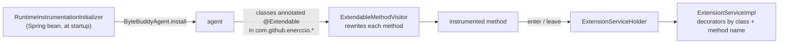

# @Extendable hooks

Most of what a plugin does starts with a **decorator**: an object whose `onMethodEnter` and `onMethodLeave` run
before and after a method of an application class. Any method of a class annotated `@Extendable` can be decorated,
private ones included, and the decorator can read the method's arguments and local variables and change what
the method returns. This page explains how that works and how to use it. The signature of every such method is declared in the source with
[`@PublicAPI`](#the-public-api), which is what plugins can rely on.

## Instrumentation



`RuntimeInstrumentationInitializer` installs a ByteBuddy agent into the running JVM when the Spring context starts.
The agent transforms every class annotated `@Extendable` whose name starts with `com.github.enerccio` - classes
loaded later when they are loaded, classes already loaded by retransformation. Only method bodies change; the class
keeps its fields and methods (`disableClassFormatChanges`), which is what makes retransformation possible.

`ExtendableMethodVisitor` rewrites every method that is not a constructor, not static and not synthetic (lambda
bodies are synthetic). In pseudo-code, an instrumented method looks like this:

```java
ReturnType method(A a, B b) {
    ExtensionService service = ExtensionServiceHolder.getInstance();
    ExtendableMethodContext context = service.createContextHolder(this);
    context.registerMethodArgument("a", a, A.class);           // declared parameter types
    context.registerMethodArgument("b", b, B.class);
    service.onExtendableMethodEnter(DeclaringClass.class, this, context, "method");
    a = (A) <argument "a" from context>;                        // decorators may have replaced it
    b = (B) <argument "b" from context>;
    try {
        ... original body; after every store into an object local variable:
        context.registerLocalVariable("name", value, value.getClass());
        ... at every return of a value (not in a void method):
        context.registerReturnValue(result, ReturnType.class);      // declared return type, the original value
        service.onExtendableMethodLeave(DeclaringClass.class, this, context, "method", null);
        return (ReturnType) context.resolveReturnValue();           // decorators may have replaced it
        ... at a return in a void method:
        service.onExtendableMethodLeave(DeclaringClass.class, this, context, "method", null);
        return;
    } catch (Throwable t) {
        service.onExtendableMethodLeave(DeclaringClass.class, this, context, "method", t);
        throw t;
    }
}
```

This runs on **every** call, whether a decorator is registered or not. That's why `@Extendable` is on UI classes,
which run at human speed, and not on services or entities.

Names come from the class file: parameter names from the `MethodParameters` attribute (the application is compiled
with `-parameters`), local variable names from the local variable table (`preserveAllLocals`). If either is
missing, arguments are called `arg0`, `arg1`... and locals `var<slot>`.

## The public API

Everything a decorator can name - the class, the method, its arguments, its local variables - is a promise the
application makes to the plugins. Every instrumented method of an `@Extendable` class (not a constructor, not static,
not synthetic, with a body - the methods that can be decorated) therefore declares its signature with `@PublicAPI`
(`domain.traits`):

```java
@PublicAPI(from = "1.1.0",
        returns = @APIReturn(type = MenuItem.class),
        parameters = {@APIParameter(name = "bar", type = MenuBar.class)},
        locals = {@APILocals(name = "cogs", type = MenuItem.class)})
private MenuItem createCogsMenuItem(MenuBar bar) {
```

| Element | Meaning |
|---|---|
| `from` | The first version of the application in which the method has this signature (`"1.2.0"`). When a change of the signature can be seen by a plugin (below), set it to the version that contains the change. |
| `returns` | `@APIReturn(type = ...)`: the declared return type, `void.class` for `void`. The type a decorator reads with `getOriginalReturn` / `getCurrentReturn` and the one `setCurrentReturn` has to fit: a plugin that replaces the result depends on it. |
| `parameters` | One `@APIParameter(name, type)` for each argument, in declaration order: the name `getMethodArgument` takes and the declared type. Primitives stay primitive (`int.class`). |
| `locals` | One `@APILocals(name, type)` for each named object local variable that is not an argument: what `getLocalVariable` in `onMethodLeave` can read. The type is the declared type of the variable; a name used for more than one type is listed once for each. Primitive locals are not recorded and not listed. Locals of lambdas and compiler-generated locals (`var5`) are not part of it. |

The methods that describe a class to the help assistant (`getLLMState`, `getLLMChildren`, `getInteraction`, `getLLMProblems`) are public API
like the others where a class overrides them, and a plugin can decorate them to add to what the assistant knows, see
[Extending the UI](ui-extensions.md#telling-the-help-assistant-about-your-ui).

Types are class literals, so a refactoring that renames or moves a class in the IDE updates them too. They are erased
(`List.class` for `List<String>`).

**What counts as a change.** Renaming or retyping an argument or a local variable, adding or removing one, changing
the return type, renaming or removing the method, or moving it to another class (a decorator registered for the old
class and name is never called) can break a plugin. Adding a method does not, and neither does changing the body in a
way that keeps the arguments, the locals and what they hold. For each change that can be seen:

1. update the annotation (see below) and set `from` to the current version of the project (`pom.xml`);
2. search `marginalia/plugins/` for the class, method and variable names and fix the plugins;
3. mention it in the release notes.

A new method starts with the current version in `from`. The methods that existed in 1.1.0 (the same class, name and
argument names) were given `"1.1.0"` when the annotation was introduced; the local variables were not compared with 1.1.0.

**It is tested.** `PublicAPISignatureTest` (`instruct` package) reads the compiled `@Extendable` classes with
ByteBuddy - the type pool, so nothing is loaded - and the local variable table, and fails when

- an instrumented method has no `@PublicAPI`;
- the annotation differs from the compiled method (name or type of an argument, return type, a local that is missing,
  extra or of another type);
- a class is compiled without parameter names (`-parameters`), so the names would be `arg0`...;
- `from` is not `major.minor.patch`, or the annotation is on a method that is not instrumented (a constructor, a static
  or abstract method) or in a class that is not `@Extendable`.

The message names the method and prints the annotation to write, so after changing a method you run the test, paste
what it says and review the difference - that difference is exactly the change a plugin would see. Methods that
AspectJ adds to the `@Configurable` classes (`readResolve()`) have no source and are skipped.

!!!
`@PublicAPI` describes methods only. The fields a plugin reads with `getReflectiveFieldValue` (such as `sidebarList`
or `this$0`) are not declared, so check `marginalia/plugins/` before renaming or retyping a field of an `@Extendable`
class.
!!!

## Registering a decorator

```java
ExtensionDecorator decorator = new ExtensionDecorator() {
    @Override
    public void onMethodEnter(Object instrumented, ExtendableMethodContext context) throws Exception {
        // before the body: arguments are known, no locals yet
    }

    @Override
    public void onMethodLeave(Object instrumented, ExtendableMethodContext context, Throwable throwing) throws Exception {
        // after the body: arguments, locals, fields; throwing != null if the method is throwing
    }
};

extensionService.registerDecorator(decorator,
        "com.github.enerccio.marginalia.ui.dialogs.manuscript.ManuscriptStoryPart", "createSidebarButton");

// in onExtensionUnload
extensionService.unregisterDecorator(decorator);    // removes it from every method it was registered for
```

- `instrumented` is the object whose method runs (`this`).
- **Class name** is the binary name of the class that *declares* the method: nested classes use `$`
  (`ManuscriptStoryPart$ChatMessageCard`). A method inherited from a superclass is reported under the superclass,
  for all subclasses; a subclass's own methods under the subclass. The class itself must be `@Extendable` - the
  annotation is not inherited, and nested classes need their own.
- **Method name** only: all overloads of a method share its decorators. Check the arguments
  (`hasMethodArgument(name, type)`) if you need to tell overloads apart.
- Several decorators on the same method run in the order they were registered, for enter and for leave.
- A decorator registered for a class or method that doesn't exist is accepted and never called - check names
  carefully. [Verification](#verification-before-loading) refuses to load an extension that does this.
- Decorators are **global**: they run for every user and every session. Use the arguments and fields to decide
  whether to act. The current user is the session-scoped `User` bean, injected as in services
  ([The current user](../services.md#the-current-user)) - on the UI thread it resolves to the session's user.

## The method context

Each call gets its own `ExtendableMethodContext` (calls don't share them, recursive and concurrent calls neither).

| Method | Use |
|---|---|
| `getMethodArgument(name, type)` | An argument by parameter name. Primitives come boxed, but ask for the primitive type (`int.class`) - the registered type is the primitive and `Integer.class` is not accepted. |
| `hasMethodArgument(name)`, `hasMethodArgument(name, type)` | Check before reading. |
| `registerMethodArgument(name, value, type)` | In `onMethodEnter`: **replace** an argument - the method body sees the new value. Use the declared type. A value that can't be cast to the parameter type (or `null` for a primitive) makes the method throw before its body runs. |
| `getLocalVariable(name, type)` | A local variable by name, with its latest value. Only in `onMethodLeave` (none exist on enter). |
| `hasLocalVariable(name)`, `hasLocalVariable(name, type)` | Check before reading - a local stored only on some paths may be missing. |
| `hasReturn()` | Whether the method returned a value: `false` in `onMethodEnter`, for a `void` method and when the method throws. |
| `getOriginalReturn(type)` | What the body of the method returned, whatever the decorators did. Only in `onMethodLeave`. Primitives come boxed, but ask for the primitive type (`int.class`) like for arguments. |
| `getCurrentReturn(type)` | What the method returns **as of now**: the original value, or the value set by the decorator that ran before this one ([chaining](#changing-the-return-value)). |
| `setCurrentReturn(value)` | **Replace** the value the method returns. See [Changing the return value](#changing-the-return-value). |
| `getReflectiveFieldValue(object, field, type)` | Read a field of any object, private fields and fields of superclasses included. |
| `setReflectiveFieldValue(object, field, value, type)` | Write a field. |
| `callReflectiveMethod(object, name, argTypes, args, returnType)` | Call any method, private ones included. `argTypes` must be the exact declared parameter types; pass `void.class` as the return type for `void` methods. |

Type checks are against the **registered** type: for arguments the declared parameter type, for locals the runtime
class of the value (`Object` when the value was `null`), for fields and methods the declared type. The requested type
must be the same or a supertype.

Local variables, in detail:

- Only **object** locals are recorded (`ASTORE`): `int`, `boolean` and other primitive locals are not.
- A local is recorded each time it's assigned, so you get its last value. Locals in different scopes that reuse the
  same slot keep their own names.
- Locals of lambdas (event listeners) belong to the synthetic lambda method, which is not instrumented.

### Changing the return value

A decorator of a method that returns a value can replace the value in `onMethodLeave`. The decorators of a method form
a **chain** in the order they were registered, sharing one *current* value:

```java
@Override
public void onMethodLeave(Object instrumented, ExtendableMethodContext context, Throwable throwing) {
    if (!context.hasReturn()) {
        return;                                         // void method, or it threw
    }
    String original = context.getOriginalReturn(String.class);   // what the body returned
    String current = context.getCurrentReturn(String.class);     // original, or the previous decorator's result
    context.setCurrentReturn(current + " (edited)");             // the next decorator and the caller get this
}
```

- `getOriginalReturn` is always what the body returned, `getCurrentReturn` starts as the same value and is whatever the
  last `setCurrentReturn` set. A decorator that only wants to add to the result reads the *current* value, so it keeps
  what the decorators before it did; one that wants to start over reads the original.
- When the last decorator is done, the caller of the method receives the current value. If nobody set one, the method
  returns what its body returned.
- The value must fit the **declared** return type of the method (a subtype is fine, `null` is fine for objects); for a
  primitive return type pass the matching wrapper (`setCurrentReturn(5)` for `int`), not `null`. A value that does not
  fit is refused with a `ModCompatibilityException` (a warning in the log, as for the other [errors](#errors)), the
  current value stays and the method is not affected.
- Type checks of the getters are against the declared return type: `getOriginalReturn(CharSequence.class)` works for a
  method that returns `String`, `Integer.class` does not work for `int`.
- The return value exists only after the body returned. In `onMethodEnter`, for a `void` method and when the method
  throws, `hasReturn()` is `false` and the getters and the setter are refused. A decorator cannot swallow an exception
  or turn a return into one, and the body always runs ([What a decorator can't do](#what-a-decorator-cant-do)).
- The mutable objects a method returns (a component, a list) can be changed without replacing the value; replace it
  when you need a different object, or the value is immutable (`String`, numbers, `Optional`).

!!!warning The return value is part of the contract
What a method returns is read by its caller, and every plugin that replaces it is now a part of that. A change of the
declared return type of an `@Extendable` method is a change of its [public API](#the-public-api), and a plugin that
replaces the value with a type that no longer fits is refused at run time.
!!!

### Errors

The getters and the reflective calls throw a `ModCompatibilityException` (a private `RuntimeException` subclass of
`ExtensionServiceImpl`) when a name doesn't exist or the type doesn't match. `ExtensionServiceImpl` catches everything a decorator throws, so a failing decorator
never breaks the decorated method or the other decorators:

- in `onMethodLeave`, a `ModCompatibilityException` is logged as a warning:
  `Mod '<decorator class>' skipped on <class>.<method>: Required component variable 'sidebarBtn' was not found ...`;
- anything else, and anything in `onMethodEnter`, is logged as an error with the stack trace.

That makes a renamed variable a log line, not a crash - but also easy to miss. When you work on a plugin, watch the
log.

## What a decorator can't do

- **Skip the method.** The body always runs, with its arguments as they are after `onMethodEnter`. What it returns can
  be [replaced](#changing-the-return-value) afterwards, and so can what it built (a local variable or field) or saved.
- **Replace the result of a method that throws**, or throw instead of a return: a decorator can read the exception in
  `onMethodLeave` but it is always rethrown.
- **Decorate constructors, static methods or lambda bodies.** Decorate the method the constructor calls (for example
  the constructor of `ChatMessageCard` calls `createHamburgerMenu()`, the items come later from `createMenuItems()`), or the method that registers the listener.
- **Decorate classes that aren't `@Extendable`**, plugin classes, or library classes.
- **Read primitive locals.** Read the fields or objects they end up in.

## Extension points

The `@Extendable` classes are listed in [User interface → Extension points](../ui.md#extension-points). To find a
hook for what you want to do:

1. Find the component in the UI and the class that builds it ([User interface](../ui.md) maps screens to classes).
2. Find the method that builds or refreshes it - preferably one that runs every time the component is (re)built, so
   that your change is applied again.
3. Find how to reach the component: a local variable of that method (`getLocalVariable`), a field
   (`getReflectiveFieldValue`), or the method's arguments.
4. Decide on enter or leave: almost always `onMethodLeave`, when the component exists. `onMethodEnter` is for
   reading state the method is about to overwrite, or replacing arguments - the bundled plugins save their settings
   in `UserPart.save`'s *enter*, so that the application's own `settingService.save(userSetting)` in the body
   stores them.

Methods the bundled plugins use, as examples:

| Class | Method | Reached through | Used for |
|---|---|---|---|
| `ManuscriptStoryPart` | `createSidebarButton(msg, orderId, dbId)` | arguments; local `sidebarBtn`; field `sidebarList` | Change the sidebar entry of a part (Chapter Marker). |
| `ManuscriptStoryPart` | `renderStoryContent()` | fields `leftBar` (a `TabDock`), `currentManuscript` | Add a tab next to the story outline (Side Query). Runs on every redraw of the story. |
| `ManuscriptStoryPart` | `populateMenuBar(bar)` / `createCogsMenuItem(bar)` | argument `bar`; local `cogs` | Add items to the menu bar of the story editor / to its settings menu. Not used by a bundled plugin yet. |
| `ManuscriptStoryPart` | `createCommandBox()` (from 1.4.0) | return value (a `Component`, the `CommandBar`) | Replace or wrap the command line (`CommandBar` with its `CommandResultView` popover), for example to put another `CommandResultTarget` on the bar. |
| `SummariesDialog` | `populateMenuBar(bar)` | argument `bar` | Add tools to the (empty) menu bar of the summaries overview. Not used by a bundled plugin yet. |
| `ManuscriptStoryPart$ChatMessageCard` | `createMenuItems()` | fields `hamburgerMenu`, `message` | Add items to a part's menu; runs when the menu of the part is first opened (Reviewer). |
| `ManuscriptStoryPart$ChatMessageCard` | `refreshSummaryMenuItems()` | fields `hamburgerMenu`, `message` | Update menu items each time the menu is about to open (Reviewer). |
| `ManuscriptStoryPart$ChatMessageCard` | `autosaveAndSwapToMarkdown()` | fields `message`, `this$0` (the outer `ManuscriptStoryPart`) | React to an edited part (Chapter Marker). |
| `UserPart` | `refresh()` / `save()` | fields `extensionSettings`, `userSetting` | Add a settings panel; save its values (Reviewer, Side Query, Lore Generator). |
| `LorebookView` | `create()` | local `lorebookHeaderLayout`; field `grid` | Add a panel above the lorebook header (Lorebook VCS); add a column to the entry grid (Lore Generator). |
| `LorebookPart` | `refresh()` | field `lorebookView` | Reach the view of the workspace tab, which was built when the page opened (Lore Generator). |
| `LorebookView` | `createEntryDetailLayout(entry)` | argument `entry`; local `detailsLayout` | Add a panel to each entry's details (Lorebook VCS). |
| `DesktopWorkspace`, `PhoneWorkspace`, `AdminPart`, `ManuscriptDialog`, `PhoneManuscriptDialog` | `getLLMState()` / `getInteraction()` | `getCurrentReturn` / `setCurrentReturn` | Tell the help assistant about what the plugin added to the screen, or let it open it. Not used by a bundled plugin yet. |
| `UserPart` (and `PhoneSettingsPart`), `AIPart`, `ProtocolPart`, `ManuscriptPart` and their phone versions | `getLLMState()` / `getInteraction()` | `getCurrentReturn` / `setCurrentReturn` | The same for the settings tabs and the lists of models, protocols and books (`open-tab:`, `open-dialog:`). Not used by a bundled plugin yet. |
| `AIDialog` | `getLLMProblems()` | `getCurrentReturn` / `setCurrentReturn` | Add what a plugin's own checks find wrong with the form (a list of lines, never a value). Not used by a bundled plugin yet. |

Inner classes reach their outer instance through the synthetic field `this$0`.

### The phone twins

On a phone the book opens in `PhoneManuscriptDialog`, whose tabs are separate classes (not subclasses) in
`ui.dialogs.phone.manuscript`, so a decorator of the desktop class does not run there. `PhoneManuscriptStoryPart` and its
`PhoneManuscriptStoryPart$ChatMessageCard` have the same decorable methods, fields and locals as the desktop ones
(`createSidebarButton`, `renderStoryContent`, `populateMenuBar`, `createCogsMenuItem`, `createMenuItems`,
`refreshSummaryMenuItems`, `autosaveAndSwapToMarkdown`; fields `sidebarList`, `leftBar`, `currentManuscript`,
`hamburgerMenu`, `message`, `this$0`), so a plugin supports the phone by registering the same decorator a second time
under the other class name. The Reviewer, Chapter Marker and Author's Note do; Side Query, Lore Generator and Lorebook VCS don't.
Two differences: the card has no right-hand column (the metadata is in a popover), and `leftBar` is the tab sheet in
the drawer of the story (a `TabDock` that does not detach, like the desktop one); on both, `leftBar` is created once and not rebuilt by `renderStoryContent()` (check for your
tab first, as Author's Note does). Reach the outer part through `this$0` as an `Object`, since its type depends on the dialog.

## Verification before loading

Every name a decorator uses is unchecked at compile time, so Marginalia checks them before it starts an extension:
`ExtensionService.verifyExtension(Bundle bundle, File jar)` (`ExtensionVerifier` in `instruct.verify`). It doesn't run
the extension, it reads its bytecode. The classes are listed by the JAR file and read from the installed bundle
(`Bundle.getEntry`), and everything they ask for is compared with the real classes of the running application.

**What is followed.** An ASM data-flow analysis (`ContextInterpreter`) walks every method of every class of the
extension and tracks constants, `new` objects and the objects that come out of the context:

- every `registerDecorator(decorator, className, methodName)` call. The class and method name must be constants
  (`static final String` constants are inlined by the compiler, so they are). The decorator is the class created with
  `new` on the way to the call, directly, through a local variable or through a field of the extension that was
  assigned earlier - the usual `decorator = new ExtensionDecorator() {...}; registerDecorator(decorator, ...)`;
- in the decorator class - **all** its methods, so lambdas and private helpers of the decorator count too - every call
  on an `ExtendableMethodContext`.

**What is checked**, against the application's classes loaded without being initialized, the way
[the context](#the-method-context) checks them when the decorated method runs:

| Request | Error when | Warning when |
|---|---|---|
| `registerDecorator(d, cls, method)` | The class doesn't exist, isn't `@Extendable`, or declares no instrumented method of that name (static, constructor and synthetic methods are not; a method of a superclass is reported with the class that declares it). | The names are not constants, or the decorator class can't be found. |
| `getMethodArgument(name, type)` | No overload has an argument of that name, or its declared type is not the same as `type` or a subtype of it (`int.class`, not `Integer.class`). | |
| `hasMethodArgument(name[, type])` | | The same problems: the access is optional. |
| `registerMethodArgument(name, value, type)` | No overload has an argument of that name. | `type` is not the declared type. |
| `getLocalVariable(name, type)` | No overload stores an object local of that name (primitives are not recorded), or its type doesn't fit, or it's asked in `onMethodEnter`, where there are no locals. | The declared type is a supertype of `type`: works only if the value is of that type at run time. |
| `hasLocalVariable(name[, type])` | | The same problems. |
| `getOriginalReturn(type)`, `getCurrentReturn(type)` | No overload of the method returns a value (all are `void`), or the declared return type is not `type` or a subtype of it (`int.class`, not `Integer.class`), or it is asked in `onMethodEnter`. | The return type could not be loaded. |
| `setCurrentReturn(value)` | No overload of the method returns a value, or it is called in `onMethodEnter`. The value itself is not checked. | |
| `getReflectiveFieldValue`, `setReflectiveFieldValue` | The object's class or its superclasses have no field of that name, or the field's type is not `type` or a subtype. | The object can't be determined. |
| `callReflectiveMethod` | No method of that name and exact parameter types, or its return type doesn't fit. | The parameter types are not constants (the name alone is checked). |

The object of a reflective access is followed: `instrumented` (of `onMethodEnter` / `onMethodLeave`) is the decorated
class; the result of `getReflectiveFieldValue` / `callReflectiveMethod` (also through a cast and a local variable) is
an object of the field's type / the method's return type; an object from `getMethodArgument` / `getLocalVariable` is
of the requested type. So the usual way to reach the outer instance of an inner class is verified in both steps:

```java
ManuscriptStoryPart parent = context.getReflectiveFieldValue(instrumented, "this$0", ManuscriptStoryPart.class);
context.getReflectiveFieldValue(parent, "sidebarList", VerticalLayout.class);     // a field of ManuscriptStoryPart
```

!!!warning Only the decorators themselves are scanned
Nothing is followed into another class. If a decorator passes its context (or `instrumented`, or an object taken out of
the context) to a method of another class, or builds names at run time, what that code asks for is **not checked** -
checking it is up to the developer of the extension. Keep the context calls in the decorator class if you want them
verified.
!!!

**The report.** The result is written next to the JAR, named after it: `chaptermarker.jar` gets
`chaptermarker.valid` or `chaptermarker.invalid` (the one of the opposite result is deleted). It is plain text: the
extension, the bundle, the time, `Result: VALID` / `INVALID`, the errors, the warnings and the decorators that were
checked:

```
Extension: chaptermarker.jar
Bundle: chaptermarker 1.3.0
Verified: 2026-10-10T18:18:31.781673Z
Result: INVALID

Errors (1):
  - ChapterMarkingExtension$1.onMethodLeave line 55 (ManuscriptStoryPart.createSidebarButton): com...ManuscriptStoryPart has no field 'sidebarLst'

Checked decorators (2):
  - ManuscriptStoryPart.createSidebarButton <- ChapterMarkingExtension$1
  - ManuscriptStoryPart$ChatMessageCard.autosaveAndSwapToMarkdown <- ChapterMarkingExtension$2
```

**When it runs.** `OsgiServiceImpl` verifies a bundle before starting it, at startup and when it is uploaded:

- A report is reused only while it is **newer than the JAR and newer than the application** (the later of the creation
  and modification time of the WAR; of the folder it is unpacked to or of the classes when it runs unpacked or from the
  IDE). An older report is deleted and the extension is verified again: a new version of Marginalia can break
  extensions that were fine, and this catches them all at the first start. Both reports at once are treated as none.
- `.valid`: the extension is started. `.invalid`: it is not - at startup the bundle stays installed, not started (state
  *Installed* or *Resolved*), the report is logged as an error and *Admin → Extensions* shows an *Invalid* button that
  opens it. An upload that is invalid is rejected like one that fails to start: its JAR is deleted, the replaced version
  is put back and the report is shown to the administrator. A verification that can't be done (an unreadable JAR) fails
  the extension too.
- Unloading an extension deletes its reports with the JAR.

Verification can't know about everything: a warning is not a failure, and an extension with no errors can still break
at run time (for example through a context handed to another class). Watch the log of the decorated methods as before.

## Keeping hooks working

Everything a decorator uses is a name: the class, the method, the argument, the local, the field. None of it is
checked at compile time. To keep the damage small:

- Prefer arguments and fields over locals, and locals over walking the component tree.
- Use `hasLocalVariable` / `hasMethodArgument` and fall back gracefully, as Chapter Marker does when `sidebarBtn`
  isn't found (it takes the last button of `sidebarList`).
- Keep all names in constants in one place, so a rename in the application is a one-line change in the plugin
  (the compiler inlines `static final String` constants, so [verification](#verification-before-loading) still sees them).
- Use the application's public methods where they exist (`LorebookView.getCurrentLorebook()`) instead of reading
  the field.

When you change the application, the other side applies: renaming or restructuring an `@Extendable` method can break
plugins. `PublicAPISignatureTest` fails until the [`@PublicAPI`](#the-public-api) of the method says what the method
is now - treat that as the prompt to check `marginalia/plugins/` (a search for the method or variable name is usually
enough) and to mention the change in the release notes. Do not make the test pass by editing the annotation alone.
