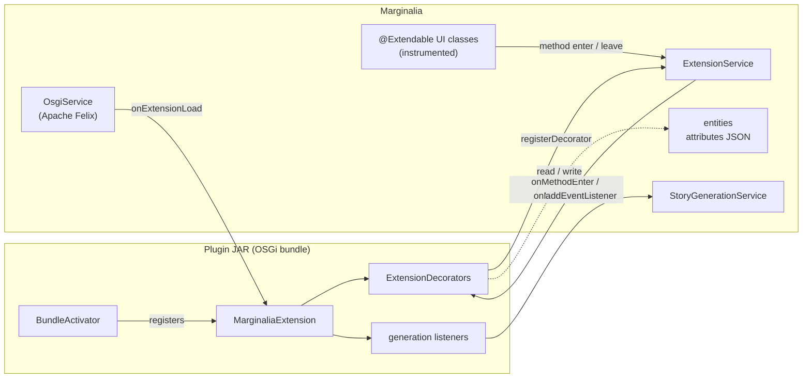

# Plugin development

A Marginalia plugin (the user interface calls them *extensions*) is an OSGi bundle - a JAR with a few extra manifest
headers - that Marginalia loads at runtime, without a restart. A plugin can add menu items, tabs, panels and settings
to the user interface, keep its own data on books, story parts, lorebooks and user settings, call the model, and take
part in generation.

This part of the developer guide explains how plugins work and how to write one. It assumes you can build Marginalia
from source ([Building from source](../building.md)) and know a little Vaadin Flow ([User interface](../ui.md)).

## How a plugin plugs in

There is no plugin API in the usual sense - no list of extension points with stable signatures. Instead, a plugin
gets three general mechanisms and the whole application to use them on:

| Mechanism | What it gives you | Page |
|---|---|---|
| **Bundles** | Loading, unloading, the `MarginaliaExtension` lifecycle, access to every Spring service through `@Configurable`. | [Plugin basics](overview.md) |
| **`@Extendable` hooks** | Code that runs before and after *any* method of an instrumented UI class, with access to its arguments, local variables and fields, and the possibility to replace the return value. | [@Extendable hooks](extendable.md) |
| **Extended attributes** | A JSON object on every data entity where a plugin keeps its data - saved with the entity, included in backups, no schema change. | [Extended attributes](extended-attributes.md) |
| **Other extensions** | Offer text about a book or a story part to other extensions or ask them for it (`IPCService`), or call one particular extension (like the name generator) by reflection, without importing its classes. | [Sharing data between extensions](ipc.md) |
| **Generation events** | Listeners that read and change the prompt, the lore, the summaries and the streamed answer while a story part is generated. | [Generation events](generation-events.md), [Generation pipeline](../generation-pipeline.md#events-for-extensions) |

[Extending the UI](ui-extensions.md) puts the first three together: adding components, settings panels, threads and
cleaning up on unload. [Generation events](generation-events.md) shows how a plugin changes the prompt sent to the
model, on the bundled Author's Note. [Example plugin](example.md) builds a small plugin from scratch and walks through
the bundled Chapter Marker and Author's Note.

!!!warning Plugins are tied to one version of Marginalia
Hooks are attached by class and method *name* and read local variables and fields by name. Renaming a method or a
variable in the application silently disables the part of a plugin that used it (a warning is logged). Build plugins
from the same source tree as the application they run in, and test them after every update. Marginalia itself
[verifies](extendable.md#verification-before-loading) the decorators of an extension before it starts it and refuses
ones that ask for classes, methods, arguments, locals or fields that don't exist.
!!!

## The bundled plugins

The twelve plugins in `marginalia/plugins/` are complete, working examples. Each is a separate Maven project.

| Plugin | What it adds | Shows how to |
|---|---|---|
| [Arc Outline](https://github.com/Enerccio/Marginalia/tree/master/marginalia/plugins/arc-outline) | The arcs of the book and their chapters, each planned, current or finished, in the story sidebar; the model can write an arc from the lore. | Add a tab to the story editor and a section to the user settings, keep a tree in a book's attributes, stream a structured (JSON schema) answer into the UI with `PartialJson`, name tools from another plugin ([call it directly](ipc.md#calling-another-extension-directly)), offer data to other plugins with `IPCService`, plugin-only CSS classes. |
| [Author's Note](https://github.com/Enerccio/Marginalia/tree/master/marginalia/plugins/authorsnote) | A per-book note inserted into the prompt of every generation, at a chosen depth and role. | Listen to generation events and change the payload sent to the model; add a tab to the story editor. |
| [Chapter Marker](https://github.com/Enerccio/Marginalia/tree/master/marginalia/plugins/chaptermarker) | Story parts that start with a Markdown heading are shown as chapters in the story sidebar. | Read method arguments and locals, change a component the method built. The smallest one - start here. |
| [Character Tracker](https://github.com/Enerccio/Marginalia/tree/master/marginalia/plugins/character-tracker) | The characters of the book with their relationships, imported from lore entries if wanted, and a relationship map, in the story sidebar. | Add a tab to the story editor, keep a list in a book's attributes, draw a graph with the application's `GraphView` ([Custom components](../custom-components.md)), upload and scale images. |
| [Gemma 4 tools fix](https://github.com/Enerccio/Marginalia/tree/master/marginalia/plugins/gemma4toolsfix) | Sends the results of function calls to Gemma 4 models with the role `tool_responses`. | Change how a service talks to the model without UI code: register an `InferenceServices.ToolRoleResolver` on load, remove it on unload. |
| [Instruction Exporter](https://github.com/Enerccio/Marginalia/tree/master/marginalia/plugins/instructionexporter) | Copies the instructions, scene settings and characters of the active branch to the clipboard, from the story settings menu. | Add an item to the settings menu of the story editor, read the story through a service, write to the clipboard. |
| [Lore Generator](https://github.com/Enerccio/Marginalia/tree/master/marginalia/plugins/lore-generator) | Writes a lorebook entry with the model from the existing lore: a generation, then a compaction, optional attachments. | Add a column to a grid, open a dialog that streams from the model (with `LLMAttachment`s), keep prompts in the user settings, give the model the functions of another extension ([a direct call](ipc.md#calling-another-extension-directly)), let the user choose the model with `ModelProtocolPicker`. |
| [Lorebook VCS](https://github.com/Enerccio/Marginalia/tree/master/marginalia/plugins/lorebookvcs) | Revision history of lorebook entries, export and import of the history. | Insert panels into a view, store data in a lorebook's attributes, replace a field of the view. |
| [Name generator](https://github.com/Enerccio/Marginalia/tree/master/marginalia/plugins/name-generator) | `list_name_categories` and `generate_names`: names from Markov chains trained at build time on lists of names. | Write functions for the model (`@LLMFunction`), train data at build time with Java programs run by `exec-maven-plugin`, ship it as a resource. |
| [Reviewer](https://github.com/Enerccio/Marginalia/tree/master/marginalia/plugins/reviewer) | AI reviews of a story part with configurable reviewer profiles (a book can pick its own profile). | Add a sub-menu to every part, add a settings panel, stream an answer from the model. |
| [Side Query](https://github.com/Enerccio/Marginalia/tree/master/marginalia/plugins/sidequery) | A chat panel next to the story for questions about the book. | Add a tab to the story editor, keep per-book sessions, build a prompt from lore and parts, use the data other extensions offer through `IPCService` ([Sharing data](ipc.md)). |
| [Chinese localization](https://github.com/Enerccio/Marginalia/tree/master/marginalia/plugins/chineselocalization) | Simplified Chinese as a language of the user interface. | Add a language with `ExtensionHasLocalization` - no UI code at all. |

Users install them as described in [Managing extensions](../../user/administration/extensions.md).

## Reading order

1. [Plugin basics](overview.md) - project layout, the activator and the extension, building and loading.
2. [Example plugin](example.md) - build one, load it, see it work.
3. [@Extendable hooks](extendable.md) - the decorator API in detail and its limits.
4. [Extended attributes](extended-attributes.md) - storing data.
5. [Extending the UI](ui-extensions.md) - patterns for menus, tabs and settings, threads and unloading.
6. [Generation events](generation-events.md) - changing the prompt and the answer during generation.
7. [Sharing data between extensions](ipc.md) - `IPCService` and calling another extension directly.
