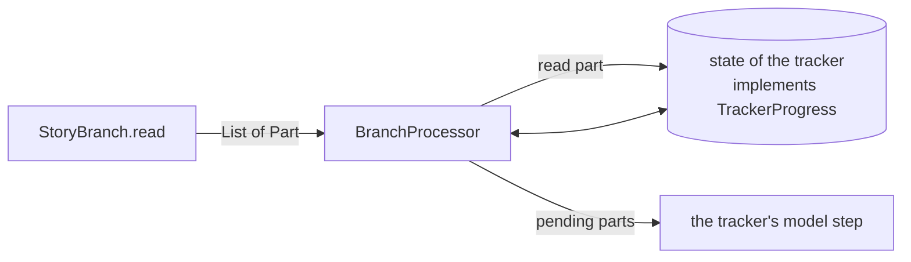
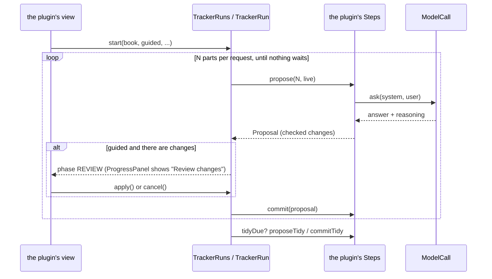

# story-tracker-common

`marginalia/libs/story-tracker-common` is what the plugins that **follow the story** share: the **Knowledge Tracker** and the **State Tracker** (which uses
the present characters reading, the payload insertion and `UiAccess` so far; the processor comes with its extraction). Read [Libraries for plugins](index.md) first for how a library is embedded and what that implies (a copy per
plugin, no shared state, parameters instead of constants).

## The idea

A tracker keeps a **state per book** (saved in the book's attributes, so it travels with backups) and reads the parts of the **active branch** in order, from a
start point; a **cursor** says how far it got. Everything it takes from a part remembers that part (its uuid), so the story can change under it: a swipe, another
branch, a regenerate or a reprocess take back what came from the parts that are no longer read, and the cursor goes back to the last part both branches share.
Only the parts that are **settled** are read (the last part may still be redrafted).

## Packages

| Package | Classes | What they are for |
|---|---|---|
| `process` | `Part`, `StoryBranch` | A part as a tracker sees it (uuid, POV and present characters fields, the text the model reads, the id); `StoryBranch.read` loads the active branch of a book with the services the plugin has. |
| `process` | `TrackerProgress` | What the tracker's state offers the processor: start point, cursor, the list of `ProcessedPart`s, `rewind(dropped)` (take back what came from those parts, keep what the user made by hand) and `read(part, separators)`, what the tracker notes without a model (the Knowledge Tracker's "has met" pass; nothing by default). |
| `process` | `BranchProcessor` | Pure logic, no Spring: `align` (in line with the branch), `process` (read the settled parts after the cursor), `pending` (what the next run would read), `reprocessFrom`, `changedSinceProcessed` (by the `TextHash` of the text), `settledCount`, `cursorPosition`. |
| `process` | `RunEstimate`, `PartReader` | The cost of a series of runs before it starts; what a model may read of the earlier parts during a request (a function the plugin registers with its own description). |
| `scene` | `PresentCharacters`, `SeparatorText` | The lenient reading of the present characters field (brackets and notes dropped, separators of the user and the book, accents and case ignored); the separators as the user edits them. |
| `block` | `PayloadInsertion` | Puts the tracker's block into the messages of the prompt at a depth, like the Author's Note, never before the leading system prompt. |
| `process` | `Evidence` | Whether a quote the model gave is in the text of a part (case, spacing, quotation marks and "..." do not matter). |
| `llm` | `TrackerModels`, `ModelCall`, `StoryLore`, `Live`, `LoreMode` | Which model a tracker asks (its settings, else the book's, else the user's defaults) and how much of the context a request may take; one streamed request with the reasoning kept, an optional function to read earlier parts (`Reading`: the plugin gives the interface with its own descriptions); the lorebook text of a run (the entries the parts activate, or the whole lorebook when it fits); what the model writes while it writes. |
| `run` | `TrackerRun`, `TrackerRuns` | One run of a book on a worker thread: a series of requests of N parts, each reviewed by the user (guided) or applied at once, the automatic tidy at the end, cancel, the live text and the thoughts of every request, the entry in the core's panel of the runs. What the tracker proposes and applies is its `TrackerRun.Steps` (and its `Proposal`); `TrackerRuns` keeps one run per book and a proposal a command holds for an agent. |
| `ui` | `ProgressPanel`, `ReviewDialog`, `StoryTrackerStyles`, `StoryTrackerLocalization` | The non-modal progress panel of a run (the plugin gives its texts for done and stopped, and makes the review); the review of the changes, grouped by character, a row per change whose body the plugin makes (`ReviewDialog.Row`); their CSS (`storytracker.css`, the plugin returns it from `getCss` with its own) and texts. |
| `log` | `LogEntry`, `TrackerChangeLog` | The log of what runs applied without asking: the shared fields of an entry (character, item, text, part, quote, reverted; a tracker extends it, stored with Gson in its state), `add` (the newest `KEEP` = 200), `canRevert` and `revert` (once, and only when the tracker's `Undo.check` says the state is still as the run left it; `Undo.undo` does it). |
| `ui` | `ChangeLogPanel` | The collapsible *Applied automatically* list of the Processing panel: the newest 30 entries, each with the line the tracker writes and a revert button (enabled when it can still be reverted) or *Reverted*. |
| `checkpoint` | `Checkpoint`, `TrackerCheckpoints`, `CheckpointFiles`, `ResourceCheckpointFiles` | Checkpoints: the whole state of a tracker in a book as a run found it, to undo the run and read its parts again (see [Checkpoints](#checkpoints)). |
| `ui` | `CheckpointsPanel` | The collapsible *Checkpoints* list of the Processing panel: the checkpoints on the active branch, newest first, each with *Return to this point* behind a confirmation; `restoredMessage` is the notification of a restore. |
| `characters` | `CharacterTrackerCharacters` | The characters of the Character Tracker plugin in a book (name, tagline, the names it is related to), read as plain JSON from the book's attributes, so a tracker imports them without depending on that plugin. |
| `ui` | `ImportCharactersDialog` | *Import from the Character Tracker*: the characters the book does not track yet, all checked, with the tracker's own options below (the Knowledge Tracker's relationships as meetings, the State Tracker's categories) and a check that they allow the import. |
| `ui` | `UiAccess` | Changes a component from a worker thread through `ui.access` and a push; `coalesced` never queues more than one update. |

## Using it in a tracker

1. The plugin's state implements `TrackerProgress` (with Gson, the fields `startMessage`, `cursor`, `processed` are plain fields of the state).
2. A service loads the state and the branch (`StoryBranch.read`), calls `BranchProcessor` under a lock per book and saves the state.
3. The model step reads `BranchProcessor.pending(...)`, asks the model and commits: move the cursor over the run first (`BranchProcessor.process` with the end
   of the run as the settled count), then apply the changes, so the alignment does not take them back (the Knowledge Tracker's `RunCommit`).

## Checkpoints

The per-entry undo of the log cannot move the cursor back, and it only reverts items still as the run left them. A **checkpoint** is the whole state of
the tracker in the book (as the tracker serializes it with Gson for the book's attributes, cursor and processed parts included) **as a run found it**,
taken when the run commits and keyed by the uuid of the cursor's part, `TrackerCheckpoints.START` when the state had read nothing. Restoring it undoes
that run: the run's parts are after the cursor again. (A checkpoint taken after its run would be the state the tracker is already in, the newest one
would undo nothing and the first run could never be undone.) `TrackerCheckpoints` (one per tracker, named after it, `KEEP` = 20 per book):

- `take(files, state, cursor, kind, added, retracted)` stores `{"part", "state"}` gzipped and drops the oldest over the limit. It never throws (a
  failure is logged; the run stays committed); a `null` cursor is `START`. `Kind` is `RUN`, `TIDY`, `READ` (without the model) or `RESTORE`.
- The metadata is in the file name, `<tracker>.checkpoint.<kind>.<added>.<retracted>.<part uuid>.before.json.gz`, so `list` (newest first) opens no
  file and ignores the other files of the book. Files without `.before` (earlier 1.9.0 builds) hold the state after their run, `Checkpoint.before`
  is `false` for them. `onBranch` keeps those whose part is on the active branch, with its position (0 for `START`, on every branch).
- `restore(files, id, branch, current, currentCursor, restorer)`: `GONE` (no such checkpoint, or the file is unreadable or does not name the part),
  `NOT_ON_BRANCH`, else it stores `current` as a `RESTORE` checkpoint (so the return can be undone), hands the stored state to the tracker's
  `Restorer` and returns `RESTORED`. The tracker holds its lock of the book around it. The overload without `current` keeps nothing.

`CheckpointFiles` is where they live: `ResourceCheckpointFiles` keeps them as resources of the current user linked to the book (`ResourceService.link`
with `Manuscript` and the book's id, listed with `findPageOfGroupForUser`). Nothing in the book names them, so a book save stays small and
`BackupResources.collect` (which follows the uuids in the book's JSON) never puts them into a backup or copy; the user sees them in *Resources*.
Tests use an in-memory implementation.

The tracker side: the commits of its runs copy the state right after loading it (`before(state)`: its JSON and cursor, a `Before` record) and call
`take` with that copy after the save, when the counts are known, inside the lock (the Knowledge Tracker in `ExtractionService.commit`/`commitTidy`
and in `KnowledgeProcessService.process` when the book reads without the model; the State Tracker in `StateExtractionService.commit`/`commitTidy`).
The restore reads the checkpoint's state, lets it keep the current setup (`KnowledgeState.keepSetupOf`: settings and start point; `StateBook.keepSetupOf`:
also the categories, adding back those the values use, and the settings of the clock while the marks come from the checkpoint), aligns it with the
branch and saves it (`KnowledgeProcessService.restore`, `StateProcessService.restore`).

## A run with the model

The plugin's `Steps` is the only place that knows its state: the Knowledge Tracker's `KnowledgeSteps` reads what the characters learned (or, without
the model, who has met whom), the State Tracker's `StateSteps` what changed in their state. Every step runs on the worker thread in the request context
of the user who started the run (or who applied the review).
