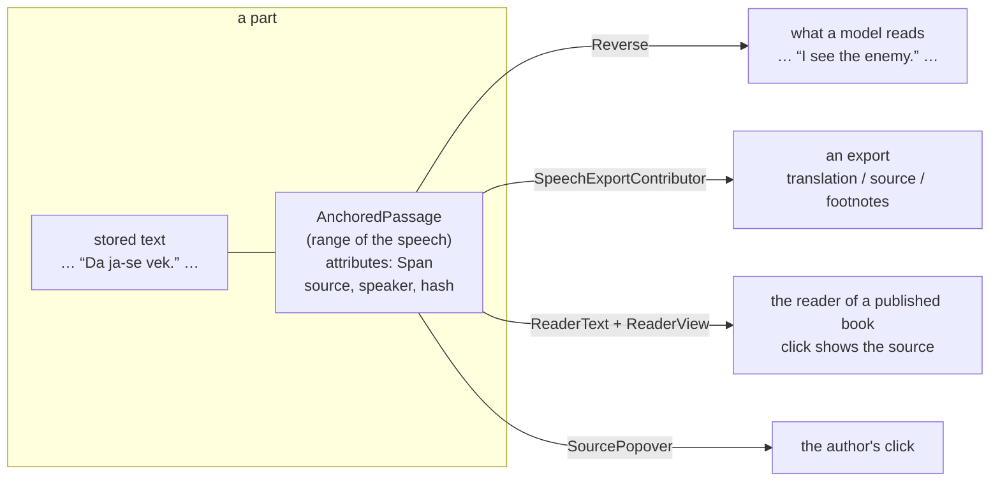

# translator-common

`marginalia/libs/translator-common` is what the **Conlang Translator** and the **Real Language Translator** share, written so that a third plugin can use it: any plugin that
keeps a story in one language and lets the models, the exports and the readers deal with another. Read [Libraries for plugins](index.md) first for how a library is embedded
and what that implies (a copy per plugin, no shared state, parameters instead of constants).

## The idea

A translator plugin stores the **translated** text in the story and keeps the text the model wrote it from, the **source**, beside it:



Everything that gives the story to a model reads the source (`PartTextRegistry`, [The text a model reads](../part-text.md)), the export is decided by the author in the
dialog ([The text of an export](../export-text.md)), and a click shows the source. The **translation itself** (the prompt, the answer, what is acceptable) is the plugin's: that is
where an invented language (a lexicon, new words) and a real one (a script, politeness) differ, so it is not in the library.

## What is in it

| Package | Class | What it is for |
|---|---|---|
| `model` | `Span` | What a plugin keeps for one translated passage: the **source**, the speaker, the language, whether the listener understands it, the register, a **reading** (the romaji of a Japanese text, empty for none), the model and time, and a **hash of the translated text** the plugin wrote. `Span.read(attributes)` / `span.write(attributes)` store it as JSON in the attributes of the passage. `isEdited(currentText)` is true when the author changed the translation since: the source is then stale. |
| | `Speakers`, `CharacterNote`, `SpeakersMode` | Who speaks the language in a book (everyone except the listed characters, or only the listed ones), with the aliases, gender and voice of each character. `speaks(name)`, `find(name)`. |
| | `ReaderMode` | What the reader of a published book sees: `CLICK` (the translation, the source on a click), `TRANSLATED`, `SOURCE`. `id()` / `of(id)` for the setting. |
| | `ExportMode` | What an export holds: `TRANSLATED` (as stored), `SOURCE`, `TRANSLATED_NOTES`, `SOURCE_NOTES` (the other text in footnotes). |
| `translate` | `Reverse` | `Reverse.toModel(stored, located)` turns the translated passages of a stored text back into their source and returns the `ModelText` map, the substitutions, the passages the author edited and the ones that could not be used. |
| | `TranslationPlan` | `TranslationPlan.make(source, accepted)`: the new text of a part with every accepted speech replaced, and the `Planned` passages in it (range, translation, source, speech). Pure. |
| | `Speech` | One direct speech as the model answered for it (`quote`, `speaker`, `language`, `text`, `understood`, `register`). A convenient shape for the answer; a plugin may use its own and make a `Speech` of it. |
| | `ModelJson` | `ModelJson.object(raw)`: the JSON object in what a model answered (a code fence or a word before it is ignored); null when there is none. |
| | `SelectionRange` | `trim(text, start, end)`: the range the user selected without its white space. |
| `text` | `SpeechTransformer` | A `PartTextRegistry.Transformer`: `new SpeechTransformer(passageAccess)`. |
| | `SpeechExportContributor`, `ExportText` | An `ExportTextRegistry.Contributor`: `new SpeechExportContributor(passageAccess, session -> mode)`. `ExportText.edits(mode, stored, located)` is the pure part. |
| | `ReaderText` | The markdown of a part for the reader: `render(mode, stored, passages, markClass)` (or a function that gives each passage the mark of its kind); the marks carry `data-translated-passage`. |
| | `SpeechPassageKind` | The `PassageKind` a plugin registers: `new SpeechPassageKind(id, markClass)`; the click opens `SourcePopover`. |
| `service` | `PassageAccess` | `new PassageAccess(kind)`: the translated passages of parts of **your** kind, located (`of(parts)`, `passagesOf(part)`, `locate(passage)`). It is the `Passages` source of the transformer. |
| | `TranslationWriter` | `new TranslationWriter(kindId)`: **writes** a `TranslationPlan` into a part (`write`), one selected sentence (`writeSelection`) and takes a translation out again (`revert`), with a lock per book, a refusal of a part that changed meanwhile (`ChangedMeanwhile`) and the rule that a passage the author edited stays. Also `readOf(part)` and `overlaps(part, start, end)`. |
| | `ModelClient` | `new ModelClient(name).choose(aiUuid, protocolUuid, book)` finds the model (yours, else the book's, else the user's defaults), `ask(model, book, system, user)` waits for the whole answer (reasoning chunks are left out). `ModelSelection` is the AI and protocol. |
| | `RangeLoop`, `RangeRuns` | An action over a range of parts, one at a time: `RangeLoop.select` / `run` (pure, with a stop and a summary), `RangeRuns.start` on a worker thread of the session, telling the page the progress. The work is a lambda. |
| | `PartRuns<R>`, `AsyncRuns` | One job on a worker thread with the user's request scope, the result handed to the page. One run per part. |
| | `TranslatedPassages` | `TranslatedPassages.of(passages, kinds, partId)`: the passages of a part of **every** registered kind that carry a `Span`, whichever plugin made them; `markClass(kinds, passage, fallback)`. For the viewer. |
| | `PluginLog` | The extension's logger for the code that has none (`PluginLog.set(log)` in `onExtensionLoad`). **Per copy**: set it in every plugin. |
| `ui` | `SourcePopover` | The popover over a translated speech: the source, who said it, "not understood", "edited after the translation". |
| | `ReaderView` | `ReaderView.apply(view, part, mode, passages, markClass)` in a decorator of `Viewer.createPart`; with a function in place of the class for passages of several kinds. A part is changed once. |
| | `RangeDialog` | The window of the actions on a range of parts (translate the new ones, translate again, put the source back), with a progress and a stop: `new RangeDialog(book, loader, rangeRuns, reload)`. |
| | `SpeakersEditor`, `ListEditor<T>`, `EditDialog` | The editor of the speakers; the list editor it is built on (a grid with add, edit, delete, move) and the small dialog with a validation. |
| | `ExportChoice` | `ExportChoice.field(label, labels)`: the select of the export dialog, with the plugin's own texts. |
| | `CommonStyles`, `TranslatorCommonLocalization` | The CSS classes and `translatorcommon.css`; the texts with their Japanese and Chinese translations (`TC.localized(...)`). |

## Building a translator plugin on it

`marginalia/plugins/reallang-translator` is the smaller example (no lexicon, no designer); the Conlang Translator is the larger one. The steps:

**1. The identity of your plugin.** The id of your passage kind and the CSS class of the mark are yours, unique among plugins:

```java
public final class MyKind {
    public static final String ID = "my-translator.speech";   // the id of the kind
    public static final String MARK = "my-passage";           // the CSS class of the mark
}
```

and the rule for the mark in your own CSS (`mark.my-passage { border-bottom: 1px dotted ...; cursor: help; }`).

**2. Register in `onExtensionLoad`:**

```java
PluginLog.set(log);
PassageAccess passages = new PassageAccess(MyKind.ID);

passageKinds.register(new SpeechPassageKind(MyKind.ID, MyKind.MARK));                    // the mark and the click
partTexts.register(owner, new SpeechTransformer(passages));                                // the models read the source
exportTexts.register(owner, new SpeechExportContributor(passages, session -> chosenMode(session)));  // the export
```

`passageKinds` is the core's `PassageKinds`, `partTexts` the `PartTextRegistry`, `exportTexts` the `ExportTextRegistry`; unregister all three in `onExtensionUnload`. `chosenMode`
reads the field you added to the export dialog (below); return `null` or `ExportMode.TRANSLATED` for no change.

**3. The export field.** Decorate `ExportDialog.createExtensionFields` on leave, add `ExportChoice.field(label, mode -> text)` to the list it returns and keep it in a
`WeakHashMap` keyed by the dialog (`instrumented`); `chosenMode(session)` is `map.get(session.source()).getValue()`. Add the field only for a book that has your passages.

**4. The viewer.** Decorate `Viewer.createPart` on leave: when the part has passages of your kind (`passageService.listForParts(ids, MyKind.ID)`), call
`ReaderView.apply(view, part, mode, TranslatedPassages.of(passageService, passageKinds, partId), p -> TranslatedPassages.markClass(passageKinds, p, MyKind.MARK))`; the `mode` is
`ReaderMode.of(...)` of the book's setting for the readers. Passing the passages of every plugin is what makes a book that holds two kinds draw right (see below).

**5. CSS and texts.** `ExtensionHasCss.getCss` returns `CommonStyles.css() + "\n" + MyStyles.css()` for `Main` and `Viewer`. Your own texts are your own
`PluginLocalizationBundle`; the library's screens have theirs.

**6. Translating a part** (yours; the library gives the pieces). The shape both plugins follow:

```java
TranslationWriter writer = new TranslationWriter(MyKind.ID);
Reverse.Result read = writer.readOf(part);                               // the English of a part that is translated already
String source = read.text();                                              // what you send to the model
String raw = new ModelClient("my-translator").ask(model, book, system, user);
// parse the answer (ModelJson.object finds the JSON in it), check it (the quote is in `source`, the language is right...), then
List<TranslationPlan.Accepted> accepted = ...;                            // (speech, start, end) of the ones you accept
TranslationPlan plan = TranslationPlan.make(source, accepted);
writer.write(book, part, plan, read, languageId, modelName,
        (span, planned) -> span.setReading(readingOf(planned.speech())));  // what only you know goes on the Span
```

`write` replaces the text of the part with a version in the history (`ChatMessageService.replaceText`: a text that says what the old one said, [The text a model
reads](../part-text.md#putting-the-other-form-into-the-story)), removes the old passages of the part except the ones the author edited, and makes a passage of every planned speech;
it throws `TranslationWriter.ChangedMeanwhile` when the part is not what you read. `writeSelection` does the same for one sentence the author selected, `revert` puts the source back.
Run it on a worker thread: `PartRuns` for a part, `RangeRuns` (with `RangeLoop`) for a range, `new RangeDialog(...)` for the window of a range.

**7. Who speaks.** Keep a `Speakers` in the attributes of the book (it is Gson-friendly) and give the author `new SpeakersEditor(speakers, onChange)`; put the notes of the
characters in your prompt.

## The contract a passage depends on

A passage is used **only when the text at its range still has the hash it was made for** (`Span.isEdited`). Every consumer in the library checks it (the reverse, the export,
the popover). It is what keeps the author's edits safe (an edited speech has no trustworthy source and is left as it is) and what lets the passage of another plugin, whose
range an earlier edit shifted, drop out instead of corrupting text. If you write a consumer of your own passages, apply the same check; `Reverse`, `ExportText` and
`SourcePopover` have tests that pin it.

## Two plugins in one book

Each plugin has its own passage kind, so the passages never mix. Models read the source of both (`PartTextRegistry` merges the substitutions of every transformer on
the stored text); the export puts both plugins' edits together once ([The text of an export](../export-text.md)). The published book's viewer draws a part **once**, from the
passages of every plugin (`TranslatedPassages`), each with the mark of its own kind: the first plugin whose decorator reaches the part does it for both (`ReaderView` leaves a flag on
the part, a string key, so the copy of the class in the other bundle sees it) and the second finds it done. The consequence for a book with both is that **one reader mode rules
the page** (the one of the plugin that decorates first); the author sets the same in both. A click finds its passage in the list that was drawn, whichever plugin it is.

A translator does not read the translated speech of the *other* plugin as its source: the stored text it sends to its model has the other plugin's translation in it (only its own
passages are reversed), so the model sees that speech in the other language and, being told to translate the English, leaves it alone.

## Tests

The library has plain unit tests (`mvn test` in `marginalia/libs/translator-common`): `ReverseTest`, `TranslationPlanTest`, `SelectionRangeTest`, `SpanTest`, `SpeakersTest`,
`SpeechTransformerTest`, `ExportTextTest` (through the core registry), `ReaderTextTest`, `RangeLoopTest`, `TranslationWriter` has no unit test here (it needs the services; the plugins' tests of the translation go through it), `ModelJsonTest`, `SourcePopoverTest` (a Vaadin component built without a browser: the
library's test dependencies include the servlet API for that) and `TranslatorCommonLocalizationTest` (every text has its Japanese and Chinese translation, with the same
`%s` / `%d` placeholders). A plugin that adds texts to its own bundle has its own such test (`ConlangTranslatorLocalizationTest` is the template).
