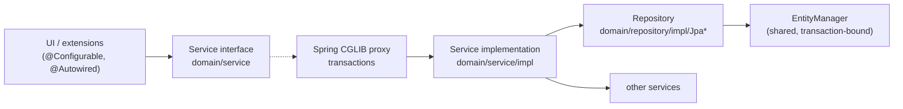

# Services

The service layer holds Marginalia's logic: everything the UI does to data goes through a service, and services are
the main API extensions use. This page describes how services and repositories are built, how transactions and the
current user work, and what each service is for. The generation engine has its own page,
[Generation pipeline](generation-pipeline.md).

## Layers



- **Interfaces** live in `domain/service/` (and `domain/security/service/`), implementations in `.../impl/`. Code
  always depends on the interface.
- **Beans** are declared in `META-INF/spring/services-config.xml`. Each entity service gets its repository injected
  through the `repository` property; everything else is `@Autowired` inside the implementation.
- **Repositories** (`domain/repository/impl/Jpa*Repository`) contain the JPQL and native SQL. They are called only by
  their service.

## The generic service hierarchy

Entity services extend a generic base that matches the entity's base class:

| Service base | For | Adds |
|---|---|---|
| `BaseService` / `BaseServiceImpl` | `BaseEntity` (`User`) | `find(id)`, `find(entity)` (reload), `find(uuid)` → id, `findAll()`, `findAllIds()`, `save`, `saveWithoutEvent`, `delete(entity, hard)`, `evict` |
| `OwnedService` / `OwnedServiceImpl` | `OwnedEntity` (`Resource`) | Owner-aware finders: `findAllForUser()`, `findAllIdsForUser()`, `findForUser(uuid)`, `findAll(user)`; `save` sets the owner of new entities to the current user. |
| `ExtendableService` / `ExtendableServiceImpl` | `ExtendableEntity` (everything else) | Nothing new - the repository serializes [extended attributes](domain-model.md#extendableentity---extended-attributes) on `save`. |

The same three levels exist for repositories: `JpaBaseRepository` → `JpaOwnedRepository` →
`JpaExtendableRepository`. A repository only has to name its entity class (`getEntityClass()`) to get the generic
queries; it can override `hydrate(entity)` to post-process loaded entities.

Things to know about the generic methods:

- **`find(id)` doesn't check owner or `deleted`.** Use it for ids that come from the user's own data (a book's
  `ai`, a part's `parent`). For anything that comes from outside - a URL, an uploaded file, a backup - use
  `findForUser(uuid)`, which returns `null` for other users' and deleted entities.
- **`find(entity)` reloads.** Entities held by the UI are detached and may be stale; services usually start with
  `Manuscript m = find(manuscript)` before changing it.
- **`findAll*` skip deleted rows**, `find(id)` doesn't.
- **`save` returns the managed copy** (`merge`). Keep using the returned object.
- **`save` vs. `saveWithoutEvent`** - `save` serializes the extended attributes into `extendedContent`;
  `saveWithoutEvent` stores `extendedContent` as it is (used when it was copied from a backup). Both keep the `_fulltext` column
  in step with the `@Fulltextable` fields, see [Full-text column](domain-model.md#full-text-column).
- **`delete(entity, false)`** soft deletes (and, in the services of entities that own other rows - manuscript, message,
  lorebook, entry, AI, tag - the owned rows with it), **`delete(entity, true)`** removes the row. See
  [Soft delete](domain-model.md#baseentity---identity-and-soft-delete).

## Transactions

Transactions are declared with three meta-annotations from `domain/traits/` and applied by Spring's
`tx:annotation-driven` with **class-based (CGLIB) proxies** around each service bean (`proxy-target-class="true"`):

| Annotation | Meaning | Typical use |
|---|---|---|
| `@CommonTx` | `@Transactional("common")`, read/write | Methods that change data. |
| `@CommonTxReadOnly` | Read-only transaction | Finders, searches, reports. |
| `@NoTx` | `Propagation.NOT_SUPPORTED` - suspends any transaction | Methods that start background work or do I/O that must not run in a transaction: `generateNextTurn`, database backups (`VACUUM INTO`), file operations. |

The rules that follow from proxies:

- **Only calls through a bean reference are transactional.** A service calling its own method (`this.save(...)`)
  bypasses the proxy, so that method's annotation has no effect. When a service needs its own transactional method
  from a callback, it injects itself - `SummaryServiceImpl` has `@Autowired private SummaryService self` and calls
  `self.save(summary)` from the streaming callback.
- **Transactions are short.** SQLite allows one writer at a time (see
  [SQLite limitations](database.md#sqlite-limitations)); a long write transaction blocks every other user's writes.
  Never call a model, wait for the UI or sleep inside a transaction. Streaming code saves through the service for each
  change, so each save is its own transaction.
- **A transaction ends with the outermost annotated call.** Entities returned to the UI are detached. Lazy
  associations (`ChatMessage.parent`, `ChatMessage.parentScript`, `LorebookEntry.lorebook`) can't be navigated after
  that - reload them through the service (`chatMessageService.getParent(node)`, `find(...)`).
- Methods without an annotation run in the caller's transaction, or without one.

## The current user

Services are singletons, but the user differs per browser session. The session-scoped bean `user`
(`domain.security.model.User` behind a scoped proxy, defined in `container-config.xml`) is injected into services as

```java
@Autowired
protected User currentUser;
```

Each call on `currentUser` is resolved against the HTTP session of the current thread. It holds a copy of the
logged-in user's `id`, `login` and `fullName` - load the entity (`userService.find(currentUser.getId())`) for
anything else, such as `isAdmin()`.

Services that depend on the current user:

- `OwnedServiceImpl` - `findAllForUser`, `findForUser`, and the owner of new entities,
- `SettingService.getOrCreate(UserSetting.class)` - the user's settings,
- `ManuscriptService` - searches, `findViewable`, `markOpened`, and the prompt defaults (`getMasterTemplate`... fall
  back to the *current* user's `UserSetting`),
- administrator checks: `AdminGuard.requireAdmin()` (see [Administration](#administration)).

**On background threads** there is no request, so resolving `currentUser` fails with *No thread-bound request
found*. Capture the request attributes on the UI thread and enter them on the worker:

```java
ThreadCopyRequestAttributes attributes = ThreadCopyRequestAttributes.create();   // on the UI thread

executor.submit(() -> {
    try (InRequestScope _ = new InRequestScope(attributes)) {                    // on the worker
        lorebookService.findAllForUser();                                         // current user resolves
    }
});
```

`create()` answers with the copy of a browser session, with the attributes of an agent run as they are (see
[Agents](#agents)), and with `null` on a thread that has no context. The generation engine, `SummaryServiceImpl` and `ThreadAccessDialog` do this. Scheduled jobs (database backups) run
without any user and only use installation-wide data (`getOrCreateApp`).

## Services by area

### Books and the story

| Service | Responsible for |
|---|---|
| `ManuscriptService` | Books: search and sort (`searchManuscripts` → ids; `searchRegularManuscripts` and `searchAgenticManuscripts` leave out or keep only the working copies of agents, likewise `findAllRegularForUser` / `findAllAgenticForUser`), `findViewable(uuid)` (own or published, for the viewer), `markOpened`, the effective prompts of a book (`getMasterTemplate`, `getPov`, `getTense`, `getStyle`, `getUserPrompt`, `getSummaryPrompt`, `getMetaSummaryPrompt`: book value → user default → `Defaults`), the effective backup strategy, and the JSON form of a book used by backups (`createBackup`, `cloneFromBackup`, `restoreBackup`); `delete(book, false)` also soft deletes its parts, their summaries and its tags. |
| `ChatMessageService` | The story tree: `createRoot`, `addChild`, `getBranchFromLeaf`, `getSwipesForMessage` (siblings), `swipeTo` (sets the book's active leaf to the deepest last descendant - the caller saves the book), `branch` (copy as sibling), `deleteNodeAndMigrateChildren`, word and token sums, `countWords`. `delete(part, false)` soft deletes the part with its summary and everything below it, `softDeleteForManuscript(book)` all parts and summaries of a book with one bulk update (the book's `delete` uses it). `searchFulltext(book, query)` finds parts of all branches by their `_fulltext` (see [Full-text search](domain-model.md#full-text-search)); `findLeafFor(book, part)` picks the end of the branch that shows a part. `findFulltextsContaining(book, literal)` and `findSummaryFulltextsContaining(book, literal)` give the id and `_fulltext` of the parts (or of their summaries) that contain a text (`null`: all), for the search and replace. |
| `SummaryService` | `createSummary(book, part, callback)` streams a summary from the model into a new `Summary` and attaches it to the part when finished; returns a `CancellationToken`. The streaming starts after the transaction that inserts the `Summary` commits (`TransactionSynchronization.afterCommit`), because the callback thread saves the row as soon as the model answers. `createMetaSummary(book, from, to, callback)` does the same for a meta summary: it merges the summaries in use between the parts `from` (newest) and `to` (oldest, rounded to the end of its block), puts the result on `from` (`attachMetaSummary`) and returns `null` when there is nothing to merge. `removeSummary(part, unwind)` deletes the summary of a part, restoring the one a meta summary replaced when `unwind` is set. `updateSummaryText` edits a text and counts its tokens again. `collectBlocks(branch)` splits the branch into the summary blocks in use (with their hashes, `SummaryBlock.isValid()`), `collectTree(...)` returns the same as a tree of `SummaryNode`s with the summaries a meta summary stands in for as children (the overview uses it). `collectFirstBlock(partsNewestFirst, BlockTexts)` gives the first block of a branch with the hash it would have if the story had the texts of the `BlockTexts` (`BlockTexts.CURRENT`: as saved), without walking the whole branch. `copySummary` for branching. `softDeleteForManuscript` / `softDeleteForMessages` soft delete summaries in bulk for the delete of a book or parts. See [the summary chain](domain-model.md#the-summary-chain). |
| `ManuscriptReplaceService` | Search and replace in the text of a book, in two steps. `plan(book, options, progress)` (read only) finds the parts of the story and, if asked, their summaries that have a match (the active branch, or all branches), works out the new texts and the new hashes of the summaries and returns a `Plan` (`items()`, `hitCount()`, `outdatedSummaries()`); `apply(book, plan, progress)` does it in one transaction and skips what was changed since the plan (`Result.skipped()`). The database narrows the candidates down by `_fulltext` (`LIKE` of the literal text; a regular expression has no such prefilter), the `@Fulltextable` fields of the loaded entity are then searched by `EntityTextSearch` (so it works for any entity, a lorebook would only need its own service) with `TextSearch` (literal, case sensitive or not (`Options.caseSensitive()`; the `_fulltext` prefilter is skipped for a text that ignores the case and has non-ASCII characters, as SQLite's `LIKE` ignores the case of A-Z only), or regex, always as typed, `TextHit` has the text around the match and the replacement). The hash of every summary of the book is worked out with the changed texts (`SummaryService.collectFirstBlock`): a summary that was valid and is in the searched scope (summaries searched and its part in the searched branches) gets the new hash, one that was valid and is out of the scope would become outdated and is counted in `outdatedSummaries()`, one that was outdated stays so. With `Options.revalidateSummaries()` the hash of every summary of the book (any branch, touched or not, valid or not) is set to what it should be, so nothing becomes outdated. The texts in a meta summary's `replacedSummary` are not searched. `TaskProgress` reports to the caller and asks whether to stop (`CancellationException`). |
| `LorebookReplaceService` | The same two steps for the entries of a lorebook (`plan(lorebook, options, progress)`, `apply(lorebook, plan, progress)`), with `LorebookEntryService.findFulltextsContaining(lorebook, literal)` for the `_fulltext` prefilter. Name, text and comment of the entries (all `@Fulltextable` fields) are searched; deleted entries are not. |
| `StoryGenerationService` | Generating parts, see [Generation pipeline](generation-pipeline.md). |
| `ExporterService` | Registry of story exporters (`registerExporter`, `unregisterExporter`, `getExporters`). The built-in `TxtExporter`, `MarkdownExporter`, `HtmlExporter`, `DocxExporter`, `PdfExporter` and `EpubExporter` (package `export`, all extend `ExporterBase`) are registered in `afterPropertiesSet`; an extension can register its own `Exporter` and it shows in the export dialog. See [Story export](#story-export). |
| `BackupService` | Book backups as JSON files in `data/<login>/backups/manuscripts/<book id>/`: `takeBackup`, `getBackups`, `importBackup`, `applyBackup` (restore, optionally messages only), `cloneBackup` / `restoreAsNewManuscript`, `analyzeLorebooks` + `LorebookDecision`s for lorebooks found in the backup, `exportBackup` (see below). Import and restore read a `File` (the UI uploads to a temp file, the `byte[]` overloads are for small payloads and tests). |

**Images in backups.** A stored backup is JSON and never contains image files, only the `imageAttachments` of the
parts (resource uuids) in their `extendedContent`. `ManuscriptBackup.imageCount` is a header field (read by
`parseMetadataOnly` without loading the backup) so the UI knows whether to ask. `BackupImages` reads and rewrites the
attachments inside the backup JSON (`collect`, `remap` where returning null drops the image).
`exportBackup(backup, withImages, onImage)` writes to a temp file and returns a `BackupExport`; with images it is a ZIP:
`backup.json` (the stored file, streamed), `resources.json` (`{"version":1,"resources":[{uuid, entry, name, mimeType, hash,
size}]}`) and `resources/<n>.<ext>`, one image at a time with `Files.copy`, so nothing but the JSON tree is in memory.
Import, restore and `analyzeLorebooks` detect a ZIP by its first bytes (`openSource`) and read entries only by the names
the manifest lists under `resources/` (no extraction to disk). Each image is read bounded by `MAX_IMAGE_BYTES` and goes
through `ResourceService.uploadImage`, so it is validated again and the hash dedupe reuses an existing file.
Resources are not shared by books, so: `importBackup` keeps a uuid the user already has with the same hash and otherwise
adds the image (`adopting`), `restoreAsNewManuscript` and `cloneBackup(..., withImages)` make a new `Resource` for every
use (from the archive, or `ResourceService.copy` of the user's own resource, which points to the same file); images that
can't be found are dropped from the parts. After every restore `linkImages` notes the new parts in the resources whose
link is empty or stale. The ZIP is only a transfer format, a stored backup stays a JSON file.

The automatic book backups (`BackupStrategy.AFTER_N_MESSAGES` / `AFTER_N_MINUTES`) are triggered by the story editor
after a part is generated (`ManuscriptStoryPart`), not by a service - code that generates parts without the editor
doesn't take them.

### Story export

`ExportDialog` (opened from the settings menu of `ManuscriptStoryPart`) collects the active branch in one
`ProgressBarDialog` (indeterminate), cuts the chosen range and exports it in a second one whose total is the number of
messages, then shows the download link. The exporter gets `ExportOptions` (title, author, title page, language), the
messages and the progress dialog, on which it calls `updateProgress()` for every message.

`ExporterBase` does the common work: it renders the title page from `Defaults.DEFAULT_EXPORT_HEADER_TEMPLATE`
(Handlebars, data `ExportHeaderTemplateData`), skips parts without text, reports progress and feeds the Markdown of
each part to an `ExportWriter` that the exporter creates per export - exporters are shared between users, so any state
must live in the writer. A part whose text has a Markdown heading is a chapter (`chapterTitle`, the same rule as the
Chapter Marker plugin: the first `#` line); before the first part the writer gets the list of all chapters in
`contents(...)` and every chapter start in `message(markdown, chapter)`, so it can put an anchor (`Chapter.anchor()`)
on the chapter and link to it from the table of contents (HTML, EPUB navigation, PDF, DOCX; TXT and Markdown ignore it).
The PDF exporter keeps the export and renders it again until the pages shown in the contents match the pages the
chapters landed on; DOCX uses `PAGEREF` fields and sets `updateFields`, so Word fills them in after asking.
Images attached to a part (`ChatMessage.getImages()`) are loaded once per part (`ResourceService.findImage` +
`getResourceData`, so only the exporting user's images; a missing one is skipped with a warning) and handed to the writer
in `images(List<ExportImage>)` right after `message(...)`. A part with images but no text is exported with an empty text.
HTML embeds them as data URIs, EPUB as files in `OEBPS/images/` with manifest items, DOCX with POI pictures (scaled to
fit the page), PDF with OpenPDF images, TXT as `[Image: caption]`, Markdown as `` plus an italic caption line. `figure(src, caption)` renders the XHTML figure.
`MarkdownExporter` is the only one that does not parse: the Markdown of each part is written as it is (raw HTML included, since the output is
source and not a rendered format), as blocks separated by an empty line.
It also provides `toHtml` (CommonMark, raw HTML escaped, XHTML safe) and `walk`, which turns
Markdown into paragraphs, headings, code and rules for formats built from styled text (`BlockSink`; used by TXT, DOCX
and PDF). Libraries: CommonMark (parsing), Apache POI (DOCX), OpenPDF with the Liberation fonts (PDF); EPUB is written
with `java.util.zip`.

### Lorebooks and tags

| Service | Responsible for |
|---|---|
| `LorebookService` | `findAllRegularForUser` / `findAllAgenticForUser` (the lorebooks without or only the working copies of agents; `findAllForUser` returns both), `fillEntries` (loads entries with their effective tags for generation and the editor), `getSubbooks`, `delete(book, false)` also soft deletes the entries and tags of the lorebook, export / import in Marginalia's format (`exportLorebook`, `importLorebook`, `marshalLorebooks`, `analyzeImport`, `importLorebooks`), SillyTavern import (`importFromSillytavern`, via `SillyTavernEntryConverter`). |
| `LorebookEntryService` | `getEntriesForLorebook`; `delete(entry, false)` also deletes the tags of the entry. |
| `TagService` | The user's tags: `searchTagsForUser`, `countTagsForUser` (for lazy combo boxes), `getOrCreateForUser(value)`, and for the Tags tab of the settings `findUsageForUser` (every tag with the number of its relations, `TagUsage`), `findRenameConflict`, `rename` (refuses a value another tag already has) and `merge(source, target)` (moves the relations of `source` to `target`, then deletes `source`). The tags are looked up by uuid among the current user's, so a foreign tag is ignored. |
| `TagRelationService` | Attaching tags to any entity (`createRelation`, `removeRelation`, with `negative` for negative tags) and querying both ways (`getTagsForObject`, `getObjectIdsForTag`, `getObjectsForTag`); `deleteForTag` and `deleteForObject` delete the relations of a deleted tag or tagged object; `moveRelations(from, to)` re-points the relations of a tag to another one (a relation the object already has with `to` is deleted instead) and `countRelationsByTag` counts the relations of each tag of the user. |

### Models

| Service | Responsible for |
|---|---|
| `AIService` | CRUD of inference providers with rules in the service: the user's AIs are their own and the shared ones (`AI.shared`); `save` / `delete` accept only the owner (`SecurityException` otherwise) and `shared = true` only from an administrator (`AdminGuard`); a new AI needs `canCreate()` (administrators, or a user with the permission `PermissionType.CREATE_AI`, see `PermissionService`). `delete(ai, false)` also soft deletes the usages of the AI. `isOwnedByCurrentUser(ai)` and `isAdministrator()` are for the UI; the latter reads the flag from the database, because the session's `User` bean is filled with id, login and name only, so `currentUser.isAdmin()` is always false in UI code. |
| `ProtocolService` | Plain CRUD of protocols (not shared). |
| `UsageService` | `record(ai, prefill, generated)` adds a request to the current user's `Usage` of the AI (never throws, see [Usage](domain-model.md#usage-tokens-used-with-an-ai)); `findForUser(ai)`, `findAllForAI(ai)` (owner of the AI or administrator), `findAllUsages()` (administrator). Called by `OpenAICompatibleInferenceService`, not by the callers of `stream`. |
| `AILimitService` | Limits of the users of a shared AI, see [Limits](domain-model.md#limits-of-the-users-of-a-shared-ai). `findLimits`, `setLimit` (shared AIs only, validated by `AILimit.validate()`), `removeLimit`: the administrator who owns the AI only. `getLimit(ai)` / `getStatus(ai)` (`LimitStatus`: limit, tokens used in the period, next reset) are for the current user; the session's `User` has no uuid, so the service loads it. `check(ai, promptTokens, reservedTokens)` (the prompt must fit into the sent and total limits; the generated tokens only count once reached, or with a hard limit together with the reserved response) throws `InferenceException` `NOT_AVAILABLE` or `LIMIT_REACHED`; `OpenAICompatibleInferenceService.stream` calls it first, so every request is covered. |
| `InferenceServices` | `forAI(ai)` returns the `InferenceService` for a provider. Implementations are listed in `services-config.xml` (`inferenceProviders`), each annotated `@SupportedAI(AIType...)` with a constructor taking the `AI`; the instance is cached on the (transient) `AI.inferenceService` field. An AI of the type `EXTENSION` (`ExtensionAI`) is served by the `ExtensionAIFactory` that an extension registered (`registerExtensionFactory` / `unregisterExtensionFactory`, `getExtensionFactory(id)`, `getExtensionFactories()`): `forAI` returns `null` while the extension is not loaded, `forAIOrThrow` throws `InferenceException` (`EXTENSION_UNAVAILABLE`) instead - the generation steps and summaries use it; `protectSecret` / `revealSecret` encrypt a secret for the settings of such an AI, see [Inference providers from a plugin](plugins/ai-providers.md). `getFunctionRegistry()` is the [`FunctionRegistry`](#function-calls); `addToolRoleResolver` / `removeToolRoleResolver` let an extension change the role the results of function calls are sent with (default `tool`, a Gemma 4 API wants `tool_responses`; `resolveToolRole(ai)` asks the resolvers in the order they were added, the first non-blank answer wins) - the plugin must remove its resolver on unload. |
| `InferenceService` | One provider: `getModels()`, `testConnection()` (model list plus a one-token completion, used by the "Test Connection" button of `AIDialog`), `countTokens` / `countTokensApprox`, `stream(payload, protocol, callback)`. Failures of the provider are `InferenceException` (classified by `Type`: authentication, model/URL not found, context overflow, rate limit, server, timeout, connection...; `OpenAICompatibleInferenceService.translateException`), also passed to `callback.onError`; `InferenceErrors.describe(loc, throwable)` / `messageOf` give the localized text for the UI. `OpenAICompatible` has the extended attributes `requestTimeoutSeconds` and `maxRetries`, applied to the client (read timeout, retries with backoff for 408/409/429/5xx and connection errors). A user message of the payload (`LLMChatMessage`) can carry `LLMAttachment`s (images as data or URL, WAV/MP3 audio, files), which `OpenAICompatibleInferenceService` sends as content parts after the text; an attachment it cannot send (audio in another format, audio or a file given only by URL) throws `IllegalArgumentException` from `stream`, attachments of other roles are not sent. Streaming is asynchronous; the callback gets chunks (`REASONING` / `RESPONSE`) and must call `controller.continueInference()` to receive the next one. `stream(payload, protocol, functions, callback)` also lets the model call functions, see [Function calls](#function-calls). `infer(payload, protocol, callback)` is the non-streaming variant: still asynchronous, but `InferenceResultCallback.onResult(text, check)` gets the whole answer (reasoning is dropped); limits and usage work as for `stream`. `infer(payload, protocol, schema, callback)` also sends the JSON schema as `response_format` (not strict, an additional parameter `response_format` wins) and validates the answer (markdown fences removed) with `StructuredOutputs.validate`: `SchemaCheck` says `checked` / `valid` / `errors`, an invalid answer is still delivered. `infer(payload, protocol, SomeClass.class, callback)` builds the schema from the class (`StructuredOutputs.schemaOf`: fields and Jackson annotations, plus `@LLMSchema` on the class and `@LLMField` on fields for description, `required`, minimum/maximum, length and item limits; unannotated fields are required, no additional properties) and calls `TypedInferenceCallback.onResult(object, text)`, or `onError` with a `StructuredOutputException` (holds the answer) when it does not match. `stream(payload, protocol, schema, functions, callback)` only passes the schema to the provider as `response_format`; the chunks are delivered untouched and nothing is validated (the caller does it, `StructuredOutputs.validate`); `PartialJson.parse(text)` reads the JSON that has arrived so far (fences ignored, unfinished strings kept, a key without a value left out) to display it while it streams. Every variant has an overload taking a `FunctionSet` before the callback: the model may call functions, run by the same machinery as in `stream` (rounds, `MAX_FUNCTION_ROUNDS`, `onFunctionCall` reported on the callback), and the callback gets one result, that of the last round. Only `OpenAICompatibleInferenceService` implements `infer` (default: `UnsupportedOperationException`). Implemented by `OpenAICompatibleInferenceService`; an empty API key is replaced by the placeholder `none` (`apiKeyOrPlaceholder`, also used for the model list of the provider dialog), because the OpenAI client refuses a request without a key and local servers don't check it. |
| `TokenizerService` | Token counting per provider: tries the `TokenizerStrategy` candidates in order and caches the first that works, per provider id, until it fails or the provider is saved (`AIDialog` calls `invalidateCache`). The local JTokkit fallback is not cached, so a provider whose server was unreachable is probed again on the next count. `countTokensApprox` always uses JTokkit locally. |
| `TokenLimits` | Static helpers (in `domain.components`) for the context, response and prompt budget of a generation: the smaller of the protocol's and the provider's limit when both are set, the one that is set otherwise. |
| `TemplateService` | `processTemplate(template, name, data)` renders a Handlebars template with macros; `isValidTemplate` for the UI. See [Templating & macros](templating.md). |

### Function calls

The model can call Java methods (tool / function calling). The functions are the methods of an interface marked
`@LLMFunction(name, description)`; their parameters may carry `@LLMParam(name, description, required)` (without it the
parameter is required and named as in the source, which needs the `-parameters` compiler option the project already
uses). The parameter types are anything Jackson reads: primitives, strings, enums, collections, maps, records and beans
(fields described with `@JsonPropertyDescription`).

Functions are **asynchronous**. Every `@LLMFunction` method returns `void` and takes a `FunctionContinuation<R>` as its
first parameter (hidden from the model, not in the schema); `FunctionRegistry.definitionsOf` throws
`IllegalArgumentException` for a method that returns a value or does not have the continuation first (or marks it with
`@LLMParam`). The method is called on a worker thread, in the request scope of the caller, and may hand the work to any
other thread; it finishes the call with `done.complete(result)` or `done.fail(message | throwable)`, whenever and from
wherever. The first finish wins. `done.isCancelled()` tells that the request is over. An exception thrown by the method
itself is a failed call.

```java
interface Lore {
    @LLMFunction(description = "Finds lorebook entries by name")
    void find(FunctionContinuation<List<String>> done, @LLMParam(description = "Part of the name") String name);
}

FunctionSet functions = inferenceServices.getFunctionRegistry().bind(Lore.class, new LoreImpl(user));
inferenceService.stream(payload, protocol, functions, callback);
```

| Type | What it does |
|---|---|
| `FunctionRegistry` (`inferenceServices.getFunctionRegistry()`) | `definitionsOf(type)` compiles the interface once - JSON schema of every method's parameters (victools `jsonschema-generator`, Jackson module, every parameter schema inlined, recursive types moved to the `$defs` of the function schema), the Jackson types the arguments are parsed into and a method handle - and caches it in a `ClassValue`, so it lives as long as the interface class (an unloaded extension releases its entries). `bind(type, implementation)` is cheap and makes a `FunctionSet`. An interface without `@LLMFunction` methods, with a name used twice, a name providers do not accept (`[a-zA-Z0-9_-]{1,64}`), a static method or an unnamed parameter is an `IllegalArgumentException`. |
| `FunctionSet` | The functions of one request, bound to their implementations; `and(other)` combines sets of several interfaces. `call(name, argumentsJson, executor, cancelled)` returns a `CompletableFuture<String>`: on the executor it parses the JSON object the model wrote into the parameters (unknown properties ignored, a missing optional one is null / 0 / false, a missing required one is an error), calls the method with a `FunctionContinuation` and completes the future when the method answers, with the result rendered: `null` as `OK`, a string as it is, anything else as JSON. Every failure is the `FunctionCallException` the future completes exceptionally with. |
| `FunctionContinuation<T>` | What a function answers with: `complete(T)`, `fail(String)`, `fail(Throwable)`, `isCancelled()`. |
| `FunctionCallException` | A call that could not be carried out; `Kind` is `UNKNOWN_FUNCTION`, `INVALID_ARGUMENTS` or `FAILED` (the method threw). Its message is written for the model. |

`OpenAICompatibleInferenceService` offers the functions as `tools`, collects the calls from the stream (they arrive in
pieces), and when the answer ends with calls it runs them as a chain of futures: one after the other, each started on a worker thread (with the request attributes of the caller), the next only after the previous one answered through its continuation, and nothing blocks while a function waits. When the last has answered the next request is sent. Cancelling the token (or a dead callback) fails the pending call and ends the request with `onCancel`. `onFunctionCall` is called on the thread the function answered on. 
appends an assistant message with the calls (`LLMChatMessage.ofToolCalls`, `LLMToolCall`) and a `LLMRole.TOOL` message
per result (`ofToolResult`) to its own copy of the payload and sends the request again. The callback sees one stream of
chunks and one completion (the text before a call and the answer after it are both `RESPONSE` chunks), and
`InferenceAsyncCallback.onFunctionCall(call, result, failed)` reports each call. A failing call is not an error of the
request: the model gets `Error: <message>` as the result and can correct itself. After `MAX_FUNCTION_ROUNDS` (10) rounds
the request is sent with `tool_choice: none`, so the stream ends with an answer. A cancelled token or a dead callback
stops before the next call. Every request of the loop is counted in the `Usage` separately. A payload that already holds
tool calls and results (`LLMChatMessage` with `toolCalls` / `toolCallId`) is sent as it is. The generation pipeline does
not offer functions yet; they are for services and extensions that call `stream` themselves. A service that cannot call
functions rejects a non-empty `FunctionSet` with `UnsupportedOperationException` (the default of the interface).

### Users and settings

| Service | Responsible for |
|---|---|
| `UserService` | Users: `authenticate` (PBKDF2-HMAC-SHA256 hashes, constant-time compare and the same amount of work for an unknown user, a missing password or a locked account; the first 10 consecutive failures are free, then the account is locked for 1 s, 2 s, 4 s... up to 15 minutes, tracked in `User.failedLogins` / `lockedUntil`; a locked account refuses even the right password; `authenticate(username, password, clientAddress)` also throttles per client address, in memory only: the first 30 consecutive failures from an address are free, then it is blocked with the same 1 s ... 15 minutes back-off for every user name, blocked attempts are not counted against the user, a successful login does not clear the address (otherwise any account holder could reset the count between batches of guesses), entries are forgotten after an hour without failures, the table keeps at most 10,000 addresses (least recently used dropped first) and a restart clears everything; every failure and the moment of a block are logged; see [Login throttling](#login-throttling)), `unlock` (an administrator's *Unlock account* checkbox in `UserDialog`, shown while the user has failures on record: forgets the failures and the lock), `changePassword` (also resets the lock, drops all saved logins and invalidates the user's other open sessions through `SessionManager.runForUsers` - the caller's own session is kept; the current password is checked by `UserDialog` for self edits), `clearPassword` (removes the password, resets the lock, removes saved logins and invalidates the user's sessions except the caller's, an administrator's reset), `isLoginAvailable`, `isLastAdmin` (the last administrator can't be removed or demoted), `deleteUser` (soft delete, frees the login by renaming it to `<login>#<uuid>`, drops saved logins, renames the data folder to `<login>-deleted`; owned data is purged with the user by cleanup), saved logins (`generateNewPersistentInfo`; `authenticateFromCookie` hashes the secret once and compares it with every saved login in constant time, a null user takes the same path; a matched login is rotated). |
| `PermissionService` | What users were allowed to do (`PermissionType`), see [Permissions](#permissions). |
| `AgentService`, `AgentRunService`, `AgentMessageService`, `AgentRunner` | Agents, their runs, the transcript of a run and the loop that works a run, see [Agents](#agents). |
| `SettingService` | `getOrCreate(UserSetting.class)` for the current user, `getOrCreate(cls, user)`, `getOrCreateApp(AppSettings.class)` for the installation. |
| `ResourceService` | Files stored by hash in the user's `resources` (or `images`) folder. `uploadImage` stores an attachment (format detected from the content, WebP converted to PNG, 10 MB and 50 megapixel limits), `findImage(uuid)` finds the current user's image. `link` / `unlink` / `describeLink` keep the loose `clazz` + `objectId` note (class name and id of the object using the resource, like `TagRelation`; not a cleanup reference, `describeLink` only checks that the entity exists and is not deleted). `findPageForUser` / `countForUser` serve the lazy table of the Resources tab, `replace` writes a new file and points the resource at it, `softDelete(uuids)` marks resources of the current user deleted (cleanup purges them; files are never deleted). |

### Agents

`AgentService` and `AgentRunService` (`domain.service`) manage the definitions of agents and their runs, see
[`Agent` and `AgentRun`](domain-model.md#agent-and-agentrun-agents). `AgentRunner` works a started run, see [The runner](#the-runner).

`AgentService` extends `ExtendableService`. `save` checks that a new agent is allowed (`getGrant(user).allowed()`: administrators,
or a user with the granted permission `AGENTS`), the manuscript exists and is the user's own, a manuscript has no other agent and the
manuscript of an existing agent is not changed, the instructions are at most `MAX_INSTRUCTIONS_LENGTH`, there are at most
`MAX_MODEL_PROFILES` profiles with unique non-blank roles and positive limits; names, roles and the allowed commands are trimmed (commands
also de-duplicated). It does not check that the AI and protocol of a profile exist: `resolveProfile(profile)` does, when the agent is used.
An existing agent can be edited after the permission was taken away, it can't run. `getGrant(user)` is an `AgentGrant(allowed,
maxConcurrentRuns, runTokenBudget, maxAgents)`: everything for an administrator, else the settings of the `AGENTS` permission (1 run, no budget,
`DEFAULT_MAX_AGENTS` = 5 agents when not set). `save` of a **new** agent (so `cloneAgent` too) refuses with an `IllegalStateException` when the user already
has `maxAgents` agents (the deleted ones don't count); `canCreate()` is the same rule for the UI. `cloneAgent(source, name, manuscript)` copies the definition to another manuscript of the user, `findForManuscript`,
`deleteForManuscript(manuscript, hard)` (called by `ManuscriptService.delete`) and `delete`, which deletes the runs first.

`AgentRunService` extends `ExtendableService`. The status and the counters change only here, by SQL updates (`AgentRunRepository`):

- `start(agent)` creates a run in `RUNNING` (the language of the book). It refuses (`SecurityException`, `IllegalArgumentException` for an agent
  that is not the user's, `IllegalStateException` otherwise) when the user is not allowed, the agent is disabled, has no main model or the main model
  can't be resolved, the agent has an unfinished run, or the user has all the concurrent runs of the grant (`RUNNING`, `WAITING_APPROVAL`,
  `PAUSING`, `STOPPING`; a run waiting for the user in `IDLE` is not counted).
- `transition(run, to, reason)` changes the status along `AgentRunStatus.next()`. The status of the `run` argument is the one the caller
  believes the run has: the update is conditional on it (and on the owner), so a runner whose run was paused by the user in between gets
  an `IllegalStateException` and has to look again. The update comes first and nothing is read before it: in WAL mode SQLite fails a
  transaction that reads and then writes when another transaction wrote in between, at once and without waiting. It returns the run as it is now.
- `addUsage(run, prefill, generated)` adds to the counters and counts a round, safe for the parallel threads of a run;
  `getTokenBudget(run)` is the smaller of the agent's budget and the grant's (0 is none), `isBudgetExceeded(run)`.
- `start` makes the **working copy** of the run before it saves it (`ManuscriptService.createAgenticCopy`: the book through its backup JSON without the
  lorebook link, plus its own copy of the lorebook tree from `LorebookService.copyLorebooks`; every copy has `agentic = true`, new uuids and nothing
  shared with the original) and stores it as `AgentRun.workingCopy`. `transition` to `DONE`, `FAILED`, `STOPPED_DISCARDED` or `APPLIED` (the
  `COPY_ENDING` statuses) deletes the copy for good and sets the column to null (`AgentRunRepository.updateWorkingCopy`, an SQL update first, the
  run lets go of it before the copy is deleted: `ManuscriptService.deleteAgenticCopy` hard deletes the messages with their summaries
  (`ChatMessageService.hardDeleteForManuscript`, the soft deleted ones too, children first), the tags and the copy's lorebooks
  (`LorebookService.deleteAgenticCopy`: the tree, its entries and tags); both refuse anything whose `agentic` is false, so a book of the user
  can't be deleted by this path). `PAUSED` and `STOPPED_KEPT` keep the copy, `resume` makes one for a run that has none, a new run makes a new copy.
  Not done: the uuid pairs, the base snapshot and the merge back.
- `delete(run, hard)` discards a run that is not over (`STOPPED_DISCARDED`) and deletes its working copy for good first.
- `pause(run)`, `stop(run, keep)` and `resume(run)` are what the buttons of the Agents tab call. A run that waits for the user (`IDLE`,
  `WAITING_APPROVAL`) is paused at once; a `RUNNING` one goes to `PAUSING` / `STOPPING` and the runner finishes the change at its next stable
  point, unless **no worker is registered** for it (`workerStarted(run)` / `workerFinished(run)`, the runner's to call, a set of run ids in
  memory), then the service takes the second step itself, so nothing waits for a runner that does not exist. `stop` of a run that is paused,
  kept or done changes it at once; discarding deletes the working copy. `resume` checks what `start` checks (except the one-unfinished-run rule,
  the run is that run). All three take the status of the `run` the caller has and fail with an `IllegalStateException` when it is out of date.
- **Attention.** `AgentRunStatus.needsAttention(reason)` says which statuses the user should hear of (`IDLE`, `WAITING_APPROVAL`, `DONE`, `FAILED`, a `PAUSED` with a
  reason); every status change writes it into the column `agent_runs.attention` in the same SQL update as the status (`JpaAgentRunRepository.statusUpdate`), so it is
  stored while the user is away. `findNeedingAttention()` reads it, `acknowledge(run)` clears it. After the transaction commits, `start`, every `transition` and `acknowledge` hand the run
  to `AgentAttentionService.publish` (every change, with `Notice.attention` telling whether it needs the user: a stop or a pause is finished by the worker later, and the tables of
  agents on the open screens have to show where it ended), which calls the listeners subscribed for the owner (`subscribe(userId, listener)`, a plain observer in memory with no UI in it): the
  Agents tab of every open UI subscribes in `create()`, keeps the `RequestAttributes` of its session (`ThreadCopyRequestAttributes.create()`) and runs the notice through
  `ui.access` + `InRequestScope`.
- **Approvals.** `AgentApprovalService` keeps, in memory, the commands an agent in the `ASK` mode waits to run (`request` returns the future of the decision). The
  runner's `Worker.approve` is the `CommandFunctions.Approval`: it registers the request, moves the run `RUNNING` to `WAITING_APPROVAL`, and returns a future that
  completes on a thread of the run in its `InRequestScope`, so the command that follows is never run in the session of the user's browser; `backToWork` moves the run back
  to `RUNNING` when nothing waits. `transition` to `PAUSED`, `STOPPING`, `STOPPED_*`, `DONE` or `FAILED` calls `rejectAll`. `pending(run)` and `decide(run, id, approved)`
  check that the run is the user's.
- `findLockingRun(manuscript)` is the run of the non-deleted agent of the book whose status `holdsLock()` (`RUNNING`, `IDLE`, `WAITING_APPROVAL`,
  `PAUSING`, `STOPPING`; whoever owns it), `checkNotLocked(manuscript)` throws the `ManuscriptLockedException` (it carries the agent name) when there is
  one. It is called by `ManuscriptService` (`save`, `delete`, `restoreBackup`), `ChatMessageService` (`save`, `delete`), `SummaryService`
  (creating, updating, attaching and removing a summary), `ManuscriptReplaceService.apply` and `StoryGenerationService.generateNextTurn`. Reading is
  free, lorebooks are not locked, and the lock follows the status: paused, stopped and finished runs release it. A change of the manuscript
  that a service does not route through these methods is not locked.
- `openSession(run)` makes the **request context of a run** (`AgentRequestAttributes`, package `bound`) from the database for every start and
  resume. A run stores only its `AgentSession(userUuid, language)` (`AgentSession.of(run)`: the owner of the run and the language of the book;
  the UI language of the user does not matter, the agent sees one fixed language, English where the book's has no localization bundle). The attributes
  are not a servlet request: they hold the session scope in memory, with the `user` bean (a copy of the owner, with uuid) and the `sessionPoint`
  (an `AgenticSessionPoint` on the working copy; a run without one fails with an `IllegalStateException`, the agent never gets the book of the user), so `currentUser`, the services and
  `Localization` resolve on any thread that enters them with `InRequestScope`. All the threads of the run share the one object:
  `ThreadCopyRequestAttributes.create()` hands it on, so the commands and the generation worker started from a command keep the context. The runner
  closes it (`close()` runs the destruction callbacks) when the run stops working. It checks nothing, it is for the runner.
- `recoverInterrupted()` is for the start of the server, when no runner is alive: `STOPPING` becomes `STOPPED_KEPT`, the other active statuses
  `PAUSED`, with a reason. It needs no user; `AgentRunnerImpl` calls it when the singletons are created (`SmartInitializingSingleton`).
- `getStopTarget(run)` and `endStop(run)`: `stop` of a working run remembers in memory whether the result is kept and the worker ends the stop (`STOPPING` to that status, the copy dropped for a discard); without a worker `stop` ends it at once. `workerFinished` forgets the choice.

#### The runner

`AgentRunner` (`AgentRunnerImpl`, `domain.service`) is what makes a run do anything. `run(run)` takes a `RUNNING` run up (it throws for another status, and
does nothing when a worker has it already): it registers the worker with `workerStarted` before the thread starts, so a pause asked at once waits for it.
`send(run, text)` is the message of the user to an `IDLE` run (`IDLE` to `RUNNING`, the message appended, a worker started). The UI calls `run` after
`start` and `resume` (`run(run, firstMessage)` appends that first message to the empty transcript of a run first, for the run started from the console, where the
agent is told to ask the author at once). A worker (a daemon thread of a cached pool) does this, in `InRequestScope` of the `AgentRequestAttributes` of `openSession`, which it closes at the end:

1. Loads the run, resolves the main profile (a model that is gone pauses the run), reads the transcript (`AgentMessageService.transcript`) and repairs its end: a
   new run gets `Defaults.DEFAULT_AGENT_START_MESSAGE`, calls of the last assistant message without a result get `Defaults.AGENT_INTERRUPTED_CALL`, a transcript that ends
   with a plain assistant reply gets `Defaults.DEFAULT_AGENT_RESUME_MESSAGE`. The plan is read back from the last `update_plan` call.
2. Builds the tools: `CommandFunctions.forAgent(...)` (with a reader of the files of the run: a text argument `@file:/path` is replaced by the text of that file before the command runs, `readFiles`; `write_file` and `append_file` of `AgentFileToolsImpl` take the same reference as their content, `textOf`) `and` the file tools of `AgentVirtualFileSystemService` `and` `RunTools` bound to a `RunToolsImpl`
   (a name used twice fails the run). The `ASK` approval is `null`, so `ASK` commands are refused.
3. Loops. At the top, the **stable point**: the status is read, and `PAUSING` becomes `PAUSED`, `STOPPING` ends with `endStop`, any other status than `RUNNING` ends the worker.
   Then the limits: rounds (`Agent.maxRounds`), `isBudgetExceeded`, and the context (the lowest cap of the agent, the profile and the AI against the tokens of the
   last request, the first one estimated); a limit pauses the run with the reason. The request is `InferenceService.round` with the system message (prompt,
   instructions, `Defaults.AGENT_RUNNER_NOTE`, for a conversation also `Defaults.AGENT_INTERACTIVE_NOTE`, and the limits of the model: the context cap and `TokenLimits.responseTokens`, as `limitsNote`) and the transcript; a failure of it (also the limits of the user's AI) pauses the run. The usage goes to `addUsage`, the answer is
   appended with its context and its reasoning (`appendAnswer`; the round callback's `onRound(text, reasoning, calls, usage)` brings the reasoning, read from `reasoning_content` / `reasoning` of the message), a reply without calls ends the turn (`IDLE`), otherwise every call runs one after another on a thread in the context of the run and the results are appended
   together (`Error: <message>` for a failure, as the inference service writes it). After the round `finish` makes the run `DONE` (the report is the status reason, cut
   at 2 000 characters) and `ask_user` makes it `IDLE` (the question is the reason).
4. While it waits for a request or a call the worker looks every second whether the run was thrown away (deleted or `STOPPED_DISCARDED`) and cancels the request
   and ends; a pause and a stop wait.

The application log tells what the agents do, at `INFO`, always with the uuid of the run: a run started, taken up by a worker, the model and the limits when a worker begins, every
round (tokens of the request and the answer, the context against its cap, the names of the calls), every call (name, time, length of the result, `done` or `failed`), every status
change (`AgentRunServiceImpl.transition`, with the reason except of `IDLE` and `DONE` whose reason is the agent's own words), a stop or a delete the user asked for, a message of the
user (its length), and an approval asked and decided (`AgentApprovalServiceImpl`, the command). The arguments and results of the calls, the messages and the reports are the story's
business and are never logged.

A status change that finds another status than it expected (the user paused meanwhile) is not an error: `reach` and `pause` then do the pause or stop that was asked.
Anything the worker throws that is not one of these makes the run `FAILED` with the message. `RunTools` (`domain.service.agent`) are `finish`, `ask_user`, `update_plan`
(statuses `pending`, `in_progress`, `done`; the usual other spellings are mapped) and `get_run_status`; `RunToolsImpl` only notes the request of the model, the worker acts on
it after the round, so every call of the round has its result in the transcript first.

The transcript is `AgentMessage` (table `agent_messages`): the run, the `ordinal` and the `LLMChatMessage` as JSON in an extended attribute, only appended. The system
message is not stored.

`InferenceService.round(payload, protocol, functions, callback)` is what the runner uses instead of `stream`/`infer`: one non-streaming request that reports the
text, the calls the model asked for (they are not called) and the tokens (the provider's, otherwise ours), with the limits and the usage of the user as for any
request. Services that can't do it throw `UnsupportedOperationException`.

Not done: summaries of older rounds when the context is full, the approval card for `ASK`, "Pause now" (the request in the air is waited for), a limit of concurrent
requests per AI, threads (sub-agents), handles, and the merge of the working copy back.

#### Commands as functions

`CommandFunctions` (package `domain.service.agent`) turns the commands an agent may call into a `FunctionSet`: `forAgent(commandService, agent, lookup,
approval)` offers the commands on the allowlist of the agent, `create(commandService, names, mode, lookup, approval)` the ones named. `lookup` gives the
texts (`localization::getValue`; the descriptions are for the model, so build the set inside the context of the run). It is built for a run and combined with
the tools of the runner by `FunctionSet.and`.

- **One function per command.** The forms (overloads) of a command share one schema: the union of their parameters in the order of the ladder, a type
  that differs between the forms is "any". A call goes to the form with the fewest parameters that has every argument the model passed, the parameters of
  it the model left out are null or their `defaultValue`; a middle option left out therefore works. Arguments no form takes, a missing required one
  or a value outside `allowed` are an `INVALID_ARGUMENTS` error that says which. A command without a declared signature takes any properties.
- **Required** is not declared: a parameter is required when every form with a signature has it and none marks it `optional` (see
  [writing commands](commands/writing-commands.md)). The schema carries `description`, `enum` (enum types and `allowed`) and `default`.
- **Names.** A command name that is a valid function name (`[a-zA-Z0-9_-]{1,64}`) is the function name. Any other is written with `_` for every
  character that is not allowed, cut so that it fits, and `_` plus six hexadecimal digits of the SHA-256 of the command name (`functionName`). The rule
  looks at the name only, never at what else is registered, so the name in a stored transcript means the same command after a restart (and `foo.bar`
  is never taken for a command `foo_bar`). Names are resolved by the name at every call, so a command that is gone answers "not available now".
- **Result and errors.** The result is bounded (`MAX_RESULT_LENGTH`, 20 000 characters, cut at a line with a note how much there was): a string as it is,
  anything else JSON, nothing "OK". A failure is the message of the cause (no class names), which the inference service writes as `Error: <message>`.
- **Policy.** Only the allowed commands exist for the model. A `DESTRUCTIVE` command follows `Agent.getDestructiveMode()`: `DENY` leaves it out,
  `AUTO` runs it, `ASK` asks the `Approval` (a future of the decision of the user; the call waits for it and no thread is held) and refuses when there is none.
- **Context.** The commands run as whoever the thread is: the inference service calls the functions in the request context of the caller, which for a run is
  the `AgentRequestAttributes` of `openSession`, and the command service hands it on to the commands that run on a worker. Nothing is aimed at the
  working copy by the adapter itself; that is what the context (the `AgenticSessionPoint` of the run) does.
- Not done: a running `async` command is not stopped when the run is (a `FunctionContinuation` has no cancel listener, only `isCancelled()`).

#### Files of an agent

`AgentVirtualFileSystemService` hands out the files of agents. Two folders in the application folder (not in `data/`, which is named by logins):
`agent-workspaces/<agent uuid>` is the **workspace**, which belongs to the agent and stays between its runs (the notes it keeps), and
`agent-runs/<run uuid>` is the folder of a run (`base/` and `checkpoints/`, nothing writes them yet; `RunFolder` is the layout). The uuids are
checked, so no value of the database makes a path leave these folders. `open(run)` is the file system of a run (the workspace and `/checkpoints`),
`openWorkspace(agent)` the workspace alone for the user to look at; both refuse (`IllegalArgumentException`) what is not the user's own.
`getFileTools(fileSystem)` binds `AgentFileTools` to it (a `FunctionSet`, to be put with the other tools of the run). `clearWorkspace` refuses
while the agent works, `copyWorkspace` is what `AgentService.cloneAgent` calls, and a workspace is deleted with an agent that is deleted for good
(not with a soft deleted one: it can be restored) and by the cleanup (the service is a `CleanupContributor`), a run folder with its run; the
files go after the transaction committed, a rollback does not bring them back.

The model never gets a path of the disk. A string it wrote goes through three steps, all in `domain.service.agent`:

```text
text -> VirtualPath.parse -> VirtualFileSystem (mounts) -> WorkspaceMount: checked real path (never returned)
```

- `VirtualPath` is the immutable value. Parsing normalizes (NFC), requires `/` at the start, lets `..` go up and stop at the root (a chroot), and refuses
  empty and `.` parts, `\`, control, format and unassigned characters, `< > : " | ? *`, a name that starts or ends with a space or ends with a dot,
  Windows device names and too long names, paths and depth. That takes drive letters and UNC paths with it. Percent encoded or full width dots are
  letters: names like any other, leading nowhere. Every method that builds a path from a name checks the name again.
- `VirtualFileSystem` routes a path to a `VirtualMount` (`stat`, `list`, `read`, `write`, `delete`, `move`, `toVirtual`): the workspace is the root,
  `/checkpoints` (`CheckpointsMount`) lists the checkpoints and is read only. Other mounts, backed by services, can be added the same way. `toVirtual(Path)`
  is the reverse mapping for everything that goes to the model and throws for a path outside every mount.
- `WorkspaceMount` is where the cage is made of real checks: it walks the path name by name from the real root and refuses a symbolic link, anything
  but a file or a folder, and a name present in another spelling (also on a case sensitive file system, so `Notes.md` and `notes.md` are never both there);
  a workspace folder that is itself a link is refused when it is opened. Files are written whole to a temporary file (`.marginalia-tmp-` prefix, not listed,
  not creatable) and moved over the target, so a reader sees the old or the new content. Writes and deletes of one workspace take one lock (kept by the
  service per agent), which makes the limits of `WorkspaceLimits` (file size, total size, number of files) true under parallel threads. The name
  `checkpoints` is reserved at the root.
- Errors are `VirtualFileException`s whose message names virtual paths only; the cause (with real paths) goes to the log. The tools pass nothing else to the model.

`AgentFileToolsImpl` implements the functions: `list_files`, `read_file` (line ranges, cut at 20 000 characters at a line with the line to go on from),
`write_file`, `append_file`, `replace_in_file` (the old text must be in the file exactly once; a file with Windows line breaks is matched too),
`regex_replace_in_file`, `grep_files` (at most 100 lines, 1 000 files), `move_file` (a free target name, the folders above it are
created; not between mounts) and `delete_file`. The regular expressions use `TextSearch` and read the text through
a `DeadlineCharSequence`, which throws after three seconds, because a thread cannot be stopped from outside and a pattern with a back reference backtracks for
hours. Which tools an agent gets, and the adapter that makes tools from the commands, are not here yet.

### Permissions

`PermissionService` (`domain.security.service`) answers what an administrator allowed a user to do, see
[`Permission`](domain-model.md#permission-what-a-user-was-allowed). `checkPermissions(user, type)` is false when the user has no
`Permission` of the type or it is not `granted`; `getPermission(user, type)` returns the object (null when there is none, a
deleted one does not count); `getPermissions(user)` lists them. The permission is found by its holder, **not** by its owner (the
owner is only the administrator who gave it), and the user is loaded again through `UserService` first - the session's `user` bean
is a scoped proxy with an id, login and name only (an unknown or deleted user has nothing). Administrators are not special here,
callers that let them do everything check `AdminGuard.isAdmin()` too (`AIService.canCreate`, `HelpAssistantService`). Changing
permissions is for administrators: `save`, `saveWithoutEvent`, `delete` and `setGranted(user, type, granted)` (changes the existing
permission or creates one owned by the current administrator) call `AdminGuard.requireAdmin()`. The migration that created the first ones
(`PermissionsMigration`) does not go through the service, it runs without a user.

The dialog behind the key button of the user list is `ui.dialogs.permissions.PermissionsDialog` (see [UI](ui.md#permissions-dialog)); the
services it uses are `PermissionService` and `SessionManager.reloadUser`.

### Login throttling

Failed logins are limited twice. Per user (`User.failedLogins`, `lockedUntil`, in the database) and per client address
(`UserServiceImpl.addressFailures`, in memory). Both use the same back-off, 1 s, 2 s, 4 s ... up to 15 minutes, after
10 (user) or 30 (address) consecutive failures; the address limit is higher because several users can share an address.
A failure counts against the address whatever the user name was, so a password spray over many accounts is stopped
even though no single account fails often.

The address comes from `UIUtils.clientAddress(Configuration)` (`LoginCheckRoute.clientAddress()` in the login routes),
which asks `ClientAddressResolver`:

- The address of the connection is used by default. `X-Forwarded-For` is **ignored**, because any client can send it.
- When `trustedProxies` (`configuration.properties`, or `-DtrustedProxies=...`) lists the connecting peer - addresses or
  CIDR ranges - the header is read from the right and the first address that is not a trusted proxy is the client.
  Entries left of it were sent by the client and are never used. The private network is not trusted by itself.
- Host names are never resolved and a bad `trustedProxies` entry stops the start.

Without a proxy nothing needs to be configured. Behind one, list the proxy, otherwise all users share its address
and 30 failures from anyone block everybody for a while.

### Administration

The services behind the Administration screen check on the server that the caller is an administrator, so they stay
safe if something other than that screen (an API, an extension) ever reaches them. They call
`AdminGuard.requireAdmin()` (bean in `services-config.xml`), which loads the current user from the database - the
session copy of `admin` is not trusted, a user demoted or deleted mid-session loses access at once - and throws
`SecurityException` for nobody, a deleted user or a non-administrator. Guarded: every `DatabaseBackupService` method
except `createScheduledBackup` and `getNextScheduledBackup`, `CleanupService.getReferenceModel/analyze/purge`,
`OsgiService.installPackage/uninstallPackage`, and `UserService.deleteUser/clearPassword/unlock`. Code that runs
without a request (the backup schedule, loading extensions on start, `registerContributor`) is not guarded, and
inside these services it calls private unguarded variants (`listBackups`, `removeBackup`). A new administrator-only
service method calls `adminGuard.requireAdmin()` first.

| Service | Responsible for |
|---|---|
| `DatabaseBackupService` | Database backups with `VACUUM INTO`, upload, staged restore, the cron schedule (`CronSchedule`, Spring `ThreadPoolTaskScheduler`) and its rotation. See [Database backups and restores](database.md#database-backups-and-restores). |
| `CleanupService` | `analyze()` builds the plan of what can be purged (from the Hibernate metamodel and `@CleanupReference`s), `purge()` executes it. Extensions with their own references register a `CleanupContributor` (`collectReferences` to block purges, `beforePurge` to clean up). See [Cleanup references](domain-model.md#cleanup-references). |
| `TrashService` | The trash: lists soft-deleted objects (`find`/`count` with a `TrashFilter` of owner and type), shows their extended content as JSON and restores them. Implemented by `CleanupServiceImpl` (same bean as `CleanupService`) because it needs the cleanup reference model. Not administrator-only: a user is limited to their own objects, an administrator (`AdminGuard.isAdmin()`) sees and restores everything, and objects of others raise `SecurityException`. `deletePermanently` removes deleted story parts and lorebook entries for good (children of a removed part move to its parent). `restore` also restores the deleted objects the selection owns (messages of a book...) and is all or nothing: an object that depends on a deleted object outside the selection (`STRONG` and `OWNED_BY` references it holds, and the `OWNS` reference of the object that owns it) blocks the whole restore, see `RestoreResult.getBlocked()`. See [Trash](domain-model.md#trash). |
| `IPCService` | Data that extensions offer to each other as text: providers about a book (`ManuscriptPluginData`) or a story part (`ChatMessagePluginData`) are registered under a bundle identifier and a key (`registerManuscriptProvider` / `registerChatMessageProvider`), listed in registration order (`getManuscriptProviders` / `getChatMessageProviders`: bundle → key → name) and asked with `getManuscriptData` / `getChatMessageData` (`null` when the provider is gone). `OsgiServiceImpl` removes the providers of a bundle's symbolic name when the extension is unloaded. See [Sharing data between extensions](plugins/ipc.md). |
| `CommandService` | Registry and dispatcher of commands (the [Commands](commands/index.md) section describes them in full: [writing a suite](commands/writing-commands.md), [the command bar](commands/command-bar.md)). A command is a public `void name(CommandContext)` method annotated with `@Command` (`commandName`; optional `humanName`, `description` and `llmDescription` for agents, `dataSeverity` (a `CommandDataSeverity`: `DESTRUCTIVE`, the default, or `NON_DESTRUCTIVE`, see [Data severity](commands/index.md#data-severity)), each an `L` key with a plain-text variant `humanNameText`... for extensions, see [Texts](commands/writing-commands.md#texts); `async`, `signature`, `returns`); an object with such methods is a command suite. **Overloads:** methods with the same `commandName` are forms of one command (same `humanName`), told apart by `signature = @CommandParameterSignature(@CommandParameter(name, type, description), ...)`; an empty `@CommandParameterSignature` is a form without arguments, and a method that declares no signature takes *any* arguments (`@CommandParameterSignature(any = true)`, the default): the objects are in `CommandContext.getPositional()` and a list of objects can be passed as one argument of type `Object` ("any"). `returns = @CommandReturn(name, type, description)` declares the returned value (`String.class`...; `void.class` by default). `registerCommands(Object)` registers all the commands of the suite (or none: it refuses a class without annotated methods, a method that is not public `void` with a `CommandContext` as its only parameter, a name with characters other than letters, digits, `_`, `-`, `.`, two forms with the same signature, forms with different human names, a signature that is also `any`, a duplicate parameter name and a name another object holds) and returns the `CommandDefinition`s (one per form); a suite is shared by all users and runs in parallel, so it must be stateless: no fields with the state of a run or a user, the current state is read when the command runs from the services and from the session-scoped `SessionPoint` (`getLanguage()`, `getWorkspace()`); `unregisterCommands(Object)` removes the whole suite, `unregisterCommand(String)` one command with its forms (an extension does that in `onExtensionUnload`, the service does not track bundles). The application's own commands (`impl.commands.HelloWorldCommands`: `/hello-world` and `/hello-world <message>`, and `/hello-world-async`, the same after 10 seconds on a worker thread, the example of an async command that polls `isTerminated()` and the interrupt flag; `impl.commands.BackupCommands`: `/take-backup`, an async `@Configurable` suite that backs up the open book and reports its progress with the status lines) are registered in `afterPropertiesSet`. **Running:** `execute(name, Map)` (arguments by name), `executePositional(name, List)` and `executeLine("/name a b")` return a `CommandRun` (a `CompletableFuture<Object>` that also holds the two status lines a command sets with `setStatus` / `setSubStatus`: `getStatus()`, `getSubStatus()`, `addStatusListener`); the form is chosen by the number of arguments and the closest types (a value that already has the type, then `Object`, then text converted to a number, boolean, character or enum; ties go to the form declared first by parameter count; a form that takes any arguments is the last resort). A command line separates arguments by spaces, `\ ` is a space inside an argument, `\\` a backslash and `\"` a quote; an argument can be wrapped in double quotes (`"two words"`, spaces inside need no escape, `""` is an empty argument, a quote that is never closed runs to the end) (`CommandLine.parse` / `escape`). A command with `async = false` runs on the caller's thread and must call `setReturn` before its method returns (otherwise the result is `null`, later calls are ignored); with `async = true` it runs on a worker thread with the caller's request attributes and the future completes with the first `setReturn`, from any thread. Cancelling the future stops the run: `CommandContext.isTerminated()` becomes true (it is true as soon as the future is done, never while a non-async command runs), the worker thread is interrupted and a command that has not started does not start; an async command checks `isTerminated()` in its loops and returns at once. A throwing command, or `CommandContext.fail`, fails the future with a `CommandException`; no form that fits fails it with `IllegalArgumentException`. `CommandHelp` (pure; takes a function that localizes `L` keys) computes the matching names and the forms that fit what is typed, for the command bar. `CommandUtils` (package `utils`) gives a command the current state of the session: the workspace, the open book window (the same interface on the desktop and the phone) and the open book, all delegated to the `SessionPoint` (for an agent session the `AgenticSessionPoint` holds the book directly). The commands that read the book are one class each in `impl.commands.manuscript.read` (see [Commands that read the book](commands/index.md#commands-that-read-the-book)). |
| `OsgiService`, `ExtensionService` | Loading extensions and the `@Extendable` decorators (which read arguments and locals and can replace the return value of the decorated method), see [Plugin development](plugins/index.md). `OsgiService` lists the installed extensions that are invalid (`getInvalidExtensions`, shown as a red bar in the workspace), also stops and starts extensions without uninstalling them (`stopExtension` / `startExtension` / `isStopped`, the `<jar name>.STOPPED` flag next to the JAR), gives the SHA-256 of an extension's JAR (`getSha256`, cached until the file changes) and gives each extension its own logger: `createLogger(bundle)` returns an SLF4J logger (implemented by `ExtensionLogger`) that appends to `<jar name>.log` in the extensions folder (moved to `.log.old` over 2 MB) and chains each line to the application log (logger `extension.<name>`); `readLog` / `clearLog` serve the Admin page. See [Logging](plugins/overview.md#logging). |

### The manual

`ManualService` (`ManualServiceImpl`, a plain bean with `init-method="load"`) holds the user manual in memory: the
Markdown pages of `manual/user` that the build packs as `classpath:/manual/` (see
[Packaging](packaging.md#the-war)). It is global read-only data, so it has no user and no transaction.
`load()` reads every `manual/**/*.md` and keeps the pages, a missing or unreadable page is only logged. `ManualParser`
turns a page into a `ManualPage`: removes the front matter, pictures and Retype admonition markers (`!!!warning Title`
becomes a bold `**Warning: Title**` line), rewrites links between pages to paths in the manual
(`books/story-editor.md#images`, links into the developer manual become plain text) and splits the page by its second
and third level headings into `ManualSection`s with the Retype anchors. `ManualIndex` is an immutable BM25 index over
the sections (heading and page title weigh more than the body, light English stemming, stop words dropped, no
support for Japanese or Chinese text). `getPage` tolerates a leading slash, an `#anchor` and a missing `.md`,
`search(query, limit)` returns `ManualHit`s, best first.

### The help assistant

`HelpAssistantService` is the model behind the help chat (`ui.components.HelpAssistantWidget`). `getSettings` / `saveSettings` are for
administrators (`AdminGuard`) and keep `Settings(aiUuid, ...prompts, adminData)` in `AppSettings` (what depends on the user is in their `HELPER` permission: `Permission.helperApplyLimits` and `helperInteractions`; an administrator without the permission has both off);
`saveSettings` accepts only an AI the administrator owns (`IllegalArgumentException` otherwise); requests are made without a protocol.
`isAvailable()` and `stream(payload, functions, callback)` are for administrators and the users with the permission `PermissionType.HELPER`
(`target()` checks it at every request). The
AI is loaded by uuid whoever owns it (the user could not see it), and only while it is not deleted and its owner is
still an administrator, which is checked at each request, so a demoted administrator's
AI is never handed to everybody. A request is **metered** (the normal path, `AILimitService.check` and
`UsageService.record` for the current user) only for a shared AI when the permission has `helperApplyLimits`; any other request runs in an
`UnmeteredScope`: a thread-local, opened by the caller around the call that starts the request, that an inference
service reads once when the request starts (before it moves to other threads) and then skips the limit check and
does not count the usage. `OpenAICompatibleInferenceService` and the `google-genai` plugin do this; an extension AI
must too, see [AI providers](plugins/ai-providers.md#the-inference-service). The tokens of an unmetered
request are not counted anywhere: not for the user, not for the owner.

`getInfo()` tells any user which AI answers (`Info(aiName, model, metered)`, null when unavailable). `ask(history,
uiState, callback)` is what the chat calls: it puts the instructions in front of the conversation, binds `HelpTools`
and calls `stream`. `HelpTools` are `ManualTools` (`search_manual` over `ManualService.search`, `read_manual_page` over
`getPage`; read only, answers cut to a size a small model can use) and `get_ui_state(path, deep)`, which asks the
`UiStateSource` (the page the question comes from; null when there is none, the function then fails with a message the
model can read), see [Letting the help assistant see the UI](ui.md#letting-the-help-assistant-see-the-ui). When the
the permission has `helperInteractions` and there is a `UiStateSource`,
`ask` binds `InteractiveHelpTools` instead (adds `interact_with_ui(path, interactions)`, which calls `UiStateSource.interact`)
and appends `HelpPrompts.INTERACTIVE` to the instructions; see [Interactions](ui.md#interactions). `HelpTools` also has
`read_last_errors(count)` (what the user was shown that went wrong, read through `UiStateSource.readProblems`, see [What went
wrong](ui.md#what-went-wrong-the-problem-log)); the rules for it are `HelpPrompts.PROBLEMS`, added to every prompt after the one the
administrator may have edited. Manual tools print the address of what they found (`URL:` next to `Page:`):
`ManualPage.url()` / `ManualSection.url()` turn the path in the manual into the address on the published site
(`ManualPage.WEB_BASE`, `https://enerccio.github.io/Marginalia/user/`, the GitHub pages of the project: `books/story-editor.md#images` is
`.../user/books/story-editor/#images`; `ManualServiceTest` checks that every page has its file under `docs/`), and the default prompt tells the model to cite
pages as Markdown links with those addresses only; the widget opens them in a new tab.

**The data of the Admin page.** With `Settings.adminData` (`AppSettings.helpAdminData`, off by default, a checkbox of the *Help assistant* tab)
**and** an administrator asking, `ask` binds a second set of functions beside the others (`FunctionSet.and`), `AdminHelpTools`:
`get_admin_data(topic)` (`extensions`, `users`, `backups`, `cleanup`, `application`) and `read_extension_log(extension, lines)`, with
`HelpPrompts.ADMIN_DATA` added to the instructions. They read through `AdminDataSource`, implemented by `HelpAdminData`: the extensions
with their state and verification (`OsgiService`, optional: it is not in the test context), the counts of the users (no names), the
database backups and schedule, what `CleanupService.analyze()` would purge (nothing is changed), memory and uptime, and the last lines
(40 by default, 200 at most, 6000 characters) of the log of an extension, found by its name, symbolic name or JAR (`OsgiService.readLog`).
The functions run on threads of their own, so `HelpAdminData` runs each read in the request of the administrator that asked
(`ThreadCopyRequestAttributes` taken in `ask`) and checks `AdminGuard.requireAdmin()` again. Log lines and verification reports go through
`UiProblem.clean` (cut, keys removed), nothing more: the setting exists because they can still carry text an extension wrote, on its way to
the AI of the assistant. The instructions are one of two prompts, for administrators (`AdminGuard.isAdmin()`) or for the other users: the text in
`AppSettings.helpPromptAdmin` / `helpPromptUser` or, when that is null or blank, the default (`HelpPrompts.ADMIN` /
`USER`); `saveSettings` stores a blank prompt or one equal to the default as null, so a default follows the new version.
`{{manualIndex}}` in a prompt is replaced by the list of pages (path, title, 110 characters of the description), a prompt
without it gets no index. The settings are installation wide, so a test that saves them must reset them first. It does not store anything. The conversation of the user is the list `SessionPoint.getHelpChat()`
(a synchronized `List<LLMChatMessage>`, user and assistant messages only), which lives and dies with the HTTP session
(logout invalidates it). A model without function calling fails the request; there is no fallback to a
prompt with searched sections.

## Asynchronous operations

Long operations - generating a part, a summary, streaming from a model - return immediately and report through a
callback:

| Operation | Returns | Callback |
|---|---|---|
| `StoryGenerationService.generateNextTurn` | `CancellationToken` | `GenerationListener` |
| `SummaryService.createSummary`, `createMetaSummary` | `CancellationToken` | `SummaryService.AsyncCallback` |
| `InferenceService.stream` | `CancellationToken` | `InferenceAsyncCallback` |
| `InferenceService.infer` | `CancellationToken` | `InferenceResultCallback` / `TypedInferenceCallback` |

`CancellationToken.cancel()` stops the operation (the inference callback's `isDead()` reports it to the stream).
Callbacks run on worker threads: UI code in them must use `ui.access(...)` (see
[Threads and push](architecture.md#threads-and-push)), and service calls need the request scope shown above.

## Writing a new service

1. Interface in `domain/service/`; for an entity extend `ExtendableService<Entity, EntityRepository>`.
2. Implementation in `domain/service/impl/` extending `ExtendableServiceImpl<...>`; repository extending
   `JpaExtendableRepository<Entity>` with `getEntityClass()`.
3. Beans in `services-config.xml`:

   ```xml
   <bean id="bookmarkRepository" class="com.github.enerccio.marginalia.domain.repository.impl.JpaBookmarkRepository">
       <property name="entityManager" ref="em"/>
   </bean>

   <bean class="com.github.enerccio.marginalia.domain.service.impl.BookmarkServiceImpl">
       <property name="repository" ref="bookmarkRepository" />
   </bean>
   ```

4. Annotate every public method: `@CommonTx`, `@CommonTxReadOnly` or `@NoTx`.
5. Use `currentUser` for ownership, `findForUser(uuid)` for anything coming from outside, and call
   `AdminGuard.requireAdmin()` for administrator operations - hiding a button in the UI is not a permission check.
6. Keep the class non-final with public methods (CGLIB proxies subclass it).
7. Test it on top of `MarginaliaTestBase` (see [Testing](testing.md)).

Extensions can't add beans to the application context. They keep their logic in their own classes annotated
`@Configurable` (plugins are compiled with the AspectJ compiler too), which get the application's services
`@Autowired` - for example the Reviewer's `ReviewerService`. Transactions then come from the application services they
call. See
[Plugin development](plugins/index.md).
