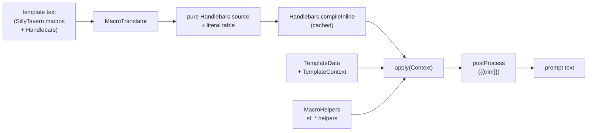

{%{
# Templating & macros

Every prompt Marginalia sends is rendered from a template: the master template, the user prompt, lorebook entries
and the summary prompt. Templates are [Handlebars](https://github.com/jknack/handlebars.java) with
SillyTavern-compatible macros on top. This page explains how that is implemented and how to add variables and macros.
What users can write is documented in the user guide: [Prompt templates](../user/templates/templates.md) and the
[Macro reference](../user/templates/macros.md).

The texts of the [agents](agents.md) are the exception: the system prompt, the compaction prompt and the instructions of an
agent (`Defaults.DEFAULT_AGENT_PROMPT` and the others around it) are plain text, put into the request as they are, with no
Handlebars and no macros.

The code is in `domain/templates/` (data objects, context, variables), `domain/templates/macros/` (translator,
helpers, macro registry) and `domain/service/impl/TemplateServiceImpl.java`.

## Rendering in one picture

`TemplateService.processTemplate(template, name, data)`:

1. **Translate** the SillyTavern syntax into plain Handlebars (`MacroTranslator.translate`).
2. **Compile** the result with Handlebars. Compiled templates are cached by template text (Caffeine, 500 entries,
   24 h after last access), so a lorebook entry is parsed once, not on every generation.
3. **Render** it against a Handlebars `Context` built from the `TemplateData` (`MacroHelpers.createContext`).
4. **Post-process** the output: `{{trim}}` markers are removed together with the newlines around them.

Handlebars runs with `EscapingStrategy.NOOP` - the output is a prompt, not HTML, so quotes, `&` and `<` stay as
they are.

`isValidTemplate(template, name)` only does steps 1-2, so it catches syntax errors. `isValidTemplate(template, name,
dataClass)` also walks the compiled template (`Template.collect` of variables and sections, in all branches) and
reports names that would end in *helperMissing* (see [Where templates are rendered](#where-templates-are-rendered): the data class of each template) in
`ValidationResult.unknownNames()`. They are warnings, `isValid()` stays true; the UI shows them as the field's helper
text (`TemplateHints.showWarnings`). Names relative to the current context (`this`, `.`, `../x`, `@index`) and
parameters (`{{#if name}}`) are not checked.

## Where templates are rendered

| Template | Rendered in | Data class | Its own variables |
|---|---|---|---|
| User prompt | `PrepareConstantsStep` | `UserPromptData` | `povCharacter`, `sceneSetting`, `presentCharacters`, `instructions` |
| Lorebook entry payload | `ProcessLorebookStep` (one data object for all active entries) | `LorebookTemplateData` | the four above + `narrativePov`, `narrativeTense`, `style` |
| Master template | `PrepareContentStep` (twice: token estimate on a fork, then for real) | `MasterTemplateData` | `backgroundLore`, `narrativePov`, `narrativeTense`, `style`, `summaries`, `annotations` (the open annotations marked `sendToPrompt` of the parts in the prompt; only the final render has them) |
| Summary prompt | `SummaryServiceImpl.createSummaryPayload` | `SummaryTemplateData` | `backgroundLore`, `text` (the parts to summarize) |
| Meta summary prompt | `SummaryServiceImpl.createMetaSummaryPayload` | `MetaSummaryTemplateData` | `backgroundLore`, `summaryBlocks` (the summaries to merge, oldest first) |
| Redraft system prompt and redraft prompt | `RedraftServiceImpl.createPayload` (an estimation render of both on a fork, then for real: the system prompt is the system message, the story before the part follows as the earlier messages, the redraft prompt is the last message) | `RedraftTemplateData` | `text` (the part), `redraftInstructions`, `previousStory` (only a note that the story follows as messages), `summaries`, `followingStory`, `backgroundLore` (stored on the part), `narrativePov`, `narrativeTense`, `style`, and the turn of the part: `povCharacter`, `sceneSetting`, `presentCharacters`, `instructions`, `annotations` (the open annotations of the part when the redraft is asked to deal with them), and for the redraft of a passage `selection`, `selectionBefore`, `selectionAfter` (all `null` for the whole part, so `{{#selection}}` tells the cases apart) |
| Impersonate prompt | `ImpersonateServiceImpl.createPayload` (an estimation render on a fork, then for real) | `ImpersonateTemplateData` | `impersonateInstructions` (the guidance of the author), `outline` (the plan a caller gives), `previousStory`, `summaries`, `backgroundLore` (stored on the last part), `instructionExamples` (the instructions of the last three parts that have some, oldest first), `narrativePov`, `narrativeTense`, `style`, `sceneSetting`, `povCharacter`, `presentCharacters` (of the request, else of the last part) |
| Annotate system prompt and annotate prompt | `AnnotateServiceImpl.createPayload` (as the redraft) | `AnnotateTemplateData` | the variables of the redraft prompts with `annotateInstructions` instead of `redraftInstructions`, `annotations` (the open ones the part has) and `outputFormat` (the description of the answer of the mode; the service writes it, a prompt of the author has to print it) |
| Title page and front matter of an export | `ExporterBase` (the title page of every format that has one, `DEFAULT_EXPORT_HEADER_TEMPLATE`, and the YAML block of *Markdown with front matter* and the Obsidian vault, `DEFAULT_EXPORT_FRONT_MATTER_TEMPLATE`; the text is the user's own from *Settings → Exports* or the default, see [Services](services.md)) | `ExportHeaderTemplateData` / `ExportFrontMatterTemplateData` | the title page: `title`, `author`; the front matter: `title`, `author`, `language` and `exportDate`. Not part of a generation: no context, no macros of the story |

The order of the [generation pipeline]