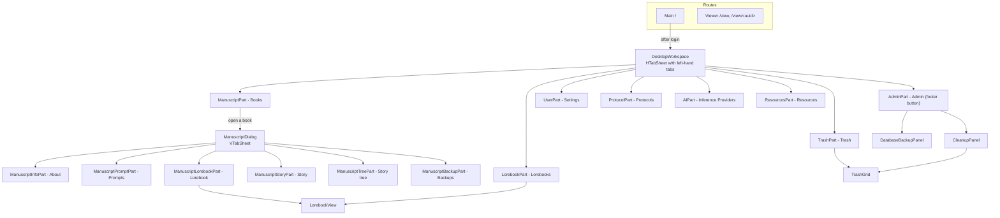
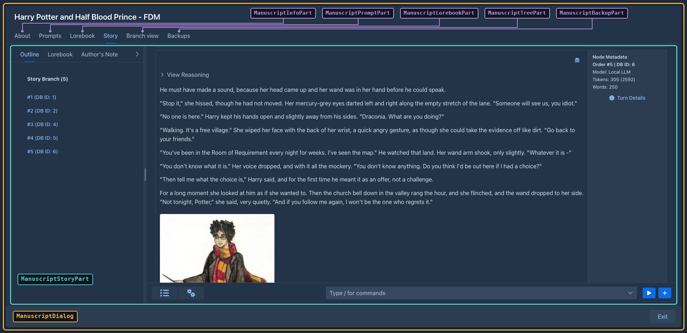

# User interface

Marginalia's UI is written in Java with [Vaadin Flow](https://vaadin.com/docs/latest/flow) 25: the component tree
lives on the server, the browser renders it with Vaadin's web components (Lumo theme, dark color scheme) and sends
events back over HTTP and a push WebSocket. There is no hand-written frontend code apart from one CSS file and a small
connector for the story tree. This page explains how the UI code is organized and the conventions to follow when you
change it. The code is in `ui/`.

## Structure






| Package | Contains |
|---|---|
| `ui.main` | Servlet, app shell, routes, login (`LoginCheckRoute`). |
| `ui.workspace` | The `Workspace` interface, its `DesktopWorkspace` implementation and the `WorkspaceComponent` interface. |
| `ui.workspace.phone`, `.parts` | `PhoneWorkspace` and the phone specific tabs (`PhoneManuscriptPart`, `PhoneLorebookPart`, `PhoneProtocolPart`, `PhoneAIPart`, `PhoneSettingsPart`, `PhoneTrashPart`). |
| `ui.dialogs.phone`, `.manuscript` | `PhoneManuscriptDialog` and its tabs (`PhoneManuscriptInfoPart`, `PhoneManuscriptPromptPart`, `PhoneManuscriptLorebookPart`, `PhoneManuscriptStoryPart`, `PhoneManuscriptTreePart`, `PhoneManuscriptBackupPart`), the book dialog for phones. |
| `ui.workspace.parts`, `.admin` | The workspace tabs and the admin panels. |
| `ui.dialogs` | Entity dialogs, the book window and generic dialogs. |
| `ui.dialogs.manuscript` | The tabs of the book window (`ManuscriptDialogPart`). |
| `ui.components` | Larger reusable components: `LorebookView`, `PhoneLorebookView`, `TreantTree`, `MessageImages`, `ThreadCopyRequestAttributes`. |
| `ui.widgets` | Small reusable widgets, among them `TrashGrid` (see [Trash](#trash)). |

## The shell, routes and login

- `AppShellConfig` (`AppShellConfigurator`) sets up the page once: `@Push`, Lumo stylesheet, `@ColorScheme(DARK)`,
  full-viewport body, `shared-styles.css`, page title, PWA metadata.
- `MarginaliaServlet` is the `VaadinServlet` mapped to `/*` (with `asyncSupported` for push).
- There are two routes, both extending `LoginCheckRoute`:

  | Route | Class | Shows |
  |---|---|---|
  | `/` | `Main` | The workspace. |
  | `/view`, `/view/<uuid>` | `Viewer` | The reader: a list of the user's own books, and a book's active branch as text (own or published books, by link). |

`LoginCheckRoute` runs in the route's constructor (`showLogin()`):

1. On an empty installation it opens `UserDialog` in *first time* mode (create the administrator) and reloads.
2. Otherwise it tries a user that is already logged in this session (`authenticatedSessionUser`, overridden by `Main`: the page was reloaded, e.g. by the language selector) and then the *Save login* cookies (`authenticateFromCookie`, rotating the secret on success).
3. Otherwise it shows a `LoginOverlay` (`PermissiveLoginOverlay` - allows empty passwords to reach the server-side
   check) with the *Save login* checkbox.
   The check passes the client address (`LoginCheckRoute.clientAddress()`) to `UserService.authenticate`, which
   throttles failed logins per address (see [Login throttling](services.md#login-throttling)).
4. After a successful login it calls `VaadinService.reinitializeSession` (new session id) and the subclass's
   `proceedWithLogin(login)`, which fills the session-scoped `user` bean, registers the login with
   `SessionManager.userLoggedIn` (see [Sessions](architecture.md#sessions)), sets the language of the session from
   the user's settings ([Localization](architecture.md#localization)) and builds the content.

Logout deletes the cookies, closes the Vaadin session, invalidates the HTTP session and redirects to the context
root. Cookie names include the context path and the route class (`root_Main_llllm_rememberMe_login`...), so the workspace
and the viewer keep separate saved logins.

## Building blocks

### Classes that build components

Most UI classes are **not** Vaadin components themselves. They are plain classes with a `create()` method that builds
and returns the component tree, and keep references to the fields they need later:

```java
@Configurable
@Extendable
public class ProtocolPart implements WorkspaceComponent {

    @Autowired
    private Localization loc;

    @Autowired
    private ProtocolService protocolService;

    private Grid<Protocol> grid;

    @Override
    public Component create() throws Exception {
        VerticalLayout layout = new VerticalLayout();
        grid = new Grid<>();
        ...
        return layout;
    }

    @Override
    public void refresh() throws Exception { ... }
}
```

This shape is deliberate:

- **`@Configurable`** - the class is created with `new`, and the AspectJ-woven configurer injects its `@Autowired`
  fields (services, `Localization`, the session `User`). See [AspectJ weaving](building.md#aspectj-weaving).
- **`@Extendable`** - the class is instrumented at startup so extensions can run code before and after any of its
  methods and read its local variables (see [Extensions](#extension-points)). Small methods with descriptive local
  variable names (`menu`, `toolbar`, `detailLayout`) are what make a class easy to extend.

Dialogs (`AIDialog`, `ProtocolDialog`, `UserDialog`, `LorebookDialog`, `ManuscriptDialog`...) extend Vaadin's `Dialog`
but follow the same pattern: construct with the entity, call `create()`, then `open()`.

### The workspace

`Workspace` is the interface of the top-level layout shown after login (`create`, `refresh`, `setNavigationLocked`,
`isNavigationLocked`, `getOnLogout`, `setOnLogout`). `Main`, the parts, `ApplicationPoint` and `SessionInformation`
only depend on this interface. `DesktopWorkspace` is the implementation (`@Configurable`, `@Extendable`): it builds an
`HTabSheet` (tabs on the left, a footer with *Admin*, the language selector, *Change Password*, *Logout*) and creates all tab components up
front. Each tab is a `WorkspaceComponent`:

| Method | Called |
|---|---|
| `create()` | Once, when the workspace is built. |
| `refresh()` | To reload data (after login, after changes elsewhere). |
| `onTabSwitched()` | When the tab becomes active - parts reload their lists here. |
| `onTabClosed()` | When another tab is selected. |

`Workspace.setNavigationLocked(true)` disables the other tabs and the *Admin* and *Logout* buttons, so the user can't
leave the active tab. `UserPart` locks it while the settings have unsaved changes: it listens to every `HasValue`
in its layout (extension settings panels included) and unlocks on *Save*, *Discard Changes* or `refresh()`.

`Main.proceedWithLogin` picks `PhoneWorkspace` instead when the body of the page is narrower than 768 px
(`ExtendedClientDetails.getBodyClientWidth()`). The choice is made once per login: resizing or rotating the device
does not switch the workspace until the page is reloaded, and a tablet or a phone in landscape gets the desktop one. `PhoneWorkspace` replaces
the left-hand tab sheet with an `AppLayout`: the parts are listed in a drawer (opened with the toggle in the top bar)
whose footer holds the language selector, *Change Password* and *Logout*, and the active part fills the screen. **There is no *Admin* button
and no `AdminPart`** on a phone: the administration (users, database backups, cleanup, extension install) is only
reachable in the desktop layout. The services still check `AdminGuard.requireAdmin()` themselves. The user manual
describes this for users in [Using Marginalia on a phone](../user/phone.md). Only the book list, the lorebooks, the settings, the protocols, the models and the trash differ. `PhoneManuscriptPart` renders the book list
like the `Viewer` (stacked filters, sort buttons, one column) with the controls of `ManuscriptPart`; both share the
*Add Book* flow in `NewBookAction`. `PhoneLorebookPart` hosts `PhoneLorebookView`, a reduced `LorebookView`: lorebooks can
only be selected (no add, delete, import or export, no new entries) and only the enabled flags and the content of an
entry are editable, every other setting of the lorebook and of an expanded entry is shown as text. `PhoneTrashPart`
hosts `PhoneTrashGrid` (see [Trash](#trash)). `PhoneProtocolPart` and `PhoneAIPart` replace the type, name and
action columns of their desktop lists with a text column (*Type:* and *Name:* on two lines) and a buttons column.
`PhoneSettingsPart` extends `UserPart` (so the extension settings panels that decorate `UserPart.refresh`/`save` keep
working) and only overrides `createHeader()`: the title, the unsaved changes hint and the *Discard*/*Save* buttons are
stacked, and *Import backup as new book* is left out. The other parts are the desktop ones.

Opening a book on a phone shows the `PhoneManuscriptDialog` (package `ui.dialogs.phone`) instead of `ManuscriptDialog`;
`NewBookAction(onClose, true)` opens it after *Add Book*. It is a separate class, not a subclass, so extensions know
which dialog they decorate (decorators of `ManuscriptDialog` and the desktop parts do not run on a phone). It fills the
screen (the `phone-dialog` class), the exit button is an icon in the header and the tabs are one scrolling `Tabs` row
above the content of the selected tab. Every tab is a `PhoneManuscriptDialogPart` of `ui.dialogs.phone.manuscript`
(the desktop `ManuscriptDialogPart` without the tab sheet argument): `PhoneManuscriptInfoPart` and
`PhoneManuscriptPromptPart` (one column of fields), `PhoneManuscriptLorebookPart` (the lorebook of the book and
`PhoneLorebookView(true)`, which hides its own lorebook selection like the pinned `LorebookView`),
`PhoneManuscriptTreePart` (stacked search bar), `PhoneManuscriptBackupPart` (one row per backup) and
`PhoneManuscriptStoryPart`. The story is a single column in an `AppLayout`: the outline is its drawer (slid in by the
toggle in the navbar, which also holds the summaries/settings menu bar), the new turn button is at the bottom. Its
`ChatMessageCard` is only the text of the part under a small header line with two icons: the menu (with *Show Prompt*)
and a popover with the metadata of the inference (ids, model, protocol, tokens, words) and the turn details (the
right-hand column of the desktop card). Its summaries item opens `PhoneSummariesDialog`, the `SummariesDialog` with a fixed 640 px, taller content column (the grid scrolls sideways anyway, so the summaries stay readable and editable). The fixed navbar and drawer of the
`AppLayout` are kept inside the dialog by the `phone-story-layout` class.

On the desktop the *Admin* button is only added for administrators; `AdminPart` shows the users grid and the
`DatabaseBackupPanel`, `CleanupPanel` and extensions tab (with the verification report of each extension and, per
extension, the buttons *Stop* / *Start* (`OsgiService.stopExtension` / `startExtension`, state *Stopped*), *Log*
(`ExtensionLogDialog`: the end of the extension's log with refresh and clear) and *Unload*). Note that the admin UI being hidden is not a permission
check - the administrator-only services call `AdminGuard.requireAdmin()` themselves (see
[Services](services.md#administration)).

### The book window

Opening a book creates a `ManuscriptDialog` - a full-screen, strictly modal dialog with a `VTabSheet` of
`ManuscriptDialogPart`s:

| Method | Purpose |
|---|---|
| `create(VTabSheet)` | Build the tab content and add the tab. |
| `load(Manuscript)` | (Re)load the part from the book; called for all parts when the dialog opens. |
| `onTabEnter()` / `onTabLeave()` | Tab switching - parts save pending edits on leave. |
| `setFrozen(boolean)` | Disable editing while a generation runs. |

The dialog holds the book (`getManuscript()`, `refreshManuscript()` reloads it, `save()` saves it) and
`freeze()` / `unfreeze()`, which disable the tabs, the exit button and every part during generation.

`ManuscriptStoryPart` is the story editor and the largest UI class: the sidebar with one button per part, a
`ChatMessageCard` per part (Markdown view, edit mode, menu with Edit / Regenerate / Swipe / Branch / View prompt /
Summary / Delete), the *New Turn Instructions* popover, starting generations and applying the result, the automatic
book backups, and the menu bar of the bottom bar (see [The story menu bar](#the-story-menu-bar)).

`renderStoryContent()` redraws only the cards and the outline list: the left tab sheet is created once in `create()`
(so the selected tab and the tabs of extensions survive), and the reasonings that were open are reopened on the new
cards. `PhoneManuscriptStoryPart` does the same.

What the desktop and the phone story editor have in common lives in `ui.dialogs.story`, so the two classes keep only
their layout and the methods extensions decorate (`renderStoryContent`, `createSidebarButton`, `populateMenuBar`,
`createCogsMenuItem`, the card's `createMenuItems`, `refreshSummaryMenuItems`, `autosaveAndSwapToMarkdown`):

| Class | Does |
|---|---|
| `StoryHost` | What a story tab needs from its dialog (`refreshManuscript`, `save`, `freeze`, `unfreeze`); `ManuscriptDialog` and `PhoneManuscriptDialog` implement it. |
| `StoryCard`, `StoryCards` | The card interface both `ChatMessageCard` classes implement, and the registry of the cards of the branch and the streaming one (opened reasonings, last flags, freezing, autosave). |
| `StoryGenerationListener` | The `GenerationListener` of a story tab: creates and fills the cards while a generation streams, redraws the story at its end. The tab reacts through `Callbacks`. |
| `NewTurnForm`, `TurnDetailsForm`, `MessageMetrics` | The fields of the *New Turn Instructions* popover, the turn details of a part, the metadata lines of a part. |
| `StoryBackup`, `StorySupport` | The automatic backup after N parts / minutes, and the scroll position tracking and saving of an edited part. |

The helpers are `@Extendable` instances (the tabs create them with `new`, `StoryBackup` and `StorySupport` are
`@Configurable`), so a decorator of one of their methods applies to the desktop and the phone tab alike. The inner
card classes stay inner classes of the tabs: extensions reach the outer part through `this$0`.

### The story menu bar

The bottom bar of the story editor has a `MenuBar` with two items, built by small methods so that extensions can add
to it (see [Extending the UI](plugins/ui-extensions.md#the-story-menu-bar)):

| Method | Builds |
|---|---|
| `createMenuBar()` | The bar: calls the three methods below. Stored in the field `menuBar`. |
| `createSummariesMenuItem(bar)` | The **Summaries** item (field `summariesMenuItem`), which opens `SummariesDialog`. Its tooltip shows the tokens of the summaries in use (`refreshSummariesMenuItem()`, run when the story is loaded, after a summary is deleted and when a summary dialog is closed). |
| `createCogsMenuItem(bar)` | The settings item (field `cogsMenuItem`, local `cogs`) and its sub menu: `createChangeStylesMenuItem(cogs)`, `createExportMenuItem(cogs)`. |
| `populateMenuBar(bar)` | Empty, runs last: the hook for new items of the bar. |

### The summaries overview

`SummariesDialog` shows the summaries of the active branch (`SummaryService.collectTree`) in a `TreeGrid<SummaryNode>`:
the summaries generation uses are the top level, the summaries a meta summary stands in for are its children
(including the summary it replaced, read from `replacedSummary`, which has no id). Columns: database id (the
hierarchy column), message id, order in the branch, content, tokens, a checkbox and a delete button. Checkboxes,
delete buttons and the edit pencil exist only on the top level - the text of the merged summaries is part of the hash
of their meta summary, so editing them would invalidate it.

- **Content** (`SummaryContent`): reasoning (a `Details` with `Markdown`, reasoning is mostly markdown), badges (*Meta summary*, *Replaced*) and the text as
  plain text (`white-space: pre-wrap`, summaries are not markdown and the model's single line breaks must show), in a scrolling `Div` of a fixed height, so all rows have the same height. The pencil is in a gutter next
  to the scroll area (not over the text); it swaps the text for a `TextArea` of the same size and the buttons for a
  green check (`SummaryService.updateSummaryText`) and a red trash icon (back to the Markdown).
- **Delete** goes through `SummaryRemoval.confirmAndRemove`, shared with the part menu of the story editor: a normal
  summary is confirmed with yes/no, a meta summary asks *Unwind* / *Delete* / *Cancel* (`ConfirmDialog` with custom
  button labels).
- **Create meta summary** takes the ticked summaries, uses the newest as `from` and the oldest as `to` and opens
  `SummaryDialog` with a meta request (`createMetaSummary`); it needs at least two.
- The grid is reloaded after every change (`refresh()`): editing, deleting, and closing the dialog of a meta summary.

`SummaryDialog` is the dialog of one summary: it generates it (`startGeneration`, streaming into a read-only text area,
with a *Stop* button), or shows the existing one. It is created with the part, and with the oldest part of the range
for a meta summary. It was an inner class of `ManuscriptStoryPart`; both the story editor and the overview open it now.
Both dialogs are `@Configurable(preConstruction = true)` (they use injected services in their constructors) and
`@Extendable`; the overview's menu bar above the grid is empty, `populateMenuBar(bar)` is where extensions add tools.

### Grids

Lists of entities use Vaadin `Grid` with a lazy data provider. `BackendTableProviderBase` (in `ui.widgets`) is the
common base: the owning part searches for the ids to show (`ManuscriptService.searchManuscripts(...)` returns ids,
already filtered and sorted), passes them with `setIds(ids)`, and the provider loads only the entities of the visible
page (`service.find(id)`) and wraps them in a `BackendTableItem` subclass. It also tracks checked rows.

### Widgets

| Widget | Used for |
|---|---|
| `HTabSheet` | The workspace's left-hand tab sheet with a footer area. |
| `LanguageSelector` | The language combo box of the workspace footers: saves the choice in `UserSetting.language`, sets `SessionPoint.language` and reloads every page of the user ([Localization](architecture.md#localization)). |
| `TagMultiComboBox` | Tag selection with lazy search (`TagService.searchTagsForUser`) and creation of new tags. |
| `TextAreaPopoverComponent`, `TextFieldPopOverComponent` | Prompt fields with a hints popover. |
| `TemplateHints` | Content of the hints popover: *Insert Default Template*, the template's variables (from `@LocalizedTemplateDescription`) and the macros (from `Macros.hints()`). |
| `ScrollPanel`, `HtmlText` | Scrollable container; text with HTML. |
| `ResizableTextArea` | `ResizableTextArea.install(loc, textArea, "160px")` on long prompt and description fields: a corner icon toggles between the fixed height (with a scrollbar) and a height that fits the whole content. |
| `ChartJs` | A [Chart.js](https://www.chartjs.org/) chart: `setChartConfig(json)` takes a Chart.js configuration (`type`, `data`, `options`) as JSON and draws it responsively into the element (height 320px, the `chart-js` style). Used by `TokenUsageDialog` (doughnut of the prompt sections, bar chart of the payload messages), opened from *Token Usage* in the part menu of the desktop and phone story editors. |
| `TrashGrid` | Deleted objects with a restore button, see [Trash](#trash). |
| `Notification` | `Notification.success(...)` / `error(...)` with Marginalia's durations and variants. |

### Trash

`TrashGrid` is a self-contained widget (`@Configurable`, create it with `new TrashGrid(allUsers).create()`) over
`TrashService`: a lazy multi-select `Grid<TrashItem>` (items identified by their `EntityKey`, so the selection
survives paging), a filter by type (names from `Localization.localizeDomainObject(Class)`) and, with `allUsers`, a
filter by owner and an owner column. `allUsers` only decides what the widget shows; the service decides what the
current user may see and restore. *Restore Selected* confirms and calls `TrashService.restore`; when it returns
blockers the widget shows them in a dialog (nothing was restored), otherwise it refreshes and runs the listeners from
`addRestoreListener` (`TrashPart` uses it to refresh the whole workspace). The *Extended Content* link opens the JSON
from `TrashService.getExtendedContent` in a read-only text area. `TrashPart` (the *Trash* tab, `allUsers` for
administrators) and `CleanupPanel` (a `Details` section, created when first opened) both use it.

`PhoneTrashGrid` (used by `PhoneTrashPart`) subclasses it through the `createToolbar()` and `addColumns()` hooks: the
filters are stacked over the whole width, the description is behind an info button (a `Popover`) instead of above the
table (`createDescription()`), and the table has only the check box column and one content column that
shows name, type, owner (`allUsers`), delete time and the *Extended Content* link below each other.

Generic dialogs: `ConfirmDialog.show(message, onYes)`, `TextInputDialog.Builder`, `ListSelectDialog`,
`ErrorDialog` (message and expandable stack trace), `ProgressBarDialog`. `ExtensionLogDialog.show(bundle, name)` is the
read-only, monospace view of an extension's log.

## Conventions

### Text

Never hard-code user-visible text. Add a key to `loc/L.java` and the text to `LocalizationBundleEN` (and `LocalizationBundleJP`), and use
`loc.getValue(L.KEY)` (`Localization` is injected into every UI class). Date formats come from the same bean
(`loc.getDateFormat()`...). The name of a kind of entity (book, lorebook...) is `loc.localizeDomainObject(entityClass)`; it falls back to the closest known superclass, then to the simple class name, so a new entity type needs a mapping in `LocalizationImpl.loadMaps()`. The texts are in the language of the user's session, so never keep a text in a field that outlives the page or the request - look it up when you show it ([Localization](architecture.md#localization)).

### Errors

Wrap event handlers in `try`/`catch` and report unexpected exceptions with
`UIUtils.internalServerError(loc, e)` - it logs the exception and opens an `ErrorDialog` with the stack trace.
Expected problems (validation, missing configuration) are shown with `Notification.error(...)` or a message next to
the field; `UIUtils.showValidationErrors(loc, e)` formats a binder's `ValidationException`. Failures of a request to the
model API (`InferenceException`: wrong key, wrong URL, timeout...) go through `UIUtils.inferenceError(loc, e)`, which
shows the localized cause (`InferenceErrors`) as a notification and falls back to `internalServerError` for anything
else. `AIDialog` has the *Test Connection* button (`InferenceService.testConnection()` with the values of the form).

### Saving

Most forms save automatically: value change listeners call an `autosave()` method of the part (guarded so that
loading values into the fields doesn't trigger a save). The story editor saves an edited part when the edit is
closed (`autosaveAndSwapToMarkdown`) and before a generation starts (`autosaveAndSwapAllToMarkdown`). Entities held
by the UI are detached copies - reload them through the service before changing them, and keep the object returned
by `save`.

### Background work and push

Vaadin component state may only be touched on a thread holding the session lock. The rules:

- Long work (generation, summaries, backups, imports) runs on another thread; the UI thread returns immediately.
- Updates from that thread go through `ui.access(() -> ...)`, with the `UI` captured on the UI thread
  (`UI.getCurrent()` is `null` elsewhere). `UIPushGuard.push(ui)` sends them right away.
- Service calls on that thread need the user's request scope - capture `ThreadCopyRequestAttributes.create()` on the
  UI thread and wrap the work in `InRequestScope` (see [The current user](services.md#the-current-user)).
- `ThreadAccessDialog` packages all of this for dialogs: `run()` starts `runInThread()` on a new thread in the
  request scope, and `vaadinLocked(...)` / `vaadinLockedSync(...)` run UI updates with `ui.access` /
  `ui.accessSynchronously` and push. `ProgressBarDialog` builds on it.

The story editor is the main example: `startGeneration` freezes the book window, calls
`StoryGenerationService.generateNextTurn` with a `GenerationListener`, and every callback (`onNodeCreated`,
`onResponseChunk`, `onComplete`...) updates the cards inside `ui.access(...)` and pushes.

### Browser-side code

Prefer Java components. When the browser has to do something (scroll positions, element sizes), the script is a
static method of `ui.JavascriptLibrary` - UI classes don't call `executeJs` themselves. The element is passed
explicitly (`$0`, not `this`), and a script that returns a value returns the `PendingJavaScriptResult`, read with
`.then(...)`; see `UIUtils.getPositionAndSizeOfElement`, the scroll handling in `ManuscriptStoryPart` and
`JavascriptLibrary.scrollTextAreaToBottom` (the extension log is shown scrolled to its newest line).
Extensions keep their own scripts.

There are two JavaScript modules. `src/main/frontend/chart-connector.js` is loaded by `ChartJs` (`@JsModule`, with the
npm package `chart.js`); it registers Chart.js and draws the configuration it gets from
`JavascriptLibrary.renderChart`, taking the text and grid colors from the Lumo variables of the page.

`src/main/frontend/treant-connector.js` is loaded by `TreantTree` (`@JsModule`) together
with the npm packages `treant-js` and `raphael` (`@NpmPackage`) and treant's CSS (`@CssImport`). It draws the story
tree; `TreantTree` sends the tree as JSON and receives clicks back: `node-click` (a card was clicked, with the
`data-node-id` of the card) and `node-goto` (an element with `data-goto-id` inside a card was clicked; the card itself
is not clicked then).

### Searching the story tree

`ManuscriptTreePart` has a search bar above the tree: an editable `ComboBox` (the last 15 searches; typed text is a
custom value that the part sets as the value) and a button. A search calls `ChatMessageService.searchFulltext` and
keeps the result as `lastQuery` and `hitSnippets` (part id → text around the match); `renderTree` then adds the CSS
class `search-hit` (shared-styles.css) to the cards of the found parts and, in them, the snippet and a "Show in story"
link (`data-goto-id`). Stretches of more than 20 parts that would be collapsed stay open when they contain a hit.
The search is kept while the tab is open and repeated on every `onTabEnter`; `load` (opening the book) clears it.

The link fires `NodeGotoEvent`. `onNodeGoto` resolves the id among the messages of the book only, asks
`ChatMessageService.findLeafFor` for the end of the branch to show, makes it the book's active leaf when it is not
(`ManuscriptDialog.save`) and calls `ManuscriptDialog.showMessage(id)`. That tells `ManuscriptStoryPart` which part to
scroll to (`scrollToMessageOnNextRender`) and selects the story tab; entering the tab renders the story, which scrolls to
the part (and flashes it) instead of restoring the saved scroll position.

### Styles

Global styles are in `src/main/frontend/styles/shared-styles.css` (imported by `AppShellConfig`): spacing helpers,
the loading indicator, the story text (`.chat-message`), the story tree (`.Treant`) and the utility classes
(`.text-secondary`, `.hint-text`, `.min-width-0`...). The book style of the reader and editor
(`.manuscript-styles .chat-message-markdown`) is in `reading-mode-styles.css`, imported separately by `AppShellConfig`. Components are
styled by adding these classes (`addClassName(CssStyles.TEXT_SECONDARY)`), not with `getStyle().set(...)`; keep that
only for values computed at runtime (the combo box overlay width). A new class goes
into the stylesheet and into `CssStyles` together. All `vaadin-markdown` elements wrap long lines through one rule
there, so a `Markdown` needs no extra call. Class names used from Java are constants in
`CssStyles`; column widths and offsets in `UIConstants`. Use Lumo's CSS custom properties (`--lumo-space-m`,
`--lumo-contrast-10pct`...) instead of fixed colors, so the dark theme stays consistent.

Styles of plugins are not in the stylesheet. `Main` and `Viewer` (the `ApplicationEntryPoint`s) own a `CssRegistry` that
injects the CSS returned by loaded extensions (`ExtensionHasCss.getCss`) as `<style>` elements and removes it when the
extension is unloaded ([Styles of a plugin](plugins/ui-extensions.md#styles-of-a-plugin)).

## Extension points

Every class annotated `@Extendable` can be extended by plugins: a decorator registered for a class and method name
runs before and after that method and can read its arguments and local variables. The UI classes that are
`@Extendable`:

| Area | Classes |
|---|---|
| Workspace | `Workspace`, `DesktopWorkspace`, `PhoneWorkspace`, `ManuscriptPart`, `PhoneManuscriptPart`, `PhoneLorebookPart`, `PhoneProtocolPart`, `PhoneAIPart`, `PhoneSettingsPart`, `PhoneTrashPart`, `LorebookPart`, `UserPart`, `ProtocolPart`, `AIPart`, `ResourcesPart`, `TrashPart`, `AdminPart`, `DatabaseBackupPanel`, `CleanupPanel` |
| Book window | `ManuscriptDialog`, `ManuscriptStoryPart` (and its `ChatMessageCard`), the shared story helpers (`StoryCards`, `StoryGenerationListener`, `NewTurnForm`, `TurnDetailsForm`, `MessageMetrics`, `StoryBackup`, `StorySupport`), `ManuscriptInfoPart`, `ManuscriptPromptPart`, `ManuscriptLorebookPart`, `ManuscriptTreePart`, `ManuscriptBackupPart`, `SummariesDialog` (and its `SummaryContent`), `SummaryDialog`, `ImagesDialog` |
| Dialogs and components | `AIDialog`, `ProtocolDialog`, `UserDialog`, `LorebookDialog`, `LorebookImportDialog`, `PromptDialog`, `TokenUsageDialog`, `ExportDialog`, `PhoneManuscriptDialog`, `PhoneSummariesDialog`, `LorebookView`, `PhoneLorebookView`, `TreantTree`, `MessageImages`, `TagMultiComboBox`, `ChartJs`, `TrashGrid`, `PhoneTrashGrid` |
| Routes | `LoginCheckRoute` (login, saved logins), `Main` (creates the `DesktopWorkspace` or `PhoneWorkspace` in `proceedWithLogin`), `Viewer` |

New screens, dialogs and components with their own logic get `@Extendable` too (a nested class needs its own
annotation), and each of their instrumented methods gets a [`@PublicAPI`](plugins/extendable.md#the-public-api) that
declares its arguments, local variables and return type. Left out on purpose: classes with only static methods (`TemplateHints`, `SummaryRemoval`, `UIUtils`; static
methods are not instrumented), the generic dialogs and widgets used everywhere (`ConfirmDialog`, `ErrorDialog`,
`ProgressBarDialog`, `Notification`, `HTabSheet`, the `BackendTable*` providers), the plumbing (servlet, app shell,
initializer, `ThreadCopyRequestAttributes`) and small data wrappers.

The bundled plugins hook into these methods:

| Plugin | Class | Methods |
|---|---|---|
| Author's Note | `ManuscriptStoryPart` | `renderStoryContent` |
| Chapter Marker | `ManuscriptStoryPart`, `ManuscriptStoryPart$ChatMessageCard` | `createSidebarButton`; `autosaveAndSwapToMarkdown` |
| Instruction Exporter | `ManuscriptStoryPart`, `PhoneManuscriptStoryPart` | `createCogsMenuItem` |
| Lore Generator | `LorebookView`, `LorebookPart`, `UserPart` | `create` (adds a column to the `grid` field); `refresh` (the same for a workspace tab that was built before the extension was loaded); `refresh`, `save` |
| Lorebook VCS | `LorebookView` | `create`, `createEntryDetailLayout` |
| Reviewer | `ManuscriptStoryPart$ChatMessageCard`, `UserPart` | `createMenuItems`, `refreshSummaryMenuItems`; `refresh`, `save` |
| Side Query | `ManuscriptStoryPart`, `UserPart` | `renderStoryContent`; `refresh`, `save` |

Because plugins depend on method names and local variable names, **renaming or restructuring these methods breaks
plugins**. When you change an `@Extendable` class, check the plugins in `marginalia/plugins/` and mention the change
in the release notes. New UI that should be extensible: put it in an `@Extendable` class, build it in small,
well-named methods, and keep the components extensions will want (menus, toolbars, layouts) in local variables or
fields with clear names. See [Extending the UI](plugins/ui-extensions.md).

## Viewer

`Viewer` (`/view`) is a separate, reader-only route. It requires a login like the workspace (with its own saved-login
cookies). Without a parameter it lists the user's own books, with name and tag filters and sorting by last opened or
name; other users' published books are opened by their link; with `/view/<uuid>` it shows the book's active branch as Markdown in
the book's reading style. Books are resolved only through `ManuscriptService.findViewable(uuid)` (owner or
published, never deleted). The layout is made for phones.
