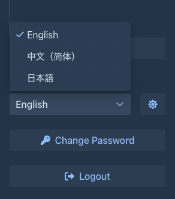
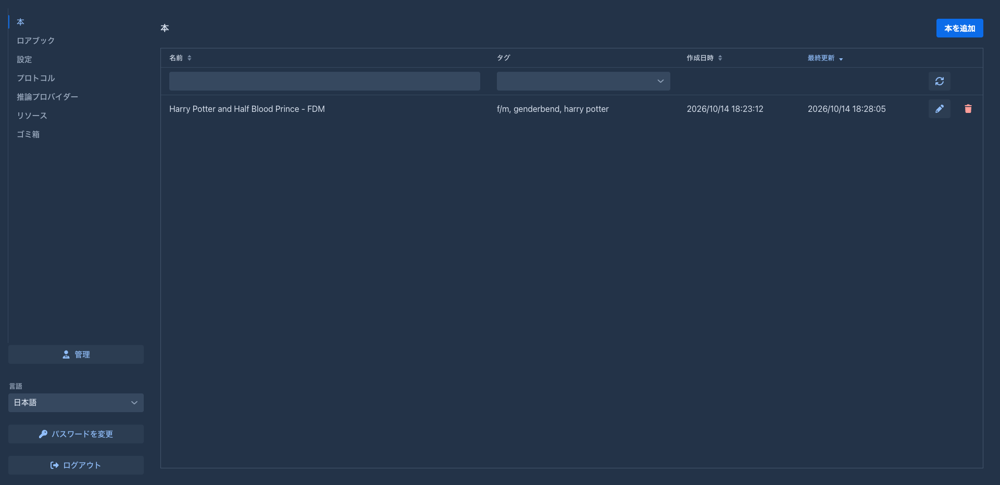
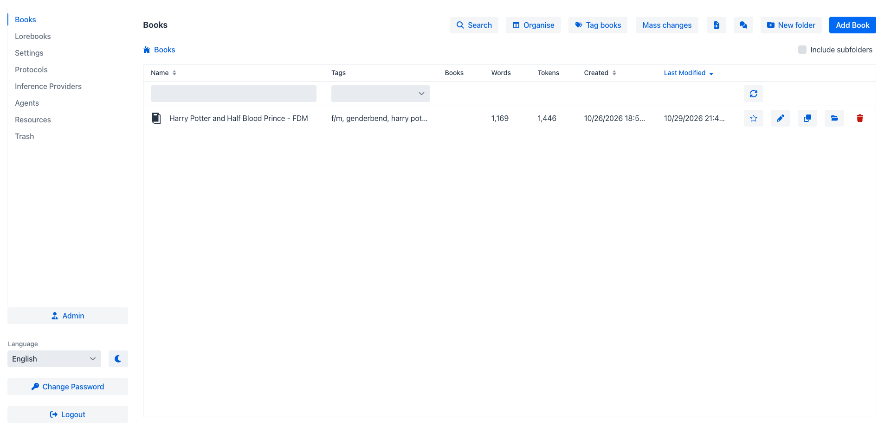
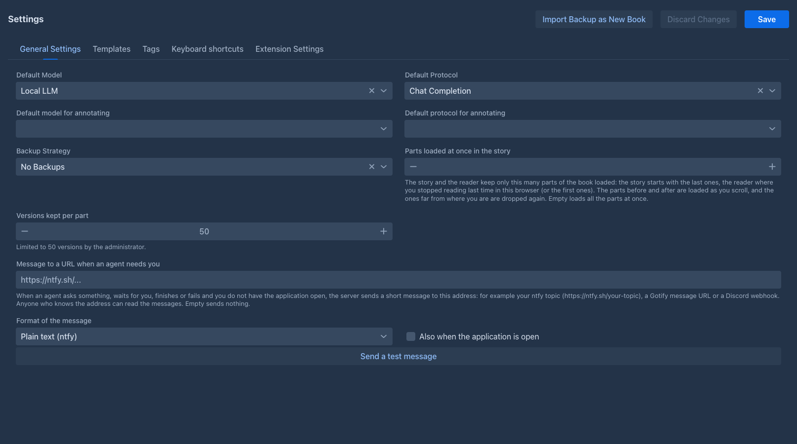
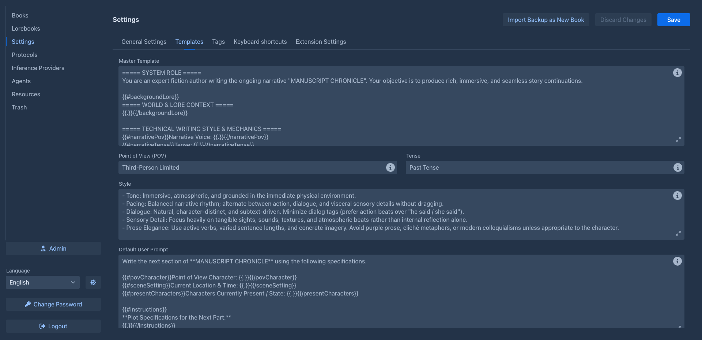
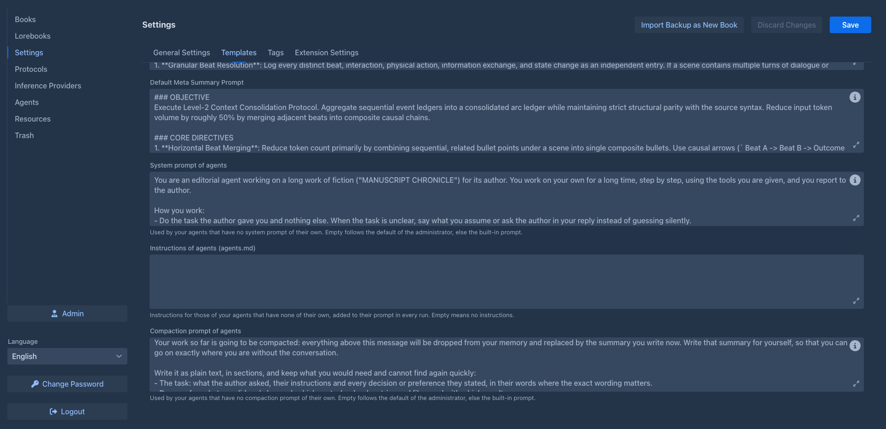
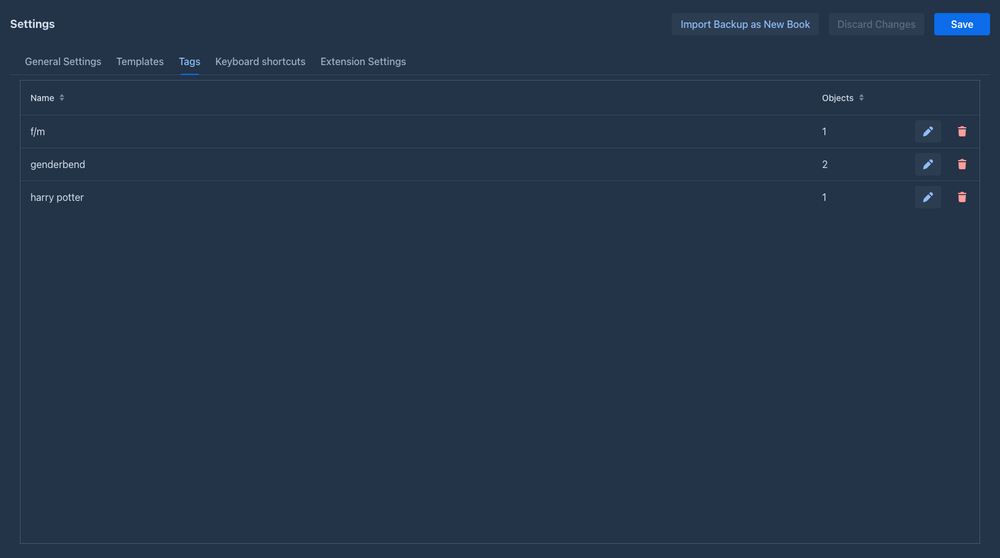
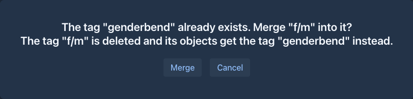
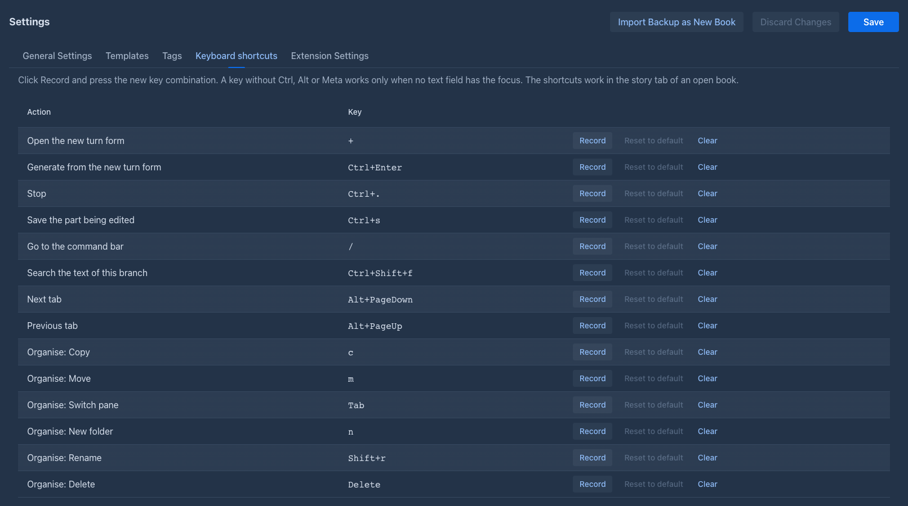
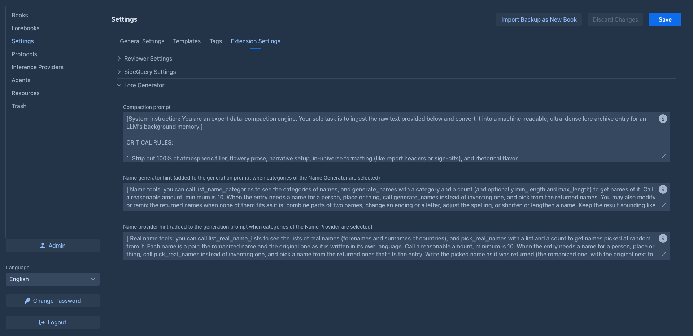

# Account & settings

Everything you create in Marginalia belongs to your account: books, lorebooks, tags, inference providers, protocols
and settings. Other users don't see them (except books you [publish](books/publishing.md)), and you don't see theirs.

## Your account

The buttons at the bottom of the workspace:

| Button | |
|---|---|
| **Language** | The language of the user interface, see [Language](#language). |
| sun / moon button | Next to the language: switches between the dark and the light theme, see [Theme](#theme). |
| **Change Password** | Changes your password, user name and full name, see below. |
| **Logout** | Logs you out on this device. |
| **Admin** | Only for administrators, see [Administration](administration/index.md). |

### Changing the password

**Change Password** opens a dialog with your **Username**, **Full Name**, **Current Password**, **Password** and
**Repeat password**:

- enter your **current password** for every change (leave it empty if your account has no password);
- to change the password, enter the new one in both password fields;
- leave both password fields empty to change only the name and keep the password;
- the user name must not be used by another account.

Click **OK** to save. With a wrong current password nothing is saved.

Changing the password ends all saved logins (*Save login*), on every device including this one: they have to log in
again with the new password. If a device was lost or your password leaked, changing the password logs that device
out. Sessions that are open right now (a browser tab still showing the workspace) stay logged in until they log out
or their session expires.

### Language

The **Language** selector above the buttons switches the user interface to another language. The choice is saved in
your account: the page reloads with the new language, and so does every other page you have open (on another device
too), and it is used again the next time you log in. The login screen itself is always in the default language.

The list contains only the languages that are installed. English and Japanese come with Marginalia; an administrator
can add more by loading an [extension](extensions/index.md), for example
[Chinese localization](extensions/chinese-localization.md). Texts a language doesn't translate are shown in English. The bundled extensions bring their own texts in Japanese and Chinese (the Chinese ones show when the Chinese localization is loaded).
Dates are written the way that language does. Your books and their texts are not translated, only the interface.

### Theme

The button next to the **Language** selector switches the user interface between the dark theme (the default) and the
light one. The choice is saved in your account and used again the next time you log in, on any device; a page that is
already open in another tab changes when it is reloaded. Charts and the relationship map take the colors of the theme
when they are opened.

### Logging in

**Save login** on the login screen keeps you logged in on this device for 30 days (it needs HTTPS on a server, see
[Server (Docker)](getting-started/docker-server.md#https-and-reverse-proxy)). **Logout** ends it.

An account can have an empty password; you then log in with the user name only. If an administrator cleared your
forgotten password, log in this way and set a new password with **Change Password** right away. That is handy for the desktop app on
your own computer, but never do it on a server others can reach.

## Settings

The **Settings** tab holds your defaults for all your books.

At the top are three buttons:

- **Import Backup as New Book** - creates a book from a backup file, see
  [Book backups](books/backups.md#importing-a-backup-as-a-new-book);
- **Discard Changes** - throws away the unsaved changes and loads the saved settings again;
- **Save** - saves the settings.

!!!info Unsaved changes
Settings are not saved automatically. As soon as you change a field (extension settings included), *Unsaved changes*
appears at the top and the other tabs, **Admin** and **Logout** are locked. Click **Save** or **Discard Changes** to
unlock them.
!!!

### General Settings

| Field | |
|---|---|
| **Default Model** | The [inference provider](inference-providers.md) new books start with. |
| **Default Protocol** | The [protocol](protocols.md) new books start with. |
| **Default model for annotating**, **Default protocol for annotating** | The model that [annotates a part](books/annotations.md#letting-a-model-annotate) when you do not choose another one for the run. Empty is the model of the book. |
| **Backup Strategy** | Automatic [book backups](books/backups.md#automatic-backups) for books without their own strategy: *No Backups*, *After N Messages* or *After N Minutes*, with the number next to it. |
| **Versions kept per part** | How many earlier versions of the text of a part the [history](books/version-history.md#how-many-versions-are-kept) keeps for all your books, unless a folder, a book or the administrator limits it more. Empty sets no limit here; **0** keeps no history. |
| **Parts loaded at once in the story** | How many parts of a book the [story](books/story-editor.md) and the [viewer](books/publishing.md) keep loaded. The story starts with the last parts, the viewer where you stopped reading (or the first parts); the parts before and after are loaded as you scroll and the ones far from you are dropped again. Empty loads all the parts at once. |

*Default Model* and *Default Protocol* are used only when a book is created; changing them doesn't change existing
books. The [Lore Generator](extensions/lore-generator.md) extension has no book and generates with them. The backup strategy applies to all books without a *Per manuscript override*, from their next generated part.

### Templates

The defaults for the [book prompts](books/prompts.md):

| Field | |
|---|---|
| **Master Template** | The frame of the prompt, see [Master template](books/prompts.md#master-template). |
| **Point of View (POV)**, **Tense** | The narrative voice and tense. |
| **Style** | Style and tone guidelines. |
| **Default User Prompt** | The request for each part, see [User prompt](books/prompts.md#user-prompt). |
| **Default Summary Prompt** | The request for a [summary](books/summaries.md#the-summary-prompt). |
| **Default Meta Summary Prompt** | The request for a [meta summary](books/summaries.md#the-meta-summary-prompt), which merges summaries. |
| **Redraft System Prompt**, **Redraft Prompt** | The system message and the last message of a [redraft](books/story-editor.md#redrafting-a-part) of a part, see [Redraft prompt](books/prompts.md#redraft-prompt). |
| **Annotate System Prompt**, **Annotate Prompt** | The system message and the last message of the request for a model to [annotate](books/annotations.md#letting-a-model-annotate) a part, see [Annotate prompt](books/prompts.md#annotate-prompt). |
| **Impersonate Prompt** | The request for a model to [draft the instructions](books/story-editor.md#drafting-the-instructions) of the next turn in your place, see [Impersonate prompt](books/prompts.md#impersonate-prompt). |
| **Compaction prompt of agents** | Only for users who may use [agents](agents.md). What your agents are asked when you [`/compact`](agents.md#running-a-command-yourself) them, if their own compaction prompt is empty; empty here is the one your administrator set, else the built-in one. |
| **Instructions of agents (agents.md)** | Only for users who may use [agents](agents.md). Your instructions for the agents that have none of their own, added to their prompt in every run. Empty is none. |
| **Message to a URL when an agent needs you**, **Format of the message**, **Also when the application is open**, **Send a test message** | Only for users with the permission [*Notifications*](administration/permissions.md) (and not only those who use [agents](agents.md)), in the *General* tab, and only if your administrator allows it. Where to send a short message when an agent asks something, waits for you, finishes or fails and you have the application closed: see [When you are not there](agents.md#when-you-are-not-there). |
| **System prompt of agents** | Only for users who may use [agents](agents.md). What your agents are told to be when their own system prompt is empty; empty here is the one your administrator set, else the built-in one. Plain text, not a template. |

Further down, for a user who may use agents, are the prompts of the agents:

Each field shows the built-in default in grey while it is empty, and has the hints popover with
**Insert Default Template** and the available [variables and macros](templates/index.md).

These defaults apply to **every book whose own field is empty**, immediately - not only to new books. A book that
sets its own value on its *Prompts* tab keeps it. So:

- set what all your books share here;
- set what is special to one book on its *Prompts* tab;
- clear a book's field to bring it back to the default from *Settings*.

### Tags

A table of all your tags (the ones you give to books, lorebooks and lorebook entries) with the number of objects each
tag is related to. Click a column header to sort by it. Unlike the other tabs, it acts at once: it is not part of the
unsaved changes and has nothing to save.

| Button | |
|---|---|
| **Rename** (pencil) | Asks for the new name of the tag; every object keeps the tag under the new name. |
| **Delete** (trash can) | Asks for confirmation, then deletes the tag and removes it from all objects that have it. |

If the new name is the name of another tag (names are compared ignoring case), renaming would make the two tags the
same, so you are asked whether to **merge** them. Merge moves everything tagged with the renamed tag to the existing
tag and deletes the renamed one; an object that has both ends up with the existing tag once. Cancel and nothing
changes, the tag keeps its old name.

### Keyboard shortcuts

The keys of the [story editor shortcuts](books/story-editor.md#keyboard-shortcuts) (they work in the story
editor on a computer, the [phone layout](phone.md) has none).
The table lists every action, also the ones [extensions](extensions/index.md) bring, with its key, and the keys of the buttons of the [Organise](books/folders.md#organise) window of the book list. Every item of the story's settings menu, of the menu of a part and of the right click menu of its text is an action here (most have no key until you give them one), and the menus show the key next to the item.

| Button | |
|---|---|
| **Record** | Press the new key combination (modifiers first or together, e.g. `Ctrl+Shift+K`); a click anywhere else cancels. |
| **Reset to default** | Gives the action its default key back. |
| **Clear** | The action has no key. |

A red note names a key two actions share, a key the browser keeps for itself (`Ctrl+N`, `Ctrl+T`, `Ctrl+W` and the like,
the page never gets them) and `Alt` with a letter (types a character on some keyboards, e.g. macOS). A key without
`Ctrl`, `Alt` or `Meta` works only when no text field has the focus. The keys are saved with **Save** like the other
settings and apply at once in the open stories.

### Extension Settings

Settings of the installed [extensions](extensions/index.md), one section per extension (for example *Reviewer Settings*
and *SideQuery Settings*). They are saved with the same **Save** button. The tab is empty when no extension with
settings is installed.

