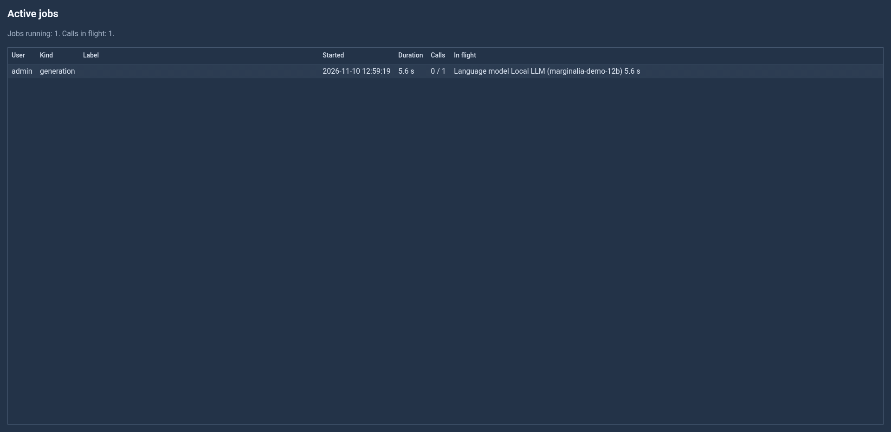
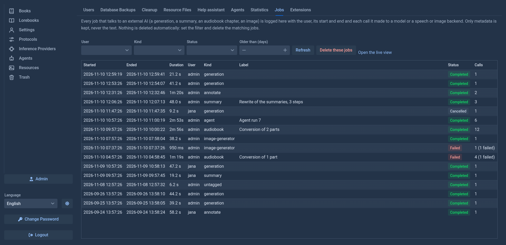
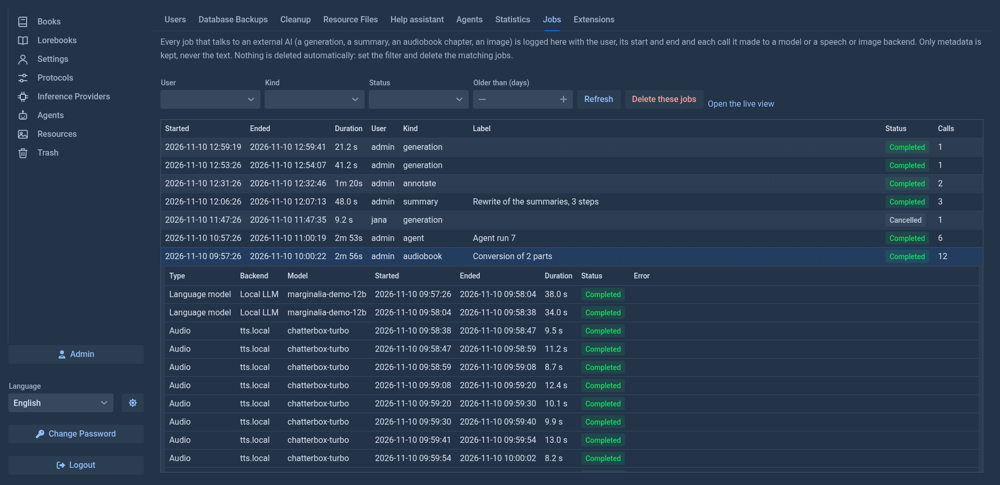
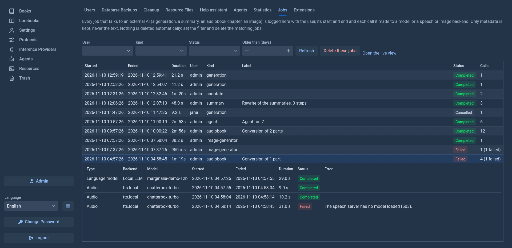
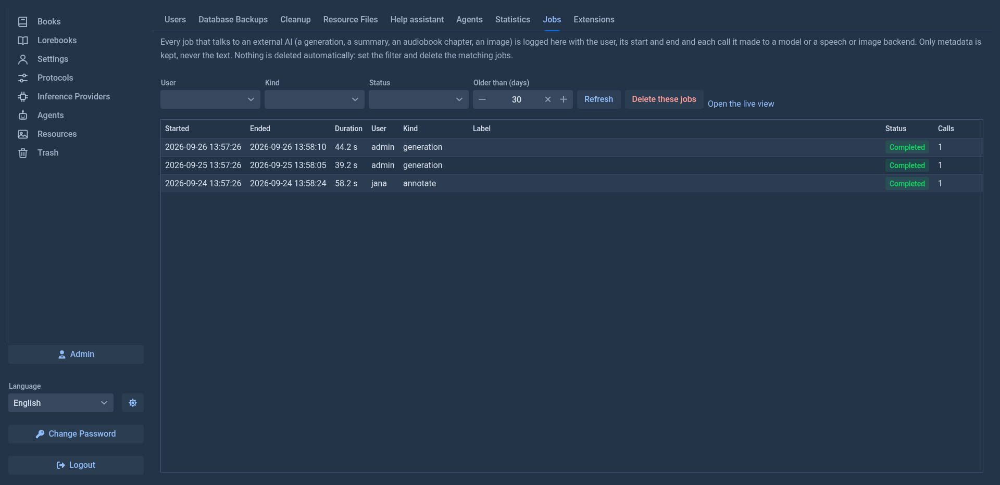
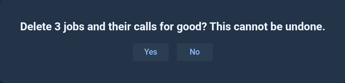

# Jobs

Everything the application asks of an **external AI** is a *job*: a generation, a summary, an annotation, an agent run, a chapter
converted to audio, an image. Each job is logged with the user it ran for, when it started and ended, how it ended, and every *call*
it made to a model or to a speech or image backend, again with its own start and end. The **Jobs** tab of the Admin page shows the log;
the page `/jobs` shows what runs right now.

Only metadata is kept: who, when, how long, which AI or server (the name of the AI, or the host of the speech or image server; never
the address path or the query), the model, how it ended and the short error message of a failure. **No prompt, no answer, no text** is
ever stored.

## What is one job

- A **request that nothing groups** (a generation, an annotation, a redraft, an impersonation, a summary of one part, a question to the help assistant, a request of a plugin such as a translation of a part or a lore entry) is a job of its own with one call. Its kind is the kind of work (`generation`, `annotate`, `summary`...).
- A **rewrite of the summaries** is one job (`summary`) with a call per summary written.
- A **work session of an agent run** is one job (`agent`) with a call per round of the agent; a run that is paused and resumed has a job for each session, and a sub-agent's requests are jobs of their own.
- A **conversion to audio** is one job (`audiobook`) per batch of parts, with the requests of the labelling model and every piece spoken as its calls.
- An image made by the **Image Generator** is a job of its own (`image-generator`) with an image call.

## What runs now: `/jobs`

Open `/jobs` on the address of your Marginalia (for example `http://localhost:8080/jobs`; the **Open the live view** link of the tab
does it). It asks for the login like every other page and shows nothing to users who are not administrators. The list refreshes every
two seconds and shows, for each running job, the user, the kind, how long it runs, how many of its calls are done and what is in
flight now (the AI or server and how long the call waits). It is the quick look when the server seems busy: a long list of calls waiting
on one model tells you why everything is slow.

Below the jobs, **Runs on the books** lists what works on a book now and keeps parts of it from being deleted or changed under it
(see the [panel of the runs](../books/story-editor.md#the-panel-of-the-runs), which shows the same to each user for their own
books): the user, the book, what it does, where it is (what the panel says: *Waiting for the model*, *The model is thinking/writing...*, *Working*, *Waits
for you*, and for a generation its stage, such as *INFERENCE* while it writes its part; the window of an open book shows nothing there), since when, and how many objects it holds (the book, parts). The window of an open book is a run too. **Stop**
stops the run as its user would. **End**, after a question, ends a run without stopping its work: what it holds is given back at
once. Use it only for a run that never ends (its work got stuck and it holds the book until a restart); its work may still write
when it wakes up.

## The log: the Jobs tab

| | |
|---|---|
| **User, Kind, Status** | Filters. The *kind* is what the job is (`generation`, `summary`, `annotate`, `agent`, `audiobook`, `image-generator`...); a request made by code that did not name its work is `untagged`. |
| **Older than (days)** | Only the jobs that started that many days ago or earlier. |
| **Refresh** | Reads the log again. |
| **Delete these jobs** | Deletes for good the jobs the filter shows and their calls, after a question that says how many. With no filter set it deletes the whole log. |
| **Open the live view** | Opens `/jobs` in a new tab. |

Click a row to see the calls of the job: the type (language model, audio, image), the AI or server, the model, start, end, duration,
status and the error of a failed one. A job that is shown as failed made a call that failed, or was ended as failed by the code that ran
it; a cancelled call is one you stopped (or one that was still running when its job ended).

A failed job shows which call failed and why:

**Nothing is deleted by itself.** The log grows with every request, so clear it from time to time: set *Older than (days)*
(for example 30), look at what is listed and delete. The [cleanup](cleanup.md) removes the jobs of a user together with the user.

A job is written to the log when it ends; a job that is still running is only on `/jobs`. If the application stops, the jobs that were
running are lost (they were never finished). A job that nobody ended and that makes no call for half an hour is ended as completed.
