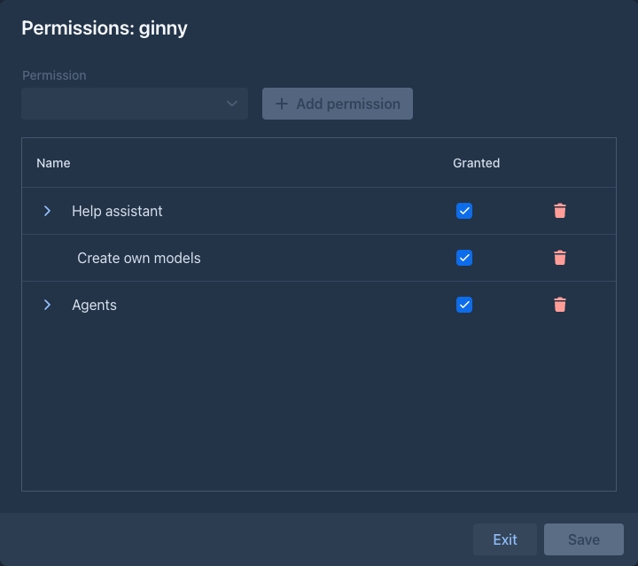
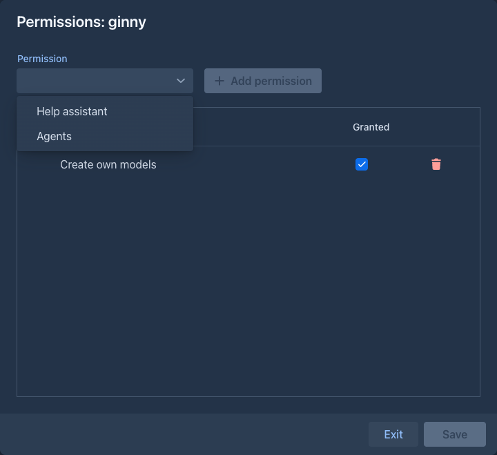
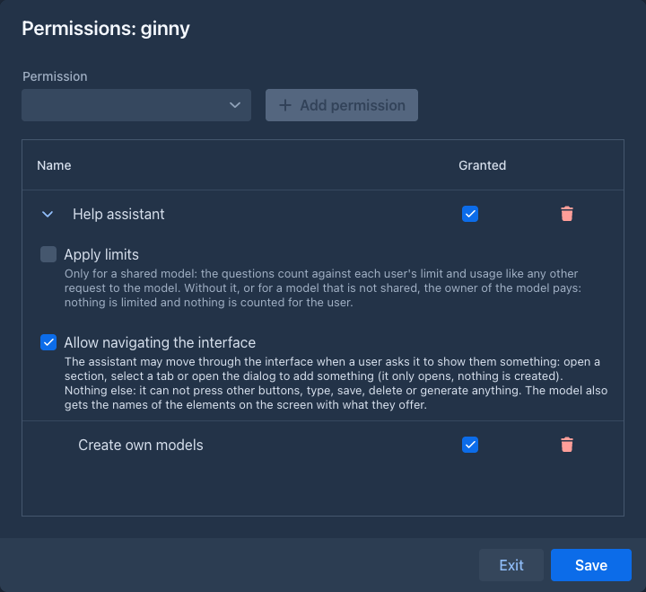
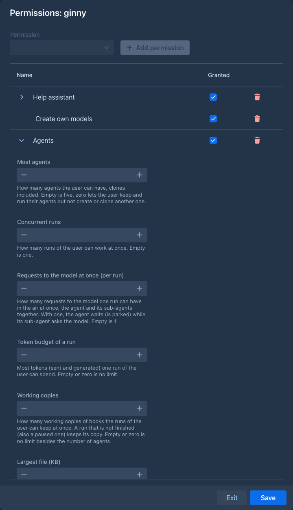

# Permissions

A permission lets one user do something that is not for everybody. Administrators give permissions to users one by one;
a user who has none can do everything else in Marginalia as usual (write books, build lorebooks, use the models that
administrators [share](../inference-providers.md#shared-providers)).

| Permission | What it allows | Settings |
|---|---|---|
| **Create own models** | Adding [inference providers](../inference-providers.md): without it the user can only use the providers the administrators share, the providers they already have keep working and can still be edited. | |
| **Help assistant** | Asking the [help assistant](help-assistant.md), the chat that answers from the manual. | **Apply limits** and **Allow navigating the interface**, see [Settings of a permission](#settings-of-a-permission). |
| **Agents** | The [Agents](../agents.md) tab: creating agents, cloning them and running them on a book. | **Most agents**, **Concurrent runs**, **Requests to the model at once**, **Token budget of a run** and the quotas of copies and files, see [Settings of a permission](#settings-of-a-permission). |

Administrators always have every permission, they need none, so there is nothing to give them (the buttons and sections
of an administrator never depend on a permission). New users have no permission: give them what they need right after
you [add them](users.md#adding-a-user).

## Giving and taking permissions

The key button in **Admin → Users**, in the row of the user, opens the permissions of that user:

The window is a table of the permissions the user has, with three columns:

| Column | |
|---|---|
| **Name** | The permission. A permission that has settings has an arrow in front of its name, see [Settings of a permission](#settings-of-a-permission). |
| **Granted** | Whether the permission works. A permission that is not granted is the same as none, but it is kept with its settings, so you can switch it off for a while and on again. |
| The trash button | Deletes the permission (and its settings) for good. |

To give a permission, click **Add permission** above the table and choose one of the permissions the user has none of;
it is added to the table, granted. Nothing is stored until you click **Save**:

- **Save** is off while there is nothing to save.
- **Exit** closes the window; when there are unsaved changes it asks first, so a change is never thrown away by
  accident.
- A permission you delete stays in the table until you save, and is deleted for good when you do. Before that, put it
  back by closing the window with **Exit** without saving.

After saving, the page of the user is reloaded when they are logged in, so the buttons and sections that depend on the
permissions appear or go away at once. Your own page is not reloaded, even when you change your own permissions.

## Settings of a permission

Some permissions have settings that belong to the user, not to the whole installation. The row of such a permission
starts with an arrow: click it to unfold the settings (they are folded when the window opens, and a permission you
just added is unfolded), click it again to fold them. Folding is only a way to keep a long list short; it changes
nothing and does not count as an unsaved change.

**Help assistant** and **Agents** have them. The ones of the help assistant:

| Setting | |
|---|---|
| **Apply limits** | For a shared model, whether the questions of the user count against their limit and usage like any other request, see [Who pays](help-assistant.md#who-pays). Off by default. |
| **Allow navigating the interface** | Lets the assistant open a section, select a tab or open the dialog to add something when the user asks it to show them the way, see [Showing the way](help-assistant.md#showing-the-way). Off by default. |

The ones of the agents; an empty field is the default:

| Setting | |
|---|---|
| **Most agents** | How many agents the user can have, the clones of an agent included. Five when empty. Zero lets the user keep and run their agents, but not create or clone another one. A deleted agent frees its place. |
| **Concurrent runs** | How many runs of the user can work at the same time. One when empty. |
| **Requests to the model at once (per run)** | How many requests to the model one run can have in the air at the same time, the agent and its [sub-agents](../agents.md#sub-agents) together. One when empty: while a sub-agent asks the model the agent waits, and the other way round. More lets sub-agents work in parallel with the agent (the model of the agent may have its own [cap of requests](../inference-providers.md#general-settings) too, which applies as well). |
| **Token budget of a run** | The most tokens (sent and generated) one run of the user can spend. Empty or zero is no limit. |
| **Working copies** | How many working copies of books the runs of the user keep at the same time. A run that is not finished keeps its copy, a paused one too, and gives it back when it is finished, stopped or deleted. Empty or zero is no limit besides the number of agents. |
| **Largest file (KB)** | The largest file an agent of the user can write to its workspace. 1024 (1 MB) when empty. |
| **Workspace size (MB)** | How much all the files in the workspace of one agent of the user can take. 20 when empty. |
| **Files in a workspace** | How many files the workspace of one agent of the user can hold, folders are free. 500 when empty. |
| **Checkpoints of a run (MB)** | How much all the [checkpoints](../agents.md#checkpoints) of one run (restore points of the working copy and its workspace) can take; part of it is kept for the automatic ones. 100 when empty. |

## When permissions were introduced

Before the permissions, **Users can create their own models** and the **Enabled** switch of the help assistant (with
**Apply limits** and **Allow navigating the interface**) were settings of the whole installation. Marginalia moved them
into permissions when it was updated: every user that existed then got **Create own models** if everybody could create
models (which was the default), and **Help assistant** with the same two settings if the assistant was enabled. Nothing
changes for them until you change it; users you add from now on start with no permission.
