# Agents

An **agent** is a model that works on one of your books on its own, for a long time, calling the [commands](commands/index.md)
you allow it as its tools: it can read the story, check it against the lorebook and report to you. The **Agents** tab is
where you create them, set what each may do, start and stop their runs, talk to them in the [console](#the-console) and clone them.

**Start** runs the agent: it works in the background, one round at a time, calling the commands you allowed and its own file tools, until it
finishes, asks you something, reaches a limit or you pause or stop it (see [A run](#a-run)). It works on a hidden [copy](#the-working-copy) of the
book, so your book is never touched while it works (the book itself is [locked](#the-book-is-locked)); when it is done you
[review its result](#reviewing-the-result) and take over what you want.

The tab is there only if an administrator gave you the **Agents** [permission](administration/permissions.md) (administrators always
have it, but the limits are the same as for everybody: the defaults unless they fill in the settings of their own permission, so an administrator who needs more agents, runs or room in the workspace sets it there; a changed limit reaches a run that is working when it is paused and resumed). On a phone each agent is a card with the same buttons, see [On a phone](#on-a-phone).

## The table

| Column | |
|---|---|
| **Agent ID** | The identifier of the agent. |
| **Name** | The name you gave it. |
| **Status** | What its run is doing: *Running*, *Waiting for you*, *Waiting for approval*, *Pausing*, *Paused*, *Stopping*, *Stopped, result kept*, *Done, waits for the review*, *Applied*. An agent without a run says *Not running*, or *Disabled* when it is switched off. |

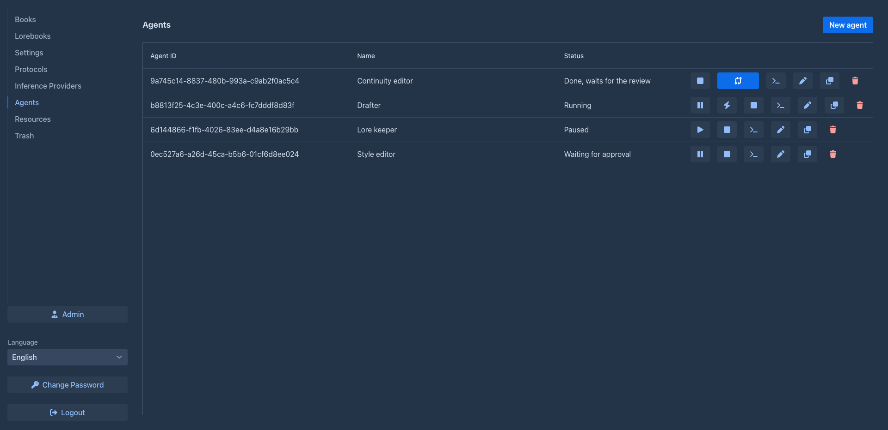

The buttons at the end of a row depend on the run:

| Button | |
|---|---|
| **Start** | Opens a menu. **Start immediately**: the agent works on its task (its instructions) on its own and you hear of it when it asks or finishes. **Start in console**: opens the [console](#the-console) and tells the agent not to work yet but to ask you at once what you want it to do; the run is then a [conversation](#a-run) that goes on until you press **Finish**. |
| **Resume** | Goes on with a paused or stopped run (shown instead of **Start**). It asks for an optional note to the agent, see [Resuming a run](#resuming-a-run). |
| **Pause** | Pauses a run that works or waits for you. |
| **Pause now** | Shown while the agent works: pauses it without waiting for the round to end, see [Pause and Stop](#a-run). |
| **Console** | Opens the [console](#the-console) of the agent. |
| **Stop** | Asks whether to **keep the result** (the run can be resumed later) or **discard** it. |
| **Edit** | Opens the agent. |
| **Clone** | Copies the agent, see [Cloning](#cloning). |
| **Delete** | Moves the agent, with its runs, to the [trash](trash.md). |

Starting is refused, with the reason, when the agent is disabled, has no model, or you have all the runs you may work at once.

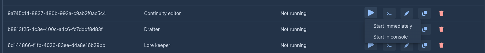

An agent has at most one run that is not over, and a book has at most one agent.

## A run

A run is the job of the agent. It works in rounds: the model is asked once, it answers with text and/or calls to its tools, the results go back, and so on.
Every round is saved, so a run can be paused and go on later, even after the server was restarted. The agent has the commands you allowed and
these of its own:

| Tool | |
|---|---|
| Files | `list_files`, `read_file`, `write_file`, `append_file`, `replace_in_file`, `regex_replace_in_file`, `grep_files`, `move_file`, `copy_file`, `merge_files`, `unzip_file`, `delete_file` in its own workspace (notes it keeps between runs). Next to the workspace it sees the read-only file `/AGENTS.md`, your instructions as the run started with them, which it can read again whenever it likes and never change. `list_files` and `grep_files` take a name pattern (`glob`, for example `*.md` or `chapters/*.md`), `copy_file` copies a folder with everything in it (a quick way to keep a version of the notes), `merge_files` joins several files into one without the text passing through the model (the last name of a path may be a pattern such as `/chapters/*.md`), `unzip_file` unpacks a [zip file](#unpacking-a-zip-file) of the workspace into a new folder. `replace_in_file` and `regex_replace_in_file` take a **folder** as the path too: they change every occurrence in all the text files below it (only the files whose name matches `glob`, when given) and report `path: n replacements` for each file. That is a **dry run** (nothing is written, the report says what would change) unless the agent passes `dry_run` false; it is all or nothing (when one file can't be written, none is changed) and refused, with nothing changed, when more than `max_files` (100 unless the agent says more) files would change. A single file can be a dry run too. `list_command_results` and `save_command_result` keep the long result of a command without the agent writing it out again: the last ten results are kept whole (the agent sees a long one cut), and one is saved to a file by its number, the newest when none is given; it then passes the file on as `@file:/path`. |
| `@file:/path` | Not a tool but a way to call one: a text argument of a command that is exactly `@file:/notes/chapter.md` is replaced by the contents of that file of the agent's workspace, so the agent can write a long text to a file once, check it, and pass it to a command (the result shows the short reference in the call, the command gets the text). `write_file` and `append_file` take it as their content too, which copies a file or adds it to another: a long file can be written in parts, each part within the longest answer of the model, and put together this way. |
| `@result` | Like `@file:`, for the result of a command: a text argument that is exactly `@result` is replaced by the whole result of the last command the agent called, `@result:3` by the result with that number (`list_command_results` shows the numbers). A generated text goes from one command to the next, or into `write_file` and `append_file`, without the agent writing it out. |
| `search_manual`, `read_manual_page` | Look something up in the Marginalia user manual (the same pages the help assistant reads): how a prompt template or a macro works, what a lorebook setting does. Read only; every agent has them. |
| `view_image` | Looks at an image file of its workspace (PNG, JPEG, GIF or WebP): the picture is shown to the model in the next message. Only an agent whose model is marked as seeing images (**The model sees images** in the agent) has it. A large image is scaled down before it is sent, a GIF shows its first frame, and only the newest four images stay in front of the model (an older one becomes a note, and the agent can look again). The images come from you (**Upload file**, or [attached to a message](#the-console)); the agent can't make one. |
| Images for commands | A command that sends pictures to a model of its own, such as [`generate-lore-entry`](extensions/lore-generator.md#commands), takes an `images` parameter: a list of paths of image files of the workspace (at most 8). It is the model of the command, not the agent's, that has to see them, so the agent can pass images even when its own model does not see images. |
| `update_plan` | Its to-do list. |
| `report` | A finding for you (what it found, where, and how serious: *Note*, *Warning* or *Problem*). The agent goes on after it; you read the findings in the [console](#the-console) and in the [review](#reviewing-the-result), apart from its final report. One finding per call, at most 200 per run. |
| `get_run_status` | How many rounds and tokens it has used, how much context, and the longest answer it can write; its plan; and its sub-agents: a line for each with its state, round, tokens, what it did last and its task. The agent is also told these limits of its model in its prompt, so it writes a long text in parts. |
| `checkpoint`, `checkpoint_list`, `checkpoint_diff`, `checkpoint_restore`, `checkpoint_delete` | Its [checkpoints](#checkpoints): saves a restore point of the working copy and its workspace (with a label), lists them, shows what changed since one (the settings, parts, lorebooks and entries of the book that were added, changed or deleted, and the files of the workspace; with a path only that file or folder, and for a text file the sentences that differ), goes back to one (when the round ends) and deletes one it does not need. |
| `get_sync_report` | Only after a resume that took over changes of yours: lists again what you changed in the book while the run was paused and what of it came into the agent's copy, see [Resuming a run](#resuming-a-run). |
| `request_compaction` | Compacts its own context: when the round ends it writes the summary of its earlier work, as with `/compact`. It is told to save its notes to a file first. See [Context filling up](#running-a-command-yourself). |
| `ask_user` | A question for you. The run waits (*Waiting for you*). |
| `finish` | Its report: the run is *Done*. The report is shown as the reason of the status. |

How a run ends a stretch of work:

- **Waiting for you:** the agent answered without a tool call, or asked you something. Answer it in the [console](#the-console).
- **Done:** the agent called `finish` (in a run you started *immediately*). A run you started *in the console* is a conversation: the report of the agent comes to you like a question, the run waits for your next message, and only **Finish** in the console (or **Stop**) ends it. The result of a *Done* run waits for your [review](#reviewing-the-result).
- **Paused**, with the reason: the limit of rounds, the token budget or the context limit is reached, the model could not be asked (an error of
  the provider, your limit on the AI), or the server was restarted. **Resume** goes on from the last complete round, see [When the server stops](#when-the-server-stops).
- **Failed:** the runner itself broke; the reason says what.

**Pause** takes effect between two rounds: the model request and the calls that are going on finish first. That can take
long (a slow model, a long generation), so there is **Pause now**: it cancels the request to the model, whose answer is thrown away, and the call
that is going on, answers the calls of the round that were not made as such, and the run is *Paused* in a moment. What the thrown away request would have
cost is lost; resume as usual. **Stop** does the same: it does not wait for the request or the call that is going on, they are cancelled and the run ends at once
(kept or discarded as you chose).

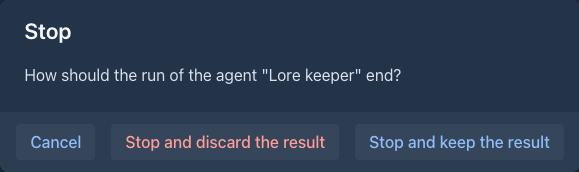

A command that is going on is told to stop, and a command that is written to be stopped (the ones that write with a model, search and replace) ends at once and leaves what it had
done so far. One that can't be stopped may still finish; either way the agent is told that it is not known whether the call was done and checks the state with a read
command when it goes on. The commands of the sub-agents are cancelled the same way when the run is paused, stopped or sent a message at once.

While the agent waits for a free place at its model (see [One model, several agents](#one-model-several-agents)) it is *Running*; a **Pause** or **Stop** ends that wait at once.

## The console

**Console** opens a window for the latest run of the agent, with eight tabs: **Run**, **Runs**, **Workspace**, **Checkpoints**, **Context**, **Book copy**, **Sub-agents** and **Diagnostics**.

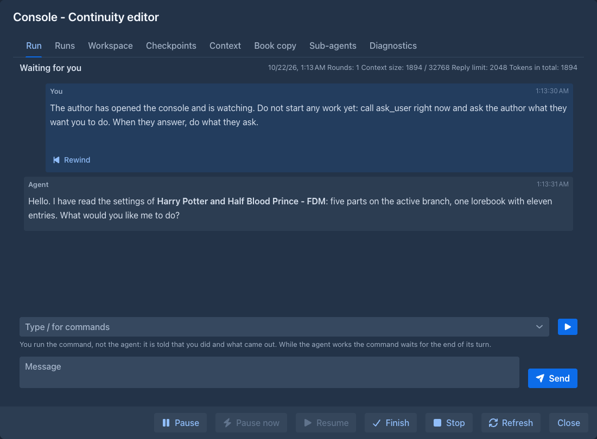

**Run** shows the *transcript*: what you told the agent, what it said (both as [Markdown](https://commonmark.org/help/), so lists, headings and emphasis show as such), and every command or file tool it called, folded to one line with the
arguments (click it to see them and the result, shown as plain text). When the model sends its **reasoning** (what it thought before it answered), a folded *Reasoning* block shows it before the answer, and the download has it. Whether you get any depends on the model and the server: it has to report it, and your AI has to have reasoning switched on. Every message has the time it was written at the right of its first line (the time of day, with the date when it was another day; hover for the whole time), so you can tell how long the agent worked and when it stopped. The state of the run, the **context** (how many tokens the last request used of the limit of the model, so you see how close the run is to a pause), the rounds and tokens it used (and the token budget, when there
is one) stay above it and the box for your message under it, while the transcript scrolls. What the agent waits for is in the transcript where it was written, as a bubble of its own that stays there when the run goes on:

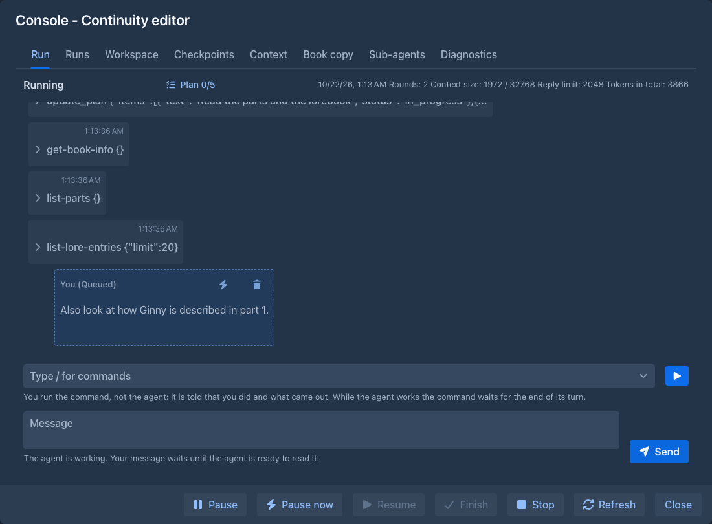

- a **Question of the agent**, when the run is *Waiting for you*; write the answer in the box and press **Send** (or **Ctrl+Enter**), and the agent goes on;
- a **Report of the agent**, when it called `finish`.

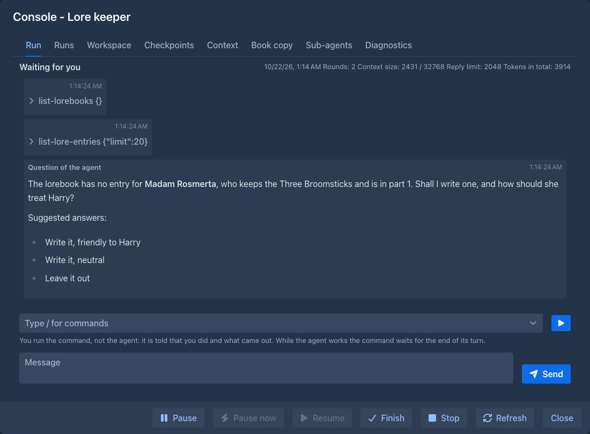

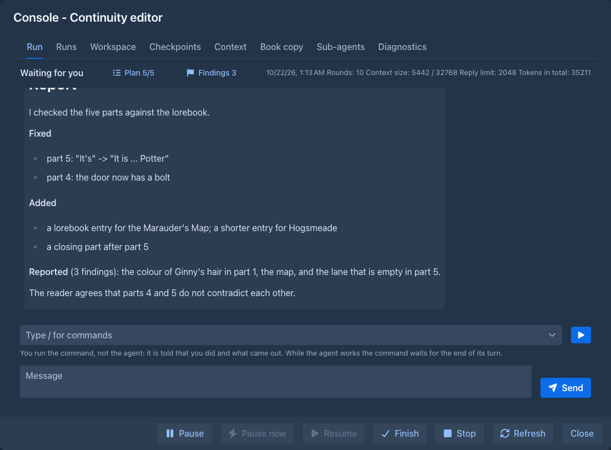

The line above the transcript shows the state of the run and its numbers: the rounds, the size of the context against its cap, the **Reply limit** (the most tokens the model of the agent can write in one answer; a call that needs more is cut off, so the agent writes long texts in parts) and the tokens in total. When the agent has made a plan (`update_plan`), a **Plan** button with the steps done out of all (**Plan 2/5**) appears there; it opens the steps in a popover, each with a mark for *Done*, *In progress* or *To do*. When it has reported findings (`report`), a **Findings** button with their number (**Findings 3**) opens them the same way, each with its severity. The findings are kept with the run, so they are there after a pause, a restart and when you look at an older run in the history; the Markdown file of a run (**Download**) has them in a section **Findings**.

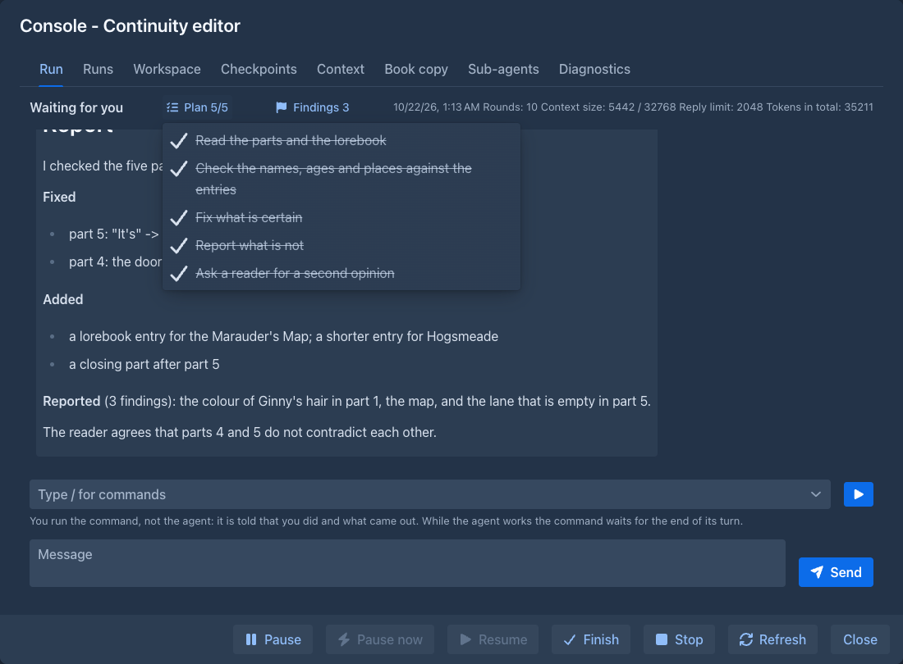

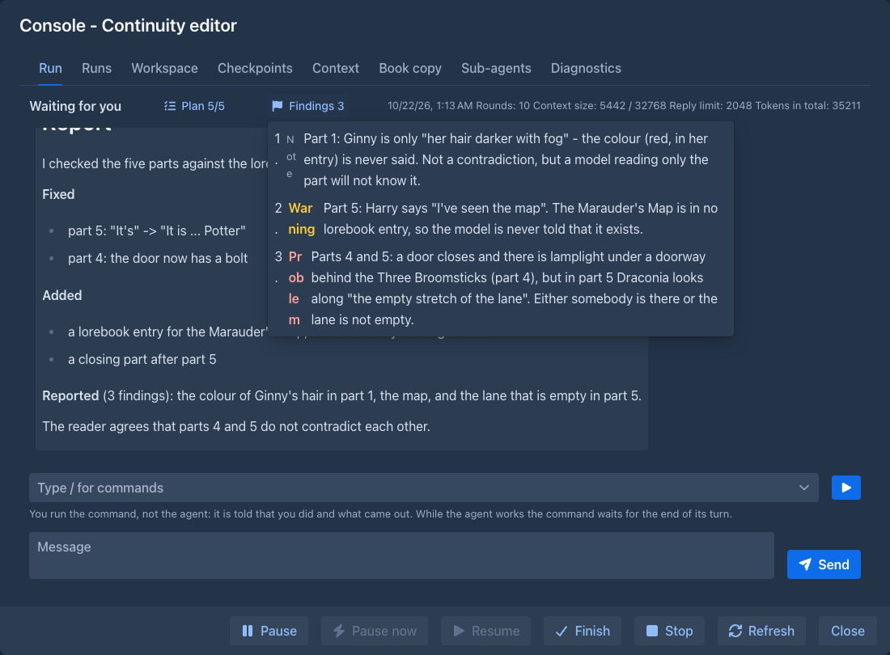

In a conversation you can also write while the agent **works**. The message is **queued**: it appears as a dashed bubble at the end of the transcript and the agent
reads it as soon as the round it is in is over: the request to the model that is on its way and the calls it made finish first, and the next request already contains
your message (several queued messages go together as one). When it should not wait even for that, press the
small **Send now** (lightning) button on the bubble: the agent drops the round it is in (the request to the model is canceled, a command that waited for your approval
is refused, calls that were not made are marked as skipped) and reads your message next. The **trash** button next to it takes the message back as long as the agent has
not read it yet (the same for a queued command). Commands that already ran stay done. Queued messages and commands are kept through a restart of the server (they are read when you resume), and
a run that is not a conversation (started *immediately*) does not take messages while it works.

### Running a command yourself

Under the transcript is the command line of the application (the one of the story tab: type `/`, the list and the help of the command appear above it) with what you can run on the agent: `/compact`, `/clear-workspace` and the
[commands the agent may call](#allowed-commands) that only read or add data (a command that changes or removes data is not offered, it would ask you to confirm
in a window of the book, which a run does not have). You run the command, not the agent: it is told, in a message of yours, that you ran it and what it answered
(and that what it read earlier may be out of date if the command changed the working copy), so it never believes it made a call it did not. It works as a message:
where the run waits (*Waiting for you*) or is *Paused* the command runs at once and the run stays as it is; where a [conversation](#the-console) works it is
queued, a dashed bubble marked *Command*, and runs at the end of the agent's turn, where the agent would have waited (the agent does not go on because of it).
The small **Run now** button on the bubble drops the round the agent is in, runs the command and lets the agent go on from there. A command that takes long
holds the box: wait for it before you write to the agent.

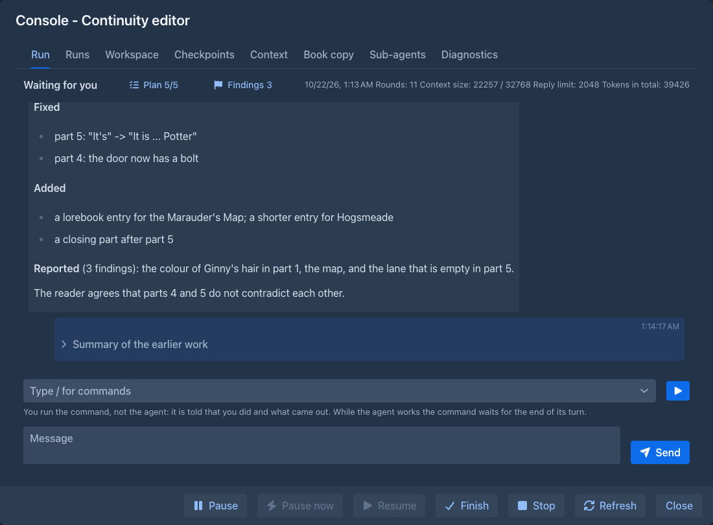

**`/compact [what to stress]`** frees the context. The agent is asked to read everything so far and write a summary (what you asked, what is done, what it found,
its notes and its plan, what it was about to do); that summary replaces everything before it in what the model reads. In the transcript you still see all of it,
and the summary as a folded block, **Summary of the earlier work**; the export keeps it too. The text after the command, if any, is what the summary should stress.
The request is the agent's own and its tokens count against the run. The question the agent is asked is its **Compaction prompt**: the one of the agent, else your
default in [Settings](account.md#templates), else the one of the administrator, else the built-in one. If the context is already so full that the request does
not fit, the oldest messages are left out of it (the summary says how many). Do it before the context is full, the usage line shows how close it is. Right after the compaction the context shown is an estimate of what the next request will hold (the summary, the system prompt and the definitions of the tools); the first answer of the model after it replaces it with the real number.

**Context filling up.** Once the context of the model passes 75% of its cap the agent gets a notice after every round (a message of the run, you see it in the
transcript): how full it is, and that it should save what it must not lose to a file of its workspace, update its plan and call `request_compaction`. Above 90% the notice says that the run
stops when the context is full. If the agent does not compact before the context passes the **Compact at** share of its definition (90% unless you say otherwise), the run does it by itself: the same compaction, the summary begins "compacted automatically" and the agent is not warned on top of it. A compaction that fails changes nothing, the agent is told, and the run tries again only some rounds later. The compaction the agent asks for is the same as yours (its **Compaction prompt**, see [Creating and editing an agent](#creating-and-editing-an-agent), its tokens count against the run); if it fails, nothing is changed and the agent is told.
The notices need a context cap: the lowest of the cap of the agent and the limits of its model.

**A call the model server could not read.** When a model writes a long text inside a call, its answer can end in the middle of the text (the limit of *one answer*, the **reply tokens** of the protocol or the **max completion tokens** of the AI, is reached, a server default applies when neither is set, or the model simply stops; the context, however full, is a different limit), and the server refuses the incomplete call ("Failed to parse tool call arguments as JSON"). Asking again with the same conversation would make the same mistake, so the run does not just pause: the agent is told in the transcript that its last answer could not be used and that nothing was done, and to write long text to a file of its workspace in several smaller steps; then it is asked again, up to three times in a row. If it keeps failing the run pauses, and what it was told stays in the transcript, so a **Resume** asks a different question than the one that failed. The same goes for a sub-agent.

A call that was cut off but reached the application (the call result says "not valid JSON ... cut off in the middle") stays in the transcript as the model wrote it, so you can read it, but it is sent back to the model with empty arguments: a server that reads the earlier calls again would otherwise refuse every following request, and the run could not go on without a rewind.

**Runaway calls.** A model can fall into a loop and write the same call hundreds of times in one answer; the results would fill the context before the next request. The run makes at most 32 calls of an answer, and a repeat of a call that only reads (the same tool with the same arguments, in the same answer) is made once. The calls that are left out are not in the transcript, and the agent gets a notice that says so.

**`/clear-workspace [what to keep]`** deletes the files and all the folders of the [workspace](#the-working-copy) of the run (after you confirm, as with the button of the workspace). Name what
to keep after it, separated by spaces: files, folders (with everything in them) or patterns such as `*.md` or `chapters/*.md`, a path with spaces in double quotes
(`/clear-workspace /notes.md "/my drafts" *.png`). The folders above a kept file stay. If something named is not there nothing is deleted. `/AGENTS.md` and the checkpoints are not
part of the workspace and are never touched. The agent is told what was deleted and what was kept. In the transcript a command you ran is a bubble with the command and what it answered.

When the model of the agent sees images (see [Creating and editing an agent](#creating-and-editing-an-agent)), **Attach image** is next to **Send**: pick a PNG, JPEG, GIF or WebP file, or paste a picture from the clipboard
into the message box (**Ctrl+V**), and it waits above the box (the cross takes it back) until you send. Up to eight images go with a message; the text may be empty.
The images are saved in the **uploads** folder of the workspace (a name that is taken gets a number: `map-2.png`), within the limits and rules of the workspace,
and the model is shown them with your message. Delete them in the **Workspace** tab when you no longer need them.

The buttons at the bottom are **Pause**, **Resume** and **Stop**, which do what they do in the table, and **Finish**, which ends a run that waits for you (its work is over, *Done*).

The window looks at the run every two seconds while it is open; **Refresh** does it at once. The **Run** tab shows the latest run that was not discarded, so a run that finished or failed can still be read there until the agent starts a new run; older runs are in **Runs**.

**Runs** is the history of the agent: every run it had, the latest first, with its date, status, rounds, tokens and result. Use the eye to **open** a
run in the **Run** tab and read its steps and its report again (the run you open stays there until you open another one), the arrow to
**download** its transcript as a Markdown file (what was said and when, every command with its arguments and result, the report, the conversations of the sub-agents), and the bin to **delete** it.
A deleted run goes to the [trash](trash.md). A run that is going on can't be deleted, stop it first. Runs you stopped and **discarded** are in the list
too, so you can read what they did or delete them; the **Run** tab shows them only when you open them.

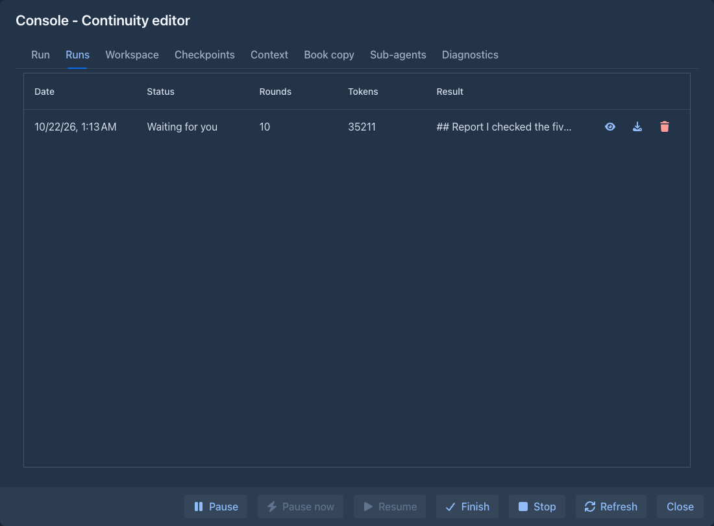

**Workspace** shows the files of the agent: its notes and reports, which it keeps between runs. Click a folder to go in (**Up** goes back), click a
text file to read it, use the arrows to download a file or the bin to delete it, and **Clear** deletes everything (stale notes mislead a fresh run).
**New folder** creates a folder in the open one and **Upload file** puts a file from your computer there, so you can hand the agent
a brief, a style guide or a draft. The same rules hold as for the agent's own files: names can't have `\ < > : " | ? *`, a trailing dot
or space, or be too long or too deep, the limits of file size and number of files apply, and an uploaded file must be text (UTF-8),
because the agent can only read text, an image (PNG, JPEG, GIF or WebP, recognised by what the file contains, not by its name;
up to 5 MB, and it counts against the total and the number of files like any file) or a zip file (up to 10 MB, kept as it is; the agent unpacks it, see [below](#unpacking-a-zip-file)). A file is never replaced by an upload: delete the old one first.
Files can't be changed while the agent works, pause it first. The workspace has a limit of size, file size and number of files, which your administrator can set in your [permission](administration/permissions.md#settings-of-a-permission); the line
under the table says how much is used. The name `AGENTS.md` at the top is taken by your instructions, which the agent sees there (the file can't be written or deleted).

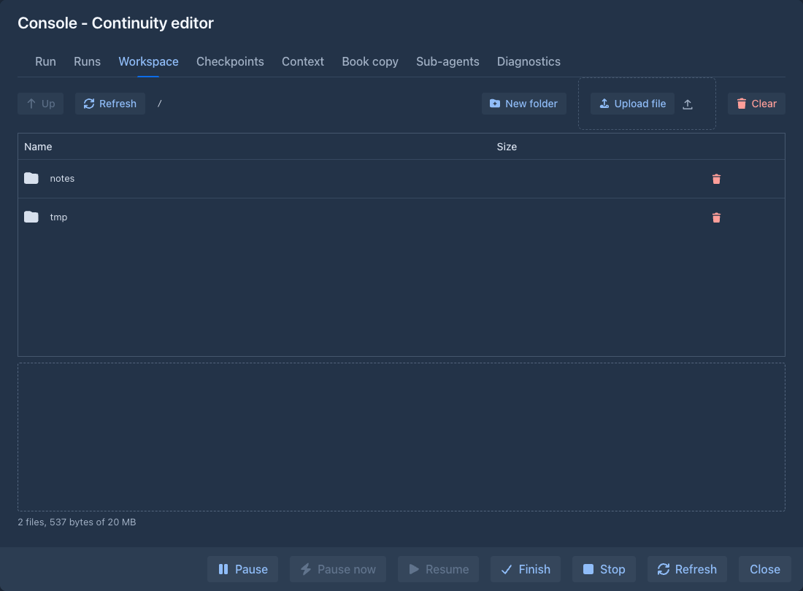

### Unpacking a zip file

Upload a zip file in the **Workspace** tab (**Upload file**) when the agent should work on many files at once, for example the chapters of
a draft, and ask it to unpack it: the agent has the tool `unzip_file`, which unpacks `/uploads/draft.zip` into the new folder
`/uploads/draft` (or into a folder it is given; the folder must not exist yet). Unpacking is all or nothing and an archive is never trusted:

- Only text files (UTF-8), images (PNG, JPEG, GIF, WebP) and zip files are kept. The other entries are left out and named in the answer to the
  agent. A zip file inside is stored, never unpacked on its own.
- The files must fit what the workspace has room for (size, file size, number of files), or nothing is unpacked.
- An archive with an entry that leads above the folder (`../x`) or starts with `/` is refused whole, and so is one with the same name twice (also
  differing in case), a name that is both a file and a folder, more than 5 000 entries, or an encrypted or damaged one.
- A zip bomb is refused: an archive that unpacks to more than the workspace can hold, or to more than 100 times its own size.

## Sub-agents

An agent can hand a job to a **sub-agent**: a helper with a conversation of its own that does one task and answers with a text. It has the commands and files of the agent (or of the model it runs on, see [below](#models-for-sub-agents)) and works in the same working copy and workspace (what it changes in the book stays), but it does not know the conversation of the agent, so the agent has to say everything in the task. The point is that what the sub-agent reads and tries stays out of the context of the agent: checking a chapter, auditing the names, drafting a part.

Set **Most sub-agents** in the [agent](#creating-and-editing-an-agent) to how many may work at once. Zero (the default) is none: the agent is not even told they exist.

- With **one**, the agent starts a sub-agent and waits (it is *parked*) until the sub-agent is done; the call returns its answer.
- With **more**, starting a sub-agent returns at once and the agent can go on, start others, look at them (`agent_status`), wait for an answer (`await_agent`) or stop one (`cancel_agent`). The call that reaches the limit waits until one of them is over and returns what ended.

Rules that hold either way:

- A sub-agent **reads the whole workspace but writes only in a folder of its own**, `/tmp/sub1`, `/tmp/sub2`... (it is made when the sub-agent starts, and what an earlier run left in a folder of the same name is deleted). Its answer is saved there as `result.md`, so when a long answer is shown cut off, the agent reads all of it from that file. You find the files in the **Workspace** tab; they take part of the workspace quota and stay until you clear it.
- A sub-agent runs on the main model of the agent unless the agent asks for another one, see [Models for sub-agents](#models-for-sub-agents).
- A command of a sub-agent that changes data follows the **Destructive commands** setting of the agent: with *Ask first* the same [window](#asking-you) asks you, and that sub-agent waits for your answer (pausing the run refuses it).
- A sub-agent can **not start sub-agents**, finish the run, ask you, or make checkpoints; it ends by answering with a text.
- Everything counts in the **one budget of the run**: rounds, tokens, the limits of the model. A sub-agent that hits a limit fails and says so; the agent then hits the same limit.
- How many requests are on their way to the model at once is the **Requests to the model at once** your administrator gave you (one when not set): with one, the agent and its sub-agent take turns.
- Calls that change the book or the workspace are done one at a time, whoever makes them, so two sub-agents never write at the same instant. Still, do not tell two of them to change the same part.
- **Pausing the run pauses the sub-agents too.** They stop at their next stable point (between two requests or two calls, at once when you pause at once) and what they said and did is kept with the run, so a **Resume** goes on where everything was: the sub-agents go on with their conversation, and a call of the agent that waited for one (`await_agent`, or `spawn_agent` with a limit of one) waits again, as if nothing had happened. A sub-agent that was over before the pause is still there for the agent to ask about. Stopping a run and keeping it does the same; discarding it, a restore of a checkpoint (the book the sub-agents worked in is replaced) and the agent finishing or asking you something end them for good. An agent that ends its turn while sub-agents still work is told once; if it does it again they are stopped.
- Their conversations are not in the **Run** tab. The **Sub-agents** tab of the console shows them: pick one above to read what the agent told it, what it said, the commands it called with their results and how it ended (the answer it gave, or why it failed or was cancelled), in the same blocks as the transcript. It follows the run while it works, and it shows the sub-agents of an older run too (pick that run in the **Runs** tab first). A `spawn_agent` call in the **Run** tab has a **Sub-agent** button that opens its conversation. A conversation the agent went back over (a rewind) is greyed and marked *forgotten by the agent*. The **download** of the run (in the **Runs** tab) has a section for each sub-agent, with its task, its state and every message and call.

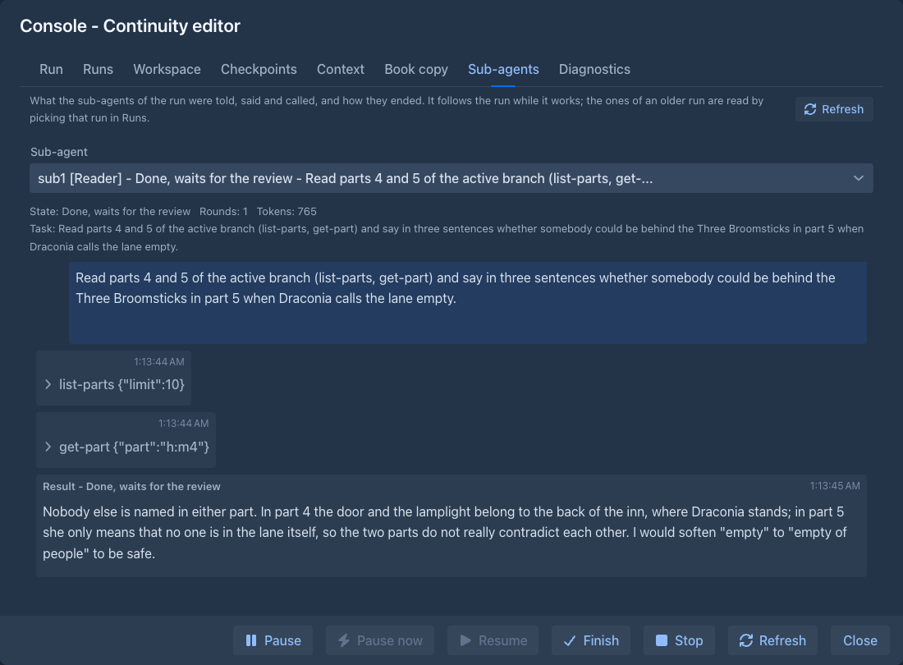

### Models for sub-agents

The agent has one **main model**, picked at the top of the dialog. Under **Models for sub-agents** you can add others, for example a cheap model that only reads or a fluent one that drafts. Each has a **role** (its name), a **description** (when to use it: the agent reads it to choose), its AI and protocol, an optional **context limit**, and what it may use:

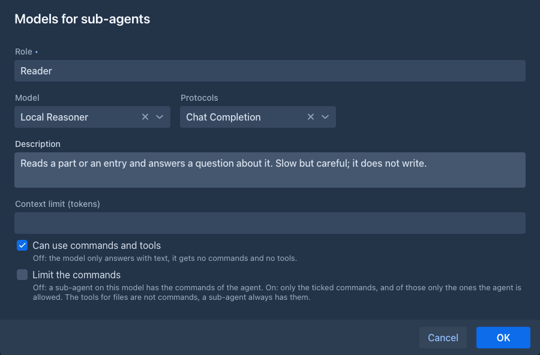

- **Can use commands and tools.** Off, a sub-agent on this model only answers with text: it gets no commands and no tools.
- **Limit the commands.** Off, a sub-agent on this model has the commands of the agent. On, only the ones you tick, and of those only the ones the agent is allowed (the allowed commands of the agent stay the upper limit). The tools for files are not commands, so every sub-agent has them. The main model has the same setting, for the sub-agents that run on it (the **Edit** button of its row).

The agent is told the roles, the descriptions and the commands of each model, and starts a sub-agent on one with the `profile` of `spawn_agent`; leaving it out means its own model. The checkbox **Sub-agents may run on the main model** (on by default) turns that last choice off: the agent must then name another model, and with none, it gets no tools for sub-agents at all. A sub-agent has the limits of its own model (how much it can read and how long its answer may be), and the **Sub-agents** tab and the diagnostics say which model each one ran on.

## One model, several agents

A local server often has one slot (one GPU): ask it for two answers at once and both crawl or time out. Set **Concurrent requests of agents** in the [settings of the model](inference-providers.md#general-settings) (1 for one slot) and the requests of your agents to it take turns, in the order they came: the others wait, their runs stay *Running*, and a **Pause** or **Stop** ends the wait. It counts the model requests of all the agents of all users who use that model, the commands that write with it included. It does not hold up your own writing in the story window, and that does not count against the agents either.

## When you are not there

An agent that needs you, finishes or fails tells the open screens of the application (the badge on the tab, a notice). When no screen of yours is open it can also send a short message to an address you give in [Settings](account.md) ("Message to a URL when an agent needs you"): your **ntfy** topic (the ntfy app on the phone shows it at once), a **Gotify** message URL or a **Discord** webhook; pick the **Format** the service wants. **Send a test message** tries it with what is in the fields. The message names the agent and says what it wants ("waits for you", "finished", "asks for the approval of the command ...", "failed", "was paused: reason") in your language. **Also when the application is open** sends it in any case.

The server calls the address, so an administrator can turn this off for everybody (Admin, *Agents*). Treat the address as a password when it holds a secret: anyone who knows it can read what is sent, the server never writes it to its log, redirects are not followed, and only `http` and `https` are called.

## Asking you

When the agent needs you, you are told wherever you are in the app:

- a **number on the Agents tab** counts the agents that wait for you, and the **Console** button of such an agent is highlighted;
- a **notice** pops up with an **Open** button that opens the console of that agent.

The agent needs you when it *asks you something or waits for your next message*, asks you to **approve a command**, *finished*, *failed*, or
was *paused by itself* (a limit is reached, the model could not be asked, the server was restarted). A pause you asked for does not count.

Agents work while you are away, so this does not depend on the app being open: the number is there when you log in again, and every browser
window you have open gets the notice. Opening the console of the agent clears it (the other windows update).

When the agent is set to **Ask first** and wants a command that changes or removes data, the run stops in *Waiting for approval* and a window
pops up over the console with the command and its arguments. **Approve** lets it run, **Deny** tells the agent that you refused and it goes on.
Pausing or stopping the run (or stopping the server) does not count as a denial: the agent is told nothing, and when you **Resume**, the window comes again for the same command. The command still works on the [copy](#the-working-copy) of the book. If the console is
closed, the window is there as soon as you open it.

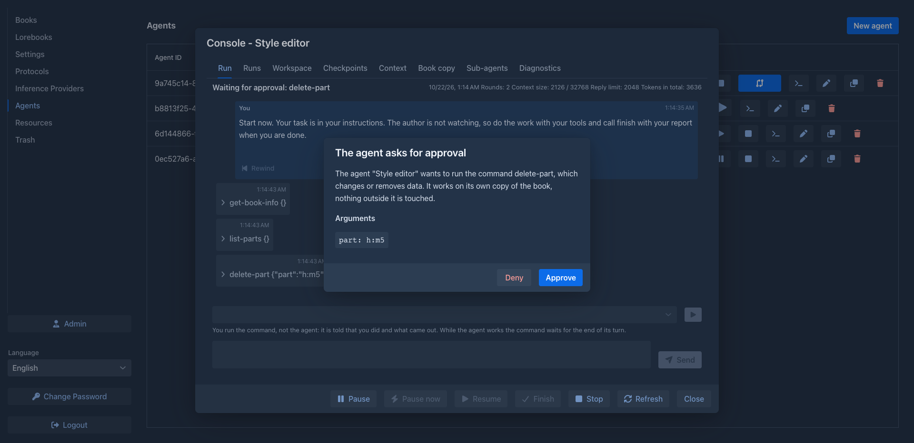

## When the server stops

Stopping the server pauses the runs that work first, as **Pause now** does (it gives the server a few seconds): the request and the call that go on are given up, the run is *Paused* with the reason "The server was stopped", and a **Resume** goes on. If the server is killed or crashes instead, the next start pauses the runs it finds working ("Interrupted by a restart of the server"). Everything the run did is kept: the saved rounds, the copy, the workspace, and the messages and commands you had queued. What is lost is the round that was not finished. Resuming handles the call the run was in:

- A call that **had not begun** (it waited for your approval, or for its turn after another call) is made again, so a command that needs your approval asks you again. A call that only reads is made again too.
- A call that **had begun to change something** may be done in part: the agent is told its outcome is unknown and checks it with a read tool before it repeats it; the calls after it are marked as not made.
- A command of yours that was running when the server stopped goes on when the run does. `/compact` and `/clear-workspace` are run again; any other command that had begun is **not** run again (it may be done in part): the agent is told so and checks. The messages and commands that came after it are delivered as usual.
- The plan of the agent and the results of its commands (`list_command_results`, `@result`) are kept too, so the agent has them after the restart.
- The calls of a sub-agent that were in the air are treated like the agent's: the ones that had not begun are made, the one that had begun is reported to it as "outcome unknown", and a sub-agent that waited for your approval asks again.
- If the server is **killed** (`kill -9`, a power cut) while a command is running, the command dies with it; what it did is as described above.

## The working copy

Every run works on a **copy of your book** and of its lorebooks that the app makes when the run starts: the messages, summaries, tags and settings
as they are at that moment, and the lorebook with its sub-lorebooks. The copy is hidden: it is not in the lists of books and lorebooks. Whatever the
agent does, it does to the copy; your book stays as it was.

When the agent has **Write the book with the model of the agent** on (the default), the copy also gets the **model of the agent** (the AI and the protocol of its main model profile) in place of the AI and the protocol of your book, every time the run starts or
is resumed. So the commands that write with a model (`/next`, `/swipe`, `/regenerate`, the summaries) and the model commands of extensions (the Lore Generator, the Arc Outline) use the agent's model even when your book is set to another one, or to none;
a `profile` named in the call still wins. With the setting off they use the model of the book. This is not a change of your book: the review does not list it and applying the result leaves the AI and the protocol of your book as they are.

A paused run keeps its copy and works on it again when you resume it. A run that is *Done*, or that you stopped and kept, keeps it until you
[take over its result or discard it](#reviewing-the-result). When the run is *Failed*, you discard its result, or its changes are applied, the copy is deleted for good, and the next run
makes a new one from the book as it is then.

## Resuming a run

A paused or kept run does not hold the lock on your book, so you can edit the book meanwhile. When you **Resume** the run, its working copy catches up with what you did:

- What you changed and the agent did not (a part, a lorebook entry, a setting, a tag...) comes into the copy. A part you added comes in too and the agent can build on it; what you deleted is deleted from the copy.
- What you and the agent both changed to different texts **stays as the agent has it**: nothing the agent did is lost. It is a [conflict](#reviewing-the-result) that you resolve when you review the result, with both texts in front of you.
- What you changed and the agent deleted stays deleted, and what you deleted and the agent changed stays in the copy; the review shows both.

Nothing needs a click: the sync is part of resuming, and it takes a moment (a few seconds when you changed hundreds of items). The state of the copy before it is saved as an automatic [checkpoint](#checkpoints). The agent is told what happened, by the names it knows
the items by, in a message when it goes on ("While the run was paused the user changed the book..."), and can ask again with `get_sync_report`.

**A conflict does not go away by itself.** Every resume compares the copy with the book again, so a conflict is reported again, and the agent is told of it again, each time you resume, until you resolve it: by changing your side of the book (to the agent's text, or back to what it was), or in the review.

**A note with the resume.** **Resume** opens a small window with a field *Note for the agent (optional)*. What you write there is the first thing the agent reads when it goes on, after the report of the changes you made to the book. It is meant for a change of direction ("leave the lorebook alone", "start with chapter 3") and, unlike a message to a conversation, it works for every run, also one that does not wait for your messages. Leave it empty to resume as before.

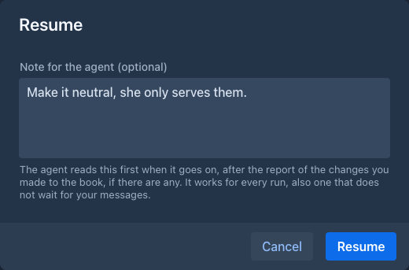

## Reviewing the result

When a run is *Done* (or you stopped it with **Stop and keep the result**) the agent row and the console have a **Review changes** button. It opens a window with
everything the agent changed, compared with your book **as it is now**, one line each. When the agent reported findings, they are listed above the changes (**Findings (3)**), so an audit that changed nothing still has something to show:

- **Book:** its name, description, language, point of view, tense, style and templates, its tags, and the data an extension keeps in the book (an arc outline, the character tracker).
- **Part:** a part whose text, instructions, scene setting, point-of-view character, present characters or summary the agent changed, a part it wrote, a part it deleted. The variables a generation keeps with a part (and the data of extensions) are taken over with it, as the field **Data**.
- **Lorebook** and **Entry:** a lorebook or an entry the agent made, changed (also moved, renamed, or with other tags, or other subbooks) or deleted.

Tick the lines you want, then **Apply the picked changes**. The buttons above the list tick **all** of them, **none**, **only new parts** (the new branch the agent wrote, nothing else) or everything
**without conflicts**. A line that needs another (a new part needs the part it follows if that is new too) brings it along when you tick it, and loses its followers when you untick it. Click a line to see it
on the right: the text of your book now and the text that will be written, **which you can edit** before you apply. If you write nothing, the agent's text is applied.

Your book may have changed since the run started (you can edit it as soon as the run is not working). What only you changed is not in the list and stays. What both of you changed to the same thing is no
change. What both changed to **different** texts is a **conflict**: it starts unticked, and when you tick it the text you see on the right replaces the text of the book. **Use the book's** puts the book's text
into the box (the line then changes nothing for that field), **Use the agent's** puts the agent's back; or write the result yourself. A line that can't be taken over (the part it follows, or the lorebook it
is in, was deleted from your book) says so and can't be ticked.

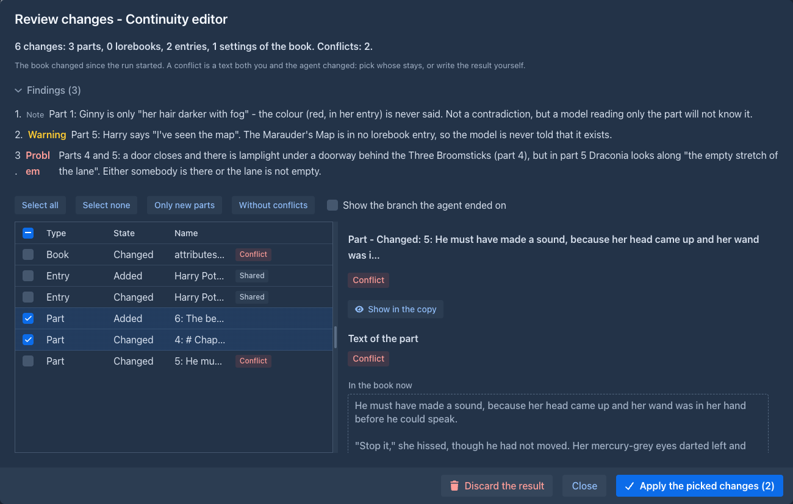

Under the texts, **Differences** shows what changes **word by word**: what is only in the book now struck through in red, what is only in the text to apply in green (it follows what you write in the box). For a conflict it also
shows what the agent changed and what you changed since the run started, each from the book as it was then, so you can see who did what. A line the agent changed in more than one thing (a part whose text and scene setting
changed, an entry with a new content and note) has a **Take this change** box beside each of them: untick one to apply the line without it, the book keeps its own value of that field. The place of a part in the story goes with the part and has no box,
and what the agent made or deleted is taken or left as a whole. **Show in the copy** (on a line the agent made or changed) opens the [copy of the book](#the-copy-of-the-book) at that part or entry, to read it in its place.

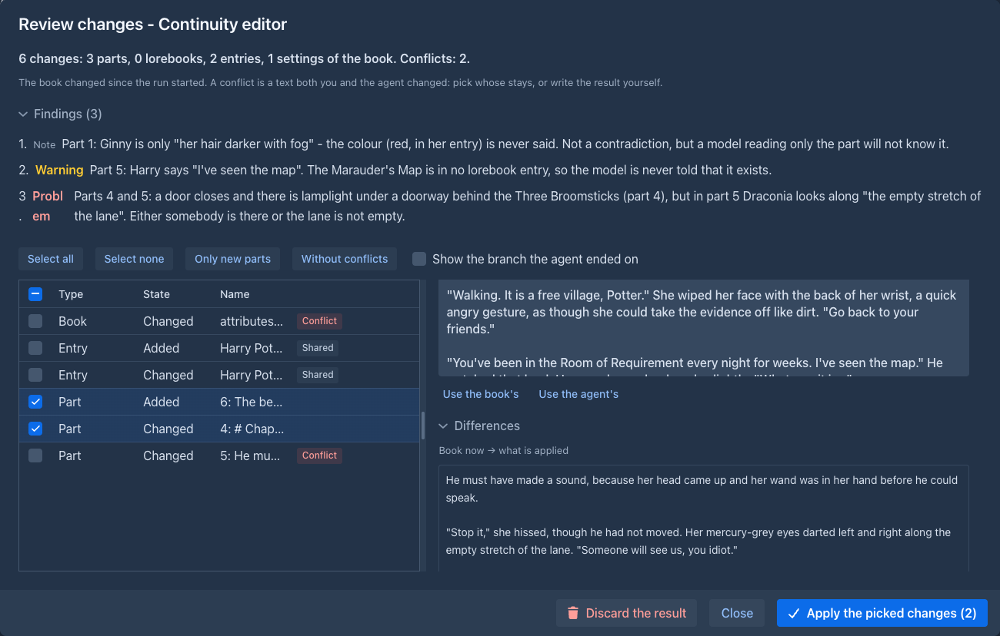

### Data that extensions keep (JSON)

Extensions keep their own data in a book, in its parts, lorebooks and entries (an arc outline, the character tracker, the variables of a generation). It is JSON, and the review shows it **pretty printed** with the line
**Merge JSON data** beside the text that will be applied. The data is not taken over as a whole: what only the agent changed is taken from the agent, what only your book changed stays, and what both changed in **different
places** is put together place by place. It is a conflict only where both changed the **same** place to different values (the order of the keys does not matter); until you decide, the agent's version is used there.

**Merge JSON data** opens a window with the data of the three versions laid over each other as a tree: *When the run started*, *In the book now*, the *Agent* and the *Result* in a column each, with a mark for what changed
and where (the agent, the book, both, a conflict). Only the places that changed are shown (untick **Only what changed** for all of them); a place is opened only when you open it, so a big document is no problem.

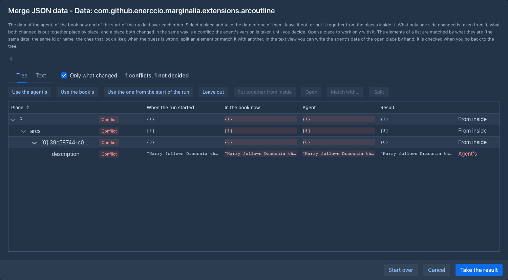

- Select a place and take its data from one version (**Use the agent's**, **Use the book's**, **Use the one from the start of the run**), **Leave out** (the key or the element is not in the result), or **Put together from
  inside** (the places inside decide, each its own). A key or an element that only one version has is copied into the result by taking it from that version. Taking a whole object or list from one version overrules what you chose
  inside it, but not for good: put it together from inside again and your choices are back.
- The elements of a **list** have no names, so they are matched by what they are: the same data first, then the same `uuid`, `id` or `name`, then the ones that look most alike, and what is left over in the same number and
  of the same kind is taken as changed. When the guess is wrong, **Split** an element into the ones of each version, or **Match with…** another element that the first one has no version in common with.
- **Open** (or a double click) works with one place alone: the path above the tree takes you back up.
- The **Text** tab shows the data of the open place as text: the agent's data you can **edit**, the others only to read (the book, the start of the run, the result), and **Show the difference to** marks what differs word
  by word. What you write is checked as JSON when you go back to the tree, change what is shown, open another place or take the result; if it is not valid JSON you stay where you are and are told what is wrong, and nothing is
  changed. Valid text replaces the agent's data in that place and everything inside it is compared again.
- **Start over** forgets what you decided and wrote; **Take the result** hands the result to the review, where it is the text to apply (the line stays as you left it while the review is open).

The review also has **Use the agent's** and **Use the book's** for such a field, to take one of the two as it is, and **Start over** to go back to the put-together data.

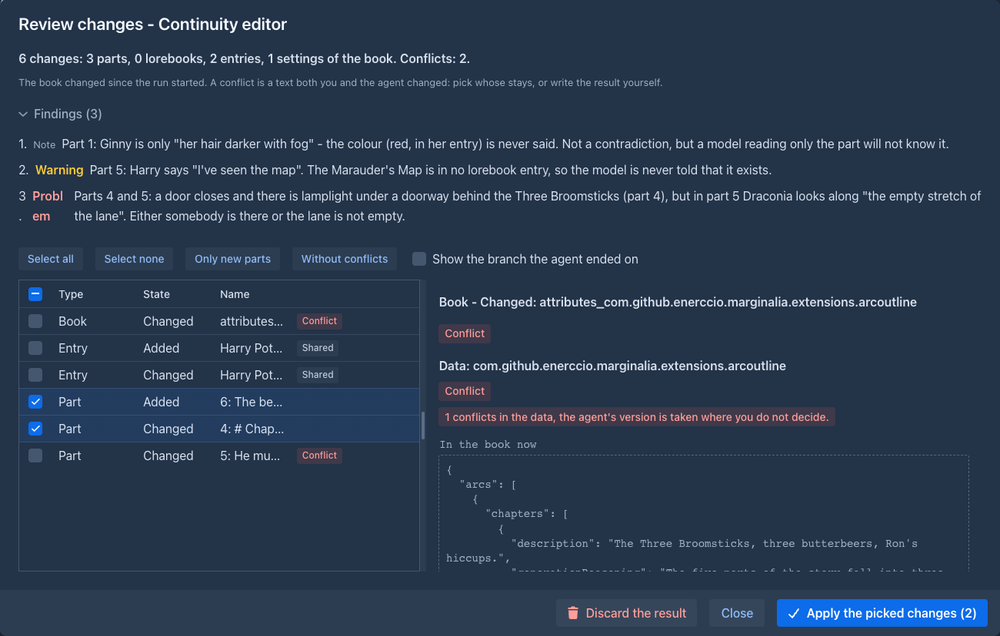

A lorebook that other books use is marked **Shared**: the change goes to the lorebook itself, so the other books get it too. It starts unticked.

Applying is done to the book **in place**: the parts keep their addresses, other books keep their links to a lorebook, and what the agent deleted goes to the trash. A **backup of the book as it was** is taken first
(it is among the backups of the book, with its lorebooks), and the changes are made all together or not at all. **Show the branch the agent ended on** also switches the book to the branch the agent was on, when it is
among what you applied. The summaries of parts that were edited are outdated as after an edit by hand; the agent's own summaries are taken over as they are.

When the changes are applied the run is *Applied* and its copy and checkpoints are deleted. **Discard the result** throws the copy away and leaves the book as it is. Until you do one of the two the agent has an unfinished run and
can't start another.

### The copy of the book

The **Book copy** tab shows the book the agent works on, to read: the **story**, one branch at a time (pick the branch above; each part with its number, the swipe it is among the others after the same part, its words, scene setting,
point of view and, folded, its instructions and summary), and the **lorebooks** with their entries (pick one to see its content, note, tags and settings). It is not a window of your book: nothing in it can be changed, no backup is
made of the copy and no extension sees a book open. It is read when you open the tab and when you press **Refresh**, also while the agent works, so it shows what the agent has written so far. It is there while the run has its copy
(not after the result was applied or discarded).

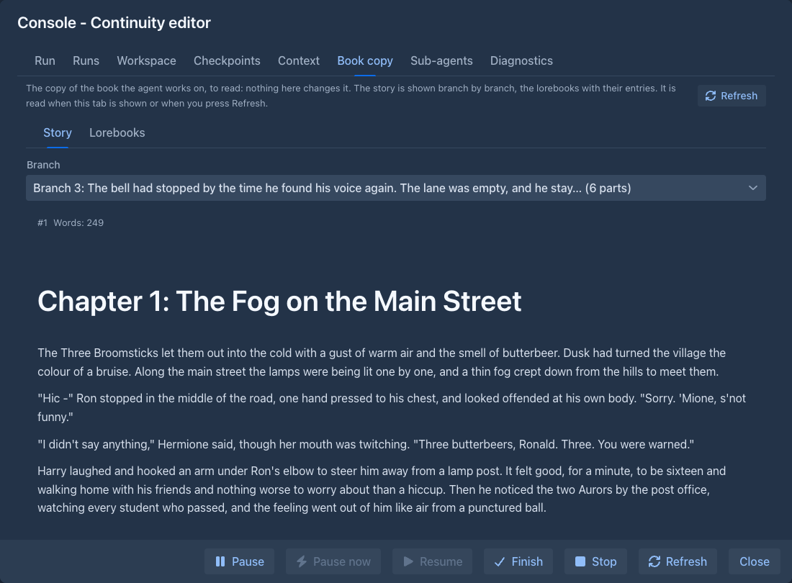

### Diagnostics

The **Diagnostics** tab counts what the run did from its transcript, to find out what an agent needs from its tools and its prompt. It works for any run, an old one too (pick it in **Runs** first), and is made when you open the tab and when you press **Refresh**.

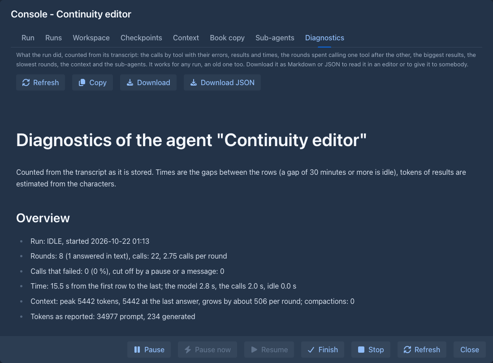

- **Overview**: rounds and calls, how many calls failed, the time of the model, of the calls and of pauses (a gap of 30 minutes or more between two steps is a pause, not work), the context at its peak and at the end, the tokens, compactions, your messages and the notices the runner gave the agent (an unreadable call, too many calls, a full context).
- **Tools**: for each tool the calls, the errors, the results that were cut, how often it was the only call of a round, the characters the agent wrote, how many calls passed a text as `@file:` or `@result`, how many wrote a long text (300 characters or more) out and how many of those copied it from a result the agent had just been given, the tokens of its results (about, from the characters), the share of all results, the longest result and the time.
- **What the requests reported**: recorded while the run works, so only for runs made after this was added (an older run says it has none): how long the requests waited for the first word (the server reading the prompt, so a short time means its cache was hot), how long the answers took to write and how many tokens per second, how much of the prompt the server did not read again (the cache; llama.cpp and OpenAI report it), how much of the answers was reasoning, why the answers ended (`length` means the limit of one answer cut it off), the calls the model wrote that were not made (repeats, the limits, the batch policies), the time the requests waited for a place, the summaries written and what they took, and the same for each block of 25 rounds.
- **What the model wrote**: the characters of the arguments, of the text beside the calls and of the reasoning, in all and for each block of 25 rounds with the time of the model, to see where its output goes and whether it stopped using `@file` at some point. **Longest arguments** shows the start of the biggest calls, with the path of a file tool.
- **Rounds lost to a pattern**: the same tool called round after round (three or more), marked when a search came right before it; and the calls made again with the same arguments. These show where a tool that takes many items, or more calls in one answer, would save rounds.
- **Errors** with the arguments of the first call that got each message (to see what the model sent when a call failed), the **biggest results**, the **slowest rounds**, the **compactions** and the **sub-agents** with the tools each one called.

**Download** gives the report as Markdown, **Download JSON** as JSON, **Copy** puts the Markdown on the clipboard. The times are the gaps between the stored rows, so they are approximate: the time of an answer includes waiting for a free place at the model.

### The context

The **Context** tab shows what the model reads with its **next request**, taken apart, so you can see where the tokens go and debug an agent that behaves oddly. It is made when you open the tab and when you press **Refresh** (not while the run works: it counts the tokens of every part).

- Three charts: the **kinds of parts** against the limit of the context (the prompt of the agent, your instructions, the notes of the runner, the tool definitions, the summary of a compaction, your messages, the answers of the agent, the results of its calls, and what is free), **every part in the order it is sent** (a bar for each, in the colour of its kind: a tool whose description is huge or a result that fills the context stands out), and the **context at each answer of the model**: a stacked bar of what it was made of (the same kinds, estimated), the size the model **reported** as a line and the limit as a dashed line. Where the line is above the bars, the model counted more than the estimate (images, the format of the provider); a bar that drops is a compaction or a rewind.
- A **table of the parts** with the kind, name, tokens and share of the context. Pick a row to read **exactly the text the model is sent** for that part: a section of the system message, the description and parameters of one tool, a message, the arguments of a call or the result of one.
- **Download** gives the whole context as one Markdown file (the system message with its sections, every tool with its description and schema, the conversation message by message, each text in a code fence), **Copy** puts the same text on the clipboard.

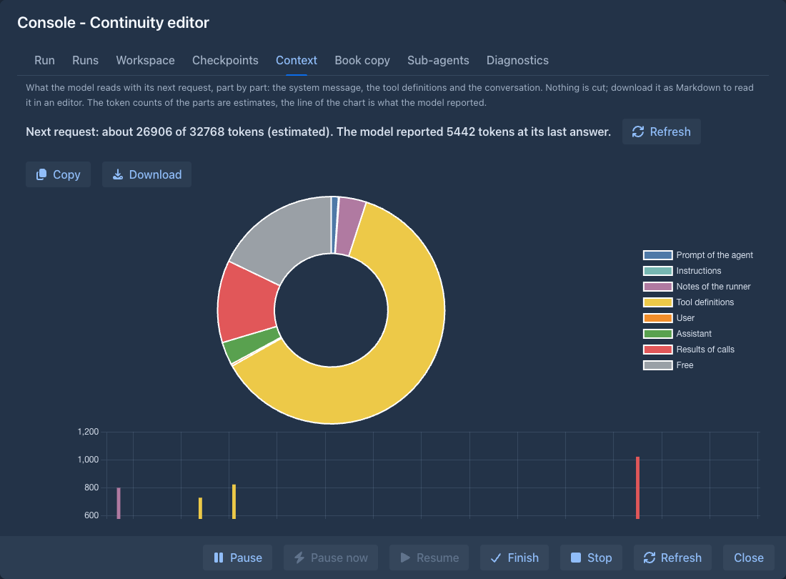

The sizes of the parts are estimates; the number the model reported is the real one (the request and its answer). In the chart of the answers the prompt, the instructions and the tools are as they are now (an older answer may have had others if you changed them), the conversation is as it was then: a summary replaced what was before it, and what a rewind went back over is gone from the answers after it (a compaction that was itself rewound is not brought back, the bars after it are a little too small). The system message and the tools are the ones the next request would use, so a change of the prompt, the instructions or the allowed commands shows at once. The messages are the transcript as stored, without what a resume adds (a "go on", the answers to calls an interruption left open). Reasoning is not part of the context (the model is not sent it back) and images show as their file names. What a compaction replaced is not in the context either; the **Run** tab and the **Runs** download still have it.

## Checkpoints

A **checkpoint** is a restore point of the working copy of the run (the parts, summaries, lorebooks and the data of the extensions, with the handles the agent was given) and of the
workspace of the agent, so that a job that went wrong can be undone: the agent goes back with `checkpoint_restore`, or you do it in the **Checkpoints** tab of the console. Who makes them:

- **Start of the run**, made when the run begins. It is never rolled out.
- **Automatic**, made by the run before a round in which the agent calls something that may change the book or the workspace (a command that is not a plain read, or a file tool that writes), and only when something
  changed since the last checkpoint. The last five are kept; the oldest goes when a new one is made.
- **Made on purpose**, by the agent with `checkpoint` (it is told to make one before a risky step) or by you with **Save a checkpoint**. They stay until deleted.

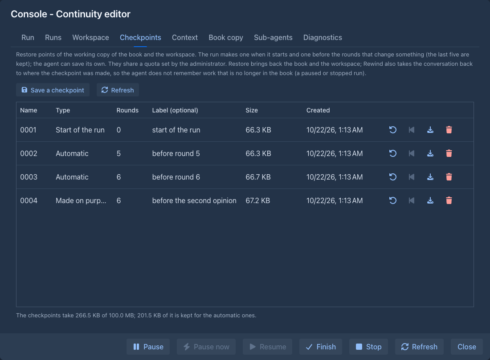

All the checkpoints of a run share a **quota** that the administrator sets in the [permission](administration/permissions.md#settings-of-a-permission) (100 MB when empty). Part of it is kept for the automatic ones, so that the
agent can't use it all up; a checkpoint made on purpose that does not fit is **refused**, nothing is deleted behind the back of whoever asked. The agent then gets the list and deletes what it does not need
(not the checkpoint of the start, and not the newest one); you can delete any in the tab. Each is an archive (a ZIP of the book as JSON, the pairs and the workspace files) you can **download**.

**Restore** makes the working copy again from the checkpoint: it is a new copy, the old one is deleted, the workspace is the saved one (files written after it are gone) and the handles of the agent for the items
that were there still work. The state before is saved as an automatic checkpoint first, if there is room, so a restore can be taken back. A restore takes about as long as the start of a run (half a minute for a book
of two thousand parts). You can restore while the agent does not work; the agent restores itself between two rounds and is told what came back. The checkpoints go when the run lets go of its copy.

**Rewind** is a restore that also takes the *conversation* back. A restore alone leaves the agent remembering work that is no longer in the book, so a run you want to send in another direction needs a rewind: the working copy and the workspace go back to the checkpoint, the messages after the place where the checkpoint was made are greyed in the transcript (you can still read them, and the export has them) and the agent no longer reads them, and a notice tells the agent what happened, so it does the work again if it is still needed. The run has to be paused or stopped (pause an agent that waits for you first); you **Resume** it afterwards and it goes on from the notice. A checkpoint can only be rewound to while its place in the conversation is still part of it: after a rewind to an earlier checkpoint the later ones (of the conversation that was undone) can only be restored. A checkpoint made before the rewind existed does not know its place and can only be restored. What a compaction did after the checkpoint is undone with the rewind; the agent reads the messages the compaction had replaced again.

**Going back to a message.** You do not have to pick a checkpoint: every message you wrote to the agent has a **Rewind** button under it in the transcript of the **Run** tab. It takes the conversation back to before that message: the agent forgets the message and everything after it, and the working copy and the workspace go back to the newest checkpoint that was made before it (the runner makes one before every round that changes something, so this is usually right at the message). The state of a run is only known at its checkpoints, so when the closest one is older than the message, the messages between that checkpoint and yours are forgotten too; the confirmation tells which checkpoint it is and how many messages go. The forgotten messages stay in the transcript, greyed. The button works while the agent waits for you (it is paused for it), is paused, or was stopped and kept; while the agent works it is disabled. You **Resume** the run afterwards, and it goes on from the notice.

## Creating and editing an agent

**New agent** opens the same window as **Edit**:

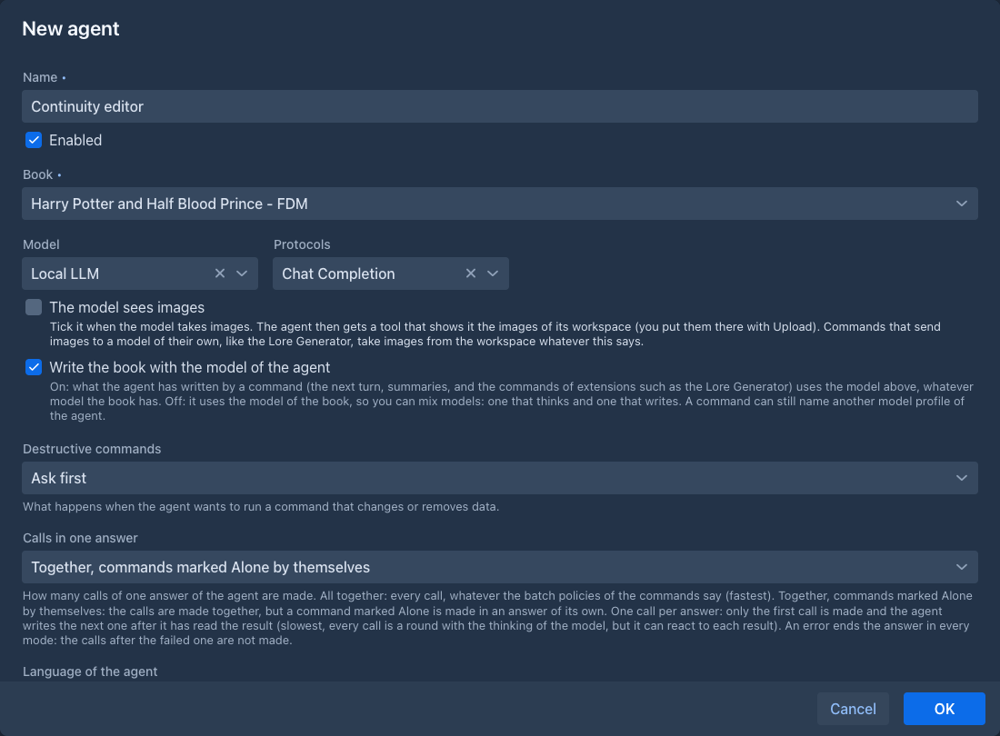

| Field | |
|---|---|
| **Name** | Required. |
| **Enabled** | A disabled agent can't be started; its runs that exist are not touched. |
| **Book** | The book the agent works on, required. Only books that have no agent are offered, and the book of an agent can't be changed later. |
| **Model**, **Protocols** | The model and the protocol the agent talks with. Both, or neither; an agent without them can't be started. |
| **Write the book with the model of the agent** | On (the default): the commands that have a model write something - the next turn, swipes, summaries, and the commands of extensions such as the Lore Generator and the Arc Outline - use the model above, whatever model your book has. Off: they use the model of your book (an extension command falls back to your default model from [Settings](account.md) when the book has none). That is how you mix models: a strong one that thinks and a cheaper or more fluent one that writes. A command can still name another model profile of the agent. |
| **Calls in one answer** | How many of the calls the agent writes in one answer are made. *All together, ignore the batch policies*: every call (the fastest). *Together, commands marked Alone by themselves* (the default): the calls are made together, but a command whose **Batch** column says *Alone*, as one that makes a call to a model, is made in an answer of its own, and the agent is told. *One call per answer*: only the first call is made and the agent writes the next after it has read the result; slower (every call is a round of its own, with the thinking of the model) but it can react to each result. An **error always ends the answer**, in every mode: the calls after the failed one are not made (they are answered "not made because an earlier call failed") and the agent reads the error first. |
| **The model sees images** | Tick it when the model takes images (the API of the model does not say, so you do). The agent then has `view_image` and you can attach images to your messages; without it it never gets a picture. |
| **Language** | The language of everything the agent reads: the descriptions of its commands, their results and their errors. English is the default and the safest choice, because the commands and their parameters are in English whatever the language is (the descriptions in another language mix both), and models, small ones above all, use tools more reliably that way. The list holds the languages installed in the application (an extension can add one, like the Chinese localization). It has **nothing to do with the language of the book**: the agent is told to write the text of the book in the language of the book, which it can read with `get-book-info`. A run keeps the language it was started with, a change applies to the next run. |
| **Destructive commands** | What happens when the agent wants a command that changes or removes data: *Run them*, *Ask first* (a [window](#asking-you) asks you to approve it) or *Refuse them*. |
| **Most rounds**, **Token budget of a run**, **Context limit** | Optional limits of one run. The limit your administrator gave you applies in any case. |
| **Most sub-agents** | How many [sub-agents](#sub-agents) the agent can have working at once, 0 to 10. Empty or zero is none. |
| **Models for sub-agents** | The [models](#models-for-sub-agents) a sub-agent can run on, and whether it may run on the main one. |
| **Compact at (% of context)** | When the context of the model passes this share of its limit and the agent did not [compact its work](#running-a-command-yourself) itself, the run does it: the agent writes the summary of its earlier work, which replaces it. Empty is 90, zero never (the run then stops when the context is full), otherwise 50 to 99. |
| **System prompt** | What the agent is told to be. Leave it empty and the agent follows the default - yours from [Settings](account.md#templates), else your administrator's, else the built-in one - which is shown in grey. The info icon has **Insert Default Template**, which fills the default in so you can edit a copy of it; clear the field again to follow the default. |
| **Compaction prompt** | What the agent is asked when you [`/compact`](#running-a-command-yourself) it: to write the summary that replaces its earlier work. Empty follows the default, like the system prompt, with the same info icon. |
| **Instructions (agents.md)** | Your instructions to the agent, added to its prompt in every run. The agent can read them, never change them. Empty follows your default from [Settings](account.md#templates), if you have one (it is shown in grey), else there are none. Under it a line says what the prompt, the instructions and the ticked commands weigh in **every request**, in tokens (an estimate, with the tools for files and for the run and the notes of the runner on top). |
| **Allowed commands** | See below. |

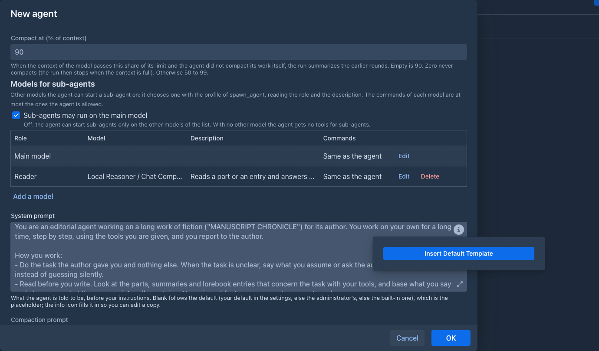

### Allowed commands

The agent is offered only the commands you tick. The table lists every command with its effect (*Destructive* changes or removes
data, *Non-destructive* only reads or adds). The **Selection** box ticks many at once: **All**, **None** or **All non-destructive**
(the default for a new agent), or a role; ticking a command yourself makes the selection *Custom*. Commands that an extension brings stay allowed
when the extension is not loaded, you just don't see them. The **Batch** column says whether the command is used *Together* with other calls in one answer or *Alone* (a command that makes a call to a model, such as `next`, `swipe`, `regenerate` or the compaction, is alone; see **Calls in one answer** below). All the columns can be resized. The **Tokens** column is what the definition of the command (its name, description and parameters) adds to every request of the agent, and
the line under the instructions adds up the ticked ones: the whole set is about 20 000 tokens, so a smaller selection (a role) leaves more room in the context for the work.

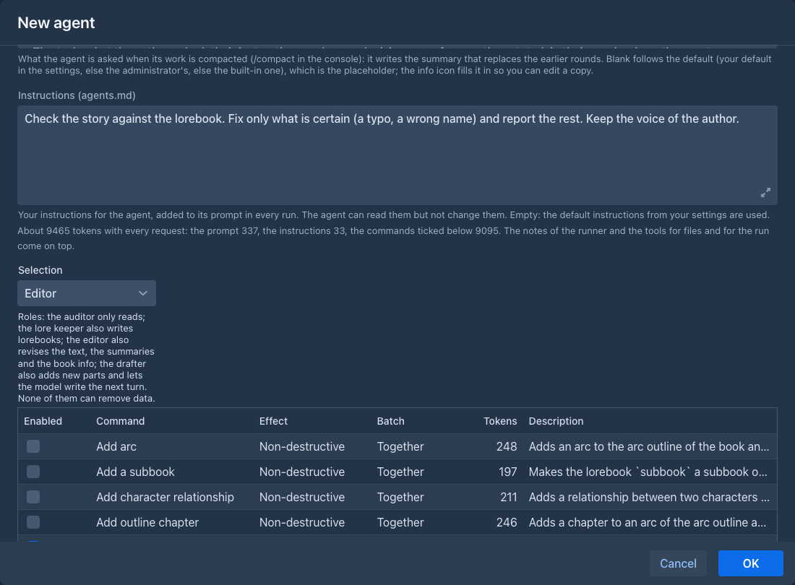

The roles are sets of commands for a job. All of them can read the book and the lorebooks (every command that only reads, those of extensions too), and none can remove data:

| Role | Besides reading |
|---|---|
| **Auditor** | Nothing: continuity checks, name and term audits, reports. |
| **Lore keeper** | Creates and updates lorebook entries and lorebooks, their tags and sub-lorebooks. |
| **Editor** | Edits and appends to parts, sets their fields, keeps the summaries (also has the model write them again) and the book information and tags. |
| **Drafter** | Adds parts and branches, edits and appends, lets the model write the next turn (`/next`, `/swipe`), keeps the summaries, creates and updates lorebook entries of what it invents. |

Every command ticked adds its definition to every request, so a role is also the cheapest way to a small prompt for a weak model.

## On a phone

The phone layout has an **Agents** tab in the drawer, for users who may use agents, with the count of the agents that need you beside its name. Each agent is a card with its name, its state and the buttons of the table (they wrap onto more lines). The windows - the console, the review, the agent's settings - fill the screen, and the review shows the table above the detail of the item. Everything works as on the desktop, only smaller. The console is laid out for a thumb:

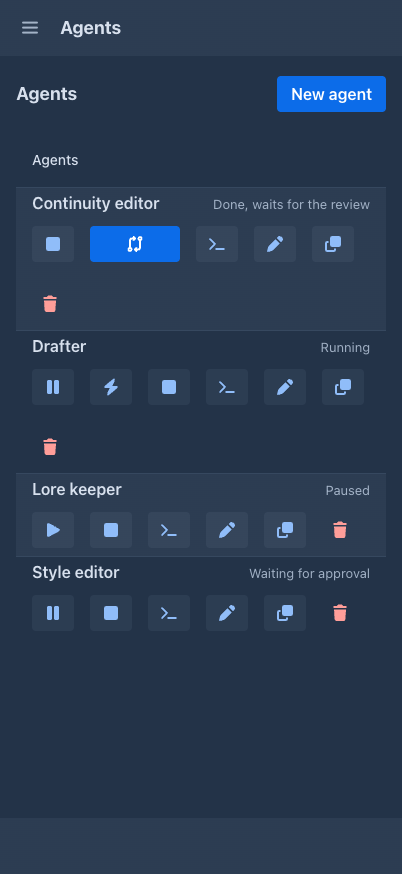

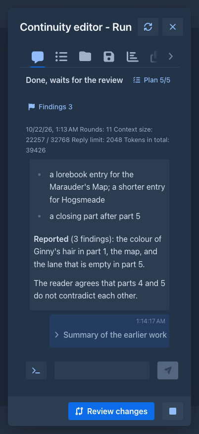

- **Tabs are icons** (run, runs, workspace, checkpoints, context, book copy, sub-agents, diagnostics); the title of the window names the one that is open.
- **Pause, Pause now, Resume, Finish and Stop are icon buttons at the bottom, and only the ones that can be used now are shown**; **Review changes** keeps its words, it is what a finished run waits for. **Refresh** and **Close** are icons in the header.
- **The message box is one line** with the **Send** and **Attach image** icons beside it. The **command line** (the terminal icon) is hidden until you open it, so the keyboard does not cover the transcript for nothing. The messages of the transcript use the whole width.
- **Tables are lists of cards**: a run, a checkpoint, a command of the agent's settings, an item of the review each show their name and state with the details under it and their buttons below, in place of columns. The files of the workspace show their size under the name, and the toolbar of the workspace is icons. The context table keeps the number, name and tokens; the type and share of a part are under the text of the part you pick.

- **The top bar shows who waits for you.** While the drawer is closed, a red number in the top bar (next to the title of the open part) counts the agents that need you, as the badge on the **Agents** tab does in the drawer; tap it to go to the **Agents** tab. It is hidden when nobody waits, while the drawer is open and in the Agents tab itself.
- **Swipe between the parts.** A swipe sideways over the content goes to the next part of the drawer (swipe to the left) or the previous one (to the right). It does nothing with the drawer open or while the application locks the navigation, and a touch that starts in a text field, a table or anything that scrolls sideways is left to it.

For long work with the transcript or the review a larger screen is still more comfortable.

## Cloning

**Clone** asks for a name and a book that has no agent, and copies the definition of the agent and its files (not its runs) to a new
agent of that book. You can have as many agents, clones included, as your administrator allows (five unless they set another number);
at the limit **New agent** and **Clone** are off and say why.

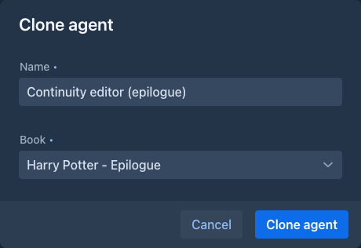

## The book is locked

While a run of an agent works or waits for you, **its book is locked**: you can read it, but nothing changes it, so the agent never
works on text that moves under it. The book list does not open a locked book, it tells you which agent holds it, and
generating, editing, search and replace, summaries and deleting the book are refused. **Pause** or **Stop** the run to edit the book again;
a paused, stopped or finished run does not lock it.

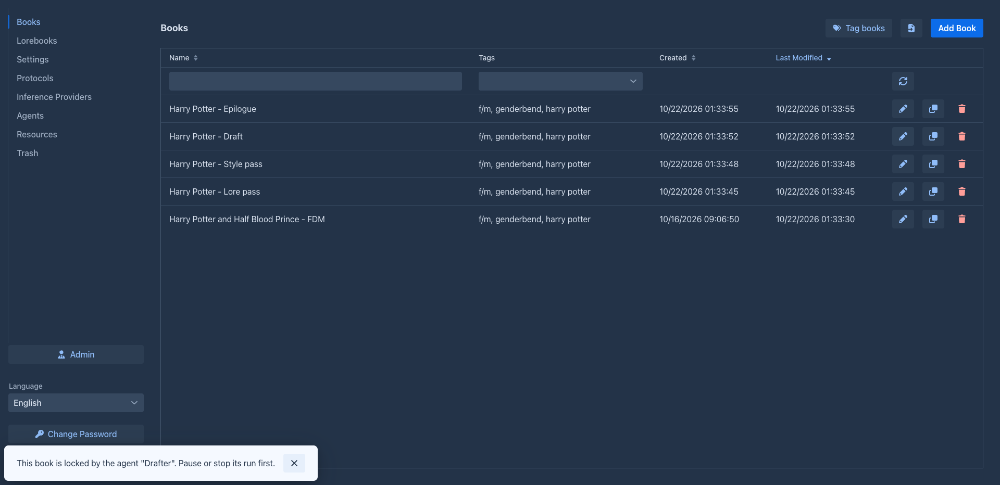

The **lorebooks of the book** are locked with it: the lorebook the book uses and its sub-lorebooks. On the Lorebooks tab such a lorebook is
shown the way it is on a phone, as plain text and without any editing, with a note that says which agent holds it; **Refresh** shows it for
editing again after you paused or stopped the run. Other lorebooks are not affected.

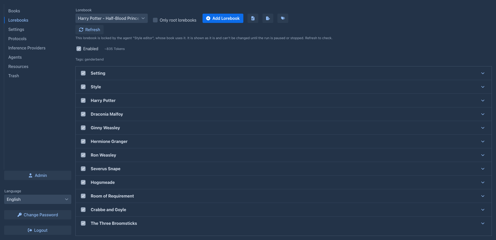
