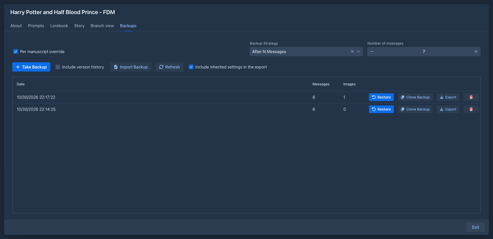
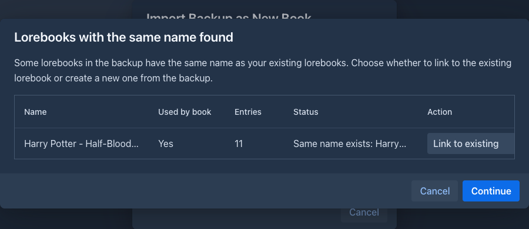
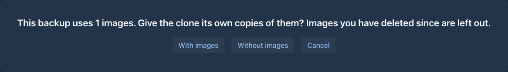
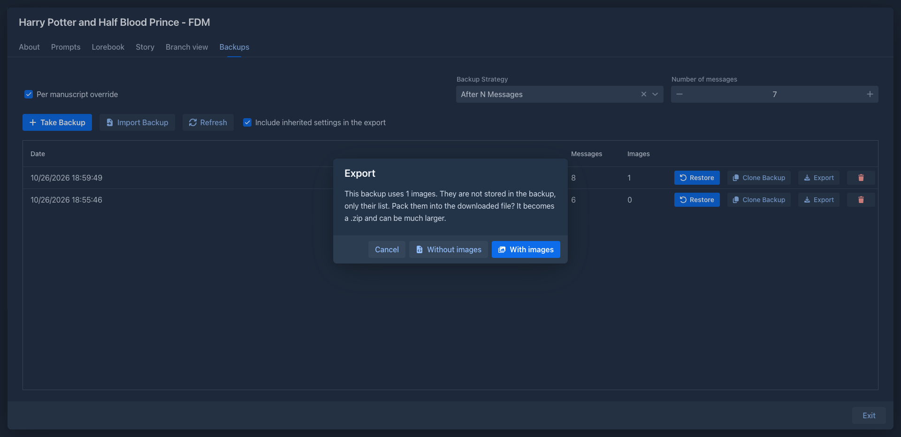

# Book backups

A book backup is a snapshot of one book: its settings and prompts, all parts in all branches, summaries, tags and the
lorebook. Use backups to go back to an earlier state of the story, to make a copy of a book, or to move a book to
another Marginalia installation or user.

Book backups are separate from the [database backups](../administration/database-backups.md) that administrators
make of the whole installation.



## Taking a backup

On the **Backups** tab of the book, click **Take Backup**. The backup appears at the top of the list with its **Date**
the number of **Messages** (parts) it contains and the number of **Images** (the [pictures of the parts](story-editor.md#images)) its parts use.

Backups can also be taken automatically, see [below](#automatic-backups).

A backup holds the whole story tree, the summaries and the [annotations](annotations.md) of the parts; restoring it, copying a book and importing a
backup bring the notes back.

## The history of the parts

A backup does not hold the [version history](version-history.md) of the parts unless you ask: check **Include version history**
next to **Take Backup** (it is unchecked at first, because the history can be several times the size of the story).
Restoring such a backup, as the book or as a copy, brings the versions back with their names, the reasoning of the generated
ones and the trash of the history; the versions are cut down to the limit of the book they come to. The automatic backups
never have the history. Restoring a backup without it gives each part one first version, as for a book from before the
history.

## Backups and folders

A backup remembers the [folders](folders.md) its book was in, from the top one down, each with its name, description,
language and the text settings it sets. **Restore as new book** and **Clone Backup** put the new book into the folder the
backup names if you still have it; if not, into the folders of the same names (one you have is used as it is, a missing
one is made with the settings it had). A backup without a folder, or folders that can't be made, restores to the top level.
**Restore** on a book (full or messages only) keeps the book in its folder. The tags of a folder are not in the backup.
Older backups restore as before.

## Pictures in a backup

A backup remembers **which pictures** the parts have (and their captions), but **not the picture files**. This keeps
backups, and the automatic ones, small. The pictures stay in your [Resources](../resources.md). To take the pictures
with a backup you pack them when you [export](#exporting-and-importing) it.

## Restoring a backup

Click **Restore** next to the backup and choose:

| Option | What is restored |
|---|---|
| **Full Restore** | Everything: name, description, publishing, prompts and other book settings, tags, model, protocol, lorebook, and all parts. |
| **Messages Only Restore** | Only the parts (all branches) and summaries. The book's current settings, prompts and lorebook stay as they are. |

!!!warning
Restoring replaces **all parts** of the book with those from the backup. Parts written after the backup are gone.
Take a backup of the current state first if you might want it back.
!!!

The book window closes and opens again with the restored book.

The pictures of the restored parts are the ones the backup lists, as long as you still have them in
[Resources](../resources.md). A picture you deleted since is gone from the part. Restoring does not bring back deleted
picture files, unless the backup comes from an export with pictures that you [imported](#importing-a-backup).

**Model and protocol** are looked up among your inference providers and protocols: first the exact one from the
backup, then one with the same name. If neither exists, the book keeps its current model or protocol.

**Lorebooks** in the backup are compared with yours. When a lorebook with the same name but a different identity
exists, Marginalia asks for each one whether to **Link to existing** or **Create new** from the backup. Lorebooks that
you don't have at all can be imported (**Import**) or left out (**Don't import**).



## Copying a book

**Clone Backup** creates a new book from the backup, under a name you enter. The original book is not changed. Use it
to try something radical with a copy of the book, or to start a new book from the same opening.

If the backup uses pictures, Marginalia asks **With images** or **Without images**:

- *With images* gives the new book **its own copies** of the pictures (the same files, new entries in
  [Resources](../resources.md)), so deleting or replacing a picture in one book does not touch the other. Pictures you
  have deleted since the backup was taken are left out.
- *Without images* clones the text only.



## Exporting and importing

**Export** downloads the backup as a JSON file (`<book name>_backup.json`). Keep it as an extra copy, or take it to
another installation.

If the backup uses pictures, Marginalia asks whether to pack them:



- **Without images** downloads the JSON right away, as above. The pictures are only listed in it.
- **With images** packs the backup and all its pictures into a **ZIP file** (`<book name>_backup.zip`). A progress
  bar shows how many pictures are done; the file is built on disk one picture at a time, so even a book with many
  large pictures does not use much memory. When it is ready, click **Download**. The file is kept only until you close
  that dialog.

If a picture can't be packed because you deleted it or its file is missing, the dialog tells how many were left out.

The check box **Include inherited settings in the export** (on by default, next to the export buttons) decides what the file
says about the settings the book gets from its [folders](folders.md#where-the-settings-of-a-book-come-from). On, the language,
master template, point of view, tense, style and prompts that the book does not set itself are written into the file as its
own values, taken from the folders it was in when the backup was taken (the nearest first) and then from your settings, so the
book reads the same in an installation or an account that has no such folders and settings; built-in defaults are not written.
Off, the file has only what the book sets itself. The file never says which folder the book is in: where a book is filed is a
local choice. (The story export, [Exporting a book](export.md), writes the text only and has no settings.)

The ZIP contains `backup.json` (the same JSON), `resources.json` (the list of the pictures) and the pictures. You don't
have to unpack it: both ways of bringing a backup back accept the `.zip` as well as the `.json`.

There are two ways to bring a backup file back:

- **Import Backup** on the *Backups* tab adds the file to the backup list of **this book**. Nothing changes until you
  *Restore* it.
- **Import Backup as New Book** in the *Settings* tab creates a **new book** from the file.

Both accept a `.json` or a `.zip` file. The file is uploaded to the server and read from there, so a big backup is
no problem.

### Importing a backup

When the file is a ZIP with pictures, the pictures are added to your [Resources](../resources.md) first, and the
backup then uses them. A picture you already have (the same file) is not stored again: the existing one is used, so
importing your own export does not add anything. A JSON file without pictures is imported as it is.

Importing **as a new book** gives the new book **its own entries** in Resources, also when you already have the same
pictures: the entries point to the same files, so no disk space is used twice. If the file has no pictures (a plain
JSON), the new book gets copies of those pictures that the file lists and that you still have; those you don't have
are left out. Anything in the file that is not a usable picture (not a PNG, JPEG, GIF or WebP, or too big) is ignored.

### Importing a backup as a new book

1. Open the **Settings** tab and click **Import Backup as New Book**.
2. Enter the **New Book Name** - the upload is enabled once the name is filled in.
3. Upload the backup file.
4. Decide about the lorebooks, if asked.

The new book appears in the *Books* tab.

## Deleting backups

The trash button removes a backup for good. Automatic backups are not rotated: they stay until you delete them.

## Automatic backups

Marginalia can take a backup on its own while you write. Set the default for all books in
**Settings → General Settings → Backup Strategy**:

| Strategy | |
|---|---|
| **No Backups** | No automatic backups. |
| **After N Messages** | A backup after every *N* generated parts. |
| **After N Minutes** | A backup after a generated part when at least *N* minutes have passed since the last automatic backup. |

To use a different strategy for one book, check **Per manuscript override** on its *Backups* tab and choose the
strategy and the number there. Unchecking it returns the book to the default from *Settings*.

Automatic backups are taken only after a part is generated, so a book you only read doesn't get new backups.

## Where backups are stored

Each backup is a JSON file in the Marginalia data folder:

```
~/.marginalia/data/<your login>/backups/manuscripts/<book id>/
```

With the [Docker version](../getting-started/docker-server.md) this is `./data/data/<login>/...` on the host. The files
are not in the database, so a [database backup](../administration/database-backups.md) doesn't contain them. Include
the whole `.marginalia` folder in your own backups.

The picture files are not in the backups either, they are in the `data/<your login>/images` folder next to
`backups`. They are also not in a [database backup](../administration/database-backups.md), see there.
