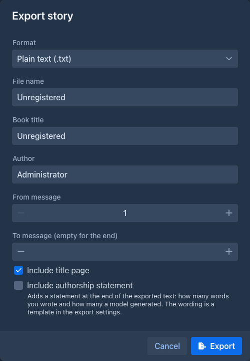
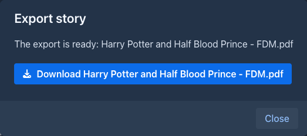
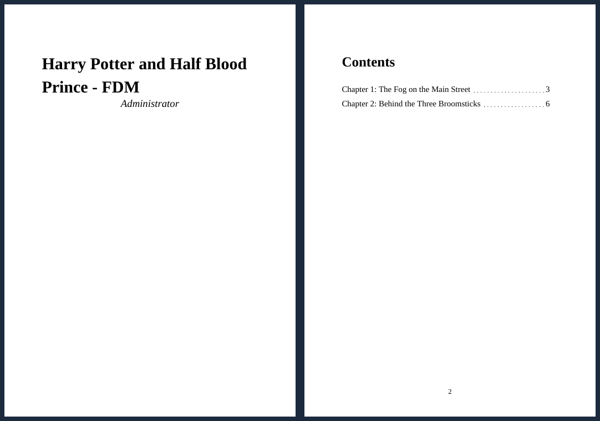

# Exporting a book

Export turns the story into a file you can read, print, send or publish elsewhere. Unlike a
[backup](backups.md) it contains only the text, as a finished book.

Only the [active branch](branches-and-story-tree.md) is exported - the same parts the story editor shows. To export
another version of the story, switch to that branch first.

## Exporting

1. Open the book and go to the **Story** tab.
2. Open the settings menu (⚙) in the bottom bar and choose **Export story**.
3. Fill in the dialog and choose **Export**.
4. Marginalia collects the parts of the branch and writes the file, which takes a moment for a long book. A progress
   bar shows how far it is.
5. When the file is ready, a dialog offers it for download. Choose the **Download** button to save it.

| Field | |
|---|---|
| **Format** | The file type, see below. |
| **Print style** | Only for the formats that have fonts and colors (HTML, Word, PDF, EPUB). The look of the text, chosen from the styles *for exports*: the application brings one for each of these formats, **HTML page**, **E-book (EPUB)**, **PDF book** and **Word document**, which are the looks the exports always had and are chosen by themselves when you pick the format, and you can make your own, see [Print styles](#print-styles). The style you chose for the format in [Settings → Exports](../account.md#exports) is the one preselected. |
| **File name** | Name of the downloaded file without the extension, which Marginalia adds. Starts as the name of the book. |
| **Book title** | The title in the file (title page and file properties). Starts as the name of the book; changing it doesn't rename the book. |
| **Author** | Starts as your full name from your [account](../account.md). Empty means no author. |
| **From message**, **To message** | Which parts to export. Parts are counted from 1 in the order of the story, parts without text are not counted. Leave **To message** empty to export to the end. |
| **Include title page** | Starts the file with a first page holding the title and the author. |

## Formats

| Format | |
|---|---|
| **Plain text** (`.txt`) | Just the text in UTF-8. Formatting such as *italics* is dropped, paragraphs are separated by an empty line. |
| **Markdown** (`.md`) | The text as it is written in the story, for editors such as Obsidian or Typora, a static site or a repository. Emphasis, headings, quotes, lists, code blocks and scene breaks stay Markdown. Raw HTML in the text is kept as typed, the Markdown reader decides whether to show it. |
| **HTML** (`.html`) | One page with a book-like style included, so it looks the same in every browser. It can be printed and has no external files. |
| **Word document** (`.docx`) | Opens in Word, LibreOffice and similar programs. Justified text, with the title and author set in the file properties. |
| **PDF** (`.pdf`) | A5 pages with embedded fonts that cover Latin, Greek and Cyrillic text, and a bundled Japanese font (Noto Sans JP) for kana, kanji and Japanese punctuation. Text of another script (Chinese-only characters, Korean, Arabic) is not drawn: the PDF has no font for it. |
| **EPUB** (`.epub`) | An e-book for e-readers and reading apps. Long books are split into several files inside the EPUB so readers stay fast. |
| **HTML for Archive of Our Own** (`.html`) | For posting on AO3, see [below](#for-other-tools). |
| **Markdown with front matter** (`.md`) | For static site generators, see [below](#for-other-tools). |
| **SillyTavern chat** (`.jsonl`) | The story as a chat, see [below](#for-other-tools). |
| **Obsidian vault** (`.zip`) | The chapters and the lorebook as linked notes, see [below](#for-other-tools). |

The text of the parts is Markdown. Emphasis, headings, quotes, lists, code blocks and scene breaks (`---`) are kept in
every format that can show them. Raw HTML in the text is shown as text, never run.

## Footnotes

A footnote is written in the text of a part as `[^1]` where the mark stands and `[^1]: the note` on a line of its own (the label can be any word). Every format has them: **Markdown** keeps the syntax, **HTML**, **EPUB** and **HTML for Archive of Our Own** put a small raised number that links to the notes under the text of the part (AO3 gets the plain markup its editor keeps), **plain text** and **Word** write the mark as `[1]` and the notes as lines that start with `[1]` after the text of the part, which is how an endnote looks. The **PDF** has real footnotes: the mark is a small raised number, and the note stands at the bottom of the same page, in a smaller type under a short rule (the pages are laid out until every page has the room its notes need). Real footnotes in a Word document are not made yet. Extensions can use them, too: the Conlang Translator extension writes the English of each speech as a footnote.

## Images

[Images](story-editor.md#images) of the parts are placed where their position says (after the text unless you chose another
place), with their captions, in the width you gave them (a percent of the width of the text; without a width the picture keeps
its size, scaled down to the page). Not every format can put text beside a picture:

| Format | |
|---|---|
| **HTML**, **EPUB** | Embedded (in the page, or as files of the book). The text flows around the pictures at the left or the right; a picture in the middle is between two columns of text. On a narrow screen they go above the text, and a reader without columns (some e-readers) shows the first text, the picture and the rest one under the other. Pictures next to each other in a place stand in a row. |
| **Word document** | The picture the text flows around is in a small table that Word places at the side or in the middle, and Word wraps the text around it (on both sides for the middle, line by line); the caption is under the picture. Pictures with a width that fit next to each other are a row of a table. |
| **PDF** | The text flows around the pictures at the side, the caption is drawn under the picture. A picture in the middle is between two columns of left aligned text (a band that does not fit at the end of a page starts on the next one). Pictures with a width that fit next to each other are a row. A picture that is too tall for the rest of the page goes to the next page. |
| **Markdown** | Embedded in the file as `` images with the caption in italics under them, so it is still one file. The position among the text is kept; the width and the flowing text are not. Not every reader shows embedded images (GitHub does not), and a book with many images has very long lines, so attach images to the parts only when you want them in a Markdown export. |
| **Plain text** | Marked with `[Image]` or `[Image: caption]` at their place in the text. |
| **HTML for Archive of Our Own** | Marked with `[Image: caption]`: AO3 takes images only from links. |
| **Obsidian vault** | Saved in the `Attachments` folder of the vault and embedded in the note of their chapter at their place, with the caption in italics. |
| **SillyTavern chat** | Left out, a chat has only text. |

## For other tools

These formats are made for a tool that reads them, not for reading. They do not have the *Print style* choice.

**HTML for Archive of Our Own.** AO3 asks for the title, the author and the chapter titles in fields of its own and drops what it does not
know (style blocks, the page around the text, images that are not links), so the file has no title page. Open it in a browser to see the work as
the paste will look. Every chapter (a part that starts with a heading and the parts after it up to the next heading) has its title above two
comments, `BEGIN chapter N` and `END chapter N`: copy what is between them into the HTML editor of the chapter on AO3 and the title into its
title field. The text is clean HTML without line breaks between the tags, because AO3 turns each line break into a ` `.

**Markdown with front matter.** The same Markdown as the *Markdown* format, but the file starts with a YAML block (`title`, `author`, `lang`,
`date` of the export) that Jekyll, Hugo, Eleventy and similar generators read, instead of a title page; **Include title page** has no effect on
it. The block is a template you can change in [Settings → Exports](../account.md#exports) (`{{title}}`, `{{author}}`, `{{language}}`,
`{{exportDate}}`; the title and the author are already escaped for use inside double quotes).

**SillyTavern chat.** A JSON Lines file that the chat import of SillyTavern reads: the character is named after the book and you are the
author. Each part of the story is a message of the character (the text), and when the part was written with instructions they come before it as
your message. The reasoning of the model, if the part has any, is kept as the reasoning of the message. The title page does not apply.

**Obsidian vault.** A ZIP with a folder named after the book; unpack it and open the folder as a vault. It has a note named after the book (the
front matter, the title page and the lists of the chapters and of the lore), a note for each chapter in `Chapters` (with links to the previous and
next chapter), a note for each enabled entry of the [lorebook](../lorebooks/index.md) of the book and of its sub lorebooks in `Lore/<lorebook>` (the tags
of the entry are the tags of the note, its comment is a callout), and the images in `Attachments`. In every note the first mention of the name of
an entry (a name of at least three characters, whole words, as spelled) is a link to its note, so the graph view shows which entry is in which
chapter. A part with a heading starts a chapter; parts before the first heading are the note *Beginning* (or *Story* when the book has no headings).
The front matter and the title page are templates you can change in [Settings → Exports](../account.md#exports).

## Print styles

The export uses the text styles of [Settings → Styles](../account.md#styles) that are marked **For exports**. Styles are either for books
(the story and the reader) or for exports: the *Change Styles For Text* menu and the reader show only the first kind, the export dialog only the
second. The four built-in ones are the looks of the formats; **Duplicate** one (or a book style, and tick **For exports**) to make your own, for
example the Book style on paper. The style is worked out for paper: colors that depend on the theme of the application (the light text of the dark
theme) become the dark ones for a white page.

| Format | What the style gives |
|---|---|
| **HTML** | The whole stylesheet of the style, including the **custom CSS**, **drop caps**, the text width and the background; the title page and the contents keep the look of the format. |
| **EPUB** | The stylesheet of the style without the custom CSS (e-readers do not all understand it; some readers also set their own fonts and sizes). |
| **PDF** | The font family (serif, sans or monospace of the embedded fonts, chosen from the font stack), size, line height, alignment, the space between paragraphs, the first line indent, the **background color** of the page (the whole page, the title page included), the colors of the text, italic, bold, quotes, headings and the scene break, the alignment and size of headings and the symbol of the scene break. |
| **Word document** | The same as the PDF, with the font named in the style (Word shows its own when the computer lacks it) instead of the embedded ones. The background is the color of the page: Word shows it on the screen, but does not print it unless *Print background colors and images* is on in its print options. |

Drop caps, the custom CSS (PDF, Word, EPUB), small capitals of headings and the text width are not made in the PDF and Word
files.

## Title page template

The title page is written from a template, one for every format. Change it in [Settings → Exports](../account.md#exports): the template is Markdown
with `{{title}}` (the book title of the dialog) and `{{author}}`, for example `## {{title}}` and a line `written by {{author}}`. The default is the
title as a heading and the author in italics.

## Table of contents

When the text contains chapters, the file gets a table of contents after the title page. A chapter is a part of the
story that contains a Markdown heading (a line starting with `#`, e.g. `# Chapter 3: The Harbour`) - the same rule the
[Chapter Marker](../extensions/chapter-marker.md) plugin uses in the story sidebar. The first heading of a part is its title, parts
without a heading belong to the chapter before them. A story without any heading has no table of contents.

In PDF, Word and EPUB every chapter starts on a new page. The title page and the table of contents are pages of their
own as well.

The entries are links to the chapters:

| Format | |
|---|---|
| **HTML** | Links to the chapters of the page. |
| **PDF** | Clickable entries with the page of the chapter, and the chapters are also in the outline (bookmarks) your PDF reader shows next to the pages. |
| **EPUB** | The table of contents of the reader, which is also a page of the book after the title page. |
| **Word document** (`.docx`) | Clickable entries with the page of the chapter. Word asks to update the fields when it opens the file, answer **Yes** to fill in the page numbers (LibreOffice fills them in on its own). It is a list of links and not a Word table of contents field. |
| **Markdown** | No table of contents. The chapter headings stay in the text, and most Markdown editors build an outline from them. |
| **Plain text** | No table of contents. |

## Page numbers

The PDF and Word files have the page number in the footer of every page except the title page. The number is the
position of the page in the file, so the title page is page 1 and the first page after it is page 2. The other formats
have no pages of their own.

## The title page

With **Include title page**, the file starts with the book title and the author on a page of their own. The page is
made from a built-in template (`DEFAULT_EXPORT_HEADER_TEMPLATE`), which isn't editable in the application yet.

## Good to know

- The export is a snapshot of the branch when you choose **Export**. Parts generated or edited afterwards are not in
  the file.
- The exported file is kept only until you close the download dialog. Export again if you need it later.
- Summaries, lorebooks, instructions and the model's reasoning are not exported, only the text and the images of the parts. To save
  all of it, make a [backup](backups.md).
