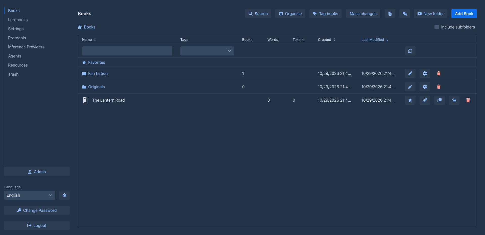
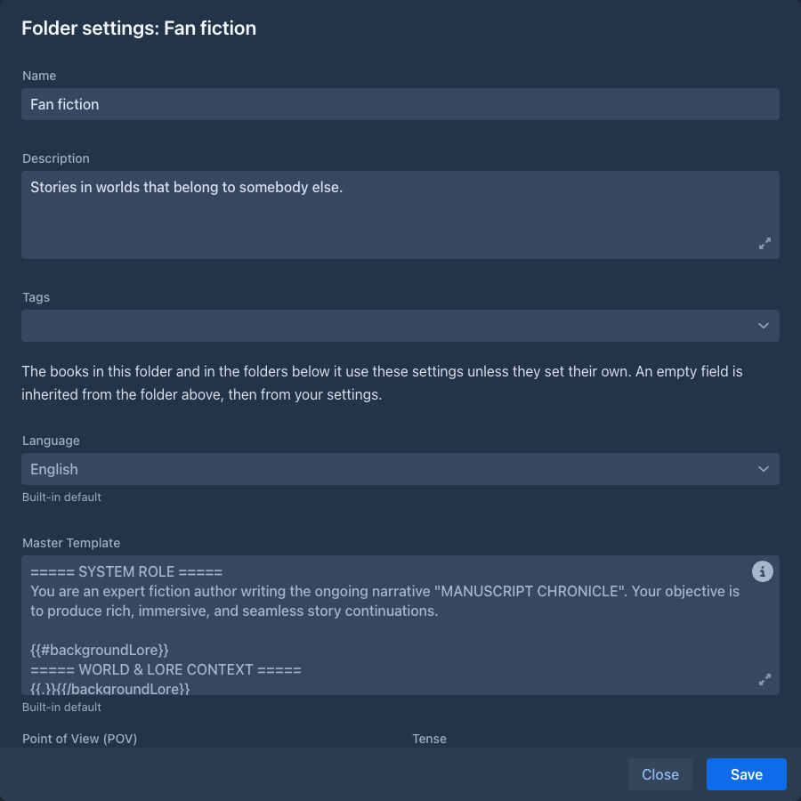
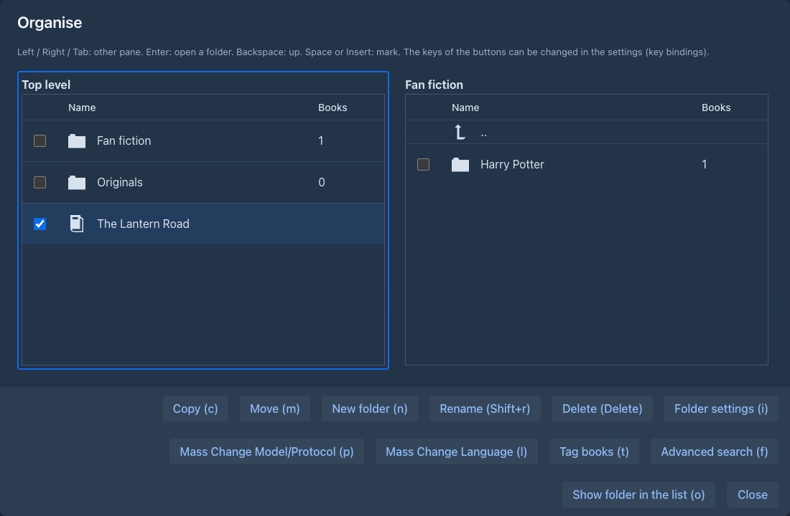

# Folders

Folders sort your books the way folders on a disk sort files. A folder holds books and other folders, as deep as you like,
and the books list shows one folder at a time. A folder can also hold **settings** (language, point of view, tense, style,
the templates and the prompts): the books in it, and in the folders below it, write with them unless they have their own.
That is the main reason to use folders: set the style of a series once, and every book of the series has it.

## Moving around

Above the books the list shows the folders of the current one, in the order of the sorted columns. Click the **name** of a
folder to open it. The path of buttons above the list (`Books / Sci-fi / Expanse`) shows where you are; click a part of it
to go back there.

The check box **Include subfolders** lists every book below the current folder, at any depth (at the top level that is
all your books), and adds a **Folder** column with the place of each. The current folder and the check box are
remembered, also when you reload the page.

A folder row shows how many books are beneath it, at any depth. A book row shows the words and tokens of its
[active branch](branches-and-story-tree.md). The **Name** and **Tags** filters work on folders as well as books
(folders have tags, see [Tagging folders](#tagging-folders)), in the current folder, or below it with *Include subfolders*.

A folder's **Last Modified** follows its books: when a book in it, or in a folder below it, changes (or one of its parts
does), the folder is touched too. Sort by it to see where you wrote last. Opening a book, or moving it, does not count.

### What the buttons do

| Button | |
|---|---|
| **New folder** (header) | Makes a folder in the current one. A name must not be empty, longer than 255 characters or contain a `/`, and must not be the name of another folder in the same place (the case does not matter). |
| the cog of a folder | The [settings of the folder](#folder-settings). |
| the pen of a folder | Renames it. |
| the trash of a folder | Deletes it, see [Deleting a folder](#deleting-a-folder). |
| **Move to folder** (a book) | Picks the folder to put the book into. |
| the star of a book | Makes it a [favorite](#favorites). |
| **Add Book**, the imports | The new book goes into the **current folder**. A [clone](managing-books.md#cloning-a-book) is put next to its original. |

## Folder settings

The cog of a folder opens its settings (the **Organise** window has the same button, key `i`):

- **Name**, **Description** and **Tags**.
- **Language**, and the same fields as the [Prompts](prompts.md) tab of a book: master template, point of view, tense,
  style and the prompts.

Everything is optional. An empty field is *inherited*, and says so: the grey text in the field is the value it inherits,
and the line under it tells where that comes from. Press **Save** to save the folder; the name and description can be
changed whenever, but a change of the language or of a text setting is refused while an agent works on a book in the
folder or below it: the message names the book, [pause or stop its run](../agents.md) first.

### Where the settings of a book come from

A book uses, for every one of these settings, the first of these that is not empty:

1. the **book** itself (its *About* and *Prompts* tabs),
2. the **folder** the book is in,
3. the folder above that one, and so on up to the top,
4. your **user settings** (*Settings → Templates*, see [Account & settings](../account.md)),
5. the **built-in default**.

A blank text counts as not set. This is looked up when it is needed (when a part is generated, a summary made, a part
redrafted...), nothing is copied into the book when you put it into a folder: **moving a book to another folder changes
how it writes**, and changing a setting of a folder changes every book below it that does not set its own.

The [Prompts](prompts.md#inherited-settings) tab of a book shows it: under each field is where its value comes from
(*Inherited from the folder "Sci-fi"*, *Inherited from your settings* or *Built-in default*).

### Language

The **Language** box of a book (the [About](managing-books.md#the-about-tab) tab) and of a folder can be left empty,
which means *inherit*: the book takes the language of the nearest folder above it that sets one, else English. An empty
box shows which language that is and where it comes from. The box has a clear button; clearing it inherits again (it used to
turn into English). Everything that shows or uses the language of a book uses the one it has with its folders: the
hyphenation of the text, the export and the [Mass Change Language](#mass-changes) table.

## Deleting a folder

The trash button of a folder asks what to do:

- **an empty folder** is deleted after a confirmation;
- **a folder with books or folders in it** offers **Move its content to the folder above** (the default) or **Delete
  everything in it as well**. The second asks again, with the numbers of books and folders, and sends the books to the
  [Trash](../trash.md), where you can bring them back. A deleted folder itself is not listed in the Trash.

If a folder inside has the name of a folder in the folder above, moving the content up is refused (names are unique):
rename one of them first. A folder with a book that an agent works on can't be deleted or moved, as the settings of that
book would change under the run.

## Organise

**Organise** (the header of the list) opens a window with two panes, each showing a folder, to move and copy books and
folders from one to the other without opening each. It opens with the left pane on the folder you were in and the right
pane on the one it showed last time.

| Key | |
|---|---|
| Left / Right / Tab | The other pane. |
| Up / Down | The cursor. |
| Enter | Opens the folder under the cursor. |
| Backspace | Goes up. |
| Space or Insert | Marks the entry under the cursor; Shift + Up / Down marks while moving. |
| Click on a check box | Marks or unmarks the entry; **Shift + click** marks (or clears) every entry between it and the box clicked before. |

A row of buttons at the bottom does the work on what is **marked** (or, if nothing is, what is under the cursor), and
shows its key in brackets:

| Button | Key | |
|---|---|---|
| **Copy** | `c` | Copies into the folder of the *other* pane. |
| **Move** | `m` | Moves into the folder of the other pane. |
| **New folder** | `n` | Makes a folder in the folder of the active pane. |
| **Rename** | `Shift+r` | Renames the folder or book under the cursor. |
| **Delete** | `Delete` | Deletes it, as in the list. |
| **Folder settings** | `i` | The [settings](#folder-settings) of the folder under the cursor. |
| **Mass Change Model/Protocol**, **Mass Change Language**, **Mass Rename**, **Tag books** | `p`, `l`, `Shift+n`, `t` | The [mass changes](#mass-changes) for the marked books, or for the books of the folder of the active pane (with their own *Include subfolders*). The panes show the new names after a mass rename. |
| **Advanced search** | `f` | The [search](managing-books.md#advanced-search) in the folder of the active pane, optionally with *Include subfolders*. A result has **Show in folder**, which takes the pane there and marks the book. |
| **Show folder in the list** | `o` | Closes the window and opens the folder of the active pane in the list of books. |

When you close the window the list of books is read again, so what you made, moved, copied, renamed or deleted shows at once (if the folder the
list was in is gone, it goes to the top level).

The keys are actions of the [keyboard shortcuts](../account.md#keyboard-shortcuts) in *Settings*: change or clear them
there (there are no function keys by default, a Mac and the browsers keep them). The buttons show the key you have set.

### Copying

A **copy** of a book is a [clone](managing-books.md#cloning-a-book); the window asks whether to take the current branch
only. A copy of a folder is a new folder with the settings, description and tags of the original and copies of all the books
and folders in it. A copy can take long, so it runs behind a progress bar that can't be stopped. If it fails halfway, the
copies made before are kept, each complete.

A **move** is done at once and can be undone by moving back. A folder can't be moved into itself or into a folder below it.

### When a name is taken

When the target already has a folder of the same name, the window asks what to do with that folder, with **Apply to all**
for the rest:

| Choice | |
|---|---|
| **Rename** | The folder gets another name. |
| **Skip** | It is left where it is (and not copied). |
| **Merge** | What is in it is put into the folder that is there; folders of the same name inside merge in turn. |

Books never clash: their names may repeat.

## Mass changes

The **Mass changes** menu of the list (and the buttons of Organise) change many books at once. **Mass Change
Model/Protocol** puts one model and/or one protocol on the books, **Mass Change Language** a language, **Mass Rename**
adds a prefix or a postfix to their names, replaces a text in them or numbers them, **Tag books**
and **Tag folders** add or remove a tag. See [Managing books](managing-books.md#tagging-many-books-at-once). From the list they
work on the books of the current folder, with their own **Include subfolders**.

## Favorites

The star on a book row makes it a **favorite**. While you have one, the top level shows the virtual folder **Favorites**
(a star) with the favorite books of all your folders. It is only a view: you can't make a book or folder in it, and taking
the star away removes the book from it, not from its folder. Favorites are kept in your settings.

## Tagging folders

Folders have tags as books do. **Mass changes → Tag folders** tags many folders at once. The tags of a folder do not
change the tags of its books, and they are not part of a [backup](backups.md).

## Folders and other features

- **Backups.** A [backup](backups.md#backups-and-folders) remembers the folders of its book, and an exported file can carry the
  settings the book inherits.
- **Agents.** An [agent](../agents.md#agents-and-folders) writes with the settings of the folders of its book.
- **Help assistant.** If you allow it, the [assistant](../administration/help-assistant.md#your-books) can look up your
  books and folders.
- **Phone.** The [phone layout](../phone.md#books) shows the same folders as cards.
- **Viewer.** The [viewer](publishing.md#folders-in-the-list) lists the folders too and opens in the one you left.
