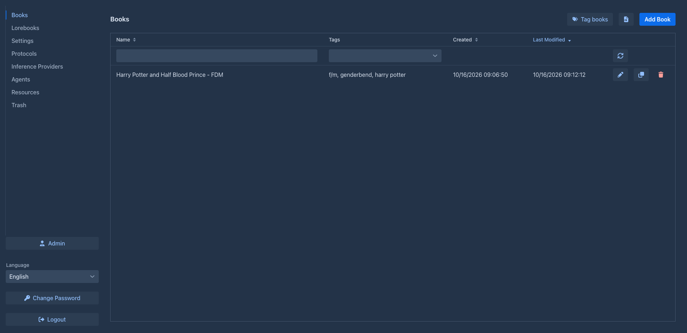
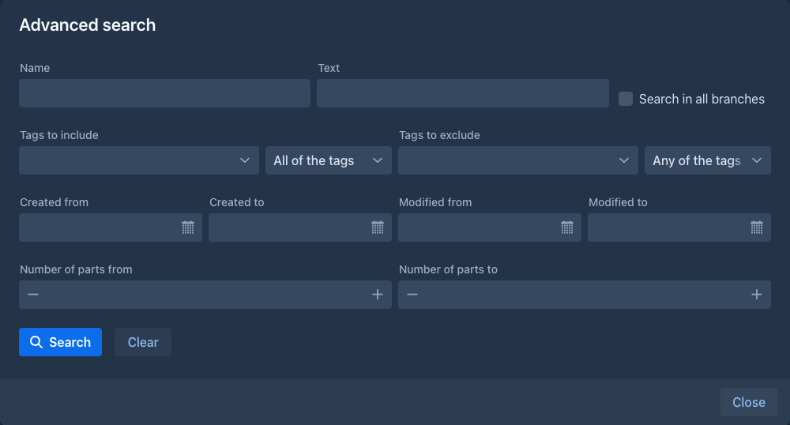
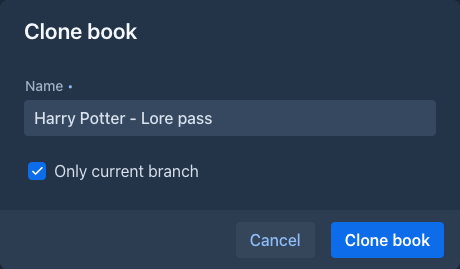
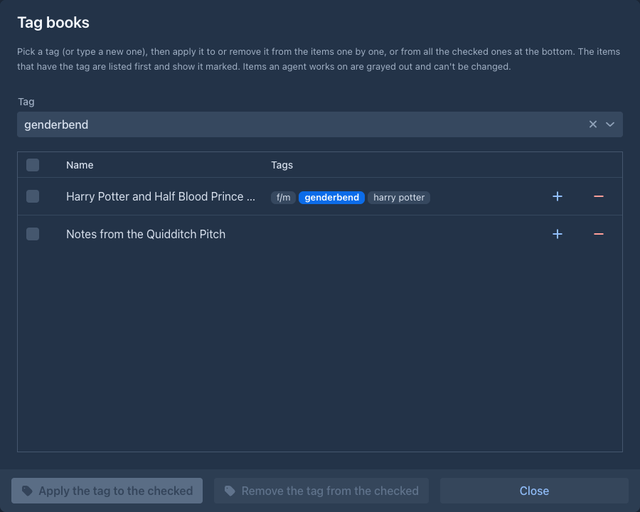
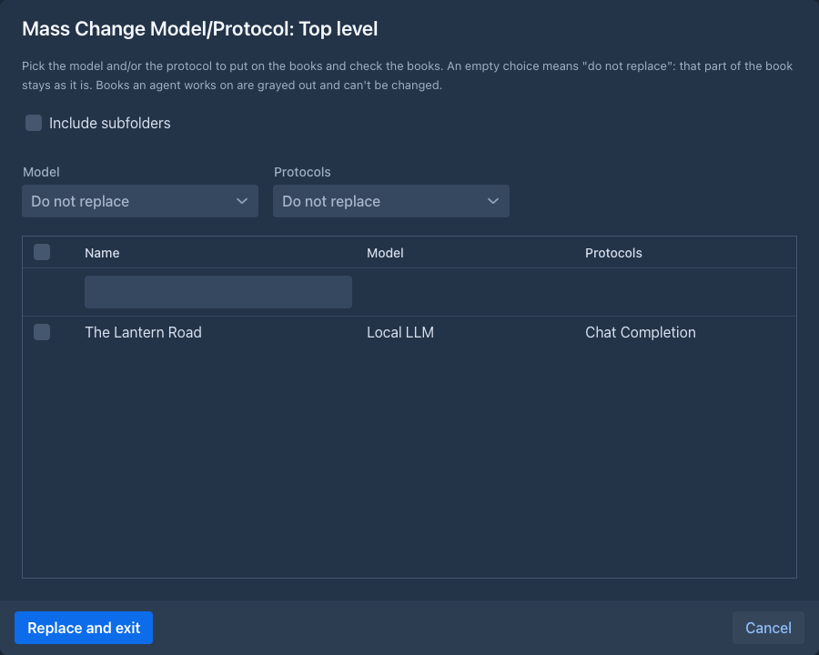
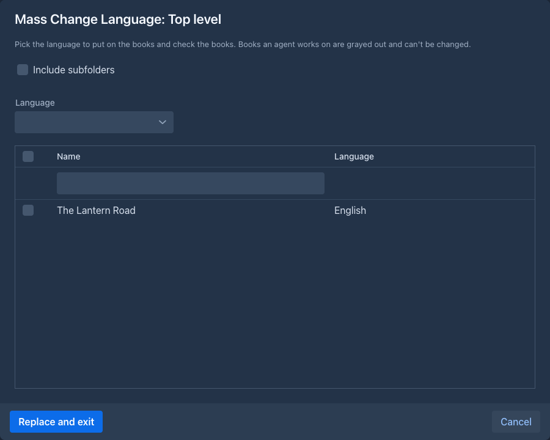
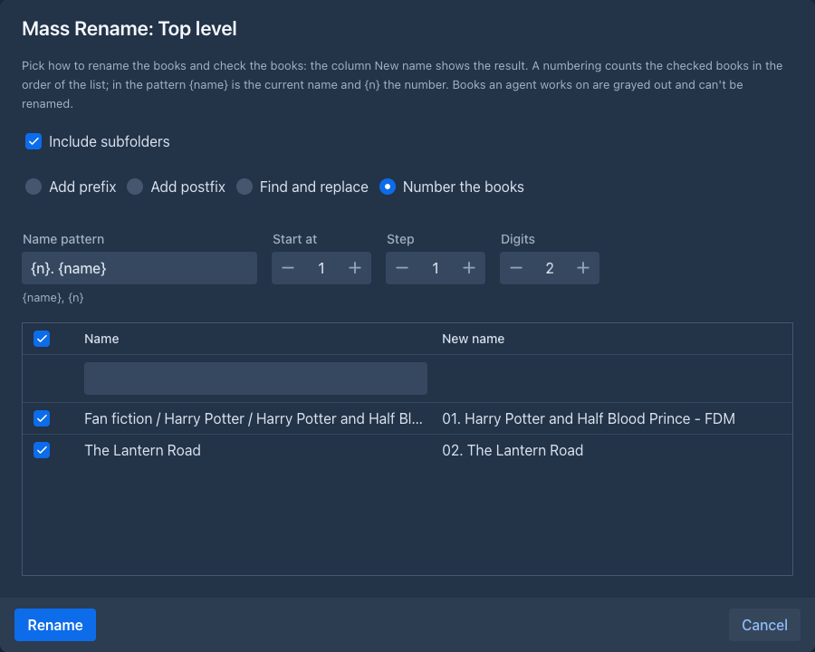
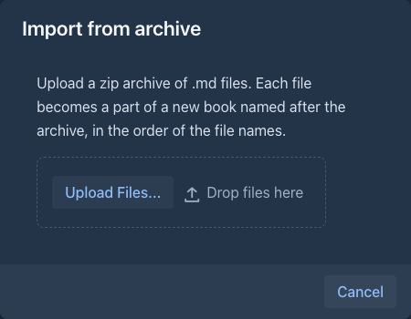
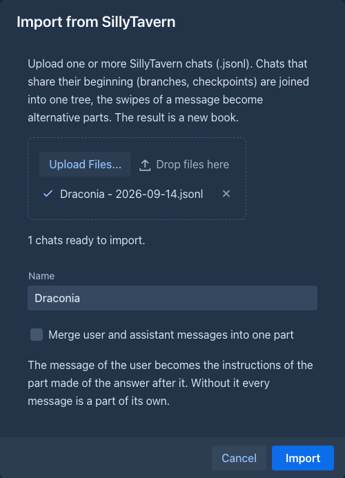

# Managing books

## The book list

The **Books** tab lists your books. Other users' books are not shown. The list shows one [folder](folders.md) at a time, the
folders of the current one above its books; at the top level, with no folders made, it is simply all your books.

| Column | |
|---|---|
| **Name** | The name of the book. |
| **Tags** | The book's tags. |
| **Created** | When the book was created. |
| **Last Modified** | When the book was last changed. |

The list is sorted by *Last Modified*, newest first. Click a column header to sort by it; with several sorted columns
the list is sorted by all of them in order.

The row below the headers filters the list:

- **Name** - books whose name *starts* with the text. Use `*` as a wildcard: `*dragon` finds every book with
  "dragon" anywhere in the name.
- **Tags** - books that have *all* the selected tags.

The refresh button at the end of the filter row reloads the list.

Each row has buttons: the star makes the book a [favorite](folders.md#favorites), the pen opens it, **Move to folder** puts it
into a [folder](folders.md), the clone button makes a copy of it and the trash button deletes it. The header has **New folder**
and **Organise** (the window to [move and copy](folders.md#organise) books and folders), and the **Mass changes** menu.

### Advanced search

**Search** (next to **Tag books**; the magnifier in the header on a phone) opens a window that finds books by more than
the filter row can. Fill in what you want to check, leave the rest empty, and press **Search** (or Enter in a text field):

| Field | Finds books... |
| ----- | -------------- |
| **Name** | whose name contains the text (`*` is a wildcard). |
| **Tags to include** | that have the tags: *All of the tags* or *Any of the tags*, as you choose next to the field. |
| **Tags to exclude** | that do not have the tags: with *Any of the tags* a book with at least one of them is left out, with *All of the tags* only a book that has every one of them. |
| **Created from / to**, **Modified from / to** | created or last changed in the range; the day of a *to* date is included. |
| **Number of parts from / to** | with that many parts in all its branches (parts in the trash are not counted). |
| **Text** | with a part that has every word of the text. Words, `"phrases"` and `*` work as in [the search of the story](story-editor.md#searching-the-story). |
| **Include versions** | off (the default): only the current text of the parts is searched; on: a book is also found when an earlier version of one of its parts has the words, see [Version history](version-history.md#searching-the-old-text). |
| **Search in all branches** | off (the default): the text is searched only in the branch the book is at (the story as you see it when you open the book); on: in the parts of all branches. |

A book has to pass every check you filled in. The books found are listed below with their tags, the last changed first;
a click on a column header sorts them. The folder button opens a book (in its window above the search, so closing the
book brings you back to the results). **Clear** empties the fields.

### Cloning a book

The clone button asks for the **Name** of the new book (the name of the original with *(Copy)* by default) and has the
check box **Only current branch**, checked by default. The new book is a separate book that gets:

- the settings of the book (description, language, prompts, point of view, tense, style, backup settings), the data
  that extensions keep in the book, and the tags;
- the same **Model**, **Protocol** and **lorebook**. The lorebook is *linked*, not copied: a change of it shows in both
  books;
- the story with its own copy of the parts, their summaries and pictures. With **Only current branch** only the parts from
  the beginning to the end of the [active branch](branches-and-story-tree.md) are copied; without it all the branches
  are.

The clone starts a [version history](version-history.md#backups-copies-and-the-trash) of its own (one version per part); the history of the original is not copied.

The clone is not published, even if the original is. The original is not changed. It is put into the same
[folder](folders.md) as the original.

### Tagging many books at once

**Tag books** (next to **Add Book**) opens a window that puts one tag on many books, or takes it off them, without opening
each. Pick the **Tag** (or type a new one and press Enter) and the list shows every book with its tags; the books that have
the picked tag come first and show it highlighted. Each row has a **+** button that applies the tag to that book and a
**-** button that removes it. To do the same for several books, tick their check boxes (the box in the header ticks all)
and use **Apply the tag to the checked** or **Remove the tag from the checked** at the bottom. A book an agent works on is
grayed out: it is locked, so it can not be ticked or changed until the run is paused or stopped. The same window tags
[lorebooks and their entries](../lorebooks/lorebooks.md#tagging-many-at-once).

### Changing the model and protocol of many books

The **Mass changes** menu (next to **Tag books**) has the item **Mass Change Model/Protocol**. It opens a window that puts one
**Model** and/or one **Protocol** on many books without opening each. Leave a box empty (it shows *Do not replace*) and that
part of the books stays as it is: pick only a model to change the models and keep the protocols. The table lists the books of
the current [folder](folders.md) by name with the model and protocol they have now; **Include subfolders** adds the books
below it. Type in the filter under **Name** to narrow the list, tick the
books to change (the box in the header ticks all the books that are shown) and press **Replace and exit**. Books that the
filter hides are unticked, so only what you see is changed. A book an agent works on is grayed out: it is locked, so it can
not be ticked or changed until the run is paused or stopped.

The item **Mass Change Language** of the same menu works the same way for the **Language** of the books: pick the language,
filter and tick the books, press **Replace and exit**. The table shows the language each book has now, with what it inherits
from its folders (see [Language](folders.md#language)).

### Renaming many books

The item **Mass Rename** renames the checked books at once. Pick how:

| Way | What it does |
|---|---|
| **Add prefix** | Puts the **Text to add** before the name. |
| **Add postfix** | Puts the **Text to add** after the name. |
| **Find and replace** | Replaces every occurrence of **Find** in the name with **Replace with** (empty removes it). The text is taken as it is, not as a pattern; **Case sensitive** is off by default. |
| **Number the books** | Gives the books numbers: the **Name pattern** is the new name, with `{name}` for the current name and `{n}` for the number, for example `{name} {n}`, `{n}. {name}` or `Chapter {n}`. The first checked book gets **Start at**, each next one the **Step** more, and **Digits** pads the number with zeros (`007`). |

The column **New name** shows what each checked book would get while you type, so check it before you press **Rename**. A
numbering counts the checked books in the order of the list (by name). Spaces at the start and the end of the new name are
removed. Nothing is renamed, and the window stays open, when a text is missing, when the pattern has no `{n}`, when no name
would change, or when a name would end up empty. Filtering, **Include subfolders** and locked books work as in the other mass
changes.

**Tag books** and the item **Tag folders** work on the books, or on the folders, of the current folder in the same way.

## Creating a book

1. Click **Add Book**.
2. Enter the name and confirm.

The new book is put into the [folder](folders.md) the list shows, and so are the books you import from an archive or
from SillyTavern. It opens right away. It starts with your **Default Model** and **Default Protocol** from the *Settings* tab
(see [Account & settings](../account.md)), if you have set them; otherwise select them on the *About* tab before
generating.

To start a book from a folder of text files, use the **import** button (file icon, *Import from archive*) next to
**Add Book**: upload a `.zip` of `.md` files and the new book, named after the archive, gets a part for each file, see
[Importing text files](story-editor.md#importing-text-files).

### Importing from SillyTavern

To continue a roleplay or story you started in [SillyTavern](https://github.com/SillyTavern/SillyTavern), use the
**import** button with the speech bubbles (*Import from SillyTavern*) next to **Add Book**. In SillyTavern, export the chat
(*Manage chat files*, or take the `.jsonl` files from `data/<user>/chats/<character>/`), then:

1. Upload **one or more** `.jsonl` chats. A file that is not a SillyTavern chat is refused, the others stay.
2. Give the book a name (it is filled from the character of the first chat).
3. Tick **Merge user and assistant messages into one part** if you want one part per turn: the message of the user
   (several messages in a row are joined with an empty line) becomes the *instructions* of the part and the answer after it
   its text. Without it every message is a part of its own, with its text as the text of the part, so the book reads like
   the chat did.
4. Click **Import**. A progress window with **Stop** shows the parts being stored; stopping keeps what was stored.

SillyTavern copies the chat when you create a *branch* or a *checkpoint*, so the chats of one story share their
beginning. Upload them together and Marginalia finds the common messages and stores them once: the chats become the
branches of one tree, which you can walk in the [tree view](story-editor.md). The *swipes* (alternative answers) of a message become sibling parts, and the book opens at the end of the chat written last (by the date of its
last message). Chats that don't begin with the same message become separate first parts. Hidden (system) messages are
skipped, and so are swipes that are empty. The reasoning and the model name of an answer are kept with the part.

To start a book from a backup file, use **Import Backup as New Book** in the *Settings* tab, see
[Book backups](backups.md#importing-a-backup-as-a-new-book).

## The About tab

| Field | |
|---|---|
| **Name** | The name of the book. |
| **Tags** | Tags for sorting your books and for [lorebook](../lorebooks/entries.md) activation. Type to pick an existing tag or create a new one. |
| **Description** | What the book is about. Available to the prompt templates as the book description. |
| **Language** | The language the book is written in. Used for automatic hyphenation of the text in the book reading style and in the [viewer](publishing.md); it does not change what the model writes. Empty means *inherit*: the language of the nearest [folder](folders.md#language) above the book that sets one, else English; the box then shows which and from where. |
| **Model** | The [inference provider](../inference-providers.md) that writes this book. |
| **Protocols** | The [protocol](../protocols.md) with the generation settings. |
| **Versions kept per part** | How many earlier versions of the text of a part the [history](version-history.md) keeps. Empty means *inherit*: the grey number in the box is the limit that applies and the line under it says which folder, your settings or the administrator sets it. **0** keeps no history. |
| **Published** | Lets other users read the book, see [Publishing & viewer](publishing.md). Once checked, the reader link of the book (`<address of Marginalia>/view/<book ID>`) is shown under the checkbox; copy it and send it to the readers. |

Changes are saved as you type.

Below are read-only counts:

| | |
|---|---|
| **Total Word Count**, **Total Token Count** | All parts of the book, in all branches. |
| **Active Branch Word Count**, **Active Branch Token Count** | Only the parts of the [active branch](branches-and-story-tree.md). |

A book needs a model and a protocol to generate. Without them, generating stops with *Book is missing model.* or
*Book is missing protocol.*

## Deleting a book

Click the trash button in the book list and confirm. The book disappears from your list.

Deleted books are not removed from the database right away. Until an administrator removes them, with all their parts,
using [Cleanup](../administration/cleanup.md), you can bring the book back from the [Trash](../trash.md) tab. Until then the data is still in the
[database backups](../administration/database-backups.md). The book's own [backups](backups.md) are files and stay
where they are.
