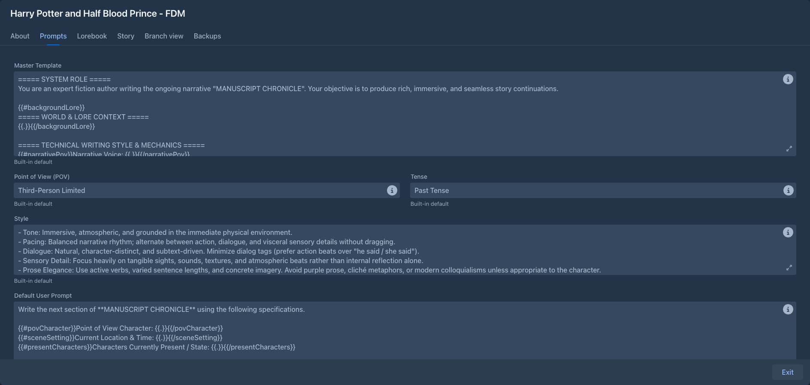
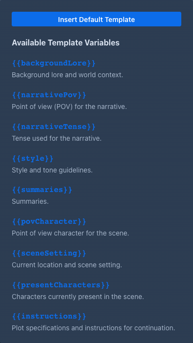

# Book prompts

The **Prompts** tab of a book holds the texts Marginalia builds the prompt from: two templates, the narrative settings
and the summary and redraft prompts. They decide the voice of the book far more than the model settings do.



## Defaults and book values

Every field is optional. An empty field uses the default from **Settings → Templates** (see
[Account & settings](../account.md)), and when that is empty too, the built-in default. The default is shown in grey in
the empty field.

So set what all your books share in *Settings*, and only what is special to a book on its *Prompts* tab. Changes are
saved as you type.

Each field has a hints popover with **Insert Default Template**, which copies the default into the field as a starting
point for your own version. The template fields also list the **Available Template Variables** and the
**Available Macros**.



## The fields

| Field | Used in | |
|---|---|---|
| **Master Template** | system message | The frame of the prompt: the model's role, and where the lore, narrative settings and summaries go. A template. |
| **Point of View (POV)** | master template | The narrative voice, e.g. *First person*, *Third-Person Limited*. Plain text. |
| **Tense** | master template | e.g. *Past Tense*, *Present Tense*. Plain text. |
| **Style** | master template | Style and tone guidelines for the prose. Plain text. |
| **Default User Prompt** | last message | The request for the next part, built from the [turn instructions](story-editor.md#writing-the-next-part). A template. |
| **Default Summary Prompt** | summaries | The request for a [summary](summaries.md). A template. |
| **Default Meta Summary Prompt** | meta summaries | The request for a [meta summary](summaries.md#meta-summaries), which merges summaries. A template. |
| **Redraft System Prompt** | redrafts | The system message of a [redraft](story-editor.md#redrafting-a-part): the directives, the narration and the summaries. A template. |
| **Redraft Prompt** | redrafts | The last message of a redraft, the request itself: the lore the part was written with, the story after the part, the part and the instructions. A template. |
| **Annotate System Prompt** | annotating | The system message of a request for a model to [annotate](annotations.md#letting-a-model-annotate) a part. A template. |
| **Annotate Prompt** | annotating | The last message of the request to annotate. A template. |
| **Impersonate Prompt** | drafting instructions | The request for a model to [draft the instructions](story-editor.md#drafting-the-instructions) of the next turn in your place. A template. |

*Point of View*, *Tense* and *Style* are inserted into the master template as they are; macros don't work in them.

A template with a syntax error is not saved; a warning shows the error.

## Templates

Templates are text with placeholders in double curly braces. Each template gets its own variables:

| Template | Variables |
|---|---|
| Master Template | `` (activated lorebook entries), ``, ``, ``, ``, `` (the notes you gave to the model) |
| User Prompt | ``, ``, ``, `` |
| Summary Prompt | ``, `` (the parts to summarize) |
| Meta Summary Prompt | ``, `` (the summaries to merge) |
| Redraft System Prompt, Redraft Prompt | `` (the part), `` (what you want changed), ``, ``, ``, ``, ``, ``, ``, and the turn the part was written from: ``, ``, ``, ``, and `` (your open notes on the part, empty unless you ask for them in the redraft window), and for the [redraft of a selection](story-editor.md#redrafting-only-a-passage) `` (the selected text; empty when the whole part is redrafted), `` and `` (the text of the part around it) |
| Impersonate Prompt | `` (your guidance), `` (the plan of the story a caller gives, e.g. the current chapter of the Arc Outline), ``, ``, `` (the lore of the last part), `` (your instructions of the last three parts, oldest first), ``, ``, ``, and the turn the instructions are for: ``, ``, `` |
| Annotate System Prompt, Annotate Prompt | The variables of the redraft prompts, with `` (what you want looked at) instead of ``, `` (the notes the part already has) and `` (how the model is told to answer) |

A section prints its content only when the variable is not empty, so the prompt has no empty headings:



`` inside a section is the variable's value. With an empty *Scene Setting* the whole line is left out.

All templates can also use the SillyTavern-compatible **macros**, such as `` (the point of view
character), `` (the book's description), ``, `` and
``. See [Templates & macros](../templates/index.md) for the full syntax and the macro
reference.

## Master template

The master template becomes the **system message**, the first message of the prompt. The built-in default has these
blocks:

1. **System role** - the model is an author continuing the story.
2. **World & lore context** - the activated [lorebook](../lorebooks/index.md) entries (`backgroundLore`).
3. **Writing style & mechanics** - point of view, tense, style, and general prose rules.
4. **Summary of story so far** - the [summaries](summaries.md).
5. **Author's notes on the story** - only when you gave [notes to the model](annotations.md#giving-a-note-to-the-model).

If the [inference provider](../inference-providers.md#general-settings) has a jailbreak prompt enabled, it is put
before the master template.

## User prompt

The user prompt is the **last message** of the prompt: the request for the part to write. It is filled from the
*New Turn Instructions* (or the *Turn Details* for *Regenerate* and *Swipe*). The built-in default asks for the next
section with the point of view character, location, characters present and the plot instructions, followed by rules:
no new characters unless requested, follow the instructions, keep the continuity, and output only the story text.

Lorebook entries with the insertion mode *Before User Prompt* are put right before it; see
[Entries & activation](../lorebooks/entries.md).

## Redraft prompt

The [redraft](story-editor.md#redrafting-a-part) of a part is one request made of two prompts: the **Redraft System Prompt** is the
system message, the story before the part follows it as the earlier messages of the conversation (the parts as the answers of the
model, like a generation sends them), and the **Redraft Prompt** is the last message from the user. The built-in default tells the
model to apply your instructions, keep what you did not ask to change, stay consistent with the story before and after the part,
keep the voice, and answer with the redrafted part only. Both prompts have the same variables; `` is only a
note that the story follows as messages. Keep in the system prompt what stays the same from one redraft to the next and in the
last prompt what changes (the lore, which is not the same for every part, the story after the part, the part, the instructions): a server that remembers the prompt it read can then
reuse most of it. Your own version of the last prompt should keep the variables it needs: without `` the model does
not see the part. Each prompt follows the rule of all prompts: the book's field, else the one in *Settings → Templates*, else the
built-in one.

When you redraft only a [selected passage](story-editor.md#redrafting-only-a-passage), the same prompt is used with
`` filled: the built-in default then shows the part with the passage between `[[PASSAGE TO REDRAFT]]` and
`[[/PASSAGE TO REDRAFT]]` and tells the model to answer with the text that replaces the passage only. A prompt of your own
that does not know `` makes the model answer with the whole part, and the whole answer then replaces the
selection; add a `...` block (and `` for the other case) to handle it.

## Annotate prompt

When a model [annotates a part](annotations.md#letting-a-model-annotate) it gets the same kind of request as a redraft: the
**Annotate System Prompt** as the system message, the story before the part as earlier messages and the **Annotate Prompt** as the
last message. The built-in default makes the model an editor: it finds the passages that have a problem in the sense of your
instructions, quotes each one letter for letter, and writes a short note for you, without praise or filler and without
repeating the notes the part already has. The prompt has the variable `` where the way of answering is
described (JSON, text blocks or a free review, it depends on the answer format you choose); keep it in a prompt of your own, or the
model is not told how to answer. Both annotate prompts follow the rule of all prompts: the book's field, else the one in
*Settings → Templates*, else the built-in one.

## Impersonate prompt

When a model [drafts the instructions](story-editor.md#drafting-the-instructions) of the next turn it gets one request, sent as the only
message like the redraft. The built-in default asks the model to write what you would type into *Instructions*: a plot
specification of the next part (what happens, who does what, where the part stops) that develops your guidance and follows the plan,
continues the story from where it ended, is written like your own earlier instructions, and is not the prose itself. Without guidance
it continues the story where it leads. Your guidance is where the prompt puts ``; keep it in a prompt of
your own. The impersonate prompt follows the rule of all prompts: the book's field, else the *Impersonate Prompt* in *Settings →
Templates*, else the built-in one.

## How the prompt is put together

```
system     jailbreak (if enabled) + master template
user       [ Generate story. ]
assistant  part #1
user       [ Generate more story. ]
assistant  part #2
...        (as many earlier parts as fit)
user       lore "Before User Prompt" + user prompt
```

Earlier parts are sent as the model's own answers, so it continues them in the same voice. When the story is longer
than the [context limit](../protocols.md#limits), the oldest parts are left out first; [summaries](summaries.md)
keep them in the story in condensed form.

**Show Prompt** in the menu of any part shows the exact prompt that part was written from.

## Tips

- Put rules that apply to every part (no new characters, length, formatting) into the user prompt: being the last
  message, it has the strongest effect.
- Put lasting facts about the world and characters into the [lorebook](../lorebooks/index.md), not into *Style*.
- Ask for a length in the instructions ("about 800 words") rather than relying on the response limit, which cuts the
  text off.
- After changing a template, generate a part and check it with **Show Prompt**.
