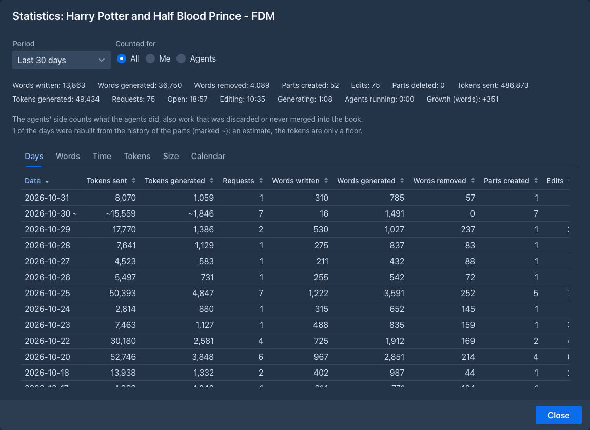
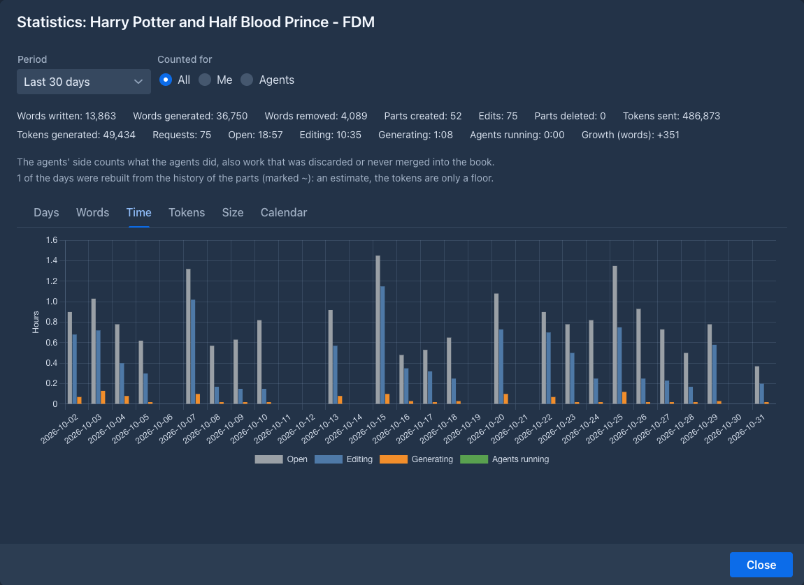
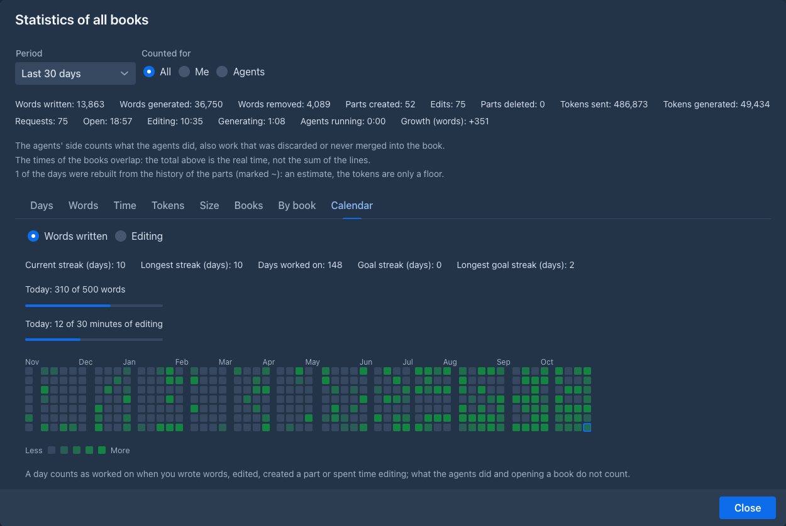
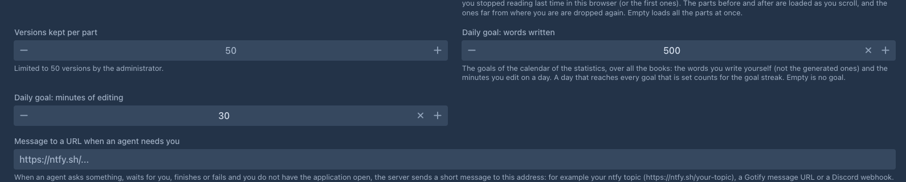
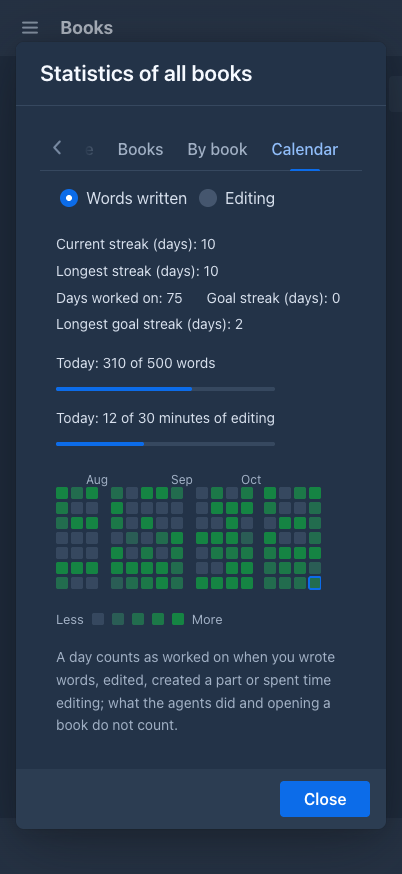

# Writing statistics

Marginalia keeps count of what happens to your books, day by day: how many words you wrote and how many the models wrote, how
long you were writing, how many tokens were sent to the models, how big the book got. The **Statistics** window shows it for
one book or for all of them, as numbers, charts and a **calendar** of the days you worked, with your **streak** and a **daily
goal**.

The numbers are only for you: every account sees its own books. The counting starts with version 1.6.0; what happened before is
[rebuilt from the history of the parts](#days-before-the-statistics) as well as it can be.

## Opening the window

- **One book:** the settings menu (the cogs under the story) has **Statistics**. The window counts that book.
- **All books:** the list of books has a **Statistics** button in its header. The window adds all your books up and has two more
  tabs, **Books** and **By book**.

Both windows work the same way. On top you choose the **Period** (*Today*, *Yesterday*, *Last 7 days*, *Last 30 days*,
*This month*, *All time*, or *Custom* with a **From** and a **To** date) and **Counted for**: **All**, **Me** (you and the models
you asked) or **Agents** (what [agents](../agents.md) did, which is kept apart). The days are the days of the server's clock.

Below the choice are the totals of the period, then the tabs.

## What is counted

| | |
|---|---|
| **Words written** | Words you wrote yourself: the text you typed in a part, in the story editor or anywhere else you edit a part. |
| **Words generated** | Words the models wrote for the book. |
| **Words removed** | Words that went away: text you cut from a part, a part you deleted. |
| **Parts created**, **Parts deleted**, **Edits** | How many parts were made and deleted, and how many times you saved a changed part. |
| **Tokens sent**, **Tokens generated**, **Requests** | What went to the models for this book (the whole prompt each time) and what came back, and how many requests it took. |
| **Open** | How long the book was open on your screen. |
| **Editing** | How long you were typing in a part. A long pause stops the clock. |
| **Generating** | How long a model was working for the book. |
| **Agents running** | How long an agent was working on the book. |
| **Growth** | How much bigger (or smaller) the book became over the period, in words. |

The times are the real clock. When two books are open at once, or three agents run together, the total counts that stretch of
time once, so the lines of the books can add up to more than the total (the window says so). The words and tokens do add up.

Importing a book or a text (an archive, a chat from SillyTavern), copying a book and restoring a backup count
nothing: the text was not written here. What the agents do is counted on their side (**Agents**), against the original book,
although they work on a copy; it includes work that was discarded or never merged into the book.

## The tabs

| Tab | |
|---|---|
| **Days** | A row for every day with something in it: all the numbers above, newest first. Click a header to sort. |
| **Words** | A chart of the words written, generated and removed per day. A long period is grouped by week or by month. |
| **Time** | A chart of the hours open, editing, generating and with an agent running. |
| **Tokens** | A chart of the tokens sent and generated. |
| **Size** | The size of the book at the end of each day and how much it grew each day, in **Words** or in **Tokens**. |
| **Books** | (all books) A row for every book, also the ones in the [trash](../trash.md) or gone, with its folder, numbers, time and growth, and its share. **Show deleted books** hides the ones in the trash and the ones that are gone. A click on a book opens it. |
| **By book** | (all books) The books as bars, by the number you choose in **Chart by**. The ten biggest are shown and the rest are one bar, *Other*. |
| **Calendar** | The days you worked, your streaks and your goal, see below. |

The size of a book is measured a moment after it changes, from the words and tokens the parts have saved. The tokens of an old
part are the ones counted when it was written, so changing the model of the book changes no number.

## The calendar

The **Calendar** tab shows a small square for every day of the last year (53 weeks, 16 on a phone), a week to a column and the
newest day in the bottom right corner, marked with a frame. The darker the square, the more you did that day. Hold the pointer
over a day to see the date, the words you wrote, the time you edited and when you were last at it (a `~` after a day that was
rebuilt from the history).

A day counts as **worked on** when you wrote words, edited a part, created a part or spent time editing. What the agents did,
words that were only generated and opening a book do not count: the calendar is about *your* writing. A square that is only
a little darker than an empty one is a day you worked on but wrote little.

Choose how the squares are shaded with **Words written** or **Editing** (minutes of editing). The calendar always shows the
latest weeks, whatever **Period** is chosen above it.

Above the calendar:

| | |
|---|---|
| **Current streak (days)** | The days in a row you worked on, counted back from today. A today you have not worked on yet does not break it: the streak then counts from yesterday. |
| **Longest streak (days)** | The longest run of days in a row, of all time. |
| **Days worked on** | How many days of the squares shown you worked on. |
| **Goal streak (days)**, **Longest goal streak (days)** | Like the streaks above, for days that reached your daily goal (when you set one, in the window of all books). |

### The daily goal

Set a goal in the **Settings** tab, in the general settings:

| Field | |
|---|---|
| **Daily goal: words written** | The words you write on a day, over all your books. Words the models generate do not count. |
| **Daily goal: minutes of editing** | The minutes you edit on a day, over all your books. |

Leave a field empty for no goal. With both set, a day reaches the goal when it reaches **both**. The window of **all books** then
shows how far you are today as two bars (*Today: 310 of 500 words*), the shade of the calendar follows the goal (a day that
reached it is the darkest), and the **Goal streak** counts the days that reached it. Without a goal, the shade follows your
busiest day of the calendar. The window of a single book has no goal (a goal over all books means little for one of them): its
squares are shaded against the busiest day of that book.

When a day has no recorded time (see below) and the calendar is shaded by **Editing**, it is only marked as a day that was worked on.

## Days before the statistics

The statistics were not kept before version 1.6.0. When Marginalia was updated, it rebuilt the days before from the history of
the parts: the first version of a part is a part created with the words it had, a later one is an edit, and a part that is gone
is a delete. These days are an estimate. They are marked with a `~` in the list of days and the window says how many there are;
the tokens of a rebuilt day are only a floor. The **time** cannot be rebuilt, because nobody recorded it: the window says from which
day it is recorded (*The time is recorded from ...*), the days before it show a dash and are left out of the time chart. The
**calendar** counts a rebuilt day as worked on, like any other.

## Commands

Two [commands](../commands/index.md) read the same numbers: `/get-book-statistics [range] [side]` for the open book, day by day, and
`/get-statistics [range] [by] [side]` for all your books, by day or by book. The range is `today`, `yesterday`, `last-7-days`,
`last-30-days`, `this-month`, `all-time`, a day (`2026-03-14`) or two days (`2026-03-01..2026-03-14`). An
[agent](../agents.md) may use them as well.
