# Summaries

A model can only read a limited amount of text at once (its context). When a book grows beyond that, Marginalia
leaves out the oldest parts, and the model forgets what happened in them. **Summaries** keep that history in the
prompt in condensed form.

## How summaries work

A summary belongs to one part and covers **that part and all parts before it**, back to the previous part with a
summary:

```
#1  #2  #3  #4  #5  #6  #7  #8  #9  #10
            [S1]            [S2]
└──── S1 ────┘└──── S2 ──────┘ sent in full ...
```

Here *S1* (on part #4) covers parts #1-#4 and *S2* (on part #8) covers parts #5-#8.

When the next part is generated:

- all summaries of the active branch go into the master template, oldest first, in the
  `` block (*Summary of story so far* in the default template);
- the parts covered by summaries are **not** sent any more;
- the parts after the newest summary (#9 and #10 above) are sent in full, as many as fit.

Summaries are made only when you ask for them; Marginalia doesn't summarize on its own.

## Creating a summary

1. Pick the part that ends a stretch of the story you want to condense, for example the last part of a chapter.
2. In its menu (☰) choose **Generate summary**.
3. The summary dialog shows the summary as the model writes it (and its reasoning, for reasoning models). **Stop**
   interrupts it and discards the summary. The dialog does not block the story: **Close** while the model writes folds it into
   the [panel of the runs](story-editor.md#the-panel-of-the-runs) and the summary goes on (the part can't be deleted or merged
   away meanwhile); open it there again to read it.
4. When it's done, close the dialog with **Exit**.

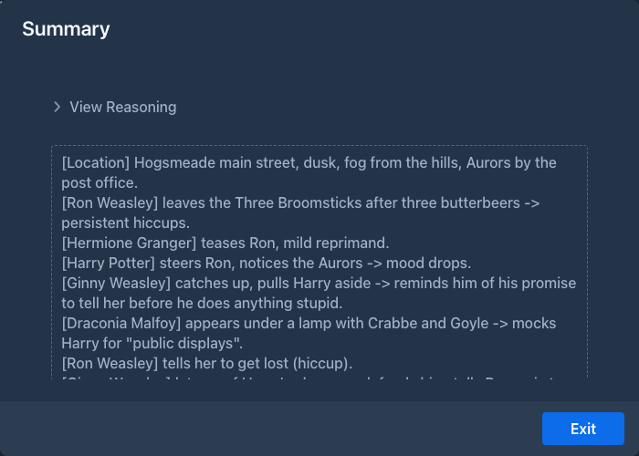

The part menu now has **View summary**, which opens the summary again, and **Delete summary**, which removes it. To
change a summary, edit it in the [Summaries overview](#the-summaries-overview), or delete it and generate it again,
possibly with a different [summary prompt](#the-summary-prompt).

The summary is written by the book's model, with the book's [protocol](../protocols.md), and must fit into the
[context limit](../protocols.md#limits) together with the text of the parts it covers. To summarize a long stretch
with a small model, summarize in smaller steps.

## The Summaries overview

The **Summaries** button (the list icon, left of the settings menu ⚙) in the bottom bar of the story editor opens the
overview of all summaries of the active branch. Hover the button to see how many tokens the summaries in use take
in the prompt.


The dialog lists the summaries the next generation will send, oldest first, and the sum of their tokens at the top.

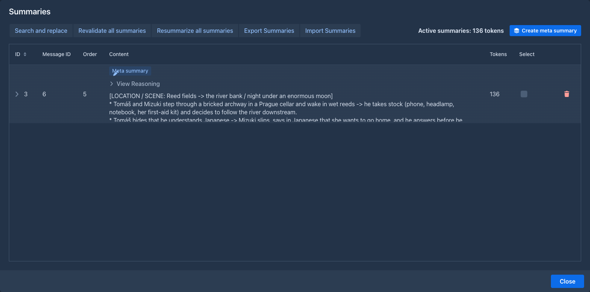

| Column | |
|---|---|
| **ID** | Database ID of the summary. A `-` marks a summary that was [replaced](#meta-summaries) by a meta summary. |
| **Message ID** | Database ID of the part the summary belongs to (the same number the outline of the story editor shows as *DB ID*). |
| **Order** | Position of that part in the branch, `1` is the first part. |
| **Content** | The reasoning of the model (collapsed, if it was a reasoning model) and the text of the summary, in a scrolling area of the same height for every summary. |
| **Tokens** | Size of the summary text. |
| **Select** | Ticks the summary for a [meta summary](#creating-a-meta-summary). |
| trash icon | Deletes the summary. |

Summaries that are merged into a meta summary are shown under it, see [below](#meta-summaries). They have no
**Select** box, no trash icon and no pencil: only the summaries that are in use can be changed.

The menu bar above the grid has **Search and Replace** (see [below](#search-and-replace-in-the-summaries)), **Create summaries...** (see [below](#create-summaries)), **Resummarize all summaries** (see [below](#resummarize-all-summaries)), **Export Summaries** and **Import Summaries** (see [Export and import](#export-and-import-of-the-summaries)); [extensions](../extensions/index.md) can add tools to it.

### Editing a summary

Click the pencil to the right of the content of a summary. The text turns into a text area of the same size. Click
the green check to save the change, or the red trash icon to throw it away. The token count is counted again after
saving.

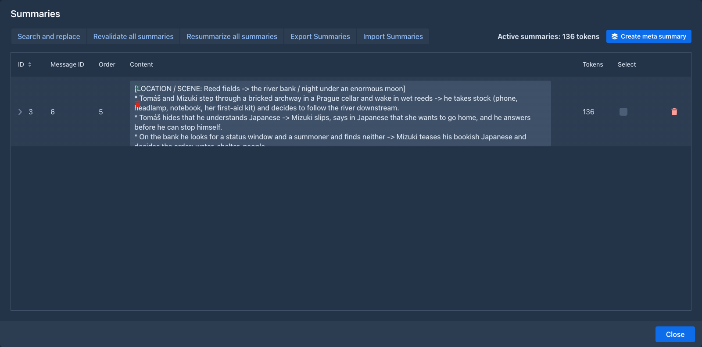

Editing a summary changes what the model gets, nothing else: the summary stays valid. Only the text can be edited,
not the reasoning.

### Search and replace in the summaries

**Search and Replace** in the menu bar of the overview changes a name or a phrase in the summaries only, for instance
when a character was renamed, and leaves the story as it is. It is the [search and replace of the story](story-editor.md#search-and-replace)
with the same fields and options, except that there is no **Search in summaries** (the summaries are all it looks into).
The table lists every summary with a match, and the matches in it.

It also looks into the summaries a meta summary stands in for and into the summary a meta summary replaced (they are shown
under the meta summary and come back when it is [unwound](#unwinding-a-meta-summary)): a match in them is listed with the
meta summary that holds them.

The text of the merged summaries is part of what makes a meta summary valid, so the replace works out the check value of
those meta summaries again and they stay valid. **Revalidate all summaries** (on by default) does that for every summary of
the book, also for those the replace did not touch and for those that were outdated before, see
[the story search](story-editor.md#search-and-replace). With it off, a meta summary on a branch that is not searched
(**Search in all branches** off) would become outdated, and the window tells you how many and asks whether to go on.

### Create summaries

**Create summaries...** (also in the settings menu ⚙ of the story, **Analysis**, and offered after an [import](story-editor.md#after-an-import))
writes the summaries of a long story in one go, for instance of a book you imported: it cuts the story into blocks and makes a
summary for each, one after the other, the oldest first. A summary covers the parts down to the part after the summary before it, as
the summary of a single part does, so the blocks follow each other without a gap.

- **Where it starts.** Only the parts **after the newest summary** get summaries (all of the story when there is none). The summaries
  that exist are ignored: they are not written again, not changed and do not decide where the new blocks end. To write older ones
  again use [Resummarize all summaries](#resummarize-all-summaries).
- **Cut the story by** says where a block ends:
  - **Number of tokens**: after the part that takes the block to **Tokens per summary** (the cut is rounded to the end of that part,
    a block has at least that many tokens, as many parts as it takes).
  - **Chapters**: before a part that starts a chapter, so the summary goes on the part before it. A chapter is a part that starts with
    a heading (the shallowest heading level a part starts with: `#` in a book made by the [import](managing-books.md#importing-a-finished-manuscript)).
    **Fewest tokens before a chapter ends a summary** keeps short chapters from having a summary of their own: when the block so far
    has fewer tokens, the chapter that starts does not end it and is summarized together with the next one.
  - **Number of parts**: after every **Parts per summary** parts.
- **Up to part** stops the range at a part (empty is the end of the story). **Also summarize the rest at the end** gives a summary to
  the parts after the last cut, which are fewer than a block (with chapters only when they have the minimum of tokens); turn it off to
  leave the newest parts without one, as they are while you write.
- A block never gets longer than the model can read (80% of the context without the reply): it ends before the part that would carry it
  over. A single part that is longer than that fails with the usual error.

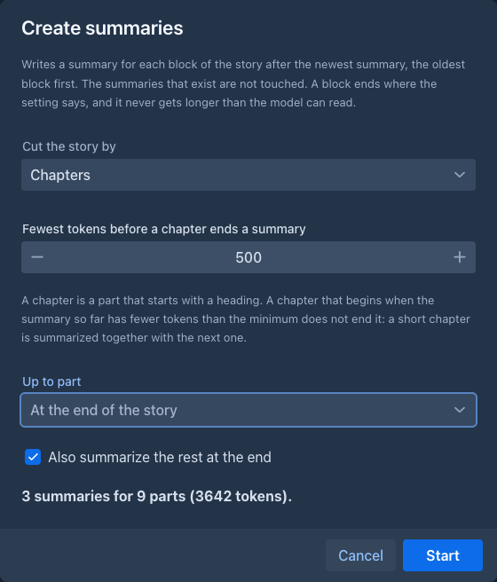

A line under the options says how many summaries it will write, for how many parts and tokens. **Start** opens the window with the number
of the summary being written and its text as it comes in. The window closes when the last one is written.

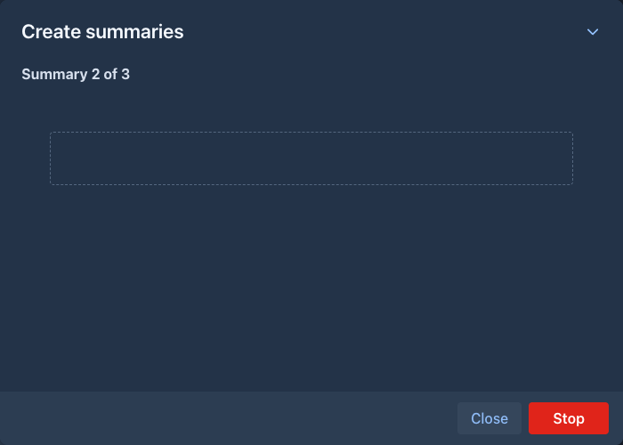

Every summary is stored when it is written: **Stop**, or a request that fails, leaves
the summaries before it, and **Create summaries** goes on from there the next time (it starts after the newest summary). The book must not be
locked by an [agent](../agents.md#the-book-is-locked); each summary is a request to the book's model.

### Resummarize all summaries

After you change the summary prompt (or the meta summary prompt) the summaries you already have still follow the old one.
**Resummarize all summaries** writes all of them again with the book's model, so that they all look the same. It asks first
and says how many summaries it is going to write: one request each.


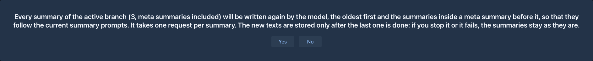

- It starts with the **oldest** summary and goes on to the newest.
- A **meta summary** is written after the summaries it stands in for (the ones shown under it, the inner meta summaries
  before the outer), from their **new** texts, so a meta summary is never made of old text.
- Every summary keeps its place on its part. The check value of each one is worked out again from the story as it is now, so a
  summary that was **outdated** is valid afterwards (the model read the current text of the parts).
- The window shows the number of the summary being written and the text as it comes in. The new texts are stored only when
  the **last** one is done: if you press **Stop**, or a request fails (the prompt does not fit into the context, the model
  answers nothing), every summary stays as it was.

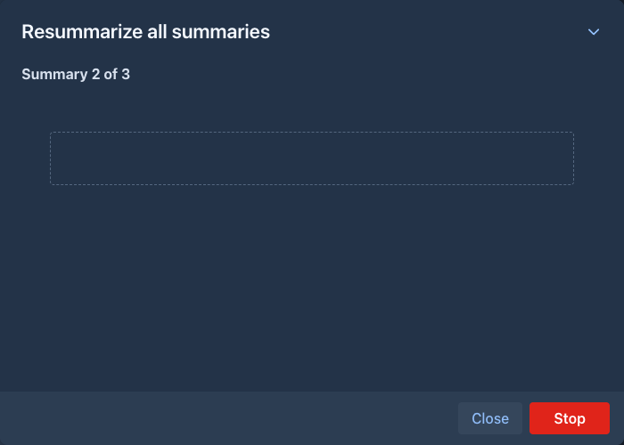

The summaries of other branches are not changed. Make sure the model is not busy and that the book is not worked on by an
agent. The edits you made to the texts by hand are replaced, export the summaries first if you want to keep them.

### Export and import of the summaries

**Export Summaries** downloads the summaries in use on the active branch as one text file (`<book>-summaries.md`), the oldest
first, each under a line like `<!-- summary part="..." order="3" -->`. Edit the texts in any editor, keep the header lines, and
bring the file back with **Import Summaries**: choose the file, the table says what would happen to each summary, and nothing
is written until you press **Import**.

| Status | |
|---|---|
| **Will change** | The part named by the header has a summary in use and its text differs. |
| **Will change (by position)** | See below. |
| **Unchanged** | The text is the one the summary has. |
| **Part not found** | The branch has no summary in use for the header. |
| **Empty text** | The text under the header is empty; an import never empties a summary. |

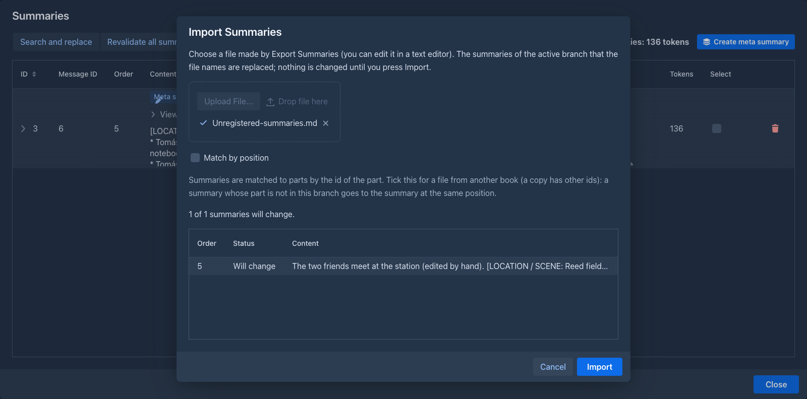

A header names the part by its id, so a file brings the summaries back to the book it came from. To move the summaries to
another book (a copy has parts with other ids) tick **Match by position**: a summary whose part is not in this branch goes
to the summary on the part at the same position (the `order` of the header, the root is 1). Check the table first: a
position only fits when the two stories have the same shape.

The file holds the summaries generation uses, a meta summary is one of them. The summaries a meta summary stands in for are
not in it and are never changed: their text is part of what makes the meta summary valid (see
[Meta summaries](#meta-summaries)), so a change of them would make it outdated. An import changes only the text and the token
count of a summary, the same as the pencil does, so no summary becomes outdated by it. It is refused while an agent works on
the book.

### Deleting a summary

The trash icon of a summary does the same as **Delete summary** in the part menu. For a meta summary it asks what to
do, see [Unwinding a meta summary](#unwinding-a-meta-summary).

## Meta summaries

Summaries stay in the prompt for good, so a long book fills the context with them. A **meta summary** condenses
several summaries into one: it is a summary of summaries.

```
#1  #2  #3  #4  #5  #6  #7  #8  #9  #10
        [S1]        [S2]        [S3]
        └─────────── M ─────────────┘
```

Here *M* merges *S1*, *S2* and *S3*. It belongs to the part of the newest merged summary (#9 above, which had *S3*)
and replaces that summary on the part. From then on:

- only *M* goes into the `` block, instead of *S1*, *S2* and *S3*;
- *S1* and *S2* stay on their parts, but are not sent. They are shown under *M* in the overview;
- *S3*, the summary *M* replaced, is kept inside *M*, shown under it with a **Replaced** badge.

The parts covered by the merged summaries are still not sent in full; a meta summary doesn't change what the
summaries cover, only how long the text for it is.

### Creating a meta summary

1. Open the [Summaries overview](#the-summaries-overview).
2. Tick the **Select** box of the summaries to merge. At least two. You tick the summaries in use only (the ones on
   the top level of the grid).
3. Click **Create meta summary**.

Marginalia merges everything from the newest to the oldest ticked summary, including the summaries in between that
were not ticked. The meta summary dialog works like the summary dialog: it shows the text as the model writes it, and
**Stop** cancels it and changes nothing. When it ends, close the dialog with **Exit** and the overview shows the
result.

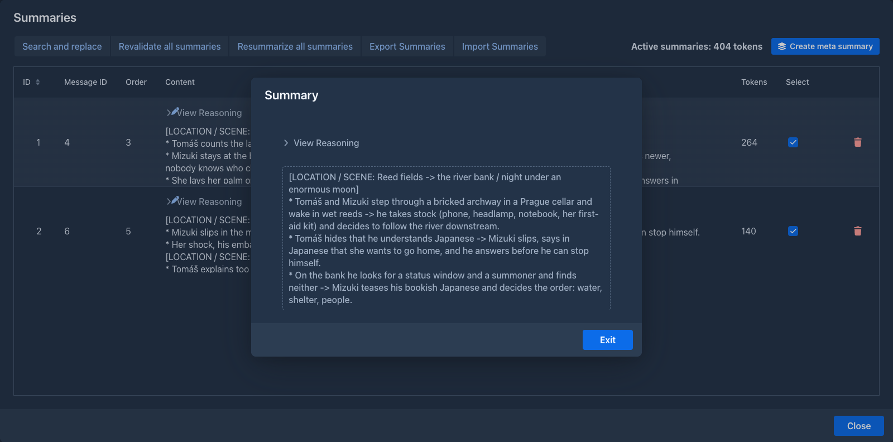

A meta summary can merge meta summaries too: tick them like any other summary. The merged ones are shown under the new
one, with their own merged summaries under them.

The summaries to merge and the request for the model must fit into the [context limit](../protocols.md#limits), so
with a small model merge a few summaries at a time.

### Unwinding a meta summary

Deleting a meta summary (the trash icon in the overview, or **Delete summary** in the part menu) asks:

| Button | |
|---|---|
| **Unwind** | Removes the meta summary and puts back the summary it replaced on the part. Summaries that were merged into a meta summary made of meta summaries come back one level at a time, the way they were made. |
| **Delete** | Removes the meta summary and leaves the part without a summary. The summaries it merged are in use again (but the one it replaced is gone). |
| **Cancel** | Does nothing. |

After unwinding, the summaries that were merged are in use again and the overview shows them on the top level.

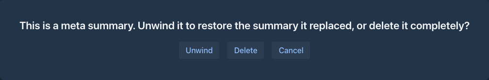

### The meta summary prompt

The request for a meta summary is the **Default Meta Summary Prompt** of the book (on the [Prompts](prompts.md) tab, or
the default from *Settings → Templates*). It gets two variables:

| Variable | |
|---|---|
| `` | The summaries to merge, oldest first, separated by an empty line. |
| `` | The lorebook entries that were active when the part of the meta summary was written. |

The built-in prompt asks for the events to be chained into shorter entries - roughly half the size - without losing
names, items, agreements or unresolved plot threads, and without adding anything new.

## When summaries become outdated

A summary is only valid for the exact text it was made from. When you [edit](story-editor.md#editing-the-text) or
[delete](story-editor.md#deleting-a-part) a part covered by a summary, the summary no longer matches.

Outdated summaries are not sent to the model. Marginalia checks this when it generates the next part and asks
*The summaries of the messages with IDs: [...] are outdated ... Continue generation and delete them?* Answer **Yes** to
delete them and generate; the parts they covered are sent in full again (as far as they fit) until you summarize them
again. Answer **No** to stop: nothing is deleted, and you can deal with the summaries first.

In the [Summaries overview](#the-summaries-overview) an outdated summary has a **red background** and an **Outdated**
label, and its tokens are not counted in the sum at the top. If it still says the right thing (you fixed a typo, say), press
the **check** button of its row to **revalidate** it, or choose **Revalidate all summaries** in the menu bar to revalidate
all the outdated ones at once. Otherwise delete it, or generate it again. A meta summary is checked like any summary; the
summaries it merged are part of it and are never outdated by themselves. Revalidating is refused while an agent works on
the book.

When you save the [edit of a part](story-editor.md#editing-the-text) that would make summaries outdated, Marginalia warns
you first and lets you go back to editing, save anyway, or save and revalidate the summaries.

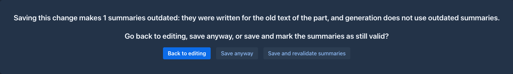

After **Save anyway** the Summaries overview shows the summary as outdated (red, with the label **Outdated**, and not counted in the sum at the top):

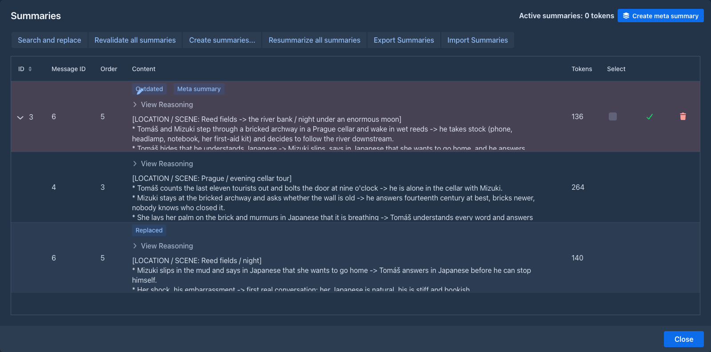

A [search and replace](story-editor.md#search-and-replace) in the story keeps the summaries it covers valid and warns about
the ones that become outdated. The [search and replace of the summaries](#search-and-replace-in-the-summaries) keeps the meta
summaries valid.

A meta summary is outdated when a part it covers is edited or deleted, but also when a summary it merged is deleted.
(That is why the merged summaries can't be edited one by one: the change would make the meta summary outdated. The
[search and replace](#search-and-replace-in-the-summaries) works out the check value of the meta summary again.) Removing an
outdated meta summary is the same as unwinding it: the summary it replaced comes back, and is checked as well. If it
is outdated too, it is removed in the same way.

When you [branch](branches-and-story-tree.md#branching-from-an-earlier-part) from a part with a summary, the new
branch gets a copy of the summary. A copied meta summary keeps what it replaced, so it can be unwound in the new
branch.

## The summary prompt

The request for a summary is the **Default Summary Prompt** of the book (on the [Prompts](prompts.md) tab, or the
default from *Settings → Templates*). It gets two variables:

| Variable | |
|---|---|
| `` | The text of the parts to summarize, oldest first. |
| `` | The lorebook entries that were active when the summarized part was written. |

The built-in prompt asks for a compact event ledger, grouped by place: under a `[LOCATION / SCENE: Name]` header,
one event per line as *who does what -> what follows from it* (the intent only when the text shows it), without
titles, numbers or ids for the events and without the atmosphere. It is meant for the model, not for a reader, and
it is about a quarter of the size of the text it replaces. The meta summary prompt expects the same format and merges neighbouring lines into causal chains. Replace it
if you prefer a different format or length; a summary made before the prompt changed keeps its old form until you
make it again.

## Tips

- Summarize at natural breaks: the end of a chapter or a scene.
- When the summaries start to take too much of the context (the tooltip of the **Summaries** button shows how much),
  merge the oldest ones into a meta summary. Repeat it later with the meta summary and the summaries after it.
- Summaries stay in the prompt for good. With many of them, the prompt can fill the context by itself, and generating
  stops with *Contextual limit not sufficient.* Then shorten them (a more concise summary prompt), merge them into
  [meta summaries](#meta-summaries) or raise the context limit.
- Keep facts that must never be forgotten (names, relationships, rules of the world) in the
  [lorebook](../lorebooks/index.md) rather than relying on summaries.
- Check what the model got with **Show Prompt** on the next part.
