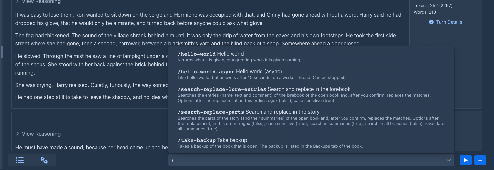
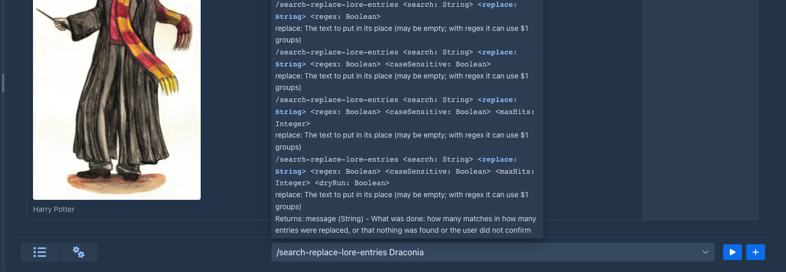
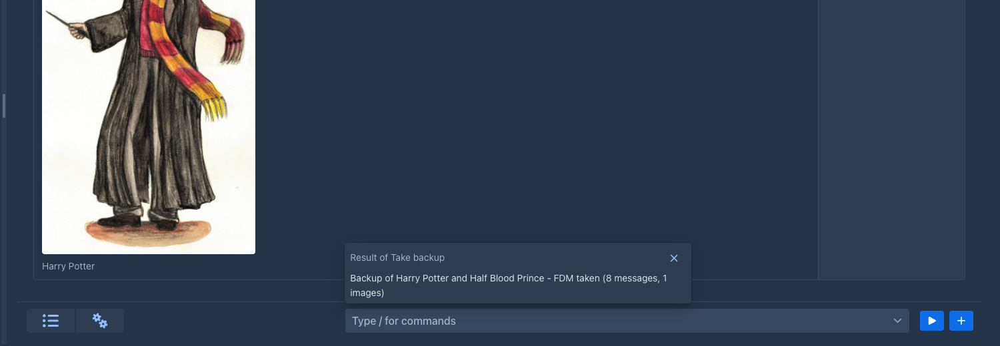
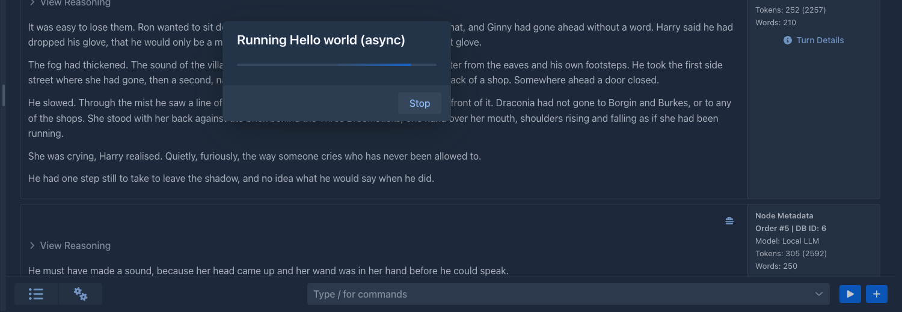
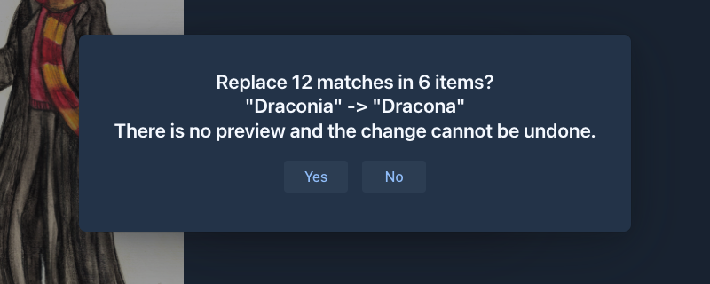

# Commands

Commands are small actions you run by typing them, instead of clicking through menus: look something up in the story or
the lorebooks, search and replace, take a backup. [Extensions](../extensions/index.md) add commands of their own, for
example to generate a lore entry or to make up names. The same commands are what an [agent](../agents.md) works with, so a
command does one clear thing and says what it does: you can read it while you type.

The **command line** is the field next to the menu below the story, in the [story editor](../books/story-editor.md).

## Running a command

1. Click into the command line and type `/`. The list shows all the commands, each with its name and a short
   description. Typing more narrows the list: the filter looks at the name of the command, its title and its description.
2. Pick the command with the mouse, or with the arrow keys and **Enter**. A command that needs nothing runs at once; for
   one that takes arguments, `/name ` is written into the field and you continue with the arguments.

3. Type the arguments and press **Enter**, or click the play button next to the field, to run it. The field is emptied
   as soon as the command starts; a text that is not a command stays, so you can correct it.

Text that does not start with `/` is not a command, and nothing is run. Clicking away from the field or pressing **Esc**
never runs anything, so you cannot start a command by accident.

## The help

While you type, a small window opens above the field. It covers part of the story but moves nothing, and it closes when
you leave the field or run the command. It shows:

- what the command does,
- the forms the command has (see [Forms](#forms-of-a-command)) that fit what you have typed so far, with the argument you
  are typing now highlighted and its description,
- what the command returns,
- a hint when you have typed more arguments than the command takes, or when no command has that name.

While you are still typing the name, the list of commands is the help.

## Arguments

Arguments are separated by spaces, and repeated spaces count as one. To put a space *inside* an argument, you have
three ways:

| You type                     | The command gets                | Why                                        |
|------------------------------|---------------------------------|--------------------------------------------|
| `/search-parts two\ words`   | one argument, `two words`       | `\ ` (backslash, space) is a space         |
| `/search-parts "two words"`  | one argument, `two words`       | double quotes keep everything inside together |
| `/search-parts say\ "hi"`    | one argument, `say hi`          | quotes can start in the middle of an argument |

The other special characters:

| You type                      | You get                    |
|-------------------------------|----------------------------|
| `\\`                          | a backslash                |
| `\"`                          | a double quote, with or without quotes around it: `"say \"hi\""` is `say "hi"` |
| `""`                          | an empty argument          |

A backslash in front of anything else stays as it is, so `C:\books\story` is passed unchanged. If you open a quote and
never close it, everything to the end of the line belongs to that argument.

Arguments are text. A command that wants a number, a yes/no or one of a few options converts the text itself; if the text does
not fit, the command is not run and a notification says so.

## Forms of a command

One command can take different arguments: `/list-parts` with nothing, and `/list-parts 2` with one argument
are two **forms** of the same command. Marginalia picks the form by the number of arguments you typed and by what they
look like. If no form fits, a notification says that the command does not take these arguments, and the help shows the
forms it does have.

## The result

When a command returns something, it is shown in a window above the command line. Close it with the cross, with **Esc**,
or just carry on: it disappears when you type something new or run another command. A command that returns nothing shows
no window.

If a command fails, or there is no such command, you get a notification with the reason.

## Commands that take time

Most commands answer at once. A command that needs time shows a window with an animated bar and a **Stop** button, and
the story is locked until the command is done. Under the bar the command can say what it is doing now and, in smaller
letters, the detail of the step. **Stop** cancels the command; it should return immediately. The commands that have the model write, like `/next`, are of this kind.

## Commands that change data

Every command says what it does to the data that already exists, and the command bar shows it as a small label next to
the command, in the list and in the help:

- **Destructive** (red) - the command changes or removes data that exists, like the search and replace commands that
  rewrite the book. Point at the label to see the explanation.
- **Non-destructive** (green) - the command only reads data or adds new data, like `/take-backup`, which adds a backup and
  changes nothing else.

The label is information for you; it does not stop the command when you run it. An [agent](../agents.md) goes by it: it is
not given a destructive command, or has to ask you first, or runs it, as set for that agent. A command that asks for
confirmation by itself is described below.

## Commands that ask first

A command that changes a lot can ask before it does. The search and replace commands have no preview, so after the
search they show how many matches they found in how many items and what would be replaced by what, and only **Yes**
changes the book; **No** leaves everything as it was. The question stays until you answer it.

## Commands that come with Marginalia

| Command                              | What it does                                                                       |
|--------------------------------------|------------------------------------------------------------------------------------|
| `/search-replace-parts <search> <replace> [regex] [caseSensitive] [summaries] [allBranches] [revalidateSummaries] [maxHits] [dryRun]` | Search and replace in the story of the open book, like the **Search and replace** window of the story tab. The options are `true`/`false`, in this order, and each one you leave out has the default of that window ([regex](../regular-expressions.md) no, case sensitive yes, summaries yes, all branches no, revalidate yes); to set one, give those before it too. `maxHits` refuses a replace that finds more matches than that, and with `dryRun` `true` nothing is changed: the answer counts the matches and shows a few, which is how an agent looks before it replaces. There is no preview: after the search you are asked whether to replace the number of matches found, and only **Yes** changes the book. The replace cannot be stopped. |
| `/search-replace-lore-entries <search> <replace> [regex] [caseSensitive] [maxHits] [dryRun]` | The same for the entries (name, text and comment) of the lorebook of the open book. |
| `/take-backup`                       | Takes a backup of the book that is open; it appears in the **Backups** tab of the book. Says no book is open when there is none. |
| `/get-book-info` | The name, settings, model, totals (parts, words, tokens) and tags of the open book. |
| `/list-parts [branch] [offset] [limit]` | The parts of a branch: handle, position, size, swipes, summary state and a short preview. |
| `/get-part <part> [branch] [offset] [length] [field]` | The text of a part in slices (or its `instructions`, `scene`, `pov`, `present` or `reasoning`) and what it was made from. |
| `/list-swipes <part> [branch]` | The alternatives (swipes) of a part, with the branch number that shows each. |
| `/list-branches [offset] [limit]` | The branches of the book, numbered, with where each parts from the others. |
| `/get-part-metrics <part> [branch]` | Tokens, timings, model and protocol of a part. |
| `/show-prompt <part> [branch] [offset] [length]` | The prompt a generated part was made from, as it was stored. |
| `/search-parts <query> [limit]` | Full-text search in the parts of all branches, with snippets. |
| `/find-occurrences <terms> [regex] [caseSensitive] [summaries] [allBranches] [limit]` | How often and where names or words occur (defaults: no regex, case insensitive, parts only, active branch). |
| `/compare-parts <a> <b> [branchA] [branchB]` | The sentences that differ between two parts; `0` as `b` compares part `a` with the text the model produced first. |
| `/count-tokens <text>`, `/count-tokens <part> <branch>` | Tokens (with the tokenizer of the book's model), words and characters of a text, or of a part when the text is its handle. |
| `/list-summaries [branch]` | The summaries of a branch, the parts they cover and whether they are still valid. |
| `/get-summary <part> [branch]` | The summary of a part. |
| `/check-summaries [branch]` | The outdated summaries and the edited parts that made them so. |
| `/get-template-variables <scope> [part] [branch]` | The template variables of the book (`global`) or of a part (`part`). |
| `/list-lorebooks` | The lorebooks of the open book (the root and its subbooks) with their numbers, entry counts, tags and subbooks. |
| `/list-lore-entries [lorebook] [filter] [offset] [limit]` | The entries of a lorebook with their settings and a preview; the filter keeps the entries whose name or tag contains it. |
| `/get-lore-entry <entry> [lorebook] [offset] [length]` | One entry: settings, keys, tags, comment and its text in slices. |
| `/search-lore <query> [regex] [limit]` | The entries of all the lorebooks of the book whose name, text or comment contain the query, with snippets. |
| `/preview-lore-activation <text> [limit]`, `/preview-lore-activation <part> <branch> <limit>` | Which entries a generation would use for a text, or for a turn like the one that made a part, and why (no filter, filter found - in the text, or in the content of another entry when the lorebook has a [scan depth](../lorebooks/entries.md#entries-brought-in-by-other-entries) - or not used because it is switched off, a tag of the book decides, or the filter is not in the text), with the lore text and its tokens. The text may be the handle of a part. |
| `/list-annotations [status [part [offset [limit]]]]` | The [annotations](../books/annotations.md) of the book or of a part: the open ones unless `status` says `resolved`, `dismissed`, `orphaned` or `all`. |
| `/get-annotation <annotation>` | One annotation in full, with the text around its passage. |

### Reading the story

The commands above that read the book (`/get-book-info` to `/get-template-variables`) change nothing; they answer in JSON text,
so an agent can use them as well. Every row of an answer has a **`handle`**: the identifier of the part (or lorebook, or entry), which
does not change when parts are added, moved or deleted. A part is given by its handle, or by its **position** on a branch, the first
part of the story being `1`; a branch by the handle of any part of it, or by its **number** from `/list-branches` (the numbers follow
the creation of the ends of the branches, so they change when a branch is added or deleted). Positions and numbers are easier to type,
handles are what an agent should use, and the commands that change the story take handles only. Without a branch the commands work on
the active branch. Lists are paged with `offset` and `limit`, long texts are cut into slices (`offset`, `length`) and the answer says
the total length. As with the other commands the options are positional: to set one, give those before it too.

The commands that read the lorebooks (`/list-lorebooks` to `/preview-lore-activation`) work the same way and reach only the lorebooks of the open
book: the root lorebook and its subbooks. A lorebook is its **handle** or its **number** from `/list-lorebooks` (the root is `1`), an entry its
**handle** or its **number in the lorebook**, in the order of the lorebook (the first entry is `1`); the numbers change when entries or subbooks are
added or removed. Without a lorebook the root lorebook is used.

### Changing the story and the lore

These commands change the open book (or the working copy of an agent, which is where an agent's changes go). A part, lorebook or
entry is always given by its **handle**, never by a position or a number: those move when something is added or deleted, and a
position that was right when it was read may be another part by the time it is written. The options are positional as before. A
command that removes text or data is `DESTRUCTIVE` and asks you to confirm (an agent is covered by its destructive mode instead);
adding and changing are not. An edit of the story can make summaries outdated (a summary carries the hash of the story it
describes): the answer lists them and says what to do, `/revalidate-summaries` if they are still right, `/regenerate-summary` if not.

| Command | What it does |
|---------|--------------|
| `/edit-part <part> <old> <new> [field]` | Replaces `old` by `new` in the text of a part; `old` must be found exactly once, otherwise nothing changes and the error says how many times it was found. `field` edits the `instructions`, `scene`, `pov` or `present` characters of the turn instead. |
| `/replace-part-text <part> <text> [field]` | Replaces the whole text of a part. Asks first. |
| `/append-to-part <part> <text> [separator]` | Adds text to the end of a part, after a blank line unless `separator` says otherwise. |
| `/set-part-fields <part> [instructions] [scene] [pov] [present]` | Changes what a part was made from, which a new generation of it reuses; an empty text clears a field, a field you leave out stays. |
| `/create-part <text> [parent] [instructions] [scene] [pov] [present]` | Writes a new part after the last part of the active branch, or after `parent` (a new branch); it becomes the end of the active branch. |
| `/insert-part <text> <part> [before]` | Inserts a new part into the story right after `part` (or right before it when `before` is `true`). Everything that followed that place, all branches included, follows the new part now; nothing is deleted or made again, so the other parts keep their summaries and data and move one position down. The summaries that covered the place become outdated (the answer says which). At the end of the branch it is the same as `/create-part`. |
| `/branch-part <part>` | Copies a part (and its summary) next to it, a new swipe that starts a branch, and makes the copy the active end. |
| `/delete-part <part>` | Deletes a part and its summary; the parts that followed it stay. Asks first. |
| `/switch-branch <part>` | Makes the branch through a part the active one. |
| `/set-summary <part> <text>` | Replaces the text of the summary on a part. |
| `/remove-summary <part> [unwind]` | Removes the summary of a part (`unwind` brings back what a meta summary replaced). Asks first. |
| `/revalidate-summaries [part]` | Says the outdated summaries still describe the story (all of the active branch, or only that part's). Use it only when you checked. |
| `/regenerate-summary <part>` | Has the model make the summary on a part again. Slow, costs tokens. |
| `/create-meta-summary <from> <to>` | Has the model merge the summaries from the part `from` (newest) back to `to` into one. Slow, costs tokens. |
| `/next [scene] [pov] [present] [instructions] [after] [profile]` | Has the model write the next part, like the **New turn** button. Slow, costs tokens; one generation of a book runs at a time, the others wait. `profile` names one of the model profiles of an agent. |
| `/swipe [part] [scene] [pov] [present] [instructions] [profile]` | Has the model write another version of the last part of a branch. What you leave out is taken from the part. |
| `/regenerate [part] [scene] [pov] [present] [instructions] [profile]` | Has the model write the last part of a branch again, replacing its text. Asks first. |
| `/redraft-part <part> [instructions] [prompt] [profile] [apply]` | Has the model write any part again from your instructions (see [Redrafting a part](../books/story-editor.md#redrafting-a-part)) and replaces its text. `prompt` is a redraft prompt to use instead of the book's, `profile` a model profile of an agent, `apply` `false` only returns the text. `DESTRUCTIVE`; asks first. Slow, costs tokens. |
| `/impersonate [instructions] [outline] [prompt]` | Has the model draft the instructions of the next turn in your place (see [Drafting the instructions](../books/story-editor.md#drafting-the-instructions)) and returns the text; nothing is changed. `instructions` is what the part should be about (empty continues the story where it leads), `outline` a plan of the story for the model, `prompt` an impersonate prompt to use instead of the book's. Only for you at the command bar: an [agent](../agents.md) is not offered it. Slow, costs tokens. |
| `/set-book-info [name] [description] [pov] [tense] [style] [language]` | Changes the descriptive settings of the book; only the values you give. |
| `/set-book-prompts [template] [userPrompt] [summaryPrompt] [metaSummaryPrompt]` | Replaces the prompt templates of the book. Each is checked first. `DESTRUCTIVE`: a bad template spoils every later generation. |
| `/set-book-tags [add] [remove]` | Adds and takes off tags of the book (comma separated). |
| `/create-lore-entry <name> <payload> [lorebook] [comment] [enabled] [order] [keys] [filteringMode] [insertionMode] [tags]` | Adds an entry to a lorebook (the root when none is given; a book that has no lorebook gets one, named like the book). `keys` is a list of keywords separated by commas; `filteringMode` is `KEYWORDS_OR` (default), `KEYWORDS_AND`, `TEXT` or `REGEX`. A problem of the template or of the regular expression is saved and reported. |
| `/update-lore-entry <entry> [name] [payload] [comment] [enabled] [order] [keys] [filteringMode] [insertionMode]` | Changes the fields you give. |
| `/delete-lore-entry <entry>` | Deletes an entry. Asks first. |
| `/move-lore-entry <entry> <lorebook>` | Moves an entry to another lorebook of the book. |
| `/set-lore-entry-tags <entry> [add] [remove] [addNegative] [removeNegative]` | Changes the tags and negative tags of an entry (comma separated). |
| `/create-lorebook <name> [parent]` | Makes a lorebook that is a subbook of `parent` (the root when none is given; a book that has no lorebook gets one first). |
| `/set-lorebook <lorebook> [name] [enabled]` | Renames a lorebook or switches it on or off. |
| `/add-subbook <lorebook> <subbook>`, `/remove-subbook <lorebook> <subbook>` | Changes which lorebooks a lorebook contains; a lorebook can't contain itself. For an [agent](../agents.md), `/add-subbook` also brings back a lorebook it deleted or took out of its parent earlier (it names it by the handle it had), with its entries. |
| `/delete-lorebook <lorebook>` | Deletes a lorebook with its entries (not the root). Asks first. |

### Annotations

The commands that read [annotations](../books/annotations.md) (`/list-annotations`, `/get-annotation`) answer in JSON like the other reading commands;
an annotation is given by its **handle**, a part by its handle for the commands that change something. These commands change only the notes,
never the story, so only the delete asks first. An agent can use all of them; its notes reach your book when you [review the result](../books/annotations.md#annotations-and-agents).

| Command | What it does |
|---------|--------------|
| `/create-annotation <part> <text> [quote [type]]` | Adds a note to a part. `quote` is the words of the passage, copied from the part: the note sits on that passage and follows it when the text is edited. Without a quote, or with one that is not in the text, the note is about the whole part (the answer says so). |
| `/update-annotation <annotation> <text> [type [sendToPrompt]]` | Changes the note, the type or whether the model gets the note; an empty text or type stays as it is. |
| `/resolve-annotation <annotation> [status]` | Sets the status: `resolved` (default), `dismissed` or `open`. |
| `/reattach-annotation <annotation> [quote]` | Moves a note to the passage the quote finds in its part; without a quote the note is about the whole part. |
| `/delete-annotation <annotation>` | Deletes a note (it can be restored from the trash). Asks first. |

The commands that have the model write (`/next`, `/swipe`, `/regenerate`, the two summaries) take time and show the **Stop** window.

## Commands that come with extensions

You see these in the list as long as the extension is loaded; each is described in the documentation of its extension.

| Command | Extension | What it does |
|---|---|---|
| `/list-lore-templates [<template>]` | [Lore Generator](../extensions/lore-generator.md) | Your saved generation prompts, or the text of one. |
| `/generate-lore-entry [<prompt> ...]` | [Lore Generator](../extensions/lore-generator.md) | Generates the text of a lore entry with the lore of the lorebook, compacts it (unless `compact` is `false`) and returns it. Stores nothing. |
| `/compact-lore-entry <text> [...]` | [Lore Generator](../extensions/lore-generator.md) | Compacts a generated text into a dense lore entry text and returns it. Stores nothing. |
| `/list-name-categories [<filter>]`, `/generate-names <category> <count> [...]` | [Name generator](../extensions/name-generator.md) | The categories of made up names, and names of one of them. |
| `/list-real-name-lists`, `/pick-real-names <list> <count>` | [Name provider](../extensions/name-provider.md) | The lists of real names, and names picked from one of them. |
| `/list-place-types`, `/search-places <query> [...]`, `/places-near <place> <radius_km> [...]`, `/distance-between <from> <to>` | [Place provider](../extensions/place-provider.md) | The types of real places, a search by name, type and country, the places around a point, and the distance of two places. |
| `/get-arc-outline [<arc> [<notes>]]` | [Arc Outline](../extensions/arc-outline.md) | The arcs and chapters of the outline. |
| `/add-arc`, `/update-arc`, `/move-arc`, `/delete-arc` | [Arc Outline](../extensions/arc-outline.md) | Add, change, move and delete an arc (`<arc>` is its number). |
| `/add-outline-chapter`, `/update-outline-chapter`, `/move-outline-chapter`, `/delete-outline-chapter` | [Arc Outline](../extensions/arc-outline.md) | The same for the chapters of an arc. |
| `/generate-arc`, `/generate-outline-chapters <arc>`, `/import-arc-from-story` | [Arc Outline](../extensions/arc-outline.md) | The generators of the Arcs tab. They return the result and add it to the outline only with `save`. |
| `/list-characters`, `/get-character <character>` | [Character Tracker](../extensions/character-tracker.md) | The characters of the book, and one with its note and relationships. |
| `/create-character`, `/update-character`, `/delete-character` | [Character Tracker](../extensions/character-tracker.md) | Add, change and delete a character. |
| `/list-character-relations`, `/add-character-relation`, `/update-character-relation`, `/delete-character-relation` | [Character Tracker](../extensions/character-tracker.md) | The relationships between characters. |

The commands of the Lore Generator, the Name generator, the Name provider and the Place provider only read: the generating ones return text and
leave it to you, or to the agent that called them, to put it into an entry. The commands of the Arc Outline and the
Character Tracker also change the outline and the characters of the open book; only their `delete` commands are destructive.

## Limits

- The command line is in the story tab of the desktop layout. The [phone view](../phone.md) does not have it yet.
- A command runs as you, in your session, and works with the book you have open.
