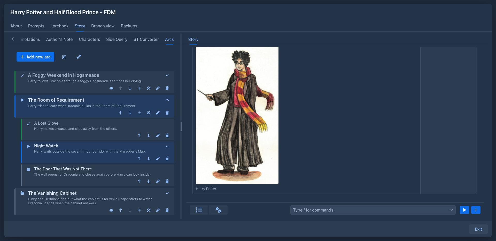
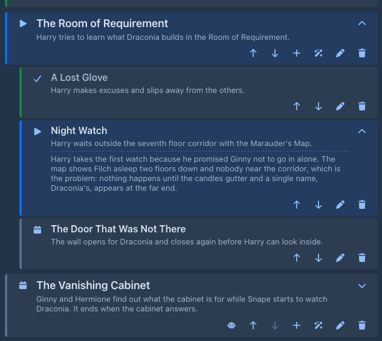
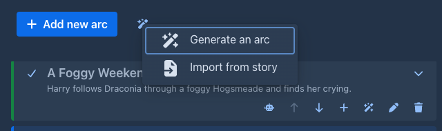
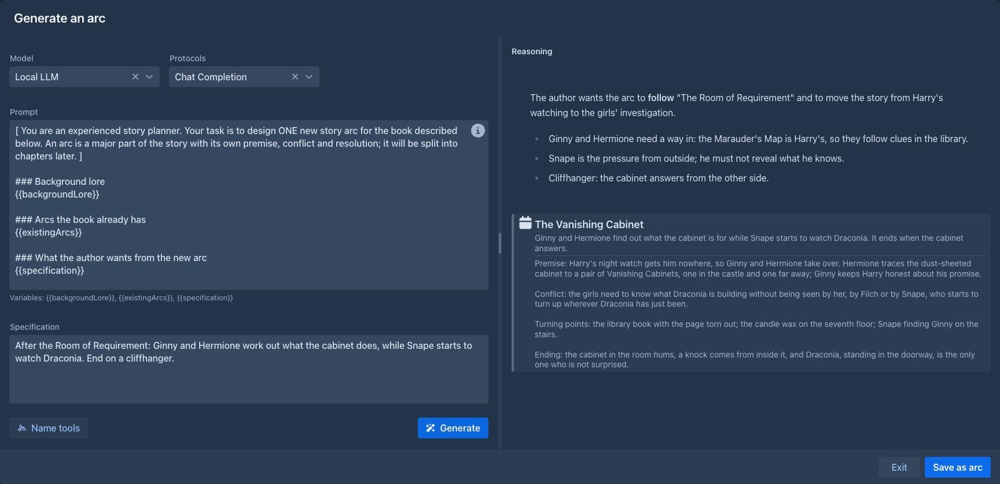
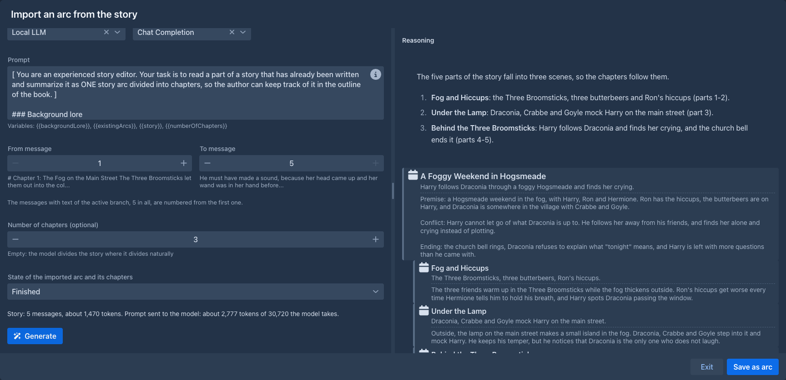
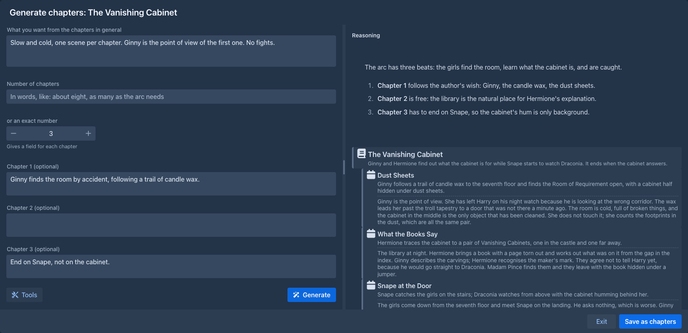
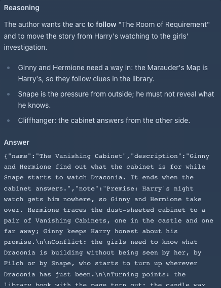

# Arc Outline

The plan of your book in the sidebar: arcs, each split into chapters, with the state of every one of them, and a model
that can write arcs and chapters for you. The outline is not part of the story prompt; the generators and the
[Side Query](side-query.md) can use it when you ask them to.

## The Arcs tab

The left sidebar of the [story editor](../books/story-editor.md) gets an **Arcs** tab next to *Outline*. **Add new
arc** opens the dialog of an arc:

| Field | |
|---|---|
| Title | Required. |
| Description | What happens in it. |
| Note (private) | Notes for yourself. |
| State | **Planned**, **Current** or **Finished**. |

Chapters have the same fields. The list shows every arc as a card with its chapters indented below it. The color of a
card follows its state: grey for planned, blue for the current one, green with a dimmed title for finished ones. The
buttons of a card:

| Button | |
|---|---|
| calendar / play / check | The state; opens a menu to change it. |
| chevron (arcs) | Hides or shows the chapters of the arc. |
| chevron (chapters with a note) | Shows or hides the note of the chapter under its description, so you can read it without opening the dialog. |
| arrows | Move the arc or chapter up or down. |
| plus (arcs) | Adds a chapter at the end of the arc. |
| wand (arcs) | Asks the model to write chapters for the arc, see [below](#generating-chapters). |
| pen | Opens it in the dialog. |
| trash | Deletes it (an arc with all its chapters), after a confirmation. |
| robot (generated arcs and chapters) | Shows what the model wrote, see [below](#generating-an-arc). |

Next to the wand at the top is a pen with a feather: it drafts the instructions of the next turn from the current chapter, see
[below](#drafting-the-instructions-for-the-current-chapter).

### The note of a chapter

A chapter that has a note shows a chevron on the right. It opens the note under the description, in the list, so you can
read the details of a chapter (the ones the model wrote for it, for example) without opening the dialog; press it again to
hide the note. Which notes are open is not saved.

### Moving chapters between arcs

A chapter moved up from the first place of its arc goes to the end of the previous arc; one moved down from the last
place goes to the start of the next arc. Keep pressing the arrow to take a chapter as far as you need.

### Drafting the instructions for the current chapter

The pen with a feather next to *Add new arc* opens the window that lets the model
[draft the instructions](../books/story-editor.md#drafting-the-instructions) of the next turn, with the data of the chapter the
story is at as its **Plan of the Story**. The current chapter is the first chapter marked **Current**; when none is, the first one
that is not **Finished**; an arc marked current that has no chapters yet stands alone. The model gets that arc and chapter with their
descriptions and notes, and the title and description (not the note) of the chapter after it, with the warning that the story must
not get there yet. The window starts with what you typed into *Instructions* of the new turn panel as the guidance; **Use as
Instructions** puts the draft into that panel and opens it. Without a current chapter the button says so.

The same data is a source for the [Side Query](side-query.md), see [below](#the-outline-as-a-source-for-other-extensions).

### Finishing an arc

Marking an arc **Finished** marks all its chapters **Finished** too. Changing an arc to another state leaves its
chapters as they are.

The outline is saved with the book as soon as you change it, so it is included in its backups.

## The outline as a source for other extensions

The outline is offered to other extensions as a source of data about the book: in [Side Query](side-query.md) check
**Arc outline** in the plug popover to send the arcs, their states, descriptions and chapters with your questions. There
are two versions: **Arc outline** is the terse one (descriptions only), **Arc outline (with notes)** adds the note of every
arc and chapter under its description, which is where the details of generated arcs and chapters are. Your private notes
are sent only when you check the second one. A third source, **Arc outline: current chapter**, sends only the arc and the chapter
the story is at (see [Drafting the instructions for the current chapter](#drafting-the-instructions-for-the-current-chapter)).

## Generating an arc

The wand button next to **Add new arc** opens a menu with two items: **Generate an arc** asks the model to write a new arc, **Import from story** summarizes what you have already written, see [below](#importing-an-arc-from-the-story).

 The dialog of **Generate an arc** has two halves.

On the left:

| | |
|---|---|
| Prompt | The instructions for the model, with three variables: `{{backgroundLore}}` (the entries of the book's lorebook and its sub lorebooks), `{{existingArcs}}` (your arcs and chapters, with their states and descriptions, but not your private notes) and `{{specification}}`. It starts as the prompt from *Settings → Extension Settings → Arc Outline* (the default prompt when you have not changed it); what you edit here applies to this generation only. |
| Specification | What you want from the arc: the theme, the characters, where it should lead. Can be empty. |
| Tools | Only when a suite of [tools for the model](tools.md) is installed (names, places): which suites, and which of their categories, the model may use instead of inventing things, the same as in the [Lore Generator](lore-generator.md). |
| Model, Protocols | Start as the model and protocol of the book (your default ones from *Settings* when the book has none). Change them to use another model for this generation only; the choice is not saved. |
| Generate | Starts the model. While it runs the button is a red **Stop** and everything else in the dialog is disabled. |

On the right you see the **reasoning** of the model as it is written and, as soon as the answer begins, the **arc** it
proposes - a name, a terse description and a longer note - shown like an arc of the outline (the note under its
description) and growing as the answer streams in. The description is what the outline shows, so the model is asked to
keep it to a couple of sentences and to put the details into the note, which ends up in the **Note** of the saved arc.
When the
model is done, its answer is checked; if it is not a valid arc (for example the note is missing), the dialog says
so and the arc can't be saved.

**Save as arc** adds the arc at the end of the outline. To try again, press **Generate** once more, with the same or a
changed prompt or specification; the previous answer is replaced.

## Importing an arc from the story

**Import from story** in the menu of the wand asks the model to read a part of your story and write it down as one arc
with its chapters, so you can bring a book you have already written into the outline. The model always reads the
[active branch](../books/branches-and-story-tree.md) of the book, as it is when you open the dialog. The dialog is like
the one for arcs, with these choices on the left:

| | |
|---|---|
| From message, To message | The range of the story to send. The messages of the branch that have text are numbered from 1; at first the whole branch is chosen. Under each field you see the beginning of the message it points to. |
| Number of chapters (optional) | Choose a number to get exactly that many chapters (an answer with another number is rejected), leave it empty to let the model divide the story where it naturally divides. |
| State of the imported arc and its chapters | **Finished** at first, because the story is written; choose **Current** or **Planned** if you need it. |
| Token counter | How many messages the range has and their approximate tokens, and the approximate tokens of the whole prompt (instructions, lore, outline and story) next to what the model takes. It turns into a warning when the prompt does not fit, then choose fewer messages. It follows the range, the number of chapters, the prompt and the model. |
| Prompt | The instructions for the model, with the variables `{{backgroundLore}}`, `{{existingArcs}}`, `{{story}}` (the messages of the range) and `{{numberOfChapters}}`. It starts as the **Story import prompt** of *Settings → Extension Settings → Arc Outline*. |

There are no tools here, the names are in the story. On the right you see the reasoning, then the arc and its
chapters as the model writes them. **Save as arc** adds the arc with its chapters at the end of the outline; every one
of them keeps the reasoning and the answer of the model and has its own robot button. A long story is best imported in
several steps, one arc for each range.

## Generating chapters

The wand button on an arc asks the model to divide that arc into chapters. The dialog is like the one for arcs, with
these choices on the left:

| | |
|---|---|
| What the model knows of the story | **Whole story so far**: the arcs up to this one, with all their chapters. **Arc summaries only**: the same arcs without chapters. **Arc summaries and finished chapters**: the same arcs with only the chapters you marked *Finished*. Arcs after this one are never sent. |
| What you want from the chapters in general | Pace, tone, what must happen. Can be empty. |
| Number of chapters | Write it in words ("about eight") or choose an exact number. A number adds a text area for each chapter where you can say what it should contain; all of them are optional. Using one of the two clears the other. With an exact number, an answer with a different number of chapters is rejected. |
| Prompt | The instructions for the model, with the variables `{{backgroundLore}}`, `{{outline}}`, `{{numberOfChapters}}`, `{{generalSpecification}}` and `{{chapterSpecification}}`. It starts as the **Chapter generation prompt** of *Settings → Extension Settings → Arc Outline*. |

On the right you see the reasoning, then the arc with the chapters it already has, and the new chapters as the model
writes them. **Save as chapters** adds them at the end of the arc, each with a terse description and the details in its note (like arcs). Every new chapter keeps the reasoning and the answer
of the model, and has its own robot button.

An arc or chapter written by the model keeps its **reasoning** and the **answer** it came from. The robot button on it
opens them in a small popover, out of the way.

## Commands

The outline and its generators are also [commands](../commands/index.md), for the command line and for
[agents](../agents.md). They work on the book that is open (an agent: on its working copy), and an open Arcs tab shows
the change at once. Arcs and chapters are given by **number**, as the outline shows them: the first arc is `1`, the first
chapter of an arc is `1` (the numbers change when something before them is added, removed or moved). A command that
changes an arc or a chapter takes only the fields you give it; an empty text clears a description or a note.

| Command | What it does |
|---|---|
| `/get-arc-outline [arc [notes]]` | The arcs with their chapters, states and descriptions as JSON. The private notes only with `notes` `true`; `arc` returns that arc alone. Reads only. |
| `/add-arc title [description [note [state [position]]]]` | Adds an arc, at the end or at `position`. |
| `/update-arc arc [title [description [note [state]]]]` | Changes an arc. `state` is `PLANNED`, `CURRENT` or `FINISHED` (finishing an arc finishes its chapters). |
| `/move-arc arc position` | Moves an arc to the place `position` (1 is the first). |
| `/delete-arc arc` | Deletes an arc with its chapters, after a confirmation. |
| `/add-outline-chapter arc title [description [note [state [position]]]]` | Adds a chapter to an arc. |
| `/update-outline-chapter arc chapter [title [description [note [state]]]]` | Changes a chapter. |
| `/move-outline-chapter arc chapter position [to_arc]` | Moves a chapter inside its arc, or into the arc `to_arc`. |
| `/delete-outline-chapter arc chapter` | Deletes a chapter, after a confirmation. |
| `/generate-arc [specification [save]]` | Asks the model for a new arc, as *Generate an arc* does. |
| `/generate-outline-chapters arc [specification [count [context [save]]]]` | Asks the model for the chapters of an arc, as the wand of the arc does. `count` is an exact number of chapters, `context` is `EVERYTHING` (the default), `ARCS_ONLY` or `ARCS_AND_FINISHED`, as the choice *What the model knows of the story*. |
| `/import-arc-from-story [from [to [count [state [save]]]]]` | Asks the model to summarize the messages `from` to `to` of the active branch (numbered among the messages with text, as in *Import from story*) as an arc with chapters. `state` (default `FINISHED`) is the state of the saved arc and its chapters. |

The three generating commands use the same prompts as the dialogs (your *Extension Settings → Arc Outline*, or the
defaults), the model and protocol of the book (your default model when the book has none) and no tools: a caller that
wants names gets them with the commands of the [Name generator](name-generator.md) or the [Name provider](name-provider.md)
and writes them into the specification. Like the dialogs they save only when asked: with `save` `false` (the default) they
return the arc or the chapters as JSON and store nothing, with `save` `true` they add them to the outline (an arc at the end,
chapters at the end of the arc) and the answer has their numbers. A story that is too long for the model is refused by
`/import-arc-from-story`: choose fewer messages. The generating commands take a while, and stop when the run is stopped.

Adding and changing is not destructive; only the two `delete` commands are, which an agent may be set to ask you about.
