# Audiobook

Turns a book into an audiobook, part by part, with a text-to-speech server: a voice for the narrator and one for each character, kept
with the parts of the book and played in the reader. You can let it run (the model labels who speaks and how, the speech server
reads) for a rough draft, or work on the parts one by one in the **Audiobook studio**, looking at exactly what is sent to the
speech server and changing it by hand, and export the result as mp3 files with chapter marks.

The extension does not make speech itself: it talks to a **Chatterbox-TTS-Server** that you run (see
[Setting up the speech server](audiobook-server.md)). The text of the book is never changed and never sent to anyone but the servers
that you named; the audio is stored in your own installation, as resources linked to the parts.

## What you need

- A speech server and, if it shares the graphics card with your language model, the requests that make room for it and stop it again
  ([Setting up the speech server](audiobook-server.md)).
- Voices: a short **reference clip** (12 to 30 seconds of one person, no music) for every voice you want to clone, or one of the voice
  files the server has. A narrator needs a calm, steady reading voice.
- For a book with several voices, a language model that can label the text. It is the model of the book by default.
- **ffmpeg** is optional. Without it everything works with mp3. With it on the server (it is in the Docker image, and on a desktop it is found on the `PATH` or in the usual
  folders such as `/opt/homebrew/bin`; the variable `MARGINALIA_FFMPEG` names it when it is somewhere else) the export gets the format **m4b**, and an administrator can store the audio as wav.

## The settings

*Settings → Extension Settings → Audiobook Settings* is the panel of your account; save the *Settings* page after changing it.

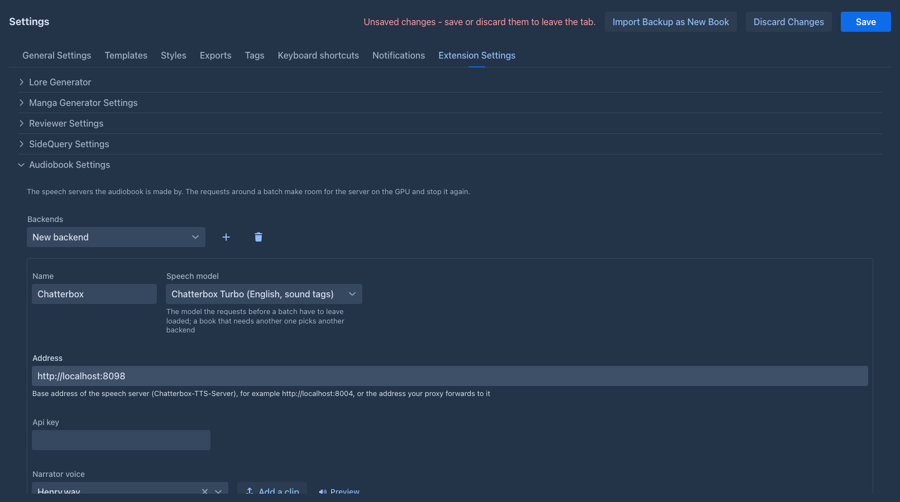

### Backends

A backend is a speech server and the model it speaks with. Add one with **+**.

| Setting | What it does |
|---|---|
| Name | The name shown in the Convert dialog. |
| Address | The base address of the speech server, or of what forwards to it, for example `http://localhost:8004`. |
| Api key | Sent as a bearer token if the server (or your proxy) wants one. It is stored encrypted and not shown again; type a new one to replace it, or **Remove the key**. |
| Speech model | **Chatterbox Turbo** (English, with sound tags such as `[sigh]`, the fastest and the default), **Chatterbox** (English, with an *exaggeration* of the delivery) or **Chatterbox Multilingual** (23 languages). The requests before a batch must leave this model loaded. A book that needs another model uses another backend. |
| GPU (name) | Optional. Servers that share one GPU, also those of the [Image Generator](image-generator.md), get the same name here: their work then waits for each other, and a backend for another model waits for the others to be done. Empty: only batches to this address wait for each other. |
| The server is on this machine or on my network | Allows addresses of the local network. Leave it off for a server in the cloud: it then cannot be made to call your own machine. |
| Timeout of a request | How long to wait for one piece of speech. |
| Restart the server after (pieces) | For a speech server that leaks memory and is killed by the system in a long batch: after this many pieces the requests after the batch and then the requests before it are made again in the middle of the batch (stop, start, load), and the work goes on with a fresh server. 0 (the default) never does it. A server that dies is started again whatever this says, see [Troubleshooting](audiobook-server.md#troubleshooting). |
| Key of the requests around a batch | The key the requests before and after a batch carry as `Authorization: Bearer`. It is stored encrypted and not shown again (**Remove the key** clears it), so it does not have to be written into the headers of each request, where it would be readable. Empty: the *Api key* above is used, which is what you want when one proxy such as LiteLLM serves everything. A request that has an `Authorization` header of its own keeps it. |
| Narrator voice | The narrator of a book that has no cast. A voice file of the server is written `predefined:Henry.wav`. |
| Defaults of a segment | Temperature, CFG weight, speed and chunk size that a piece starts with (the studio can change them for one piece). |
| Before a batch, After a batch | The requests made around a batch of parts: *before* frees the graphics card and starts the speech server, *after* stops it. See [One GPU for the model and the speech](audiobook-server.md#one-gpu-for-the-model-and-the-speech). Empty does nothing. |

**Test connection** does what a batch does: it makes the requests before a batch (so a speech server that is stopped is started), asks the server whether it is there and has a model loaded,
and makes the requests after the batch. Without any requests it only asks.

A book that has pieces in another script (Japanese in an English book) sends them to the multilingual model, if you have a backend
for it, with their language; they stay on the model of the book when you have none.

### Shared speech servers

On an installation with several users the administrator can keep speech servers for everybody, so that one GPU machine is set up once and nobody needs an address or a key. The administrator does it in the same panel (the last sections, seen only by administrators): **Shared speech servers** opens a window with the same fields as a backend of your own, plus who may use it: **all users**, or the users picked in the list. A switch there, **Users may add speech servers of their own**, decides whether the backends below are still allowed.

What you get:

- **Backend in use** at the top of the panel lists the shared servers you may use (marked *(shared)*) and your own. The *Convert to audio* window and the studio use the one you pick; the commands use it too.
- You see only the name of a shared server, never its address, keys or requests. The batches of all users on one server address wait for each other, so two users cannot start the same GPU twice.
- When the administrator takes a server away from you, a job that still names it is refused; pick another one.
- When the administrator turns your own servers off, the panel says so. The ones you added are kept and are used again if the switch is turned back on.
- A shared server's *Narrator voice* should be a voice file of the server (`predefined:Henry.wav`): a reference clip is a resource of one user and cannot be read by the others. Voices of your actors work as always.

### Actors

An **actor** is a voice of yours: a reference clip (one of your audio [resources](../resources.md), or a new one uploaded here) or a
voice file of the server, with voices of its own for a **mood** (a whisper, a shout) or a **language** (a clip that speaks
Japanese). The language wins over the mood, and without a voice for them the voice of the actor reads. Your actors are kept in
your account; any book can give an actor to its narrator and its characters.

**Preview** next to a voice (in the actor, the settings and the cast) has a short sentence spoken with it (in the language of the voice for a language) and plays it, starting the speech server if the requests before a batch do that. The actors are listed by name.

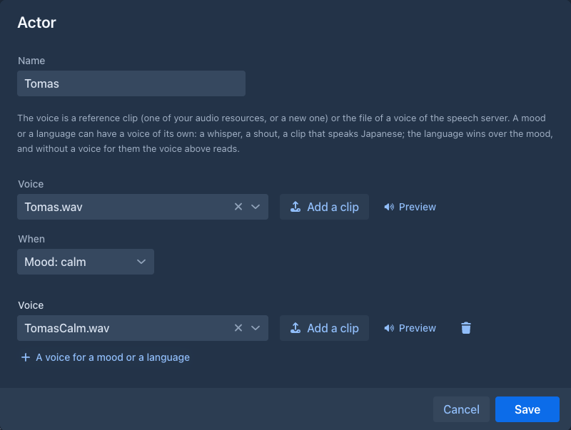

### Converting new parts by itself

*Convert new parts to audio by itself* is the default for all your books; see [Automatic conversion](#automatic-conversion).

## The cast and the pronunciation of a book

Both are kept with the book (they travel in its backup) and are edited from the **Convert to audio** dialog.

**Cast** says who reads: an actor for the **narrator**, one for **other speakers** (whoever the model names that the cast does not
have; empty: the narrator reads) and one for each **character**. A character has a name and other names the text may use for it
(*Tom* for *Tomáš Novák*), separated by commas; a speech is given to the character when its name, one of the other names, or a word of
the name that no other character shares, matches, ignoring the case and the accents. **Add the characters of the book** fills the
list from the point of view and present characters of the parts.

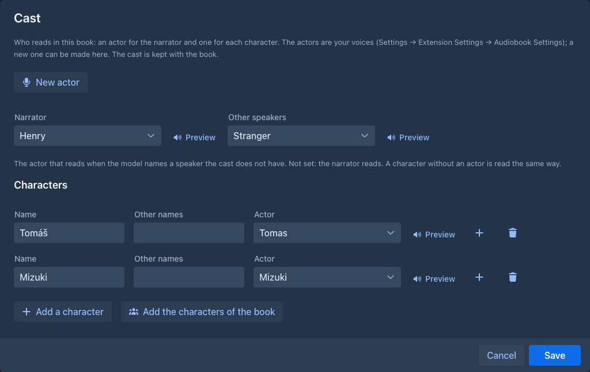

**Pronunciation** is how the text is spelled *for the voice*; the book itself is never changed. The **dictionary** replaces whole
words (the case matters) with what is said for them: a respelling for a name or a word you made up, or a reading in kana for
Japanese. For a book in English the rules also read the other things aloud: numbers, ordinals, years, times, money and
abbreviations as words, a heading that is only a number as *Chapter four. The Arch* (the word before the number is yours), markdown marks
such as `*` are dropped, and a scene break (`***`, `---`) is not read but is a longer pause. Switch the rules off for a book in
another language; the dictionary still applies. **Try a text** shows what a piece of text will be read as. A piece whose spoken text
changes is made again, the others are kept.

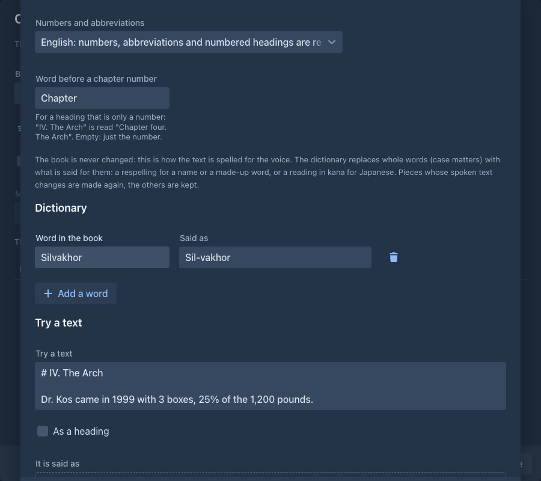

## Converting a book

*Tools menu of the story editor (the cogs button) → **Convert to audio***.

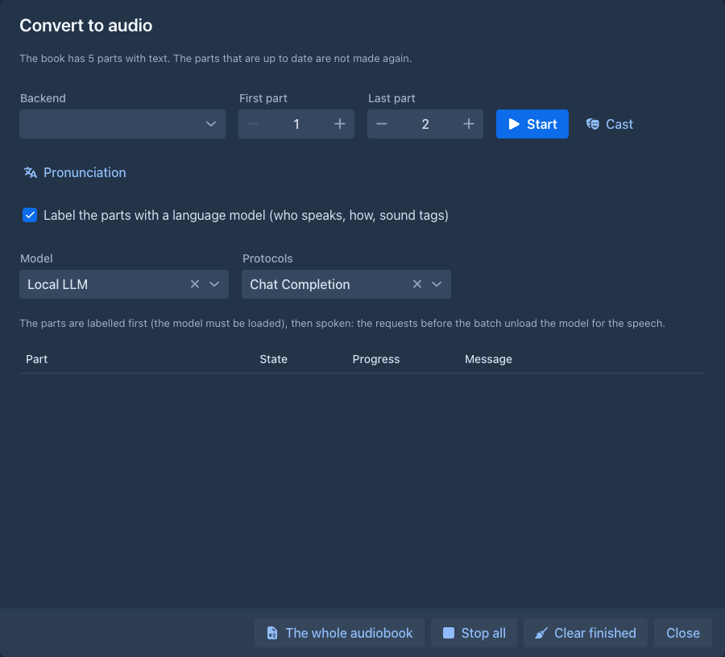

1. Choose the **backend** and press **Load**: the parts with text of the active branch are listed (the first is 1) with what each has:
   *Not generated*, *Labelled* (the model's labels are stored, no audio yet), *Generated* (with a play button and a download) or
   *Generated (the text changed)* (the audio was made from an older text and is made again); *(final)* is added to a part the studio marks final.
2. Leave **Label the parts with a language model** off for the plain version: the narrator reads every paragraph. Turn it on to have
   the model decide who speaks each piece of speech, how (calm, whisper, shout...) and where a sound tag fits, and the cast gives the
   voices. The model of the book is chosen; pick another if you like. The parts are labelled first, then spoken. A part that already has labels for its text is read
   with them also when the box is off (the model is not asked), so running a labelled book again without the box does not turn its dialogue into plain narration; **Remove labels** is how you ask for plain narration or new labels.
3. Tick the parts (the box in the header ticks them all) and **plan** what to do with them; the **Plan** column shows it and nothing is done yet:
   **Generate** (make what is missing; a part that is up to date is not made again), **Regenerate** (delete the audio, remove the labels, generate),
   **Delete audio** (the pieces and the joined audio of the part; the labels stay), **Remove labels** (the model is asked again the next time the part is made),
   **Clear the plan**. Steps add up on a part (Delete audio and Remove labels without Generate only clean up); a part marked final is left out of every plan.
4. **Start** carries the plan out. When it takes audio or labels away it asks first. What is to be generated goes into your queue, which goes on when you close the window
   and when you leave the page; a part that waits or runs in the queue is left out of a plan. The state, the pieces made so far and the message of the job are shown on the part's row.
   While the model labels a part its row says *Labelling pieces 17-32 of 120* (the model is asked about 16 pieces at a time); **click the state** of a part that was labelled to read, for each request, the
   model's reasoning and its answer, as they arrive. They are kept in memory with the job, until the finished jobs are cleared (*Clear finished*) or the application restarts.

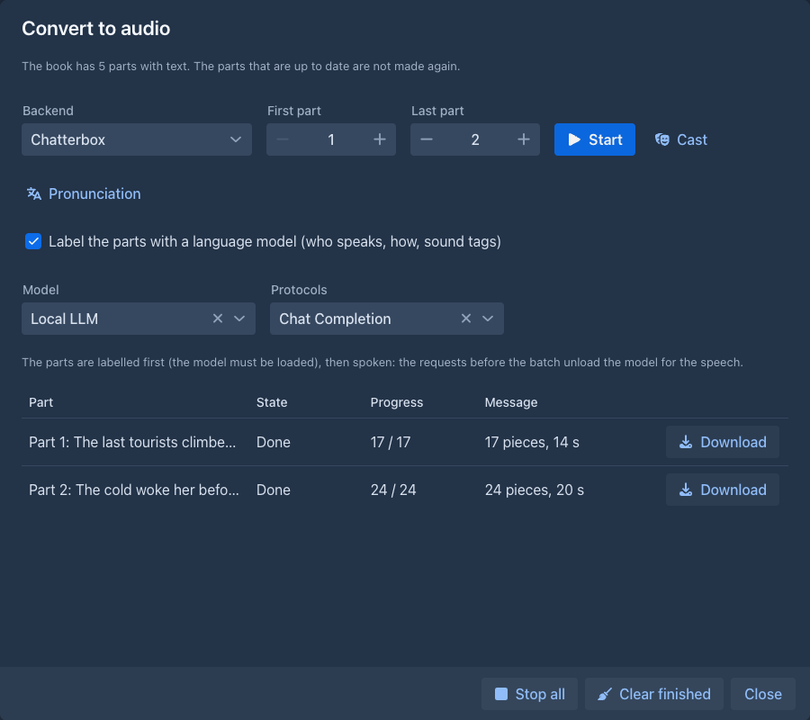

How a part is made, so you know what to expect:

- The text is **split by the program**, never by the model, into pieces of narration and pieces of direct speech (between straight or
  curly double quotation marks or Japanese corner brackets; a heading is narration). The model only *labels* the numbered pieces. A text
  with sound tags is used only when it is the piece with tags added and nothing else changed, so the model can never change your book.
- **Who speaks a piece is the model's call for speech; narration is the narrator's.** A letter, a note, a message or a character's thoughts has no quotation marks, so the
  program calls it narration. Such a piece is read by the character (the voice of the cast) only when it **starts in italics** (`*...*` or `_..._`) and the model names the
  character, from the context (a signature, "the handwriting was unmistakable"). Third person narration, also when it is told from a character's point of view ("She watched as
  Percy crossed the room"), is always the narrator: the program ignores a character the model gives to a piece without italics. Italics for emphasis, sounds or foreign words are
  narration too. The words are always yours.
- **The instruction to the model is a template you can change.** *Settings → Extension Settings → Audiobook Settings → Labelling prompt* is your default; a book (*Prompts* tab →
  *Extension Settings* → *Audiobook*) or a folder can have its own. Empty means the one of the folder above, then yours, then the built-in one. It is written like the other
  [prompts](../books/prompts.md): the variables are `{{characters}}`, `{{deliveries}}`, `{{tags}}` and `{{wordsPerTag}}`, and the hints popover has **Insert Default Template**. A changed
  instruction makes the labels of the parts to be asked again the next time they are made.
- **The loudness of the parts is levelled** when the program ffmpeg is installed (the same one that makes the `.m4b`): the joined audio of every part is brought to one loudness
  (EBU R128, linear, so the dynamics stay; **-18 LUFS** unless you change it in *Settings → Extension Settings → Audiobook Settings*, where you can also turn it off). The pieces
  are kept as the server made them, only the joined part is levelled, so an audiobook does not jump in level from part to part. **Parts that were made before** are not touched until
  you convert them again: that joins them again from the stored pieces and levels them, and asks the speech server for nothing (no unloading of the language model either). Turning the
  levelling off leaves the parts that were levelled as they are. If ffmpeg fails for a part, it keeps its audio as it was and the result says so.
- All the parts of one click are made in **one batch per speech model**: the requests before the batch run once, then all the pieces
  are spoken, then the requests after the batch run once. This is what keeps the graphics card from swapping models for every part.
- Every piece is **kept by its content** (text, voice, model, language, settings, seed). A part that is already up to date costs
  nothing, a changed paragraph is the only piece made again, and a part that failed keeps the pieces already made when you press
  **Retry**.
- The pieces are joined with pauses that depend on where they are (after a heading, between paragraphs, before *he said*) into one mp3 per
  part, kept with the part.
- While a generation of yours runs, the speech waits, so the language model is not unloaded under it.
- A part that you marked **final** in the studio is left alone, and the dialog says how many were.
- **The whole audiobook** joins every part that has up to date audio into one mp3 with a chapter mark for each part and shows a download link under the list (the parts left out are named). The same file is the export format *one mp3 with chapter marks*.
- **Stop all** cancels the waiting parts and stops the running one at once: the request to the language model (the labelling) or to the speech server (the piece being spoken) is dropped, not waited for. A batch stopped before it began does not send the requests before it, so the language model stays loaded. **Download** gives the mp3 of a done part.

## The Audiobook studio

*Tools menu → **Audiobook studio*** (the voice of the selected piece, with a preview, is beside its speaker) is where the final audiobook is made, a part at a time: you see the script, change it, listen to a
piece and make the part.

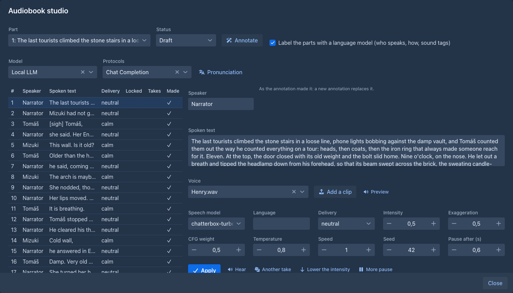

- While the part is being annotated or made, a bar shows that something is going on and the buttons that would start more work wait.
- **Annotate** makes the script of the part (with the language model if you ask for it, else with the narrator) and shows the pieces in a
  table: speaker, delivery, intensity, the spoken text and a mark for a piece you changed. While it runs a **Stop** button appears beside it and ends the request to the language model.
- Select a piece to edit its **speaker**, the **spoken text**, the **delivery**, the **intensity** (the exaggeration of the voice, for the models
  that have one), the **language**, the **seed**, the **pause after** it. **Apply** keeps the change and **locks** the piece: a new annotation leaves a locked piece as it is.
  **Unlock** gives it back to the annotation. *The request the speech server gets* shows the exact request.
- **Hear** makes the audio of a piece (only that piece, the speech server is started for it); **Another take** makes it again with a new
  seed, and the **takes** are kept so you can choose the one you like (*Use this take and hear it*). A good voice is often a matter of
  the seed.
- **Make the part from this script** joins the pieces as they are, with no new annotation.
- The **status** of the part is *draft*, *reviewed* or *final*. A final part is not annotated or converted again, and the export can be
  limited to the parts that are final.

## Exporting

The audiobook is a format of the book's *Export story*: **Audiobook (one mp3 per chapter, in a zip)**, **Audiobook (one mp3 with chapter marks)** and, when ffmpeg is installed, **Audiobook (one m4b with chapters)**. They are made of the audio of the parts that
are up to date: a part that has no audio, or audio older than its text or than its script in the studio, is left out and the window
says which. The mp3 files carry ID3 tags (the title of the book, the chapter, the track), and the single file has
chapter marks that players such as VLC and most audiobook apps show; the zip has a playlist. The check box **Audiobook: only the parts marked final**
limits the export to the parts you finished in the studio.

The **m4b** is the format Apple Books and most phone audiobook apps want: AAC audio (64 kbit/s, enough for speech) in an MP4 container with the chapters, the title, the author and the genre. ffmpeg makes it, so the format is
offered only on a server that has ffmpeg. Audio stored as mp3 is encoded a second time for it; audio stored as wav is encoded once.

### How the audio is stored

An administrator chooses it for the whole installation in *Settings → Extension Settings → Audiobook Settings* (the last section, seen only by administrators):

- **mp3** (default): small, joined without a decoder, no ffmpeg needed. The m4b is a second lossy step.
- **wav**: lossless, about ten times the size (an hour of speech is about 170 MB), needs ffmpeg. The pieces are asked from the speech server as wav and joined as wav; the browser plays it as it is;
  the mp3 and zip exports are encoded by ffmpeg (96 kbit/s) and the m4b is encoded once.

The choice applies to what is made from then on. Parts made before keep their audio and are understood as they are; a part of both kinds (a locked piece of the studio from before) is joined as wav, and an export of
parts of both kinds works, but needs ffmpeg.

An export of the whole book is made from the stored files of the parts into temporary files of the server and downloaded from there, so its
length is not limited by the memory of the application, but the temporary folder needs room for about twice the audio of the book (with wav,
about 350 MB an hour) while it is made.

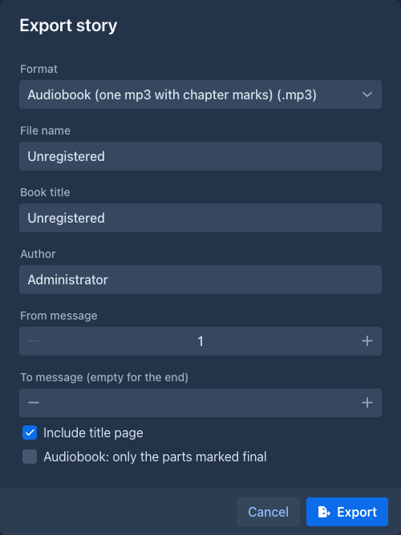

## Automatic conversion

A book can make the audio of a new part by itself, as soon as the part is final: after the automatic annotation, redraft and
translations if the book has them, as the last step of [what follows the part](../books/story-editor.md#what-follows-a-generated-part)
(in the panel of the runs until the audio is made; its **Stop** takes the part out of the queue). It is **off** by default. Choose it in the book's *Prompts* tab under extension
settings, for a folder of books, or for all your books in the audiobook settings; the nearest one wins:

- **No**,
- **Yes: the narrator reads the part**,
- **Yes: labelled by the model of the book, the cast gives the voices**; a book without a model gets the plain narration, and you are told.

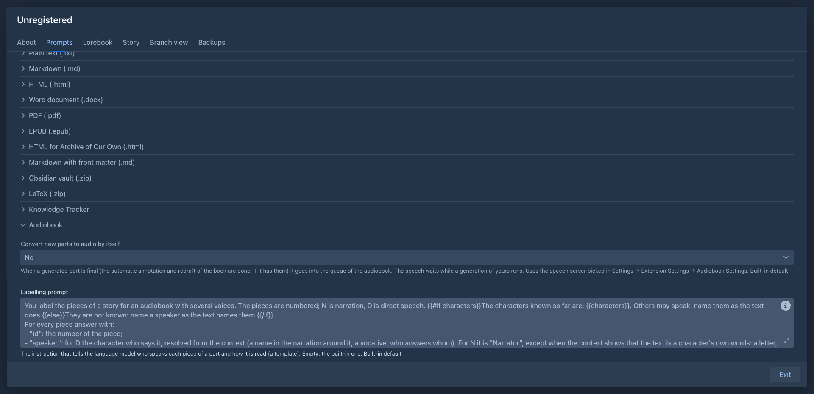

The part goes into your queue, with the cast and the pronunciation of the book. A notice tells you that it is queued and another that its
audio is ready or failed; they show only in the page that started the generation, the job is in the *Convert to audio* window in any case.

## Listening

A published book (or the reader) that has parts with audio gets a player bar: play, pause, stop, the speed, the part that is heard marked in the text. It starts from the selection or
from the first part in view, plays the parts in order and fetches the next one while the current plays, and the device's media controls know the book. Audio made from an older text of a part is
not offered. The audio is served to the owner of the book and, while the book is published, to everybody who can open it; a book that is taken back from publication stops being served at once (at the next part the player loads).

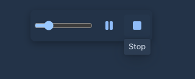

### A part without audio

The player stops at a part that has no audio, so that a part of the story is not skipped, and says so. When the extension [Read Aloud](tts-reader.md) is installed the bar also shows a speaker button, **Read this part (and the next ones without audio) with the voice of the browser**. Nothing is read with a machine voice unless you press it. It then reads that part and the following parts that have no audio with the voice of your device, and when it reaches a part that has audio the player takes over again. Later parts without audio in the same listening are read the same way without asking again; **Stop** silences it, and starting the player anew asks again. The voice, speed and pitch are those of Read Aloud.

## Commands

The same things as [commands](../commands/index.md) (the command line of the story editor, the `command` macro of a template, an agent). Parts are numbered as the Convert dialog
numbers them, or named by their handle.

| Command | What it does |
|---|---|
| `/audiobook-status [from [to]]` | The speech server in use, the way the book converts by itself, how many parts have audio (none, ready, older than the text, older than the script), the status of each listed part in the studio, and the queue. Slow only when the book is long. |
| `/audiobook-convert [from [to [labelling [what [wait]]]]]` | Puts the parts into the queue (the whole book without arguments, one part when only `from` is given). `labelling` `true` uses the model of the book; `what` is `audio` or `script` (only the script for the studio, nothing is spoken). With `wait` `true` the command stays until the jobs are over, shows how far they are and tells how each ended; stopping it cancels the jobs that have not started. |
| `/audiobook-stop` | Cancels the waiting parts; the running one stops after its piece. |
| `/audiobook-set-part-status part status` | `draft`, `reviewed` or `final` in the studio; the part needs a script. |
| `/audiobook-cast` | The narrator, the fallback and the characters of the cast with their actors. |

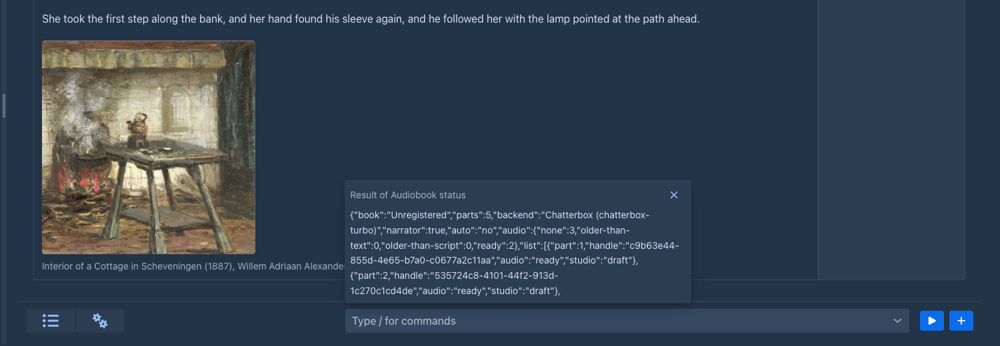

The audio is made for **your** book, not for the hidden working copy of an [agent](../agents.md): an agent can read the cast, and gets a refusal from the other commands, saying that
you have to run them. Run them from the command line, or give an agent the task of preparing the book (annotate, review) and convert it yourself.

## Notifications

When a batch of conversions is over, the browser can tell you ([notifications](../account.md#notifications), so you can leave the tab while the speech server works). In the notification
list of the *Settings* page there are two lines: **Convert to audio** (the batches you start in the dialog or with the command) and **Convert to audio (automatic)** (a new part that was made into audio by itself). A batch you stopped does not notify, a batch with a failed part says it failed.

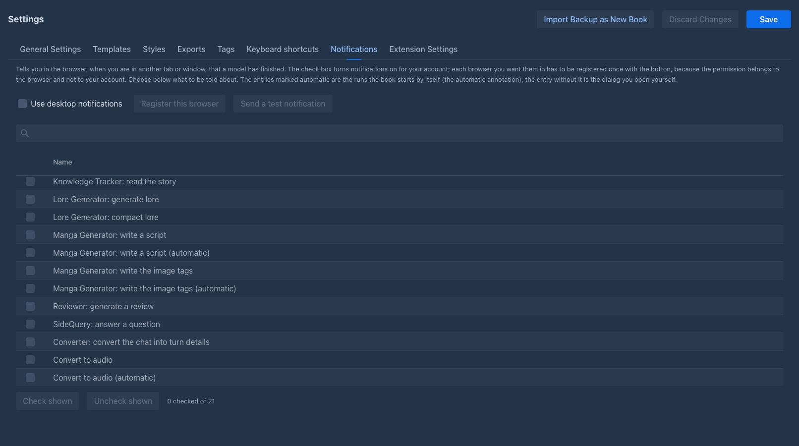

## What it does not do (yet)

- Mp3 and wav only (no opus); the loudness of the pieces is what the voices give.
- No sound effects or ambience.
- One speech engine, Chatterbox. Other engines are the next step.
- The audition of a voice outside a segment.
- The cast is not part of a book's backup of your *actors*: a restored book keeps its cast, but names actors that must exist in your account.
