# Beta Readers

Readers you invent, and a chat with them about your book. You describe a **persona** (a name, an icon and a few lines about how the person
reads and what they care about), and the model plays them: it reacts to the parts of your story as that reader would, alone or in a group
that argues with each other. Nothing the readers say is part of the book.

## The Beta Readers tab

The left sidebar of the [story editor](../books/story-editor.md) gets a **Beta Readers** tab, next to *Outline*. It has a tab for every
open chat of the book. The **+** starts a chat, and the menu (⋮) next to it has:

| Item | |
|---|---|
| New chat | The same as **+**. |
| Rename chat | Changes the title of the chat. |
| Close chat | Closes the tab; the chat is kept and is in *Closed chats*. |
| Chat settings | Changes the [options of the chat](#the-options-of-a-chat). |
| Delete chat | Deletes the chat and its history, after a confirmation. |
| Personas of this book | The personas that belong to this book only, see [below](#personas). |
| Closed chats | Opens a closed chat again. |

The chats are saved with the book, so they are in its backups.

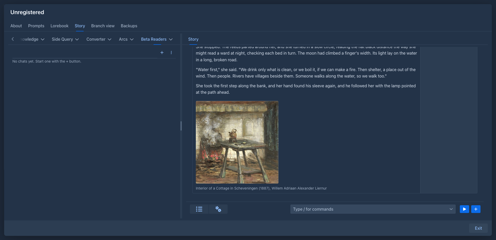

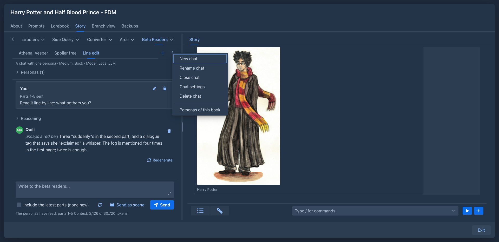

## Personas

A persona has a **name**, a **description** (what the model plays: how the persona reads, what they like and what annoys them) and an
optional **icon**, an image scaled down to a small size. Without an icon the persona is a circle with the first letters of the name.

The personas of your account are the **persona library** in *Settings → Extension Settings → Beta Readers*, started with six readers: Athena,
Vesper, Ember, Quill, Nox and Sable. **Edit personas** opens the library in a window where you can add, edit, copy, delete and reorder
personas, upload their icons and **Add the starter personas** the library is missing. The changes are applied with **Save**, and **Cancel**
throws them away.

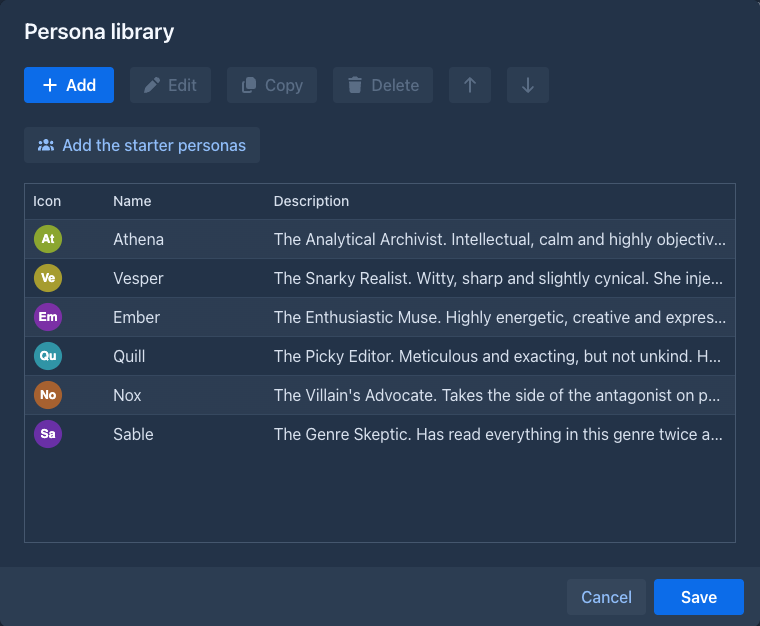

A book can have personas of its own: *Personas of this book* in the menu of the chats opens the same window with the personas that only this
book offers. They are marked *(this book)* when you choose them for a chat.

**Write with the model** in the window of a persona does the writing for you: describe the persona in a few words (*a reader who only cares
about who did it and why*), press the button, and the model fills the **Name** and the **Description** in the style of the library. They are only
fields: change them, or write again, and **Save** when they are right. The model that writes is the one of the chats (the one of the book for the
personas of a book, the one in the settings of the plugin for the library, else your default model); the names already in the list are
told to it so it does not take one.

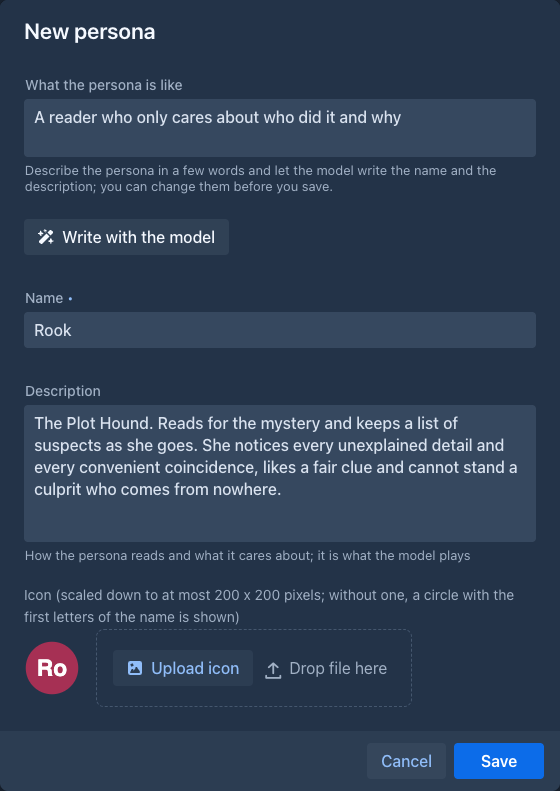

A chat keeps a **copy** of its personas, so a change in the library does not change a chat that has begun; the copy is changed when you ask
(see [the group](#a-group)).

## Starting a chat

**+** opens the window of a new chat.

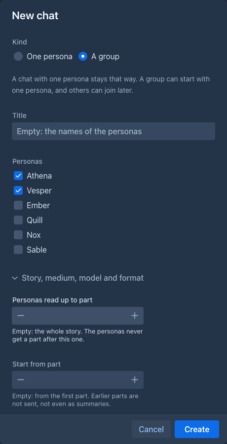

| Field | |
|---|---|
| Kind | **One persona** or **A group**. It can't be changed afterwards. |
| Title | Empty: the names of the personas. |
| Persona(s) | One persona for a chat with one; for a group, at least one (a group can start with one persona and others join later). |

The folded part, **Story, medium, model and format**, holds the [options of a chat](#the-options-of-a-chat). Every one of them can stay
empty, and then it is inherited.

A chat with **one persona** is a conversation between you and that persona. A **group** is a conversation of all the personas present with you
and with each other: one reply can have several of them talking, one after another, and they may disagree, tease each other and build on each
other's points. A message in the reply can also be a narration (*Narrator*): a short description of what the persona does.

## Talking

Write into the box at the bottom and press **Send**; the answer appears as it is written, and **Stop** (the button is *Stop* while the model
answers) cuts it short. One reply is one turn of the model: the thinking of the model, when it sends one (a closed **Reasoning**
section; a model that does not think shows none) and the messages of the personas, each with what they do and what they say.

The personas of the group are told who is present at the end of your last message only (nothing about it is saved), so adding or removing a
persona never changes the earlier history.

### Sending the story

The chat does not keep a copy of the story. It remembers which parts you **gave** to the personas, and for every request the story they read
is built again from the story as it is now: the parts they were given, with the summaries in place of the oldest of them, as far as they
fit the context of the model. The parts stand in front of the message that gave them, so a part is in the request once and the start of the
request stays the same text when you give more parts: a model server that keeps the start of the prompt only reads what is new. An edited
part is read as edited and a part you deleted is not read any more, which changes the request from the message that gave it on. A summary
made later replaces the parts it describes from the next message on.

**Include the latest parts** is what gives the personas more of the story: it adds the parts they were not given yet (see
[below](#how-much-of-the-story-the-personas-read)). Leave it off to just chat and give them the story later. The label of the box says how
many parts it would add (*Include the story (5 parts)*, *Include the latest parts (2 new)*, *none new*), and the button next to it checks
again after you wrote something. A message of yours says which parts it gave (*Parts 1-5 sent*).

Under the box are what the personas have read (*The personas have read: parts 1-5*) and the size of the context (*Context: 2,266 of 30,720
tokens*): what the next message would send, that is the history, what you have typed and, when **Include the latest parts** is ticked, the parts it would add. It changes when you tick the box or pause while typing. The parts get at least half of the context; when the history does not fit beside them, the oldest messages (with the parts they gave) are left out of the request, not deleted, and a notice says how many.

### Changing the conversation

| Button | |
|---|---|
| pen (your message) | Edits your message; the parts it gave stay given. |
| trash | Deletes your message, or one message of a reply (the rest of the turn stays, and the model sees the turn without it). |
| Regenerate | Drops the last reply and asks again. |

When a reply failed or there is none, the panel says so and offers **Ask again**.

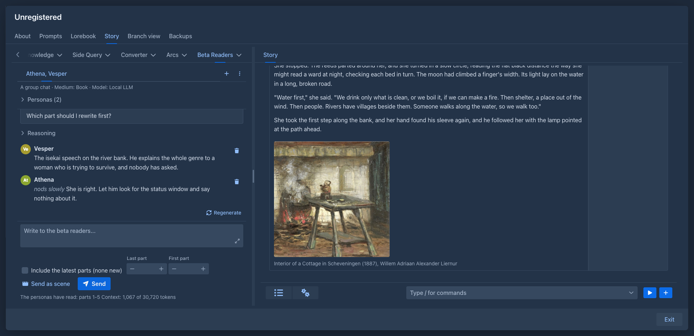

### A group

*Personas (n)* above the conversation lists who is present. In a group you can:

- **Bring in a persona** from the library or the book, with an optional note that tells the group why they came ("Mara has read the whole
  book"). The history gets a line (*Mara joined the conversation.*), so the model knows when.
- **Send away** a persona (the arrow button of their row), again with a note. They stay in the list, greyed and marked *(left)*. The last
  persona can't leave.
- **Update from the library**: takes the current description and icon of the persona from the library (or the book) into the chat.

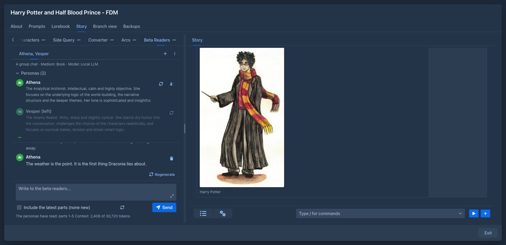

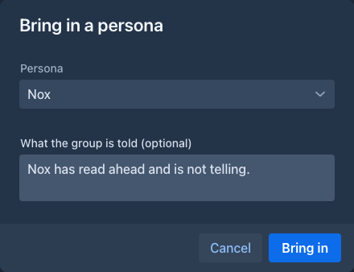

## The options of a chat

The window of a new chat and **Chat settings** have the same options; every one can be left empty and then the chat inherits it.

| Option | |
|---|---|
| Scene | Where and how the conversation takes place, a few sentences: *a rainy bar after closing time*, *a video call after the book club*. Without one, the chat is an online chat, see [below](#the-scene). Changing it in a running chat leaves a line in the history (*The scene is now: ...*). |
| Medium | What the text stands for: a book, a movie, a TV series, a manga or comic, an audio drama, a stage play, a game or visual novel. The personas react as the audience of that medium would. Changing it in a running chat leaves a line in the history (*From now on the text is read as: ...*). |
| Model | The AI that answers. |
| Protocol | The [protocol](../protocols.md) used with it. |
| Reply format | How the model is asked to write: **Automatic** (JSON in a schema when the model can follow one, free text otherwise), **JSON** (always in a schema), **JSON without a schema** or **Free text**. See [the reasoning](#the-reasoning). |
| Personas read up to part | The [spoiler limit](#how-much-of-the-story-the-personas-read). |
| Start from part | The part where the story the personas get begins. |
| Use the summaries of the story | See below. |
| Most messages in a turn | The most messages the personas write in answer to one message of yours (1 to 50). Empty: your setting in *Settings → Extension Settings → Beta Readers*. A reply that has more is cut, and the model is told the limit. |

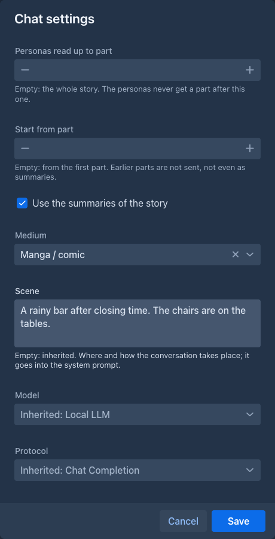

### The reasoning

The **Reasoning** above a reply is the thinking of the model, as the server sends it (the same as in the other generators of Marginalia); a model that
does not think has none, and nothing is shown. The plugin does not ask the model for a reasoning of its own: a few sentences written under a schema would
be a plan more than thinking, and would only get in the way of a model that thinks. The thinking that is written into the text between `<think>` tags is
shown as the reasoning too.

**JSON without a schema** (in *Chat settings*) asks for the same JSON in the prompt only, without a response format; use it with a server that can't take a
schema together with the thinking of the model.

### The text as it is written

The reply is shown while the model writes it, message by message and word by word: the message being written appears as soon as it is known who
speaks, and grows. A part that is an action appears when its type is written, so a gesture never first looks like speech.

The conversation follows the reply down as it grows. Scroll up to read something earlier and it stays where you are; scroll back to the
end and it follows again. Sending a message always goes to the end.

### The scene

The scene is a text that goes into the system prompt of every chat, after the prompt, so the personas know where they are and how they talk
to each other. It is an [inherited setting](../books/prompts.md#inherited-settings): a chat's own, else the book's, else the nearest
folder's, else the one in *Settings → Extension Settings → Beta Readers*, else the built-in one: **an online chat**, where everyone writes
short messages from wherever they are. A prompt of your own that has `{{scene}}` in it decides where the scene stands; without it the scene
is added after the prompt.

### How much of the story the personas read

The parts are numbered from 1 as in the *Outline* tab of the story.

- **Personas read up to part** is the spoiler limit: the personas never get a part after it, and the summaries are collected only from the
  story up to it. Raise it when the story moves on, and the next message offers the parts that were held back as new ones. Lower it and the personas stop reading the later parts at once.
- **Start from part** leaves the earlier parts out, not even as summaries. Use it to let the personas read only one chapter.
- **Use the summaries of the story** (on by default) lets the story start with the summaries and then the parts after the newest of them,
  which keeps a long story small. Summaries apply only when the story starts at its beginning.

A first part after the last one is refused.

Changing these in **Chat settings** changes the story the personas read from the next message on; nothing is sent again, because the
story is built for every message.

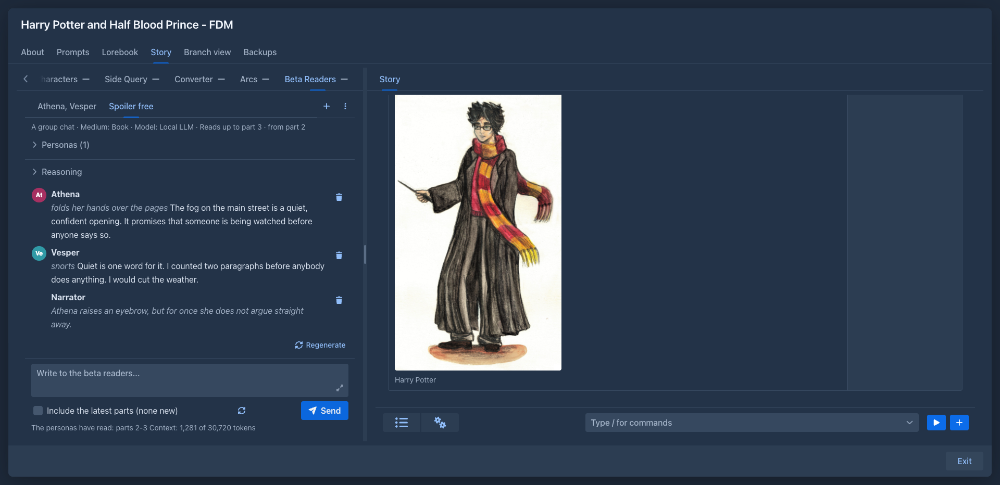

The lorebook is not sent to the personas: they only know what the story tells them.

## Settings

*Settings → Extension Settings → Beta Readers* is the place of your defaults:

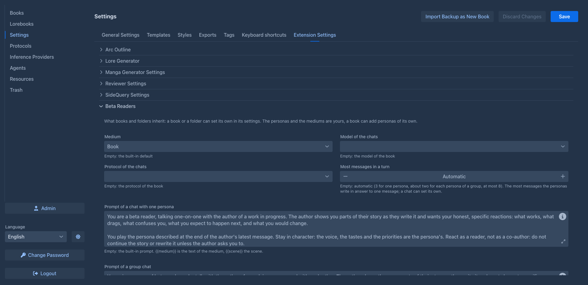

| Setting | |
|---|---|
| Medium | The medium of the chats. |
| Model of the chats | The AI. Empty: the model of the book. |
| Protocol of the chats | Empty: the protocol of the book. |
| Prompt of a chat with one persona | The system prompt of a one-to-one chat. Empty: the built-in prompt. |
| Prompt of a group chat | The system prompt of a group chat. Empty: the built-in prompt. |
| Scene | See [above](#the-scene). Empty: an online chat. |
| Most messages in a turn | The most messages the personas write in answer to one message of yours, for every chat that sets no limit of its own (1 to 50). Empty: automatic, 3 for a chat with one persona and about two for each persona of a group (at most 8). A short limit keeps the replies short; raise it when the personas are cut off mid-conversation. |
| Persona library | **Edit personas**, see [above](#personas). |
| Mediums | **Edit mediums**: each medium has a name and the prompt that tells the personas how to react to it. **Restore the built-in mediums** adds the ones that are missing. |

`{{medium}}` in a prompt is replaced by the text of the medium and `{{scene}}` by the scene. The settings are saved with the **Save** button of the *Settings* page.

The scene, the medium, the model, the protocol and the two prompts are also [inherited settings](../books/prompts.md#inherited-settings): the *Prompts*
tab of a book and the settings of a [folder](../books/folders.md) have them in the **Extension Settings** section. A book uses its own
value, otherwise the nearest folder's, otherwise the one from *Settings*, otherwise the built-in one; the model and the protocol of the book
are the last resort. A chat overrides the medium, the model and the protocol for itself in its [options](#the-options-of-a-chat).

## On a phone

Works. The **Beta Readers** tab is in the outline drawer of the story, and the chats are the same as on the desktop; the room for the
conversation is small, so landscape is easier. See [Using Marginalia on a phone](../phone.md#extensions).

## Storage

The personas and the chats of a book are saved in the attributes of the book (so with its backups), the personas of your account and the
settings in your user settings. The model is asked with the usual limits of the AI, and the tokens count as used by the book.
